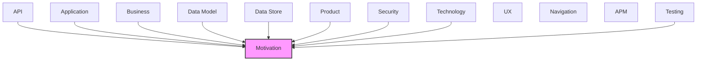

# Motivation

[← Back to README](../README.md)

Goals, requirements, drivers, and strategic outcomes of the architecture.

## Report Index

- [Layer Introduction](#layer-introduction)
- [Intra-Layer Relationships](#intra-layer-relationships)
- [Inter-Layer Dependencies](#inter-layer-dependencies)
- [Inter-Layer Relationships Table](#inter-layer-relationships-table)
- [Element Reference](#element-reference)

## Layer Introduction

| Metric                    | Count |
| ------------------------- | ----- |
| Elements                  | 64    |
| Intra-Layer Relationships | 77    |
| Inter-Layer Relationships | 149   |
| Inbound Relationships     | 149   |
| Outbound Relationships    | 0     |

**Cross-Layer References**:

- **Upstream layers**: [API](./07-api-layer-report.md), [Application](./05-application-layer-report.md), [Business](./02-business-layer-report.md), [Data Model](./08-data-model-layer-report.md), [Data Store](./09-data-store-layer-report.md), [Product](./03-product-layer-report.md), [Security](./04-security-layer-report.md), [Technology](./06-technology-layer-report.md), [Testing](./13-testing-layer-report.md)

## Intra-Layer Relationships

*This layer has >30 elements. Summary table shown instead of diagram.*

| Element                                                                                      | Type          | Relationships |
| -------------------------------------------------------------------------------------------- | ------------- | ------------- |
| `motivation.assessment.benchmark-gold-is-thin-and-mostly-model-made`                         | `assessment`  | 3             |
| `motivation.assessment.relationship-extraction-is-unsolved`                                  | `assessment`  | 2             |
| `motivation.assessment.security-posture-assessment`                                          | `assessment`  | 3             |
| `motivation.assessment.splits-and-retypes-are-half-of-reviewer-changes`                      | `assessment`  | 2             |
| `motivation.constraint.configuration-only-through-the-config-file`                           | `constraint`  | 1             |
| `motivation.constraint.external-llm-provider-required`                                       | `constraint`  | 1             |
| `motivation.constraint.external-reference-source-rate-limits`                                | `constraint`  | 0             |
| `motivation.constraint.loopback-only-deployment`                                             | `constraint`  | 3             |
| `motivation.constraint.no-backwards-compatibility-with-legacy-server`                        | `constraint`  | 1             |
| `motivation.constraint.python-and-nodejs-runtime-versions`                                   | `constraint`  | 1             |
| `motivation.constraint.sqlite-only-persistence`                                              | `constraint`  | 1             |
| `motivation.driver.agents-invent-vocabulary`                                                 | `driver`      | 2             |
| `motivation.driver.client-ontologies-refined-by-hand`                                        | `driver`      | 3             |
| `motivation.driver.review-is-the-normal-workflow`                                            | `driver`      | 6             |
| `motivation.driver.unauthenticated-local-workspace-api`                                      | `driver`      | 2             |
| `motivation.goal.agents-ground-on-the-curated-model`                                         | `goal`        | 5             |
| `motivation.goal.every-decision-becomes-data`                                                | `goal`        | 3             |
| `motivation.goal.ontology-workbench-for-client-projects`                                     | `goal`        | 11            |
| `motivation.goal.packaged-desktop-application`                                               | `goal`        | 3             |
| `motivation.goal.safe-local-first-workspace`                                                 | `goal`        | 7             |
| `motivation.goal.trustworthy-extraction-into-datasets`                                       | `goal`        | 8             |
| `motivation.meaning.knowledge-as-infrastructure`                                             | `meaning`     | 3             |
| `motivation.outcome.agents-use-the-curated-vocabulary`                                       | `outcome`     | 3             |
| `motivation.outcome.client-changes-land-without-hand-edited-specs`                           | `outcome`     | 5             |
| `motivation.outcome.curated-domain-ontology`                                                 | `outcome`     | 3             |
| `motivation.outcome.extraction-proposals-worth-a-reviewers-time`                             | `outcome`     | 6             |
| `motivation.principle.agents-propose-and-people-decide`                                      | `principle`   | 6             |
| `motivation.principle.clients-drive-proposals`                                               | `principle`   | 2             |
| `motivation.principle.hexagonal-domain-purity`                                               | `principle`   | 3             |
| `motivation.principle.intent-travels-with-every-call`                                        | `principle`   | 1             |
| `motivation.principle.keep-several-implementations-and-garden-them`                          | `principle`   | 3             |
| `motivation.principle.one-tool-registry-for-every-face`                                      | `principle`   | 1             |
| `motivation.principle.the-repo-releases-and-context-studio-refines`                          | `principle`   | 1             |
| `motivation.requirement.a-review-only-proposal-is-never-auto-applied`                        | `requirement` | 1             |
| `motivation.requirement.agent-file-sources-limited-to-allowed-roots`                         | `requirement` | 1             |
| `motivation.requirement.an-operation-without-a-probability-never-meets-the-probability-rule` | `requirement` | 1             |
| `motivation.requirement.breaking-changes-never-auto-apply`                                   | `requirement` | 1             |
| `motivation.requirement.contexts-depend-on-each-other-only-through-public-contracts`         | `requirement` | 1             |
| `motivation.requirement.dev-server-not-reachable-from-the-lan`                               | `requirement` | 3             |
| `motivation.requirement.every-applied-proposal-is-revertible`                                | `requirement` | 1             |
| `motivation.requirement.extracted-facts-cite-their-source`                                   | `requirement` | 2             |
| `motivation.requirement.individuals-belong-to-one-dataset`                                   | `requirement` | 1             |
| `motivation.requirement.local-api-refuses-foreign-origins`                                   | `requirement` | 1             |
| `motivation.requirement.mcp-requires-a-bearer-token-on-loopback`                             | `requirement` | 2             |
| `motivation.requirement.mirrored-taxonomies-accept-schema-changes-only-from-their-client`    | `requirement` | 2             |
| `motivation.requirement.one-unexportable-operation-never-blocks-a-dr-spec-export`            | `requirement` | 1             |
| `motivation.requirement.one-way-to-select-a-pipeline`                                        | `requirement` | 1             |
| `motivation.requirement.pre-review-is-adopted-only-by-a-rule-set-in-advance`                 | `requirement` | 2             |
| `motivation.requirement.proposals-record-their-pipeline-and-version`                         | `requirement` | 1             |
| `motivation.requirement.relationships-limited-to-allowed-types`                              | `requirement` | 1             |
| `motivation.requirement.secrets-stay-in-the-configuration-file`                              | `requirement` | 2             |
| `motivation.requirement.the-proposals-list-filters-in-the-query-and-has-a-summary-form`      | `requirement` | 0             |
| `motivation.requirement.unlanded-lists-only-proposals-with-something-to-land`                | `requirement` | 1             |
| `motivation.requirement.url-sources-refuse-private-network-addresses`                        | `requirement` | 2             |
| `motivation.stakeholder.agent-claude-code-and-in-app-chat`                                   | `stakeholder` | 3             |
| `motivation.stakeholder.desktop-application-user`                                            | `stakeholder` | 1             |
| `motivation.stakeholder.documentation-robotics-project`                                      | `stakeholder` | 3             |
| `motivation.stakeholder.house-project`                                                       | `stakeholder` | 3             |
| `motivation.stakeholder.ontology-owner-and-reviewer`                                         | `stakeholder` | 4             |
| `motivation.stakeholder.platform-developer`                                                  | `stakeholder` | 2             |
| `motivation.value.every-fact-is-traceable`                                                   | `value`       | 1             |
| `motivation.value.knowledge-reusability`                                                     | `value`       | 2             |
| `motivation.value.reduced-manual-curation-effort`                                            | `value`       | 1             |
| `motivation.value.reviewer-time-goes-to-judgment-calls`                                      | `value`       | 1             |

## Inter-Layer Dependencies

## Inter-Layer Relationships Table

| Relationship ID                                                    | Source Node                                                                                        | Dest Node                                                                                    | Dest Layer   | Predicate    | Cardinality  | Strength |
| ------------------------------------------------------------------ | -------------------------------------------------------------------------------------------------- | -------------------------------------------------------------------------------------------- | ------------ | ------------ | ------------ | -------- |
| `api.operation.satisfies.motivation.requirement`                   | `api.operation.get-individual-sources`                                                             | `motivation.requirement.extracted-facts-cite-their-source`                                   | `motivation` | `satisfies`  | many-to-many | medium   |
| `api.operation.satisfies.motivation.requirement`                   | `api.operation.list-proposals`                                                                     | `motivation.requirement.the-proposals-list-filters-in-the-query-and-has-a-summary-form`      | `motivation` | `satisfies`  | many-to-many | medium   |
| `api.operation.satisfies.motivation.requirement`                   | `api.operation.list-proposals`                                                                     | `motivation.requirement.unlanded-lists-only-proposals-with-something-to-land`                | `motivation` | `satisfies`  | many-to-many | medium   |
| `api.operation.satisfies.motivation.requirement`                   | `api.operation.revert-proposal`                                                                    | `motivation.requirement.every-applied-proposal-is-revertible`                                | `motivation` | `satisfies`  | many-to-many | medium   |
| `api.operation.satisfies.motivation.requirement`                   | `api.operation.set-approval-policy`                                                                | `motivation.requirement.breaking-changes-never-auto-apply`                                   | `motivation` | `satisfies`  | many-to-many | medium   |
| `api.ratelimit.satisfies.motivation.constraint`                    | `api.ratelimit.external-reference-api-rate-limit`                                                  | `motivation.constraint.external-reference-source-rate-limits`                                | `motivation` | `satisfies`  | many-to-many | medium   |
| `api.securityscheme.satisfies.motivation.requirement`              | `api.securityscheme.mcp-bearer-token`                                                              | `motivation.requirement.mcp-requires-a-bearer-token-on-loopback`                             | `motivation` | `satisfies`  | many-to-many | medium   |
| `application.applicationfunction.satisfies.motivation.requirement` | `application.applicationfunction.domain-import-check`                                              | `motivation.requirement.contexts-depend-on-each-other-only-through-public-contracts`         | `motivation` | `satisfies`  | many-to-many | medium   |
| `application.applicationfunction.satisfies.motivation.requirement` | `application.applicationfunction.in-use-inspection`                                                | `motivation.requirement.breaking-changes-never-auto-apply`                                   | `motivation` | `satisfies`  | many-to-many | medium   |
| `application.applicationfunction.satisfies.motivation.requirement` | `application.applicationfunction.individual-extraction-apply`                                      | `motivation.requirement.individuals-belong-to-one-dataset`                                   | `motivation` | `satisfies`  | many-to-many | medium   |
| `application.applicationfunction.satisfies.motivation.requirement` | `application.applicationfunction.spec-changes-for-a-proposal`                                      | `motivation.requirement.one-unexportable-operation-never-blocks-a-dr-spec-export`            | `motivation` | `satisfies`  | many-to-many | medium   |
| `application.applicationservice.satisfies.motivation.requirement`  | `application.applicationservice.approval-policy-service`                                           | `motivation.requirement.an-operation-without-a-probability-never-meets-the-probability-rule` | `motivation` | `satisfies`  | many-to-many | medium   |
| `application.applicationservice.satisfies.motivation.requirement`  | `application.applicationservice.approval-policy-service`                                           | `motivation.requirement.breaking-changes-never-auto-apply`                                   | `motivation` | `satisfies`  | many-to-many | medium   |
| `application.applicationservice.satisfies.motivation.requirement`  | `application.applicationservice.change-proposal-repository`                                        | `motivation.requirement.the-proposals-list-filters-in-the-query-and-has-a-summary-form`      | `motivation` | `satisfies`  | many-to-many | medium   |
| `application.applicationservice.satisfies.motivation.requirement`  | `application.applicationservice.change-proposal-repository`                                        | `motivation.requirement.unlanded-lists-only-proposals-with-something-to-land`                | `motivation` | `satisfies`  | many-to-many | medium   |
| `application.applicationservice.satisfies.motivation.requirement`  | `application.applicationservice.change-record-port`                                                | `motivation.requirement.every-applied-proposal-is-revertible`                                | `motivation` | `satisfies`  | many-to-many | medium   |
| `application.applicationservice.satisfies.motivation.requirement`  | `application.applicationservice.drift-import-service`                                              | `motivation.requirement.mirrored-taxonomies-accept-schema-changes-only-from-their-client`    | `motivation` | `satisfies`  | many-to-many | medium   |
| `application.applicationservice.satisfies.motivation.requirement`  | `application.applicationservice.extraction-service`                                                | `motivation.requirement.contexts-depend-on-each-other-only-through-public-contracts`         | `motivation` | `satisfies`  | many-to-many | medium   |
| `application.applicationservice.satisfies.motivation.requirement`  | `application.applicationservice.import-run-service`                                                | `motivation.requirement.contexts-depend-on-each-other-only-through-public-contracts`         | `motivation` | `satisfies`  | many-to-many | medium   |
| `application.applicationservice.satisfies.motivation.requirement`  | `application.applicationservice.ontology-service`                                                  | `motivation.requirement.individuals-belong-to-one-dataset`                                   | `motivation` | `satisfies`  | many-to-many | medium   |
| `application.applicationservice.satisfies.motivation.requirement`  | `application.applicationservice.ontology-service`                                                  | `motivation.requirement.relationships-limited-to-allowed-types`                              | `motivation` | `satisfies`  | many-to-many | medium   |
| `application.applicationservice.satisfies.motivation.requirement`  | `application.applicationservice.pipeline-selection-service`                                        | `motivation.requirement.one-way-to-select-a-pipeline`                                        | `motivation` | `satisfies`  | many-to-many | medium   |
| `application.applicationservice.satisfies.motivation.requirement`  | `application.applicationservice.proposal-apply-rules`                                              | `motivation.requirement.mirrored-taxonomies-accept-schema-changes-only-from-their-client`    | `motivation` | `satisfies`  | many-to-many | medium   |
| `application.applicationservice.satisfies.motivation.requirement`  | `application.applicationservice.proposal-apply-rules`                                              | `motivation.requirement.relationships-limited-to-allowed-types`                              | `motivation` | `satisfies`  | many-to-many | medium   |
| `application.applicationservice.satisfies.motivation.requirement`  | `application.applicationservice.proposal-service`                                                  | `motivation.requirement.a-review-only-proposal-is-never-auto-applied`                        | `motivation` | `satisfies`  | many-to-many | medium   |
| `application.applicationservice.satisfies.motivation.requirement`  | `application.applicationservice.proposal-service`                                                  | `motivation.requirement.mirrored-taxonomies-accept-schema-changes-only-from-their-client`    | `motivation` | `satisfies`  | many-to-many | medium   |
| `application.applicationservice.satisfies.motivation.requirement`  | `application.applicationservice.revert-service`                                                    | `motivation.requirement.every-applied-proposal-is-revertible`                                | `motivation` | `satisfies`  | many-to-many | medium   |
| `application.applicationservice.satisfies.motivation.requirement`  | `application.applicationservice.source-extraction-service`                                         | `motivation.requirement.extracted-facts-cite-their-source`                                   | `motivation` | `satisfies`  | many-to-many | medium   |
| `application.applicationservice.satisfies.motivation.requirement`  | `application.applicationservice.source-extraction-service`                                         | `motivation.requirement.proposals-record-their-pipeline-and-version`                         | `motivation` | `satisfies`  | many-to-many | medium   |
| `application.applicationservice.satisfies.motivation.requirement`  | `application.applicationservice.source-file-store`                                                 | `motivation.requirement.extracted-facts-cite-their-source`                                   | `motivation` | `satisfies`  | many-to-many | medium   |
| `business.businessactor.references.motivation.stakeholder`         | `business.businessactor.documentation-robotics-project`                                            | `motivation.stakeholder.documentation-robotics-project`                                      | `motivation` | `references` | many-to-many | medium   |
| `business.businessactor.references.motivation.stakeholder`         | `business.businessactor.house-project`                                                             | `motivation.stakeholder.house-project`                                                       | `motivation` | `references` | many-to-many | medium   |
| `business.businessactor.references.motivation.stakeholder`         | `business.businessactor.ontology-maintainer`                                                       | `motivation.stakeholder.ontology-owner-and-reviewer`                                         | `motivation` | `references` | many-to-many | medium   |
| `business.businessprocess.realizes.motivation.outcome`             | `business.businessprocess.client-round-trip`                                                       | `motivation.outcome.client-changes-land-without-hand-edited-specs`                           | `motivation` | `realizes`   | many-to-many | medium   |
| `business.businessprocess.realizes.motivation.outcome`             | `business.businessprocess.extract-a-source-into-a-dataset`                                         | `motivation.outcome.extraction-proposals-worth-a-reviewers-time`                             | `motivation` | `realizes`   | many-to-many | medium   |
| `business.businessprocess.satisfies.motivation.requirement`        | `business.businessprocess.extract-a-source-into-a-dataset`                                         | `motivation.requirement.individuals-belong-to-one-dataset`                                   | `motivation` | `satisfies`  | many-to-many | medium   |
| `business.businessrole.references.motivation.stakeholder`          | `business.businessrole.client-lander`                                                              | `motivation.stakeholder.documentation-robotics-project`                                      | `motivation` | `references` | many-to-many | medium   |
| `business.businessrole.references.motivation.stakeholder`          | `business.businessrole.client-lander`                                                              | `motivation.stakeholder.house-project`                                                       | `motivation` | `references` | many-to-many | medium   |
| `business.businessrole.references.motivation.stakeholder`          | `business.businessrole.proposer`                                                                   | `motivation.stakeholder.agent-claude-code-and-in-app-chat`                                   | `motivation` | `references` | many-to-many | medium   |
| `business.businessrole.references.motivation.stakeholder`          | `business.businessrole.reviewer`                                                                   | `motivation.stakeholder.ontology-owner-and-reviewer`                                         | `motivation` | `references` | many-to-many | medium   |
| `business.businessservice.delivers.motivation.value`               | `business.businessservice.agent-context-service`                                                   | `motivation.value.knowledge-reusability`                                                     | `motivation` | `delivers`   | many-to-many | medium   |
| `business.businessservice.realizes.motivation.goal`                | `business.businessservice.agent-context-service`                                                   | `motivation.goal.agents-ground-on-the-curated-model`                                         | `motivation` | `realizes`   | many-to-many | medium   |
| `business.businessservice.realizes.motivation.outcome`             | `business.businessservice.client-interchange-service`                                              | `motivation.outcome.client-changes-land-without-hand-edited-specs`                           | `motivation` | `realizes`   | many-to-many | medium   |
| `business.businessservice.satisfies.motivation.requirement`        | `business.businessservice.client-interchange-service`                                              | `motivation.requirement.mirrored-taxonomies-accept-schema-changes-only-from-their-client`    | `motivation` | `satisfies`  | many-to-many | medium   |
| `business.businessservice.realizes.motivation.goal`                | `business.businessservice.pipeline-benchmarking-service`                                           | `motivation.goal.every-decision-becomes-data`                                                | `motivation` | `realizes`   | many-to-many | medium   |
| `business.businessservice.delivers.motivation.value`               | `business.businessservice.proposal-adjudication-service`                                           | `motivation.value.reduced-manual-curation-effort`                                            | `motivation` | `delivers`   | many-to-many | medium   |
| `business.businessservice.delivers.motivation.value`               | `business.businessservice.proposal-adjudication-service`                                           | `motivation.value.reviewer-time-goes-to-judgment-calls`                                      | `motivation` | `delivers`   | many-to-many | medium   |
| `business.businessservice.realizes.motivation.goal`                | `business.businessservice.proposal-adjudication-service`                                           | `motivation.goal.ontology-workbench-for-client-projects`                                     | `motivation` | `realizes`   | many-to-many | medium   |
| `business.businessservice.satisfies.motivation.requirement`        | `business.businessservice.proposal-adjudication-service`                                           | `motivation.requirement.breaking-changes-never-auto-apply`                                   | `motivation` | `satisfies`  | many-to-many | medium   |
| `business.businessservice.satisfies.motivation.requirement`        | `business.businessservice.proposal-adjudication-service`                                           | `motivation.requirement.every-applied-proposal-is-revertible`                                | `motivation` | `satisfies`  | many-to-many | medium   |
| `business.businessservice.delivers.motivation.value`               | `business.businessservice.source-extraction-service`                                               | `motivation.value.every-fact-is-traceable`                                                   | `motivation` | `delivers`   | many-to-many | medium   |
| `business.businessservice.realizes.motivation.goal`                | `business.businessservice.source-extraction-service`                                               | `motivation.goal.trustworthy-extraction-into-datasets`                                       | `motivation` | `realizes`   | many-to-many | medium   |
| `business.businessservice.satisfies.motivation.requirement`        | `business.businessservice.source-extraction-service`                                               | `motivation.requirement.extracted-facts-cite-their-source`                                   | `motivation` | `satisfies`  | many-to-many | medium   |
| `business.businessservice.satisfies.motivation.requirement`        | `business.businessservice.source-extraction-service`                                               | `motivation.requirement.relationships-limited-to-allowed-types`                              | `motivation` | `satisfies`  | many-to-many | medium   |
| `data-model.objectschema.satisfies.motivation.requirement`         | `data-model.objectschema.operation-draft`                                                          | `motivation.requirement.contexts-depend-on-each-other-only-through-public-contracts`         | `motivation` | `satisfies`  | many-to-many | medium   |
| `data-model.objectschema.satisfies.motivation.requirement`         | `data-model.objectschema.predicate-entity`                                                         | `motivation.requirement.relationships-limited-to-allowed-types`                              | `motivation` | `satisfies`  | many-to-many | medium   |
| `data-store.collection.satisfies.motivation.requirement`           | `data-store.collection.approval-policies`                                                          | `motivation.requirement.breaking-changes-never-auto-apply`                                   | `motivation` | `satisfies`  | many-to-many | medium   |
| `data-store.collection.satisfies.motivation.requirement`           | `data-store.collection.change-events`                                                              | `motivation.requirement.every-applied-proposal-is-revertible`                                | `motivation` | `satisfies`  | many-to-many | medium   |
| `data-store.collection.satisfies.motivation.requirement`           | `data-store.collection.datasets`                                                                   | `motivation.requirement.individuals-belong-to-one-dataset`                                   | `motivation` | `satisfies`  | many-to-many | medium   |
| `data-store.collection.satisfies.motivation.requirement`           | `data-store.collection.entity-sources`                                                             | `motivation.requirement.extracted-facts-cite-their-source`                                   | `motivation` | `satisfies`  | many-to-many | medium   |
| `data-store.collection.satisfies.motivation.requirement`           | `data-store.collection.predicates`                                                                 | `motivation.requirement.relationships-limited-to-allowed-types`                              | `motivation` | `satisfies`  | many-to-many | medium   |
| `data-store.collection.satisfies.motivation.requirement`           | `data-store.collection.proposals-table`                                                            | `motivation.requirement.proposals-record-their-pipeline-and-version`                         | `motivation` | `satisfies`  | many-to-many | medium   |
| `data-store.database.satisfies.motivation.constraint`              | `data-store.database.localdb`                                                                      | `motivation.constraint.sqlite-only-persistence`                                              | `motivation` | `satisfies`  | many-to-many | medium   |
| `data-store.database.satisfies.motivation.constraint`              | `data-store.database.operationsdb`                                                                 | `motivation.constraint.sqlite-only-persistence`                                              | `motivation` | `satisfies`  | many-to-many | medium   |
| `data-store.database.satisfies.motivation.constraint`              | `data-store.database.reference-api-cachedb`                                                        | `motivation.constraint.sqlite-only-persistence`                                              | `motivation` | `satisfies`  | many-to-many | medium   |
| `data-store.database.satisfies.motivation.constraint`              | `data-store.database.referencedb`                                                                  | `motivation.constraint.sqlite-only-persistence`                                              | `motivation` | `satisfies`  | many-to-many | medium   |
| `data-store.retentionpolicy.satisfies.motivation.constraint`       | `data-store.retentionpolicy.reference-api-cache-cleanup`                                           | `motivation.constraint.external-reference-source-rate-limits`                                | `motivation` | `satisfies`  | many-to-many | medium   |
| `data-store.validationrule.satisfies.motivation.requirement`       | `data-store.validationrule.uk-dataset-taxonomy-identifier`                                         | `motivation.requirement.individuals-belong-to-one-dataset`                                   | `motivation` | `satisfies`  | many-to-many | medium   |
| `data-store.validationrule.satisfies.motivation.requirement`       | `data-store.validationrule.uk-relationship-triple`                                                 | `motivation.requirement.relationships-limited-to-allowed-types`                              | `motivation` | `satisfies`  | many-to-many | medium   |
| `product.feature.satisfies.motivation.requirement`                 | `product.feature.approval-policy`                                                                  | `motivation.requirement.a-review-only-proposal-is-never-auto-applied`                        | `motivation` | `satisfies`  | many-to-many | medium   |
| `product.feature.satisfies.motivation.requirement`                 | `product.feature.approval-policy`                                                                  | `motivation.requirement.an-operation-without-a-probability-never-meets-the-probability-rule` | `motivation` | `satisfies`  | many-to-many | medium   |
| `product.feature.satisfies.motivation.requirement`                 | `product.feature.approval-policy`                                                                  | `motivation.requirement.breaking-changes-never-auto-apply`                                   | `motivation` | `satisfies`  | many-to-many | medium   |
| `product.feature.satisfies.motivation.requirement`                 | `product.feature.check-drift`                                                                      | `motivation.requirement.mirrored-taxonomies-accept-schema-changes-only-from-their-client`    | `motivation` | `satisfies`  | many-to-many | medium   |
| `product.feature.satisfies.motivation.requirement`                 | `product.feature.configuration-settings`                                                           | `motivation.requirement.secrets-stay-in-the-configuration-file`                              | `motivation` | `satisfies`  | many-to-many | medium   |
| `product.feature.satisfies.motivation.requirement`                 | `product.feature.dataset-selector`                                                                 | `motivation.requirement.individuals-belong-to-one-dataset`                                   | `motivation` | `satisfies`  | many-to-many | medium   |
| `product.feature.delivers.motivation.value`                        | `product.feature.export-bundle`                                                                    | `motivation.value.knowledge-reusability`                                                     | `motivation` | `delivers`   | many-to-many | medium   |
| `product.feature.delivers.motivation.value`                        | `product.feature.extraction-pre-review`                                                            | `motivation.value.reviewer-time-goes-to-judgment-calls`                                      | `motivation` | `delivers`   | many-to-many | medium   |
| `product.feature.satisfies.motivation.requirement`                 | `product.feature.extraction-pre-review`                                                            | `motivation.requirement.pre-review-is-adopted-only-by-a-rule-set-in-advance`                 | `motivation` | `satisfies`  | many-to-many | medium   |
| `product.feature.satisfies.motivation.requirement`                 | `product.feature.gold-mode`                                                                        | `motivation.requirement.proposals-record-their-pipeline-and-version`                         | `motivation` | `satisfies`  | many-to-many | medium   |
| `product.feature.satisfies.motivation.requirement`                 | `product.feature.mcp-integration-settings`                                                         | `motivation.requirement.mcp-requires-a-bearer-token-on-loopback`                             | `motivation` | `satisfies`  | many-to-many | medium   |
| `product.feature.delivers.motivation.value`                        | `product.feature.owl-skos-and-graph-ml-import-and-export`                                          | `motivation.value.knowledge-reusability`                                                     | `motivation` | `delivers`   | many-to-many | medium   |
| `product.feature.satisfies.motivation.requirement`                 | `product.feature.pipeline-run-wizard`                                                              | `motivation.requirement.one-way-to-select-a-pipeline`                                        | `motivation` | `satisfies`  | many-to-many | medium   |
| `product.feature.satisfies.motivation.requirement`                 | `product.feature.proposal-queue-and-detail`                                                        | `motivation.requirement.every-applied-proposal-is-revertible`                                | `motivation` | `satisfies`  | many-to-many | medium   |
| `product.feature.delivers.motivation.value`                        | `product.feature.proposal-review-page`                                                             | `motivation.value.reviewer-time-goes-to-judgment-calls`                                      | `motivation` | `delivers`   | many-to-many | medium   |
| `product.feature.satisfies.motivation.requirement`                 | `product.feature.schema-and-data-pages`                                                            | `motivation.requirement.individuals-belong-to-one-dataset`                                   | `motivation` | `satisfies`  | many-to-many | medium   |
| `product.feature.satisfies.motivation.requirement`                 | `product.feature.schema-and-data-pages`                                                            | `motivation.requirement.relationships-limited-to-allowed-types`                              | `motivation` | `satisfies`  | many-to-many | medium   |
| `product.feature.delivers.motivation.value`                        | `product.feature.source-citations-on-entity-pages`                                                 | `motivation.value.every-fact-is-traceable`                                                   | `motivation` | `delivers`   | many-to-many | medium   |
| `product.feature.satisfies.motivation.requirement`                 | `product.feature.source-citations-on-entity-pages`                                                 | `motivation.requirement.extracted-facts-cite-their-source`                                   | `motivation` | `satisfies`  | many-to-many | medium   |
| `product.feature.satisfies.motivation.requirement`                 | `product.feature.sources-page-and-extract-flow`                                                    | `motivation.requirement.individuals-belong-to-one-dataset`                                   | `motivation` | `satisfies`  | many-to-many | medium   |
| `product.persona.references.motivation.stakeholder`                | `product.persona.client-maintainer`                                                                | `motivation.stakeholder.documentation-robotics-project`                                      | `motivation` | `references` | many-to-many | medium   |
| `product.persona.references.motivation.stakeholder`                | `product.persona.client-maintainer`                                                                | `motivation.stakeholder.house-project`                                                       | `motivation` | `references` | many-to-many | medium   |
| `product.persona.references.motivation.stakeholder`                | `product.persona.ontology-curator`                                                                 | `motivation.stakeholder.desktop-application-user`                                            | `motivation` | `references` | many-to-many | medium   |
| `product.persona.references.motivation.stakeholder`                | `product.persona.ontology-curator`                                                                 | `motivation.stakeholder.ontology-owner-and-reviewer`                                         | `motivation` | `references` | many-to-many | medium   |
| `product.softwarecapability.satisfies.motivation.requirement`      | `product.softwarecapability.agent-access-over-mcp`                                                 | `motivation.requirement.mcp-requires-a-bearer-token-on-loopback`                             | `motivation` | `satisfies`  | many-to-many | medium   |
| `product.softwarecapability.supports.motivation.goal`              | `product.softwarecapability.agent-access-over-mcp`                                                 | `motivation.goal.agents-ground-on-the-curated-model`                                         | `motivation` | `supports`   | many-to-many | medium   |
| `product.softwarecapability.supports.motivation.goal`              | `product.softwarecapability.chat-assistant`                                                        | `motivation.goal.agents-ground-on-the-curated-model`                                         | `motivation` | `supports`   | many-to-many | medium   |
| `product.softwarecapability.supports.motivation.goal`              | `product.softwarecapability.claims-triage`                                                         | `motivation.goal.ontology-workbench-for-client-projects`                                     | `motivation` | `supports`   | many-to-many | medium   |
| `product.softwarecapability.satisfies.motivation.requirement`      | `product.softwarecapability.client-interchange`                                                    | `motivation.requirement.mirrored-taxonomies-accept-schema-changes-only-from-their-client`    | `motivation` | `satisfies`  | many-to-many | medium   |
| `product.softwarecapability.supports.motivation.goal`              | `product.softwarecapability.client-interchange`                                                    | `motivation.goal.ontology-workbench-for-client-projects`                                     | `motivation` | `supports`   | many-to-many | medium   |
| `product.softwarecapability.supports.motivation.goal`              | `product.softwarecapability.decision-models`                                                       | `motivation.goal.trustworthy-extraction-into-datasets`                                       | `motivation` | `supports`   | many-to-many | medium   |
| `product.softwarecapability.supports.motivation.goal`              | `product.softwarecapability.desktop-application-packaging`                                         | `motivation.goal.packaged-desktop-application`                                               | `motivation` | `supports`   | many-to-many | medium   |
| `product.softwarecapability.satisfies.motivation.requirement`      | `product.softwarecapability.extraction-benchmarking`                                               | `motivation.requirement.proposals-record-their-pipeline-and-version`                         | `motivation` | `satisfies`  | many-to-many | medium   |
| `product.softwarecapability.supports.motivation.goal`              | `product.softwarecapability.extraction-benchmarking`                                               | `motivation.goal.every-decision-becomes-data`                                                | `motivation` | `supports`   | many-to-many | medium   |
| `product.softwarecapability.supports.motivation.goal`              | `product.softwarecapability.graph-exploration`                                                     | `motivation.goal.ontology-workbench-for-client-projects`                                     | `motivation` | `supports`   | many-to-many | medium   |
| `product.softwarecapability.satisfies.motivation.requirement`      | `product.softwarecapability.pipeline-configuration-and-selection`                                  | `motivation.requirement.one-way-to-select-a-pipeline`                                        | `motivation` | `satisfies`  | many-to-many | medium   |
| `product.softwarecapability.supports.motivation.goal`              | `product.softwarecapability.pipeline-configuration-and-selection`                                  | `motivation.goal.trustworthy-extraction-into-datasets`                                       | `motivation` | `supports`   | many-to-many | medium   |
| `product.softwarecapability.satisfies.motivation.requirement`      | `product.softwarecapability.proposal-review-and-apply`                                             | `motivation.requirement.breaking-changes-never-auto-apply`                                   | `motivation` | `satisfies`  | many-to-many | medium   |
| `product.softwarecapability.satisfies.motivation.requirement`      | `product.softwarecapability.proposal-review-and-apply`                                             | `motivation.requirement.every-applied-proposal-is-revertible`                                | `motivation` | `satisfies`  | many-to-many | medium   |
| `product.softwarecapability.supports.motivation.goal`              | `product.softwarecapability.proposal-review-and-apply`                                             | `motivation.goal.ontology-workbench-for-client-projects`                                     | `motivation` | `supports`   | many-to-many | medium   |
| `product.softwarecapability.supports.motivation.goal`              | `product.softwarecapability.reference-grounding`                                                   | `motivation.goal.ontology-workbench-for-client-projects`                                     | `motivation` | `supports`   | many-to-many | medium   |
| `product.softwarecapability.satisfies.motivation.requirement`      | `product.softwarecapability.schema-and-data-curation`                                              | `motivation.requirement.individuals-belong-to-one-dataset`                                   | `motivation` | `satisfies`  | many-to-many | medium   |
| `product.softwarecapability.supports.motivation.goal`              | `product.softwarecapability.schema-and-data-curation`                                              | `motivation.goal.ontology-workbench-for-client-projects`                                     | `motivation` | `supports`   | many-to-many | medium   |
| `product.softwarecapability.satisfies.motivation.requirement`      | `product.softwarecapability.source-extraction`                                                     | `motivation.requirement.extracted-facts-cite-their-source`                                   | `motivation` | `satisfies`  | many-to-many | medium   |
| `product.softwarecapability.satisfies.motivation.requirement`      | `product.softwarecapability.source-extraction`                                                     | `motivation.requirement.relationships-limited-to-allowed-types`                              | `motivation` | `satisfies`  | many-to-many | medium   |
| `product.softwarecapability.supports.motivation.goal`              | `product.softwarecapability.source-extraction`                                                     | `motivation.goal.trustworthy-extraction-into-datasets`                                       | `motivation` | `supports`   | many-to-many | medium   |
| `product.softwarecapability.satisfies.motivation.requirement`      | `product.softwarecapability.workspace-administration`                                              | `motivation.requirement.secrets-stay-in-the-configuration-file`                              | `motivation` | `satisfies`  | many-to-many | medium   |
| `product.softwarecapability.supports.motivation.goal`              | `product.softwarecapability.workspace-administration`                                              | `motivation.goal.safe-local-first-workspace`                                                 | `motivation` | `supports`   | many-to-many | medium   |
| `product.softwarecapability.supports.motivation.goal`              | `product.softwarecapability.workspace-sync`                                                        | `motivation.goal.ontology-workbench-for-client-projects`                                     | `motivation` | `supports`   | many-to-many | medium   |
| `product.userworkflow.delivers.motivation.outcome`                 | `product.userworkflow.adjudicate-a-client-plan`                                                    | `motivation.outcome.client-changes-land-without-hand-edited-specs`                           | `motivation` | `delivers`   | many-to-many | medium   |
| `product.userworkflow.delivers.motivation.outcome`                 | `product.userworkflow.check-benchmark-gold-workflow`                                               | `motivation.outcome.extraction-proposals-worth-a-reviewers-time`                             | `motivation` | `delivers`   | many-to-many | medium   |
| `product.userworkflow.delivers.motivation.outcome`                 | `product.userworkflow.connect-an-agent`                                                            | `motivation.outcome.agents-use-the-curated-vocabulary`                                       | `motivation` | `delivers`   | many-to-many | medium   |
| `product.userworkflow.delivers.motivation.outcome`                 | `product.userworkflow.extract-a-document-into-a-dataset`                                           | `motivation.outcome.extraction-proposals-worth-a-reviewers-time`                             | `motivation` | `delivers`   | many-to-many | medium   |
| `product.userworkflow.delivers.motivation.outcome`                 | `product.userworkflow.review-and-decide-a-proposal`                                                | `motivation.outcome.curated-domain-ontology`                                                 | `motivation` | `delivers`   | many-to-many | medium   |
| `security.countermeasure.satisfies.motivation.requirement`         | `security.countermeasure.connect-time-address-check-for-url-sources`                               | `motivation.requirement.url-sources-refuse-private-network-addresses`                        | `motivation` | `satisfies`  | many-to-many | medium   |
| `security.countermeasure.satisfies.motivation.requirement`         | `security.countermeasure.human-review-gate-for-agent-writes`                                       | `motivation.requirement.breaking-changes-never-auto-apply`                                   | `motivation` | `satisfies`  | many-to-many | medium   |
| `security.countermeasure.satisfies.motivation.requirement`         | `security.countermeasure.loopback-only-mcp-startup`                                                | `motivation.requirement.mcp-requires-a-bearer-token-on-loopback`                             | `motivation` | `satisfies`  | many-to-many | medium   |
| `security.countermeasure.satisfies.motivation.requirement`         | `security.countermeasure.mcp-bearer-token-check`                                                   | `motivation.requirement.mcp-requires-a-bearer-token-on-loopback`                             | `motivation` | `satisfies`  | many-to-many | medium   |
| `security.countermeasure.satisfies.motivation.requirement`         | `security.countermeasure.origin-and-host-request-guard`                                            | `motivation.requirement.local-api-refuses-foreign-origins`                                   | `motivation` | `satisfies`  | many-to-many | medium   |
| `security.countermeasure.realizes.motivation.goal`                 | `security.countermeasure.parameterized-queries-via-orm`                                            | `motivation.goal.safe-local-first-workspace`                                                 | `motivation` | `realizes`   | many-to-many | medium   |
| `security.countermeasure.satisfies.motivation.requirement`         | `security.countermeasure.secret-safe-configuration`                                                | `motivation.requirement.secrets-stay-in-the-configuration-file`                              | `motivation` | `satisfies`  | many-to-many | medium   |
| `security.countermeasure.satisfies.motivation.requirement`         | `security.countermeasure.source-path-allowlist`                                                    | `motivation.requirement.agent-file-sources-limited-to-allowed-roots`                         | `motivation` | `satisfies`  | many-to-many | medium   |
| `security.countermeasure.realizes.motivation.goal`                 | `security.countermeasure.source-size-limit`                                                        | `motivation.goal.safe-local-first-workspace`                                                 | `motivation` | `realizes`   | many-to-many | medium   |
| `security.countermeasure.satisfies.motivation.requirement`         | `security.countermeasure.vite-dev-server-loopback-binding`                                         | `motivation.requirement.dev-server-not-reachable-from-the-lan`                               | `motivation` | `satisfies`  | many-to-many | medium   |
| `security.threat.references.motivation.driver`                     | `security.threat.arbitrary-file-read-via-mcp-sources`                                              | `motivation.driver.unauthenticated-local-workspace-api`                                      | `motivation` | `references` | many-to-many | medium   |
| `security.threat.references.motivation.driver`                     | `security.threat.cross-site-request-and-dns-rebinding-against-the-local-api`                       | `motivation.driver.unauthenticated-local-workspace-api`                                      | `motivation` | `references` | many-to-many | medium   |
| `security.threat.references.motivation.driver`                     | `security.threat.lan-exposure-via-the-vite-dev-server`                                             | `motivation.driver.unauthenticated-local-workspace-api`                                      | `motivation` | `references` | many-to-many | medium   |
| `security.threat.references.motivation.driver`                     | `security.threat.prompt-injection-via-sources-or-client-plans`                                     | `motivation.driver.review-is-the-normal-workflow`                                            | `motivation` | `references` | many-to-many | medium   |
| `security.threat.references.motivation.driver`                     | `security.threat.server-side-request-forgery-via-url-sources`                                      | `motivation.driver.unauthenticated-local-workspace-api`                                      | `motivation` | `references` | many-to-many | medium   |
| `security.threat.references.motivation.driver`                     | `security.threat.unauthorized-mcp-access`                                                          | `motivation.driver.unauthenticated-local-workspace-api`                                      | `motivation` | `references` | many-to-many | medium   |
| `technology.systemsoftware.satisfies.motivation.constraint`        | `technology.systemsoftware.anthropic-sdk`                                                          | `motivation.constraint.external-llm-provider-required`                                       | `motivation` | `satisfies`  | many-to-many | medium   |
| `technology.systemsoftware.satisfies.motivation.constraint`        | `technology.systemsoftware.openai-sdk`                                                             | `motivation.constraint.external-llm-provider-required`                                       | `motivation` | `satisfies`  | many-to-many | medium   |
| `technology.systemsoftware.satisfies.motivation.constraint`        | `technology.systemsoftware.python`                                                                 | `motivation.constraint.python-and-nodejs-runtime-versions`                                   | `motivation` | `satisfies`  | many-to-many | medium   |
| `technology.systemsoftware.satisfies.motivation.constraint`        | `technology.systemsoftware.reference-api-buddy`                                                    | `motivation.constraint.external-reference-source-rate-limits`                                | `motivation` | `satisfies`  | many-to-many | medium   |
| `technology.systemsoftware.satisfies.motivation.constraint`        | `technology.systemsoftware.sqlite`                                                                 | `motivation.constraint.sqlite-only-persistence`                                              | `motivation` | `satisfies`  | many-to-many | medium   |
| `technology.systemsoftware.satisfies.motivation.constraint`        | `technology.systemsoftware.uvicorn`                                                                | `motivation.constraint.loopback-only-deployment`                                             | `motivation` | `satisfies`  | many-to-many | medium   |
| `technology.systemsoftware.satisfies.motivation.constraint`        | `technology.systemsoftware.vite`                                                                   | `motivation.constraint.python-and-nodejs-runtime-versions`                                   | `motivation` | `satisfies`  | many-to-many | medium   |
| `testing.testcasesketch.satisfies.motivation.requirement`          | `testing.testcasesketch.seeded-errors-are-built-and-scored-offline`                                | `motivation.requirement.pre-review-is-adopted-only-by-a-rule-set-in-advance`                 | `motivation` | `satisfies`  | many-to-many | high     |
| `testing.testcasesketch.satisfies.motivation.requirement`          | `testing.testcasesketch.url-sources-refuse-private-addresses`                                      | `motivation.requirement.url-sources-refuse-private-network-addresses`                        | `motivation` | `satisfies`  | many-to-many | high     |
| `testing.testcasesketch.satisfies.motivation.requirement`          | `testing.testcasesketch.vite-config-does-not-open-the-dev-server-or-preview-to-the-network-mode-s` | `motivation.requirement.dev-server-not-reachable-from-the-lan`                               | `motivation` | `satisfies`  | many-to-many | high     |

## Element Reference

### Benchmark Gold Is Thin and Mostly Model-Made {#benchmark-gold-is-thin-and-mostly-model-made}

**ID**: `motivation.assessment.benchmark-gold-is-thin-and-mostly-model-made`

**Type**: `assessment`

The extraction benchmark has 3 documents and 294 gold individuals covering 51 of 193 classes; only edit_check is human-checked; differences under 0.08 typed F1 are noise.

#### Attributes

| Name           | Value |
| -------------- | ----- |
| assessmentType | risk  |

#### Relationships

| Type        | Related Element                                                              | Predicate         | Direction |
| ----------- | ---------------------------------------------------------------------------- | ----------------- | --------- |
| intra-layer | `motivation.driver.review-is-the-normal-workflow`                            | `associated-with` | outbound  |
| intra-layer | `motivation.outcome.extraction-proposals-worth-a-reviewers-time`             | `influence`       | outbound  |
| intra-layer | `motivation.requirement.pre-review-is-adopted-only-by-a-rule-set-in-advance` | `influence`       | outbound  |

### Relationship Extraction Is Unsolved {#relationship-extraction-is-unsolved}

**ID**: `motivation.assessment.relationship-extraction-is-unsolved`

**Type**: `assessment`

Best relationship recall is 0.32 dev / 0.16 holdout, limited mostly by the individuals found.

#### Attributes

| Name           | Value |
| -------------- | ----- |
| assessmentType | gap   |

#### Relationships

| Type        | Related Element                                                  | Predicate         | Direction |
| ----------- | ---------------------------------------------------------------- | ----------------- | --------- |
| intra-layer | `motivation.driver.review-is-the-normal-workflow`                | `associated-with` | outbound  |
| intra-layer | `motivation.outcome.extraction-proposals-worth-a-reviewers-time` | `influence`       | outbound  |

### Security Posture Assessment {#security-posture-assessment}

**ID**: `motivation.assessment.security-posture-assessment`

**Type**: `assessment`

Single-user, loopback-only posture. The REST API has no login, so anything that can reach the port can read and change the workspace. RequestGuard refuses foreign Origin and non-loopback Host headers. MCP needs a bearer token and starts only on loopback. Agent writes are proposals. Gaps, tracked as requirements to fix: the Vite dev server exposes /api (including the MCP token endpoint) to the LAN (#1655), and URL sources have no private-address (SSRF) check (#1656). Source text and ontology content go to external LLM providers.

#### Attributes

| Name           | Value |
| -------------- | ----- |
| assessmentType | gap   |

#### Relationships

| Type        | Related Element                                                       | Predicate         | Direction |
| ----------- | --------------------------------------------------------------------- | ----------------- | --------- |
| intra-layer | `motivation.driver.unauthenticated-local-workspace-api`               | `associated-with` | outbound  |
| intra-layer | `motivation.requirement.dev-server-not-reachable-from-the-lan`        | `influence`       | outbound  |
| intra-layer | `motivation.requirement.url-sources-refuse-private-network-addresses` | `influence`       | outbound  |

### Splits and Retypes Are Half of Reviewer Changes {#splits-and-retypes-are-half-of-reviewer-changes}

**ID**: `motivation.assessment.splits-and-retypes-are-half-of-reviewer-changes`

**Type**: `assessment`

Gate D (2026-11-21, one take per document, one reviewer): 15 of the 29 rejections and retypes the person made on two real documents came down to two questions: one item or several (4 House nodes naming two or three tools or kits) and the better class (11 retypes, 5 on the DR viewer README). The DR document had no splits; its other 5 rejections were 'not an element' (dependencies or facts stated as elements). Only DR's half reflects real use. Source: documentation/extraction/experiments/2026-11-21-gate-d-real-documents.md and the Gate D reading in rearchitecture/ontology_workbench_proposal.md (PR tinkermonkey/context-studio#1675, branch claude/gate-d-value-log).

#### Attributes

| Name           | Value |
| -------------- | ----- |
| assessmentType | gap   |

#### Relationships

| Type        | Related Element                                                  | Predicate         | Direction |
| ----------- | ---------------------------------------------------------------- | ----------------- | --------- |
| intra-layer | `motivation.driver.review-is-the-normal-workflow`                | `associated-with` | outbound  |
| intra-layer | `motivation.outcome.extraction-proposals-worth-a-reviewers-time` | `influence`       | outbound  |

### Configuration Only Through the Config File {#configuration-only-through-the-config-file}

**ID**: `motivation.constraint.configuration-only-through-the-config-file`

**Type**: `constraint`

Settings live in config.json (or the file CONFIG_PATH names); no environment overrides of app settings. The LLM key environment fallback is a development convenience and is never written back.

#### Attributes

| Name           | Value     |
| -------------- | --------- |
| constraintType | technical |

#### Relationships

| Type        | Related Element                                                 | Predicate    | Direction |
| ----------- | --------------------------------------------------------------- | ------------ | --------- |
| intra-layer | `motivation.requirement.secrets-stay-in-the-configuration-file` | `constrains` | outbound  |

### External LLM Provider Required {#external-llm-provider-required}

**ID**: `motivation.constraint.external-llm-provider-required`

**Type**: `constraint`

Extraction, chat and refinement need an Anthropic, OpenAI or OpenRouter key (decision models optionally Cloudflare Workers AI); the default extraction costs about $0.7-1.5 per document.

#### Attributes

| Name           | Value    |
| -------------- | -------- |
| constraintType | external |

#### Relationships

| Type        | Related Element                                        | Predicate   | Direction |
| ----------- | ------------------------------------------------------ | ----------- | --------- |
| inter-layer | `technology.systemsoftware.anthropic-sdk`              | `satisfies` | inbound   |
| inter-layer | `technology.systemsoftware.openai-sdk`                 | `satisfies` | inbound   |
| intra-layer | `motivation.goal.trustworthy-extraction-into-datasets` | `influence` | outbound  |

### External Reference Source Rate Limits {#external-reference-source-rate-limits}

**ID**: `motivation.constraint.external-reference-source-rate-limits`

**Type**: `constraint`

The built-in caching proxy (reference-api-buddy) enforces per-upstream limits: requests_per_hour for each source in config.json reference.proxy.sources (ConceptNet, DBpedia, Wikidata, and Wikipedia pages fetched as sources), with responses cached for 168 h.

#### Attributes

| Name           | Value    |
| -------------- | -------- |
| constraintType | external |

#### Relationships

| Type        | Related Element                                          | Predicate   | Direction |
| ----------- | -------------------------------------------------------- | ----------- | --------- |
| inter-layer | `api.ratelimit.external-reference-api-rate-limit`        | `satisfies` | inbound   |
| inter-layer | `data-store.retentionpolicy.reference-api-cache-cleanup` | `satisfies` | inbound   |
| inter-layer | `technology.systemsoftware.reference-api-buddy`          | `satisfies` | inbound   |

### Loopback-Only Deployment {#loopback-only-deployment}

**ID**: `motivation.constraint.loopback-only-deployment`

**Type**: `constraint`

The server binds 127.0.0.1 by default and MCP refuses to start on a non-loopback host; remote access is out of scope.

#### Attributes

| Name           | Value     |
| -------------- | --------- |
| constraintType | technical |

#### Relationships

| Type        | Related Element                                                                           | Predicate    | Direction |
| ----------- | ----------------------------------------------------------------------------------------- | ------------ | --------- |
| inter-layer | `technology.systemsoftware.uvicorn`                                                       | `satisfies`  | inbound   |
| intra-layer | `motivation.requirement.dev-server-not-reachable-from-the-lan`                            | `constrains` | outbound  |
| intra-layer | `motivation.requirement.mcp-requires-a-bearer-token-on-loopback`                          | `constrains` | outbound  |
| intra-layer | `motivation.requirement.mirrored-taxonomies-accept-schema-changes-only-from-their-client` | `constrains` | outbound  |

### No Backwards Compatibility with Legacy Server {#no-backwards-compatibility-with-legacy-server}

**ID**: `motivation.constraint.no-backwards-compatibility-with-legacy-server`

**Type**: `constraint`

The new server defines its own API contracts and database schema; nothing in legacy-server constrains it.

#### Attributes

| Name           | Value     |
| -------------- | --------- |
| constraintType | technical |

#### Relationships

| Type        | Related Element                                | Predicate   | Direction |
| ----------- | ---------------------------------------------- | ----------- | --------- |
| intra-layer | `motivation.principle.hexagonal-domain-purity` | `influence` | outbound  |

### Python and Node.js Runtime Versions {#python-and-node-js-runtime-versions}

**ID**: `motivation.constraint.python-and-nodejs-runtime-versions`

**Type**: `constraint`

The back end runs on Python 3.14 everywhere (venv, mypy, black, CI, Dockerfile.agent; local-server/.python-version); the front-end toolchain needs Node.js 24. The packaged desktop app ships its own interpreter, so users never choose a Python.

#### Attributes

| Name           | Value     |
| -------------- | --------- |
| constraintType | technical |

#### Relationships

| Type        | Related Element                                | Predicate   | Direction |
| ----------- | ---------------------------------------------- | ----------- | --------- |
| inter-layer | `technology.systemsoftware.python`             | `satisfies` | inbound   |
| inter-layer | `technology.systemsoftware.vite`               | `satisfies` | inbound   |
| intra-layer | `motivation.goal.packaged-desktop-application` | `influence` | outbound  |

### SQLite-Only Persistence {#sqlite-only-persistence}

**ID**: `motivation.constraint.sqlite-only-persistence`

**Type**: `constraint`

SQLite files only: local.db for the workspace, operations.db for pipeline runs, executions and chat, plus the droppable caches reference_api_cache.db and reference.db. Vector similarity is brute-force numpy cosine over embeddings stored in SQLite, not the SQLiteVector extension. S3/DuckDB sync is an optional export, not a store.

#### Attributes

| Name           | Value     |
| -------------- | --------- |
| constraintType | technical |

#### Relationships

| Type        | Related Element                                | Predicate   | Direction |
| ----------- | ---------------------------------------------- | ----------- | --------- |
| inter-layer | `data-store.database.localdb`                  | `satisfies` | inbound   |
| inter-layer | `data-store.database.operationsdb`             | `satisfies` | inbound   |
| inter-layer | `data-store.database.reference-api-cachedb`    | `satisfies` | inbound   |
| inter-layer | `data-store.database.referencedb`              | `satisfies` | inbound   |
| inter-layer | `technology.systemsoftware.sqlite`             | `satisfies` | inbound   |
| intra-layer | `motivation.goal.packaged-desktop-application` | `influence` | outbound  |

### Agents Invent Vocabulary {#agents-invent-vocabulary}

**ID**: `motivation.driver.agents-invent-vocabulary`

**Type**: `driver`

Without a shared, queryable model, each agent learns the vocabulary from whatever was pasted into its prompt and invents names.

#### Attributes

| Name     | Value     |
| -------- | --------- |
| category | technical |

#### Relationships

| Type        | Related Element                                            | Predicate         | Direction |
| ----------- | ---------------------------------------------------------- | ----------------- | --------- |
| intra-layer | `motivation.goal.agents-ground-on-the-curated-model`       | `influence`       | outbound  |
| intra-layer | `motivation.stakeholder.agent-claude-code-and-in-app-chat` | `associated-with` | inbound   |

### Client Ontologies Refined by Hand {#client-ontologies-refined-by-hand}

**ID**: `motivation.driver.client-ontologies-refined-by-hand`

**Type**: `driver`

DR's spec was refined with scripts, JSONL and markdown reports, and House's schema was hand-copied into about seven code locations with visible drift; nothing was reusable across ontologies.

#### Attributes

| Name     | Value       |
| -------- | ----------- |
| category | operational |

#### Relationships

| Type        | Related Element                                          | Predicate         | Direction |
| ----------- | -------------------------------------------------------- | ----------------- | --------- |
| intra-layer | `motivation.goal.ontology-workbench-for-client-projects` | `influence`       | outbound  |
| intra-layer | `motivation.stakeholder.documentation-robotics-project`  | `associated-with` | inbound   |
| intra-layer | `motivation.stakeholder.house-project`                   | `associated-with` | inbound   |

### Review Is the Normal Workflow {#review-is-the-normal-workflow}

**ID**: `motivation.driver.review-is-the-normal-workflow`

**Type**: `driver`

Review is the key workflow for the maintainer: every agent, chat and pipeline change arrives as a proposal, and model-made extraction gold had never been checked by a person.

#### Attributes

| Name     | Value    |
| -------- | -------- |
| category | business |

#### Relationships

| Type        | Related Element                                                         | Predicate         | Direction |
| ----------- | ----------------------------------------------------------------------- | ----------------- | --------- |
| inter-layer | `security.threat.prompt-injection-via-sources-or-client-plans`          | `references`      | inbound   |
| intra-layer | `motivation.assessment.benchmark-gold-is-thin-and-mostly-model-made`    | `associated-with` | inbound   |
| intra-layer | `motivation.assessment.relationship-extraction-is-unsolved`             | `associated-with` | inbound   |
| intra-layer | `motivation.assessment.splits-and-retypes-are-half-of-reviewer-changes` | `associated-with` | inbound   |
| intra-layer | `motivation.goal.every-decision-becomes-data`                           | `influence`       | outbound  |
| intra-layer | `motivation.goal.trustworthy-extraction-into-datasets`                  | `influence`       | outbound  |
| intra-layer | `motivation.stakeholder.ontology-owner-and-reviewer`                    | `associated-with` | inbound   |

### Unauthenticated Local Workspace API {#unauthenticated-local-workspace-api}

**ID**: `motivation.driver.unauthenticated-local-workspace-api`

**Type**: `driver`

The REST API has no login: anything that can reach the port can read and change the workspace. Safety rests on loopback binding, request checks, a bearer token for MCP and the human review gate for agent writes.

#### Attributes

| Name     | Value     |
| -------- | --------- |
| category | technical |

#### Relationships

| Type        | Related Element                                                              | Predicate         | Direction |
| ----------- | ---------------------------------------------------------------------------- | ----------------- | --------- |
| inter-layer | `security.threat.arbitrary-file-read-via-mcp-sources`                        | `references`      | inbound   |
| inter-layer | `security.threat.cross-site-request-and-dns-rebinding-against-the-local-api` | `references`      | inbound   |
| inter-layer | `security.threat.lan-exposure-via-the-vite-dev-server`                       | `references`      | inbound   |
| inter-layer | `security.threat.server-side-request-forgery-via-url-sources`                | `references`      | inbound   |
| inter-layer | `security.threat.unauthorized-mcp-access`                                    | `references`      | inbound   |
| intra-layer | `motivation.assessment.security-posture-assessment`                          | `associated-with` | inbound   |
| intra-layer | `motivation.goal.safe-local-first-workspace`                                 | `influence`       | outbound  |

### Agents Ground on the Curated Model {#agents-ground-on-the-curated-model}

**ID**: `motivation.goal.agents-ground-on-the-curated-model`

**Type**: `goal`

Agents look up classes and relationship types in the curated model instead of inventing them, and propose what is missing.

#### Attributes

| Name     | Value |
| -------- | ----- |
| priority | high  |

#### Relationships

| Type        | Related Element                                            | Predicate   | Direction |
| ----------- | ---------------------------------------------------------- | ----------- | --------- |
| inter-layer | `business.businessservice.agent-context-service`           | `realizes`  | inbound   |
| inter-layer | `product.softwarecapability.agent-access-over-mcp`         | `supports`  | inbound   |
| inter-layer | `product.softwarecapability.chat-assistant`                | `supports`  | inbound   |
| intra-layer | `motivation.driver.agents-invent-vocabulary`               | `influence` | inbound   |
| intra-layer | `motivation.outcome.agents-use-the-curated-vocabulary`     | `realizes`  | inbound   |
| intra-layer | `motivation.principle.intent-travels-with-every-call`      | `influence` | inbound   |
| intra-layer | `motivation.principle.one-tool-registry-for-every-face`    | `influence` | inbound   |
| intra-layer | `motivation.stakeholder.agent-claude-code-and-in-app-chat` | `influence` | inbound   |

### Every Decision Becomes Data {#every-decision-becomes-data}

**ID**: `motivation.goal.every-decision-becomes-data`

**Type**: `goal`

Accepts, rejects, edits and claim verdicts are stored as gold and used to benchmark the pipelines and decision models that made the suggestion.

#### Attributes

| Name     | Value  |
| -------- | ------ |
| priority | medium |

#### Relationships

| Type        | Related Element                                                      | Predicate   | Direction |
| ----------- | -------------------------------------------------------------------- | ----------- | --------- |
| inter-layer | `business.businessservice.pipeline-benchmarking-service`             | `realizes`  | inbound   |
| inter-layer | `product.softwarecapability.extraction-benchmarking`                 | `supports`  | inbound   |
| intra-layer | `motivation.driver.review-is-the-normal-workflow`                    | `influence` | inbound   |
| intra-layer | `motivation.goal.trustworthy-extraction-into-datasets`               | `influence` | outbound  |
| intra-layer | `motivation.requirement.proposals-record-their-pipeline-and-version` | `realizes`  | inbound   |

### Ontology Workbench for Client Projects {#ontology-workbench-for-client-projects}

**ID**: `motivation.goal.ontology-workbench-for-client-projects`

**Type**: `goal`

Context Studio is the ontology workbench for its client projects (DR, House): clients propose, people decide in CS, and each client repo stays the release channel.

#### Attributes

| Name     | Value    |
| -------- | -------- |
| priority | critical |

#### Relationships

| Type        | Related Element                                                     | Predicate         | Direction |
| ----------- | ------------------------------------------------------------------- | ----------------- | --------- |
| inter-layer | `business.businessservice.proposal-adjudication-service`            | `realizes`        | inbound   |
| inter-layer | `product.softwarecapability.claims-triage`                          | `supports`        | inbound   |
| inter-layer | `product.softwarecapability.client-interchange`                     | `supports`        | inbound   |
| inter-layer | `product.softwarecapability.graph-exploration`                      | `supports`        | inbound   |
| inter-layer | `product.softwarecapability.proposal-review-and-apply`              | `supports`        | inbound   |
| inter-layer | `product.softwarecapability.reference-grounding`                    | `supports`        | inbound   |
| inter-layer | `product.softwarecapability.schema-and-data-curation`               | `supports`        | inbound   |
| inter-layer | `product.softwarecapability.workspace-sync`                         | `supports`        | inbound   |
| intra-layer | `motivation.driver.client-ontologies-refined-by-hand`               | `influence`       | inbound   |
| intra-layer | `motivation.meaning.knowledge-as-infrastructure`                    | `associated-with` | inbound   |
| intra-layer | `motivation.outcome.client-changes-land-without-hand-edited-specs`  | `realizes`        | inbound   |
| intra-layer | `motivation.outcome.curated-domain-ontology`                        | `realizes`        | inbound   |
| intra-layer | `motivation.principle.agents-propose-and-people-decide`             | `influence`       | inbound   |
| intra-layer | `motivation.principle.clients-drive-proposals`                      | `influence`       | inbound   |
| intra-layer | `motivation.principle.the-repo-releases-and-context-studio-refines` | `influence`       | inbound   |
| intra-layer | `motivation.stakeholder.documentation-robotics-project`             | `influence`       | inbound   |
| intra-layer | `motivation.stakeholder.house-project`                              | `influence`       | inbound   |
| intra-layer | `motivation.stakeholder.ontology-owner-and-reviewer`                | `influence`       | inbound   |
| intra-layer | `motivation.value.reviewer-time-goes-to-judgment-calls`             | `associated-with` | inbound   |

### Packaged Desktop Application {#packaged-desktop-application}

**ID**: `motivation.goal.packaged-desktop-application`

**Type**: `goal`

Ship Context Studio as an installable Tauri desktop app (the /app scaffold packaging /ux and the local server) as the functional MVP nears, planned for the next few weeks. Not built yet: today users run ./dev.sh and a browser.

#### Attributes

| Name          | Value                                                                                                                   |
| ------------- | ----------------------------------------------------------------------------------------------------------------------- |
| documentation | Planned. /app holds only the default Tauri v2 starter and is not wired to /ux; no code-layer elements exist for it yet. |
| priority      | high                                                                                                                    |

#### Relationships

| Type        | Related Element                                            | Predicate   | Direction |
| ----------- | ---------------------------------------------------------- | ----------- | --------- |
| inter-layer | `product.softwarecapability.desktop-application-packaging` | `supports`  | inbound   |
| intra-layer | `motivation.constraint.python-and-nodejs-runtime-versions` | `influence` | inbound   |
| intra-layer | `motivation.constraint.sqlite-only-persistence`            | `influence` | inbound   |
| intra-layer | `motivation.stakeholder.desktop-application-user`          | `influence` | inbound   |

### Safe Local-First Workspace {#safe-local-first-workspace}

**ID**: `motivation.goal.safe-local-first-workspace`

**Type**: `goal`

The single-user workspace stays safe on its workstation: nothing off the machine, no foreign web page and no agent can read or change it beyond what the owner allows.

#### Attributes

| Name     | Value |
| -------- | ----- |
| priority | high  |

#### Relationships

| Type        | Related Element                                                       | Predicate   | Direction |
| ----------- | --------------------------------------------------------------------- | ----------- | --------- |
| inter-layer | `product.softwarecapability.workspace-administration`                 | `supports`  | inbound   |
| inter-layer | `security.countermeasure.parameterized-queries-via-orm`               | `realizes`  | inbound   |
| inter-layer | `security.countermeasure.source-size-limit`                           | `realizes`  | inbound   |
| intra-layer | `motivation.driver.unauthenticated-local-workspace-api`               | `influence` | inbound   |
| intra-layer | `motivation.requirement.agent-file-sources-limited-to-allowed-roots`  | `realizes`  | inbound   |
| intra-layer | `motivation.requirement.dev-server-not-reachable-from-the-lan`        | `realizes`  | inbound   |
| intra-layer | `motivation.requirement.local-api-refuses-foreign-origins`            | `realizes`  | inbound   |
| intra-layer | `motivation.requirement.mcp-requires-a-bearer-token-on-loopback`      | `realizes`  | inbound   |
| intra-layer | `motivation.requirement.secrets-stay-in-the-configuration-file`       | `realizes`  | inbound   |
| intra-layer | `motivation.requirement.url-sources-refuse-private-network-addresses` | `realizes`  | inbound   |

### Trustworthy Extraction into Datasets {#trustworthy-extraction-into-datasets}

**ID**: `motivation.goal.trustworthy-extraction-into-datasets`

**Type**: `goal`

Turn documents into cited individuals and relationships, typed by one schema, good enough that review is mostly quick accepts.

#### Attributes

| Name     | Value |
| -------- | ----- |
| priority | high  |

#### Relationships

| Type        | Related Element                                                     | Predicate   | Direction |
| ----------- | ------------------------------------------------------------------- | ----------- | --------- |
| inter-layer | `business.businessservice.source-extraction-service`                | `realizes`  | inbound   |
| inter-layer | `product.softwarecapability.decision-models`                        | `supports`  | inbound   |
| inter-layer | `product.softwarecapability.pipeline-configuration-and-selection`   | `supports`  | inbound   |
| inter-layer | `product.softwarecapability.source-extraction`                      | `supports`  | inbound   |
| intra-layer | `motivation.constraint.external-llm-provider-required`              | `influence` | inbound   |
| intra-layer | `motivation.driver.review-is-the-normal-workflow`                   | `influence` | inbound   |
| intra-layer | `motivation.goal.every-decision-becomes-data`                       | `influence` | inbound   |
| intra-layer | `motivation.outcome.extraction-proposals-worth-a-reviewers-time`    | `realizes`  | inbound   |
| intra-layer | `motivation.principle.keep-several-implementations-and-garden-them` | `influence` | inbound   |
| intra-layer | `motivation.requirement.extracted-facts-cite-their-source`          | `realizes`  | inbound   |
| intra-layer | `motivation.requirement.individuals-belong-to-one-dataset`          | `realizes`  | inbound   |
| intra-layer | `motivation.requirement.relationships-limited-to-allowed-types`     | `realizes`  | inbound   |

### Knowledge as Infrastructure {#knowledge-as-infrastructure}

**ID**: `motivation.meaning.knowledge-as-infrastructure`

**Type**: `meaning`

A curated ontology that changes only by reviewed proposal is the shared context that people and agents both rely on: agents propose, people decide, the graph becomes everyone's context.

#### Relationships

| Type        | Related Element                                          | Predicate         | Direction |
| ----------- | -------------------------------------------------------- | ----------------- | --------- |
| intra-layer | `motivation.goal.ontology-workbench-for-client-projects` | `associated-with` | outbound  |
| intra-layer | `motivation.principle.agents-propose-and-people-decide`  | `associated-with` | outbound  |
| intra-layer | `motivation.value.knowledge-reusability`                 | `associated-with` | outbound  |

### Agents Use the Curated Vocabulary {#agents-use-the-curated-vocabulary}

**ID**: `motivation.outcome.agents-use-the-curated-vocabulary`

**Type**: `outcome`

Agents answer with the model's class and relationship names and propose new ones instead of inventing them.

#### Attributes

| Name   | Value       |
| ------ | ----------- |
| status | in-progress |

#### Relationships

| Type        | Related Element                                            | Predicate         | Direction |
| ----------- | ---------------------------------------------------------- | ----------------- | --------- |
| inter-layer | `product.userworkflow.connect-an-agent`                    | `delivers`        | inbound   |
| intra-layer | `motivation.stakeholder.agent-claude-code-and-in-app-chat` | `associated-with` | outbound  |
| intra-layer | `motivation.goal.agents-ground-on-the-curated-model`       | `realizes`        | outbound  |
| intra-layer | `motivation.value.knowledge-reusability`                   | `associated-with` | inbound   |

### Client Changes Land Without Hand-Edited Specs {#client-changes-land-without-hand-edited-specs}

**ID**: `motivation.outcome.client-changes-land-without-hand-edited-specs`

**Type**: `outcome`

Gate C: 221/221 DR ops accepted unchanged and landed from CS's export; House pulls its structure from CS bundles instead of hand-copying the schema.

#### Attributes

| Name   | Value    |
| ------ | -------- |
| status | achieved |

#### Relationships

| Type        | Related Element                                                                   | Predicate         | Direction |
| ----------- | --------------------------------------------------------------------------------- | ----------------- | --------- |
| inter-layer | `business.businessprocess.client-round-trip`                                      | `realizes`        | inbound   |
| inter-layer | `business.businessservice.client-interchange-service`                             | `realizes`        | inbound   |
| inter-layer | `product.userworkflow.adjudicate-a-client-plan`                                   | `delivers`        | inbound   |
| intra-layer | `motivation.stakeholder.documentation-robotics-project`                           | `associated-with` | outbound  |
| intra-layer | `motivation.stakeholder.house-project`                                            | `associated-with` | outbound  |
| intra-layer | `motivation.goal.ontology-workbench-for-client-projects`                          | `realizes`        | outbound  |
| intra-layer | `motivation.requirement.one-unexportable-operation-never-blocks-a-dr-spec-export` | `realizes`        | inbound   |
| intra-layer | `motivation.requirement.unlanded-lists-only-proposals-with-something-to-land`     | `realizes`        | inbound   |

### Curated Domain Ontology {#curated-domain-ontology}

**ID**: `motivation.outcome.curated-domain-ontology`

**Type**: `outcome`

Reviewed, versioned schemas and datasets for the client projects (the DR spec as the mirrored taxonomy dr_spec, House, CS's own DR model as dataset context-studio), every change traceable to a proposal, a decision and, for extracted facts, a source passage.

#### Attributes

| Name   | Value    |
| ------ | -------- |
| status | achieved |

#### Relationships

| Type        | Related Element                                          | Predicate         | Direction |
| ----------- | -------------------------------------------------------- | ----------------- | --------- |
| inter-layer | `product.userworkflow.review-and-decide-a-proposal`      | `delivers`        | inbound   |
| intra-layer | `motivation.stakeholder.ontology-owner-and-reviewer`     | `associated-with` | outbound  |
| intra-layer | `motivation.goal.ontology-workbench-for-client-projects` | `realizes`        | outbound  |
| intra-layer | `motivation.value.reduced-manual-curation-effort`        | `associated-with` | inbound   |

### Extraction Proposals Worth a Reviewer's Time {#extraction-proposals-worth-a-reviewer-s-time}

**ID**: `motivation.outcome.extraction-proposals-worth-a-reviewers-time`

**Type**: `outcome`

Extraction proposals are good enough that a reviewer's time on them is well spent: most candidates are quick accepts. Judged by the reviewer, with no numeric target (owner decision 2026-11-19); the benchmark numbers in the extraction README are context, not the target.

#### Attributes

| Name   | Value       |
| ------ | ----------- |
| status | in-progress |

#### Relationships

| Type        | Related Element                                                              | Predicate         | Direction |
| ----------- | ---------------------------------------------------------------------------- | ----------------- | --------- |
| inter-layer | `business.businessprocess.extract-a-source-into-a-dataset`                   | `realizes`        | inbound   |
| inter-layer | `product.userworkflow.check-benchmark-gold-workflow`                         | `delivers`        | inbound   |
| inter-layer | `product.userworkflow.extract-a-document-into-a-dataset`                     | `delivers`        | inbound   |
| intra-layer | `motivation.assessment.benchmark-gold-is-thin-and-mostly-model-made`         | `influence`       | inbound   |
| intra-layer | `motivation.assessment.relationship-extraction-is-unsolved`                  | `influence`       | inbound   |
| intra-layer | `motivation.assessment.splits-and-retypes-are-half-of-reviewer-changes`      | `influence`       | inbound   |
| intra-layer | `motivation.stakeholder.ontology-owner-and-reviewer`                         | `associated-with` | outbound  |
| intra-layer | `motivation.goal.trustworthy-extraction-into-datasets`                       | `realizes`        | outbound  |
| intra-layer | `motivation.requirement.pre-review-is-adopted-only-by-a-rule-set-in-advance` | `realizes`        | inbound   |

### Agents Propose and People Decide {#agents-propose-and-people-decide}

**ID**: `motivation.principle.agents-propose-and-people-decide`

**Type**: `principle`

Every agent, chat or pipeline write lands as a proposal with source, rationale, evidence and probability; only a per-taxonomy approval policy may auto-apply routine changes.

#### Attributes

| Name     | Value       |
| -------- | ----------- |
| category | operational |

#### Relationships

| Type        | Related Element                                                                              | Predicate         | Direction |
| ----------- | -------------------------------------------------------------------------------------------- | ----------------- | --------- |
| intra-layer | `motivation.meaning.knowledge-as-infrastructure`                                             | `associated-with` | inbound   |
| intra-layer | `motivation.goal.ontology-workbench-for-client-projects`                                     | `influence`       | outbound  |
| intra-layer | `motivation.requirement.a-review-only-proposal-is-never-auto-applied`                        | `realizes`        | inbound   |
| intra-layer | `motivation.requirement.an-operation-without-a-probability-never-meets-the-probability-rule` | `realizes`        | inbound   |
| intra-layer | `motivation.requirement.breaking-changes-never-auto-apply`                                   | `realizes`        | inbound   |
| intra-layer | `motivation.requirement.every-applied-proposal-is-revertible`                                | `realizes`        | inbound   |

### Clients Drive Proposals {#clients-drive-proposals}

**ID**: `motivation.principle.clients-drive-proposals`

**Type**: `principle`

CS adjudicates; it does not originate proposals or run its own reflections on a client's taxonomy (catch-up after a re-import excepted).

#### Attributes

| Name     | Value       |
| -------- | ----------- |
| category | integration |

#### Relationships

| Type        | Related Element                                                                           | Predicate   | Direction |
| ----------- | ----------------------------------------------------------------------------------------- | ----------- | --------- |
| intra-layer | `motivation.goal.ontology-workbench-for-client-projects`                                  | `influence` | outbound  |
| intra-layer | `motivation.requirement.mirrored-taxonomies-accept-schema-changes-only-from-their-client` | `realizes`  | inbound   |

### Hexagonal Domain Purity {#hexagonal-domain-purity}

**ID**: `motivation.principle.hexagonal-domain-purity`

**Type**: `principle`

domain/ has no infrastructure imports; adapters implement the domain's ports (checked by scripts/check_domain_imports.py).

#### Attributes

| Name     | Value        |
| -------- | ------------ |
| category | architecture |

#### Relationships

| Type        | Related Element                                                                      | Predicate         | Direction |
| ----------- | ------------------------------------------------------------------------------------ | ----------------- | --------- |
| intra-layer | `motivation.constraint.no-backwards-compatibility-with-legacy-server`                | `influence`       | inbound   |
| intra-layer | `motivation.requirement.contexts-depend-on-each-other-only-through-public-contracts` | `realizes`        | inbound   |
| intra-layer | `motivation.stakeholder.platform-developer`                                          | `associated-with` | inbound   |

### Intent Travels with Every Call {#intent-travels-with-every-call}

**ID**: `motivation.principle.intent-travels-with-every-call`

**Type**: `principle`

Taxonomy vision and summary, scheme scope notes and class definitions go into every agent's and pipeline's context.

#### Attributes

| Name     | Value |
| -------- | ----- |
| category | data  |

#### Relationships

| Type        | Related Element                                      | Predicate   | Direction |
| ----------- | ---------------------------------------------------- | ----------- | --------- |
| intra-layer | `motivation.goal.agents-ground-on-the-curated-model` | `influence` | outbound  |

### Keep Several Implementations and Garden Them {#keep-several-implementations-and-garden-them}

**ID**: `motivation.principle.keep-several-implementations-and-garden-them`

**Type**: `principle`

Each pipeline type keeps several selectable implementations; the registry names the default; dead ones are removed rather than one winner kept.

#### Attributes

| Name     | Value       |
| -------- | ----------- |
| category | development |

#### Relationships

| Type        | Related Element                                        | Predicate         | Direction |
| ----------- | ------------------------------------------------------ | ----------------- | --------- |
| intra-layer | `motivation.goal.trustworthy-extraction-into-datasets` | `influence`       | outbound  |
| intra-layer | `motivation.requirement.one-way-to-select-a-pipeline`  | `realizes`        | inbound   |
| intra-layer | `motivation.stakeholder.platform-developer`            | `associated-with` | inbound   |

### One Tool Registry for Every Face {#one-tool-registry-for-every-face}

**ID**: `motivation.principle.one-tool-registry-for-every-face`

**Type**: `principle`

Chat tools and MCP tools come from one registry, so anything the chat can do an agent can do.

#### Attributes

| Name     | Value        |
| -------- | ------------ |
| category | architecture |

#### Relationships

| Type        | Related Element                                      | Predicate   | Direction |
| ----------- | ---------------------------------------------------- | ----------- | --------- |
| intra-layer | `motivation.goal.agents-ground-on-the-curated-model` | `influence` | outbound  |

### The Repo Releases and Context Studio Refines {#the-repo-releases-and-context-studio-refines}

**ID**: `motivation.principle.the-repo-releases-and-context-studio-refines`

**Type**: `principle`

Client specs ship from their own repos, gated by their own evals; CS keeps claims, decisions, gold, provenance and history.

#### Attributes

| Name     | Value       |
| -------- | ----------- |
| category | integration |

#### Relationships

| Type        | Related Element                                          | Predicate   | Direction |
| ----------- | -------------------------------------------------------- | ----------- | --------- |
| intra-layer | `motivation.goal.ontology-workbench-for-client-projects` | `influence` | outbound  |

### A review-only proposal is never auto-applied {#a-review-only-proposal-is-never-auto-applied}

**ID**: `motivation.requirement.a-review-only-proposal-is-never-auto-applied`

**Type**: `requirement`

#1628: a proposal created with review_only is left whole for a person to decide, whatever the taxonomy's approval policy says. Benchmark gold checks set it.

#### Attributes

| Name            | Value      |
| --------------- | ---------- |
| priority        | high       |
| requirementType | functional |

#### Relationships

| Type        | Related Element                                         | Predicate   | Direction |
| ----------- | ------------------------------------------------------- | ----------- | --------- |
| inter-layer | `application.applicationservice.proposal-service`       | `satisfies` | inbound   |
| inter-layer | `product.feature.approval-policy`                       | `satisfies` | inbound   |
| intra-layer | `motivation.principle.agents-propose-and-people-decide` | `realizes`  | outbound  |

### Agent File Sources Limited to Allowed Roots {#agent-file-sources-limited-to-allowed-roots}

**ID**: `motivation.requirement.agent-file-sources-limited-to-allowed-roots`

**Type**: `requirement`

An agent may add a local file as a source only from under the configured absolute sources.allowed_roots (empty by default).

#### Attributes

| Name            | Value          |
| --------------- | -------------- |
| priority        | high           |
| requirementType | non-functional |

#### Relationships

| Type        | Related Element                                 | Predicate   | Direction |
| ----------- | ----------------------------------------------- | ----------- | --------- |
| inter-layer | `security.countermeasure.source-path-allowlist` | `satisfies` | inbound   |
| intra-layer | `motivation.goal.safe-local-first-workspace`    | `realizes`  | outbound  |

### An operation without a probability never meets the probability rule {#an-operation-without-a-probability-never-meets-the-probability-rule}

**ID**: `motivation.requirement.an-operation-without-a-probability-never-meets-the-probability-rule`

**Type**: `requirement`

#1628: an operation that states no probability never satisfies a policy's min_probability (0 included), so it never auto-applies under a policy; a bundle import's operations stay exempt (the project's own released source).

#### Attributes

| Name            | Value      |
| --------------- | ---------- |
| priority        | high       |
| requirementType | functional |

#### Relationships

| Type        | Related Element                                          | Predicate   | Direction |
| ----------- | -------------------------------------------------------- | ----------- | --------- |
| inter-layer | `application.applicationservice.approval-policy-service` | `satisfies` | inbound   |
| inter-layer | `product.feature.approval-policy`                        | `satisfies` | inbound   |
| intra-layer | `motivation.principle.agents-propose-and-people-decide`  | `realizes`  | outbound  |

### Breaking Changes Never Auto-Apply {#breaking-changes-never-auto-apply}

**ID**: `motivation.requirement.breaking-changes-never-auto-apply`

**Type**: `requirement`

Breaking operations (deletes included), taxonomy creates, vision edits and extraction operations without a source passage are never applied by an approval policy.

#### Attributes

| Name            | Value      |
| --------------- | ---------- |
| priority        | critical   |
| requirementType | functional |

#### Relationships

| Type        | Related Element                                              | Predicate   | Direction |
| ----------- | ------------------------------------------------------------ | ----------- | --------- |
| inter-layer | `api.operation.set-approval-policy`                          | `satisfies` | inbound   |
| inter-layer | `application.applicationfunction.in-use-inspection`          | `satisfies` | inbound   |
| inter-layer | `application.applicationservice.approval-policy-service`     | `satisfies` | inbound   |
| inter-layer | `business.businessservice.proposal-adjudication-service`     | `satisfies` | inbound   |
| inter-layer | `data-store.collection.approval-policies`                    | `satisfies` | inbound   |
| inter-layer | `product.feature.approval-policy`                            | `satisfies` | inbound   |
| inter-layer | `product.softwarecapability.proposal-review-and-apply`       | `satisfies` | inbound   |
| inter-layer | `security.countermeasure.human-review-gate-for-agent-writes` | `satisfies` | inbound   |
| intra-layer | `motivation.principle.agents-propose-and-people-decide`      | `realizes`  | outbound  |

### Contexts depend on each other only through public contracts {#contexts-depend-on-each-other-only-through-public-contracts}

**ID**: `motivation.requirement.contexts-depend-on-each-other-only-through-public-contracts`

**Type**: `requirement`

A bounded context may depend on another context's ports, entities, value objects, exceptions, public functions and the public methods of its application service, which is injected at the composition root and never constructed. It never touches another context's adapters or private (_) members, and never shares state through ambient globals. scripts/check_domain_imports.py checks it (#1633).

#### Attributes

| Name            | Value          |
| --------------- | -------------- |
| priority        | high           |
| requirementType | non-functional |

#### Relationships

| Type        | Related Element                                       | Predicate   | Direction |
| ----------- | ----------------------------------------------------- | ----------- | --------- |
| inter-layer | `application.applicationfunction.domain-import-check` | `satisfies` | inbound   |
| inter-layer | `application.applicationservice.extraction-service`   | `satisfies` | inbound   |
| inter-layer | `application.applicationservice.import-run-service`   | `satisfies` | inbound   |
| inter-layer | `data-model.objectschema.operation-draft`             | `satisfies` | inbound   |
| intra-layer | `motivation.principle.hexagonal-domain-purity`        | `realizes`  | outbound  |

### Dev Server Not Reachable from the LAN {#dev-server-not-reachable-from-the-lan}

**ID**: `motivation.requirement.dev-server-not-reachable-from-the-lan`

**Type**: `requirement`

The Vite dev server must not expose /api (including the endpoint that returns the MCP token) to other machines on the network. Met by binding to loopback (#1655).

#### Attributes

| Name            | Value                                                                            |
| --------------- | -------------------------------------------------------------------------------- |
| documentation   | To fix: tinkermonkey/context-studio#1655 (LAN exposure via the Vite dev server). |
| priority        | high                                                                             |
| requirementType | non-functional                                                                   |

#### Relationships

| Type        | Related Element                                                                                    | Predicate    | Direction |
| ----------- | -------------------------------------------------------------------------------------------------- | ------------ | --------- |
| inter-layer | `security.countermeasure.vite-dev-server-loopback-binding`                                         | `satisfies`  | inbound   |
| inter-layer | `testing.testcasesketch.vite-config-does-not-open-the-dev-server-or-preview-to-the-network-mode-s` | `satisfies`  | inbound   |
| intra-layer | `motivation.assessment.security-posture-assessment`                                                | `influence`  | inbound   |
| intra-layer | `motivation.constraint.loopback-only-deployment`                                                   | `constrains` | inbound   |
| intra-layer | `motivation.goal.safe-local-first-workspace`                                                       | `realizes`   | outbound  |

### Every Applied Proposal Is Revertible {#every-applied-proposal-is-revertible}

**ID**: `motivation.requirement.every-applied-proposal-is-revertible`

**Type**: `requirement`

An applied proposal reverts in one transaction, with conflicts explained before anything is undone.

#### Attributes

| Name            | Value      |
| --------------- | ---------- |
| priority        | high       |
| requirementType | functional |

#### Relationships

| Type        | Related Element                                          | Predicate   | Direction |
| ----------- | -------------------------------------------------------- | ----------- | --------- |
| inter-layer | `api.operation.revert-proposal`                          | `satisfies` | inbound   |
| inter-layer | `application.applicationservice.change-record-port`      | `satisfies` | inbound   |
| inter-layer | `application.applicationservice.revert-service`          | `satisfies` | inbound   |
| inter-layer | `business.businessservice.proposal-adjudication-service` | `satisfies` | inbound   |
| inter-layer | `data-store.collection.change-events`                    | `satisfies` | inbound   |
| inter-layer | `product.feature.proposal-queue-and-detail`              | `satisfies` | inbound   |
| inter-layer | `product.softwarecapability.proposal-review-and-apply`   | `satisfies` | inbound   |
| intra-layer | `motivation.principle.agents-propose-and-people-decide`  | `realizes`  | outbound  |

### Extracted Facts Cite Their Source {#extracted-facts-cite-their-source}

**ID**: `motivation.requirement.extracted-facts-cite-their-source`

**Type**: `requirement`

Each extracted individual and relationship keeps source, page and quote; citations survive source removal.

#### Attributes

| Name            | Value      |
| --------------- | ---------- |
| priority        | high       |
| requirementType | functional |

#### Relationships

| Type        | Related Element                                            | Predicate         | Direction |
| ----------- | ---------------------------------------------------------- | ----------------- | --------- |
| inter-layer | `api.operation.get-individual-sources`                     | `satisfies`       | inbound   |
| inter-layer | `application.applicationservice.source-extraction-service` | `satisfies`       | inbound   |
| inter-layer | `application.applicationservice.source-file-store`         | `satisfies`       | inbound   |
| inter-layer | `business.businessservice.source-extraction-service`       | `satisfies`       | inbound   |
| inter-layer | `data-store.collection.entity-sources`                     | `satisfies`       | inbound   |
| inter-layer | `product.feature.source-citations-on-entity-pages`         | `satisfies`       | inbound   |
| inter-layer | `product.softwarecapability.source-extraction`             | `satisfies`       | inbound   |
| intra-layer | `motivation.goal.trustworthy-extraction-into-datasets`     | `realizes`        | outbound  |
| intra-layer | `motivation.value.every-fact-is-traceable`                 | `associated-with` | inbound   |

### Individuals Belong to One Dataset {#individuals-belong-to-one-dataset}

**ID**: `motivation.requirement.individuals-belong-to-one-dataset`

**Type**: `requirement`

Every individual belongs to one dataset of one taxonomy; cross-dataset edges are refused.

#### Attributes

| Name            | Value      |
| --------------- | ---------- |
| priority        | high       |
| requirementType | functional |

#### Relationships

| Type        | Related Element                                               | Predicate   | Direction |
| ----------- | ------------------------------------------------------------- | ----------- | --------- |
| inter-layer | `application.applicationfunction.individual-extraction-apply` | `satisfies` | inbound   |
| inter-layer | `application.applicationservice.ontology-service`             | `satisfies` | inbound   |
| inter-layer | `business.businessprocess.extract-a-source-into-a-dataset`    | `satisfies` | inbound   |
| inter-layer | `data-store.collection.datasets`                              | `satisfies` | inbound   |
| inter-layer | `data-store.validationrule.uk-dataset-taxonomy-identifier`    | `satisfies` | inbound   |
| inter-layer | `product.feature.dataset-selector`                            | `satisfies` | inbound   |
| inter-layer | `product.feature.schema-and-data-pages`                       | `satisfies` | inbound   |
| inter-layer | `product.feature.sources-page-and-extract-flow`               | `satisfies` | inbound   |
| inter-layer | `product.softwarecapability.schema-and-data-curation`         | `satisfies` | inbound   |
| intra-layer | `motivation.goal.trustworthy-extraction-into-datasets`        | `realizes`  | outbound  |

### Local API Refuses Foreign Origins {#local-api-refuses-foreign-origins}

**ID**: `motivation.requirement.local-api-refuses-foreign-origins`

**Type**: `requirement`

The unauthenticated REST API refuses requests with a foreign Origin and, on loopback, a non-loopback Host header (cross-site requests and DNS rebinding).

#### Attributes

| Name            | Value          |
| --------------- | -------------- |
| priority        | high           |
| requirementType | non-functional |

#### Relationships

| Type        | Related Element                                         | Predicate   | Direction |
| ----------- | ------------------------------------------------------- | ----------- | --------- |
| inter-layer | `security.countermeasure.origin-and-host-request-guard` | `satisfies` | inbound   |
| intra-layer | `motivation.goal.safe-local-first-workspace`            | `realizes`  | outbound  |

### MCP Requires a Bearer Token on Loopback {#mcp-requires-a-bearer-token-on-loopback}

**ID**: `motivation.requirement.mcp-requires-a-bearer-token-on-loopback`

**Type**: `requirement`

The MCP endpoint starts only on a loopback host and every request must carry the configured bearer token.

#### Attributes

| Name            | Value          |
| --------------- | -------------- |
| priority        | high           |
| requirementType | non-functional |

#### Relationships

| Type        | Related Element                                     | Predicate    | Direction |
| ----------- | --------------------------------------------------- | ------------ | --------- |
| inter-layer | `api.securityscheme.mcp-bearer-token`               | `satisfies`  | inbound   |
| inter-layer | `product.feature.mcp-integration-settings`          | `satisfies`  | inbound   |
| inter-layer | `product.softwarecapability.agent-access-over-mcp`  | `satisfies`  | inbound   |
| inter-layer | `security.countermeasure.loopback-only-mcp-startup` | `satisfies`  | inbound   |
| inter-layer | `security.countermeasure.mcp-bearer-token-check`    | `satisfies`  | inbound   |
| intra-layer | `motivation.constraint.loopback-only-deployment`    | `constrains` | inbound   |
| intra-layer | `motivation.goal.safe-local-first-workspace`        | `realizes`   | outbound  |

### Mirrored Taxonomies Accept Schema Changes Only from Their Client {#mirrored-taxonomies-accept-schema-changes-only-from-their-client}

**ID**: `motivation.requirement.mirrored-taxonomies-accept-schema-changes-only-from-their-client`

**Type**: `requirement`

A mirrored taxonomy (dr_spec) takes schema proposals and refinement runs only from its client (DR over MCP); landed proposals there cannot be reverted.

#### Attributes

| Name            | Value      |
| --------------- | ---------- |
| priority        | medium     |
| requirementType | functional |

#### Relationships

| Type        | Related Element                                       | Predicate    | Direction |
| ----------- | ----------------------------------------------------- | ------------ | --------- |
| inter-layer | `application.applicationservice.drift-import-service` | `satisfies`  | inbound   |
| inter-layer | `application.applicationservice.proposal-apply-rules` | `satisfies`  | inbound   |
| inter-layer | `application.applicationservice.proposal-service`     | `satisfies`  | inbound   |
| inter-layer | `business.businessservice.client-interchange-service` | `satisfies`  | inbound   |
| inter-layer | `product.feature.check-drift`                         | `satisfies`  | inbound   |
| inter-layer | `product.softwarecapability.client-interchange`       | `satisfies`  | inbound   |
| intra-layer | `motivation.constraint.loopback-only-deployment`      | `constrains` | inbound   |
| intra-layer | `motivation.principle.clients-drive-proposals`        | `realizes`   | outbound  |

### One unexportable operation never blocks a DR spec export {#one-unexportable-operation-never-blocks-a-dr-spec-export}

**ID**: `motivation.requirement.one-unexportable-operation-never-blocks-a-dr-spec-export`

**Type**: `requirement`

#1623: a create without a DR reference takes the reference its entity has now; one with none at all is listed under skipped (with why and the fix) and the proposal's other operations still export.

#### Attributes

| Name            | Value      |
| --------------- | ---------- |
| priority        | high       |
| requirementType | functional |

#### Relationships

| Type        | Related Element                                                    | Predicate   | Direction |
| ----------- | ------------------------------------------------------------------ | ----------- | --------- |
| inter-layer | `application.applicationfunction.spec-changes-for-a-proposal`      | `satisfies` | inbound   |
| intra-layer | `motivation.outcome.client-changes-land-without-hand-edited-specs` | `realizes`  | outbound  |

### One Way to Select a Pipeline {#one-way-to-select-a-pipeline}

**ID**: `motivation.requirement.one-way-to-select-a-pipeline`

**Type**: `requirement`

Every entry point selects a pipeline by (type, implementation, configuration) through one resolver; the registry owns defaults; the configuration owns the model.

#### Attributes

| Name            | Value      |
| --------------- | ---------- |
| priority        | medium     |
| requirementType | functional |

#### Relationships

| Type        | Related Element                                                     | Predicate   | Direction |
| ----------- | ------------------------------------------------------------------- | ----------- | --------- |
| inter-layer | `application.applicationservice.pipeline-selection-service`         | `satisfies` | inbound   |
| inter-layer | `product.feature.pipeline-run-wizard`                               | `satisfies` | inbound   |
| inter-layer | `product.softwarecapability.pipeline-configuration-and-selection`   | `satisfies` | inbound   |
| intra-layer | `motivation.principle.keep-several-implementations-and-garden-them` | `realizes`  | outbound  |

### Pre-Review Is Adopted Only by a Rule Set in Advance {#pre-review-is-adopted-only-by-a-rule-set-in-advance}

**ID**: `motivation.requirement.pre-review-is-adopted-only-by-a-rule-set-in-advance`

**Type**: `requirement`

The pre-review stage stays off by default until a decision rule written on its experiment page before the first paid run adopts it: it must cut the reviewer's split and retype changes without losing typed F1, measured over three paired takes on human-checked gold, with its own changes' precision and its false-change rate on correct elements bounded.

#### Attributes

| Name            | Value   |
| --------------- | ------- |
| priority        | high    |
| requirementType | quality |

#### Relationships

| Type        | Related Element                                                      | Predicate   | Direction |
| ----------- | -------------------------------------------------------------------- | ----------- | --------- |
| inter-layer | `product.feature.extraction-pre-review`                              | `satisfies` | inbound   |
| inter-layer | `testing.testcasesketch.seeded-errors-are-built-and-scored-offline`  | `satisfies` | inbound   |
| intra-layer | `motivation.assessment.benchmark-gold-is-thin-and-mostly-model-made` | `influence` | inbound   |
| intra-layer | `motivation.outcome.extraction-proposals-worth-a-reviewers-time`     | `realizes`  | outbound  |

### Proposals Record Their Pipeline and Version {#proposals-record-their-pipeline-and-version}

**ID**: `motivation.requirement.proposals-record-their-pipeline-and-version`

**Type**: `requirement`

Every proposal records the pipeline implementation and version that produced it; supersession is per implementation.

#### Attributes

| Name            | Value      |
| --------------- | ---------- |
| priority        | high       |
| requirementType | functional |

#### Relationships

| Type        | Related Element                                            | Predicate   | Direction |
| ----------- | ---------------------------------------------------------- | ----------- | --------- |
| inter-layer | `application.applicationservice.source-extraction-service` | `satisfies` | inbound   |
| inter-layer | `data-store.collection.proposals-table`                    | `satisfies` | inbound   |
| inter-layer | `product.feature.gold-mode`                                | `satisfies` | inbound   |
| inter-layer | `product.softwarecapability.extraction-benchmarking`       | `satisfies` | inbound   |
| intra-layer | `motivation.goal.every-decision-becomes-data`              | `realizes`  | outbound  |

### Relationships Limited to Allowed Types {#relationships-limited-to-allowed-types}

**ID**: `motivation.requirement.relationships-limited-to-allowed-types`

**Type**: `requirement`

Extraction proposes only relationships whose (source class, predicate, target class) is an allowed relationship type; domain and range are enforced on write.

#### Attributes

| Name            | Value      |
| --------------- | ---------- |
| priority        | high       |
| requirementType | functional |

#### Relationships

| Type        | Related Element                                        | Predicate   | Direction |
| ----------- | ------------------------------------------------------ | ----------- | --------- |
| inter-layer | `application.applicationservice.ontology-service`      | `satisfies` | inbound   |
| inter-layer | `application.applicationservice.proposal-apply-rules`  | `satisfies` | inbound   |
| inter-layer | `business.businessservice.source-extraction-service`   | `satisfies` | inbound   |
| inter-layer | `data-model.objectschema.predicate-entity`             | `satisfies` | inbound   |
| inter-layer | `data-store.collection.predicates`                     | `satisfies` | inbound   |
| inter-layer | `data-store.validationrule.uk-relationship-triple`     | `satisfies` | inbound   |
| inter-layer | `product.feature.schema-and-data-pages`                | `satisfies` | inbound   |
| inter-layer | `product.softwarecapability.source-extraction`         | `satisfies` | inbound   |
| intra-layer | `motivation.goal.trustworthy-extraction-into-datasets` | `realizes`  | outbound  |

### Secrets Stay in the Configuration File {#secrets-stay-in-the-configuration-file}

**ID**: `motivation.requirement.secrets-stay-in-the-configuration-file`

**Type**: `requirement`

API keys and tokens live only in the untracked config.json; keys read from the environment are never written back, and validation errors never echo secret values.

#### Attributes

| Name            | Value          |
| --------------- | -------------- |
| priority        | high           |
| requirementType | non-functional |

#### Relationships

| Type        | Related Element                                                    | Predicate    | Direction |
| ----------- | ------------------------------------------------------------------ | ------------ | --------- |
| inter-layer | `product.feature.configuration-settings`                           | `satisfies`  | inbound   |
| inter-layer | `product.softwarecapability.workspace-administration`              | `satisfies`  | inbound   |
| inter-layer | `security.countermeasure.secret-safe-configuration`                | `satisfies`  | inbound   |
| intra-layer | `motivation.constraint.configuration-only-through-the-config-file` | `constrains` | inbound   |
| intra-layer | `motivation.goal.safe-local-first-workspace`                       | `realizes`   | outbound  |

### The proposals list filters in the query and has a summary form {#the-proposals-list-filters-in-the-query-and-has-a-summary-form}

**ID**: `motivation.requirement.the-proposals-list-filters-in-the-query-and-has-a-summary-form`

**Type**: `requirement`

#1626: GET /api/proposals filters by dataset_id, source_id and pipeline_type in the query, with a correct total, and fields=summary returns operation counts (by op, kind, status and scope) instead of operations, so pages that show counts download no operations.

#### Attributes

| Name            | Value          |
| --------------- | -------------- |
| priority        | medium         |
| requirementType | non-functional |

#### Relationships

| Type        | Related Element                                             | Predicate   | Direction |
| ----------- | ----------------------------------------------------------- | ----------- | --------- |
| inter-layer | `api.operation.list-proposals`                              | `satisfies` | inbound   |
| inter-layer | `application.applicationservice.change-proposal-repository` | `satisfies` | inbound   |

### Unlanded lists only proposals with something to land {#unlanded-lists-only-proposals-with-something-to-land}

**ID**: `motivation.requirement.unlanded-lists-only-proposals-with-something-to-land`

**Type**: `requirement`

#1634: landed=false (REST and MCP alike) lists only proposals that have applied operations a client can land in its source: never one whose operations were all rejected or reverted, never a re-import (source bundle), never one about a dataset (dataset_id set).

#### Attributes

| Name            | Value      |
| --------------- | ---------- |
| priority        | high       |
| requirementType | functional |

#### Relationships

| Type        | Related Element                                                    | Predicate   | Direction |
| ----------- | ------------------------------------------------------------------ | ----------- | --------- |
| inter-layer | `api.operation.list-proposals`                                     | `satisfies` | inbound   |
| inter-layer | `application.applicationservice.change-proposal-repository`        | `satisfies` | inbound   |
| intra-layer | `motivation.outcome.client-changes-land-without-hand-edited-specs` | `realizes`  | outbound  |

### URL Sources Refuse Private Network Addresses {#url-sources-refuse-private-network-addresses}

**ID**: `motivation.requirement.url-sources-refuse-private-network-addresses`

**Type**: `requirement`

Adding a URL source must refuse private, loopback and link-local addresses, including after redirects, so the server cannot be used to reach internal services (SSRF). Met by the connect-time address check (#1656); sources.allow_private_urls is the explicit exception.

#### Attributes

| Name            | Value                                                            |
| --------------- | ---------------------------------------------------------------- |
| documentation   | To fix: tinkermonkey/context-studio#1656 (SSRF via URL sources). |
| priority        | high                                                             |
| requirementType | non-functional                                                   |

#### Relationships

| Type        | Related Element                                                      | Predicate   | Direction |
| ----------- | -------------------------------------------------------------------- | ----------- | --------- |
| inter-layer | `security.countermeasure.connect-time-address-check-for-url-sources` | `satisfies` | inbound   |
| inter-layer | `testing.testcasesketch.url-sources-refuse-private-addresses`        | `satisfies` | inbound   |
| intra-layer | `motivation.assessment.security-posture-assessment`                  | `influence` | inbound   |
| intra-layer | `motivation.goal.safe-local-first-workspace`                         | `realizes`  | outbound  |

### Agent (Claude Code and In-App Chat) {#agent-claude-code-and-in-app-chat}

**ID**: `motivation.stakeholder.agent-claude-code-and-in-app-chat`

**Type**: `stakeholder`

Agents that read the model through the shared tool registry (MCP tools and resources; the in-app chat uses the same tools) and suggest changes only as proposals.

#### Attributes

| Name | Value  |
| ---- | ------ |
| type | system |

#### Relationships

| Type        | Related Element                                        | Predicate         | Direction |
| ----------- | ------------------------------------------------------ | ----------------- | --------- |
| inter-layer | `business.businessrole.proposer`                       | `references`      | inbound   |
| intra-layer | `motivation.outcome.agents-use-the-curated-vocabulary` | `associated-with` | inbound   |
| intra-layer | `motivation.driver.agents-invent-vocabulary`           | `associated-with` | outbound  |
| intra-layer | `motivation.goal.agents-ground-on-the-curated-model`   | `influence`       | outbound  |

### Desktop Application User {#desktop-application-user}

**ID**: `motivation.stakeholder.desktop-application-user`

**Type**: `stakeholder`

People who will run Context Studio as an installable local-first desktop application (Tauri, /app) on their own workstation. Packaging is a near-term goal; today the app runs from ./dev.sh in a browser.

#### Attributes

| Name | Value    |
| ---- | -------- |
| type | end-user |

#### Relationships

| Type        | Related Element                                | Predicate    | Direction |
| ----------- | ---------------------------------------------- | ------------ | --------- |
| inter-layer | `product.persona.ontology-curator`             | `references` | inbound   |
| intra-layer | `motivation.goal.packaged-desktop-application` | `influence`  | outbound  |

### Documentation Robotics Project {#documentation-robotics-project}

**ID**: `motivation.stakeholder.documentation-robotics-project`

**Type**: `stakeholder`

Client project whose spec is mirrored as the dr_spec taxonomy (and whose own model is the dataset context-studio); its maintainer agent submits reflection plans over MCP and lands decisions and spec changes in the DR repo.

#### Attributes

| Name | Value    |
| ---- | -------- |
| type | external |

#### Relationships

| Type        | Related Element                                                    | Predicate         | Direction |
| ----------- | ------------------------------------------------------------------ | ----------------- | --------- |
| inter-layer | `business.businessactor.documentation-robotics-project`            | `references`      | inbound   |
| inter-layer | `business.businessrole.client-lander`                              | `references`      | inbound   |
| inter-layer | `product.persona.client-maintainer`                                | `references`      | inbound   |
| intra-layer | `motivation.outcome.client-changes-land-without-hand-edited-specs` | `associated-with` | inbound   |
| intra-layer | `motivation.driver.client-ontologies-refined-by-hand`              | `associated-with` | outbound  |
| intra-layer | `motivation.goal.ontology-workbench-for-client-projects`           | `influence`       | outbound  |

### House Project {#house-project}

**ID**: `motivation.stakeholder.house-project`

**Type**: `stakeholder`

Client project that round-trips its schema through bundle v1 and a per-taxonomy approval policy, and generates its code from the CS bundle.

#### Attributes

| Name | Value    |
| ---- | -------- |
| type | external |

#### Relationships

| Type        | Related Element                                                    | Predicate         | Direction |
| ----------- | ------------------------------------------------------------------ | ----------------- | --------- |
| inter-layer | `business.businessactor.house-project`                             | `references`      | inbound   |
| inter-layer | `business.businessrole.client-lander`                              | `references`      | inbound   |
| inter-layer | `product.persona.client-maintainer`                                | `references`      | inbound   |
| intra-layer | `motivation.outcome.client-changes-land-without-hand-edited-specs` | `associated-with` | inbound   |
| intra-layer | `motivation.driver.client-ontologies-refined-by-hand`              | `associated-with` | outbound  |
| intra-layer | `motivation.goal.ontology-workbench-for-client-projects`           | `influence`       | outbound  |

### Ontology Owner and Reviewer {#ontology-owner-and-reviewer}

**ID**: `motivation.stakeholder.ontology-owner-and-reviewer`

**Type**: `stakeholder`

The person who writes taxonomy visions, adjudicates proposals (accept, edit, reject, revert), checks gold and decides extraction direction. Today one person (the maintainer) working local-first on their own workstation.

#### Attributes

| Name | Value    |
| ---- | -------- |
| type | end-user |

#### Relationships

| Type        | Related Element                                                  | Predicate         | Direction |
| ----------- | ---------------------------------------------------------------- | ----------------- | --------- |
| inter-layer | `business.businessactor.ontology-maintainer`                     | `references`      | inbound   |
| inter-layer | `business.businessrole.reviewer`                                 | `references`      | inbound   |
| inter-layer | `product.persona.ontology-curator`                               | `references`      | inbound   |
| intra-layer | `motivation.outcome.curated-domain-ontology`                     | `associated-with` | inbound   |
| intra-layer | `motivation.outcome.extraction-proposals-worth-a-reviewers-time` | `associated-with` | inbound   |
| intra-layer | `motivation.driver.review-is-the-normal-workflow`                | `associated-with` | outbound  |
| intra-layer | `motivation.goal.ontology-workbench-for-client-projects`         | `influence`       | outbound  |

### Platform Developer {#platform-developer}

**ID**: `motivation.stakeholder.platform-developer`

**Type**: `stakeholder`

The developers who build and maintain Context Studio: the maintainer plus Claude Code subagent sessions, which are also the main users of the DR and CS tooling while building it.

#### Attributes

| Name | Value    |
| ---- | -------- |
| type | internal |

#### Relationships

| Type        | Related Element                                                     | Predicate         | Direction |
| ----------- | ------------------------------------------------------------------- | ----------------- | --------- |
| intra-layer | `motivation.principle.hexagonal-domain-purity`                      | `associated-with` | outbound  |
| intra-layer | `motivation.principle.keep-several-implementations-and-garden-them` | `associated-with` | outbound  |

### Every Fact Is Traceable {#every-fact-is-traceable}

**ID**: `motivation.value.every-fact-is-traceable`

**Type**: `value`

'Where did this come from?' is answerable for any fact from its page: source, passage, proposal and decision.

#### Attributes

| Name      | Value     |
| --------- | --------- |
| valueType | strategic |

#### Relationships

| Type        | Related Element                                            | Predicate         | Direction |
| ----------- | ---------------------------------------------------------- | ----------------- | --------- |
| inter-layer | `business.businessservice.source-extraction-service`       | `delivers`        | inbound   |
| inter-layer | `product.feature.source-citations-on-entity-pages`         | `delivers`        | inbound   |
| intra-layer | `motivation.requirement.extracted-facts-cite-their-source` | `associated-with` | outbound  |

### Knowledge Reusability {#knowledge-reusability}

**ID**: `motivation.value.knowledge-reusability`

**Type**: `value`

One reviewed schema serves many datasets and client repos: House generates its code from the CS bundle instead of hand-copying the schema into about seven places, and agents read the same model over MCP.

#### Attributes

| Name      | Value     |
| --------- | --------- |
| valueType | strategic |

#### Relationships

| Type        | Related Element                                           | Predicate         | Direction |
| ----------- | --------------------------------------------------------- | ----------------- | --------- |
| inter-layer | `business.businessservice.agent-context-service`          | `delivers`        | inbound   |
| inter-layer | `product.feature.export-bundle`                           | `delivers`        | inbound   |
| inter-layer | `product.feature.owl-skos-and-graph-ml-import-and-export` | `delivers`        | inbound   |
| intra-layer | `motivation.meaning.knowledge-as-infrastructure`          | `associated-with` | inbound   |
| intra-layer | `motivation.outcome.agents-use-the-curated-vocabulary`    | `associated-with` | outbound  |

### Reduced Manual Curation Effort {#reduced-manual-curation-effort}

**ID**: `motivation.value.reduced-manual-curation-effort`

**Type**: `value`

Proposals plus tiered review save curation time: the DR manual layer walk took 3h54m for 18 rows; through CS the ux layer took 41 min for 108 ops and the api layer about 2 min for 113 ops, and Gate C accepted 221/221 ops with no edits.

#### Attributes

| Name      | Value       |
| --------- | ----------- |
| valueType | operational |

#### Relationships

| Type        | Related Element                                          | Predicate         | Direction |
| ----------- | -------------------------------------------------------- | ----------------- | --------- |
| inter-layer | `business.businessservice.proposal-adjudication-service` | `delivers`        | inbound   |
| intra-layer | `motivation.outcome.curated-domain-ontology`             | `associated-with` | outbound  |

### Reviewer Time Goes to Judgment Calls {#reviewer-time-goes-to-judgment-calls}

**ID**: `motivation.value.reviewer-time-goes-to-judgment-calls`

**Type**: `value`

Mechanical changes clear in bulk by threshold, so the reviewer's time goes to the rows that need judgment.

#### Attributes

| Name      | Value       |
| --------- | ----------- |
| valueType | operational |

#### Relationships

| Type        | Related Element                                          | Predicate         | Direction |
| ----------- | -------------------------------------------------------- | ----------------- | --------- |
| inter-layer | `business.businessservice.proposal-adjudication-service` | `delivers`        | inbound   |
| inter-layer | `product.feature.extraction-pre-review`                  | `delivers`        | inbound   |
| inter-layer | `product.feature.proposal-review-page`                   | `delivers`        | inbound   |
| intra-layer | `motivation.goal.ontology-workbench-for-client-projects` | `associated-with` | outbound  |

---

Generated: 2026-11-24T18:01:31.681Z | Model Version: 0.1.0
