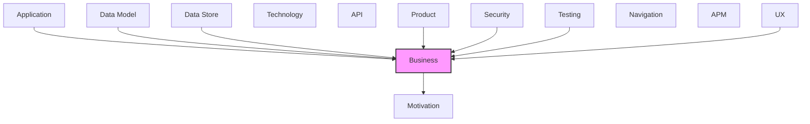

# Business

[← Back to README](../README.md)

Business processes, functions, roles, and services.

## Report Index

- [Layer Introduction](#layer-introduction)
- [Intra-Layer Relationships](#intra-layer-relationships)
- [Inter-Layer Dependencies](#inter-layer-dependencies)
- [Inter-Layer Relationships Table](#inter-layer-relationships-table)
- [Element Reference](#element-reference)

## Layer Introduction

| Metric                    | Count |
| ------------------------- | ----- |
| Elements                  | 36    |
| Intra-Layer Relationships | 57    |
| Inter-Layer Relationships | 87    |
| Inbound Relationships     | 63    |
| Outbound Relationships    | 24    |

**Cross-Layer References**:

- **Upstream layers**: [Application](./05-application-layer-report.md), [Data Model](./08-data-model-layer-report.md), [Data Store](./09-data-store-layer-report.md), [Product](./03-product-layer-report.md), [Security](./04-security-layer-report.md), [Testing](./13-testing-layer-report.md), [UX](./10-ux-layer-report.md)
- **Downstream layers**: [Motivation](./01-motivation-layer-report.md)

## Intra-Layer Relationships

*This layer has >30 elements. Summary table shown instead of diagram.*

| Element                                                          | Type                    | Relationships |
| ---------------------------------------------------------------- | ----------------------- | ------------- |
| `business.businessactor.documentation-robotics-project`          | `businessactor`         | 2             |
| `business.businessactor.house-project`                           | `businessactor`         | 2             |
| `business.businessactor.ontology-maintainer`                     | `businessactor`         | 1             |
| `business.businesscollaboration.client-round-trip-collaboration` | `businesscollaboration` | 3             |
| `business.businessevent.entity-changed-event`                    | `businessevent`         | 1             |
| `business.businessevent.proposal-amended`                        | `businessevent`         | 1             |
| `business.businessevent.proposal-applied`                        | `businessevent`         | 2             |
| `business.businessevent.proposal-landed`                         | `businessevent`         | 1             |
| `business.businessevent.proposal-reverted`                       | `businessevent`         | 1             |
| `business.businessevent.proposal-submitted`                      | `businessevent`         | 4             |
| `business.businessevent.proposal-withdrawn`                      | `businessevent`         | 1             |
| `business.businessevent.sync-completed-event`                    | `businessevent`         | 1             |
| `business.businessfunction.schema-refinement`                    | `businessfunction`      | 3             |
| `business.businessfunction.semantic-search`                      | `businessfunction`      | 1             |
| `business.businessobject.change-proposal`                        | `businessobject`        | 4             |
| `business.businessobject.claim`                                  | `businessobject`        | 1             |
| `business.businessobject.dataset`                                | `businessobject`        | 1             |
| `business.businessobject.decision-gold`                          | `businessobject`        | 3             |
| `business.businessobject.source-document`                        | `businessobject`        | 1             |
| `business.businessobject.taxonomy-charter`                       | `businessobject`        | 1             |
| `business.businessprocess.adjudicate-a-proposal`                 | `businessprocess`       | 14            |
| `business.businessprocess.check-benchmark-gold`                  | `businessprocess`       | 4             |
| `business.businessprocess.client-round-trip`                     | `businessprocess`       | 9             |
| `business.businessprocess.extract-a-source-into-a-dataset`       | `businessprocess`       | 7             |
| `business.businessprocess.sync-workspace-changes`                | `businessprocess`       | 2             |
| `business.businessprocess.triage-claims`                         | `businessprocess`       | 3             |
| `business.businessrole.client-lander`                            | `businessrole`          | 5             |
| `business.businessrole.proposer`                                 | `businessrole`          | 5             |
| `business.businessrole.reviewer`                                 | `businessrole`          | 11            |
| `business.businessservice.agent-context-service`                 | `businessservice`       | 2             |
| `business.businessservice.client-interchange-service`            | `businessservice`       | 4             |
| `business.businessservice.pipeline-benchmarking-service`         | `businessservice`       | 2             |
| `business.businessservice.proposal-adjudication-service`         | `businessservice`       | 4             |
| `business.businessservice.source-extraction-service`             | `businessservice`       | 3             |
| `business.contract.bundle-v1-contract`                           | `contract`              | 2             |
| `business.contract.dr-interchange-contract`                      | `contract`              | 2             |

## Inter-Layer Dependencies

## Inter-Layer Relationships Table

| Relationship ID                                                      | Source Node                                                           | Dest Node                                                                                 | Dest Layer   | Predicate    | Cardinality  | Strength |
| -------------------------------------------------------------------- | --------------------------------------------------------------------- | ----------------------------------------------------------------------------------------- | ------------ | ------------ | ------------ | -------- |
| `application.applicationfunction.realizes.business.businessfunction` | `application.applicationfunction.definition-enrichment`               | `business.businessfunction.schema-refinement`                                             | `business`   | `realizes`   | many-to-many | medium   |
| `application.applicationfunction.realizes.business.businessfunction` | `application.applicationfunction.embedding-generation`                | `business.businessfunction.semantic-search`                                               | `business`   | `realizes`   | many-to-many | medium   |
| `application.applicationfunction.realizes.business.businessfunction` | `application.applicationfunction.evidence-pack-building`              | `business.businessfunction.schema-refinement`                                             | `business`   | `realizes`   | many-to-many | medium   |
| `application.applicationfunction.realizes.business.businessfunction` | `application.applicationfunction.grounding-scoring`                   | `business.businessfunction.schema-refinement`                                             | `business`   | `realizes`   | many-to-many | medium   |
| `application.applicationfunction.realizes.business.businessfunction` | `application.applicationfunction.schema-connection-refinement-apply`  | `business.businessfunction.schema-refinement`                                             | `business`   | `realizes`   | many-to-many | medium   |
| `application.applicationfunction.realizes.business.businessfunction` | `application.applicationfunction.schema-definition-refinement-apply`  | `business.businessfunction.schema-refinement`                                             | `business`   | `realizes`   | many-to-many | medium   |
| `application.applicationfunction.realizes.business.businessfunction` | `application.applicationfunction.schema-extraction-apply`             | `business.businessfunction.schema-refinement`                                             | `business`   | `realizes`   | many-to-many | medium   |
| `application.applicationfunction.realizes.business.businessfunction` | `application.applicationfunction.schema-grounding-apply`              | `business.businessfunction.schema-refinement`                                             | `business`   | `realizes`   | many-to-many | medium   |
| `application.applicationfunction.realizes.business.businessfunction` | `application.applicationfunction.schema-neighborhood-traversal`       | `business.businessfunction.schema-refinement`                                             | `business`   | `realizes`   | many-to-many | medium   |
| `application.applicationprocess.realizes.business.businessprocess`   | `application.applicationprocess.claim-triage-pipeline`                | `business.businessprocess.triage-claims`                                                  | `business`   | `realizes`   | many-to-many | medium   |
| `application.applicationprocess.realizes.business.businessprocess`   | `application.applicationprocess.find-then-type-individual-extraction` | `business.businessprocess.extract-a-source-into-a-dataset`                                | `business`   | `realizes`   | many-to-many | medium   |
| `application.applicationprocess.realizes.business.businessprocess`   | `application.applicationprocess.individual-extraction-pipeline`       | `business.businessprocess.extract-a-source-into-a-dataset`                                | `business`   | `realizes`   | many-to-many | medium   |
| `application.applicationprocess.realizes.business.businessprocess`   | `application.applicationprocess.notes-to-claims-pipeline`             | `business.businessprocess.triage-claims`                                                  | `business`   | `realizes`   | many-to-many | medium   |
| `application.applicationprocess.realizes.business.businessprocess`   | `application.applicationprocess.open-individual-extraction`           | `business.businessprocess.extract-a-source-into-a-dataset`                                | `business`   | `realizes`   | many-to-many | medium   |
| `application.applicationprocess.realizes.business.businessprocess`   | `application.applicationprocess.open-schema-extraction`               | `business.businessprocess.extract-a-source-into-a-dataset`                                | `business`   | `realizes`   | many-to-many | medium   |
| `application.applicationprocess.realizes.business.businessprocess`   | `application.applicationprocess.schema-extraction-pipeline`           | `business.businessprocess.extract-a-source-into-a-dataset`                                | `business`   | `realizes`   | many-to-many | medium   |
| `application.applicationprocess.realizes.business.businessprocess`   | `application.applicationprocess.single-call-individual-extraction`    | `business.businessprocess.extract-a-source-into-a-dataset`                                | `business`   | `realizes`   | many-to-many | medium   |
| `application.applicationservice.realizes.business.businessservice`   | `application.applicationservice.approval-policy-service`              | `business.businessservice.proposal-adjudication-service`                                  | `business`   | `realizes`   | many-to-many | medium   |
| `application.applicationservice.realizes.business.businessservice`   | `application.applicationservice.bundle-export-service`                | `business.businessservice.client-interchange-service`                                     | `business`   | `realizes`   | many-to-many | medium   |
| `application.applicationservice.realizes.business.businessservice`   | `application.applicationservice.bundle-import-service`                | `business.businessservice.client-interchange-service`                                     | `business`   | `realizes`   | many-to-many | medium   |
| `application.applicationservice.realizes.business.businessservice`   | `application.applicationservice.chat-service`                         | `business.businessservice.agent-context-service`                                          | `business`   | `realizes`   | many-to-many | medium   |
| `application.applicationservice.realizes.business.businessservice`   | `application.applicationservice.claim-service`                        | `business.businessservice.proposal-adjudication-service`                                  | `business`   | `realizes`   | many-to-many | medium   |
| `application.applicationservice.realizes.business.businessservice`   | `application.applicationservice.drift-import-service`                 | `business.businessservice.client-interchange-service`                                     | `business`   | `realizes`   | many-to-many | medium   |
| `application.applicationservice.realizes.business.businessservice`   | `application.applicationservice.extraction-service`                   | `business.businessservice.source-extraction-service`                                      | `business`   | `realizes`   | many-to-many | medium   |
| `application.applicationservice.realizes.business.businessservice`   | `application.applicationservice.graph-analysis-service`               | `business.businessservice.agent-context-service`                                          | `business`   | `realizes`   | many-to-many | medium   |
| `application.applicationservice.realizes.business.businessservice`   | `application.applicationservice.import-run-service`                   | `business.businessservice.client-interchange-service`                                     | `business`   | `realizes`   | many-to-many | medium   |
| `application.applicationservice.realizes.business.businessservice`   | `application.applicationservice.ontology-service`                     | `business.businessservice.agent-context-service`                                          | `business`   | `realizes`   | many-to-many | medium   |
| `application.applicationservice.realizes.business.businessservice`   | `application.applicationservice.proposal-comparison-service`          | `business.businessservice.pipeline-benchmarking-service`                                  | `business`   | `realizes`   | many-to-many | medium   |
| `application.applicationservice.realizes.business.businessservice`   | `application.applicationservice.proposal-service`                     | `business.businessservice.proposal-adjudication-service`                                  | `business`   | `realizes`   | many-to-many | medium   |
| `application.applicationservice.realizes.business.businessservice`   | `application.applicationservice.revert-service`                       | `business.businessservice.proposal-adjudication-service`                                  | `business`   | `realizes`   | many-to-many | medium   |
| `application.applicationservice.realizes.business.businessservice`   | `application.applicationservice.source-extraction-service`            | `business.businessservice.source-extraction-service`                                      | `business`   | `realizes`   | many-to-many | medium   |
| `application.applicationservice.realizes.business.businessservice`   | `application.applicationservice.source-service`                       | `business.businessservice.source-extraction-service`                                      | `business`   | `realizes`   | many-to-many | medium   |
| `application.applicationservice.serves.business.businessprocess`     | `application.applicationservice.versioning-service`                   | `business.businessprocess.sync-workspace-changes`                                         | `business`   | `serves`     | many-to-many | medium   |
| `business.businessactor.references.motivation.stakeholder`           | `business.businessactor.documentation-robotics-project`               | `motivation.stakeholder.documentation-robotics-project`                                   | `motivation` | `references` | many-to-many | medium   |
| `business.businessactor.references.motivation.stakeholder`           | `business.businessactor.house-project`                                | `motivation.stakeholder.house-project`                                                    | `motivation` | `references` | many-to-many | medium   |
| `business.businessactor.references.motivation.stakeholder`           | `business.businessactor.ontology-maintainer`                          | `motivation.stakeholder.ontology-owner-and-reviewer`                                      | `motivation` | `references` | many-to-many | medium   |
| `business.businessprocess.realizes.motivation.outcome`               | `business.businessprocess.client-round-trip`                          | `motivation.outcome.client-changes-land-without-hand-edited-specs`                        | `motivation` | `realizes`   | many-to-many | medium   |
| `business.businessprocess.realizes.motivation.outcome`               | `business.businessprocess.extract-a-source-into-a-dataset`            | `motivation.outcome.extraction-proposals-worth-a-reviewers-time`                          | `motivation` | `realizes`   | many-to-many | medium   |
| `business.businessprocess.satisfies.motivation.requirement`          | `business.businessprocess.extract-a-source-into-a-dataset`            | `motivation.requirement.individuals-belong-to-one-dataset`                                | `motivation` | `satisfies`  | many-to-many | medium   |
| `business.businessrole.references.motivation.stakeholder`            | `business.businessrole.client-lander`                                 | `motivation.stakeholder.documentation-robotics-project`                                   | `motivation` | `references` | many-to-many | medium   |
| `business.businessrole.references.motivation.stakeholder`            | `business.businessrole.client-lander`                                 | `motivation.stakeholder.house-project`                                                    | `motivation` | `references` | many-to-many | medium   |
| `business.businessrole.references.motivation.stakeholder`            | `business.businessrole.proposer`                                      | `motivation.stakeholder.agent-claude-code-and-in-app-chat`                                | `motivation` | `references` | many-to-many | medium   |
| `business.businessrole.references.motivation.stakeholder`            | `business.businessrole.reviewer`                                      | `motivation.stakeholder.ontology-owner-and-reviewer`                                      | `motivation` | `references` | many-to-many | medium   |
| `business.businessservice.delivers.motivation.value`                 | `business.businessservice.agent-context-service`                      | `motivation.value.knowledge-reusability`                                                  | `motivation` | `delivers`   | many-to-many | medium   |
| `business.businessservice.realizes.motivation.goal`                  | `business.businessservice.agent-context-service`                      | `motivation.goal.agents-ground-on-the-curated-model`                                      | `motivation` | `realizes`   | many-to-many | medium   |
| `business.businessservice.realizes.motivation.outcome`               | `business.businessservice.client-interchange-service`                 | `motivation.outcome.client-changes-land-without-hand-edited-specs`                        | `motivation` | `realizes`   | many-to-many | medium   |
| `business.businessservice.satisfies.motivation.requirement`          | `business.businessservice.client-interchange-service`                 | `motivation.requirement.mirrored-taxonomies-accept-schema-changes-only-from-their-client` | `motivation` | `satisfies`  | many-to-many | medium   |
| `business.businessservice.realizes.motivation.goal`                  | `business.businessservice.pipeline-benchmarking-service`              | `motivation.goal.every-decision-becomes-data`                                             | `motivation` | `realizes`   | many-to-many | medium   |
| `business.businessservice.delivers.motivation.value`                 | `business.businessservice.proposal-adjudication-service`              | `motivation.value.reduced-manual-curation-effort`                                         | `motivation` | `delivers`   | many-to-many | medium   |
| `business.businessservice.delivers.motivation.value`                 | `business.businessservice.proposal-adjudication-service`              | `motivation.value.reviewer-time-goes-to-judgment-calls`                                   | `motivation` | `delivers`   | many-to-many | medium   |
| `business.businessservice.realizes.motivation.goal`                  | `business.businessservice.proposal-adjudication-service`              | `motivation.goal.ontology-workbench-for-client-projects`                                  | `motivation` | `realizes`   | many-to-many | medium   |
| `business.businessservice.satisfies.motivation.requirement`          | `business.businessservice.proposal-adjudication-service`              | `motivation.requirement.breaking-changes-never-auto-apply`                                | `motivation` | `satisfies`  | many-to-many | medium   |
| `business.businessservice.satisfies.motivation.requirement`          | `business.businessservice.proposal-adjudication-service`              | `motivation.requirement.every-applied-proposal-is-revertible`                             | `motivation` | `satisfies`  | many-to-many | medium   |
| `business.businessservice.delivers.motivation.value`                 | `business.businessservice.source-extraction-service`                  | `motivation.value.every-fact-is-traceable`                                                | `motivation` | `delivers`   | many-to-many | medium   |
| `business.businessservice.realizes.motivation.goal`                  | `business.businessservice.source-extraction-service`                  | `motivation.goal.trustworthy-extraction-into-datasets`                                    | `motivation` | `realizes`   | many-to-many | medium   |
| `business.businessservice.satisfies.motivation.requirement`          | `business.businessservice.source-extraction-service`                  | `motivation.requirement.extracted-facts-cite-their-source`                                | `motivation` | `satisfies`  | many-to-many | medium   |
| `business.businessservice.satisfies.motivation.requirement`          | `business.businessservice.source-extraction-service`                  | `motivation.requirement.relationships-limited-to-allowed-types`                           | `motivation` | `satisfies`  | many-to-many | medium   |
| `data-model.objectschema.realizes.business.businessobject`           | `data-model.objectschema.claim-entity`                                | `business.businessobject.claim`                                                           | `business`   | `realizes`   | many-to-many | medium   |
| `data-store.collection.realizes.business.businessobject`             | `data-store.collection.claims`                                        | `business.businessobject.claim`                                                           | `business`   | `realizes`   | many-to-many | medium   |
| `product.persona.references.business.businessrole`                   | `product.persona.client-maintainer`                                   | `business.businessrole.client-lander`                                                     | `business`   | `references` | many-to-many | medium   |
| `product.persona.references.business.businessrole`                   | `product.persona.ontology-curator`                                    | `business.businessrole.reviewer`                                                          | `business`   | `references` | many-to-many | medium   |
| `product.softwarecapability.realizes.business.businessfunction`      | `product.softwarecapability.agent-access-over-mcp`                    | `business.businessfunction.semantic-search`                                               | `business`   | `realizes`   | many-to-many | medium   |
| `product.softwarecapability.realizes.business.businessfunction`      | `product.softwarecapability.chat-assistant`                           | `business.businessfunction.semantic-search`                                               | `business`   | `realizes`   | many-to-many | medium   |
| `product.softwarecapability.realizes.business.businessfunction`      | `product.softwarecapability.reference-grounding`                      | `business.businessfunction.schema-refinement`                                             | `business`   | `realizes`   | many-to-many | medium   |
| `product.userworkflow.realizes.business.businessprocess`             | `product.userworkflow.adjudicate-a-client-plan`                       | `business.businessprocess.client-round-trip`                                              | `business`   | `realizes`   | many-to-many | medium   |
| `product.userworkflow.realizes.business.businessprocess`             | `product.userworkflow.check-benchmark-gold-workflow`                  | `business.businessprocess.check-benchmark-gold`                                           | `business`   | `realizes`   | many-to-many | medium   |
| `product.userworkflow.realizes.business.businessprocess`             | `product.userworkflow.extract-a-document-into-a-dataset`              | `business.businessprocess.extract-a-source-into-a-dataset`                                | `business`   | `realizes`   | many-to-many | medium   |
| `product.userworkflow.realizes.business.businessprocess`             | `product.userworkflow.review-and-decide-a-proposal`                   | `business.businessprocess.adjudicate-a-proposal`                                          | `business`   | `realizes`   | many-to-many | medium   |
| `security.countermeasure.protects.business.businessprocess`          | `security.countermeasure.human-review-gate-for-agent-writes`          | `business.businessprocess.adjudicate-a-proposal`                                          | `business`   | `protects`   | many-to-many | medium   |
| `security.role.references.business.businessrole`                     | `security.role.local-operator`                                        | `business.businessrole.reviewer`                                                          | `business`   | `references` | many-to-many | medium   |
| `security.role.references.business.businessrole`                     | `security.role.mcp-agent`                                             | `business.businessrole.proposer`                                                          | `business`   | `references` | many-to-many | medium   |
| `security.secureresource.references.business.businessobject`         | `security.secureresource.workspace-databases`                         | `business.businessobject.change-proposal`                                                 | `business`   | `references` | many-to-many | medium   |
| `security.secureresource.references.business.businessobject`         | `security.secureresource.workspace-databases`                         | `business.businessobject.claim`                                                           | `business`   | `references` | many-to-many | medium   |
| `security.secureresource.references.business.businessobject`         | `security.secureresource.workspace-databases`                         | `business.businessobject.dataset`                                                         | `business`   | `references` | many-to-many | medium   |
| `security.secureresource.references.business.businessobject`         | `security.secureresource.workspace-databases`                         | `business.businessobject.decision-gold`                                                   | `business`   | `references` | many-to-many | medium   |
| `security.secureresource.references.business.businessobject`         | `security.secureresource.workspace-databases`                         | `business.businessobject.source-document`                                                 | `business`   | `references` | many-to-many | medium   |
| `security.threat.targets.business.businessprocess`                   | `security.threat.prompt-injection-via-sources-or-client-plans`        | `business.businessprocess.extract-a-source-into-a-dataset`                                | `business`   | `targets`    | many-to-many | medium   |
| `security.threat.targets.business.businessservice`                   | `security.threat.prompt-injection-via-sources-or-client-plans`        | `business.businessservice.proposal-adjudication-service`                                  | `business`   | `targets`    | many-to-many | medium   |
| `security.threat.targets.business.businessservice`                   | `security.threat.workspace-data-sent-to-llm-providers`                | `business.businessservice.source-extraction-service`                                      | `business`   | `targets`    | many-to-many | medium   |
| `testing.testcoveragetarget.covers.business.businessprocess`         | `testing.testcoveragetarget.domain-unit-tests`                        | `business.businessprocess.adjudicate-a-proposal`                                          | `business`   | `covers`     | many-to-many | medium   |
| `testing.testcoveragetarget.covers.business.businessprocess`         | `testing.testcoveragetarget.interchange-integration-tests`            | `business.businessprocess.client-round-trip`                                              | `business`   | `covers`     | many-to-many | medium   |
| `testing.testcoveragetarget.covers.business.businessprocess`         | `testing.testcoveragetarget.pipeline-integration-tests`               | `business.businessprocess.extract-a-source-into-a-dataset`                                | `business`   | `covers`     | many-to-many | medium   |
| `testing.testcoveragetarget.covers.business.businessprocess`         | `testing.testcoveragetarget.route-integration-tests`                  | `business.businessprocess.adjudicate-a-proposal`                                          | `business`   | `covers`     | many-to-many | medium   |
| `testing.testcoveragetarget.covers.business.businessprocess`         | `testing.testcoveragetarget.source-integration-tests`                 | `business.businessprocess.extract-a-source-into-a-dataset`                                | `business`   | `covers`     | many-to-many | medium   |
| `testing.testcoveragetarget.covers.business.businessprocess`         | `testing.testcoveragetarget.versioning-integration-tests`             | `business.businessprocess.adjudicate-a-proposal`                                          | `business`   | `covers`     | many-to-many | medium   |
| `ux.view.serves.business.businessrole`                               | `ux.view.proposal-review-view`                                        | `business.businessrole.reviewer`                                                          | `business`   | `serves`     | many-to-many | medium   |
| `ux.view.serves.business.businessrole`                               | `ux.view.proposals-view`                                              | `business.businessrole.reviewer`                                                          | `business`   | `serves`     | many-to-many | medium   |

## Element Reference

### Documentation Robotics Project {#documentation-robotics-project}

**ID**: `business.businessactor.documentation-robotics-project`

**Type**: `businessactor`

Client project whose spec is the mirrored dr_spec taxonomy; its maintainer agent submits reflection plans and lands decisions and spec changes.

#### Relationships

| Type        | Related Element                                         | Predicate     | Direction |
| ----------- | ------------------------------------------------------- | ------------- | --------- |
| inter-layer | `motivation.stakeholder.documentation-robotics-project` | `references`  | outbound  |
| intra-layer | `business.businessrole.client-lander`                   | `assigned-to` | outbound  |
| intra-layer | `business.businessrole.proposer`                        | `assigned-to` | outbound  |

### House Project {#house-project}

**ID**: `business.businessactor.house-project`

**Type**: `businessactor`

Client project that round-trips its schema via bundle v1 and a per-taxonomy approval policy.

#### Relationships

| Type        | Related Element                        | Predicate     | Direction |
| ----------- | -------------------------------------- | ------------- | --------- |
| inter-layer | `motivation.stakeholder.house-project` | `references`  | outbound  |
| intra-layer | `business.businessrole.client-lander`  | `assigned-to` | outbound  |
| intra-layer | `business.businessrole.proposer`       | `assigned-to` | outbound  |

### Ontology Maintainer {#ontology-maintainer}

**ID**: `business.businessactor.ontology-maintainer`

**Type**: `businessactor`

The person who owns the Context Studio workspace and decides proposals.

#### Relationships

| Type        | Related Element                                      | Predicate     | Direction |
| ----------- | ---------------------------------------------------- | ------------- | --------- |
| inter-layer | `motivation.stakeholder.ontology-owner-and-reviewer` | `references`  | outbound  |
| intra-layer | `business.businessrole.reviewer`                     | `assigned-to` | outbound  |

### Client Round-Trip Collaboration {#client-round-trip-collaboration}

**ID**: `business.businesscollaboration.client-round-trip-collaboration`

**Type**: `businesscollaboration`

A client project (DR's or House's maintainer agent), the reviewer and CS jointly carry the round trip: the client submits a plan, the reviewer adjudicates in CS, CS exports decisions and spec changes, and the client lands them and marks the proposal landed. Changeset editing and conflict resolution were retired (#1369, #1400).

#### Relationships

| Type        | Related Element                       | Predicate    | Direction |
| ----------- | ------------------------------------- | ------------ | --------- |
| intra-layer | `business.businessrole.client-lander` | `aggregates` | outbound  |
| intra-layer | `business.businessrole.proposer`      | `aggregates` | outbound  |
| intra-layer | `business.businessrole.reviewer`      | `aggregates` | outbound  |

### Entity Changed Event {#entity-changed-event}

**ID**: `business.businessevent.entity-changed-event`

**Type**: `businessevent`

An ontology change is recorded: every create, update or delete of a taxonomy, scheme, class, relationship type, dataset or individual (TaxonomyCreated through IndividualDeleted) becomes a revertible change event in local.db.

#### Attributes

| Name | Value    |
| ---- | -------- |
| type | internal |

#### Relationships

| Type        | Related Element                                  | Predicate  | Direction |
| ----------- | ------------------------------------------------ | ---------- | --------- |
| intra-layer | `business.businessprocess.adjudicate-a-proposal` | `triggers` | inbound   |

### Proposal Amended {#proposal-amended}

**ID**: `business.businessevent.proposal-amended`

**Type**: `businessevent`

The proposer changed, added or removed pending operations of its open proposal.

#### Attributes

| Name | Value    |
| ---- | -------- |
| type | external |

#### Relationships

| Type        | Related Element                                  | Predicate  | Direction |
| ----------- | ------------------------------------------------ | ---------- | --------- |
| intra-layer | `business.businessprocess.adjudicate-a-proposal` | `triggers` | inbound   |

### Proposal Applied {#proposal-applied}

**ID**: `business.businessevent.proposal-applied`

**Type**: `businessevent`

Accepted operations are applied; change events and gold are written.

#### Attributes

| Name | Value    |
| ---- | -------- |
| type | internal |

#### Relationships

| Type        | Related Element                                  | Predicate  | Direction |
| ----------- | ------------------------------------------------ | ---------- | --------- |
| intra-layer | `business.businessprocess.client-round-trip`     | `triggers` | outbound  |
| intra-layer | `business.businessprocess.adjudicate-a-proposal` | `triggers` | inbound   |

### Proposal Landed {#proposal-landed}

**ID**: `business.businessevent.proposal-landed`

**Type**: `businessevent`

The client records the commit, repo and spec version where the decisions landed.

#### Attributes

| Name | Value    |
| ---- | -------- |
| type | external |

#### Relationships

| Type        | Related Element                              | Predicate  | Direction |
| ----------- | -------------------------------------------- | ---------- | --------- |
| intra-layer | `business.businessprocess.client-round-trip` | `triggers` | inbound   |

### Proposal Reverted {#proposal-reverted}

**ID**: `business.businessevent.proposal-reverted`

**Type**: `businessevent`

An applied proposal is undone in one transaction.

#### Attributes

| Name | Value    |
| ---- | -------- |
| type | internal |

#### Relationships

| Type        | Related Element                                  | Predicate  | Direction |
| ----------- | ------------------------------------------------ | ---------- | --------- |
| intra-layer | `business.businessprocess.adjudicate-a-proposal` | `triggers` | inbound   |

### Proposal Submitted {#proposal-submitted}

**ID**: `business.businessevent.proposal-submitted`

**Type**: `businessevent`

A proposal arrives from any source (MCP, chat, pipeline, bundle, user).

#### Attributes

| Name | Value   |
| ---- | ------- |
| type | message |

#### Relationships

| Type        | Related Element                                            | Predicate  | Direction |
| ----------- | ---------------------------------------------------------- | ---------- | --------- |
| intra-layer | `business.businessprocess.adjudicate-a-proposal`           | `triggers` | outbound  |
| intra-layer | `business.businessfunction.schema-refinement`              | `triggers` | inbound   |
| intra-layer | `business.businessprocess.client-round-trip`               | `triggers` | inbound   |
| intra-layer | `business.businessprocess.extract-a-source-into-a-dataset` | `triggers` | inbound   |

### Proposal Withdrawn {#proposal-withdrawn}

**ID**: `business.businessevent.proposal-withdrawn`

**Type**: `businessevent`

The proposer withdrew an open proposal, possibly naming the proposal that supersedes it.

#### Attributes

| Name | Value    |
| ---- | -------- |
| type | external |

#### Relationships

| Type        | Related Element                                  | Predicate  | Direction |
| ----------- | ------------------------------------------------ | ---------- | --------- |
| intra-layer | `business.businessprocess.adjudicate-a-proposal` | `triggers` | inbound   |

### Sync Completed Event {#sync-completed-event}

**ID**: `business.businessevent.sync-completed-event`

**Type**: `businessevent`

Business event signalling successful synchronisation of the local knowledge graph to remote S3 storage via the sync adapter

#### Attributes

| Name | Value    |
| ---- | -------- |
| type | external |

#### Relationships

| Type        | Related Element                                   | Predicate  | Direction |
| ----------- | ------------------------------------------------- | ---------- | --------- |
| intra-layer | `business.businessprocess.sync-workspace-changes` | `triggers` | inbound   |

### Schema Refinement {#schema-refinement}

**ID**: `business.businessfunction.schema-refinement`

**Type**: `businessfunction`

Refinement pipelines (grounding to DBpedia and ConceptNet, definition refinement, connection refinement, relationship reflection) produce proposals, never direct writes, and run when a client or the reviewer starts them.

#### Relationships

| Type        | Related Element                                                      | Predicate     | Direction |
| ----------- | -------------------------------------------------------------------- | ------------- | --------- |
| inter-layer | `application.applicationfunction.definition-enrichment`              | `realizes`    | inbound   |
| inter-layer | `application.applicationfunction.evidence-pack-building`             | `realizes`    | inbound   |
| inter-layer | `application.applicationfunction.grounding-scoring`                  | `realizes`    | inbound   |
| inter-layer | `application.applicationfunction.schema-connection-refinement-apply` | `realizes`    | inbound   |
| inter-layer | `application.applicationfunction.schema-definition-refinement-apply` | `realizes`    | inbound   |
| inter-layer | `application.applicationfunction.schema-extraction-apply`            | `realizes`    | inbound   |
| inter-layer | `application.applicationfunction.schema-grounding-apply`             | `realizes`    | inbound   |
| inter-layer | `application.applicationfunction.schema-neighborhood-traversal`      | `realizes`    | inbound   |
| inter-layer | `product.softwarecapability.reference-grounding`                     | `realizes`    | inbound   |
| intra-layer | `business.businessprocess.adjudicate-a-proposal`                     | `flows-to`    | outbound  |
| intra-layer | `business.businessevent.proposal-submitted`                          | `triggers`    | outbound  |
| intra-layer | `business.businessrole.reviewer`                                     | `assigned-to` | inbound   |

### Semantic Search {#semantic-search}

**ID**: `business.businessfunction.semantic-search`

**Type**: `businessfunction`

Semantic and name search over schema and individuals (MCP and chat search_entities, extraction recognition). Embeddings are SentenceTransformer vectors stored in SQLite and compared by brute-force cosine.

#### Relationships

| Type        | Related Element                                        | Predicate  | Direction |
| ----------- | ------------------------------------------------------ | ---------- | --------- |
| inter-layer | `application.applicationfunction.embedding-generation` | `realizes` | inbound   |
| inter-layer | `product.softwarecapability.agent-access-over-mcp`     | `realizes` | inbound   |
| inter-layer | `product.softwarecapability.chat-assistant`            | `realizes` | inbound   |
| intra-layer | `business.businessservice.agent-context-service`       | `realizes` | outbound  |

### Change Proposal {#change-proposal}

**ID**: `business.businessobject.change-proposal`

**Type**: `businessobject`

Pending typed operations with source, rationale, evidence, probability, scope, dataset and the pipeline that produced them.

#### Relationships

| Type        | Related Element                                            | Predicate    | Direction |
| ----------- | ---------------------------------------------------------- | ------------ | --------- |
| inter-layer | `security.secureresource.workspace-databases`              | `references` | inbound   |
| intra-layer | `business.businessprocess.adjudicate-a-proposal`           | `accesses`   | inbound   |
| intra-layer | `business.businessprocess.client-round-trip`               | `accesses`   | inbound   |
| intra-layer | `business.businessprocess.extract-a-source-into-a-dataset` | `accesses`   | inbound   |
| intra-layer | `business.businessservice.source-extraction-service`       | `delivers`   | inbound   |

### Claim {#claim}

**ID**: `business.businessobject.claim`

**Type**: `businessobject`

An atomic review note with a triage result and a reviewer verdict.

#### Relationships

| Type        | Related Element                               | Predicate    | Direction |
| ----------- | --------------------------------------------- | ------------ | --------- |
| inter-layer | `data-model.objectschema.claim-entity`        | `realizes`   | inbound   |
| inter-layer | `data-store.collection.claims`                | `realizes`   | inbound   |
| inter-layer | `security.secureresource.workspace-databases` | `references` | inbound   |
| intra-layer | `business.businessprocess.triage-claims`      | `accesses`   | inbound   |

### Dataset {#dataset}

**ID**: `business.businessobject.dataset`

**Type**: `businessobject`

A named body of individuals over one taxonomy.

#### Relationships

| Type        | Related Element                                            | Predicate    | Direction |
| ----------- | ---------------------------------------------------------- | ------------ | --------- |
| inter-layer | `security.secureresource.workspace-databases`              | `references` | inbound   |
| intra-layer | `business.businessprocess.extract-a-source-into-a-dataset` | `accesses`   | inbound   |

### Decision (Gold) {#decision-gold}

**ID**: `business.businessobject.decision-gold`

**Type**: `businessobject`

A reviewer's or approval policy's verdict on one operation, kept as benchmark gold.

#### Relationships

| Type        | Related Element                                          | Predicate    | Direction |
| ----------- | -------------------------------------------------------- | ------------ | --------- |
| inter-layer | `security.secureresource.workspace-databases`            | `references` | inbound   |
| intra-layer | `business.businessprocess.adjudicate-a-proposal`         | `accesses`   | inbound   |
| intra-layer | `business.businessprocess.check-benchmark-gold`          | `accesses`   | inbound   |
| intra-layer | `business.businessservice.proposal-adjudication-service` | `delivers`   | inbound   |

### Source Document {#source-document}

**ID**: `business.businessobject.source-document`

**Type**: `businessobject`

A document (PDF, Markdown, HTML, text or URL) that extraction reads; kept for citations.

#### Relationships

| Type        | Related Element                                            | Predicate    | Direction |
| ----------- | ---------------------------------------------------------- | ------------ | --------- |
| inter-layer | `security.secureresource.workspace-databases`              | `references` | inbound   |
| intra-layer | `business.businessprocess.extract-a-source-into-a-dataset` | `accesses`   | inbound   |

### Taxonomy Charter {#taxonomy-charter}

**ID**: `business.businessobject.taxonomy-charter`

**Type**: `businessobject`

The taxonomy's vision and summary, which agents and pipelines read first.

#### Relationships

| Type        | Related Element                                  | Predicate  | Direction |
| ----------- | ------------------------------------------------ | ---------- | --------- |
| intra-layer | `business.businessprocess.adjudicate-a-proposal` | `accesses` | inbound   |

### Adjudicate a Proposal {#adjudicate-a-proposal}

**ID**: `business.businessprocess.adjudicate-a-proposal`

**Type**: `businessprocess`

Proposed, then classified (editorial, additive, breaking), decided per operation, applied (change events and gold written), and later landed by the client or reverted.

#### Relationships

| Type        | Related Element                                              | Predicate     | Direction |
| ----------- | ------------------------------------------------------------ | ------------- | --------- |
| inter-layer | `product.userworkflow.review-and-decide-a-proposal`          | `realizes`    | inbound   |
| inter-layer | `security.countermeasure.human-review-gate-for-agent-writes` | `protects`    | inbound   |
| inter-layer | `testing.testcoveragetarget.domain-unit-tests`               | `covers`      | inbound   |
| inter-layer | `testing.testcoveragetarget.route-integration-tests`         | `covers`      | inbound   |
| inter-layer | `testing.testcoveragetarget.versioning-integration-tests`    | `covers`      | inbound   |
| intra-layer | `business.businessevent.proposal-submitted`                  | `triggers`    | inbound   |
| intra-layer | `business.businessfunction.schema-refinement`                | `flows-to`    | inbound   |
| intra-layer | `business.businessobject.change-proposal`                    | `accesses`    | outbound  |
| intra-layer | `business.businessobject.decision-gold`                      | `accesses`    | outbound  |
| intra-layer | `business.businessobject.taxonomy-charter`                   | `accesses`    | outbound  |
| intra-layer | `business.businessservice.proposal-adjudication-service`     | `realizes`    | outbound  |
| intra-layer | `business.businessevent.entity-changed-event`                | `triggers`    | outbound  |
| intra-layer | `business.businessevent.proposal-amended`                    | `triggers`    | outbound  |
| intra-layer | `business.businessevent.proposal-applied`                    | `triggers`    | outbound  |
| intra-layer | `business.businessevent.proposal-reverted`                   | `triggers`    | outbound  |
| intra-layer | `business.businessevent.proposal-withdrawn`                  | `triggers`    | outbound  |
| intra-layer | `business.businessprocess.check-benchmark-gold`              | `flows-to`    | inbound   |
| intra-layer | `business.businessprocess.extract-a-source-into-a-dataset`   | `flows-to`    | inbound   |
| intra-layer | `business.businessrole.reviewer`                             | `assigned-to` | inbound   |

### Check Benchmark Gold {#check-benchmark-gold}

**ID**: `business.businessprocess.check-benchmark-gold`

**Type**: `businessprocess`

Open a gold-check proposal for a benchmark document, review it in the Review page's gold mode, write the gold back and replay to re-score.

#### Relationships

| Type        | Related Element                                          | Predicate     | Direction |
| ----------- | -------------------------------------------------------- | ------------- | --------- |
| inter-layer | `product.userworkflow.check-benchmark-gold-workflow`     | `realizes`    | inbound   |
| intra-layer | `business.businessobject.decision-gold`                  | `accesses`    | outbound  |
| intra-layer | `business.businessprocess.adjudicate-a-proposal`         | `flows-to`    | outbound  |
| intra-layer | `business.businessservice.pipeline-benchmarking-service` | `realizes`    | outbound  |
| intra-layer | `business.businessrole.reviewer`                         | `assigned-to` | inbound   |

### Client Round Trip {#client-round-trip}

**ID**: `business.businessprocess.client-round-trip`

**Type**: `businessprocess`

A client submits a plan, the reviewer adjudicates it in CS, the client reads decisions and spec changes, lands them in its repo and marks the proposal landed.

#### Relationships

| Type        | Related Element                                                    | Predicate     | Direction |
| ----------- | ------------------------------------------------------------------ | ------------- | --------- |
| inter-layer | `motivation.outcome.client-changes-land-without-hand-edited-specs` | `realizes`    | outbound  |
| inter-layer | `product.userworkflow.adjudicate-a-client-plan`                    | `realizes`    | inbound   |
| inter-layer | `testing.testcoveragetarget.interchange-integration-tests`         | `covers`      | inbound   |
| intra-layer | `business.businessevent.proposal-applied`                          | `triggers`    | inbound   |
| intra-layer | `business.businessobject.change-proposal`                          | `accesses`    | outbound  |
| intra-layer | `business.contract.bundle-v1-contract`                             | `accesses`    | outbound  |
| intra-layer | `business.contract.dr-interchange-contract`                        | `accesses`    | outbound  |
| intra-layer | `business.businessservice.client-interchange-service`              | `realizes`    | outbound  |
| intra-layer | `business.businessevent.proposal-landed`                           | `triggers`    | outbound  |
| intra-layer | `business.businessevent.proposal-submitted`                        | `triggers`    | outbound  |
| intra-layer | `business.businessrole.client-lander`                              | `assigned-to` | inbound   |
| intra-layer | `business.businessrole.proposer`                                   | `assigned-to` | inbound   |

### Extract a Source into a Dataset {#extract-a-source-into-a-dataset}

**ID**: `business.businessprocess.extract-a-source-into-a-dataset`

**Type**: `businessprocess`

Add a source, chunk it, extract, receive one proposal, review it and apply it with provenance.

#### Relationships

| Type        | Related Element                                                       | Predicate     | Direction |
| ----------- | --------------------------------------------------------------------- | ------------- | --------- |
| inter-layer | `application.applicationprocess.find-then-type-individual-extraction` | `realizes`    | inbound   |
| inter-layer | `application.applicationprocess.individual-extraction-pipeline`       | `realizes`    | inbound   |
| inter-layer | `application.applicationprocess.open-individual-extraction`           | `realizes`    | inbound   |
| inter-layer | `application.applicationprocess.open-schema-extraction`               | `realizes`    | inbound   |
| inter-layer | `application.applicationprocess.schema-extraction-pipeline`           | `realizes`    | inbound   |
| inter-layer | `application.applicationprocess.single-call-individual-extraction`    | `realizes`    | inbound   |
| inter-layer | `motivation.outcome.extraction-proposals-worth-a-reviewers-time`      | `realizes`    | outbound  |
| inter-layer | `motivation.requirement.individuals-belong-to-one-dataset`            | `satisfies`   | outbound  |
| inter-layer | `product.userworkflow.extract-a-document-into-a-dataset`              | `realizes`    | inbound   |
| inter-layer | `security.threat.prompt-injection-via-sources-or-client-plans`        | `targets`     | inbound   |
| inter-layer | `testing.testcoveragetarget.pipeline-integration-tests`               | `covers`      | inbound   |
| inter-layer | `testing.testcoveragetarget.source-integration-tests`                 | `covers`      | inbound   |
| intra-layer | `business.businessobject.change-proposal`                             | `accesses`    | outbound  |
| intra-layer | `business.businessobject.dataset`                                     | `accesses`    | outbound  |
| intra-layer | `business.businessobject.source-document`                             | `accesses`    | outbound  |
| intra-layer | `business.businessprocess.adjudicate-a-proposal`                      | `flows-to`    | outbound  |
| intra-layer | `business.businessservice.source-extraction-service`                  | `realizes`    | outbound  |
| intra-layer | `business.businessevent.proposal-submitted`                           | `triggers`    | outbound  |
| intra-layer | `business.businessrole.reviewer`                                      | `assigned-to` | inbound   |

### Sync Workspace Changes {#sync-workspace-changes}

**ID**: `business.businessprocess.sync-workspace-changes`

**Type**: `businessprocess`

Optionally push the workspace's change events to S3 or DuckDB/Parquet (and pull them back), from the Versioning page's Sync tab.

#### Relationships

| Type        | Related Element                                     | Predicate     | Direction |
| ----------- | --------------------------------------------------- | ------------- | --------- |
| inter-layer | `application.applicationservice.versioning-service` | `serves`      | inbound   |
| intra-layer | `business.businessevent.sync-completed-event`       | `triggers`    | outbound  |
| intra-layer | `business.businessrole.reviewer`                    | `assigned-to` | inbound   |

### Triage Claims {#triage-claims}

**ID**: `business.businessprocess.triage-claims`

**Type**: `businessprocess`

Notes become atomic claims, a decision model triages them, the reviewer gives a verdict, and fixes go back as proposals.

#### Relationships

| Type        | Related Element                                           | Predicate     | Direction |
| ----------- | --------------------------------------------------------- | ------------- | --------- |
| inter-layer | `application.applicationprocess.claim-triage-pipeline`    | `realizes`    | inbound   |
| inter-layer | `application.applicationprocess.notes-to-claims-pipeline` | `realizes`    | inbound   |
| intra-layer | `business.businessobject.claim`                           | `accesses`    | outbound  |
| intra-layer | `business.businessservice.proposal-adjudication-service`  | `realizes`    | outbound  |
| intra-layer | `business.businessrole.reviewer`                          | `assigned-to` | inbound   |

### Client Lander {#client-lander}

**ID**: `business.businessrole.client-lander`

**Type**: `businessrole`

The client-side role that reads decisions and spec changes, writes them into its own spec and records where they landed.

#### Relationships

| Type        | Related Element                                                  | Predicate     | Direction |
| ----------- | ---------------------------------------------------------------- | ------------- | --------- |
| inter-layer | `motivation.stakeholder.documentation-robotics-project`          | `references`  | outbound  |
| inter-layer | `motivation.stakeholder.house-project`                           | `references`  | outbound  |
| inter-layer | `product.persona.client-maintainer`                              | `references`  | inbound   |
| intra-layer | `business.businessactor.documentation-robotics-project`          | `assigned-to` | inbound   |
| intra-layer | `business.businessactor.house-project`                           | `assigned-to` | inbound   |
| intra-layer | `business.businesscollaboration.client-round-trip-collaboration` | `aggregates`  | inbound   |
| intra-layer | `business.businessprocess.client-round-trip`                     | `assigned-to` | outbound  |
| intra-layer | `business.businessservice.client-interchange-service`            | `serves`      | inbound   |

### Proposer {#proposer}

**ID**: `business.businessrole.proposer`

**Type**: `businessrole`

Any party that suggests a change: an agent over MCP, the chat, a pipeline, a bundle import, or the user.

#### Relationships

| Type        | Related Element                                                  | Predicate     | Direction |
| ----------- | ---------------------------------------------------------------- | ------------- | --------- |
| inter-layer | `motivation.stakeholder.agent-claude-code-and-in-app-chat`       | `references`  | outbound  |
| inter-layer | `security.role.mcp-agent`                                        | `references`  | inbound   |
| intra-layer | `business.businessactor.documentation-robotics-project`          | `assigned-to` | inbound   |
| intra-layer | `business.businessactor.house-project`                           | `assigned-to` | inbound   |
| intra-layer | `business.businesscollaboration.client-round-trip-collaboration` | `aggregates`  | inbound   |
| intra-layer | `business.businessprocess.client-round-trip`                     | `assigned-to` | outbound  |
| intra-layer | `business.businessservice.agent-context-service`                 | `serves`      | inbound   |

### Reviewer {#reviewer}

**ID**: `business.businessrole.reviewer`

**Type**: `businessrole`

Decides proposals (accept, edit then accept, reject with reason, apply, revert) and claim verdicts, and checks benchmark gold.

#### Relationships

| Type        | Related Element                                                  | Predicate     | Direction |
| ----------- | ---------------------------------------------------------------- | ------------- | --------- |
| inter-layer | `motivation.stakeholder.ontology-owner-and-reviewer`             | `references`  | outbound  |
| inter-layer | `product.persona.ontology-curator`                               | `references`  | inbound   |
| inter-layer | `security.role.local-operator`                                   | `references`  | inbound   |
| inter-layer | `ux.view.proposal-review-view`                                   | `serves`      | inbound   |
| inter-layer | `ux.view.proposals-view`                                         | `serves`      | inbound   |
| intra-layer | `business.businessactor.ontology-maintainer`                     | `assigned-to` | inbound   |
| intra-layer | `business.businesscollaboration.client-round-trip-collaboration` | `aggregates`  | inbound   |
| intra-layer | `business.businessfunction.schema-refinement`                    | `assigned-to` | outbound  |
| intra-layer | `business.businessprocess.adjudicate-a-proposal`                 | `assigned-to` | outbound  |
| intra-layer | `business.businessprocess.check-benchmark-gold`                  | `assigned-to` | outbound  |
| intra-layer | `business.businessprocess.extract-a-source-into-a-dataset`       | `assigned-to` | outbound  |
| intra-layer | `business.businessprocess.sync-workspace-changes`                | `assigned-to` | outbound  |
| intra-layer | `business.businessprocess.triage-claims`                         | `assigned-to` | outbound  |
| intra-layer | `business.businessservice.pipeline-benchmarking-service`         | `serves`      | inbound   |
| intra-layer | `business.businessservice.proposal-adjudication-service`         | `serves`      | inbound   |
| intra-layer | `business.businessservice.source-extraction-service`             | `serves`      | inbound   |

### Agent Context Service {#agent-context-service}

**ID**: `business.businessservice.agent-context-service`

**Type**: `businessservice`

Read access to the curated model for agents: search, neighbours, paths, taxonomy vision and bundle resources over MCP and the in-app chat.

#### Relationships

| Type        | Related Element                                         | Predicate  | Direction |
| ----------- | ------------------------------------------------------- | ---------- | --------- |
| inter-layer | `application.applicationservice.chat-service`           | `realizes` | inbound   |
| inter-layer | `application.applicationservice.graph-analysis-service` | `realizes` | inbound   |
| inter-layer | `application.applicationservice.ontology-service`       | `realizes` | inbound   |
| inter-layer | `motivation.value.knowledge-reusability`                | `delivers` | outbound  |
| inter-layer | `motivation.goal.agents-ground-on-the-curated-model`    | `realizes` | outbound  |
| intra-layer | `business.businessfunction.semantic-search`             | `realizes` | inbound   |
| intra-layer | `business.businessrole.proposer`                        | `serves`   | outbound  |

### Client Interchange Service {#client-interchange-service}

**ID**: `business.businessservice.client-interchange-service`

**Type**: `businessservice`

Import client plans and bundles as proposals, run drift checks against a client spec, export decisions, spec changes and bundles, and record landings.

#### Relationships

| Type        | Related Element                                                                           | Predicate   | Direction |
| ----------- | ----------------------------------------------------------------------------------------- | ----------- | --------- |
| inter-layer | `application.applicationservice.bundle-export-service`                                    | `realizes`  | inbound   |
| inter-layer | `application.applicationservice.bundle-import-service`                                    | `realizes`  | inbound   |
| inter-layer | `application.applicationservice.drift-import-service`                                     | `realizes`  | inbound   |
| inter-layer | `application.applicationservice.import-run-service`                                       | `realizes`  | inbound   |
| inter-layer | `motivation.outcome.client-changes-land-without-hand-edited-specs`                        | `realizes`  | outbound  |
| inter-layer | `motivation.requirement.mirrored-taxonomies-accept-schema-changes-only-from-their-client` | `satisfies` | outbound  |
| intra-layer | `business.businessprocess.client-round-trip`                                              | `realizes`  | inbound   |
| intra-layer | `business.businessrole.client-lander`                                                     | `serves`    | outbound  |
| intra-layer | `business.contract.bundle-v1-contract`                                                    | `governs`   | inbound   |
| intra-layer | `business.contract.dr-interchange-contract`                                               | `governs`   | inbound   |

### Pipeline Benchmarking Service {#pipeline-benchmarking-service}

**ID**: `business.businessservice.pipeline-benchmarking-service`

**Type**: `businessservice`

Score pipeline implementations on the extraction benchmark against human-checked gold, and compare two pipelines' proposals for the same source.

#### Relationships

| Type        | Related Element                                              | Predicate  | Direction |
| ----------- | ------------------------------------------------------------ | ---------- | --------- |
| inter-layer | `application.applicationservice.proposal-comparison-service` | `realizes` | inbound   |
| inter-layer | `motivation.goal.every-decision-becomes-data`                | `realizes` | outbound  |
| intra-layer | `business.businessprocess.check-benchmark-gold`              | `realizes` | inbound   |
| intra-layer | `business.businessrole.reviewer`                             | `serves`   | outbound  |

### Proposal Adjudication Service {#proposal-adjudication-service}

**ID**: `business.businessservice.proposal-adjudication-service`

**Type**: `businessservice`

Review, edit-then-accept, reject with reason, apply, revert and gold recording for every proposed change, with tiered review and a per-taxonomy approval policy.

#### Relationships

| Type        | Related Element                                                | Predicate   | Direction |
| ----------- | -------------------------------------------------------------- | ----------- | --------- |
| inter-layer | `application.applicationservice.approval-policy-service`       | `realizes`  | inbound   |
| inter-layer | `application.applicationservice.claim-service`                 | `realizes`  | inbound   |
| inter-layer | `application.applicationservice.proposal-service`              | `realizes`  | inbound   |
| inter-layer | `application.applicationservice.revert-service`                | `realizes`  | inbound   |
| inter-layer | `motivation.value.reduced-manual-curation-effort`              | `delivers`  | outbound  |
| inter-layer | `motivation.value.reviewer-time-goes-to-judgment-calls`        | `delivers`  | outbound  |
| inter-layer | `motivation.goal.ontology-workbench-for-client-projects`       | `realizes`  | outbound  |
| inter-layer | `motivation.requirement.breaking-changes-never-auto-apply`     | `satisfies` | outbound  |
| inter-layer | `motivation.requirement.every-applied-proposal-is-revertible`  | `satisfies` | outbound  |
| inter-layer | `security.threat.prompt-injection-via-sources-or-client-plans` | `targets`   | inbound   |
| intra-layer | `business.businessprocess.adjudicate-a-proposal`               | `realizes`  | inbound   |
| intra-layer | `business.businessprocess.triage-claims`                       | `realizes`  | inbound   |
| intra-layer | `business.businessobject.decision-gold`                        | `delivers`  | outbound  |
| intra-layer | `business.businessrole.reviewer`                               | `serves`    | outbound  |

### Source Extraction Service {#source-extraction-service}

**ID**: `business.businessservice.source-extraction-service`

**Type**: `businessservice`

Turn a file, web page or text into one proposal of cited individuals and relationships in a dataset (optionally a schema proposal).

#### Relationships

| Type        | Related Element                                                 | Predicate   | Direction |
| ----------- | --------------------------------------------------------------- | ----------- | --------- |
| inter-layer | `application.applicationservice.extraction-service`             | `realizes`  | inbound   |
| inter-layer | `application.applicationservice.source-extraction-service`      | `realizes`  | inbound   |
| inter-layer | `application.applicationservice.source-service`                 | `realizes`  | inbound   |
| inter-layer | `motivation.value.every-fact-is-traceable`                      | `delivers`  | outbound  |
| inter-layer | `motivation.goal.trustworthy-extraction-into-datasets`          | `realizes`  | outbound  |
| inter-layer | `motivation.requirement.extracted-facts-cite-their-source`      | `satisfies` | outbound  |
| inter-layer | `motivation.requirement.relationships-limited-to-allowed-types` | `satisfies` | outbound  |
| inter-layer | `security.threat.workspace-data-sent-to-llm-providers`          | `targets`   | inbound   |
| intra-layer | `business.businessprocess.extract-a-source-into-a-dataset`      | `realizes`  | inbound   |
| intra-layer | `business.businessobject.change-proposal`                       | `delivers`  | outbound  |
| intra-layer | `business.businessrole.reviewer`                                | `serves`    | outbound  |

### Bundle v1 Contract {#bundle-v1-contract}

**ID**: `business.contract.bundle-v1-contract`

**Type**: `contract`

The versioned JSON taxonomy bundle (schema, optionally a dataset) that House generates its code from.

#### Relationships

| Type        | Related Element                                       | Predicate  | Direction |
| ----------- | ----------------------------------------------------- | ---------- | --------- |
| intra-layer | `business.businessprocess.client-round-trip`          | `accesses` | inbound   |
| intra-layer | `business.businessservice.client-interchange-service` | `governs`  | outbound  |

### DR Interchange Contract {#dr-interchange-contract}

**ID**: `business.contract.dr-interchange-contract`

**Type**: `contract`

dr-reflection-plan/1 in; cs-dr-spec-changes/1 and decisions out. Agreed with DR on 2026-10-27 and extended since.

#### Relationships

| Type        | Related Element                                       | Predicate  | Direction |
| ----------- | ----------------------------------------------------- | ---------- | --------- |
| intra-layer | `business.businessprocess.client-round-trip`          | `accesses` | inbound   |
| intra-layer | `business.businessservice.client-interchange-service` | `governs`  | outbound  |

---

Generated: 2026-11-24T18:43:49.876Z | Model Version: 0.1.0
