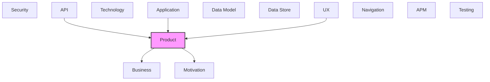

# Product

[← Back to README](../README.md)

Product features, capabilities, personas, and milestones.

## Report Index

- [Layer Introduction](#layer-introduction)
- [Intra-Layer Relationships](#intra-layer-relationships)
- [Inter-Layer Dependencies](#inter-layer-dependencies)
- [Inter-Layer Relationships Table](#inter-layer-relationships-table)
- [Element Reference](#element-reference)

## Layer Introduction

| Metric                    | Count |
| ------------------------- | ----- |
| Elements                  | 68    |
| Intra-Layer Relationships | 118   |
| Inter-Layer Relationships | 320   |
| Inbound Relationships     | 259   |
| Outbound Relationships    | 61    |

**Cross-Layer References**:

- **Upstream layers**: [API](./07-api-layer-report.md), [Application](./05-application-layer-report.md), [UX](./10-ux-layer-report.md)
- **Downstream layers**: [Business](./02-business-layer-report.md), [Motivation](./01-motivation-layer-report.md)

## Intra-Layer Relationships

*This layer has >30 elements. Summary table shown instead of diagram.*

| Element                                                           | Type                 | Relationships |
| ----------------------------------------------------------------- | -------------------- | ------------- |
| `product.feature.approval-policy`                                 | `feature`            | 2             |
| `product.feature.change-history-and-sync`                         | `feature`            | 2             |
| `product.feature.chat-panel`                                      | `feature`            | 2             |
| `product.feature.check-drift`                                     | `feature`            | 4             |
| `product.feature.claims-page`                                     | `feature`            | 3             |
| `product.feature.compare-two-pipelines`                           | `feature`            | 3             |
| `product.feature.configuration-settings`                          | `feature`            | 2             |
| `product.feature.dataset-selector`                                | `feature`            | 2             |
| `product.feature.demo-dataset-loader`                             | `feature`            | 2             |
| `product.feature.export-bundle`                                   | `feature`            | 2             |
| `product.feature.extraction-pre-review`                           | `feature`            | 3             |
| `product.feature.extraction-review-bench`                         | `feature`            | 3             |
| `product.feature.gold-mode`                                       | `feature`            | 4             |
| `product.feature.graph-view`                                      | `feature`            | 2             |
| `product.feature.inline-suggesters-in-drawers`                    | `feature`            | 2             |
| `product.feature.installable-desktop-app`                         | `feature`            | 2             |
| `product.feature.mcp-integration-settings`                        | `feature`            | 5             |
| `product.feature.owl-skos-and-graph-ml-import-and-export`         | `feature`            | 2             |
| `product.feature.pending-changes-on-entity-pages`                 | `feature`            | 2             |
| `product.feature.pipeline-run-wizard`                             | `feature`            | 2             |
| `product.feature.proposal-queue-and-detail`                       | `feature`            | 7             |
| `product.feature.proposal-review-page`                            | `feature`            | 7             |
| `product.feature.reference-sources-and-grounding-workflows`       | `feature`            | 2             |
| `product.feature.runs-page`                                       | `feature`            | 2             |
| `product.feature.schema-and-data-pages`                           | `feature`            | 2             |
| `product.feature.source-citations-on-entity-pages`                | `feature`            | 3             |
| `product.feature.sources-page-and-extract-flow`                   | `feature`            | 4             |
| `product.feature.system-health-and-background-tasks`              | `feature`            | 2             |
| `product.persona.client-maintainer`                               | `persona`            | 7             |
| `product.persona.ontology-curator`                                | `persona`            | 30            |
| `product.softwarecapability.agent-access-over-mcp`                | `softwarecapability` | 1             |
| `product.softwarecapability.chat-assistant`                       | `softwarecapability` | 1             |
| `product.softwarecapability.claims-triage`                        | `softwarecapability` | 1             |
| `product.softwarecapability.client-interchange`                   | `softwarecapability` | 3             |
| `product.softwarecapability.decision-models`                      | `softwarecapability` | 1             |
| `product.softwarecapability.desktop-application-packaging`        | `softwarecapability` | 1             |
| `product.softwarecapability.extraction-benchmarking`              | `softwarecapability` | 2             |
| `product.softwarecapability.graph-exploration`                    | `softwarecapability` | 1             |
| `product.softwarecapability.pipeline-configuration-and-selection` | `softwarecapability` | 3             |
| `product.softwarecapability.proposal-review-and-apply`            | `softwarecapability` | 5             |
| `product.softwarecapability.reference-grounding`                  | `softwarecapability` | 2             |
| `product.softwarecapability.schema-and-data-curation`             | `softwarecapability` | 3             |
| `product.softwarecapability.source-extraction`                    | `softwarecapability` | 4             |
| `product.softwarecapability.workspace-administration`             | `softwarecapability` | 2             |
| `product.softwarecapability.workspace-sync`                       | `softwarecapability` | 1             |
| `product.userworkflow.adjudicate-a-client-plan`                   | `userworkflow`       | 6             |
| `product.userworkflow.check-benchmark-gold-workflow`              | `userworkflow`       | 4             |
| `product.userworkflow.connect-an-agent`                           | `userworkflow`       | 4             |
| `product.userworkflow.extract-a-document-into-a-dataset`          | `userworkflow`       | 5             |
| `product.userworkflow.review-and-decide-a-proposal`               | `userworkflow`       | 6             |
| `product.workflowstep.add-a-source`                               | `workflowstep`       | 3             |
| `product.workflowstep.apply-the-decisions`                        | `workflowstep`       | 4             |
| `product.workflowstep.ask-the-agent-about-the-model`              | `workflowstep`       | 3             |
| `product.workflowstep.check-drift-against-the-client-spec`        | `workflowstep`       | 4             |
| `product.workflowstep.clear-mechanical-operations-by-threshold`   | `workflowstep`       | 4             |
| `product.workflowstep.client-lands-the-decisions`                 | `workflowstep`       | 3             |
| `product.workflowstep.copy-the-mcp-command`                       | `workflowstep`       | 3             |
| `product.workflowstep.extract-into-a-dataset`                     | `workflowstep`       | 4             |
| `product.workflowstep.judge-the-gold-candidates`                  | `workflowstep`       | 4             |
| `product.workflowstep.judge-the-remaining-operations`             | `workflowstep`       | 4             |
| `product.workflowstep.open-the-gold-check`                        | `workflowstep`       | 3             |
| `product.workflowstep.open-the-proposal-from-the-queue`           | `workflowstep`       | 3             |
| `product.workflowstep.receive-the-client-plan`                    | `workflowstep`       | 3             |
| `product.workflowstep.revert-an-applied-proposal`                 | `workflowstep`       | 3             |
| `product.workflowstep.review-the-client-plan`                     | `workflowstep`       | 4             |
| `product.workflowstep.review-the-extraction-proposal`             | `workflowstep`       | 5             |
| `product.workflowstep.see-the-citations`                          | `workflowstep`       | 3             |
| `product.workflowstep.write-the-gold-back`                        | `workflowstep`       | 3             |

## Inter-Layer Dependencies

## Inter-Layer Relationships Table

| Relationship ID                                                      | Source Node                                                         | Dest Node                                                                                 | Dest Layer   | Predicate    | Cardinality  | Strength |
| -------------------------------------------------------------------- | ------------------------------------------------------------------- | ----------------------------------------------------------------------------------------- | ------------ | ------------ | ------------ | -------- |
| `api.operation.exposes.product.feature`                              | `api.operation.accept-rest-of-comparison`                           | `product.feature.compare-two-pipelines`                                                   | `product`    | `exposes`    | many-to-many | medium   |
| `api.operation.exposes.product.feature`                              | `api.operation.add-parent-class-to-individual`                      | `product.feature.schema-and-data-pages`                                                   | `product`    | `exposes`    | many-to-many | medium   |
| `api.operation.exposes.product.feature`                              | `api.operation.add-proposal-operations`                             | `product.feature.proposal-queue-and-detail`                                               | `product`    | `exposes`    | many-to-many | medium   |
| `api.operation.exposes.product.feature`                              | `api.operation.add-proposal-operations`                             | `product.feature.proposal-review-page`                                                    | `product`    | `exposes`    | many-to-many | medium   |
| `api.operation.exposes.product.feature`                              | `api.operation.add-source`                                          | `product.feature.sources-page-and-extract-flow`                                           | `product`    | `exposes`    | many-to-many | medium   |
| `api.operation.exposes.product.feature`                              | `api.operation.apply-proposal`                                      | `product.feature.proposal-queue-and-detail`                                               | `product`    | `exposes`    | many-to-many | medium   |
| `api.operation.exposes.product.feature`                              | `api.operation.build-graph`                                         | `product.feature.graph-view`                                                              | `product`    | `exposes`    | many-to-many | medium   |
| `api.operation.exposes.product.feature`                              | `api.operation.cancel-batch-runs`                                   | `product.feature.runs-page`                                                               | `product`    | `exposes`    | many-to-many | medium   |
| `api.operation.exposes.product.feature`                              | `api.operation.cancel-pipeline-run`                                 | `product.feature.runs-page`                                                               | `product`    | `exposes`    | many-to-many | medium   |
| `api.operation.exposes.product.feature`                              | `api.operation.check-cycle`                                         | `product.feature.graph-view`                                                              | `product`    | `exposes`    | many-to-many | medium   |
| `api.operation.exposes.product.feature`                              | `api.operation.clear-claim-verdict`                                 | `product.feature.claims-page`                                                             | `product`    | `exposes`    | many-to-many | medium   |
| `api.operation.exposes.product.feature`                              | `api.operation.clear-proposal-landed`                               | `product.feature.proposal-queue-and-detail`                                               | `product`    | `exposes`    | many-to-many | medium   |
| `api.operation.exposes.product.feature`                              | `api.operation.compare-proposals`                                   | `product.feature.compare-two-pipelines`                                                   | `product`    | `exposes`    | many-to-many | medium   |
| `api.operation.exposes.product.feature`                              | `api.operation.create-attribute-definition`                         | `product.feature.schema-and-data-pages`                                                   | `product`    | `exposes`    | many-to-many | medium   |
| `api.operation.exposes.product.feature`                              | `api.operation.create-batch`                                        | `product.feature.runs-page`                                                               | `product`    | `exposes`    | many-to-many | medium   |
| `api.operation.exposes.product.feature`                              | `api.operation.create-class`                                        | `product.feature.schema-and-data-pages`                                                   | `product`    | `exposes`    | many-to-many | medium   |
| `api.operation.exposes.product.feature`                              | `api.operation.create-conversation`                                 | `product.feature.chat-panel`                                                              | `product`    | `exposes`    | many-to-many | medium   |
| `api.operation.exposes.product.feature`                              | `api.operation.create-dataset`                                      | `product.feature.schema-and-data-pages`                                                   | `product`    | `exposes`    | many-to-many | medium   |
| `api.operation.exposes.product.feature`                              | `api.operation.create-individual`                                   | `product.feature.schema-and-data-pages`                                                   | `product`    | `exposes`    | many-to-many | medium   |
| `api.operation.exposes.product.feature`                              | `api.operation.create-property-definition`                          | `product.feature.schema-and-data-pages`                                                   | `product`    | `exposes`    | many-to-many | medium   |
| `api.operation.exposes.product.feature`                              | `api.operation.create-proposal`                                     | `product.feature.proposal-queue-and-detail`                                               | `product`    | `exposes`    | many-to-many | medium   |
| `api.operation.exposes.product.feature`                              | `api.operation.decide-comparison-pair`                              | `product.feature.compare-two-pipelines`                                                   | `product`    | `exposes`    | many-to-many | medium   |
| `api.operation.exposes.product.feature`                              | `api.operation.delete-attribute-definition`                         | `product.feature.schema-and-data-pages`                                                   | `product`    | `exposes`    | many-to-many | medium   |
| `api.operation.exposes.product.feature`                              | `api.operation.delete-class`                                        | `product.feature.schema-and-data-pages`                                                   | `product`    | `exposes`    | many-to-many | medium   |
| `api.operation.exposes.product.feature`                              | `api.operation.delete-concept-scheme`                               | `product.feature.schema-and-data-pages`                                                   | `product`    | `exposes`    | many-to-many | medium   |
| `api.operation.exposes.product.feature`                              | `api.operation.delete-conversation`                                 | `product.feature.chat-panel`                                                              | `product`    | `exposes`    | many-to-many | medium   |
| `api.operation.exposes.product.feature`                              | `api.operation.delete-dataset`                                      | `product.feature.schema-and-data-pages`                                                   | `product`    | `exposes`    | many-to-many | medium   |
| `api.operation.exposes.product.feature`                              | `api.operation.delete-grounding-workflow`                           | `product.feature.reference-sources-and-grounding-workflows`                               | `product`    | `exposes`    | many-to-many | medium   |
| `api.operation.exposes.product.feature`                              | `api.operation.delete-individual`                                   | `product.feature.schema-and-data-pages`                                                   | `product`    | `exposes`    | many-to-many | medium   |
| `api.operation.exposes.product.feature`                              | `api.operation.delete-property-definition`                          | `product.feature.schema-and-data-pages`                                                   | `product`    | `exposes`    | many-to-many | medium   |
| `api.operation.exposes.product.feature`                              | `api.operation.delete-relationship`                                 | `product.feature.schema-and-data-pages`                                                   | `product`    | `exposes`    | many-to-many | medium   |
| `api.operation.exposes.product.feature`                              | `api.operation.delete-taxonomy`                                     | `product.feature.schema-and-data-pages`                                                   | `product`    | `exposes`    | many-to-many | medium   |
| `api.operation.exposes.product.feature`                              | `api.operation.dr-spec-drift`                                       | `product.feature.check-drift`                                                             | `product`    | `exposes`    | many-to-many | medium   |
| `api.operation.exposes.product.feature`                              | `api.operation.enqueue-batch-runs`                                  | `product.feature.runs-page`                                                               | `product`    | `exposes`    | many-to-many | medium   |
| `api.operation.exposes.product.feature`                              | `api.operation.execute-sparql`                                      | `product.feature.graph-view`                                                              | `product`    | `exposes`    | many-to-many | medium   |
| `api.operation.exposes.product.feature`                              | `api.operation.export-bundle`                                       | `product.feature.export-bundle`                                                           | `product`    | `exposes`    | many-to-many | medium   |
| `api.operation.exposes.product.feature`                              | `api.operation.export-claims`                                       | `product.feature.claims-page`                                                             | `product`    | `exposes`    | many-to-many | medium   |
| `api.operation.exposes.product.feature`                              | `api.operation.export-gold`                                         | `product.feature.gold-mode`                                                               | `product`    | `exposes`    | many-to-many | medium   |
| `api.operation.exposes.product.feature`                              | `api.operation.export-ontology`                                     | `product.feature.owl-skos-and-graph-ml-import-and-export`                                 | `product`    | `exposes`    | many-to-many | medium   |
| `api.operation.exposes.product.feature`                              | `api.operation.extract-source`                                      | `product.feature.sources-page-and-extract-flow`                                           | `product`    | `exposes`    | many-to-many | medium   |
| `api.operation.exposes.product.feature`                              | `api.operation.get-all-paths`                                       | `product.feature.graph-view`                                                              | `product`    | `exposes`    | many-to-many | medium   |
| `api.operation.exposes.product.feature`                              | `api.operation.get-approval-policy`                                 | `product.feature.approval-policy`                                                         | `product`    | `exposes`    | many-to-many | medium   |
| `api.operation.exposes.product.feature`                              | `api.operation.get-attribute-definition`                            | `product.feature.schema-and-data-pages`                                                   | `product`    | `exposes`    | many-to-many | medium   |
| `api.operation.exposes.product.feature`                              | `api.operation.get-background-task`                                 | `product.feature.system-health-and-background-tasks`                                      | `product`    | `exposes`    | many-to-many | medium   |
| `api.operation.exposes.product.feature`                              | `api.operation.get-batch`                                           | `product.feature.runs-page`                                                               | `product`    | `exposes`    | many-to-many | medium   |
| `api.operation.exposes.product.feature`                              | `api.operation.get-centrality`                                      | `product.feature.graph-view`                                                              | `product`    | `exposes`    | many-to-many | medium   |
| `api.operation.exposes.product.feature`                              | `api.operation.get-change-history-all`                              | `product.feature.change-history-and-sync`                                                 | `product`    | `exposes`    | many-to-many | medium   |
| `api.operation.exposes.product.feature`                              | `api.operation.get-change-history-by-entity`                        | `product.feature.change-history-and-sync`                                                 | `product`    | `exposes`    | many-to-many | medium   |
| `api.operation.exposes.product.feature`                              | `api.operation.get-chat-status`                                     | `product.feature.chat-panel`                                                              | `product`    | `exposes`    | many-to-many | medium   |
| `api.operation.exposes.product.feature`                              | `api.operation.get-claim`                                           | `product.feature.claims-page`                                                             | `product`    | `exposes`    | many-to-many | medium   |
| `api.operation.exposes.product.feature`                              | `api.operation.get-class`                                           | `product.feature.schema-and-data-pages`                                                   | `product`    | `exposes`    | many-to-many | medium   |
| `api.operation.exposes.product.feature`                              | `api.operation.get-communities`                                     | `product.feature.graph-view`                                                              | `product`    | `exposes`    | many-to-many | medium   |
| `api.operation.exposes.product.feature`                              | `api.operation.get-concept-scheme`                                  | `product.feature.schema-and-data-pages`                                                   | `product`    | `exposes`    | many-to-many | medium   |
| `api.operation.exposes.product.feature`                              | `api.operation.get-configuration`                                   | `product.feature.configuration-settings`                                                  | `product`    | `exposes`    | many-to-many | medium   |
| `api.operation.exposes.product.feature`                              | `api.operation.get-conversation`                                    | `product.feature.chat-panel`                                                              | `product`    | `exposes`    | many-to-many | medium   |
| `api.operation.exposes.product.feature`                              | `api.operation.get-database-health`                                 | `product.feature.system-health-and-background-tasks`                                      | `product`    | `exposes`    | many-to-many | medium   |
| `api.operation.exposes.product.feature`                              | `api.operation.get-degree-distribution`                             | `product.feature.graph-view`                                                              | `product`    | `exposes`    | many-to-many | medium   |
| `api.operation.exposes.product.feature`                              | `api.operation.get-embedding-health`                                | `product.feature.system-health-and-background-tasks`                                      | `product`    | `exposes`    | many-to-many | medium   |
| `api.operation.exposes.product.feature`                              | `api.operation.get-graph-metrics`                                   | `product.feature.graph-view`                                                              | `product`    | `exposes`    | many-to-many | medium   |
| `api.operation.exposes.product.feature`                              | `api.operation.get-graph-view`                                      | `product.feature.graph-view`                                                              | `product`    | `exposes`    | many-to-many | medium   |
| `api.operation.exposes.product.feature`                              | `api.operation.get-grounding-workflow`                              | `product.feature.reference-sources-and-grounding-workflows`                               | `product`    | `exposes`    | many-to-many | medium   |
| `api.operation.exposes.product.feature`                              | `api.operation.get-import-run`                                      | `product.feature.owl-skos-and-graph-ml-import-and-export`                                 | `product`    | `exposes`    | many-to-many | medium   |
| `api.operation.exposes.product.feature`                              | `api.operation.get-individual`                                      | `product.feature.schema-and-data-pages`                                                   | `product`    | `exposes`    | many-to-many | medium   |
| `api.operation.exposes.product.feature`                              | `api.operation.get-individual-extraction-candidates`                | `product.feature.runs-page`                                                               | `product`    | `exposes`    | many-to-many | medium   |
| `api.operation.exposes.product.feature`                              | `api.operation.get-individual-inherited-properties`                 | `product.feature.schema-and-data-pages`                                                   | `product`    | `exposes`    | many-to-many | medium   |
| `api.operation.exposes.product.feature`                              | `api.operation.get-individual-sources`                              | `product.feature.source-citations-on-entity-pages`                                        | `product`    | `exposes`    | many-to-many | medium   |
| `api.operation.exposes.product.feature`                              | `api.operation.get-mcp-connection-details`                          | `product.feature.mcp-integration-settings`                                                | `product`    | `exposes`    | many-to-many | medium   |
| `api.operation.exposes.product.feature`                              | `api.operation.get-neighbors`                                       | `product.feature.graph-view`                                                              | `product`    | `exposes`    | many-to-many | medium   |
| `api.operation.exposes.product.feature`                              | `api.operation.get-nlp-health`                                      | `product.feature.system-health-and-background-tasks`                                      | `product`    | `exposes`    | many-to-many | medium   |
| `api.operation.exposes.product.feature`                              | `api.operation.get-pipeline-candidates-generic`                     | `product.feature.runs-page`                                                               | `product`    | `exposes`    | many-to-many | medium   |
| `api.operation.exposes.product.feature`                              | `api.operation.get-pipeline-executions`                             | `product.feature.runs-page`                                                               | `product`    | `exposes`    | many-to-many | medium   |
| `api.operation.exposes.product.feature`                              | `api.operation.get-pipeline-run-change-events`                      | `product.feature.runs-page`                                                               | `product`    | `exposes`    | many-to-many | medium   |
| `api.operation.exposes.product.feature`                              | `api.operation.get-pipeline-run`                                    | `product.feature.runs-page`                                                               | `product`    | `exposes`    | many-to-many | medium   |
| `api.operation.exposes.product.feature`                              | `api.operation.get-property-definition`                             | `product.feature.schema-and-data-pages`                                                   | `product`    | `exposes`    | many-to-many | medium   |
| `api.operation.exposes.product.feature`                              | `api.operation.get-proposal-decisions`                              | `product.feature.proposal-queue-and-detail`                                               | `product`    | `exposes`    | many-to-many | medium   |
| `api.operation.exposes.product.feature`                              | `api.operation.get-proposal`                                        | `product.feature.proposal-queue-and-detail`                                               | `product`    | `exposes`    | many-to-many | medium   |
| `api.operation.exposes.product.feature`                              | `api.operation.get-publish-diff-stats`                              | `product.feature.schema-and-data-pages`                                                   | `product`    | `exposes`    | many-to-many | medium   |
| `api.operation.exposes.product.feature`                              | `api.operation.get-rdf-triple-count`                                | `product.feature.graph-view`                                                              | `product`    | `exposes`    | many-to-many | medium   |
| `api.operation.exposes.product.feature`                              | `api.operation.get-rdf-triples`                                     | `product.feature.graph-view`                                                              | `product`    | `exposes`    | many-to-many | medium   |
| `api.operation.exposes.product.feature`                              | `api.operation.get-reference-relations`                             | `product.feature.reference-sources-and-grounding-workflows`                               | `product`    | `exposes`    | many-to-many | medium   |
| `api.operation.exposes.product.feature`                              | `api.operation.get-reference-status`                                | `product.feature.reference-sources-and-grounding-workflows`                               | `product`    | `exposes`    | many-to-many | medium   |
| `api.operation.exposes.product.feature`                              | `api.operation.get-relationship`                                    | `product.feature.schema-and-data-pages`                                                   | `product`    | `exposes`    | many-to-many | medium   |
| `api.operation.exposes.product.feature`                              | `api.operation.get-relationship-sources`                            | `product.feature.source-citations-on-entity-pages`                                        | `product`    | `exposes`    | many-to-many | medium   |
| `api.operation.exposes.product.feature`                              | `api.operation.get-run-change-events`                               | `product.feature.owl-skos-and-graph-ml-import-and-export`                                 | `product`    | `exposes`    | many-to-many | medium   |
| `api.operation.exposes.product.feature`                              | `api.operation.get-schema-extraction-candidates`                    | `product.feature.runs-page`                                                               | `product`    | `exposes`    | many-to-many | medium   |
| `api.operation.exposes.product.feature`                              | `api.operation.get-schema-grounding-candidates`                     | `product.feature.runs-page`                                                               | `product`    | `exposes`    | many-to-many | medium   |
| `api.operation.exposes.product.feature`                              | `api.operation.get-schema-refinement-candidates`                    | `product.feature.runs-page`                                                               | `product`    | `exposes`    | many-to-many | medium   |
| `api.operation.exposes.product.feature`                              | `api.operation.get-scheme-class-counts`                             | `product.feature.schema-and-data-pages`                                                   | `product`    | `exposes`    | many-to-many | medium   |
| `api.operation.exposes.product.feature`                              | `api.operation.get-service-metrics`                                 | `product.feature.system-health-and-background-tasks`                                      | `product`    | `exposes`    | many-to-many | medium   |
| `api.operation.exposes.product.feature`                              | `api.operation.get-shortest-path`                                   | `product.feature.graph-view`                                                              | `product`    | `exposes`    | many-to-many | medium   |
| `api.operation.exposes.product.feature`                              | `api.operation.get-source`                                          | `product.feature.sources-page-and-extract-flow`                                           | `product`    | `exposes`    | many-to-many | medium   |
| `api.operation.exposes.product.feature`                              | `api.operation.get-source-text`                                     | `product.feature.proposal-review-page`                                                    | `product`    | `exposes`    | many-to-many | medium   |
| `api.operation.exposes.product.feature`                              | `api.operation.get-source-text`                                     | `product.feature.sources-page-and-extract-flow`                                           | `product`    | `exposes`    | many-to-many | medium   |
| `api.operation.exposes.product.feature`                              | `api.operation.get-stats-trends`                                    | `product.feature.system-health-and-background-tasks`                                      | `product`    | `exposes`    | many-to-many | medium   |
| `api.operation.exposes.product.feature`                              | `api.operation.get-subgraph-by-depth`                               | `product.feature.graph-view`                                                              | `product`    | `exposes`    | many-to-many | medium   |
| `api.operation.exposes.product.feature`                              | `api.operation.get-subgraph`                                        | `product.feature.graph-view`                                                              | `product`    | `exposes`    | many-to-many | medium   |
| `api.operation.exposes.product.feature`                              | `api.operation.get-sync-status`                                     | `product.feature.change-history-and-sync`                                                 | `product`    | `exposes`    | many-to-many | medium   |
| `api.operation.exposes.product.feature`                              | `api.operation.get-system-health`                                   | `product.feature.system-health-and-background-tasks`                                      | `product`    | `exposes`    | many-to-many | medium   |
| `api.operation.exposes.product.feature`                              | `api.operation.get-tasks-health`                                    | `product.feature.system-health-and-background-tasks`                                      | `product`    | `exposes`    | many-to-many | medium   |
| `api.operation.exposes.product.feature`                              | `api.operation.get-taxonomy`                                        | `product.feature.schema-and-data-pages`                                                   | `product`    | `exposes`    | many-to-many | medium   |
| `api.operation.exposes.product.feature`                              | `api.operation.get-taxonomy-scheme-counts`                          | `product.feature.schema-and-data-pages`                                                   | `product`    | `exposes`    | many-to-many | medium   |
| `api.operation.exposes.product.feature`                              | `api.operation.import-ontology`                                     | `product.feature.owl-skos-and-graph-ml-import-and-export`                                 | `product`    | `exposes`    | many-to-many | medium   |
| `api.operation.exposes.product.feature`                              | `api.operation.list-background-tasks`                               | `product.feature.system-health-and-background-tasks`                                      | `product`    | `exposes`    | many-to-many | medium   |
| `api.operation.exposes.product.feature`                              | `api.operation.list-claims`                                         | `product.feature.claims-page`                                                             | `product`    | `exposes`    | many-to-many | medium   |
| `api.operation.exposes.product.feature`                              | `api.operation.list-class-attribute-definitions`                    | `product.feature.schema-and-data-pages`                                                   | `product`    | `exposes`    | many-to-many | medium   |
| `api.operation.exposes.product.feature`                              | `api.operation.list-classes`                                        | `product.feature.schema-and-data-pages`                                                   | `product`    | `exposes`    | many-to-many | medium   |
| `api.operation.exposes.product.feature`                              | `api.operation.list-concept-schemes`                                | `product.feature.schema-and-data-pages`                                                   | `product`    | `exposes`    | many-to-many | medium   |
| `api.operation.exposes.product.feature`                              | `api.operation.list-conversations`                                  | `product.feature.chat-panel`                                                              | `product`    | `exposes`    | many-to-many | medium   |
| `api.operation.exposes.product.feature`                              | `api.operation.list-datasets`                                       | `product.feature.schema-and-data-pages`                                                   | `product`    | `exposes`    | many-to-many | medium   |
| `api.operation.exposes.product.feature`                              | `api.operation.list-decision-models`                                | `product.feature.pipeline-run-wizard`                                                     | `product`    | `exposes`    | many-to-many | medium   |
| `api.operation.exposes.product.feature`                              | `api.operation.list-demo-datasets`                                  | `product.feature.demo-dataset-loader`                                                     | `product`    | `exposes`    | many-to-many | medium   |
| `api.operation.exposes.product.feature`                              | `api.operation.list-edge-attributes`                                | `product.feature.schema-and-data-pages`                                                   | `product`    | `exposes`    | many-to-many | medium   |
| `api.operation.exposes.product.feature`                              | `api.operation.list-gold`                                           | `product.feature.gold-mode`                                                               | `product`    | `exposes`    | many-to-many | medium   |
| `api.operation.exposes.product.feature`                              | `api.operation.list-grounding-workflows`                            | `product.feature.reference-sources-and-grounding-workflows`                               | `product`    | `exposes`    | many-to-many | medium   |
| `api.operation.exposes.product.feature`                              | `api.operation.list-import-runs`                                    | `product.feature.owl-skos-and-graph-ml-import-and-export`                                 | `product`    | `exposes`    | many-to-many | medium   |
| `api.operation.exposes.product.feature`                              | `api.operation.list-individuals`                                    | `product.feature.schema-and-data-pages`                                                   | `product`    | `exposes`    | many-to-many | medium   |
| `api.operation.exposes.product.feature`                              | `api.operation.list-predicates-by-ids`                              | `product.feature.schema-and-data-pages`                                                   | `product`    | `exposes`    | many-to-many | medium   |
| `api.operation.exposes.product.feature`                              | `api.operation.list-property-definitions`                           | `product.feature.schema-and-data-pages`                                                   | `product`    | `exposes`    | many-to-many | medium   |
| `api.operation.exposes.product.feature`                              | `api.operation.list-proposals`                                      | `product.feature.proposal-queue-and-detail`                                               | `product`    | `exposes`    | many-to-many | medium   |
| `api.operation.exposes.product.feature`                              | `api.operation.list-relationships`                                  | `product.feature.schema-and-data-pages`                                                   | `product`    | `exposes`    | many-to-many | medium   |
| `api.operation.exposes.product.feature`                              | `api.operation.list-sources`                                        | `product.feature.sources-page-and-extract-flow`                                           | `product`    | `exposes`    | many-to-many | medium   |
| `api.operation.exposes.product.feature`                              | `api.operation.list-taxonomies`                                     | `product.feature.schema-and-data-pages`                                                   | `product`    | `exposes`    | many-to-many | medium   |
| `api.operation.exposes.product.feature`                              | `api.operation.list-taxonomy-classes`                               | `product.feature.schema-and-data-pages`                                                   | `product`    | `exposes`    | many-to-many | medium   |
| `api.operation.exposes.product.feature`                              | `api.operation.list-taxonomy-predicates`                            | `product.feature.schema-and-data-pages`                                                   | `product`    | `exposes`    | many-to-many | medium   |
| `api.operation.exposes.product.feature`                              | `api.operation.list-workflow-runs`                                  | `product.feature.reference-sources-and-grounding-workflows`                               | `product`    | `exposes`    | many-to-many | medium   |
| `api.operation.exposes.product.feature`                              | `api.operation.load-demo-dataset`                                   | `product.feature.demo-dataset-loader`                                                     | `product`    | `exposes`    | many-to-many | medium   |
| `api.operation.exposes.product.feature`                              | `api.operation.mark-proposal-landed`                                | `product.feature.proposal-queue-and-detail`                                               | `product`    | `exposes`    | many-to-many | medium   |
| `api.operation.exposes.product.feature`                              | `api.operation.publish-taxonomy`                                    | `product.feature.schema-and-data-pages`                                                   | `product`    | `exposes`    | many-to-many | medium   |
| `api.operation.exposes.product.feature`                              | `api.operation.pull-changes`                                        | `product.feature.change-history-and-sync`                                                 | `product`    | `exposes`    | many-to-many | medium   |
| `api.operation.exposes.product.feature`                              | `api.operation.push-changes`                                        | `product.feature.change-history-and-sync`                                                 | `product`    | `exposes`    | many-to-many | medium   |
| `api.operation.exposes.product.feature`                              | `api.operation.reject-proposal`                                     | `product.feature.proposal-queue-and-detail`                                               | `product`    | `exposes`    | many-to-many | medium   |
| `api.operation.exposes.product.feature`                              | `api.operation.remove-parent-class-from-individual`                 | `product.feature.schema-and-data-pages`                                                   | `product`    | `exposes`    | many-to-many | medium   |
| `api.operation.exposes.product.feature`                              | `api.operation.remove-source`                                       | `product.feature.sources-page-and-extract-flow`                                           | `product`    | `exposes`    | many-to-many | medium   |
| `api.operation.exposes.product.feature`                              | `api.operation.reopen-operations`                                   | `product.feature.proposal-queue-and-detail`                                               | `product`    | `exposes`    | many-to-many | medium   |
| `api.operation.exposes.product.feature`                              | `api.operation.reorder-individual-classes`                          | `product.feature.schema-and-data-pages`                                                   | `product`    | `exposes`    | many-to-many | medium   |
| `api.operation.exposes.product.feature`                              | `api.operation.reset-configuration`                                 | `product.feature.configuration-settings`                                                  | `product`    | `exposes`    | many-to-many | medium   |
| `api.operation.exposes.product.feature`                              | `api.operation.resume-batch-runs`                                   | `product.feature.runs-page`                                                               | `product`    | `exposes`    | many-to-many | medium   |
| `api.operation.exposes.product.feature`                              | `api.operation.revert-proposal`                                     | `product.feature.proposal-queue-and-detail`                                               | `product`    | `exposes`    | many-to-many | medium   |
| `api.operation.exposes.product.feature`                              | `api.operation.run-grounding-workflow`                              | `product.feature.reference-sources-and-grounding-workflows`                               | `product`    | `exposes`    | many-to-many | medium   |
| `api.operation.exposes.product.feature`                              | `api.operation.search-references`                                   | `product.feature.reference-sources-and-grounding-workflows`                               | `product`    | `exposes`    | many-to-many | medium   |
| `api.operation.exposes.product.feature`                              | `api.operation.send-message`                                        | `product.feature.chat-panel`                                                              | `product`    | `exposes`    | many-to-many | medium   |
| `api.operation.exposes.product.feature`                              | `api.operation.set-approval-policy`                                 | `product.feature.approval-policy`                                                         | `product`    | `exposes`    | many-to-many | medium   |
| `api.operation.exposes.product.feature`                              | `api.operation.set-claim-verdict`                                   | `product.feature.claims-page`                                                             | `product`    | `exposes`    | many-to-many | medium   |
| `api.operation.exposes.product.feature`                              | `api.operation.submit-claims`                                       | `product.feature.claims-page`                                                             | `product`    | `exposes`    | many-to-many | medium   |
| `api.operation.exposes.product.feature`                              | `api.operation.update-attribute-definition`                         | `product.feature.schema-and-data-pages`                                                   | `product`    | `exposes`    | many-to-many | medium   |
| `api.operation.exposes.product.feature`                              | `api.operation.update-class`                                        | `product.feature.schema-and-data-pages`                                                   | `product`    | `exposes`    | many-to-many | medium   |
| `api.operation.exposes.product.feature`                              | `api.operation.update-configuration-section`                        | `product.feature.configuration-settings`                                                  | `product`    | `exposes`    | many-to-many | medium   |
| `api.operation.exposes.product.feature`                              | `api.operation.update-individual`                                   | `product.feature.schema-and-data-pages`                                                   | `product`    | `exposes`    | many-to-many | medium   |
| `api.operation.exposes.product.feature`                              | `api.operation.update-property-definition`                          | `product.feature.schema-and-data-pages`                                                   | `product`    | `exposes`    | many-to-many | medium   |
| `application.applicationservice.realizes.product.softwarecapability` | `application.applicationservice.admin-service`                      | `product.softwarecapability.workspace-administration`                                     | `product`    | `realizes`   | many-to-many | medium   |
| `application.applicationservice.realizes.product.feature`            | `application.applicationservice.approval-policy-service`            | `product.feature.approval-policy`                                                         | `product`    | `realizes`   | many-to-many | medium   |
| `application.applicationservice.realizes.product.feature`            | `application.applicationservice.bundle-export-service`              | `product.feature.export-bundle`                                                           | `product`    | `realizes`   | many-to-many | medium   |
| `application.applicationservice.realizes.product.softwarecapability` | `application.applicationservice.bundle-import-service`              | `product.softwarecapability.client-interchange`                                           | `product`    | `realizes`   | many-to-many | medium   |
| `application.applicationservice.realizes.product.softwarecapability` | `application.applicationservice.chat-service`                       | `product.softwarecapability.chat-assistant`                                               | `product`    | `realizes`   | many-to-many | medium   |
| `application.applicationservice.realizes.product.softwarecapability` | `application.applicationservice.chat-settings`                      | `product.softwarecapability.chat-assistant`                                               | `product`    | `realizes`   | many-to-many | medium   |
| `application.applicationservice.realizes.product.softwarecapability` | `application.applicationservice.chat-tool`                          | `product.softwarecapability.agent-access-over-mcp`                                        | `product`    | `realizes`   | many-to-many | medium   |
| `application.applicationservice.realizes.product.softwarecapability` | `application.applicationservice.claim-repository`                   | `product.softwarecapability.claims-triage`                                                | `product`    | `realizes`   | many-to-many | medium   |
| `application.applicationservice.realizes.product.softwarecapability` | `application.applicationservice.claim-service`                      | `product.softwarecapability.claims-triage`                                                | `product`    | `realizes`   | many-to-many | medium   |
| `application.applicationservice.realizes.product.softwarecapability` | `application.applicationservice.configuration-store`                | `product.softwarecapability.workspace-administration`                                     | `product`    | `realizes`   | many-to-many | medium   |
| `application.applicationservice.realizes.product.softwarecapability` | `application.applicationservice.decision-models`                    | `product.softwarecapability.decision-models`                                              | `product`    | `realizes`   | many-to-many | medium   |
| `application.applicationservice.realizes.product.feature`            | `application.applicationservice.demo-dataset-service`               | `product.feature.demo-dataset-loader`                                                     | `product`    | `realizes`   | many-to-many | medium   |
| `application.applicationservice.realizes.product.feature`            | `application.applicationservice.drift-import-service`               | `product.feature.check-drift`                                                             | `product`    | `realizes`   | many-to-many | medium   |
| `application.applicationservice.realizes.product.softwarecapability` | `application.applicationservice.extraction-repository`              | `product.softwarecapability.source-extraction`                                            | `product`    | `realizes`   | many-to-many | medium   |
| `application.applicationservice.realizes.product.softwarecapability` | `application.applicationservice.extraction-run-repository`          | `product.softwarecapability.source-extraction`                                            | `product`    | `realizes`   | many-to-many | medium   |
| `application.applicationservice.realizes.product.softwarecapability` | `application.applicationservice.extraction-service`                 | `product.softwarecapability.source-extraction`                                            | `product`    | `realizes`   | many-to-many | medium   |
| `application.applicationservice.realizes.product.softwarecapability` | `application.applicationservice.graph-analysis-service`             | `product.softwarecapability.graph-exploration`                                            | `product`    | `realizes`   | many-to-many | medium   |
| `application.applicationservice.realizes.product.softwarecapability` | `application.applicationservice.grounding-adapter-port`             | `product.softwarecapability.reference-grounding`                                          | `product`    | `realizes`   | many-to-many | medium   |
| `application.applicationservice.realizes.product.feature`            | `application.applicationservice.import-run-service`                 | `product.feature.owl-skos-and-graph-ml-import-and-export`                                 | `product`    | `realizes`   | many-to-many | medium   |
| `application.applicationservice.realizes.product.softwarecapability` | `application.applicationservice.import-run-service`                 | `product.softwarecapability.client-interchange`                                           | `product`    | `realizes`   | many-to-many | medium   |
| `application.applicationservice.realizes.product.softwarecapability` | `application.applicationservice.metrics-collector`                  | `product.softwarecapability.workspace-administration`                                     | `product`    | `realizes`   | many-to-many | medium   |
| `application.applicationservice.realizes.product.softwarecapability` | `application.applicationservice.ontology-service`                   | `product.softwarecapability.schema-and-data-curation`                                     | `product`    | `realizes`   | many-to-many | medium   |
| `application.applicationservice.realizes.product.softwarecapability` | `application.applicationservice.pipeline-registry`                  | `product.softwarecapability.pipeline-configuration-and-selection`                         | `product`    | `realizes`   | many-to-many | medium   |
| `application.applicationservice.realizes.product.softwarecapability` | `application.applicationservice.pipeline-run-repository`            | `product.softwarecapability.pipeline-configuration-and-selection`                         | `product`    | `realizes`   | many-to-many | medium   |
| `application.applicationservice.realizes.product.softwarecapability` | `application.applicationservice.pipeline-selection-service`         | `product.softwarecapability.pipeline-configuration-and-selection`                         | `product`    | `realizes`   | many-to-many | medium   |
| `application.applicationservice.realizes.product.feature`            | `application.applicationservice.proposal-comparison-service`        | `product.feature.compare-two-pipelines`                                                   | `product`    | `realizes`   | many-to-many | medium   |
| `application.applicationservice.realizes.product.softwarecapability` | `application.applicationservice.proposal-service`                   | `product.softwarecapability.proposal-review-and-apply`                                    | `product`    | `realizes`   | many-to-many | medium   |
| `application.applicationservice.realizes.product.softwarecapability` | `application.applicationservice.reference-source`                   | `product.softwarecapability.reference-grounding`                                          | `product`    | `realizes`   | many-to-many | medium   |
| `application.applicationservice.realizes.product.softwarecapability` | `application.applicationservice.revert-service`                     | `product.softwarecapability.proposal-review-and-apply`                                    | `product`    | `realizes`   | many-to-many | medium   |
| `application.applicationservice.realizes.product.feature`            | `application.applicationservice.schema-recognition-preview-service` | `product.feature.extraction-review-bench`                                                 | `product`    | `realizes`   | many-to-many | medium   |
| `application.applicationservice.realizes.product.feature`            | `application.applicationservice.source-extraction-service`          | `product.feature.extraction-pre-review`                                                   | `product`    | `realizes`   | many-to-many | medium   |
| `application.applicationservice.realizes.product.softwarecapability` | `application.applicationservice.source-extraction-service`          | `product.softwarecapability.source-extraction`                                            | `product`    | `realizes`   | many-to-many | medium   |
| `application.applicationservice.realizes.product.softwarecapability` | `application.applicationservice.source-file-store`                  | `product.softwarecapability.source-extraction`                                            | `product`    | `realizes`   | many-to-many | medium   |
| `application.applicationservice.realizes.product.softwarecapability` | `application.applicationservice.source-reader`                      | `product.softwarecapability.source-extraction`                                            | `product`    | `realizes`   | many-to-many | medium   |
| `application.applicationservice.realizes.product.softwarecapability` | `application.applicationservice.source-run-reader`                  | `product.softwarecapability.source-extraction`                                            | `product`    | `realizes`   | many-to-many | medium   |
| `application.applicationservice.realizes.product.feature`            | `application.applicationservice.source-service`                     | `product.feature.sources-page-and-extract-flow`                                           | `product`    | `realizes`   | many-to-many | medium   |
| `application.applicationservice.realizes.product.softwarecapability` | `application.applicationservice.sync-target`                        | `product.softwarecapability.workspace-sync`                                               | `product`    | `realizes`   | many-to-many | medium   |
| `application.applicationservice.realizes.product.softwarecapability` | `application.applicationservice.versioning-service`                 | `product.softwarecapability.workspace-sync`                                               | `product`    | `realizes`   | many-to-many | medium   |
| `application.applicationservice.realizes.product.softwarecapability` | `application.applicationservice.workspace-context`                  | `product.softwarecapability.chat-assistant`                                               | `product`    | `realizes`   | many-to-many | medium   |
| `product.feature.satisfies.motivation.requirement`                   | `product.feature.approval-policy`                                   | `motivation.requirement.breaking-changes-never-auto-apply`                                | `motivation` | `satisfies`  | many-to-many | medium   |
| `product.feature.satisfies.motivation.requirement`                   | `product.feature.check-drift`                                       | `motivation.requirement.mirrored-taxonomies-accept-schema-changes-only-from-their-client` | `motivation` | `satisfies`  | many-to-many | medium   |
| `product.feature.satisfies.motivation.requirement`                   | `product.feature.configuration-settings`                            | `motivation.requirement.secrets-stay-in-the-configuration-file`                           | `motivation` | `satisfies`  | many-to-many | medium   |
| `product.feature.satisfies.motivation.requirement`                   | `product.feature.dataset-selector`                                  | `motivation.requirement.individuals-belong-to-one-dataset`                                | `motivation` | `satisfies`  | many-to-many | medium   |
| `product.feature.delivers.motivation.value`                          | `product.feature.export-bundle`                                     | `motivation.value.knowledge-reusability`                                                  | `motivation` | `delivers`   | many-to-many | medium   |
| `product.feature.delivers.motivation.value`                          | `product.feature.extraction-pre-review`                             | `motivation.value.reviewer-time-goes-to-judgment-calls`                                   | `motivation` | `delivers`   | many-to-many | medium   |
| `product.feature.satisfies.motivation.requirement`                   | `product.feature.extraction-pre-review`                             | `motivation.requirement.pre-review-is-adopted-only-by-a-rule-set-in-advance`              | `motivation` | `satisfies`  | many-to-many | medium   |
| `product.feature.satisfies.motivation.requirement`                   | `product.feature.gold-mode`                                         | `motivation.requirement.proposals-record-their-pipeline-and-version`                      | `motivation` | `satisfies`  | many-to-many | medium   |
| `product.feature.satisfies.motivation.requirement`                   | `product.feature.mcp-integration-settings`                          | `motivation.requirement.mcp-requires-a-bearer-token-on-loopback`                          | `motivation` | `satisfies`  | many-to-many | medium   |
| `product.feature.delivers.motivation.value`                          | `product.feature.owl-skos-and-graph-ml-import-and-export`           | `motivation.value.knowledge-reusability`                                                  | `motivation` | `delivers`   | many-to-many | medium   |
| `product.feature.satisfies.motivation.requirement`                   | `product.feature.pipeline-run-wizard`                               | `motivation.requirement.one-way-to-select-a-pipeline`                                     | `motivation` | `satisfies`  | many-to-many | medium   |
| `product.feature.satisfies.motivation.requirement`                   | `product.feature.proposal-queue-and-detail`                         | `motivation.requirement.every-applied-proposal-is-revertible`                             | `motivation` | `satisfies`  | many-to-many | medium   |
| `product.feature.delivers.motivation.value`                          | `product.feature.proposal-review-page`                              | `motivation.value.reviewer-time-goes-to-judgment-calls`                                   | `motivation` | `delivers`   | many-to-many | medium   |
| `product.feature.satisfies.motivation.requirement`                   | `product.feature.schema-and-data-pages`                             | `motivation.requirement.individuals-belong-to-one-dataset`                                | `motivation` | `satisfies`  | many-to-many | medium   |
| `product.feature.satisfies.motivation.requirement`                   | `product.feature.schema-and-data-pages`                             | `motivation.requirement.relationships-limited-to-allowed-types`                           | `motivation` | `satisfies`  | many-to-many | medium   |
| `product.feature.delivers.motivation.value`                          | `product.feature.source-citations-on-entity-pages`                  | `motivation.value.every-fact-is-traceable`                                                | `motivation` | `delivers`   | many-to-many | medium   |
| `product.feature.satisfies.motivation.requirement`                   | `product.feature.source-citations-on-entity-pages`                  | `motivation.requirement.extracted-facts-cite-their-source`                                | `motivation` | `satisfies`  | many-to-many | medium   |
| `product.feature.satisfies.motivation.requirement`                   | `product.feature.sources-page-and-extract-flow`                     | `motivation.requirement.individuals-belong-to-one-dataset`                                | `motivation` | `satisfies`  | many-to-many | medium   |
| `product.persona.references.business.businessrole`                   | `product.persona.client-maintainer`                                 | `business.businessrole.client-lander`                                                     | `business`   | `references` | many-to-many | medium   |
| `product.persona.references.motivation.stakeholder`                  | `product.persona.client-maintainer`                                 | `motivation.stakeholder.documentation-robotics-project`                                   | `motivation` | `references` | many-to-many | medium   |
| `product.persona.references.motivation.stakeholder`                  | `product.persona.client-maintainer`                                 | `motivation.stakeholder.house-project`                                                    | `motivation` | `references` | many-to-many | medium   |
| `product.persona.references.business.businessrole`                   | `product.persona.ontology-curator`                                  | `business.businessrole.reviewer`                                                          | `business`   | `references` | many-to-many | medium   |
| `product.persona.references.motivation.stakeholder`                  | `product.persona.ontology-curator`                                  | `motivation.stakeholder.desktop-application-user`                                         | `motivation` | `references` | many-to-many | medium   |
| `product.persona.references.motivation.stakeholder`                  | `product.persona.ontology-curator`                                  | `motivation.stakeholder.ontology-owner-and-reviewer`                                      | `motivation` | `references` | many-to-many | medium   |
| `product.softwarecapability.realizes.business.businessfunction`      | `product.softwarecapability.agent-access-over-mcp`                  | `business.businessfunction.semantic-search`                                               | `business`   | `realizes`   | many-to-many | medium   |
| `product.softwarecapability.satisfies.motivation.requirement`        | `product.softwarecapability.agent-access-over-mcp`                  | `motivation.requirement.mcp-requires-a-bearer-token-on-loopback`                          | `motivation` | `satisfies`  | many-to-many | medium   |
| `product.softwarecapability.supports.motivation.goal`                | `product.softwarecapability.agent-access-over-mcp`                  | `motivation.goal.agents-ground-on-the-curated-model`                                      | `motivation` | `supports`   | many-to-many | medium   |
| `product.softwarecapability.realizes.business.businessfunction`      | `product.softwarecapability.chat-assistant`                         | `business.businessfunction.semantic-search`                                               | `business`   | `realizes`   | many-to-many | medium   |
| `product.softwarecapability.supports.motivation.goal`                | `product.softwarecapability.chat-assistant`                         | `motivation.goal.agents-ground-on-the-curated-model`                                      | `motivation` | `supports`   | many-to-many | medium   |
| `product.softwarecapability.supports.motivation.goal`                | `product.softwarecapability.claims-triage`                          | `motivation.goal.ontology-workbench-for-client-projects`                                  | `motivation` | `supports`   | many-to-many | medium   |
| `product.softwarecapability.satisfies.motivation.requirement`        | `product.softwarecapability.client-interchange`                     | `motivation.requirement.mirrored-taxonomies-accept-schema-changes-only-from-their-client` | `motivation` | `satisfies`  | many-to-many | medium   |
| `product.softwarecapability.supports.motivation.goal`                | `product.softwarecapability.client-interchange`                     | `motivation.goal.ontology-workbench-for-client-projects`                                  | `motivation` | `supports`   | many-to-many | medium   |
| `product.softwarecapability.supports.motivation.goal`                | `product.softwarecapability.decision-models`                        | `motivation.goal.trustworthy-extraction-into-datasets`                                    | `motivation` | `supports`   | many-to-many | medium   |
| `product.softwarecapability.supports.motivation.goal`                | `product.softwarecapability.desktop-application-packaging`          | `motivation.goal.packaged-desktop-application`                                            | `motivation` | `supports`   | many-to-many | medium   |
| `product.softwarecapability.satisfies.motivation.requirement`        | `product.softwarecapability.extraction-benchmarking`                | `motivation.requirement.proposals-record-their-pipeline-and-version`                      | `motivation` | `satisfies`  | many-to-many | medium   |
| `product.softwarecapability.supports.motivation.goal`                | `product.softwarecapability.extraction-benchmarking`                | `motivation.goal.every-decision-becomes-data`                                             | `motivation` | `supports`   | many-to-many | medium   |
| `product.softwarecapability.supports.motivation.goal`                | `product.softwarecapability.graph-exploration`                      | `motivation.goal.ontology-workbench-for-client-projects`                                  | `motivation` | `supports`   | many-to-many | medium   |
| `product.softwarecapability.satisfies.motivation.requirement`        | `product.softwarecapability.pipeline-configuration-and-selection`   | `motivation.requirement.one-way-to-select-a-pipeline`                                     | `motivation` | `satisfies`  | many-to-many | medium   |
| `product.softwarecapability.supports.motivation.goal`                | `product.softwarecapability.pipeline-configuration-and-selection`   | `motivation.goal.trustworthy-extraction-into-datasets`                                    | `motivation` | `supports`   | many-to-many | medium   |
| `product.softwarecapability.satisfies.motivation.requirement`        | `product.softwarecapability.proposal-review-and-apply`              | `motivation.requirement.breaking-changes-never-auto-apply`                                | `motivation` | `satisfies`  | many-to-many | medium   |
| `product.softwarecapability.satisfies.motivation.requirement`        | `product.softwarecapability.proposal-review-and-apply`              | `motivation.requirement.every-applied-proposal-is-revertible`                             | `motivation` | `satisfies`  | many-to-many | medium   |
| `product.softwarecapability.supports.motivation.goal`                | `product.softwarecapability.proposal-review-and-apply`              | `motivation.goal.ontology-workbench-for-client-projects`                                  | `motivation` | `supports`   | many-to-many | medium   |
| `product.softwarecapability.realizes.business.businessfunction`      | `product.softwarecapability.reference-grounding`                    | `business.businessfunction.schema-refinement`                                             | `business`   | `realizes`   | many-to-many | medium   |
| `product.softwarecapability.supports.motivation.goal`                | `product.softwarecapability.reference-grounding`                    | `motivation.goal.ontology-workbench-for-client-projects`                                  | `motivation` | `supports`   | many-to-many | medium   |
| `product.softwarecapability.satisfies.motivation.requirement`        | `product.softwarecapability.schema-and-data-curation`               | `motivation.requirement.individuals-belong-to-one-dataset`                                | `motivation` | `satisfies`  | many-to-many | medium   |
| `product.softwarecapability.supports.motivation.goal`                | `product.softwarecapability.schema-and-data-curation`               | `motivation.goal.ontology-workbench-for-client-projects`                                  | `motivation` | `supports`   | many-to-many | medium   |
| `product.softwarecapability.satisfies.motivation.requirement`        | `product.softwarecapability.source-extraction`                      | `motivation.requirement.extracted-facts-cite-their-source`                                | `motivation` | `satisfies`  | many-to-many | medium   |
| `product.softwarecapability.satisfies.motivation.requirement`        | `product.softwarecapability.source-extraction`                      | `motivation.requirement.relationships-limited-to-allowed-types`                           | `motivation` | `satisfies`  | many-to-many | medium   |
| `product.softwarecapability.supports.motivation.goal`                | `product.softwarecapability.source-extraction`                      | `motivation.goal.trustworthy-extraction-into-datasets`                                    | `motivation` | `supports`   | many-to-many | medium   |
| `product.softwarecapability.satisfies.motivation.requirement`        | `product.softwarecapability.workspace-administration`               | `motivation.requirement.secrets-stay-in-the-configuration-file`                           | `motivation` | `satisfies`  | many-to-many | medium   |
| `product.softwarecapability.supports.motivation.goal`                | `product.softwarecapability.workspace-administration`               | `motivation.goal.safe-local-first-workspace`                                              | `motivation` | `supports`   | many-to-many | medium   |
| `product.softwarecapability.supports.motivation.goal`                | `product.softwarecapability.workspace-sync`                         | `motivation.goal.ontology-workbench-for-client-projects`                                  | `motivation` | `supports`   | many-to-many | medium   |
| `product.userworkflow.delivers.motivation.outcome`                   | `product.userworkflow.adjudicate-a-client-plan`                     | `motivation.outcome.client-changes-land-without-hand-edited-specs`                        | `motivation` | `delivers`   | many-to-many | medium   |
| `product.userworkflow.realizes.business.businessprocess`             | `product.userworkflow.adjudicate-a-client-plan`                     | `business.businessprocess.client-round-trip`                                              | `business`   | `realizes`   | many-to-many | medium   |
| `product.userworkflow.delivers.motivation.outcome`                   | `product.userworkflow.check-benchmark-gold-workflow`                | `motivation.outcome.extraction-proposals-worth-a-reviewers-time`                          | `motivation` | `delivers`   | many-to-many | medium   |
| `product.userworkflow.realizes.business.businessprocess`             | `product.userworkflow.check-benchmark-gold-workflow`                | `business.businessprocess.check-benchmark-gold`                                           | `business`   | `realizes`   | many-to-many | medium   |
| `product.userworkflow.delivers.motivation.outcome`                   | `product.userworkflow.connect-an-agent`                             | `motivation.outcome.agents-use-the-curated-vocabulary`                                    | `motivation` | `delivers`   | many-to-many | medium   |
| `product.userworkflow.delivers.motivation.outcome`                   | `product.userworkflow.extract-a-document-into-a-dataset`            | `motivation.outcome.extraction-proposals-worth-a-reviewers-time`                          | `motivation` | `delivers`   | many-to-many | medium   |
| `product.userworkflow.realizes.business.businessprocess`             | `product.userworkflow.extract-a-document-into-a-dataset`            | `business.businessprocess.extract-a-source-into-a-dataset`                                | `business`   | `realizes`   | many-to-many | medium   |
| `product.userworkflow.delivers.motivation.outcome`                   | `product.userworkflow.review-and-decide-a-proposal`                 | `motivation.outcome.curated-domain-ontology`                                              | `motivation` | `delivers`   | many-to-many | medium   |
| `product.userworkflow.realizes.business.businessprocess`             | `product.userworkflow.review-and-decide-a-proposal`                 | `business.businessprocess.adjudicate-a-proposal`                                          | `business`   | `realizes`   | many-to-many | medium   |
| `ux.view.realizes.product.feature`                                   | `ux.view.app-shell-view`                                            | `product.feature.chat-panel`                                                              | `product`    | `realizes`   | many-to-many | medium   |
| `ux.view.realizes.product.feature`                                   | `ux.view.app-shell-view`                                            | `product.feature.system-health-and-background-tasks`                                      | `product`    | `realizes`   | many-to-many | medium   |
| `ux.view.realizes.product.feature`                                   | `ux.view.batch-detail-view`                                         | `product.feature.runs-page`                                                               | `product`    | `realizes`   | many-to-many | medium   |
| `ux.view.realizes.product.feature`                                   | `ux.view.benchmark-gold-view`                                       | `product.feature.gold-mode`                                                               | `product`    | `realizes`   | many-to-many | medium   |
| `ux.view.realizes.product.feature`                                   | `ux.view.cascade-delete-dialog`                                     | `product.feature.schema-and-data-pages`                                                   | `product`    | `realizes`   | many-to-many | medium   |
| `ux.view.realizes.product.feature`                                   | `ux.view.claims-view`                                               | `product.feature.claims-page`                                                             | `product`    | `realizes`   | many-to-many | medium   |
| `ux.view.realizes.product.feature`                                   | `ux.view.class-detail-view`                                         | `product.feature.pending-changes-on-entity-pages`                                         | `product`    | `realizes`   | many-to-many | medium   |
| `ux.view.realizes.product.feature`                                   | `ux.view.class-detail-view`                                         | `product.feature.schema-and-data-pages`                                                   | `product`    | `realizes`   | many-to-many | medium   |
| `ux.view.realizes.product.feature`                                   | `ux.view.class-drawer`                                              | `product.feature.inline-suggesters-in-drawers`                                            | `product`    | `realizes`   | many-to-many | medium   |
| `ux.view.realizes.product.feature`                                   | `ux.view.class-drawer`                                              | `product.feature.schema-and-data-pages`                                                   | `product`    | `realizes`   | many-to-many | medium   |
| `ux.view.realizes.product.feature`                                   | `ux.view.classes-view`                                              | `product.feature.dataset-selector`                                                        | `product`    | `realizes`   | many-to-many | medium   |
| `ux.view.realizes.product.feature`                                   | `ux.view.classes-view`                                              | `product.feature.schema-and-data-pages`                                                   | `product`    | `realizes`   | many-to-many | medium   |
| `ux.view.realizes.product.feature`                                   | `ux.view.concept-scheme-detail-view`                                | `product.feature.schema-and-data-pages`                                                   | `product`    | `realizes`   | many-to-many | medium   |
| `ux.view.realizes.product.feature`                                   | `ux.view.concept-schemes-index-view`                                | `product.feature.schema-and-data-pages`                                                   | `product`    | `realizes`   | many-to-many | medium   |
| `ux.view.realizes.product.feature`                                   | `ux.view.concept-schemes-view`                                      | `product.feature.schema-and-data-pages`                                                   | `product`    | `realizes`   | many-to-many | medium   |
| `ux.view.realizes.product.feature`                                   | `ux.view.create-dataset-modal`                                      | `product.feature.schema-and-data-pages`                                                   | `product`    | `realizes`   | many-to-many | medium   |
| `ux.view.realizes.product.feature`                                   | `ux.view.create-drawer`                                             | `product.feature.inline-suggesters-in-drawers`                                            | `product`    | `realizes`   | many-to-many | medium   |
| `ux.view.realizes.product.feature`                                   | `ux.view.create-drawer`                                             | `product.feature.schema-and-data-pages`                                                   | `product`    | `realizes`   | many-to-many | medium   |
| `ux.view.realizes.product.feature`                                   | `ux.view.dashboard-view`                                            | `product.feature.dataset-selector`                                                        | `product`    | `realizes`   | many-to-many | medium   |
| `ux.view.realizes.product.feature`                                   | `ux.view.dashboard-view`                                            | `product.feature.demo-dataset-loader`                                                     | `product`    | `realizes`   | many-to-many | medium   |
| `ux.view.realizes.product.feature`                                   | `ux.view.dashboard-view`                                            | `product.feature.system-health-and-background-tasks`                                      | `product`    | `realizes`   | many-to-many | medium   |
| `ux.view.realizes.product.feature`                                   | `ux.view.datasets-view`                                             | `product.feature.dataset-selector`                                                        | `product`    | `realizes`   | many-to-many | medium   |
| `ux.view.realizes.product.feature`                                   | `ux.view.datasets-view`                                             | `product.feature.schema-and-data-pages`                                                   | `product`    | `realizes`   | many-to-many | medium   |
| `ux.view.realizes.product.feature`                                   | `ux.view.delete-dataset-dialog`                                     | `product.feature.schema-and-data-pages`                                                   | `product`    | `realizes`   | many-to-many | medium   |
| `ux.view.realizes.product.feature`                                   | `ux.view.dr-spec-drift-dialog`                                      | `product.feature.check-drift`                                                             | `product`    | `realizes`   | many-to-many | medium   |
| `ux.view.realizes.product.feature`                                   | `ux.view.extract-source-view`                                       | `product.feature.sources-page-and-extract-flow`                                           | `product`    | `realizes`   | many-to-many | medium   |
| `ux.view.realizes.product.feature`                                   | `ux.view.extraction-review-view`                                    | `product.feature.extraction-review-bench`                                                 | `product`    | `realizes`   | many-to-many | medium   |
| `ux.view.realizes.product.feature`                                   | `ux.view.graph-view`                                                | `product.feature.dataset-selector`                                                        | `product`    | `realizes`   | many-to-many | medium   |
| `ux.view.realizes.product.feature`                                   | `ux.view.graph-view`                                                | `product.feature.graph-view`                                                              | `product`    | `realizes`   | many-to-many | medium   |
| `ux.view.realizes.product.feature`                                   | `ux.view.grounding-workflow-drawer`                                 | `product.feature.reference-sources-and-grounding-workflows`                               | `product`    | `realizes`   | many-to-many | medium   |
| `ux.view.realizes.product.feature`                                   | `ux.view.grounding-workflows-view`                                  | `product.feature.reference-sources-and-grounding-workflows`                               | `product`    | `realizes`   | many-to-many | medium   |
| `ux.view.realizes.product.feature`                                   | `ux.view.individual-detail-view`                                    | `product.feature.dataset-selector`                                                        | `product`    | `realizes`   | many-to-many | medium   |
| `ux.view.realizes.product.feature`                                   | `ux.view.individual-detail-view`                                    | `product.feature.schema-and-data-pages`                                                   | `product`    | `realizes`   | many-to-many | medium   |
| `ux.view.realizes.product.feature`                                   | `ux.view.individual-detail-view`                                    | `product.feature.source-citations-on-entity-pages`                                        | `product`    | `realizes`   | many-to-many | medium   |
| `ux.view.realizes.product.feature`                                   | `ux.view.individual-drawer`                                         | `product.feature.schema-and-data-pages`                                                   | `product`    | `realizes`   | many-to-many | medium   |
| `ux.view.realizes.product.feature`                                   | `ux.view.individuals-view`                                          | `product.feature.dataset-selector`                                                        | `product`    | `realizes`   | many-to-many | medium   |
| `ux.view.realizes.product.feature`                                   | `ux.view.individuals-view`                                          | `product.feature.schema-and-data-pages`                                                   | `product`    | `realizes`   | many-to-many | medium   |
| `ux.view.realizes.product.feature`                                   | `ux.view.pipeline-runs-view`                                        | `product.feature.runs-page`                                                               | `product`    | `realizes`   | many-to-many | medium   |
| `ux.view.realizes.product.feature`                                   | `ux.view.pipelines-view`                                            | `product.feature.pipeline-run-wizard`                                                     | `product`    | `realizes`   | many-to-many | medium   |
| `ux.view.realizes.product.feature`                                   | `ux.view.properties-view`                                           | `product.feature.schema-and-data-pages`                                                   | `product`    | `realizes`   | many-to-many | medium   |
| `ux.view.realizes.product.feature`                                   | `ux.view.property-drawer`                                           | `product.feature.inline-suggesters-in-drawers`                                            | `product`    | `realizes`   | many-to-many | medium   |
| `ux.view.realizes.product.feature`                                   | `ux.view.property-drawer`                                           | `product.feature.pending-changes-on-entity-pages`                                         | `product`    | `realizes`   | many-to-many | medium   |
| `ux.view.realizes.product.feature`                                   | `ux.view.property-drawer`                                           | `product.feature.schema-and-data-pages`                                                   | `product`    | `realizes`   | many-to-many | medium   |
| `ux.view.realizes.product.feature`                                   | `ux.view.proposal-compare-view`                                     | `product.feature.compare-two-pipelines`                                                   | `product`    | `realizes`   | many-to-many | medium   |
| `ux.view.realizes.product.feature`                                   | `ux.view.proposal-detail-view`                                      | `product.feature.proposal-queue-and-detail`                                               | `product`    | `realizes`   | many-to-many | medium   |
| `ux.view.realizes.product.feature`                                   | `ux.view.proposal-review-view`                                      | `product.feature.gold-mode`                                                               | `product`    | `realizes`   | many-to-many | medium   |
| `ux.view.realizes.product.feature`                                   | `ux.view.proposal-review-view`                                      | `product.feature.proposal-review-page`                                                    | `product`    | `realizes`   | many-to-many | medium   |
| `ux.view.realizes.product.feature`                                   | `ux.view.proposals-view`                                            | `product.feature.proposal-queue-and-detail`                                               | `product`    | `realizes`   | many-to-many | medium   |
| `ux.view.realizes.product.feature`                                   | `ux.view.reference-source-drawer`                                   | `product.feature.reference-sources-and-grounding-workflows`                               | `product`    | `realizes`   | many-to-many | medium   |
| `ux.view.realizes.product.feature`                                   | `ux.view.reference-sources-view`                                    | `product.feature.reference-sources-and-grounding-workflows`                               | `product`    | `realizes`   | many-to-many | medium   |
| `ux.view.realizes.product.feature`                                   | `ux.view.relationship-drawer`                                       | `product.feature.schema-and-data-pages`                                                   | `product`    | `realizes`   | many-to-many | medium   |
| `ux.view.realizes.product.feature`                                   | `ux.view.relationship-drawer`                                       | `product.feature.source-citations-on-entity-pages`                                        | `product`    | `realizes`   | many-to-many | medium   |
| `ux.view.realizes.product.feature`                                   | `ux.view.relationships-view`                                        | `product.feature.dataset-selector`                                                        | `product`    | `realizes`   | many-to-many | medium   |
| `ux.view.realizes.product.feature`                                   | `ux.view.relationships-view`                                        | `product.feature.schema-and-data-pages`                                                   | `product`    | `realizes`   | many-to-many | medium   |
| `ux.view.realizes.product.feature`                                   | `ux.view.run-detail-drawer`                                         | `product.feature.runs-page`                                                               | `product`    | `realizes`   | many-to-many | medium   |
| `ux.view.realizes.product.feature`                                   | `ux.view.run-wizard-view`                                           | `product.feature.pipeline-run-wizard`                                                     | `product`    | `realizes`   | many-to-many | medium   |
| `ux.view.realizes.product.feature`                                   | `ux.view.scheme-drawer`                                             | `product.feature.inline-suggesters-in-drawers`                                            | `product`    | `realizes`   | many-to-many | medium   |
| `ux.view.realizes.product.feature`                                   | `ux.view.scheme-drawer`                                             | `product.feature.schema-and-data-pages`                                                   | `product`    | `realizes`   | many-to-many | medium   |
| `ux.view.realizes.product.feature`                                   | `ux.view.settings-view`                                             | `product.feature.configuration-settings`                                                  | `product`    | `realizes`   | many-to-many | medium   |
| `ux.view.realizes.product.feature`                                   | `ux.view.settings-view`                                             | `product.feature.mcp-integration-settings`                                                | `product`    | `realizes`   | many-to-many | medium   |
| `ux.view.realizes.product.feature`                                   | `ux.view.sources-view`                                              | `product.feature.sources-page-and-extract-flow`                                           | `product`    | `realizes`   | many-to-many | medium   |
| `ux.view.realizes.product.feature`                                   | `ux.view.taxonomies-view`                                           | `product.feature.dataset-selector`                                                        | `product`    | `realizes`   | many-to-many | medium   |
| `ux.view.realizes.product.feature`                                   | `ux.view.taxonomies-view`                                           | `product.feature.schema-and-data-pages`                                                   | `product`    | `realizes`   | many-to-many | medium   |
| `ux.view.realizes.product.feature`                                   | `ux.view.taxonomy-detail-view`                                      | `product.feature.check-drift`                                                             | `product`    | `realizes`   | many-to-many | medium   |
| `ux.view.realizes.product.feature`                                   | `ux.view.taxonomy-detail-view`                                      | `product.feature.export-bundle`                                                           | `product`    | `realizes`   | many-to-many | medium   |
| `ux.view.realizes.product.feature`                                   | `ux.view.taxonomy-detail-view`                                      | `product.feature.pending-changes-on-entity-pages`                                         | `product`    | `realizes`   | many-to-many | medium   |
| `ux.view.realizes.product.feature`                                   | `ux.view.taxonomy-detail-view`                                      | `product.feature.schema-and-data-pages`                                                   | `product`    | `realizes`   | many-to-many | medium   |
| `ux.view.realizes.product.feature`                                   | `ux.view.taxonomy-drawer`                                           | `product.feature.inline-suggesters-in-drawers`                                            | `product`    | `realizes`   | many-to-many | medium   |
| `ux.view.realizes.product.feature`                                   | `ux.view.taxonomy-drawer`                                           | `product.feature.schema-and-data-pages`                                                   | `product`    | `realizes`   | many-to-many | medium   |
| `ux.view.realizes.product.feature`                                   | `ux.view.taxonomy-publish-dialog`                                   | `product.feature.schema-and-data-pages`                                                   | `product`    | `realizes`   | many-to-many | medium   |
| `ux.view.realizes.product.feature`                                   | `ux.view.versioning-view`                                           | `product.feature.change-history-and-sync`                                                 | `product`    | `realizes`   | many-to-many | medium   |

## Element Reference

### Approval Policy {#approval-policy}

**ID**: `product.feature.approval-policy`

**Type**: `feature`

Per-taxonomy auto-apply rules for routine changes. REST only; no screen.

#### Attributes

| Name     | Value     |
| -------- | --------- |
| priority | medium    |
| status   | delivered |

#### Relationships

| Type        | Related Element                                            | Predicate   | Direction |
| ----------- | ---------------------------------------------------------- | ----------- | --------- |
| inter-layer | `api.operation.get-approval-policy`                        | `exposes`   | inbound   |
| inter-layer | `api.operation.set-approval-policy`                        | `exposes`   | inbound   |
| inter-layer | `application.applicationservice.approval-policy-service`   | `realizes`  | inbound   |
| inter-layer | `motivation.requirement.breaking-changes-never-auto-apply` | `satisfies` | outbound  |
| intra-layer | `product.softwarecapability.proposal-review-and-apply`     | `realizes`  | outbound  |
| intra-layer | `product.persona.client-maintainer`                        | `serves`    | outbound  |

### Change History and Sync {#change-history-and-sync}

**ID**: `product.feature.change-history-and-sync`

**Type**: `feature`

/app/versioning: change history list and sync status, push and pull.

#### Attributes

| Name     | Value     |
| -------- | --------- |
| priority | low       |
| status   | delivered |

#### Relationships

| Type        | Related Element                              | Predicate  | Direction |
| ----------- | -------------------------------------------- | ---------- | --------- |
| inter-layer | `api.operation.get-change-history-all`       | `exposes`  | inbound   |
| inter-layer | `api.operation.get-change-history-by-entity` | `exposes`  | inbound   |
| inter-layer | `api.operation.get-sync-status`              | `exposes`  | inbound   |
| inter-layer | `api.operation.pull-changes`                 | `exposes`  | inbound   |
| inter-layer | `api.operation.push-changes`                 | `exposes`  | inbound   |
| inter-layer | `ux.view.versioning-view`                    | `realizes` | inbound   |
| intra-layer | `product.softwarecapability.workspace-sync`  | `realizes` | outbound  |
| intra-layer | `product.persona.ontology-curator`           | `serves`   | outbound  |

### Chat Panel {#chat-panel}

**ID**: `product.feature.chat-panel`

**Type**: `feature`

The in-app chat (Cmd-J) mounted in the app shell, so it is on every page, with 'Ask about this' entry points on entity pages and proposal cards.

#### Attributes

| Name     | Value     |
| -------- | --------- |
| priority | high      |
| status   | delivered |

#### Relationships

| Type        | Related Element                             | Predicate  | Direction |
| ----------- | ------------------------------------------- | ---------- | --------- |
| inter-layer | `api.operation.create-conversation`         | `exposes`  | inbound   |
| inter-layer | `api.operation.delete-conversation`         | `exposes`  | inbound   |
| inter-layer | `api.operation.get-chat-status`             | `exposes`  | inbound   |
| inter-layer | `api.operation.get-conversation`            | `exposes`  | inbound   |
| inter-layer | `api.operation.list-conversations`          | `exposes`  | inbound   |
| inter-layer | `api.operation.send-message`                | `exposes`  | inbound   |
| inter-layer | `ux.view.app-shell-view`                    | `realizes` | inbound   |
| intra-layer | `product.softwarecapability.chat-assistant` | `realizes` | outbound  |
| intra-layer | `product.persona.ontology-curator`          | `serves`   | outbound  |

### Check Drift {#check-drift}

**ID**: `product.feature.check-drift`

**Type**: `feature`

Compare the mirrored dr_spec taxonomy with the DR spec on disk and propose the difference (from the taxonomy page).

#### Attributes

| Name     | Value     |
| -------- | --------- |
| priority | medium    |
| status   | delivered |

#### Relationships

| Type        | Related Element                                                                           | Predicate   | Direction |
| ----------- | ----------------------------------------------------------------------------------------- | ----------- | --------- |
| inter-layer | `api.operation.dr-spec-drift`                                                             | `exposes`   | inbound   |
| inter-layer | `application.applicationservice.drift-import-service`                                     | `realizes`  | inbound   |
| inter-layer | `motivation.requirement.mirrored-taxonomies-accept-schema-changes-only-from-their-client` | `satisfies` | outbound  |
| inter-layer | `ux.view.dr-spec-drift-dialog`                                                            | `realizes`  | inbound   |
| inter-layer | `ux.view.taxonomy-detail-view`                                                            | `realizes`  | inbound   |
| intra-layer | `product.softwarecapability.client-interchange`                                           | `realizes`  | outbound  |
| intra-layer | `product.persona.client-maintainer`                                                       | `serves`    | outbound  |
| intra-layer | `product.persona.ontology-curator`                                                        | `serves`    | outbound  |
| intra-layer | `product.workflowstep.check-drift-against-the-client-spec`                                | `uses`      | inbound   |

### Claims Page {#claims-page}

**ID**: `product.feature.claims-page`

**Type**: `feature`

/app/claims: filter, claim inspector, verdicts and export.

#### Attributes

| Name     | Value     |
| -------- | --------- |
| priority | medium    |
| status   | delivered |

#### Relationships

| Type        | Related Element                              | Predicate  | Direction |
| ----------- | -------------------------------------------- | ---------- | --------- |
| inter-layer | `api.operation.clear-claim-verdict`          | `exposes`  | inbound   |
| inter-layer | `api.operation.export-claims`                | `exposes`  | inbound   |
| inter-layer | `api.operation.get-claim`                    | `exposes`  | inbound   |
| inter-layer | `api.operation.list-claims`                  | `exposes`  | inbound   |
| inter-layer | `api.operation.set-claim-verdict`            | `exposes`  | inbound   |
| inter-layer | `api.operation.submit-claims`                | `exposes`  | inbound   |
| inter-layer | `ux.view.claims-view`                        | `realizes` | inbound   |
| intra-layer | `product.softwarecapability.claims-triage`   | `realizes` | outbound  |
| intra-layer | `product.softwarecapability.decision-models` | `realizes` | outbound  |
| intra-layer | `product.persona.ontology-curator`           | `serves`   | outbound  |

### Compare Two Pipelines {#compare-two-pipelines}

**ID**: `product.feature.compare-two-pipelines`

**Type**: `feature`

/app/proposals/$id/compare/$otherId: two pipelines' proposals for one source, decided once for both.

#### Attributes

| Name     | Value     |
| -------- | --------- |
| priority | medium    |
| status   | delivered |

#### Relationships

| Type        | Related Element                                              | Predicate  | Direction |
| ----------- | ------------------------------------------------------------ | ---------- | --------- |
| inter-layer | `api.operation.accept-rest-of-comparison`                    | `exposes`  | inbound   |
| inter-layer | `api.operation.compare-proposals`                            | `exposes`  | inbound   |
| inter-layer | `api.operation.decide-comparison-pair`                       | `exposes`  | inbound   |
| inter-layer | `application.applicationservice.proposal-comparison-service` | `realizes` | inbound   |
| inter-layer | `ux.view.proposal-compare-view`                              | `realizes` | inbound   |
| intra-layer | `product.softwarecapability.extraction-benchmarking`         | `realizes` | outbound  |
| intra-layer | `product.softwarecapability.proposal-review-and-apply`       | `realizes` | outbound  |
| intra-layer | `product.persona.ontology-curator`                           | `serves`   | outbound  |

### Configuration Settings {#configuration-settings}

**ID**: `product.feature.configuration-settings`

**Type**: `feature`

/app/settings: edit, reset and inspect config.json sections (LLM providers, decision models, sources, sync, MCP).

#### Attributes

| Name     | Value     |
| -------- | --------- |
| priority | medium    |
| status   | delivered |

#### Relationships

| Type        | Related Element                                                 | Predicate   | Direction |
| ----------- | --------------------------------------------------------------- | ----------- | --------- |
| inter-layer | `api.operation.get-configuration`                               | `exposes`   | inbound   |
| inter-layer | `api.operation.reset-configuration`                             | `exposes`   | inbound   |
| inter-layer | `api.operation.update-configuration-section`                    | `exposes`   | inbound   |
| inter-layer | `motivation.requirement.secrets-stay-in-the-configuration-file` | `satisfies` | outbound  |
| inter-layer | `ux.view.settings-view`                                         | `realizes`  | inbound   |
| intra-layer | `product.softwarecapability.workspace-administration`           | `realizes`  | outbound  |
| intra-layer | `product.persona.ontology-curator`                              | `serves`    | outbound  |

### Dataset Selector {#dataset-selector}

**ID**: `product.feature.dataset-selector`

**Type**: `feature`

A dataset picker (DatasetSelect, also inside the entity navigator) that scopes the dashboard, graph, relationships and data pages.

#### Attributes

| Name     | Value     |
| -------- | --------- |
| priority | high      |
| status   | delivered |

#### Relationships

| Type        | Related Element                                            | Predicate   | Direction |
| ----------- | ---------------------------------------------------------- | ----------- | --------- |
| inter-layer | `motivation.requirement.individuals-belong-to-one-dataset` | `satisfies` | outbound  |
| inter-layer | `ux.view.classes-view`                                     | `realizes`  | inbound   |
| inter-layer | `ux.view.dashboard-view`                                   | `realizes`  | inbound   |
| inter-layer | `ux.view.datasets-view`                                    | `realizes`  | inbound   |
| inter-layer | `ux.view.graph-view`                                       | `realizes`  | inbound   |
| inter-layer | `ux.view.individual-detail-view`                           | `realizes`  | inbound   |
| inter-layer | `ux.view.individuals-view`                                 | `realizes`  | inbound   |
| inter-layer | `ux.view.relationships-view`                               | `realizes`  | inbound   |
| inter-layer | `ux.view.taxonomies-view`                                  | `realizes`  | inbound   |
| intra-layer | `product.softwarecapability.schema-and-data-curation`      | `realizes`  | outbound  |
| intra-layer | `product.persona.ontology-curator`                         | `serves`    | outbound  |

### Demo Dataset Loader {#demo-dataset-loader}

**ID**: `product.feature.demo-dataset-loader`

**Type**: `feature`

Load the Software Architecture demo dataset from an empty Dashboard.

#### Attributes

| Name     | Value     |
| -------- | --------- |
| priority | low       |
| status   | delivered |

#### Relationships

| Type        | Related Element                                       | Predicate  | Direction |
| ----------- | ----------------------------------------------------- | ---------- | --------- |
| inter-layer | `api.operation.list-demo-datasets`                    | `exposes`  | inbound   |
| inter-layer | `api.operation.load-demo-dataset`                     | `exposes`  | inbound   |
| inter-layer | `application.applicationservice.demo-dataset-service` | `realizes` | inbound   |
| inter-layer | `ux.view.dashboard-view`                              | `realizes` | inbound   |
| intra-layer | `product.softwarecapability.schema-and-data-curation` | `realizes` | outbound  |
| intra-layer | `product.persona.ontology-curator`                    | `serves`   | outbound  |

### Export Bundle {#export-bundle}

**ID**: `product.feature.export-bundle`

**Type**: `feature`

JSON snapshot of a taxonomy, optionally with a dataset or schema only, from the taxonomy page.

#### Attributes

| Name     | Value     |
| -------- | --------- |
| priority | medium    |
| status   | delivered |

#### Relationships

| Type        | Related Element                                        | Predicate  | Direction |
| ----------- | ------------------------------------------------------ | ---------- | --------- |
| inter-layer | `api.operation.export-bundle`                          | `exposes`  | inbound   |
| inter-layer | `application.applicationservice.bundle-export-service` | `realizes` | inbound   |
| inter-layer | `motivation.value.knowledge-reusability`               | `delivers` | outbound  |
| inter-layer | `ux.view.taxonomy-detail-view`                         | `realizes` | inbound   |
| intra-layer | `product.softwarecapability.client-interchange`        | `realizes` | outbound  |
| intra-layer | `product.persona.client-maintainer`                    | `serves`   | outbound  |

### Extraction Pre-Review {#extraction-pre-review}

**ID**: `product.feature.extraction-pre-review`

**Type**: `feature`

An optional stage of individual extraction that reviews each extracted element before a person does: it splits an element that names several things and retypes one whose class is not the best fit. Built behind a pipeline configuration's pre_review setting, which no built-in configuration has. Assessed 2026-11-23 (documentation/extraction/experiments/2026-11-22-pre-review-stage.md): inconclusive, so it stays off; showing its verdicts in a proposal is not built.

#### Attributes

| Name     | Value    |
| -------- | -------- |
| priority | medium   |
| size     | m        |
| status   | proposed |

#### Relationships

| Type        | Related Element                                                              | Predicate   | Direction |
| ----------- | ---------------------------------------------------------------------------- | ----------- | --------- |
| inter-layer | `application.applicationservice.source-extraction-service`                   | `realizes`  | inbound   |
| inter-layer | `motivation.value.reviewer-time-goes-to-judgment-calls`                      | `delivers`  | outbound  |
| inter-layer | `motivation.requirement.pre-review-is-adopted-only-by-a-rule-set-in-advance` | `satisfies` | outbound  |
| intra-layer | `product.softwarecapability.source-extraction`                               | `realizes`  | outbound  |
| intra-layer | `product.persona.ontology-curator`                                           | `serves`    | outbound  |
| intra-layer | `product.workflowstep.review-the-extraction-proposal`                        | `uses`      | inbound   |

### Extraction Review Bench {#extraction-review-bench}

**ID**: `product.feature.extraction-review-bench`

**Type**: `feature`

Paste-text tuning bench with an example library and recognition preview; applies reviewed candidates directly (not through a proposal).

#### Attributes

| Name     | Value     |
| -------- | --------- |
| priority | medium    |
| status   | delivered |

#### Relationships

| Type        | Related Element                                                     | Predicate  | Direction |
| ----------- | ------------------------------------------------------------------- | ---------- | --------- |
| inter-layer | `application.applicationservice.schema-recognition-preview-service` | `realizes` | inbound   |
| inter-layer | `ux.view.extraction-review-view`                                    | `realizes` | inbound   |
| intra-layer | `product.softwarecapability.pipeline-configuration-and-selection`   | `realizes` | outbound  |
| intra-layer | `product.softwarecapability.source-extraction`                      | `realizes` | outbound  |
| intra-layer | `product.persona.ontology-curator`                                  | `serves`   | outbound  |

### Gold Mode {#gold-mode}

**ID**: `product.feature.gold-mode`

**Type**: `feature`

/app/pipelines/gold: review gold-check proposals for benchmark documents and export gold.

#### Attributes

| Name     | Value     |
| -------- | --------- |
| priority | medium    |
| status   | delivered |

#### Relationships

| Type        | Related Element                                                      | Predicate   | Direction |
| ----------- | -------------------------------------------------------------------- | ----------- | --------- |
| inter-layer | `api.operation.export-gold`                                          | `exposes`   | inbound   |
| inter-layer | `api.operation.list-gold`                                            | `exposes`   | inbound   |
| inter-layer | `motivation.requirement.proposals-record-their-pipeline-and-version` | `satisfies` | outbound  |
| inter-layer | `ux.view.benchmark-gold-view`                                        | `realizes`  | inbound   |
| inter-layer | `ux.view.proposal-review-view`                                       | `realizes`  | inbound   |
| intra-layer | `product.softwarecapability.extraction-benchmarking`                 | `realizes`  | outbound  |
| intra-layer | `product.persona.ontology-curator`                                   | `serves`    | outbound  |
| intra-layer | `product.workflowstep.open-the-gold-check`                           | `uses`      | inbound   |
| intra-layer | `product.workflowstep.write-the-gold-back`                           | `uses`      | inbound   |

### Graph View {#graph-view}

**ID**: `product.feature.graph-view`

**Type**: `feature`

/app/graph: layouts, focus, metrics, path finder and SPARQL editor.

#### Attributes

| Name     | Value     |
| -------- | --------- |
| priority | medium    |
| status   | delivered |

#### Relationships

| Type        | Related Element                                | Predicate  | Direction |
| ----------- | ---------------------------------------------- | ---------- | --------- |
| inter-layer | `api.operation.build-graph`                    | `exposes`  | inbound   |
| inter-layer | `api.operation.check-cycle`                    | `exposes`  | inbound   |
| inter-layer | `api.operation.execute-sparql`                 | `exposes`  | inbound   |
| inter-layer | `api.operation.get-all-paths`                  | `exposes`  | inbound   |
| inter-layer | `api.operation.get-centrality`                 | `exposes`  | inbound   |
| inter-layer | `api.operation.get-communities`                | `exposes`  | inbound   |
| inter-layer | `api.operation.get-degree-distribution`        | `exposes`  | inbound   |
| inter-layer | `api.operation.get-graph-metrics`              | `exposes`  | inbound   |
| inter-layer | `api.operation.get-graph-view`                 | `exposes`  | inbound   |
| inter-layer | `api.operation.get-neighbors`                  | `exposes`  | inbound   |
| inter-layer | `api.operation.get-rdf-triple-count`           | `exposes`  | inbound   |
| inter-layer | `api.operation.get-rdf-triples`                | `exposes`  | inbound   |
| inter-layer | `api.operation.get-shortest-path`              | `exposes`  | inbound   |
| inter-layer | `api.operation.get-subgraph-by-depth`          | `exposes`  | inbound   |
| inter-layer | `api.operation.get-subgraph`                   | `exposes`  | inbound   |
| inter-layer | `ux.view.graph-view`                           | `realizes` | inbound   |
| intra-layer | `product.softwarecapability.graph-exploration` | `realizes` | outbound  |
| intra-layer | `product.persona.ontology-curator`             | `serves`   | outbound  |

### Inline Suggesters in Drawers {#inline-suggesters-in-drawers}

**ID**: `product.feature.inline-suggesters-in-drawers`

**Type**: `feature`

SuggestField in the taxonomy, scheme, class, property and create drawers: run a refinement or grounding suggestion and receive it as a proposal.

#### Attributes

| Name     | Value     |
| -------- | --------- |
| priority | medium    |
| status   | delivered |

#### Relationships

| Type        | Related Element                                  | Predicate  | Direction |
| ----------- | ------------------------------------------------ | ---------- | --------- |
| inter-layer | `ux.view.class-drawer`                           | `realizes` | inbound   |
| inter-layer | `ux.view.create-drawer`                          | `realizes` | inbound   |
| inter-layer | `ux.view.property-drawer`                        | `realizes` | inbound   |
| inter-layer | `ux.view.scheme-drawer`                          | `realizes` | inbound   |
| inter-layer | `ux.view.taxonomy-drawer`                        | `realizes` | inbound   |
| intra-layer | `product.softwarecapability.reference-grounding` | `realizes` | outbound  |
| intra-layer | `product.persona.ontology-curator`               | `serves`   | outbound  |

### Installable Desktop App {#installable-desktop-app}

**ID**: `product.feature.installable-desktop-app`

**Type**: `feature`

A Tauri desktop build of Context Studio that starts the local server and opens the UI without ./dev.sh. Planned for the next few weeks; /app holds only the starter.

#### Attributes

| Name     | Value   |
| -------- | ------- |
| priority | high    |
| status   | planned |

#### Relationships

| Type        | Related Element                                            | Predicate  | Direction |
| ----------- | ---------------------------------------------------------- | ---------- | --------- |
| intra-layer | `product.softwarecapability.desktop-application-packaging` | `realizes` | outbound  |
| intra-layer | `product.persona.ontology-curator`                         | `serves`   | outbound  |

### MCP Integration Settings {#mcp-integration-settings}

**ID**: `product.feature.mcp-integration-settings`

**Type**: `feature`

Configuration, Integrations: shows the MCP token and the claude mcp add command.

#### Attributes

| Name     | Value     |
| -------- | --------- |
| priority | high      |
| status   | delivered |

#### Relationships

| Type        | Related Element                                                  | Predicate   | Direction |
| ----------- | ---------------------------------------------------------------- | ----------- | --------- |
| inter-layer | `api.operation.get-mcp-connection-details`                       | `exposes`   | inbound   |
| inter-layer | `motivation.requirement.mcp-requires-a-bearer-token-on-loopback` | `satisfies` | outbound  |
| inter-layer | `ux.view.settings-view`                                          | `realizes`  | inbound   |
| intra-layer | `product.softwarecapability.agent-access-over-mcp`               | `realizes`  | outbound  |
| intra-layer | `product.persona.client-maintainer`                              | `serves`    | outbound  |
| intra-layer | `product.persona.ontology-curator`                               | `serves`    | outbound  |
| intra-layer | `product.workflowstep.ask-the-agent-about-the-model`             | `uses`      | inbound   |
| intra-layer | `product.workflowstep.copy-the-mcp-command`                      | `uses`      | inbound   |

### OWL SKOS and GraphML Import and Export {#owl-skos-and-graphml-import-and-export}

**ID**: `product.feature.owl-skos-and-graph-ml-import-and-export`

**Type**: `feature`

Import and export a taxonomy as OWL, SKOS or GraphML, with import runs and their change events. REST only; no screen.

#### Attributes

| Name     | Value     |
| -------- | --------- |
| priority | low       |
| status   | delivered |

#### Relationships

| Type        | Related Element                                     | Predicate  | Direction |
| ----------- | --------------------------------------------------- | ---------- | --------- |
| inter-layer | `api.operation.export-ontology`                     | `exposes`  | inbound   |
| inter-layer | `api.operation.get-import-run`                      | `exposes`  | inbound   |
| inter-layer | `api.operation.get-run-change-events`               | `exposes`  | inbound   |
| inter-layer | `api.operation.import-ontology`                     | `exposes`  | inbound   |
| inter-layer | `api.operation.list-import-runs`                    | `exposes`  | inbound   |
| inter-layer | `application.applicationservice.import-run-service` | `realizes` | inbound   |
| inter-layer | `motivation.value.knowledge-reusability`            | `delivers` | outbound  |
| intra-layer | `product.softwarecapability.client-interchange`     | `realizes` | outbound  |
| intra-layer | `product.persona.client-maintainer`                 | `serves`   | outbound  |

### Pending Changes on Entity Pages {#pending-changes-on-entity-pages}

**ID**: `product.feature.pending-changes-on-entity-pages`

**Type**: `feature`

Pending proposal operations shown on taxonomy and class pages and the property drawer, linking to the proposal.

#### Attributes

| Name     | Value     |
| -------- | --------- |
| priority | medium    |
| status   | delivered |

#### Relationships

| Type        | Related Element                                        | Predicate  | Direction |
| ----------- | ------------------------------------------------------ | ---------- | --------- |
| inter-layer | `ux.view.class-detail-view`                            | `realizes` | inbound   |
| inter-layer | `ux.view.property-drawer`                              | `realizes` | inbound   |
| inter-layer | `ux.view.taxonomy-detail-view`                         | `realizes` | inbound   |
| intra-layer | `product.softwarecapability.proposal-review-and-apply` | `realizes` | outbound  |
| intra-layer | `product.persona.ontology-curator`                     | `serves`   | outbound  |

### Pipeline Run Wizard {#pipeline-run-wizard}

**ID**: `product.feature.pipeline-run-wizard`

**Type**: `feature`

/app/pipelines and the per-type run wizard: choose implementation and configuration and start a run.

#### Attributes

| Name     | Value     |
| -------- | --------- |
| priority | medium    |
| status   | delivered |

#### Relationships

| Type        | Related Element                                                   | Predicate   | Direction |
| ----------- | ----------------------------------------------------------------- | ----------- | --------- |
| inter-layer | `api.operation.list-decision-models`                              | `exposes`   | inbound   |
| inter-layer | `motivation.requirement.one-way-to-select-a-pipeline`             | `satisfies` | outbound  |
| inter-layer | `ux.view.pipelines-view`                                          | `realizes`  | inbound   |
| inter-layer | `ux.view.run-wizard-view`                                         | `realizes`  | inbound   |
| intra-layer | `product.softwarecapability.pipeline-configuration-and-selection` | `realizes`  | outbound  |
| intra-layer | `product.persona.ontology-curator`                                | `serves`    | outbound  |

### Proposal Queue and Detail {#proposal-queue-and-detail}

**ID**: `product.feature.proposal-queue-and-detail`

**Type**: `feature`

Proposal list with the needs-decision banner, mechanical threshold, tiered operations, conflict and in-use cards, apply, revert and landing state.

#### Attributes

| Name     | Value     |
| -------- | --------- |
| priority | high      |
| status   | delivered |

#### Relationships

| Type        | Related Element                                               | Predicate   | Direction |
| ----------- | ------------------------------------------------------------- | ----------- | --------- |
| inter-layer | `api.operation.add-proposal-operations`                       | `exposes`   | inbound   |
| inter-layer | `api.operation.apply-proposal`                                | `exposes`   | inbound   |
| inter-layer | `api.operation.clear-proposal-landed`                         | `exposes`   | inbound   |
| inter-layer | `api.operation.create-proposal`                               | `exposes`   | inbound   |
| inter-layer | `api.operation.get-proposal-decisions`                        | `exposes`   | inbound   |
| inter-layer | `api.operation.get-proposal`                                  | `exposes`   | inbound   |
| inter-layer | `api.operation.list-proposals`                                | `exposes`   | inbound   |
| inter-layer | `api.operation.mark-proposal-landed`                          | `exposes`   | inbound   |
| inter-layer | `api.operation.reject-proposal`                               | `exposes`   | inbound   |
| inter-layer | `api.operation.reopen-operations`                             | `exposes`   | inbound   |
| inter-layer | `api.operation.revert-proposal`                               | `exposes`   | inbound   |
| inter-layer | `motivation.requirement.every-applied-proposal-is-revertible` | `satisfies` | outbound  |
| inter-layer | `ux.view.proposal-detail-view`                                | `realizes`  | inbound   |
| inter-layer | `ux.view.proposals-view`                                      | `realizes`  | inbound   |
| intra-layer | `product.softwarecapability.proposal-review-and-apply`        | `realizes`  | outbound  |
| intra-layer | `product.persona.ontology-curator`                            | `serves`    | outbound  |
| intra-layer | `product.workflowstep.apply-the-decisions`                    | `uses`      | inbound   |
| intra-layer | `product.workflowstep.client-lands-the-decisions`             | `uses`      | inbound   |
| intra-layer | `product.workflowstep.open-the-proposal-from-the-queue`       | `uses`      | inbound   |
| intra-layer | `product.workflowstep.receive-the-client-plan`                | `uses`      | inbound   |
| intra-layer | `product.workflowstep.revert-an-applied-proposal`             | `uses`      | inbound   |

### Proposal Review Page {#proposal-review-page}

**ID**: `product.feature.proposal-review-page`

**Type**: `feature`

/app/proposals/$id/review: the source beside the candidates, review pills with hover overlays, the review inspector, tier control and reject-the-rest.

#### Attributes

| Name     | Value     |
| -------- | --------- |
| priority | critical  |
| status   | delivered |

#### Relationships

| Type        | Related Element                                                 | Predicate  | Direction |
| ----------- | --------------------------------------------------------------- | ---------- | --------- |
| inter-layer | `api.operation.add-proposal-operations`                         | `exposes`  | inbound   |
| inter-layer | `api.operation.get-source-text`                                 | `exposes`  | inbound   |
| inter-layer | `motivation.value.reviewer-time-goes-to-judgment-calls`         | `delivers` | outbound  |
| inter-layer | `ux.view.proposal-review-view`                                  | `realizes` | inbound   |
| intra-layer | `product.softwarecapability.proposal-review-and-apply`          | `realizes` | outbound  |
| intra-layer | `product.persona.ontology-curator`                              | `serves`   | outbound  |
| intra-layer | `product.workflowstep.clear-mechanical-operations-by-threshold` | `uses`     | inbound   |
| intra-layer | `product.workflowstep.judge-the-gold-candidates`                | `uses`     | inbound   |
| intra-layer | `product.workflowstep.judge-the-remaining-operations`           | `uses`     | inbound   |
| intra-layer | `product.workflowstep.review-the-client-plan`                   | `uses`     | inbound   |
| intra-layer | `product.workflowstep.review-the-extraction-proposal`           | `uses`     | inbound   |

### Reference Sources and Grounding Workflows {#reference-sources-and-grounding-workflows}

**ID**: `product.feature.reference-sources-and-grounding-workflows`

**Type**: `feature`

/app/reference: reference source settings and grounding workflows, with their drawers.

#### Attributes

| Name     | Value     |
| -------- | --------- |
| priority | low       |
| status   | delivered |

#### Relationships

| Type        | Related Element                                  | Predicate  | Direction |
| ----------- | ------------------------------------------------ | ---------- | --------- |
| inter-layer | `api.operation.delete-grounding-workflow`        | `exposes`  | inbound   |
| inter-layer | `api.operation.get-grounding-workflow`           | `exposes`  | inbound   |
| inter-layer | `api.operation.get-reference-relations`          | `exposes`  | inbound   |
| inter-layer | `api.operation.get-reference-status`             | `exposes`  | inbound   |
| inter-layer | `api.operation.list-grounding-workflows`         | `exposes`  | inbound   |
| inter-layer | `api.operation.list-workflow-runs`               | `exposes`  | inbound   |
| inter-layer | `api.operation.run-grounding-workflow`           | `exposes`  | inbound   |
| inter-layer | `api.operation.search-references`                | `exposes`  | inbound   |
| inter-layer | `ux.view.grounding-workflow-drawer`              | `realizes` | inbound   |
| inter-layer | `ux.view.grounding-workflows-view`               | `realizes` | inbound   |
| inter-layer | `ux.view.reference-source-drawer`                | `realizes` | inbound   |
| inter-layer | `ux.view.reference-sources-view`                 | `realizes` | inbound   |
| intra-layer | `product.softwarecapability.reference-grounding` | `realizes` | outbound  |
| intra-layer | `product.persona.ontology-curator`               | `serves`   | outbound  |

### Runs Page {#runs-page}

**ID**: `product.feature.runs-page`

**Type**: `feature`

/app/pipelines/runs: filter runs, run detail drawer with per-pipeline review, apply selected candidates, revert; batch detail.

#### Attributes

| Name     | Value     |
| -------- | --------- |
| priority | medium    |
| status   | delivered |

#### Relationships

| Type        | Related Element                                                   | Predicate  | Direction |
| ----------- | ----------------------------------------------------------------- | ---------- | --------- |
| inter-layer | `api.operation.cancel-batch-runs`                                 | `exposes`  | inbound   |
| inter-layer | `api.operation.cancel-pipeline-run`                               | `exposes`  | inbound   |
| inter-layer | `api.operation.create-batch`                                      | `exposes`  | inbound   |
| inter-layer | `api.operation.enqueue-batch-runs`                                | `exposes`  | inbound   |
| inter-layer | `api.operation.get-batch`                                         | `exposes`  | inbound   |
| inter-layer | `api.operation.get-individual-extraction-candidates`              | `exposes`  | inbound   |
| inter-layer | `api.operation.get-pipeline-candidates-generic`                   | `exposes`  | inbound   |
| inter-layer | `api.operation.get-pipeline-executions`                           | `exposes`  | inbound   |
| inter-layer | `api.operation.get-pipeline-run-change-events`                    | `exposes`  | inbound   |
| inter-layer | `api.operation.get-pipeline-run`                                  | `exposes`  | inbound   |
| inter-layer | `api.operation.get-schema-extraction-candidates`                  | `exposes`  | inbound   |
| inter-layer | `api.operation.get-schema-grounding-candidates`                   | `exposes`  | inbound   |
| inter-layer | `api.operation.get-schema-refinement-candidates`                  | `exposes`  | inbound   |
| inter-layer | `api.operation.resume-batch-runs`                                 | `exposes`  | inbound   |
| inter-layer | `ux.view.batch-detail-view`                                       | `realizes` | inbound   |
| inter-layer | `ux.view.pipeline-runs-view`                                      | `realizes` | inbound   |
| inter-layer | `ux.view.run-detail-drawer`                                       | `realizes` | inbound   |
| intra-layer | `product.softwarecapability.pipeline-configuration-and-selection` | `realizes` | outbound  |
| intra-layer | `product.persona.ontology-curator`                                | `serves`   | outbound  |

### Schema and Data Pages {#schema-and-data-pages}

**ID**: `product.feature.schema-and-data-pages`

**Type**: `feature`

Taxonomy, scheme, class, property, relationship, dataset and individual pages, list and detail, sharing the entity navigator and the CRUD drawers and dialogs.

#### Attributes

| Name     | Value     |
| -------- | --------- |
| priority | critical  |
| status   | delivered |

#### Relationships

| Type        | Related Element                                                 | Predicate   | Direction |
| ----------- | --------------------------------------------------------------- | ----------- | --------- |
| inter-layer | `api.operation.add-parent-class-to-individual`                  | `exposes`   | inbound   |
| inter-layer | `api.operation.create-attribute-definition`                     | `exposes`   | inbound   |
| inter-layer | `api.operation.create-class`                                    | `exposes`   | inbound   |
| inter-layer | `api.operation.create-dataset`                                  | `exposes`   | inbound   |
| inter-layer | `api.operation.create-individual`                               | `exposes`   | inbound   |
| inter-layer | `api.operation.create-property-definition`                      | `exposes`   | inbound   |
| inter-layer | `api.operation.delete-attribute-definition`                     | `exposes`   | inbound   |
| inter-layer | `api.operation.delete-class`                                    | `exposes`   | inbound   |
| inter-layer | `api.operation.delete-concept-scheme`                           | `exposes`   | inbound   |
| inter-layer | `api.operation.delete-dataset`                                  | `exposes`   | inbound   |
| inter-layer | `api.operation.delete-individual`                               | `exposes`   | inbound   |
| inter-layer | `api.operation.delete-property-definition`                      | `exposes`   | inbound   |
| inter-layer | `api.operation.delete-relationship`                             | `exposes`   | inbound   |
| inter-layer | `api.operation.delete-taxonomy`                                 | `exposes`   | inbound   |
| inter-layer | `api.operation.get-attribute-definition`                        | `exposes`   | inbound   |
| inter-layer | `api.operation.get-class`                                       | `exposes`   | inbound   |
| inter-layer | `api.operation.get-concept-scheme`                              | `exposes`   | inbound   |
| inter-layer | `api.operation.get-individual`                                  | `exposes`   | inbound   |
| inter-layer | `api.operation.get-individual-inherited-properties`             | `exposes`   | inbound   |
| inter-layer | `api.operation.get-property-definition`                         | `exposes`   | inbound   |
| inter-layer | `api.operation.get-publish-diff-stats`                          | `exposes`   | inbound   |
| inter-layer | `api.operation.get-relationship`                                | `exposes`   | inbound   |
| inter-layer | `api.operation.get-scheme-class-counts`                         | `exposes`   | inbound   |
| inter-layer | `api.operation.get-taxonomy`                                    | `exposes`   | inbound   |
| inter-layer | `api.operation.get-taxonomy-scheme-counts`                      | `exposes`   | inbound   |
| inter-layer | `api.operation.list-class-attribute-definitions`                | `exposes`   | inbound   |
| inter-layer | `api.operation.list-classes`                                    | `exposes`   | inbound   |
| inter-layer | `api.operation.list-concept-schemes`                            | `exposes`   | inbound   |
| inter-layer | `api.operation.list-datasets`                                   | `exposes`   | inbound   |
| inter-layer | `api.operation.list-edge-attributes`                            | `exposes`   | inbound   |
| inter-layer | `api.operation.list-individuals`                                | `exposes`   | inbound   |
| inter-layer | `api.operation.list-predicates-by-ids`                          | `exposes`   | inbound   |
| inter-layer | `api.operation.list-property-definitions`                       | `exposes`   | inbound   |
| inter-layer | `api.operation.list-relationships`                              | `exposes`   | inbound   |
| inter-layer | `api.operation.list-taxonomies`                                 | `exposes`   | inbound   |
| inter-layer | `api.operation.list-taxonomy-classes`                           | `exposes`   | inbound   |
| inter-layer | `api.operation.list-taxonomy-predicates`                        | `exposes`   | inbound   |
| inter-layer | `api.operation.publish-taxonomy`                                | `exposes`   | inbound   |
| inter-layer | `api.operation.remove-parent-class-from-individual`             | `exposes`   | inbound   |
| inter-layer | `api.operation.reorder-individual-classes`                      | `exposes`   | inbound   |
| inter-layer | `api.operation.update-attribute-definition`                     | `exposes`   | inbound   |
| inter-layer | `api.operation.update-class`                                    | `exposes`   | inbound   |
| inter-layer | `api.operation.update-individual`                               | `exposes`   | inbound   |
| inter-layer | `api.operation.update-property-definition`                      | `exposes`   | inbound   |
| inter-layer | `motivation.requirement.individuals-belong-to-one-dataset`      | `satisfies` | outbound  |
| inter-layer | `motivation.requirement.relationships-limited-to-allowed-types` | `satisfies` | outbound  |
| inter-layer | `ux.view.cascade-delete-dialog`                                 | `realizes`  | inbound   |
| inter-layer | `ux.view.class-detail-view`                                     | `realizes`  | inbound   |
| inter-layer | `ux.view.class-drawer`                                          | `realizes`  | inbound   |
| inter-layer | `ux.view.classes-view`                                          | `realizes`  | inbound   |
| inter-layer | `ux.view.concept-scheme-detail-view`                            | `realizes`  | inbound   |
| inter-layer | `ux.view.concept-schemes-index-view`                            | `realizes`  | inbound   |
| inter-layer | `ux.view.concept-schemes-view`                                  | `realizes`  | inbound   |
| inter-layer | `ux.view.create-dataset-modal`                                  | `realizes`  | inbound   |
| inter-layer | `ux.view.create-drawer`                                         | `realizes`  | inbound   |
| inter-layer | `ux.view.datasets-view`                                         | `realizes`  | inbound   |
| inter-layer | `ux.view.delete-dataset-dialog`                                 | `realizes`  | inbound   |
| inter-layer | `ux.view.individual-detail-view`                                | `realizes`  | inbound   |
| inter-layer | `ux.view.individual-drawer`                                     | `realizes`  | inbound   |
| inter-layer | `ux.view.individuals-view`                                      | `realizes`  | inbound   |
| inter-layer | `ux.view.properties-view`                                       | `realizes`  | inbound   |
| inter-layer | `ux.view.property-drawer`                                       | `realizes`  | inbound   |
| inter-layer | `ux.view.relationship-drawer`                                   | `realizes`  | inbound   |
| inter-layer | `ux.view.relationships-view`                                    | `realizes`  | inbound   |
| inter-layer | `ux.view.scheme-drawer`                                         | `realizes`  | inbound   |
| inter-layer | `ux.view.taxonomies-view`                                       | `realizes`  | inbound   |
| inter-layer | `ux.view.taxonomy-detail-view`                                  | `realizes`  | inbound   |
| inter-layer | `ux.view.taxonomy-drawer`                                       | `realizes`  | inbound   |
| inter-layer | `ux.view.taxonomy-publish-dialog`                               | `realizes`  | inbound   |
| intra-layer | `product.softwarecapability.schema-and-data-curation`           | `realizes`  | outbound  |
| intra-layer | `product.persona.ontology-curator`                              | `serves`    | outbound  |

### Source Citations on Entity Pages {#source-citations-on-entity-pages}

**ID**: `product.feature.source-citations-on-entity-pages`

**Type**: `feature`

EntitySources on individual pages and the relationship drawer: the source, page and quote each fact came from.

#### Attributes

| Name     | Value     |
| -------- | --------- |
| priority | high      |
| status   | delivered |

#### Relationships

| Type        | Related Element                                            | Predicate   | Direction |
| ----------- | ---------------------------------------------------------- | ----------- | --------- |
| inter-layer | `api.operation.get-individual-sources`                     | `exposes`   | inbound   |
| inter-layer | `api.operation.get-relationship-sources`                   | `exposes`   | inbound   |
| inter-layer | `motivation.value.every-fact-is-traceable`                 | `delivers`  | outbound  |
| inter-layer | `motivation.requirement.extracted-facts-cite-their-source` | `satisfies` | outbound  |
| inter-layer | `ux.view.individual-detail-view`                           | `realizes`  | inbound   |
| inter-layer | `ux.view.relationship-drawer`                              | `realizes`  | inbound   |
| intra-layer | `product.softwarecapability.source-extraction`             | `realizes`  | outbound  |
| intra-layer | `product.persona.ontology-curator`                         | `serves`    | outbound  |
| intra-layer | `product.workflowstep.see-the-citations`                   | `uses`      | inbound   |

### Sources Page and Extract Flow {#sources-page-and-extract-flow}

**ID**: `product.feature.sources-page-and-extract-flow`

**Type**: `feature`

Add a file, page or text as a source, pick a dataset and configuration, and follow extraction stage progress to its proposal.

#### Attributes

| Name     | Value     |
| -------- | --------- |
| priority | high      |
| status   | delivered |

#### Relationships

| Type        | Related Element                                            | Predicate   | Direction |
| ----------- | ---------------------------------------------------------- | ----------- | --------- |
| inter-layer | `api.operation.add-source`                                 | `exposes`   | inbound   |
| inter-layer | `api.operation.extract-source`                             | `exposes`   | inbound   |
| inter-layer | `api.operation.get-source`                                 | `exposes`   | inbound   |
| inter-layer | `api.operation.get-source-text`                            | `exposes`   | inbound   |
| inter-layer | `api.operation.list-sources`                               | `exposes`   | inbound   |
| inter-layer | `api.operation.remove-source`                              | `exposes`   | inbound   |
| inter-layer | `application.applicationservice.source-service`            | `realizes`  | inbound   |
| inter-layer | `motivation.requirement.individuals-belong-to-one-dataset` | `satisfies` | outbound  |
| inter-layer | `ux.view.extract-source-view`                              | `realizes`  | inbound   |
| inter-layer | `ux.view.sources-view`                                     | `realizes`  | inbound   |
| intra-layer | `product.softwarecapability.source-extraction`             | `realizes`  | outbound  |
| intra-layer | `product.persona.ontology-curator`                         | `serves`    | outbound  |
| intra-layer | `product.workflowstep.add-a-source`                        | `uses`      | inbound   |
| intra-layer | `product.workflowstep.extract-into-a-dataset`              | `uses`      | inbound   |

### System Health and Background Tasks {#system-health-and-background-tasks}

**ID**: `product.feature.system-health-and-background-tasks`

**Type**: `feature`

Health of the database, embedding, NLP and LLM services, usage trends and background tasks, shown on the Dashboard and in the status bar.

#### Attributes

| Name     | Value     |
| -------- | --------- |
| priority | low       |
| status   | delivered |

#### Relationships

| Type        | Related Element                                       | Predicate  | Direction |
| ----------- | ----------------------------------------------------- | ---------- | --------- |
| inter-layer | `api.operation.get-background-task`                   | `exposes`  | inbound   |
| inter-layer | `api.operation.get-database-health`                   | `exposes`  | inbound   |
| inter-layer | `api.operation.get-embedding-health`                  | `exposes`  | inbound   |
| inter-layer | `api.operation.get-nlp-health`                        | `exposes`  | inbound   |
| inter-layer | `api.operation.get-service-metrics`                   | `exposes`  | inbound   |
| inter-layer | `api.operation.get-stats-trends`                      | `exposes`  | inbound   |
| inter-layer | `api.operation.get-system-health`                     | `exposes`  | inbound   |
| inter-layer | `api.operation.get-tasks-health`                      | `exposes`  | inbound   |
| inter-layer | `api.operation.list-background-tasks`                 | `exposes`  | inbound   |
| inter-layer | `ux.view.app-shell-view`                              | `realizes` | inbound   |
| inter-layer | `ux.view.dashboard-view`                              | `realizes` | inbound   |
| intra-layer | `product.softwarecapability.workspace-administration` | `realizes` | outbound  |
| intra-layer | `product.persona.ontology-curator`                    | `serves`   | outbound  |

### Client Maintainer {#client-maintainer}

**ID**: `product.persona.client-maintainer`

**Type**: `persona`

Maintainer of a client project (DR, House) who sends plans through an agent and lands decisions in the client repo.

#### Attributes

| Name        | Value     |
| ----------- | --------- |
| category    | secondary |
| proficiency | expert    |

#### Relationships

| Type        | Related Element                                           | Predicate    | Direction |
| ----------- | --------------------------------------------------------- | ------------ | --------- |
| inter-layer | `business.businessrole.client-lander`                     | `references` | outbound  |
| inter-layer | `motivation.stakeholder.documentation-robotics-project`   | `references` | outbound  |
| inter-layer | `motivation.stakeholder.house-project`                    | `references` | outbound  |
| intra-layer | `product.feature.approval-policy`                         | `serves`     | inbound   |
| intra-layer | `product.feature.check-drift`                             | `serves`     | inbound   |
| intra-layer | `product.feature.export-bundle`                           | `serves`     | inbound   |
| intra-layer | `product.feature.mcp-integration-settings`                | `serves`     | inbound   |
| intra-layer | `product.feature.owl-skos-and-graph-ml-import-and-export` | `serves`     | inbound   |
| intra-layer | `product.userworkflow.adjudicate-a-client-plan`           | `serves`     | inbound   |
| intra-layer | `product.userworkflow.connect-an-agent`                   | `serves`     | inbound   |

### Ontology Curator {#ontology-curator}

**ID**: `product.persona.ontology-curator`

**Type**: `persona`

Expert who designs schemas, writes taxonomy visions and adjudicates proposals; works locally, often alongside Claude Code.

#### Attributes

| Name        | Value   |
| ----------- | ------- |
| category    | primary |
| proficiency | expert  |

#### Relationships

| Type        | Related Element                                             | Predicate    | Direction |
| ----------- | ----------------------------------------------------------- | ------------ | --------- |
| inter-layer | `business.businessrole.reviewer`                            | `references` | outbound  |
| inter-layer | `motivation.stakeholder.desktop-application-user`           | `references` | outbound  |
| inter-layer | `motivation.stakeholder.ontology-owner-and-reviewer`        | `references` | outbound  |
| intra-layer | `product.feature.change-history-and-sync`                   | `serves`     | inbound   |
| intra-layer | `product.feature.chat-panel`                                | `serves`     | inbound   |
| intra-layer | `product.feature.check-drift`                               | `serves`     | inbound   |
| intra-layer | `product.feature.claims-page`                               | `serves`     | inbound   |
| intra-layer | `product.feature.compare-two-pipelines`                     | `serves`     | inbound   |
| intra-layer | `product.feature.configuration-settings`                    | `serves`     | inbound   |
| intra-layer | `product.feature.dataset-selector`                          | `serves`     | inbound   |
| intra-layer | `product.feature.demo-dataset-loader`                       | `serves`     | inbound   |
| intra-layer | `product.feature.extraction-pre-review`                     | `serves`     | inbound   |
| intra-layer | `product.feature.extraction-review-bench`                   | `serves`     | inbound   |
| intra-layer | `product.feature.gold-mode`                                 | `serves`     | inbound   |
| intra-layer | `product.feature.graph-view`                                | `serves`     | inbound   |
| intra-layer | `product.feature.inline-suggesters-in-drawers`              | `serves`     | inbound   |
| intra-layer | `product.feature.installable-desktop-app`                   | `serves`     | inbound   |
| intra-layer | `product.feature.mcp-integration-settings`                  | `serves`     | inbound   |
| intra-layer | `product.feature.pending-changes-on-entity-pages`           | `serves`     | inbound   |
| intra-layer | `product.feature.pipeline-run-wizard`                       | `serves`     | inbound   |
| intra-layer | `product.feature.proposal-queue-and-detail`                 | `serves`     | inbound   |
| intra-layer | `product.feature.proposal-review-page`                      | `serves`     | inbound   |
| intra-layer | `product.feature.reference-sources-and-grounding-workflows` | `serves`     | inbound   |
| intra-layer | `product.feature.runs-page`                                 | `serves`     | inbound   |
| intra-layer | `product.feature.schema-and-data-pages`                     | `serves`     | inbound   |
| intra-layer | `product.feature.source-citations-on-entity-pages`          | `serves`     | inbound   |
| intra-layer | `product.feature.sources-page-and-extract-flow`             | `serves`     | inbound   |
| intra-layer | `product.feature.system-health-and-background-tasks`        | `serves`     | inbound   |
| intra-layer | `product.userworkflow.adjudicate-a-client-plan`             | `serves`     | inbound   |
| intra-layer | `product.userworkflow.check-benchmark-gold-workflow`        | `serves`     | inbound   |
| intra-layer | `product.userworkflow.connect-an-agent`                     | `serves`     | inbound   |
| intra-layer | `product.userworkflow.extract-a-document-into-a-dataset`    | `serves`     | inbound   |
| intra-layer | `product.userworkflow.review-and-decide-a-proposal`         | `serves`     | inbound   |

### Agent Access over MCP {#agent-access-over-mcp}

**ID**: `product.softwarecapability.agent-access-over-mcp`

**Type**: `softwarecapability`

MCP tools and resources behind a bearer token, from the same registry the chat uses.

#### Attributes

| Name   | Value     |
| ------ | --------- |
| status | delivered |

#### Relationships

| Type        | Related Element                                                  | Predicate   | Direction |
| ----------- | ---------------------------------------------------------------- | ----------- | --------- |
| inter-layer | `application.applicationservice.chat-tool`                       | `realizes`  | inbound   |
| inter-layer | `business.businessfunction.semantic-search`                      | `realizes`  | outbound  |
| inter-layer | `motivation.requirement.mcp-requires-a-bearer-token-on-loopback` | `satisfies` | outbound  |
| inter-layer | `motivation.goal.agents-ground-on-the-curated-model`             | `supports`  | outbound  |
| intra-layer | `product.feature.mcp-integration-settings`                       | `realizes`  | inbound   |

### Chat Assistant {#chat-assistant}

**ID**: `product.softwarecapability.chat-assistant`

**Type**: `softwarecapability`

In-app agent over the same tools; drafts proposals as cards.

#### Attributes

| Name   | Value     |
| ------ | --------- |
| status | delivered |

#### Relationships

| Type        | Related Element                                      | Predicate  | Direction |
| ----------- | ---------------------------------------------------- | ---------- | --------- |
| inter-layer | `application.applicationservice.chat-service`        | `realizes` | inbound   |
| inter-layer | `application.applicationservice.chat-settings`       | `realizes` | inbound   |
| inter-layer | `application.applicationservice.workspace-context`   | `realizes` | inbound   |
| inter-layer | `business.businessfunction.semantic-search`          | `realizes` | outbound  |
| inter-layer | `motivation.goal.agents-ground-on-the-curated-model` | `supports` | outbound  |
| intra-layer | `product.feature.chat-panel`                         | `realizes` | inbound   |

### Claims Triage {#claims-triage}

**ID**: `product.softwarecapability.claims-triage`

**Type**: `softwarecapability`

Notes to atomic claims, decision-model triage and reviewer verdicts.

#### Attributes

| Name   | Value     |
| ------ | --------- |
| status | delivered |

#### Relationships

| Type        | Related Element                                          | Predicate  | Direction |
| ----------- | -------------------------------------------------------- | ---------- | --------- |
| inter-layer | `application.applicationservice.claim-repository`        | `realizes` | inbound   |
| inter-layer | `application.applicationservice.claim-service`           | `realizes` | inbound   |
| inter-layer | `motivation.goal.ontology-workbench-for-client-projects` | `supports` | outbound  |
| intra-layer | `product.feature.claims-page`                            | `realizes` | inbound   |

### Client Interchange {#client-interchange}

**ID**: `product.softwarecapability.client-interchange`

**Type**: `softwarecapability`

Bundle import and export, DR reflection plans, drift checks, decisions, spec changes and landing records.

#### Attributes

| Name   | Value     |
| ------ | --------- |
| status | delivered |

#### Relationships

| Type        | Related Element                                                                           | Predicate   | Direction |
| ----------- | ----------------------------------------------------------------------------------------- | ----------- | --------- |
| inter-layer | `application.applicationservice.bundle-import-service`                                    | `realizes`  | inbound   |
| inter-layer | `application.applicationservice.import-run-service`                                       | `realizes`  | inbound   |
| inter-layer | `motivation.requirement.mirrored-taxonomies-accept-schema-changes-only-from-their-client` | `satisfies` | outbound  |
| inter-layer | `motivation.goal.ontology-workbench-for-client-projects`                                  | `supports`  | outbound  |
| intra-layer | `product.feature.check-drift`                                                             | `realizes`  | inbound   |
| intra-layer | `product.feature.export-bundle`                                                           | `realizes`  | inbound   |
| intra-layer | `product.feature.owl-skos-and-graph-ml-import-and-export`                                 | `realizes`  | inbound   |

### Decision Models {#decision-models}

**ID**: `product.softwarecapability.decision-models`

**Type**: `softwarecapability`

Choice, score and yes/no probabilities through a port (clef on Workers AI, with an LLM fallback).

#### Attributes

| Name   | Value     |
| ------ | --------- |
| status | delivered |

#### Relationships

| Type        | Related Element                                        | Predicate  | Direction |
| ----------- | ------------------------------------------------------ | ---------- | --------- |
| inter-layer | `application.applicationservice.decision-models`       | `realizes` | inbound   |
| inter-layer | `motivation.goal.trustworthy-extraction-into-datasets` | `supports` | outbound  |
| intra-layer | `product.feature.claims-page`                          | `realizes` | inbound   |

### Desktop Application Packaging {#desktop-application-packaging}

**ID**: `product.softwarecapability.desktop-application-packaging`

**Type**: `softwarecapability`

Context Studio packaged as an installable Tauri desktop app (/app). Planned; not built.

#### Attributes

| Name   | Value   |
| ------ | ------- |
| status | planned |

#### Relationships

| Type        | Related Element                                | Predicate  | Direction |
| ----------- | ---------------------------------------------- | ---------- | --------- |
| inter-layer | `motivation.goal.packaged-desktop-application` | `supports` | outbound  |
| intra-layer | `product.feature.installable-desktop-app`      | `realizes` | inbound   |

### Extraction Benchmarking {#extraction-benchmarking}

**ID**: `product.softwarecapability.extraction-benchmarking`

**Type**: `softwarecapability`

Benchmark replay, gold check and write-back, and comparing two pipelines' proposals.

#### Attributes

| Name   | Value     |
| ------ | --------- |
| status | delivered |

#### Relationships

| Type        | Related Element                                                      | Predicate   | Direction |
| ----------- | -------------------------------------------------------------------- | ----------- | --------- |
| inter-layer | `motivation.requirement.proposals-record-their-pipeline-and-version` | `satisfies` | outbound  |
| inter-layer | `motivation.goal.every-decision-becomes-data`                        | `supports`  | outbound  |
| intra-layer | `product.feature.compare-two-pipelines`                              | `realizes`  | inbound   |
| intra-layer | `product.feature.gold-mode`                                          | `realizes`  | inbound   |

### Graph Exploration {#graph-exploration}

**ID**: `product.softwarecapability.graph-exploration`

**Type**: `softwarecapability`

Layered and clustered layouts, focus, metrics, path finding and SPARQL over the ontology graph.

#### Attributes

| Name   | Value     |
| ------ | --------- |
| status | delivered |

#### Relationships

| Type        | Related Element                                          | Predicate  | Direction |
| ----------- | -------------------------------------------------------- | ---------- | --------- |
| inter-layer | `application.applicationservice.graph-analysis-service`  | `realizes` | inbound   |
| inter-layer | `motivation.goal.ontology-workbench-for-client-projects` | `supports` | outbound  |
| intra-layer | `product.feature.graph-view`                             | `realizes` | inbound   |

### Pipeline Configuration and Selection {#pipeline-configuration-and-selection}

**ID**: `product.softwarecapability.pipeline-configuration-and-selection`

**Type**: `softwarecapability`

Pipeline types, implementations and configurations; registry defaults; runs and their audit.

#### Attributes

| Name   | Value     |
| ------ | --------- |
| status | delivered |

#### Relationships

| Type        | Related Element                                             | Predicate   | Direction |
| ----------- | ----------------------------------------------------------- | ----------- | --------- |
| inter-layer | `application.applicationservice.pipeline-registry`          | `realizes`  | inbound   |
| inter-layer | `application.applicationservice.pipeline-run-repository`    | `realizes`  | inbound   |
| inter-layer | `application.applicationservice.pipeline-selection-service` | `realizes`  | inbound   |
| inter-layer | `motivation.requirement.one-way-to-select-a-pipeline`       | `satisfies` | outbound  |
| inter-layer | `motivation.goal.trustworthy-extraction-into-datasets`      | `supports`  | outbound  |
| intra-layer | `product.feature.extraction-review-bench`                   | `realizes`  | inbound   |
| intra-layer | `product.feature.pipeline-run-wizard`                       | `realizes`  | inbound   |
| intra-layer | `product.feature.runs-page`                                 | `realizes`  | inbound   |

### Proposal Review and Apply {#proposal-review-and-apply}

**ID**: `product.softwarecapability.proposal-review-and-apply`

**Type**: `softwarecapability`

Tiered review, edit-then-accept, reject with reason, apply, revert and gold recording.

#### Attributes

| Name   | Value     |
| ------ | --------- |
| status | delivered |

#### Relationships

| Type        | Related Element                                               | Predicate   | Direction |
| ----------- | ------------------------------------------------------------- | ----------- | --------- |
| inter-layer | `application.applicationservice.proposal-service`             | `realizes`  | inbound   |
| inter-layer | `application.applicationservice.revert-service`               | `realizes`  | inbound   |
| inter-layer | `motivation.requirement.breaking-changes-never-auto-apply`    | `satisfies` | outbound  |
| inter-layer | `motivation.requirement.every-applied-proposal-is-revertible` | `satisfies` | outbound  |
| inter-layer | `motivation.goal.ontology-workbench-for-client-projects`      | `supports`  | outbound  |
| intra-layer | `product.feature.approval-policy`                             | `realizes`  | inbound   |
| intra-layer | `product.feature.compare-two-pipelines`                       | `realizes`  | inbound   |
| intra-layer | `product.feature.pending-changes-on-entity-pages`             | `realizes`  | inbound   |
| intra-layer | `product.feature.proposal-queue-and-detail`                   | `realizes`  | inbound   |
| intra-layer | `product.feature.proposal-review-page`                        | `realizes`  | inbound   |

### Reference Grounding {#reference-grounding}

**ID**: `product.softwarecapability.reference-grounding`

**Type**: `softwarecapability`

ConceptNet, DBpedia, Wikidata and schema.org lookups through the caching proxy, used by refinement pipelines and suggesters.

#### Attributes

| Name   | Value     |
| ------ | --------- |
| status | delivered |

#### Relationships

| Type        | Related Element                                             | Predicate  | Direction |
| ----------- | ----------------------------------------------------------- | ---------- | --------- |
| inter-layer | `application.applicationservice.grounding-adapter-port`     | `realizes` | inbound   |
| inter-layer | `application.applicationservice.reference-source`           | `realizes` | inbound   |
| inter-layer | `business.businessfunction.schema-refinement`               | `realizes` | outbound  |
| inter-layer | `motivation.goal.ontology-workbench-for-client-projects`    | `supports` | outbound  |
| intra-layer | `product.feature.inline-suggesters-in-drawers`              | `realizes` | inbound   |
| intra-layer | `product.feature.reference-sources-and-grounding-workflows` | `realizes` | inbound   |

### Schema and Data Curation {#schema-and-data-curation}

**ID**: `product.softwarecapability.schema-and-data-curation`

**Type**: `softwarecapability`

Taxonomies, concept schemes, classes, relationship types, datasets, individuals and their provenance.

#### Attributes

| Name   | Value     |
| ------ | --------- |
| status | delivered |

#### Relationships

| Type        | Related Element                                            | Predicate   | Direction |
| ----------- | ---------------------------------------------------------- | ----------- | --------- |
| inter-layer | `application.applicationservice.ontology-service`          | `realizes`  | inbound   |
| inter-layer | `motivation.requirement.individuals-belong-to-one-dataset` | `satisfies` | outbound  |
| inter-layer | `motivation.goal.ontology-workbench-for-client-projects`   | `supports`  | outbound  |
| intra-layer | `product.feature.dataset-selector`                         | `realizes`  | inbound   |
| intra-layer | `product.feature.demo-dataset-loader`                      | `realizes`  | inbound   |
| intra-layer | `product.feature.schema-and-data-pages`                    | `realizes`  | inbound   |

### Source Extraction {#source-extraction}

**ID**: `product.softwarecapability.source-extraction`

**Type**: `softwarecapability`

Files, web pages and text turned into proposals of cited individuals and relationships.

#### Attributes

| Name   | Value     |
| ------ | --------- |
| status | delivered |

#### Relationships

| Type        | Related Element                                                 | Predicate   | Direction |
| ----------- | --------------------------------------------------------------- | ----------- | --------- |
| inter-layer | `application.applicationservice.extraction-repository`          | `realizes`  | inbound   |
| inter-layer | `application.applicationservice.extraction-run-repository`      | `realizes`  | inbound   |
| inter-layer | `application.applicationservice.extraction-service`             | `realizes`  | inbound   |
| inter-layer | `application.applicationservice.source-extraction-service`      | `realizes`  | inbound   |
| inter-layer | `application.applicationservice.source-file-store`              | `realizes`  | inbound   |
| inter-layer | `application.applicationservice.source-reader`                  | `realizes`  | inbound   |
| inter-layer | `application.applicationservice.source-run-reader`              | `realizes`  | inbound   |
| inter-layer | `motivation.requirement.extracted-facts-cite-their-source`      | `satisfies` | outbound  |
| inter-layer | `motivation.requirement.relationships-limited-to-allowed-types` | `satisfies` | outbound  |
| inter-layer | `motivation.goal.trustworthy-extraction-into-datasets`          | `supports`  | outbound  |
| intra-layer | `product.feature.extraction-pre-review`                         | `realizes`  | inbound   |
| intra-layer | `product.feature.extraction-review-bench`                       | `realizes`  | inbound   |
| intra-layer | `product.feature.source-citations-on-entity-pages`              | `realizes`  | inbound   |
| intra-layer | `product.feature.sources-page-and-extract-flow`                 | `realizes`  | inbound   |

### Workspace Administration {#workspace-administration}

**ID**: `product.softwarecapability.workspace-administration`

**Type**: `softwarecapability`

Configuration sections, system and service health, statistics and background tasks for the local workspace.

#### Attributes

| Name   | Value     |
| ------ | --------- |
| status | delivered |

#### Relationships

| Type        | Related Element                                                 | Predicate   | Direction |
| ----------- | --------------------------------------------------------------- | ----------- | --------- |
| inter-layer | `application.applicationservice.admin-service`                  | `realizes`  | inbound   |
| inter-layer | `application.applicationservice.configuration-store`            | `realizes`  | inbound   |
| inter-layer | `application.applicationservice.metrics-collector`              | `realizes`  | inbound   |
| inter-layer | `motivation.requirement.secrets-stay-in-the-configuration-file` | `satisfies` | outbound  |
| inter-layer | `motivation.goal.safe-local-first-workspace`                    | `supports`  | outbound  |
| intra-layer | `product.feature.configuration-settings`                        | `realizes`  | inbound   |
| intra-layer | `product.feature.system-health-and-background-tasks`            | `realizes`  | inbound   |

### Workspace Sync {#workspace-sync}

**ID**: `product.softwarecapability.workspace-sync`

**Type**: `softwarecapability`

Optional push and pull of change events to S3 or DuckDB/Parquet.

#### Attributes

| Name   | Value     |
| ------ | --------- |
| status | delivered |

#### Relationships

| Type        | Related Element                                          | Predicate  | Direction |
| ----------- | -------------------------------------------------------- | ---------- | --------- |
| inter-layer | `application.applicationservice.sync-target`             | `realizes` | inbound   |
| inter-layer | `application.applicationservice.versioning-service`      | `realizes` | inbound   |
| inter-layer | `motivation.goal.ontology-workbench-for-client-projects` | `supports` | outbound  |
| intra-layer | `product.feature.change-history-and-sync`                | `realizes` | inbound   |

### Adjudicate a Client Plan {#adjudicate-a-client-plan}

**ID**: `product.userworkflow.adjudicate-a-client-plan`

**Type**: `userworkflow`

A client's plan arrives as a proposal, the curator reviews it, and the client reads the decisions and lands them.

#### Attributes

| Name       | Value   |
| ---------- | ------- |
| complexity | complex |

#### Relationships

| Type        | Related Element                                                    | Predicate  | Direction |
| ----------- | ------------------------------------------------------------------ | ---------- | --------- |
| inter-layer | `motivation.outcome.client-changes-land-without-hand-edited-specs` | `delivers` | outbound  |
| inter-layer | `business.businessprocess.client-round-trip`                       | `realizes` | outbound  |
| intra-layer | `product.workflowstep.check-drift-against-the-client-spec`         | `composes` | outbound  |
| intra-layer | `product.workflowstep.client-lands-the-decisions`                  | `composes` | outbound  |
| intra-layer | `product.workflowstep.receive-the-client-plan`                     | `composes` | outbound  |
| intra-layer | `product.workflowstep.review-the-client-plan`                      | `composes` | outbound  |
| intra-layer | `product.persona.client-maintainer`                                | `serves`   | outbound  |
| intra-layer | `product.persona.ontology-curator`                                 | `serves`   | outbound  |

### Check Benchmark Gold Workflow {#check-benchmark-gold-workflow}

**ID**: `product.userworkflow.check-benchmark-gold-workflow`

**Type**: `userworkflow`

Open a gold-check proposal in gold mode, judge it on the Review page and write the gold back.

#### Attributes

| Name       | Value    |
| ---------- | -------- |
| complexity | moderate |

#### Relationships

| Type        | Related Element                                                  | Predicate  | Direction |
| ----------- | ---------------------------------------------------------------- | ---------- | --------- |
| inter-layer | `motivation.outcome.extraction-proposals-worth-a-reviewers-time` | `delivers` | outbound  |
| inter-layer | `business.businessprocess.check-benchmark-gold`                  | `realizes` | outbound  |
| intra-layer | `product.workflowstep.judge-the-gold-candidates`                 | `composes` | outbound  |
| intra-layer | `product.workflowstep.open-the-gold-check`                       | `composes` | outbound  |
| intra-layer | `product.workflowstep.write-the-gold-back`                       | `composes` | outbound  |
| intra-layer | `product.persona.ontology-curator`                               | `serves`   | outbound  |

### Connect an Agent {#connect-an-agent}

**ID**: `product.userworkflow.connect-an-agent`

**Type**: `userworkflow`

Copy the token and command from Settings, run claude mcp add, and ask the agent about the model.

#### Attributes

| Name       | Value  |
| ---------- | ------ |
| complexity | simple |

#### Relationships

| Type        | Related Element                                        | Predicate  | Direction |
| ----------- | ------------------------------------------------------ | ---------- | --------- |
| inter-layer | `motivation.outcome.agents-use-the-curated-vocabulary` | `delivers` | outbound  |
| intra-layer | `product.workflowstep.ask-the-agent-about-the-model`   | `composes` | outbound  |
| intra-layer | `product.workflowstep.copy-the-mcp-command`            | `composes` | outbound  |
| intra-layer | `product.persona.client-maintainer`                    | `serves`   | outbound  |
| intra-layer | `product.persona.ontology-curator`                     | `serves`   | outbound  |

### Extract a Document into a Dataset {#extract-a-document-into-a-dataset}

**ID**: `product.userworkflow.extract-a-document-into-a-dataset`

**Type**: `userworkflow`

Add a source, extract it into a dataset, review the proposal and see the citations.

#### Attributes

| Name       | Value    |
| ---------- | -------- |
| complexity | moderate |

#### Relationships

| Type        | Related Element                                                  | Predicate  | Direction |
| ----------- | ---------------------------------------------------------------- | ---------- | --------- |
| inter-layer | `motivation.outcome.extraction-proposals-worth-a-reviewers-time` | `delivers` | outbound  |
| inter-layer | `business.businessprocess.extract-a-source-into-a-dataset`       | `realizes` | outbound  |
| intra-layer | `product.workflowstep.add-a-source`                              | `composes` | outbound  |
| intra-layer | `product.workflowstep.extract-into-a-dataset`                    | `composes` | outbound  |
| intra-layer | `product.workflowstep.review-the-extraction-proposal`            | `composes` | outbound  |
| intra-layer | `product.workflowstep.see-the-citations`                         | `composes` | outbound  |
| intra-layer | `product.persona.ontology-curator`                               | `serves`   | outbound  |

### Review and Decide a Proposal {#review-and-decide-a-proposal}

**ID**: `product.userworkflow.review-and-decide-a-proposal`

**Type**: `userworkflow`

Open a proposal, clear the mechanical tier by threshold, judge the rest, apply, and revert if needed.

#### Attributes

| Name       | Value    |
| ---------- | -------- |
| complexity | moderate |

#### Relationships

| Type        | Related Element                                                 | Predicate  | Direction |
| ----------- | --------------------------------------------------------------- | ---------- | --------- |
| inter-layer | `motivation.outcome.curated-domain-ontology`                    | `delivers` | outbound  |
| inter-layer | `business.businessprocess.adjudicate-a-proposal`                | `realizes` | outbound  |
| intra-layer | `product.workflowstep.apply-the-decisions`                      | `composes` | outbound  |
| intra-layer | `product.workflowstep.clear-mechanical-operations-by-threshold` | `composes` | outbound  |
| intra-layer | `product.workflowstep.judge-the-remaining-operations`           | `composes` | outbound  |
| intra-layer | `product.workflowstep.open-the-proposal-from-the-queue`         | `composes` | outbound  |
| intra-layer | `product.workflowstep.revert-an-applied-proposal`               | `composes` | outbound  |
| intra-layer | `product.persona.ontology-curator`                              | `serves`   | outbound  |

### Add a Source {#add-a-source}

**ID**: `product.workflowstep.add-a-source`

**Type**: `workflowstep`

#### Attributes

| Name     | Value                                                       |
| -------- | ----------------------------------------------------------- |
| action   | Upload a file, paste text or give a URL on the Sources page |
| outcome  | The source is stored and readable                           |
| sequence | 1                                                           |

#### Relationships

| Type        | Related Element                                          | Predicate  | Direction |
| ----------- | -------------------------------------------------------- | ---------- | --------- |
| intra-layer | `product.userworkflow.extract-a-document-into-a-dataset` | `composes` | inbound   |
| intra-layer | `product.workflowstep.extract-into-a-dataset`            | `flows-to` | outbound  |
| intra-layer | `product.feature.sources-page-and-extract-flow`          | `uses`     | outbound  |

### Apply the Decisions {#apply-the-decisions}

**ID**: `product.workflowstep.apply-the-decisions`

**Type**: `workflowstep`

#### Attributes

| Name     | Value                              |
| -------- | ---------------------------------- |
| action   | Apply the accepted operations      |
| outcome  | Change events and gold are written |
| sequence | 4                                  |

#### Relationships

| Type        | Related Element                                       | Predicate  | Direction |
| ----------- | ----------------------------------------------------- | ---------- | --------- |
| intra-layer | `product.userworkflow.review-and-decide-a-proposal`   | `composes` | inbound   |
| intra-layer | `product.workflowstep.revert-an-applied-proposal`     | `flows-to` | outbound  |
| intra-layer | `product.feature.proposal-queue-and-detail`           | `uses`     | outbound  |
| intra-layer | `product.workflowstep.judge-the-remaining-operations` | `flows-to` | inbound   |

### Ask the Agent About the Model {#ask-the-agent-about-the-model}

**ID**: `product.workflowstep.ask-the-agent-about-the-model`

**Type**: `workflowstep`

#### Attributes

| Name     | Value                                                   |
| -------- | ------------------------------------------------------- |
| action   | Ask the connected agent about classes and relationships |
| outcome  | The agent answers in the model's vocabulary             |
| sequence | 2                                                       |

#### Relationships

| Type        | Related Element                             | Predicate  | Direction |
| ----------- | ------------------------------------------- | ---------- | --------- |
| intra-layer | `product.userworkflow.connect-an-agent`     | `composes` | inbound   |
| intra-layer | `product.feature.mcp-integration-settings`  | `uses`     | outbound  |
| intra-layer | `product.workflowstep.copy-the-mcp-command` | `flows-to` | inbound   |

### Check Drift Against the Client Spec {#check-drift-against-the-client-spec}

**ID**: `product.workflowstep.check-drift-against-the-client-spec`

**Type**: `workflowstep`

#### Attributes

| Name     | Value                                                        |
| -------- | ------------------------------------------------------------ |
| action   | Compare the mirrored taxonomy with the client's spec on disk |
| optional | true                                                         |
| outcome  | Any difference becomes a proposal                            |
| sequence | 3                                                            |

#### Relationships

| Type        | Related Element                                   | Predicate  | Direction |
| ----------- | ------------------------------------------------- | ---------- | --------- |
| intra-layer | `product.userworkflow.adjudicate-a-client-plan`   | `composes` | inbound   |
| intra-layer | `product.workflowstep.client-lands-the-decisions` | `flows-to` | outbound  |
| intra-layer | `product.feature.check-drift`                     | `uses`     | outbound  |
| intra-layer | `product.workflowstep.review-the-client-plan`     | `flows-to` | inbound   |

### Clear Mechanical Operations by Threshold {#clear-mechanical-operations-by-threshold}

**ID**: `product.workflowstep.clear-mechanical-operations-by-threshold`

**Type**: `workflowstep`

#### Attributes

| Name     | Value                                                              |
| -------- | ------------------------------------------------------------------ |
| action   | Accept the mechanical tier in bulk above the probability threshold |
| outcome  | Only judgment rows remain                                          |
| sequence | 2                                                                  |

#### Relationships

| Type        | Related Element                                         | Predicate  | Direction |
| ----------- | ------------------------------------------------------- | ---------- | --------- |
| intra-layer | `product.userworkflow.review-and-decide-a-proposal`     | `composes` | inbound   |
| intra-layer | `product.workflowstep.judge-the-remaining-operations`   | `flows-to` | outbound  |
| intra-layer | `product.feature.proposal-review-page`                  | `uses`     | outbound  |
| intra-layer | `product.workflowstep.open-the-proposal-from-the-queue` | `flows-to` | inbound   |

### Client Lands the Decisions {#client-lands-the-decisions}

**ID**: `product.workflowstep.client-lands-the-decisions`

**Type**: `workflowstep`

#### Attributes

| Name     | Value                                                                                 |
| -------- | ------------------------------------------------------------------------------------- |
| action   | The client reads decisions and spec changes, lands them and marks the proposal landed |
| outcome  | The proposal shows where it landed                                                    |
| sequence | 4                                                                                     |

#### Relationships

| Type        | Related Element                                            | Predicate  | Direction |
| ----------- | ---------------------------------------------------------- | ---------- | --------- |
| intra-layer | `product.userworkflow.adjudicate-a-client-plan`            | `composes` | inbound   |
| intra-layer | `product.workflowstep.check-drift-against-the-client-spec` | `flows-to` | inbound   |
| intra-layer | `product.feature.proposal-queue-and-detail`                | `uses`     | outbound  |

### Copy the MCP Command {#copy-the-mcp-command}

**ID**: `product.workflowstep.copy-the-mcp-command`

**Type**: `workflowstep`

#### Attributes

| Name     | Value                                                                     |
| -------- | ------------------------------------------------------------------------- |
| action   | Copy the token and the claude mcp add command from Settings, Integrations |
| outcome  | The agent can be registered                                               |
| sequence | 1                                                                         |

#### Relationships

| Type        | Related Element                                      | Predicate  | Direction |
| ----------- | ---------------------------------------------------- | ---------- | --------- |
| intra-layer | `product.userworkflow.connect-an-agent`              | `composes` | inbound   |
| intra-layer | `product.workflowstep.ask-the-agent-about-the-model` | `flows-to` | outbound  |
| intra-layer | `product.feature.mcp-integration-settings`           | `uses`     | outbound  |

### Extract into a Dataset {#extract-into-a-dataset}

**ID**: `product.workflowstep.extract-into-a-dataset`

**Type**: `workflowstep`

#### Attributes

| Name     | Value                                                 |
| -------- | ----------------------------------------------------- |
| action   | Pick a dataset and configuration and start extraction |
| outcome  | One proposal of cited candidates                      |
| sequence | 2                                                     |

#### Relationships

| Type        | Related Element                                          | Predicate  | Direction |
| ----------- | -------------------------------------------------------- | ---------- | --------- |
| intra-layer | `product.userworkflow.extract-a-document-into-a-dataset` | `composes` | inbound   |
| intra-layer | `product.workflowstep.add-a-source`                      | `flows-to` | inbound   |
| intra-layer | `product.workflowstep.review-the-extraction-proposal`    | `flows-to` | outbound  |
| intra-layer | `product.feature.sources-page-and-extract-flow`          | `uses`     | outbound  |

### Judge the Gold Candidates {#judge-the-gold-candidates}

**ID**: `product.workflowstep.judge-the-gold-candidates`

**Type**: `workflowstep`

#### Attributes

| Name     | Value                                                        |
| -------- | ------------------------------------------------------------ |
| action   | Accept, fix or reject each gold candidate on the Review page |
| outcome  | The gold is human-checked                                    |
| sequence | 2                                                            |

#### Relationships

| Type        | Related Element                                      | Predicate  | Direction |
| ----------- | ---------------------------------------------------- | ---------- | --------- |
| intra-layer | `product.userworkflow.check-benchmark-gold-workflow` | `composes` | inbound   |
| intra-layer | `product.workflowstep.write-the-gold-back`           | `flows-to` | outbound  |
| intra-layer | `product.feature.proposal-review-page`               | `uses`     | outbound  |
| intra-layer | `product.workflowstep.open-the-gold-check`           | `flows-to` | inbound   |

### Judge the Remaining Operations {#judge-the-remaining-operations}

**ID**: `product.workflowstep.judge-the-remaining-operations`

**Type**: `workflowstep`

#### Attributes

| Name     | Value                                                                     |
| -------- | ------------------------------------------------------------------------- |
| action   | Accept, edit or reject each remaining candidate beside its source passage |
| outcome  | Every operation has a decision                                            |
| sequence | 3                                                                         |

#### Relationships

| Type        | Related Element                                                 | Predicate  | Direction |
| ----------- | --------------------------------------------------------------- | ---------- | --------- |
| intra-layer | `product.userworkflow.review-and-decide-a-proposal`             | `composes` | inbound   |
| intra-layer | `product.workflowstep.clear-mechanical-operations-by-threshold` | `flows-to` | inbound   |
| intra-layer | `product.workflowstep.apply-the-decisions`                      | `flows-to` | outbound  |
| intra-layer | `product.feature.proposal-review-page`                          | `uses`     | outbound  |

### Open the Gold Check {#open-the-gold-check}

**ID**: `product.workflowstep.open-the-gold-check`

**Type**: `workflowstep`

#### Attributes

| Name     | Value                                                        |
| -------- | ------------------------------------------------------------ |
| action   | Open a benchmark document's gold-check proposal in gold mode |
| outcome  | Gold candidates are shown beside the document                |
| sequence | 1                                                            |

#### Relationships

| Type        | Related Element                                      | Predicate  | Direction |
| ----------- | ---------------------------------------------------- | ---------- | --------- |
| intra-layer | `product.userworkflow.check-benchmark-gold-workflow` | `composes` | inbound   |
| intra-layer | `product.workflowstep.judge-the-gold-candidates`     | `flows-to` | outbound  |
| intra-layer | `product.feature.gold-mode`                          | `uses`     | outbound  |

### Open the Proposal from the Queue {#open-the-proposal-from-the-queue}

**ID**: `product.workflowstep.open-the-proposal-from-the-queue`

**Type**: `workflowstep`

#### Attributes

| Name     | Value                                                        |
| -------- | ------------------------------------------------------------ |
| action   | Open a proposal that needs a decision from the proposal list |
| outcome  | The proposal's operations, tiers and source are shown        |
| sequence | 1                                                            |

#### Relationships

| Type        | Related Element                                                 | Predicate  | Direction |
| ----------- | --------------------------------------------------------------- | ---------- | --------- |
| intra-layer | `product.userworkflow.review-and-decide-a-proposal`             | `composes` | inbound   |
| intra-layer | `product.workflowstep.clear-mechanical-operations-by-threshold` | `flows-to` | outbound  |
| intra-layer | `product.feature.proposal-queue-and-detail`                     | `uses`     | outbound  |

### Receive the Client Plan {#receive-the-client-plan}

**ID**: `product.workflowstep.receive-the-client-plan`

**Type**: `workflowstep`

#### Attributes

| Name     | Value                                                           |
| -------- | --------------------------------------------------------------- |
| action   | The client's agent submits a reflection plan or bundle over MCP |
| outcome  | The plan is a proposal in the queue                             |
| sequence | 1                                                               |

#### Relationships

| Type        | Related Element                                 | Predicate  | Direction |
| ----------- | ----------------------------------------------- | ---------- | --------- |
| intra-layer | `product.userworkflow.adjudicate-a-client-plan` | `composes` | inbound   |
| intra-layer | `product.workflowstep.review-the-client-plan`   | `flows-to` | outbound  |
| intra-layer | `product.feature.proposal-queue-and-detail`     | `uses`     | outbound  |

### Revert an Applied Proposal {#revert-an-applied-proposal}

**ID**: `product.workflowstep.revert-an-applied-proposal`

**Type**: `workflowstep`

#### Attributes

| Name     | Value                                                   |
| -------- | ------------------------------------------------------- |
| action   | Revert the applied proposal after reading any conflicts |
| optional | true                                                    |
| outcome  | The changes are undone in one transaction               |
| sequence | 5                                                       |

#### Relationships

| Type        | Related Element                                     | Predicate  | Direction |
| ----------- | --------------------------------------------------- | ---------- | --------- |
| intra-layer | `product.userworkflow.review-and-decide-a-proposal` | `composes` | inbound   |
| intra-layer | `product.workflowstep.apply-the-decisions`          | `flows-to` | inbound   |
| intra-layer | `product.feature.proposal-queue-and-detail`         | `uses`     | outbound  |

### Review the Client Plan {#review-the-client-plan}

**ID**: `product.workflowstep.review-the-client-plan`

**Type**: `workflowstep`

#### Attributes

| Name     | Value                                   |
| -------- | --------------------------------------- |
| action   | Review and decide the plan's operations |
| outcome  | Decisions are recorded and applied      |
| sequence | 2                                       |

#### Relationships

| Type        | Related Element                                            | Predicate  | Direction |
| ----------- | ---------------------------------------------------------- | ---------- | --------- |
| intra-layer | `product.userworkflow.adjudicate-a-client-plan`            | `composes` | inbound   |
| intra-layer | `product.workflowstep.receive-the-client-plan`             | `flows-to` | inbound   |
| intra-layer | `product.workflowstep.check-drift-against-the-client-spec` | `flows-to` | outbound  |
| intra-layer | `product.feature.proposal-review-page`                     | `uses`     | outbound  |

### Review the Extraction Proposal {#review-the-extraction-proposal}

**ID**: `product.workflowstep.review-the-extraction-proposal`

**Type**: `workflowstep`

#### Attributes

| Name     | Value                                              |
| -------- | -------------------------------------------------- |
| action   | Review the candidates on the Review page and apply |
| outcome  | Individuals and relationships land in the dataset  |
| sequence | 3                                                  |

#### Relationships

| Type        | Related Element                                          | Predicate  | Direction |
| ----------- | -------------------------------------------------------- | ---------- | --------- |
| intra-layer | `product.userworkflow.extract-a-document-into-a-dataset` | `composes` | inbound   |
| intra-layer | `product.workflowstep.extract-into-a-dataset`            | `flows-to` | inbound   |
| intra-layer | `product.workflowstep.see-the-citations`                 | `flows-to` | outbound  |
| intra-layer | `product.feature.extraction-pre-review`                  | `uses`     | outbound  |
| intra-layer | `product.feature.proposal-review-page`                   | `uses`     | outbound  |

### See the Citations {#see-the-citations}

**ID**: `product.workflowstep.see-the-citations`

**Type**: `workflowstep`

#### Attributes

| Name     | Value                                                |
| -------- | ---------------------------------------------------- |
| action   | Open an individual to see its source, page and quote |
| optional | true                                                 |
| outcome  | Each fact is traceable to its passage                |
| sequence | 4                                                    |

#### Relationships

| Type        | Related Element                                          | Predicate  | Direction |
| ----------- | -------------------------------------------------------- | ---------- | --------- |
| intra-layer | `product.userworkflow.extract-a-document-into-a-dataset` | `composes` | inbound   |
| intra-layer | `product.workflowstep.review-the-extraction-proposal`    | `flows-to` | inbound   |
| intra-layer | `product.feature.source-citations-on-entity-pages`       | `uses`     | outbound  |

### Write the Gold Back {#write-the-gold-back}

**ID**: `product.workflowstep.write-the-gold-back`

**Type**: `workflowstep`

#### Attributes

| Name     | Value                                    |
| -------- | ---------------------------------------- |
| action   | Export the gold and replay the benchmark |
| outcome  | Pipelines are re-scored on checked gold  |
| sequence | 3                                        |

#### Relationships

| Type        | Related Element                                      | Predicate  | Direction |
| ----------- | ---------------------------------------------------- | ---------- | --------- |
| intra-layer | `product.userworkflow.check-benchmark-gold-workflow` | `composes` | inbound   |
| intra-layer | `product.workflowstep.judge-the-gold-candidates`     | `flows-to` | inbound   |
| intra-layer | `product.feature.gold-mode`                          | `uses`     | outbound  |

---

Generated: 2026-11-24T12:27:09.956Z | Model Version: 0.1.0
