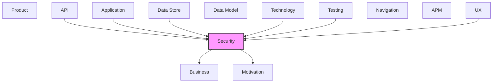

# Security

[← Back to README](../README.md)

Authentication, authorization, security threats, and controls.

## Report Index

- [Layer Introduction](#layer-introduction)
- [Intra-Layer Relationships](#intra-layer-relationships)
- [Inter-Layer Dependencies](#inter-layer-dependencies)
- [Inter-Layer Relationships Table](#inter-layer-relationships-table)
- [Element Reference](#element-reference)

## Layer Introduction

| Metric                    | Count |
| ------------------------- | ----- |
| Elements                  | 31    |
| Intra-Layer Relationships | 64    |
| Inter-Layer Relationships | 48    |
| Inbound Relationships     | 22    |
| Outbound Relationships    | 26    |

**Cross-Layer References**:

- **Upstream layers**: [API](./07-api-layer-report.md), [Application](./05-application-layer-report.md), [Data Store](./09-data-store-layer-report.md), [Technology](./06-technology-layer-report.md), [Testing](./13-testing-layer-report.md), [UX](./10-ux-layer-report.md)
- **Downstream layers**: [Business](./02-business-layer-report.md), [Motivation](./01-motivation-layer-report.md)

## Intra-Layer Relationships

*This layer has >30 elements. Summary table shown instead of diagram.*

| Element                                                                      | Type                   | Relationships |
| ---------------------------------------------------------------------------- | ---------------------- | ------------- |
| `security.actor.local-operator`                                              | `actor`                | 2             |
| `security.actor.mcp-client-agent`                                            | `actor`                | 3             |
| `security.authenticationconfig.mcp-bearer-token-authentication`              | `authenticationconfig` | 3             |
| `security.countermeasure.human-review-gate-for-agent-writes`                 | `countermeasure`       | 1             |
| `security.countermeasure.loopback-only-mcp-startup`                          | `countermeasure`       | 3             |
| `security.countermeasure.mcp-bearer-token-check`                             | `countermeasure`       | 2             |
| `security.countermeasure.origin-and-host-request-guard`                      | `countermeasure`       | 2             |
| `security.countermeasure.parameterized-queries-via-orm`                      | `countermeasure`       | 2             |
| `security.countermeasure.secret-safe-configuration`                          | `countermeasure`       | 3             |
| `security.countermeasure.source-path-allowlist`                              | `countermeasure`       | 2             |
| `security.countermeasure.source-size-limit`                                  | `countermeasure`       | 1             |
| `security.countermeasure.vite-dev-server-loopback-binding`                   | `countermeasure`       | 2             |
| `security.dataclassification.internal-knowledge-graph-data`                  | `dataclassification`   | 8             |
| `security.dataclassification.secrets`                                        | `dataclassification`   | 5             |
| `security.role.local-operator`                                               | `role`                 | 2             |
| `security.role.mcp-agent`                                                    | `role`                 | 2             |
| `security.secureresource.configuration-file`                                 | `secureresource`       | 3             |
| `security.secureresource.local-rest-api`                                     | `secureresource`       | 6             |
| `security.secureresource.mcp-endpoint`                                       | `secureresource`       | 9             |
| `security.secureresource.vite-dev-server`                                    | `secureresource`       | 3             |
| `security.secureresource.workspace-databases`                                | `secureresource`       | 6             |
| `security.securitymodel.context-studio-security-model`                       | `securitymodel`        | 21            |
| `security.threat.arbitrary-file-read-via-mcp-sources`                        | `threat`               | 4             |
| `security.threat.cross-site-request-and-dns-rebinding-against-the-local-api` | `threat`               | 5             |
| `security.threat.information-disclosure-via-error-messages`                  | `threat`               | 4             |
| `security.threat.lan-exposure-via-the-vite-dev-server`                       | `threat`               | 5             |
| `security.threat.prompt-injection-via-sources-or-client-plans`               | `threat`               | 4             |
| `security.threat.server-side-request-forgery-via-url-sources`                | `threat`               | 3             |
| `security.threat.sql-injection`                                              | `threat`               | 4             |
| `security.threat.unauthorized-mcp-access`                                    | `threat`               | 5             |
| `security.threat.workspace-data-sent-to-llm-providers`                       | `threat`               | 3             |

## Inter-Layer Dependencies

## Inter-Layer Relationships Table

| Relationship ID                                                     | Source Node                                                                                        | Dest Node                                                            | Dest Layer   | Predicate    | Cardinality  | Strength |
| ------------------------------------------------------------------- | -------------------------------------------------------------------------------------------------- | -------------------------------------------------------------------- | ------------ | ------------ | ------------ | -------- |
| `api.operation.references.security.threat`                          | `api.operation.add-source`                                                                         | `security.threat.server-side-request-forgery-via-url-sources`        | `security`   | `references` | many-to-many | medium   |
| `api.operation.references.security.secureresource`                  | `api.operation.get-mcp-connection-details`                                                         | `security.secureresource.mcp-endpoint`                               | `security`   | `references` | many-to-many | medium   |
| `api.operation.references.security.threat`                          | `api.operation.get-mcp-connection-details`                                                         | `security.threat.lan-exposure-via-the-vite-dev-server`               | `security`   | `references` | many-to-many | medium   |
| `api.operation.references.security.secureresource`                  | `api.operation.mcp-endpoint`                                                                       | `security.secureresource.mcp-endpoint`                               | `security`   | `references` | many-to-many | medium   |
| `api.securityscheme.references.security.secureresource`             | `api.securityscheme.mcp-bearer-token`                                                              | `security.secureresource.mcp-endpoint`                               | `security`   | `references` | many-to-many | medium   |
| `application.applicationcomponent.realizes.security.countermeasure` | `application.applicationcomponent.database-manager`                                                | `security.countermeasure.parameterized-queries-via-orm`              | `security`   | `realizes`   | many-to-many | medium   |
| `application.applicationcomponent.realizes.security.countermeasure` | `application.applicationcomponent.http-page-fetcher`                                               | `security.countermeasure.source-size-limit`                          | `security`   | `realizes`   | many-to-many | medium   |
| `application.applicationcomponent.realizes.security.countermeasure` | `application.applicationcomponent.json-file-config-store`                                          | `security.countermeasure.secret-safe-configuration`                  | `security`   | `realizes`   | many-to-many | medium   |
| `application.applicationcomponent.realizes.security.countermeasure` | `application.applicationcomponent.mcp-server`                                                      | `security.countermeasure.loopback-only-mcp-startup`                  | `security`   | `realizes`   | many-to-many | medium   |
| `application.applicationcomponent.realizes.security.countermeasure` | `application.applicationcomponent.mcp-server`                                                      | `security.countermeasure.mcp-bearer-token-check`                     | `security`   | `realizes`   | many-to-many | medium   |
| `application.applicationcomponent.realizes.security.countermeasure` | `application.applicationcomponent.request-guard`                                                   | `security.countermeasure.origin-and-host-request-guard`              | `security`   | `realizes`   | many-to-many | medium   |
| `application.applicationcomponent.realizes.security.countermeasure` | `application.applicationcomponent.source-chat-tools`                                               | `security.countermeasure.source-path-allowlist`                      | `security`   | `realizes`   | many-to-many | medium   |
| `application.applicationinterface.exposes.security.secureresource`  | `application.applicationinterface.mcp-interface`                                                   | `security.secureresource.mcp-endpoint`                               | `security`   | `exposes`    | many-to-many | medium   |
| `application.applicationinterface.exposes.security.secureresource`  | `application.applicationinterface.rest-api-interface`                                              | `security.secureresource.local-rest-api`                             | `security`   | `exposes`    | many-to-many | medium   |
| `data-store.collection.references.security.dataclassification`      | `data-store.collection.chat-messages`                                                              | `security.dataclassification.internal-knowledge-graph-data`          | `security`   | `references` | many-to-many | medium   |
| `data-store.collection.references.security.dataclassification`      | `data-store.collection.ontology-entities`                                                          | `security.dataclassification.internal-knowledge-graph-data`          | `security`   | `references` | many-to-many | medium   |
| `data-store.collection.references.security.dataclassification`      | `data-store.collection.proposals-table`                                                            | `security.dataclassification.internal-knowledge-graph-data`          | `security`   | `references` | many-to-many | medium   |
| `data-store.collection.references.security.dataclassification`      | `data-store.collection.sources`                                                                    | `security.dataclassification.internal-knowledge-graph-data`          | `security`   | `references` | many-to-many | medium   |
| `security.countermeasure.protects.business.businessprocess`         | `security.countermeasure.human-review-gate-for-agent-writes`                                       | `business.businessprocess.adjudicate-a-proposal`                     | `business`   | `protects`   | many-to-many | medium   |
| `security.countermeasure.satisfies.motivation.requirement`          | `security.countermeasure.human-review-gate-for-agent-writes`                                       | `motivation.requirement.breaking-changes-never-auto-apply`           | `motivation` | `satisfies`  | many-to-many | medium   |
| `security.countermeasure.satisfies.motivation.requirement`          | `security.countermeasure.loopback-only-mcp-startup`                                                | `motivation.requirement.mcp-requires-a-bearer-token-on-loopback`     | `motivation` | `satisfies`  | many-to-many | medium   |
| `security.countermeasure.satisfies.motivation.requirement`          | `security.countermeasure.mcp-bearer-token-check`                                                   | `motivation.requirement.mcp-requires-a-bearer-token-on-loopback`     | `motivation` | `satisfies`  | many-to-many | medium   |
| `security.countermeasure.satisfies.motivation.requirement`          | `security.countermeasure.origin-and-host-request-guard`                                            | `motivation.requirement.local-api-refuses-foreign-origins`           | `motivation` | `satisfies`  | many-to-many | medium   |
| `security.countermeasure.realizes.motivation.goal`                  | `security.countermeasure.parameterized-queries-via-orm`                                            | `motivation.goal.safe-local-first-workspace`                         | `motivation` | `realizes`   | many-to-many | medium   |
| `security.countermeasure.satisfies.motivation.requirement`          | `security.countermeasure.secret-safe-configuration`                                                | `motivation.requirement.secrets-stay-in-the-configuration-file`      | `motivation` | `satisfies`  | many-to-many | medium   |
| `security.countermeasure.satisfies.motivation.requirement`          | `security.countermeasure.source-path-allowlist`                                                    | `motivation.requirement.agent-file-sources-limited-to-allowed-roots` | `motivation` | `satisfies`  | many-to-many | medium   |
| `security.countermeasure.realizes.motivation.goal`                  | `security.countermeasure.source-size-limit`                                                        | `motivation.goal.safe-local-first-workspace`                         | `motivation` | `realizes`   | many-to-many | medium   |
| `security.countermeasure.satisfies.motivation.requirement`          | `security.countermeasure.vite-dev-server-loopback-binding`                                         | `motivation.requirement.dev-server-not-reachable-from-the-lan`       | `motivation` | `satisfies`  | many-to-many | medium   |
| `security.role.references.business.businessrole`                    | `security.role.local-operator`                                                                     | `business.businessrole.reviewer`                                     | `business`   | `references` | many-to-many | medium   |
| `security.role.references.business.businessrole`                    | `security.role.mcp-agent`                                                                          | `business.businessrole.proposer`                                     | `business`   | `references` | many-to-many | medium   |
| `security.secureresource.references.business.businessobject`        | `security.secureresource.workspace-databases`                                                      | `business.businessobject.change-proposal`                            | `business`   | `references` | many-to-many | medium   |
| `security.secureresource.references.business.businessobject`        | `security.secureresource.workspace-databases`                                                      | `business.businessobject.claim`                                      | `business`   | `references` | many-to-many | medium   |
| `security.secureresource.references.business.businessobject`        | `security.secureresource.workspace-databases`                                                      | `business.businessobject.dataset`                                    | `business`   | `references` | many-to-many | medium   |
| `security.secureresource.references.business.businessobject`        | `security.secureresource.workspace-databases`                                                      | `business.businessobject.decision-gold`                              | `business`   | `references` | many-to-many | medium   |
| `security.secureresource.references.business.businessobject`        | `security.secureresource.workspace-databases`                                                      | `business.businessobject.source-document`                            | `business`   | `references` | many-to-many | medium   |
| `security.threat.references.motivation.driver`                      | `security.threat.arbitrary-file-read-via-mcp-sources`                                              | `motivation.driver.unauthenticated-local-workspace-api`              | `motivation` | `references` | many-to-many | medium   |
| `security.threat.references.motivation.driver`                      | `security.threat.cross-site-request-and-dns-rebinding-against-the-local-api`                       | `motivation.driver.unauthenticated-local-workspace-api`              | `motivation` | `references` | many-to-many | medium   |
| `security.threat.references.motivation.driver`                      | `security.threat.lan-exposure-via-the-vite-dev-server`                                             | `motivation.driver.unauthenticated-local-workspace-api`              | `motivation` | `references` | many-to-many | medium   |
| `security.threat.references.motivation.driver`                      | `security.threat.prompt-injection-via-sources-or-client-plans`                                     | `motivation.driver.review-is-the-normal-workflow`                    | `motivation` | `references` | many-to-many | medium   |
| `security.threat.targets.business.businessprocess`                  | `security.threat.prompt-injection-via-sources-or-client-plans`                                     | `business.businessprocess.extract-a-source-into-a-dataset`           | `business`   | `targets`    | many-to-many | medium   |
| `security.threat.targets.business.businessservice`                  | `security.threat.prompt-injection-via-sources-or-client-plans`                                     | `business.businessservice.proposal-adjudication-service`             | `business`   | `targets`    | many-to-many | medium   |
| `security.threat.references.motivation.driver`                      | `security.threat.server-side-request-forgery-via-url-sources`                                      | `motivation.driver.unauthenticated-local-workspace-api`              | `motivation` | `references` | many-to-many | medium   |
| `security.threat.references.motivation.driver`                      | `security.threat.unauthorized-mcp-access`                                                          | `motivation.driver.unauthenticated-local-workspace-api`              | `motivation` | `references` | many-to-many | medium   |
| `security.threat.targets.business.businessservice`                  | `security.threat.workspace-data-sent-to-llm-providers`                                             | `business.businessservice.source-extraction-service`                 | `business`   | `targets`    | many-to-many | medium   |
| `technology.systemsoftware.realizes.security.countermeasure`        | `technology.systemsoftware.sqlalchemy`                                                             | `security.countermeasure.parameterized-queries-via-orm`              | `security`   | `realizes`   | many-to-many | medium   |
| `technology.systemsoftware.realizes.security.countermeasure`        | `technology.systemsoftware.vite`                                                                   | `security.countermeasure.vite-dev-server-loopback-binding`           | `security`   | `realizes`   | many-to-many | medium   |
| `testing.testcasesketch.tests.security.countermeasure`              | `testing.testcasesketch.vite-config-does-not-open-the-dev-server-or-preview-to-the-network-mode-s` | `security.countermeasure.vite-dev-server-loopback-binding`           | `security`   | `tests`      | many-to-many | medium   |
| `ux.view.requires.security.role`                                    | `ux.view.settings-view`                                                                            | `security.role.local-operator`                                       | `security`   | `requires`   | many-to-many | medium   |

## Element Reference

### Local Operator {#local-operator}

**ID**: `security.actor.local-operator`

**Type**: `actor`

The browser UI and any local process that reaches the REST port; it has full read and write, including apply and revert.

#### Attributes

| Name       | Value |
| ---------- | ----- |
| trustLevel | full  |
| type       | human |

#### Relationships

| Type        | Related Element                                        | Predicate     | Direction |
| ----------- | ------------------------------------------------------ | ------------- | --------- |
| intra-layer | `security.role.local-operator`                         | `assigned-to` | outbound  |
| intra-layer | `security.securitymodel.context-studio-security-model` | `aggregates`  | inbound   |

### MCP Client Agent {#mcp-client-agent}

**ID**: `security.actor.mcp-client-agent`

**Type**: `actor`

Claude Code or a client project's maintainer agent connected over MCP with the bearer token.

#### Attributes

| Name       | Value  |
| ---------- | ------ |
| trustLevel | medium |
| type       | system |

#### Relationships

| Type        | Related Element                                                 | Predicate       | Direction |
| ----------- | --------------------------------------------------------------- | --------------- | --------- |
| intra-layer | `security.role.mcp-agent`                                       | `assigned-to`   | outbound  |
| intra-layer | `security.authenticationconfig.mcp-bearer-token-authentication` | `authenticates` | inbound   |
| intra-layer | `security.securitymodel.context-studio-security-model`          | `aggregates`    | inbound   |

### MCP Bearer Token Authentication {#mcp-bearer-token-authentication}

**ID**: `security.authenticationconfig.mcp-bearer-token-authentication`

**Type**: `authenticationconfig`

Every MCP request must carry Authorization: Bearer with the token from config.json mcp.auth_token, compared with hmac.compare_digest. The token is generated on first start; rotate it by clearing the value and restarting. The REST API itself has no login.

#### Attributes

| Name           | Value |
| -------------- | ----- |
| mfaRequired    | false |
| provider       | local |
| sessionTimeout | 0     |

#### Relationships

| Type        | Related Element                                        | Predicate       | Direction |
| ----------- | ------------------------------------------------------ | --------------- | --------- |
| intra-layer | `security.actor.mcp-client-agent`                      | `authenticates` | outbound  |
| intra-layer | `security.secureresource.mcp-endpoint`                 | `protects`      | outbound  |
| intra-layer | `security.securitymodel.context-studio-security-model` | `composes`      | inbound   |

### Human Review Gate for Agent Writes {#human-review-gate-for-agent-writes}

**ID**: `security.countermeasure.human-review-gate-for-agent-writes`

**Type**: `countermeasure`

Agent, chat and pipeline writes are proposals a person decides; the approval policy never auto-applies breaking or no-passage operations, and there is no apply tool over MCP.

#### Attributes

| Name          | Value                              |
| ------------- | ---------------------------------- |
| description   | Agent writes need a human decision |
| effectiveness | high                               |
| implemented   | true                               |
| type          | operational                        |

#### Relationships

| Type        | Related Element                                                | Predicate   | Direction |
| ----------- | -------------------------------------------------------------- | ----------- | --------- |
| inter-layer | `business.businessprocess.adjudicate-a-proposal`               | `protects`  | outbound  |
| inter-layer | `motivation.requirement.breaking-changes-never-auto-apply`     | `satisfies` | outbound  |
| intra-layer | `security.threat.prompt-injection-via-sources-or-client-plans` | `mitigates` | outbound  |

### Loopback-Only MCP Startup {#loopback-only-mcp-startup}

**ID**: `security.countermeasure.loopback-only-mcp-startup`

**Type**: `countermeasure`

MCP is not started when server.host is not a loopback address, and its transport accepts only loopback Host and Origin headers.

#### Attributes

| Name          | Value                                               |
| ------------- | --------------------------------------------------- |
| description   | MCP only on loopback, with DNS-rebinding protection |
| effectiveness | high                                                |
| implemented   | true                                                |
| type          | technical                                           |

#### Relationships

| Type        | Related Element                                                              | Predicate   | Direction |
| ----------- | ---------------------------------------------------------------------------- | ----------- | --------- |
| inter-layer | `application.applicationcomponent.mcp-server`                                | `realizes`  | inbound   |
| inter-layer | `motivation.requirement.mcp-requires-a-bearer-token-on-loopback`             | `satisfies` | outbound  |
| intra-layer | `security.threat.cross-site-request-and-dns-rebinding-against-the-local-api` | `mitigates` | outbound  |
| intra-layer | `security.threat.unauthorized-mcp-access`                                    | `mitigates` | outbound  |
| intra-layer | `security.secureresource.mcp-endpoint`                                       | `protects`  | outbound  |

### MCP Bearer Token Check {#mcp-bearer-token-check}

**ID**: `security.countermeasure.mcp-bearer-token-check`

**Type**: `countermeasure`

Each MCP request's bearer token is compared to the configured token in constant time; requests without it are refused.

#### Attributes

| Name          | Value                                    |
| ------------- | ---------------------------------------- |
| description   | Constant-time bearer token check on /mcp |
| effectiveness | high                                     |
| implemented   | true                                     |
| type          | technical                                |

#### Relationships

| Type        | Related Element                                                  | Predicate   | Direction |
| ----------- | ---------------------------------------------------------------- | ----------- | --------- |
| inter-layer | `application.applicationcomponent.mcp-server`                    | `realizes`  | inbound   |
| inter-layer | `motivation.requirement.mcp-requires-a-bearer-token-on-loopback` | `satisfies` | outbound  |
| intra-layer | `security.threat.unauthorized-mcp-access`                        | `mitigates` | outbound  |
| intra-layer | `security.secureresource.mcp-endpoint`                           | `protects`  | outbound  |

### Origin and Host Request Guard {#origin-and-host-request-guard}

**ID**: `security.countermeasure.origin-and-host-request-guard`

**Type**: `countermeasure`

RequestGuard refuses requests with a foreign Origin and, on loopback, a non-loopback Host header; the CORS allowlist ignores '\*'.

#### Attributes

| Name          | Value                              |
| ------------- | ---------------------------------- |
| description   | Origin/Host checks on the REST API |
| effectiveness | high                               |
| implemented   | true                               |
| type          | technical                          |

#### Relationships

| Type        | Related Element                                                              | Predicate   | Direction |
| ----------- | ---------------------------------------------------------------------------- | ----------- | --------- |
| inter-layer | `application.applicationcomponent.request-guard`                             | `realizes`  | inbound   |
| inter-layer | `motivation.requirement.local-api-refuses-foreign-origins`                   | `satisfies` | outbound  |
| intra-layer | `security.threat.cross-site-request-and-dns-rebinding-against-the-local-api` | `mitigates` | outbound  |
| intra-layer | `security.secureresource.local-rest-api`                                     | `protects`  | outbound  |

### Parameterized Queries via ORM {#parameterized-queries-via-orm}

**ID**: `security.countermeasure.parameterized-queries-via-orm`

**Type**: `countermeasure`

SQLAlchemy ORM uses parameterized queries for all database operations across all bounded contexts, preventing SQL injection

#### Attributes

| Name          | Value                                                      |
| ------------- | ---------------------------------------------------------- |
| description   | SQLAlchemy ORM parameterized queries prevent SQL injection |
| effectiveness | high                                                       |
| implemented   | true                                                       |
| type          | technical                                                  |

#### Relationships

| Type        | Related Element                                     | Predicate   | Direction |
| ----------- | --------------------------------------------------- | ----------- | --------- |
| inter-layer | `application.applicationcomponent.database-manager` | `realizes`  | inbound   |
| inter-layer | `motivation.goal.safe-local-first-workspace`        | `realizes`  | outbound  |
| inter-layer | `technology.systemsoftware.sqlalchemy`              | `realizes`  | inbound   |
| intra-layer | `security.threat.sql-injection`                     | `mitigates` | outbound  |
| intra-layer | `security.secureresource.workspace-databases`       | `protects`  | outbound  |

### Secret-Safe Configuration {#secret-safe-configuration}

**ID**: `security.countermeasure.secret-safe-configuration`

**Type**: `countermeasure`

config.json is untracked (config.example.json is the template); keys derived from the environment are not written back; configuration models that may hold credentials hide input values in validation errors.

#### Attributes

| Name          | Value                                                  |
| ------------- | ------------------------------------------------------ |
| description   | Secrets kept out of the repo and out of error messages |
| effectiveness | medium                                                 |
| implemented   | true                                                   |
| type          | technical                                              |

#### Relationships

| Type        | Related Element                                                 | Predicate   | Direction |
| ----------- | --------------------------------------------------------------- | ----------- | --------- |
| inter-layer | `application.applicationcomponent.json-file-config-store`       | `realizes`  | inbound   |
| inter-layer | `motivation.requirement.secrets-stay-in-the-configuration-file` | `satisfies` | outbound  |
| intra-layer | `security.threat.information-disclosure-via-error-messages`     | `mitigates` | outbound  |
| intra-layer | `security.secureresource.configuration-file`                    | `protects`  | outbound  |
| intra-layer | `security.dataclassification.secrets`                           | `mandates`  | inbound   |

### Source Path Allowlist {#source-path-allowlist}

**ID**: `security.countermeasure.source-path-allowlist`

**Type**: `countermeasure`

MCP and chat file sources are read only from under absolute sources.allowed_roots (empty by default), resolving the real path and checking it on the open file descriptor.

#### Attributes

| Name          | Value                                       |
| ------------- | ------------------------------------------- |
| description   | Agent file sources limited to allowed roots |
| effectiveness | high                                        |
| implemented   | true                                        |
| type          | technical                                   |

#### Relationships

| Type        | Related Element                                                      | Predicate   | Direction |
| ----------- | -------------------------------------------------------------------- | ----------- | --------- |
| inter-layer | `application.applicationcomponent.source-chat-tools`                 | `realizes`  | inbound   |
| inter-layer | `motivation.requirement.agent-file-sources-limited-to-allowed-roots` | `satisfies` | outbound  |
| intra-layer | `security.threat.arbitrary-file-read-via-mcp-sources`                | `mitigates` | outbound  |
| intra-layer | `security.secureresource.mcp-endpoint`                               | `protects`  | outbound  |

### Source Size Limit {#source-size-limit}

**ID**: `security.countermeasure.source-size-limit`

**Type**: `countermeasure`

Uploads and fetched pages are capped at sources.max_bytes (50 MB by default).

#### Attributes

| Name          | Value                                    |
| ------------- | ---------------------------------------- |
| description   | Uploads and fetched pages capped in size |
| effectiveness | medium                                   |
| implemented   | true                                     |
| type          | technical                                |

#### Relationships

| Type        | Related Element                                      | Predicate  | Direction |
| ----------- | ---------------------------------------------------- | ---------- | --------- |
| inter-layer | `application.applicationcomponent.http-page-fetcher` | `realizes` | inbound   |
| inter-layer | `motivation.goal.safe-local-first-workspace`         | `realizes` | outbound  |
| intra-layer | `security.secureresource.local-rest-api`             | `protects` | outbound  |

### Vite Dev Server Loopback Binding {#vite-dev-server-loopback-binding}

**ID**: `security.countermeasure.vite-dev-server-loopback-binding`

**Type**: `countermeasure`

vite.config.ts sets no server.host, so Vite's default (localhost) applies to npm run dev, vite preview, the QA instances and the E2E stack. A vitest test pins the default.

#### Attributes

| Name          | Value                               |
| ------------- | ----------------------------------- |
| description   | Dev server listens on loopback only |
| effectiveness | high                                |
| implemented   | true                                |
| type          | technical                           |

#### Relationships

| Type        | Related Element                                                                                    | Predicate   | Direction |
| ----------- | -------------------------------------------------------------------------------------------------- | ----------- | --------- |
| inter-layer | `motivation.requirement.dev-server-not-reachable-from-the-lan`                                     | `satisfies` | outbound  |
| inter-layer | `technology.systemsoftware.vite`                                                                   | `realizes`  | inbound   |
| inter-layer | `testing.testcasesketch.vite-config-does-not-open-the-dev-server-or-preview-to-the-network-mode-s` | `tests`     | inbound   |
| intra-layer | `security.threat.lan-exposure-via-the-vite-dev-server`                                             | `mitigates` | outbound  |
| intra-layer | `security.secureresource.vite-dev-server`                                                          | `protects`  | outbound  |

### Internal Knowledge Graph Data {#internal-knowledge-graph-data}

**ID**: `security.dataclassification.internal-knowledge-graph-data`

**Type**: `dataclassification`

Workspace data: the ontology and datasets in local.db, plus uploaded files and fetched pages (sources), proposals, decisions and gold, and claims; operations.db holds LLM traces and chat. Internal, no encryption at rest for the single-user desktop case. This data is sent to the configured LLM providers during extraction, chat, refinement and triage.

#### Attributes

| Name                  | Value    |
| --------------------- | -------- |
| classificationLevel   | internal |
| encryptionRequirement | none     |
| version               | 1.0      |

#### Relationships

| Type        | Related Element                                                              | Predicate    | Direction |
| ----------- | ---------------------------------------------------------------------------- | ------------ | --------- |
| inter-layer | `data-store.collection.chat-messages`                                        | `references` | inbound   |
| inter-layer | `data-store.collection.ontology-entities`                                    | `references` | inbound   |
| inter-layer | `data-store.collection.proposals-table`                                      | `references` | inbound   |
| inter-layer | `data-store.collection.sources`                                              | `references` | inbound   |
| intra-layer | `security.secureresource.workspace-databases`                                | `governs`    | outbound  |
| intra-layer | `security.securitymodel.context-studio-security-model`                       | `aggregates` | inbound   |
| intra-layer | `security.threat.cross-site-request-and-dns-rebinding-against-the-local-api` | `influence`  | inbound   |
| intra-layer | `security.threat.information-disclosure-via-error-messages`                  | `influence`  | inbound   |
| intra-layer | `security.threat.prompt-injection-via-sources-or-client-plans`               | `influence`  | inbound   |
| intra-layer | `security.threat.sql-injection`                                              | `influence`  | inbound   |
| intra-layer | `security.threat.unauthorized-mcp-access`                                    | `influence`  | inbound   |
| intra-layer | `security.threat.workspace-data-sent-to-llm-providers`                       | `influence`  | inbound   |

### Secrets {#secrets}

**ID**: `security.dataclassification.secrets`

**Type**: `dataclassification`

API keys and tokens in config.json. Never written back from the environment; validation errors never echo their values.

#### Attributes

| Name                  | Value        |
| --------------------- | ------------ |
| classificationLevel   | confidential |
| encryptionRequirement | none         |
| version               | 1.0          |

#### Relationships

| Type        | Related Element                                        | Predicate    | Direction |
| ----------- | ------------------------------------------------------ | ------------ | --------- |
| intra-layer | `security.secureresource.configuration-file`           | `governs`    | outbound  |
| intra-layer | `security.countermeasure.secret-safe-configuration`    | `mandates`   | outbound  |
| intra-layer | `security.securitymodel.context-studio-security-model` | `aggregates` | inbound   |
| intra-layer | `security.threat.arbitrary-file-read-via-mcp-sources`  | `influence`  | inbound   |
| intra-layer | `security.threat.lan-exposure-via-the-vite-dev-server` | `influence`  | inbound   |

### Local Operator {#local-operator}

**ID**: `security.role.local-operator`

**Type**: `role`

No RBAC: whoever reaches the REST port (the UI or local processes) has full read and write, including apply and revert.

#### Attributes

| Name         | Value                                                               |
| ------------ | ------------------------------------------------------------------- |
| description  | Full workspace access through the unauthenticated loopback REST API |
| displayName  | Local Operator                                                      |
| inheritsFrom |                                                                     |
| level        | 1                                                                   |

#### Relationships

| Type        | Related Element                                        | Predicate     | Direction |
| ----------- | ------------------------------------------------------ | ------------- | --------- |
| inter-layer | `business.businessrole.reviewer`                       | `references`  | outbound  |
| inter-layer | `ux.view.settings-view`                                | `requires`    | inbound   |
| intra-layer | `security.actor.local-operator`                        | `assigned-to` | inbound   |
| intra-layer | `security.securitymodel.context-studio-security-model` | `aggregates`  | inbound   |

### MCP Agent {#mcp-agent}

**ID**: `security.role.mcp-agent`

**Type**: `role`

Read, propose, extract, run, triage and landing tools over MCP; there is no apply or revert tool, so an agent cannot change the workspace without a person deciding.

#### Attributes

| Name         | Value                                               |
| ------------ | --------------------------------------------------- |
| description  | Reads and proposes over MCP; cannot apply or revert |
| displayName  | MCP Agent                                           |
| inheritsFrom |                                                     |
| level        | 2                                                   |

#### Relationships

| Type        | Related Element                                        | Predicate     | Direction |
| ----------- | ------------------------------------------------------ | ------------- | --------- |
| inter-layer | `business.businessrole.proposer`                       | `references`  | outbound  |
| intra-layer | `security.actor.mcp-client-agent`                      | `assigned-to` | inbound   |
| intra-layer | `security.securitymodel.context-studio-security-model` | `aggregates`  | inbound   |

### Configuration File {#configuration-file}

**ID**: `security.secureresource.configuration-file`

**Type**: `secureresource`

config.json: holds LLM provider keys, the MCP token, S3 and Workers AI credentials; untracked since #1378 (config.example.json is the template).

#### Attributes

| Name     | Value                    |
| -------- | ------------------------ |
| resource | local-server/config.json |
| type     | file                     |

#### Relationships

| Type        | Related Element                                        | Predicate    | Direction |
| ----------- | ------------------------------------------------------ | ------------ | --------- |
| intra-layer | `security.countermeasure.secret-safe-configuration`    | `protects`   | inbound   |
| intra-layer | `security.dataclassification.secrets`                  | `governs`    | inbound   |
| intra-layer | `security.securitymodel.context-studio-security-model` | `aggregates` | inbound   |

### Local REST API {#local-rest-api}

**ID**: `security.secureresource.local-rest-api`

**Type**: `secureresource`

The unauthenticated REST API on 127.0.0.1:8000, guarded by Origin/Host checks and loopback binding.

#### Attributes

| Name     | Value                     |
| -------- | ------------------------- |
| resource | http://127.0.0.1:8000/api |
| type     | api                       |

#### Relationships

| Type        | Related Element                                                              | Predicate    | Direction |
| ----------- | ---------------------------------------------------------------------------- | ------------ | --------- |
| inter-layer | `application.applicationinterface.rest-api-interface`                        | `exposes`    | inbound   |
| intra-layer | `security.countermeasure.origin-and-host-request-guard`                      | `protects`   | inbound   |
| intra-layer | `security.countermeasure.source-size-limit`                                  | `protects`   | inbound   |
| intra-layer | `security.securitymodel.context-studio-security-model`                       | `aggregates` | inbound   |
| intra-layer | `security.threat.cross-site-request-and-dns-rebinding-against-the-local-api` | `targets`    | inbound   |
| intra-layer | `security.threat.information-disclosure-via-error-messages`                  | `targets`    | inbound   |
| intra-layer | `security.threat.server-side-request-forgery-via-url-sources`                | `targets`    | inbound   |

### MCP Endpoint {#mcp-endpoint}

**ID**: `security.secureresource.mcp-endpoint`

**Type**: `secureresource`

The /mcp endpoint on the running app: bearer token, loopback only, DNS-rebinding protection.

#### Attributes

| Name     | Value                     |
| -------- | ------------------------- |
| resource | http://127.0.0.1:8000/mcp |
| type     | api                       |

#### Relationships

| Type        | Related Element                                                 | Predicate    | Direction |
| ----------- | --------------------------------------------------------------- | ------------ | --------- |
| inter-layer | `api.operation.get-mcp-connection-details`                      | `references` | inbound   |
| inter-layer | `api.operation.mcp-endpoint`                                    | `references` | inbound   |
| inter-layer | `api.securityscheme.mcp-bearer-token`                           | `references` | inbound   |
| inter-layer | `application.applicationinterface.mcp-interface`                | `exposes`    | inbound   |
| intra-layer | `security.authenticationconfig.mcp-bearer-token-authentication` | `protects`   | inbound   |
| intra-layer | `security.countermeasure.loopback-only-mcp-startup`             | `protects`   | inbound   |
| intra-layer | `security.countermeasure.mcp-bearer-token-check`                | `protects`   | inbound   |
| intra-layer | `security.countermeasure.source-path-allowlist`                 | `protects`   | inbound   |
| intra-layer | `security.securitymodel.context-studio-security-model`          | `aggregates` | inbound   |
| intra-layer | `security.threat.arbitrary-file-read-via-mcp-sources`           | `targets`    | inbound   |
| intra-layer | `security.threat.lan-exposure-via-the-vite-dev-server`          | `targets`    | inbound   |
| intra-layer | `security.threat.server-side-request-forgery-via-url-sources`   | `targets`    | inbound   |
| intra-layer | `security.threat.unauthorized-mcp-access`                       | `targets`    | inbound   |

### Vite Dev Server {#vite-dev-server}

**ID**: `security.secureresource.vite-dev-server`

**Type**: `secureresource`

npm run dev serves the UI and proxies /api to the back end; it listens on loopback only (Vite's default).

#### Attributes

| Name     | Value                                   |
| -------- | --------------------------------------- |
| resource | ux dev server (port 3100) proxying /api |
| type     | ui                                      |

#### Relationships

| Type        | Related Element                                            | Predicate    | Direction |
| ----------- | ---------------------------------------------------------- | ------------ | --------- |
| intra-layer | `security.countermeasure.vite-dev-server-loopback-binding` | `protects`   | inbound   |
| intra-layer | `security.securitymodel.context-studio-security-model`     | `aggregates` | inbound   |
| intra-layer | `security.threat.lan-exposure-via-the-vite-dev-server`     | `targets`    | inbound   |

### Workspace Databases {#workspace-databases}

**ID**: `security.secureresource.workspace-databases`

**Type**: `secureresource`

local.db (ontology, datasets, sources, proposals, decisions, claims) and operations.db (pipeline runs, LLM traces, chat).

#### Attributes

| Name     | Value                   |
| -------- | ----------------------- |
| resource | local.db, operations.db |
| type     | database                |

#### Relationships

| Type        | Related Element                                                | Predicate    | Direction |
| ----------- | -------------------------------------------------------------- | ------------ | --------- |
| inter-layer | `business.businessobject.change-proposal`                      | `references` | outbound  |
| inter-layer | `business.businessobject.claim`                                | `references` | outbound  |
| inter-layer | `business.businessobject.dataset`                              | `references` | outbound  |
| inter-layer | `business.businessobject.decision-gold`                        | `references` | outbound  |
| inter-layer | `business.businessobject.source-document`                      | `references` | outbound  |
| intra-layer | `security.countermeasure.parameterized-queries-via-orm`        | `protects`   | inbound   |
| intra-layer | `security.dataclassification.internal-knowledge-graph-data`    | `governs`    | inbound   |
| intra-layer | `security.securitymodel.context-studio-security-model`         | `aggregates` | inbound   |
| intra-layer | `security.threat.prompt-injection-via-sources-or-client-plans` | `targets`    | inbound   |
| intra-layer | `security.threat.sql-injection`                                | `targets`    | inbound   |
| intra-layer | `security.threat.workspace-data-sent-to-llm-providers`         | `targets`    | inbound   |

### Context Studio Security Model {#context-studio-security-model}

**ID**: `security.securitymodel.context-studio-security-model`

**Type**: `securitymodel`

Single-user local-first posture: unauthenticated REST guarded by Origin/Host checks and loopback binding; bearer-token MCP on loopback only; agent writes limited to proposals adjudicated by a person; path allowlist for agent file sources. Open gaps to fix: LAN exposure via the Vite dev server (#1655) and SSRF via URL sources (#1656).

#### Attributes

| Name               | Value                       |
| ------------------ | --------------------------- |
| accessControlModel | dac                         |
| application        | context-studio-local-server |
| version            | 2.0                         |

#### Relationships

| Type        | Related Element                                                              | Predicate    | Direction |
| ----------- | ---------------------------------------------------------------------------- | ------------ | --------- |
| intra-layer | `security.actor.local-operator`                                              | `aggregates` | outbound  |
| intra-layer | `security.actor.mcp-client-agent`                                            | `aggregates` | outbound  |
| intra-layer | `security.dataclassification.internal-knowledge-graph-data`                  | `aggregates` | outbound  |
| intra-layer | `security.dataclassification.secrets`                                        | `aggregates` | outbound  |
| intra-layer | `security.role.local-operator`                                               | `aggregates` | outbound  |
| intra-layer | `security.role.mcp-agent`                                                    | `aggregates` | outbound  |
| intra-layer | `security.secureresource.configuration-file`                                 | `aggregates` | outbound  |
| intra-layer | `security.secureresource.local-rest-api`                                     | `aggregates` | outbound  |
| intra-layer | `security.secureresource.mcp-endpoint`                                       | `aggregates` | outbound  |
| intra-layer | `security.secureresource.vite-dev-server`                                    | `aggregates` | outbound  |
| intra-layer | `security.secureresource.workspace-databases`                                | `aggregates` | outbound  |
| intra-layer | `security.threat.arbitrary-file-read-via-mcp-sources`                        | `aggregates` | outbound  |
| intra-layer | `security.threat.cross-site-request-and-dns-rebinding-against-the-local-api` | `aggregates` | outbound  |
| intra-layer | `security.threat.information-disclosure-via-error-messages`                  | `aggregates` | outbound  |
| intra-layer | `security.threat.lan-exposure-via-the-vite-dev-server`                       | `aggregates` | outbound  |
| intra-layer | `security.threat.prompt-injection-via-sources-or-client-plans`               | `aggregates` | outbound  |
| intra-layer | `security.threat.server-side-request-forgery-via-url-sources`                | `aggregates` | outbound  |
| intra-layer | `security.threat.sql-injection`                                              | `aggregates` | outbound  |
| intra-layer | `security.threat.unauthorized-mcp-access`                                    | `aggregates` | outbound  |
| intra-layer | `security.threat.workspace-data-sent-to-llm-providers`                       | `aggregates` | outbound  |
| intra-layer | `security.authenticationconfig.mcp-bearer-token-authentication`              | `composes`   | outbound  |

### Arbitrary File Read via MCP Sources {#arbitrary-file-read-via-mcp-sources}

**ID**: `security.threat.arbitrary-file-read-via-mcp-sources`

**Type**: `threat`

An agent asks to add a local path outside the intended folders as a source and reads it back.

#### Attributes

| Name        | Value                                                |
| ----------- | ---------------------------------------------------- |
| criticality | high                                                 |
| description | Agent reads arbitrary local files through add_source |
| impact      | high                                                 |
| likelihood  | moderate                                             |
| threatens   | file                                                 |

#### Relationships

| Type        | Related Element                                         | Predicate    | Direction |
| ----------- | ------------------------------------------------------- | ------------ | --------- |
| inter-layer | `motivation.driver.unauthenticated-local-workspace-api` | `references` | outbound  |
| intra-layer | `security.countermeasure.source-path-allowlist`         | `mitigates`  | inbound   |
| intra-layer | `security.securitymodel.context-studio-security-model`  | `aggregates` | inbound   |
| intra-layer | `security.dataclassification.secrets`                   | `influence`  | outbound  |
| intra-layer | `security.secureresource.mcp-endpoint`                  | `targets`    | outbound  |

### Cross-Site Request and DNS Rebinding against the Local API {#cross-site-request-and-dns-rebinding-against-the-local-api}

**ID**: `security.threat.cross-site-request-and-dns-rebinding-against-the-local-api`

**Type**: `threat`

A web page open in the user's browser drives the unauthenticated local API, directly or through DNS rebinding.

#### Attributes

| Name        | Value                                                      |
| ----------- | ---------------------------------------------------------- |
| criticality | high                                                       |
| description | Browser-borne requests to the unauthenticated loopback API |
| impact      | high                                                       |
| likelihood  | moderate                                                   |
| threatens   | api                                                        |

#### Relationships

| Type        | Related Element                                             | Predicate    | Direction |
| ----------- | ----------------------------------------------------------- | ------------ | --------- |
| inter-layer | `motivation.driver.unauthenticated-local-workspace-api`     | `references` | outbound  |
| intra-layer | `security.countermeasure.loopback-only-mcp-startup`         | `mitigates`  | inbound   |
| intra-layer | `security.countermeasure.origin-and-host-request-guard`     | `mitigates`  | inbound   |
| intra-layer | `security.securitymodel.context-studio-security-model`      | `aggregates` | inbound   |
| intra-layer | `security.dataclassification.internal-knowledge-graph-data` | `influence`  | outbound  |
| intra-layer | `security.secureresource.local-rest-api`                    | `targets`    | outbound  |

### Information Disclosure via Error Messages {#information-disclosure-via-error-messages}

**ID**: `security.threat.information-disclosure-via-error-messages`

**Type**: `threat`

Internal details or secret values leaking through error responses. There is no global exception handler: routes map domain exceptions to HTTP codes, unhandled errors fall back to FastAPI's plain 500, and configuration models that may hold credentials hide input values in validation errors.

#### Attributes

| Name        | Value                                 |
| ----------- | ------------------------------------- |
| criticality | low                                   |
| description | File path leakage via error responses |
| impact      | moderate                              |
| likelihood  | low                                   |
| threatens   | api                                   |

#### Relationships

| Type        | Related Element                                             | Predicate    | Direction |
| ----------- | ----------------------------------------------------------- | ------------ | --------- |
| intra-layer | `security.countermeasure.secret-safe-configuration`         | `mitigates`  | inbound   |
| intra-layer | `security.securitymodel.context-studio-security-model`      | `aggregates` | inbound   |
| intra-layer | `security.dataclassification.internal-knowledge-graph-data` | `influence`  | outbound  |
| intra-layer | `security.secureresource.local-rest-api`                    | `targets`    | outbound  |

### LAN Exposure via the Vite Dev Server {#lan-exposure-via-the-vite-dev-server}

**ID**: `security.threat.lan-exposure-via-the-vite-dev-server`

**Type**: `threat`

Mitigated (#1655). The dev server used to listen on all interfaces (server.host: true) and proxy /api, so another machine on the network could read and change the workspace. It now binds to loopback only; LAN access would need an explicit edit of vite.config.ts or a --host flag.

#### Attributes

| Name        | Value                                                       |
| ----------- | ----------------------------------------------------------- |
| criticality | high                                                        |
| description | Dev server exposes the API and MCP token to the LAN (#1655) |
| impact      | high                                                        |
| likelihood  | moderate                                                    |
| threatens   | api                                                         |

#### Relationships

| Type        | Related Element                                            | Predicate    | Direction |
| ----------- | ---------------------------------------------------------- | ------------ | --------- |
| inter-layer | `api.operation.get-mcp-connection-details`                 | `references` | inbound   |
| inter-layer | `motivation.driver.unauthenticated-local-workspace-api`    | `references` | outbound  |
| intra-layer | `security.countermeasure.vite-dev-server-loopback-binding` | `mitigates`  | inbound   |
| intra-layer | `security.securitymodel.context-studio-security-model`     | `aggregates` | inbound   |
| intra-layer | `security.dataclassification.secrets`                      | `influence`  | outbound  |
| intra-layer | `security.secureresource.mcp-endpoint`                     | `targets`    | outbound  |
| intra-layer | `security.secureresource.vite-dev-server`                  | `targets`    | outbound  |

### Prompt Injection via Sources or Client Plans {#prompt-injection-via-sources-or-client-plans}

**ID**: `security.threat.prompt-injection-via-sources-or-client-plans`

**Type**: `threat`

Document text or a client plan steers an LLM pipeline or the chat into proposing harmful changes.

#### Attributes

| Name        | Value                                        |
| ----------- | -------------------------------------------- |
| criticality | medium                                       |
| description | Untrusted text steers LLM-produced proposals |
| impact      | moderate                                     |
| likelihood  | moderate                                     |
| threatens   | business-process                             |

#### Relationships

| Type        | Related Element                                              | Predicate    | Direction |
| ----------- | ------------------------------------------------------------ | ------------ | --------- |
| inter-layer | `motivation.driver.review-is-the-normal-workflow`            | `references` | outbound  |
| inter-layer | `business.businessprocess.extract-a-source-into-a-dataset`   | `targets`    | outbound  |
| inter-layer | `business.businessservice.proposal-adjudication-service`     | `targets`    | outbound  |
| intra-layer | `security.countermeasure.human-review-gate-for-agent-writes` | `mitigates`  | inbound   |
| intra-layer | `security.securitymodel.context-studio-security-model`       | `aggregates` | inbound   |
| intra-layer | `security.dataclassification.internal-knowledge-graph-data`  | `influence`  | outbound  |
| intra-layer | `security.secureresource.workspace-databases`                | `targets`    | outbound  |

### Server-Side Request Forgery via URL Sources {#server-side-request-forgery-via-url-sources}

**ID**: `security.threat.server-side-request-forgery-via-url-sources`

**Type**: `threat`

Adding a URL source fetches any http(s) URL and follows redirects with no private-address check, so the server can be made to reach internal services. Not accepted: to fix under #1656.

#### Attributes

| Name        | Value                                           |
| ----------- | ----------------------------------------------- |
| criticality | medium                                          |
| description | URL sources can reach private addresses (#1656) |
| impact      | moderate                                        |
| likelihood  | low                                             |
| threatens   | api                                             |

#### Relationships

| Type        | Related Element                                         | Predicate    | Direction |
| ----------- | ------------------------------------------------------- | ------------ | --------- |
| inter-layer | `api.operation.add-source`                              | `references` | inbound   |
| inter-layer | `motivation.driver.unauthenticated-local-workspace-api` | `references` | outbound  |
| intra-layer | `security.securitymodel.context-studio-security-model`  | `aggregates` | inbound   |
| intra-layer | `security.secureresource.local-rest-api`                | `targets`    | outbound  |
| intra-layer | `security.secureresource.mcp-endpoint`                  | `targets`    | outbound  |

### SQL Injection {#sql-injection}

**ID**: `security.threat.sql-injection`

**Type**: `threat`

Threat: SQL injection attacks against the SQLite databases (local.db, operations.db) via unsanitized API inputs

#### Attributes

| Name        | Value                              |
| ----------- | ---------------------------------- |
| criticality | high                               |
| description | SQL injection via API input fields |
| impact      | high                               |
| likelihood  | moderate                           |
| threatens   | data-store                         |

#### Relationships

| Type        | Related Element                                             | Predicate    | Direction |
| ----------- | ----------------------------------------------------------- | ------------ | --------- |
| intra-layer | `security.countermeasure.parameterized-queries-via-orm`     | `mitigates`  | inbound   |
| intra-layer | `security.securitymodel.context-studio-security-model`      | `aggregates` | inbound   |
| intra-layer | `security.dataclassification.internal-knowledge-graph-data` | `influence`  | outbound  |
| intra-layer | `security.secureresource.workspace-databases`               | `targets`    | outbound  |

### Unauthorized MCP Access {#unauthorized-mcp-access}

**ID**: `security.threat.unauthorized-mcp-access`

**Type**: `threat`

A local or remote process without the token calls MCP tools to read the model or submit proposals.

#### Attributes

| Name        | Value                                |
| ----------- | ------------------------------------ |
| criticality | high                                 |
| description | MCP tools used without authorization |
| impact      | high                                 |
| likelihood  | moderate                             |
| threatens   | api                                  |

#### Relationships

| Type        | Related Element                                             | Predicate    | Direction |
| ----------- | ----------------------------------------------------------- | ------------ | --------- |
| inter-layer | `motivation.driver.unauthenticated-local-workspace-api`     | `references` | outbound  |
| intra-layer | `security.countermeasure.loopback-only-mcp-startup`         | `mitigates`  | inbound   |
| intra-layer | `security.countermeasure.mcp-bearer-token-check`            | `mitigates`  | inbound   |
| intra-layer | `security.securitymodel.context-studio-security-model`      | `aggregates` | inbound   |
| intra-layer | `security.dataclassification.internal-knowledge-graph-data` | `influence`  | outbound  |
| intra-layer | `security.secureresource.mcp-endpoint`                      | `targets`    | outbound  |

### Workspace Data Sent to LLM Providers {#workspace-data-sent-to-llm-providers}

**ID**: `security.threat.workspace-data-sent-to-llm-providers`

**Type**: `threat`

Source text, ontology content and chat go to Anthropic, OpenAI, OpenRouter or Cloudflare during extraction, chat, refinement and triage.

#### Attributes

| Name        | Value                                              |
| ----------- | -------------------------------------------------- |
| criticality | medium                                             |
| description | Workspace content leaves the machine for LLM calls |
| impact      | moderate                                           |
| likelihood  | high                                               |
| threatens   | data                                               |

#### Relationships

| Type        | Related Element                                             | Predicate    | Direction |
| ----------- | ----------------------------------------------------------- | ------------ | --------- |
| inter-layer | `business.businessservice.source-extraction-service`        | `targets`    | outbound  |
| intra-layer | `security.securitymodel.context-studio-security-model`      | `aggregates` | inbound   |
| intra-layer | `security.dataclassification.internal-knowledge-graph-data` | `influence`  | outbound  |
| intra-layer | `security.secureresource.workspace-databases`               | `targets`    | outbound  |

---

Generated: 2026-11-24T14:28:53.404Z | Model Version: 0.1.0
