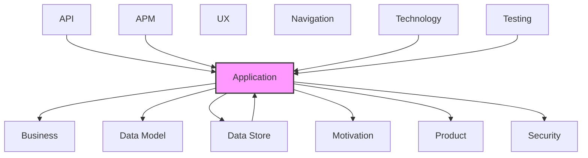

# Application

[← Back to README](../README.md)

Application components, services, and interactions.

## Report Index

- [Layer Introduction](#layer-introduction)
- [Intra-Layer Relationships](#intra-layer-relationships)
- [Inter-Layer Dependencies](#inter-layer-dependencies)
- [Inter-Layer Relationships Table](#inter-layer-relationships-table)
- [Element Reference](#element-reference)

## Layer Introduction

| Metric                    | Count |
| ------------------------- | ----- |
| Elements                  | 194   |
| Intra-Layer Relationships | 422   |
| Inter-Layer Relationships | 423   |
| Inbound Relationships     | 232   |
| Outbound Relationships    | 191   |

**Cross-Layer References**:

- **Upstream layers**: [API](./07-api-layer-report.md), [APM](./12-apm-layer-report.md), [Data Store](./09-data-store-layer-report.md), [Technology](./06-technology-layer-report.md), [Testing](./13-testing-layer-report.md)
- **Downstream layers**: [Business](./02-business-layer-report.md), [Data Model](./08-data-model-layer-report.md), [Data Store](./09-data-store-layer-report.md), [Motivation](./01-motivation-layer-report.md), [Product](./03-product-layer-report.md), [Security](./04-security-layer-report.md)

## Intra-Layer Relationships

*This layer has >30 elements. Summary table shown instead of diagram.*

| Element                                                                     | Type                       | Relationships |
| --------------------------------------------------------------------------- | -------------------------- | ------------- |
| `application.applicationcollaboration.hexagonal-port-adapter-wiring`        | `applicationcollaboration` | 12            |
| `application.applicationcomponent.anthropic-chat-model`                     | `applicationcomponent`     | 3             |
| `application.applicationcomponent.anthropic-llm-provider`                   | `applicationcomponent`     | 3             |
| `application.applicationcomponent.background-run-executor`                  | `applicationcomponent`     | 10            |
| `application.applicationcomponent.cached-reference-source`                  | `applicationcomponent`     | 3             |
| `application.applicationcomponent.caching-embedding-service`                | `applicationcomponent`     | 4             |
| `application.applicationcomponent.canon-demo-dataset-loader`                | `applicationcomponent`     | 3             |
| `application.applicationcomponent.cascade-individual-recognizer`            | `applicationcomponent`     | 6             |
| `application.applicationcomponent.change-event-recorder`                    | `applicationcomponent`     | 2             |
| `application.applicationcomponent.claim-chat-tools`                         | `applicationcomponent`     | 3             |
| `application.applicationcomponent.concept-net-reference-source`             | `applicationcomponent`     | 4             |
| `application.applicationcomponent.database-manager`                         | `applicationcomponent`     | 1             |
| `application.applicationcomponent.dbpedia-reference-source`                 | `applicationcomponent`     | 3             |
| `application.applicationcomponent.decision-model-registry`                  | `applicationcomponent`     | 4             |
| `application.applicationcomponent.dr-claims-importer`                       | `applicationcomponent`     | 3             |
| `application.applicationcomponent.dr-decisions-exporter`                    | `applicationcomponent`     | 2             |
| `application.applicationcomponent.dr-predicate-rules`                       | `applicationcomponent`     | 3             |
| `application.applicationcomponent.dr-reflection-plan-importer`              | `applicationcomponent`     | 4             |
| `application.applicationcomponent.dr-relationship-rules`                    | `applicationcomponent`     | 3             |
| `application.applicationcomponent.dr-spec-changes-exporter`                 | `applicationcomponent`     | 4             |
| `application.applicationcomponent.dr-spec-drift-planner`                    | `applicationcomponent`     | 4             |
| `application.applicationcomponent.dr-spec-reader`                           | `applicationcomponent`     | 2             |
| `application.applicationcomponent.duck-db-sync-adapter`                     | `applicationcomponent`     | 3             |
| `application.applicationcomponent.graph-ml-interchange-adapter`             | `applicationcomponent`     | 3             |
| `application.applicationcomponent.grounding-adapter`                        | `applicationcomponent`     | 8             |
| `application.applicationcomponent.html-reader`                              | `applicationcomponent`     | 2             |
| `application.applicationcomponent.http-page-fetcher`                        | `applicationcomponent`     | 2             |
| `application.applicationcomponent.in-process-event-publisher`               | `applicationcomponent`     | 2             |
| `application.applicationcomponent.interchange-chat-tools`                   | `applicationcomponent`     | 7             |
| `application.applicationcomponent.json-file-config-store`                   | `applicationcomponent`     | 2             |
| `application.applicationcomponent.llm-decision-model`                       | `applicationcomponent`     | 4             |
| `application.applicationcomponent.llm-provider-router`                      | `applicationcomponent`     | 13            |
| `application.applicationcomponent.local-reference-repository`               | `applicationcomponent`     | 1             |
| `application.applicationcomponent.local-source-file-store`                  | `applicationcomponent`     | 2             |
| `application.applicationcomponent.markdown-reader`                          | `applicationcomponent`     | 2             |
| `application.applicationcomponent.mcp-server`                               | `applicationcomponent`     | 9             |
| `application.applicationcomponent.network-x-graph-engine-adapter`           | `applicationcomponent`     | 4             |
| `application.applicationcomponent.no-op-sync-adapter`                       | `applicationcomponent`     | 2             |
| `application.applicationcomponent.ontology-chat-tools`                      | `applicationcomponent`     | 6             |
| `application.applicationcomponent.ontology-workspace-context`               | `applicationcomponent`     | 4             |
| `application.applicationcomponent.open-ai-llm-provider`                     | `applicationcomponent`     | 3             |
| `application.applicationcomponent.open-router-chat-model`                   | `applicationcomponent`     | 4             |
| `application.applicationcomponent.open-router-llm-provider`                 | `applicationcomponent`     | 4             |
| `application.applicationcomponent.owl-interchange-adapter`                  | `applicationcomponent`     | 3             |
| `application.applicationcomponent.pdf-text-reader`                          | `applicationcomponent`     | 2             |
| `application.applicationcomponent.pipeline-orchestrator-factory`            | `applicationcomponent`     | 6             |
| `application.applicationcomponent.plain-text-reader`                        | `applicationcomponent`     | 2             |
| `application.applicationcomponent.proposal-chat-tools`                      | `applicationcomponent`     | 3             |
| `application.applicationcomponent.rdflib-query-engine-adapter`              | `applicationcomponent`     | 2             |
| `application.applicationcomponent.request-guard`                            | `applicationcomponent`     | 1             |
| `application.applicationcomponent.run-chat-tools`                           | `applicationcomponent`     | 3             |
| `application.applicationcomponent.s3-sync-adapter`                          | `applicationcomponent`     | 3             |
| `application.applicationcomponent.schema-org-reference-source`              | `applicationcomponent`     | 3             |
| `application.applicationcomponent.sentence-transformer-embedding-adapter`   | `applicationcomponent`     | 4             |
| `application.applicationcomponent.sklearn-clusterer`                        | `applicationcomponent`     | 2             |
| `application.applicationcomponent.skos-interchange-adapter`                 | `applicationcomponent`     | 3             |
| `application.applicationcomponent.source-chat-tools`                        | `applicationcomponent`     | 3             |
| `application.applicationcomponent.spa-cy-nlp-processor`                     | `applicationcomponent`     | 3             |
| `application.applicationcomponent.sqlite-approval-policy-repository`        | `applicationcomponent`     | 2             |
| `application.applicationcomponent.sqlite-batch-repository`                  | `applicationcomponent`     | 3             |
| `application.applicationcomponent.sqlite-change-proposal-repository`        | `applicationcomponent`     | 2             |
| `application.applicationcomponent.sqlite-change-repository`                 | `applicationcomponent`     | 3             |
| `application.applicationcomponent.sqlite-claim-repository`                  | `applicationcomponent`     | 2             |
| `application.applicationcomponent.sqlite-conversation-repository`           | `applicationcomponent`     | 2             |
| `application.applicationcomponent.sqlite-entity-source-repository`          | `applicationcomponent`     | 2             |
| `application.applicationcomponent.sqlite-extraction-repository`             | `applicationcomponent`     | 2             |
| `application.applicationcomponent.sqlite-extraction-run-repository`         | `applicationcomponent`     | 1             |
| `application.applicationcomponent.sqlite-individual-vector-index`           | `applicationcomponent`     | 4             |
| `application.applicationcomponent.sqlite-interchange-repository`            | `applicationcomponent`     | 2             |
| `application.applicationcomponent.sqlite-ontology-repository`               | `applicationcomponent`     | 2             |
| `application.applicationcomponent.sqlite-pipeline-configuration-repository` | `applicationcomponent`     | 1             |
| `application.applicationcomponent.sqlite-pipeline-repository`               | `applicationcomponent`     | 5             |
| `application.applicationcomponent.sqlite-schema-vector-index`               | `applicationcomponent`     | 4             |
| `application.applicationcomponent.sqlite-source-repository`                 | `applicationcomponent`     | 2             |
| `application.applicationcomponent.sqlite-transaction-scope`                 | `applicationcomponent`     | 2             |
| `application.applicationcomponent.system-metrics-collector-adapter`         | `applicationcomponent`     | 5             |
| `application.applicationcomponent.telemetry-lifecycle`                      | `applicationcomponent`     | 1             |
| `application.applicationcomponent.wikidata-reference-source`                | `applicationcomponent`     | 3             |
| `application.applicationcomponent.workers-ai-decision-model`                | `applicationcomponent`     | 2             |
| `application.applicationevent.extraction-completed-event`                   | `applicationevent`         | 1             |
| `application.applicationevent.graph-invalidated-event`                      | `applicationevent`         | 1             |
| `application.applicationevent.ontology-changed-event`                       | `applicationevent`         | 1             |
| `application.applicationevent.sync-completed-event`                         | `applicationevent`         | 1             |
| `application.applicationfunction.definition-enrichment`                     | `applicationfunction`      | 4             |
| `application.applicationfunction.domain-import-check`                       | `applicationfunction`      | 0             |
| `application.applicationfunction.embedding-generation`                      | `applicationfunction`      | 2             |
| `application.applicationfunction.evidence-pack-building`                    | `applicationfunction`      | 4             |
| `application.applicationfunction.grounding-scoring`                         | `applicationfunction`      | 2             |
| `application.applicationfunction.in-use-inspection`                         | `applicationfunction`      | 2             |
| `application.applicationfunction.individual-extraction-apply`               | `applicationfunction`      | 3             |
| `application.applicationfunction.individual-pre-review`                     | `applicationfunction`      | 7             |
| `application.applicationfunction.llm-provider-routing`                      | `applicationfunction`      | 1             |
| `application.applicationfunction.network-metrics-function`                  | `applicationfunction`      | 2             |
| `application.applicationfunction.schema-connection-refinement-apply`        | `applicationfunction`      | 2             |
| `application.applicationfunction.schema-definition-refinement-apply`        | `applicationfunction`      | 2             |
| `application.applicationfunction.schema-extraction-apply`                   | `applicationfunction`      | 2             |
| `application.applicationfunction.schema-grounding-apply`                    | `applicationfunction`      | 2             |
| `application.applicationfunction.schema-neighborhood-traversal`             | `applicationfunction`      | 6             |
| `application.applicationfunction.sparql-query-function`                     | `applicationfunction`      | 2             |
| `application.applicationfunction.spec-changes-for-a-proposal`               | `applicationfunction`      | 1             |
| `application.applicationfunction.split-witness`                             | `applicationfunction`      | 2             |
| `application.applicationinteraction.domain-event-publication`               | `applicationinteraction`   | 1             |
| `application.applicationinteraction.external-reference-enrichment`          | `applicationinteraction`   | 1             |
| `application.applicationinteraction.llm-provider-request`                   | `applicationinteraction`   | 1             |
| `application.applicationinterface.mcp-interface`                            | `applicationinterface`     | 1             |
| `application.applicationinterface.rest-api-interface`                       | `applicationinterface`     | 2             |
| `application.applicationprocess.alembic-migration-runner`                   | `applicationprocess`       | 1             |
| `application.applicationprocess.background-task-executor`                   | `applicationprocess`       | 6             |
| `application.applicationprocess.claim-triage-pipeline`                      | `applicationprocess`       | 8             |
| `application.applicationprocess.find-then-type-individual-extraction`       | `applicationprocess`       | 3             |
| `application.applicationprocess.individual-extraction-pipeline`             | `applicationprocess`       | 6             |
| `application.applicationprocess.no-op-pipeline`                             | `applicationprocess`       | 3             |
| `application.applicationprocess.notes-to-claims-pipeline`                   | `applicationprocess`       | 7             |
| `application.applicationprocess.open-individual-extraction`                 | `applicationprocess`       | 8             |
| `application.applicationprocess.open-schema-extraction`                     | `applicationprocess`       | 8             |
| `application.applicationprocess.reference-data-import-process`              | `applicationprocess`       | 1             |
| `application.applicationprocess.schema-connection-refinement-pipeline`      | `applicationprocess`       | 4             |
| `application.applicationprocess.schema-definition-refinement-pipeline`      | `applicationprocess`       | 6             |
| `application.applicationprocess.schema-extraction-pipeline`                 | `applicationprocess`       | 5             |
| `application.applicationprocess.schema-node-grounding-pipeline`             | `applicationprocess`       | 7             |
| `application.applicationprocess.schema-relationship-reflection-pipeline`    | `applicationprocess`       | 7             |
| `application.applicationprocess.single-call-individual-extraction`          | `applicationprocess`       | 4             |
| `application.applicationservice.admin-service`                              | `applicationservice`       | 4             |
| `application.applicationservice.approval-policy-repository`                 | `applicationservice`       | 3             |
| `application.applicationservice.approval-policy-service`                    | `applicationservice`       | 3             |
| `application.applicationservice.batch-repository`                           | `applicationservice`       | 2             |
| `application.applicationservice.batch-run-repository`                       | `applicationservice`       | 2             |
| `application.applicationservice.bundle-export-service`                      | `applicationservice`       | 1             |
| `application.applicationservice.bundle-import-service`                      | `applicationservice`       | 1             |
| `application.applicationservice.change-proposal-repository`                 | `applicationservice`       | 3             |
| `application.applicationservice.change-record-port`                         | `applicationservice`       | 2             |
| `application.applicationservice.change-repository`                          | `applicationservice`       | 5             |
| `application.applicationservice.chat-model`                                 | `applicationservice`       | 4             |
| `application.applicationservice.chat-service`                               | `applicationservice`       | 15            |
| `application.applicationservice.chat-settings`                              | `applicationservice`       | 2             |
| `application.applicationservice.chat-tool`                                  | `applicationservice`       | 8             |
| `application.applicationservice.claim-repository`                           | `applicationservice`       | 2             |
| `application.applicationservice.claim-service`                              | `applicationservice`       | 7             |
| `application.applicationservice.clustering-port`                            | `applicationservice`       | 3             |
| `application.applicationservice.configuration-store`                        | `applicationservice`       | 3             |
| `application.applicationservice.conversation-repository`                    | `applicationservice`       | 2             |
| `application.applicationservice.decision-model`                             | `applicationservice`       | 4             |
| `application.applicationservice.decision-models`                            | `applicationservice`       | 3             |
| `application.applicationservice.demo-dataset-loader`                        | `applicationservice`       | 2             |
| `application.applicationservice.demo-dataset-service`                       | `applicationservice`       | 2             |
| `application.applicationservice.drift-import-service`                       | `applicationservice`       | 4             |
| `application.applicationservice.drift-planner`                              | `applicationservice`       | 2             |
| `application.applicationservice.embedding-service`                          | `applicationservice`       | 12            |
| `application.applicationservice.entity-source-repository`                   | `applicationservice`       | 2             |
| `application.applicationservice.extraction-port`                            | `applicationservice`       | 4             |
| `application.applicationservice.extraction-repository`                      | `applicationservice`       | 2             |
| `application.applicationservice.extraction-run-repository`                  | `applicationservice`       | 2             |
| `application.applicationservice.extraction-service`                         | `applicationservice`       | 32            |
| `application.applicationservice.extraction-usage-repository`                | `applicationservice`       | 1             |
| `application.applicationservice.graph-analysis-service`                     | `applicationservice`       | 11            |
| `application.applicationservice.graph-engine`                               | `applicationservice`       | 2             |
| `application.applicationservice.grounding-adapter-port`                     | `applicationservice`       | 2             |
| `application.applicationservice.health-checkable-embedding`                 | `applicationservice`       | 3             |
| `application.applicationservice.health-checkable-llm`                       | `applicationservice`       | 2             |
| `application.applicationservice.health-checkable-nlp`                       | `applicationservice`       | 2             |
| `application.applicationservice.import-run-service`                         | `applicationservice`       | 9             |
| `application.applicationservice.individual-recognizer`                      | `applicationservice`       | 3             |
| `application.applicationservice.individual-vector-index`                    | `applicationservice`       | 6             |
| `application.applicationservice.llmprovider`                                | `applicationservice`       | 20            |
| `application.applicationservice.metrics-collector`                          | `applicationservice`       | 3             |
| `application.applicationservice.nlpprocessor`                               | `applicationservice`       | 4             |
| `application.applicationservice.ontology-deserializer`                      | `applicationservice`       | 3             |
| `application.applicationservice.ontology-repository`                        | `applicationservice`       | 38            |
| `application.applicationservice.ontology-serializer`                        | `applicationservice`       | 3             |
| `application.applicationservice.ontology-service`                           | `applicationservice`       | 25            |
| `application.applicationservice.page-fetcher`                               | `applicationservice`       | 2             |
| `application.applicationservice.pipeline-registry`                          | `applicationservice`       | 1             |
| `application.applicationservice.pipeline-run-repository`                    | `applicationservice`       | 1             |
| `application.applicationservice.pipeline-run-status-writer`                 | `applicationservice`       | 13            |
| `application.applicationservice.pipeline-run-submitter`                     | `applicationservice`       | 2             |
| `application.applicationservice.pipeline-selection-service`                 | `applicationservice`       | 23            |
| `application.applicationservice.proposal-apply-rules`                       | `applicationservice`       | 3             |
| `application.applicationservice.proposal-comparison-service`                | `applicationservice`       | 2             |
| `application.applicationservice.proposal-service`                           | `applicationservice`       | 26            |
| `application.applicationservice.reference-source`                           | `applicationservice`       | 6             |
| `application.applicationservice.revert-service`                             | `applicationservice`       | 5             |
| `application.applicationservice.schema-recognition-preview-service`         | `applicationservice`       | 3             |
| `application.applicationservice.schema-vector-index`                        | `applicationservice`       | 7             |
| `application.applicationservice.semantic-query-engine`                      | `applicationservice`       | 2             |
| `application.applicationservice.source-extraction-service`                  | `applicationservice`       | 14            |
| `application.applicationservice.source-file-store`                          | `applicationservice`       | 2             |
| `application.applicationservice.source-reader`                              | `applicationservice`       | 5             |
| `application.applicationservice.source-repository`                          | `applicationservice`       | 4             |
| `application.applicationservice.source-run-reader`                          | `applicationservice`       | 2             |
| `application.applicationservice.source-service`                             | `applicationservice`       | 12            |
| `application.applicationservice.sync-target`                                | `applicationservice`       | 4             |
| `application.applicationservice.transaction-scope`                          | `applicationservice`       | 4             |
| `application.applicationservice.versioning-service`                         | `applicationservice`       | 11            |
| `application.applicationservice.workspace-context`                          | `applicationservice`       | 2             |

## Inter-Layer Dependencies

## Inter-Layer Relationships Table

| Relationship ID                                                      | Source Node                                                                 | Dest Node                                                                                 | Dest Layer    | Predicate    | Cardinality  | Strength |
| -------------------------------------------------------------------- | --------------------------------------------------------------------------- | ----------------------------------------------------------------------------------------- | ------------- | ------------ | ------------ | -------- |
| `api.operation.references.application.applicationservice`            | `api.operation.accept-rest-of-comparison`                                   | `application.applicationservice.proposal-comparison-service`                              | `application` | `references` | many-to-many | medium   |
| `api.operation.references.application.applicationservice`            | `api.operation.add-parent-class-to-individual`                              | `application.applicationservice.ontology-service`                                         | `application` | `references` | many-to-many | medium   |
| `api.operation.references.application.applicationservice`            | `api.operation.add-proposal-operations`                                     | `application.applicationservice.proposal-service`                                         | `application` | `references` | many-to-many | medium   |
| `api.operation.references.application.applicationservice`            | `api.operation.add-source`                                                  | `application.applicationservice.source-service`                                           | `application` | `references` | many-to-many | medium   |
| `api.operation.references.application.applicationservice`            | `api.operation.analyze-text`                                                | `application.applicationservice.extraction-service`                                       | `application` | `references` | many-to-many | medium   |
| `api.operation.references.application.applicationservice`            | `api.operation.apply-pipeline-run`                                          | `application.applicationservice.proposal-service`                                         | `application` | `references` | many-to-many | medium   |
| `api.operation.references.application.applicationservice`            | `api.operation.apply-proposal`                                              | `application.applicationservice.proposal-service`                                         | `application` | `references` | many-to-many | medium   |
| `api.operation.references.application.applicationservice`            | `api.operation.build-graph`                                                 | `application.applicationservice.graph-analysis-service`                                   | `application` | `references` | many-to-many | medium   |
| `api.operation.references.application.applicationservice`            | `api.operation.cancel-batch-runs`                                           | `application.applicationservice.pipeline-selection-service`                               | `application` | `references` | many-to-many | medium   |
| `api.operation.references.application.applicationservice`            | `api.operation.cancel-pipeline-run`                                         | `application.applicationservice.pipeline-selection-service`                               | `application` | `references` | many-to-many | medium   |
| `api.operation.references.application.applicationservice`            | `api.operation.check-cycle`                                                 | `application.applicationservice.graph-analysis-service`                                   | `application` | `references` | many-to-many | medium   |
| `api.operation.references.application.applicationservice`            | `api.operation.clear-claim-verdict`                                         | `application.applicationservice.claim-service`                                            | `application` | `references` | many-to-many | medium   |
| `api.operation.references.application.applicationservice`            | `api.operation.clear-proposal-landed`                                       | `application.applicationservice.proposal-service`                                         | `application` | `references` | many-to-many | medium   |
| `api.operation.references.application.applicationservice`            | `api.operation.compare-proposals`                                           | `application.applicationservice.proposal-comparison-service`                              | `application` | `references` | many-to-many | medium   |
| `api.operation.references.application.applicationservice`            | `api.operation.create-attribute-definition`                                 | `application.applicationservice.ontology-service`                                         | `application` | `references` | many-to-many | medium   |
| `api.operation.references.application.applicationservice`            | `api.operation.create-batch`                                                | `application.applicationservice.pipeline-selection-service`                               | `application` | `references` | many-to-many | medium   |
| `api.operation.references.application.applicationservice`            | `api.operation.create-class`                                                | `application.applicationservice.ontology-service`                                         | `application` | `references` | many-to-many | medium   |
| `api.operation.references.application.applicationservice`            | `api.operation.create-concept-scheme`                                       | `application.applicationservice.ontology-service`                                         | `application` | `references` | many-to-many | medium   |
| `api.operation.references.application.applicationservice`            | `api.operation.create-conversation`                                         | `application.applicationservice.chat-service`                                             | `application` | `references` | many-to-many | medium   |
| `api.operation.references.application.applicationservice`            | `api.operation.create-dataset`                                              | `application.applicationservice.ontology-service`                                         | `application` | `references` | many-to-many | medium   |
| `api.operation.references.application.applicationservice`            | `api.operation.create-grounding-workflow`                                   | `application.applicationservice.extraction-service`                                       | `application` | `references` | many-to-many | medium   |
| `api.operation.references.application.applicationservice`            | `api.operation.create-individual`                                           | `application.applicationservice.ontology-service`                                         | `application` | `references` | many-to-many | medium   |
| `api.operation.references.application.applicationservice`            | `api.operation.create-pipeline-configuration`                               | `application.applicationservice.pipeline-registry`                                        | `application` | `references` | many-to-many | medium   |
| `api.operation.references.application.applicationservice`            | `api.operation.create-property-definition`                                  | `application.applicationservice.ontology-service`                                         | `application` | `references` | many-to-many | medium   |
| `api.operation.references.application.applicationservice`            | `api.operation.create-proposal`                                             | `application.applicationservice.proposal-service`                                         | `application` | `references` | many-to-many | medium   |
| `api.operation.references.application.applicationservice`            | `api.operation.create-relationship`                                         | `application.applicationservice.ontology-service`                                         | `application` | `references` | many-to-many | medium   |
| `api.operation.references.application.applicationservice`            | `api.operation.create-taxonomy`                                             | `application.applicationservice.ontology-service`                                         | `application` | `references` | many-to-many | medium   |
| `api.operation.references.application.applicationservice`            | `api.operation.decide-comparison-pair`                                      | `application.applicationservice.proposal-comparison-service`                              | `application` | `references` | many-to-many | medium   |
| `api.operation.references.application.applicationservice`            | `api.operation.delete-attribute-definition`                                 | `application.applicationservice.ontology-service`                                         | `application` | `references` | many-to-many | medium   |
| `api.operation.references.application.applicationservice`            | `api.operation.delete-class`                                                | `application.applicationservice.ontology-service`                                         | `application` | `references` | many-to-many | medium   |
| `api.operation.references.application.applicationservice`            | `api.operation.delete-concept-scheme`                                       | `application.applicationservice.ontology-service`                                         | `application` | `references` | many-to-many | medium   |
| `api.operation.references.application.applicationservice`            | `api.operation.delete-conversation`                                         | `application.applicationservice.chat-service`                                             | `application` | `references` | many-to-many | medium   |
| `api.operation.references.application.applicationservice`            | `api.operation.delete-dataset`                                              | `application.applicationservice.ontology-service`                                         | `application` | `references` | many-to-many | medium   |
| `api.operation.references.application.applicationservice`            | `api.operation.delete-grounding-workflow`                                   | `application.applicationservice.extraction-service`                                       | `application` | `references` | many-to-many | medium   |
| `api.operation.references.application.applicationservice`            | `api.operation.delete-individual`                                           | `application.applicationservice.ontology-service`                                         | `application` | `references` | many-to-many | medium   |
| `api.operation.references.application.applicationservice`            | `api.operation.delete-pipeline-configuration`                               | `application.applicationservice.pipeline-registry`                                        | `application` | `references` | many-to-many | medium   |
| `api.operation.references.application.applicationservice`            | `api.operation.delete-property-definition`                                  | `application.applicationservice.ontology-service`                                         | `application` | `references` | many-to-many | medium   |
| `api.operation.references.application.applicationservice`            | `api.operation.delete-relationship`                                         | `application.applicationservice.ontology-service`                                         | `application` | `references` | many-to-many | medium   |
| `api.operation.references.application.applicationservice`            | `api.operation.delete-taxonomy`                                             | `application.applicationservice.ontology-service`                                         | `application` | `references` | many-to-many | medium   |
| `api.operation.references.application.applicationservice`            | `api.operation.dr-spec-drift`                                               | `application.applicationservice.drift-import-service`                                     | `application` | `references` | many-to-many | medium   |
| `api.operation.references.application.applicationservice`            | `api.operation.enqueue-batch-runs`                                          | `application.applicationservice.pipeline-selection-service`                               | `application` | `references` | many-to-many | medium   |
| `api.operation.references.application.applicationservice`            | `api.operation.enrich-from-references`                                      | `application.applicationservice.extraction-service`                                       | `application` | `references` | many-to-many | medium   |
| `api.operation.references.application.applicationservice`            | `api.operation.execute-pipeline`                                            | `application.applicationservice.pipeline-selection-service`                               | `application` | `references` | many-to-many | medium   |
| `api.operation.references.application.applicationservice`            | `api.operation.execute-sparql`                                              | `application.applicationservice.graph-analysis-service`                                   | `application` | `references` | many-to-many | medium   |
| `api.operation.references.application.applicationservice`            | `api.operation.export-bundle`                                               | `application.applicationservice.bundle-export-service`                                    | `application` | `references` | many-to-many | medium   |
| `api.operation.references.application.applicationservice`            | `api.operation.export-claims`                                               | `application.applicationservice.claim-service`                                            | `application` | `references` | many-to-many | medium   |
| `api.operation.references.application.applicationservice`            | `api.operation.export-gold`                                                 | `application.applicationservice.proposal-service`                                         | `application` | `references` | many-to-many | medium   |
| `api.operation.references.application.applicationservice`            | `api.operation.export-ontology`                                             | `application.applicationservice.import-run-service`                                       | `application` | `references` | many-to-many | medium   |
| `api.operation.references.application.applicationservice`            | `api.operation.extract-entities`                                            | `application.applicationservice.extraction-service`                                       | `application` | `references` | many-to-many | medium   |
| `api.operation.references.application.applicationservice`            | `api.operation.extract-source`                                              | `application.applicationservice.source-extraction-service`                                | `application` | `references` | many-to-many | medium   |
| `api.operation.references.application.applicationservice`            | `api.operation.get-all-paths`                                               | `application.applicationservice.graph-analysis-service`                                   | `application` | `references` | many-to-many | medium   |
| `api.operation.references.application.applicationservice`            | `api.operation.get-approval-policy`                                         | `application.applicationservice.approval-policy-service`                                  | `application` | `references` | many-to-many | medium   |
| `api.operation.references.application.applicationservice`            | `api.operation.get-attribute-definition`                                    | `application.applicationservice.ontology-service`                                         | `application` | `references` | many-to-many | medium   |
| `api.operation.references.application.applicationservice`            | `api.operation.get-background-task`                                         | `application.applicationservice.admin-service`                                            | `application` | `references` | many-to-many | medium   |
| `api.operation.references.application.applicationservice`            | `api.operation.get-batch`                                                   | `application.applicationservice.pipeline-selection-service`                               | `application` | `references` | many-to-many | medium   |
| `api.operation.references.application.applicationservice`            | `api.operation.get-centrality`                                              | `application.applicationservice.graph-analysis-service`                                   | `application` | `references` | many-to-many | medium   |
| `api.operation.references.application.applicationservice`            | `api.operation.get-change-history-all`                                      | `application.applicationservice.versioning-service`                                       | `application` | `references` | many-to-many | medium   |
| `api.operation.references.application.applicationservice`            | `api.operation.get-change-history-by-entity`                                | `application.applicationservice.versioning-service`                                       | `application` | `references` | many-to-many | medium   |
| `api.operation.references.application.applicationservice`            | `api.operation.get-chat-status`                                             | `application.applicationservice.chat-service`                                             | `application` | `references` | many-to-many | medium   |
| `api.operation.references.application.applicationservice`            | `api.operation.get-claim`                                                   | `application.applicationservice.claim-service`                                            | `application` | `references` | many-to-many | medium   |
| `api.operation.references.application.applicationservice`            | `api.operation.get-class`                                                   | `application.applicationservice.ontology-service`                                         | `application` | `references` | many-to-many | medium   |
| `api.operation.references.application.applicationservice`            | `api.operation.get-communities`                                             | `application.applicationservice.graph-analysis-service`                                   | `application` | `references` | many-to-many | medium   |
| `api.operation.references.application.applicationservice`            | `api.operation.get-concept-scheme`                                          | `application.applicationservice.ontology-service`                                         | `application` | `references` | many-to-many | medium   |
| `api.operation.references.application.applicationservice`            | `api.operation.get-configuration`                                           | `application.applicationservice.admin-service`                                            | `application` | `references` | many-to-many | medium   |
| `api.operation.references.application.applicationservice`            | `api.operation.get-conversation`                                            | `application.applicationservice.chat-service`                                             | `application` | `references` | many-to-many | medium   |
| `api.operation.references.application.applicationservice`            | `api.operation.get-database-health`                                         | `application.applicationservice.admin-service`                                            | `application` | `references` | many-to-many | medium   |
| `api.operation.references.application.applicationservice`            | `api.operation.get-degree-distribution`                                     | `application.applicationservice.graph-analysis-service`                                   | `application` | `references` | many-to-many | medium   |
| `api.operation.references.application.applicationservice`            | `api.operation.get-embedding-health`                                        | `application.applicationservice.admin-service`                                            | `application` | `references` | many-to-many | medium   |
| `api.operation.references.application.applicationservice`            | `api.operation.get-graph-metrics`                                           | `application.applicationservice.graph-analysis-service`                                   | `application` | `references` | many-to-many | medium   |
| `api.operation.references.application.applicationservice`            | `api.operation.get-graph-view`                                              | `application.applicationservice.graph-analysis-service`                                   | `application` | `references` | many-to-many | medium   |
| `api.operation.references.application.applicationservice`            | `api.operation.get-grounding-workflow`                                      | `application.applicationservice.extraction-service`                                       | `application` | `references` | many-to-many | medium   |
| `api.operation.references.application.applicationservice`            | `api.operation.get-import-run`                                              | `application.applicationservice.import-run-service`                                       | `application` | `references` | many-to-many | medium   |
| `api.operation.references.application.applicationservice`            | `api.operation.get-individual-extraction-candidates`                        | `application.applicationservice.pipeline-selection-service`                               | `application` | `references` | many-to-many | medium   |
| `api.operation.references.application.applicationservice`            | `api.operation.get-individual-inherited-properties`                         | `application.applicationservice.ontology-service`                                         | `application` | `references` | many-to-many | medium   |
| `api.operation.references.application.applicationservice`            | `api.operation.get-individual`                                              | `application.applicationservice.ontology-service`                                         | `application` | `references` | many-to-many | medium   |
| `api.operation.references.application.applicationservice`            | `api.operation.get-individual-sources`                                      | `application.applicationservice.ontology-service`                                         | `application` | `references` | many-to-many | medium   |
| `api.operation.references.application.applicationservice`            | `api.operation.get-mcp-connection-details`                                  | `application.applicationservice.admin-service`                                            | `application` | `references` | many-to-many | medium   |
| `api.operation.references.application.applicationservice`            | `api.operation.get-neighbors`                                               | `application.applicationservice.graph-analysis-service`                                   | `application` | `references` | many-to-many | medium   |
| `api.operation.references.application.applicationservice`            | `api.operation.get-nlp-health`                                              | `application.applicationservice.admin-service`                                            | `application` | `references` | many-to-many | medium   |
| `api.operation.references.application.applicationservice`            | `api.operation.get-pipeline-candidates-generic`                             | `application.applicationservice.pipeline-selection-service`                               | `application` | `references` | many-to-many | medium   |
| `api.operation.references.application.applicationservice`            | `api.operation.get-pipeline-configuration`                                  | `application.applicationservice.pipeline-registry`                                        | `application` | `references` | many-to-many | medium   |
| `api.operation.references.application.applicationservice`            | `api.operation.get-pipeline-executions`                                     | `application.applicationservice.pipeline-selection-service`                               | `application` | `references` | many-to-many | medium   |
| `api.operation.references.application.applicationservice`            | `api.operation.get-pipeline-run-change-events`                              | `application.applicationservice.pipeline-selection-service`                               | `application` | `references` | many-to-many | medium   |
| `api.operation.references.application.applicationservice`            | `api.operation.get-pipeline-run`                                            | `application.applicationservice.pipeline-selection-service`                               | `application` | `references` | many-to-many | medium   |
| `api.operation.references.application.applicationservice`            | `api.operation.get-property-definition`                                     | `application.applicationservice.ontology-service`                                         | `application` | `references` | many-to-many | medium   |
| `api.operation.references.application.applicationservice`            | `api.operation.get-proposal-decisions`                                      | `application.applicationservice.proposal-service`                                         | `application` | `references` | many-to-many | medium   |
| `api.operation.references.application.applicationservice`            | `api.operation.get-proposal`                                                | `application.applicationservice.proposal-service`                                         | `application` | `references` | many-to-many | medium   |
| `api.operation.references.application.applicationservice`            | `api.operation.get-publish-diff-stats`                                      | `application.applicationservice.ontology-service`                                         | `application` | `references` | many-to-many | medium   |
| `api.operation.references.application.applicationservice`            | `api.operation.get-rdf-triple-count`                                        | `application.applicationservice.graph-analysis-service`                                   | `application` | `references` | many-to-many | medium   |
| `api.operation.references.application.applicationservice`            | `api.operation.get-rdf-triples`                                             | `application.applicationservice.graph-analysis-service`                                   | `application` | `references` | many-to-many | medium   |
| `api.operation.references.application.applicationservice`            | `api.operation.get-reference-relations`                                     | `application.applicationservice.extraction-service`                                       | `application` | `references` | many-to-many | medium   |
| `api.operation.references.application.applicationservice`            | `api.operation.get-reference-status`                                        | `application.applicationservice.extraction-service`                                       | `application` | `references` | many-to-many | medium   |
| `api.operation.references.application.applicationservice`            | `api.operation.get-relationship`                                            | `application.applicationservice.ontology-service`                                         | `application` | `references` | many-to-many | medium   |
| `api.operation.references.application.applicationservice`            | `api.operation.get-relationship-sources`                                    | `application.applicationservice.ontology-service`                                         | `application` | `references` | many-to-many | medium   |
| `api.operation.references.application.applicationservice`            | `api.operation.get-run-change-events`                                       | `application.applicationservice.import-run-service`                                       | `application` | `references` | many-to-many | medium   |
| `api.operation.references.application.applicationservice`            | `api.operation.get-schema-extraction-candidates`                            | `application.applicationservice.pipeline-selection-service`                               | `application` | `references` | many-to-many | medium   |
| `api.operation.references.application.applicationservice`            | `api.operation.get-schema-grounding-candidates`                             | `application.applicationservice.pipeline-selection-service`                               | `application` | `references` | many-to-many | medium   |
| `api.operation.references.application.applicationservice`            | `api.operation.get-schema-refinement-candidates`                            | `application.applicationservice.pipeline-selection-service`                               | `application` | `references` | many-to-many | medium   |
| `api.operation.references.application.applicationservice`            | `api.operation.get-scheme-class-counts`                                     | `application.applicationservice.ontology-service`                                         | `application` | `references` | many-to-many | medium   |
| `api.operation.references.application.applicationservice`            | `api.operation.get-service-metrics`                                         | `application.applicationservice.admin-service`                                            | `application` | `references` | many-to-many | medium   |
| `api.operation.references.application.applicationservice`            | `api.operation.get-shortest-path`                                           | `application.applicationservice.graph-analysis-service`                                   | `application` | `references` | many-to-many | medium   |
| `api.operation.references.application.applicationservice`            | `api.operation.get-source`                                                  | `application.applicationservice.source-service`                                           | `application` | `references` | many-to-many | medium   |
| `api.operation.references.application.applicationservice`            | `api.operation.get-source-text`                                             | `application.applicationservice.source-service`                                           | `application` | `references` | many-to-many | medium   |
| `api.operation.references.application.applicationservice`            | `api.operation.get-stats-trends`                                            | `application.applicationservice.admin-service`                                            | `application` | `references` | many-to-many | medium   |
| `api.operation.references.application.applicationservice`            | `api.operation.get-subgraph-by-depth`                                       | `application.applicationservice.graph-analysis-service`                                   | `application` | `references` | many-to-many | medium   |
| `api.operation.references.application.applicationservice`            | `api.operation.get-subgraph`                                                | `application.applicationservice.graph-analysis-service`                                   | `application` | `references` | many-to-many | medium   |
| `api.operation.references.application.applicationservice`            | `api.operation.get-sync-status`                                             | `application.applicationservice.versioning-service`                                       | `application` | `references` | many-to-many | medium   |
| `api.operation.references.application.applicationservice`            | `api.operation.get-system-health`                                           | `application.applicationservice.admin-service`                                            | `application` | `references` | many-to-many | medium   |
| `api.operation.references.application.applicationservice`            | `api.operation.get-tasks-health`                                            | `application.applicationservice.admin-service`                                            | `application` | `references` | many-to-many | medium   |
| `api.operation.references.application.applicationservice`            | `api.operation.get-taxonomy`                                                | `application.applicationservice.ontology-service`                                         | `application` | `references` | many-to-many | medium   |
| `api.operation.references.application.applicationservice`            | `api.operation.get-taxonomy-scheme-counts`                                  | `application.applicationservice.ontology-service`                                         | `application` | `references` | many-to-many | medium   |
| `api.operation.references.application.applicationservice`            | `api.operation.import-bundle`                                               | `application.applicationservice.bundle-import-service`                                    | `application` | `references` | many-to-many | medium   |
| `api.operation.references.application.applicationservice`            | `api.operation.import-ontology`                                             | `application.applicationservice.import-run-service`                                       | `application` | `references` | many-to-many | medium   |
| `api.operation.references.application.applicationservice`            | `api.operation.list-background-tasks`                                       | `application.applicationservice.admin-service`                                            | `application` | `references` | many-to-many | medium   |
| `api.operation.references.application.applicationservice`            | `api.operation.list-claims`                                                 | `application.applicationservice.claim-service`                                            | `application` | `references` | many-to-many | medium   |
| `api.operation.references.application.applicationservice`            | `api.operation.list-class-attribute-definitions`                            | `application.applicationservice.ontology-service`                                         | `application` | `references` | many-to-many | medium   |
| `api.operation.references.application.applicationservice`            | `api.operation.list-classes`                                                | `application.applicationservice.ontology-service`                                         | `application` | `references` | many-to-many | medium   |
| `api.operation.references.application.applicationservice`            | `api.operation.list-concept-schemes`                                        | `application.applicationservice.ontology-service`                                         | `application` | `references` | many-to-many | medium   |
| `api.operation.references.application.applicationservice`            | `api.operation.list-conversations`                                          | `application.applicationservice.chat-service`                                             | `application` | `references` | many-to-many | medium   |
| `api.operation.references.application.applicationservice`            | `api.operation.list-datasets`                                               | `application.applicationservice.ontology-service`                                         | `application` | `references` | many-to-many | medium   |
| `api.operation.references.application.applicationservice`            | `api.operation.list-demo-datasets`                                          | `application.applicationservice.demo-dataset-service`                                     | `application` | `references` | many-to-many | medium   |
| `api.operation.references.application.applicationservice`            | `api.operation.list-edge-attributes`                                        | `application.applicationservice.ontology-service`                                         | `application` | `references` | many-to-many | medium   |
| `api.operation.references.application.applicationservice`            | `api.operation.list-extraction-examples`                                    | `application.applicationservice.pipeline-registry`                                        | `application` | `references` | many-to-many | medium   |
| `api.operation.references.application.applicationservice`            | `api.operation.list-gold`                                                   | `application.applicationservice.proposal-service`                                         | `application` | `references` | many-to-many | medium   |
| `api.operation.references.application.applicationservice`            | `api.operation.list-grounding-workflows`                                    | `application.applicationservice.extraction-service`                                       | `application` | `references` | many-to-many | medium   |
| `api.operation.references.application.applicationservice`            | `api.operation.list-implementations`                                        | `application.applicationservice.pipeline-registry`                                        | `application` | `references` | many-to-many | medium   |
| `api.operation.references.application.applicationservice`            | `api.operation.list-import-runs`                                            | `application.applicationservice.import-run-service`                                       | `application` | `references` | many-to-many | medium   |
| `api.operation.references.application.applicationservice`            | `api.operation.list-individuals`                                            | `application.applicationservice.ontology-service`                                         | `application` | `references` | many-to-many | medium   |
| `api.operation.references.application.applicationservice`            | `api.operation.list-pipeline-configurations`                                | `application.applicationservice.pipeline-registry`                                        | `application` | `references` | many-to-many | medium   |
| `api.operation.references.application.applicationservice`            | `api.operation.list-pipeline-types`                                         | `application.applicationservice.pipeline-registry`                                        | `application` | `references` | many-to-many | medium   |
| `api.operation.references.application.applicationservice`            | `api.operation.list-predicates-by-ids`                                      | `application.applicationservice.ontology-service`                                         | `application` | `references` | many-to-many | medium   |
| `api.operation.references.application.applicationservice`            | `api.operation.list-property-definitions`                                   | `application.applicationservice.ontology-service`                                         | `application` | `references` | many-to-many | medium   |
| `api.operation.references.application.applicationservice`            | `api.operation.list-proposals`                                              | `application.applicationservice.proposal-service`                                         | `application` | `references` | many-to-many | medium   |
| `api.operation.references.application.applicationservice`            | `api.operation.list-relationships`                                          | `application.applicationservice.ontology-service`                                         | `application` | `references` | many-to-many | medium   |
| `api.operation.references.application.applicationservice`            | `api.operation.list-sources`                                                | `application.applicationservice.source-service`                                           | `application` | `references` | many-to-many | medium   |
| `api.operation.references.application.applicationservice`            | `api.operation.list-taxonomies`                                             | `application.applicationservice.ontology-service`                                         | `application` | `references` | many-to-many | medium   |
| `api.operation.references.application.applicationservice`            | `api.operation.list-taxonomy-classes`                                       | `application.applicationservice.ontology-service`                                         | `application` | `references` | many-to-many | medium   |
| `api.operation.references.application.applicationservice`            | `api.operation.list-taxonomy-predicates`                                    | `application.applicationservice.ontology-service`                                         | `application` | `references` | many-to-many | medium   |
| `api.operation.references.application.applicationservice`            | `api.operation.list-workflow-runs`                                          | `application.applicationservice.extraction-service`                                       | `application` | `references` | many-to-many | medium   |
| `api.operation.references.application.applicationservice`            | `api.operation.load-demo-dataset`                                           | `application.applicationservice.demo-dataset-service`                                     | `application` | `references` | many-to-many | medium   |
| `api.operation.references.application.applicationservice`            | `api.operation.mark-proposal-landed`                                        | `application.applicationservice.proposal-service`                                         | `application` | `references` | many-to-many | medium   |
| `api.operation.uses.application.applicationinterface`                | `api.operation.mcp-endpoint`                                                | `application.applicationinterface.mcp-interface`                                          | `application` | `uses`       | many-to-many | medium   |
| `api.operation.references.application.applicationservice`            | `api.operation.move-class`                                                  | `application.applicationservice.ontology-service`                                         | `application` | `references` | many-to-many | medium   |
| `api.operation.references.application.applicationservice`            | `api.operation.preview-recognition`                                         | `application.applicationservice.schema-recognition-preview-service`                       | `application` | `references` | many-to-many | medium   |
| `api.operation.references.application.applicationservice`            | `api.operation.publish-taxonomy`                                            | `application.applicationservice.ontology-service`                                         | `application` | `references` | many-to-many | medium   |
| `api.operation.references.application.applicationservice`            | `api.operation.pull-changes`                                                | `application.applicationservice.versioning-service`                                       | `application` | `references` | many-to-many | medium   |
| `api.operation.references.application.applicationservice`            | `api.operation.push-changes`                                                | `application.applicationservice.versioning-service`                                       | `application` | `references` | many-to-many | medium   |
| `api.operation.references.application.applicationservice`            | `api.operation.reject-proposal`                                             | `application.applicationservice.proposal-service`                                         | `application` | `references` | many-to-many | medium   |
| `api.operation.references.application.applicationservice`            | `api.operation.remove-parent-class-from-individual`                         | `application.applicationservice.ontology-service`                                         | `application` | `references` | many-to-many | medium   |
| `api.operation.references.application.applicationservice`            | `api.operation.remove-source`                                               | `application.applicationservice.source-service`                                           | `application` | `references` | many-to-many | medium   |
| `api.operation.references.application.applicationservice`            | `api.operation.reopen-operations`                                           | `application.applicationservice.proposal-service`                                         | `application` | `references` | many-to-many | medium   |
| `api.operation.references.application.applicationservice`            | `api.operation.reorder-individual-classes`                                  | `application.applicationservice.ontology-service`                                         | `application` | `references` | many-to-many | medium   |
| `api.operation.references.application.applicationservice`            | `api.operation.reset-configuration`                                         | `application.applicationservice.admin-service`                                            | `application` | `references` | many-to-many | medium   |
| `api.operation.references.application.applicationservice`            | `api.operation.resume-batch-runs`                                           | `application.applicationservice.pipeline-selection-service`                               | `application` | `references` | many-to-many | medium   |
| `api.operation.references.application.applicationservice`            | `api.operation.revert-pipeline-run`                                         | `application.applicationservice.revert-service`                                           | `application` | `references` | many-to-many | medium   |
| `api.operation.references.application.applicationservice`            | `api.operation.revert-proposal`                                             | `application.applicationservice.revert-service`                                           | `application` | `references` | many-to-many | medium   |
| `api.operation.references.application.applicationservice`            | `api.operation.run-grounding-workflow`                                      | `application.applicationservice.extraction-service`                                       | `application` | `references` | many-to-many | medium   |
| `api.operation.references.application.applicationservice`            | `api.operation.search-references`                                           | `application.applicationservice.extraction-service`                                       | `application` | `references` | many-to-many | medium   |
| `api.operation.references.application.applicationservice`            | `api.operation.send-message`                                                | `application.applicationservice.chat-service`                                             | `application` | `references` | many-to-many | medium   |
| `api.operation.references.application.applicationservice`            | `api.operation.set-approval-policy`                                         | `application.applicationservice.approval-policy-service`                                  | `application` | `references` | many-to-many | medium   |
| `api.operation.references.application.applicationservice`            | `api.operation.set-claim-verdict`                                           | `application.applicationservice.claim-service`                                            | `application` | `references` | many-to-many | medium   |
| `api.operation.references.application.applicationservice`            | `api.operation.submit-claims`                                               | `application.applicationservice.claim-service`                                            | `application` | `references` | many-to-many | medium   |
| `api.operation.references.application.applicationservice`            | `api.operation.update-attribute-definition`                                 | `application.applicationservice.ontology-service`                                         | `application` | `references` | many-to-many | medium   |
| `api.operation.references.application.applicationservice`            | `api.operation.update-class`                                                | `application.applicationservice.ontology-service`                                         | `application` | `references` | many-to-many | medium   |
| `api.operation.references.application.applicationservice`            | `api.operation.update-concept-scheme`                                       | `application.applicationservice.ontology-service`                                         | `application` | `references` | many-to-many | medium   |
| `api.operation.references.application.applicationservice`            | `api.operation.update-configuration-section`                                | `application.applicationservice.admin-service`                                            | `application` | `references` | many-to-many | medium   |
| `api.operation.references.application.applicationservice`            | `api.operation.update-grounding-workflow`                                   | `application.applicationservice.extraction-service`                                       | `application` | `references` | many-to-many | medium   |
| `api.operation.references.application.applicationservice`            | `api.operation.update-individual`                                           | `application.applicationservice.ontology-service`                                         | `application` | `references` | many-to-many | medium   |
| `api.operation.references.application.applicationservice`            | `api.operation.update-pipeline-configuration`                               | `application.applicationservice.pipeline-registry`                                        | `application` | `references` | many-to-many | medium   |
| `api.operation.references.application.applicationservice`            | `api.operation.update-property-definition`                                  | `application.applicationservice.ontology-service`                                         | `application` | `references` | many-to-many | medium   |
| `api.operation.references.application.applicationservice`            | `api.operation.update-taxonomy`                                             | `application.applicationservice.ontology-service`                                         | `application` | `references` | many-to-many | medium   |
| `apm.span.monitors.application.applicationcomponent`                 | `apm.span.embedding-encode-span`                                            | `application.applicationcomponent.sentence-transformer-embedding-adapter`                 | `application` | `monitors`   | many-to-many | medium   |
| `apm.span.monitors.application.applicationcomponent`                 | `apm.span.llm-completion-span`                                              | `application.applicationcomponent.anthropic-llm-provider`                                 | `application` | `monitors`   | many-to-many | medium   |
| `apm.span.monitors.application.applicationcomponent`                 | `apm.span.llm-completion-span`                                              | `application.applicationcomponent.open-ai-llm-provider`                                   | `application` | `monitors`   | many-to-many | medium   |
| `apm.span.monitors.application.applicationcomponent`                 | `apm.span.nlp-process-span`                                                 | `application.applicationcomponent.spa-cy-nlp-processor`                                   | `application` | `monitors`   | many-to-many | medium   |
| `apm.span.monitors.application.applicationcomponent`                 | `apm.span.sync-span`                                                        | `application.applicationcomponent.duck-db-sync-adapter`                                   | `application` | `monitors`   | many-to-many | medium   |
| `apm.span.monitors.application.applicationcomponent`                 | `apm.span.sync-span`                                                        | `application.applicationcomponent.s3-sync-adapter`                                        | `application` | `monitors`   | many-to-many | medium   |
| `application.applicationcomponent.accesses.data-model.objectschema`  | `application.applicationcomponent.canon-demo-dataset-loader`                | `data-model.objectschema.concept-scheme-entity`                                           | `data-model`  | `accesses`   | many-to-many | medium   |
| `application.applicationcomponent.accesses.data-model.objectschema`  | `application.applicationcomponent.canon-demo-dataset-loader`                | `data-model.objectschema.ontology-class-entity`                                           | `data-model`  | `accesses`   | many-to-many | medium   |
| `application.applicationcomponent.accesses.data-model.objectschema`  | `application.applicationcomponent.canon-demo-dataset-loader`                | `data-model.objectschema.property-definition-entity`                                      | `data-model`  | `accesses`   | many-to-many | medium   |
| `application.applicationcomponent.accesses.data-model.objectschema`  | `application.applicationcomponent.canon-demo-dataset-loader`                | `data-model.objectschema.taxonomy-entity`                                                 | `data-model`  | `accesses`   | many-to-many | medium   |
| `application.applicationcomponent.realizes.security.countermeasure`  | `application.applicationcomponent.database-manager`                         | `security.countermeasure.parameterized-queries-via-orm`                                   | `security`    | `realizes`   | many-to-many | medium   |
| `application.applicationcomponent.accesses.data-model.objectschema`  | `application.applicationcomponent.duck-db-sync-adapter`                     | `data-model.objectschema.change-event-entity`                                             | `data-model`  | `accesses`   | many-to-many | medium   |
| `application.applicationcomponent.realizes.security.countermeasure`  | `application.applicationcomponent.http-page-fetcher`                        | `security.countermeasure.connect-time-address-check-for-url-sources`                      | `security`    | `realizes`   | many-to-many | medium   |
| `application.applicationcomponent.realizes.security.countermeasure`  | `application.applicationcomponent.http-page-fetcher`                        | `security.countermeasure.source-size-limit`                                               | `security`    | `realizes`   | many-to-many | medium   |
| `application.applicationcomponent.accesses.data-model.objectschema`  | `application.applicationcomponent.json-file-config-store`                   | `data-model.objectschema.app-configuration`                                               | `data-model`  | `accesses`   | many-to-many | medium   |
| `application.applicationcomponent.realizes.security.countermeasure`  | `application.applicationcomponent.json-file-config-store`                   | `security.countermeasure.secret-safe-configuration`                                       | `security`    | `realizes`   | many-to-many | medium   |
| `application.applicationcomponent.realizes.security.countermeasure`  | `application.applicationcomponent.mcp-server`                               | `security.countermeasure.loopback-only-mcp-startup`                                       | `security`    | `realizes`   | many-to-many | medium   |
| `application.applicationcomponent.realizes.security.countermeasure`  | `application.applicationcomponent.mcp-server`                               | `security.countermeasure.mcp-bearer-token-check`                                          | `security`    | `realizes`   | many-to-many | medium   |
| `application.applicationcomponent.accesses.data-model.objectschema`  | `application.applicationcomponent.network-x-graph-engine-adapter`           | `data-model.objectschema.graph-view`                                                      | `data-model`  | `accesses`   | many-to-many | medium   |
| `application.applicationcomponent.accesses.data-model.objectschema`  | `application.applicationcomponent.owl-interchange-adapter`                  | `data-model.objectschema.concept-scheme-entity`                                           | `data-model`  | `accesses`   | many-to-many | medium   |
| `application.applicationcomponent.accesses.data-model.objectschema`  | `application.applicationcomponent.rdflib-query-engine-adapter`              | `data-model.objectschema.concept-scheme-entity`                                           | `data-model`  | `accesses`   | many-to-many | medium   |
| `application.applicationcomponent.accesses.data-model.objectschema`  | `application.applicationcomponent.rdflib-query-engine-adapter`              | `data-model.objectschema.ontology-class-entity`                                           | `data-model`  | `accesses`   | many-to-many | medium   |
| `application.applicationcomponent.accesses.data-model.objectschema`  | `application.applicationcomponent.rdflib-query-engine-adapter`              | `data-model.objectschema.taxonomy-entity`                                                 | `data-model`  | `accesses`   | many-to-many | medium   |
| `application.applicationcomponent.realizes.security.countermeasure`  | `application.applicationcomponent.request-guard`                            | `security.countermeasure.origin-and-host-request-guard`                                   | `security`    | `realizes`   | many-to-many | medium   |
| `application.applicationcomponent.accesses.data-model.objectschema`  | `application.applicationcomponent.s3-sync-adapter`                          | `data-model.objectschema.change-event-entity`                                             | `data-model`  | `accesses`   | many-to-many | medium   |
| `application.applicationcomponent.accesses.data-model.objectschema`  | `application.applicationcomponent.skos-interchange-adapter`                 | `data-model.objectschema.concept-scheme-entity`                                           | `data-model`  | `accesses`   | many-to-many | medium   |
| `application.applicationcomponent.realizes.security.countermeasure`  | `application.applicationcomponent.source-chat-tools`                        | `security.countermeasure.source-path-allowlist`                                           | `security`    | `realizes`   | many-to-many | medium   |
| `application.applicationcomponent.accesses.data-model.objectschema`  | `application.applicationcomponent.sqlite-approval-policy-repository`        | `data-model.objectschema.approval-policy-entity`                                          | `data-model`  | `accesses`   | many-to-many | medium   |
| `application.applicationcomponent.accesses.data-store.collection`    | `application.applicationcomponent.sqlite-approval-policy-repository`        | `data-store.collection.approval-policies`                                                 | `data-store`  | `accesses`   | many-to-many | medium   |
| `application.applicationcomponent.accesses.data-model.objectschema`  | `application.applicationcomponent.sqlite-batch-repository`                  | `data-model.objectschema.batch-entity`                                                    | `data-model`  | `accesses`   | many-to-many | medium   |
| `application.applicationcomponent.accesses.data-store.collection`    | `application.applicationcomponent.sqlite-batch-repository`                  | `data-store.collection.batches`                                                           | `data-store`  | `accesses`   | many-to-many | medium   |
| `application.applicationcomponent.accesses.data-model.objectschema`  | `application.applicationcomponent.sqlite-change-proposal-repository`        | `data-model.objectschema.proposal`                                                        | `data-model`  | `accesses`   | many-to-many | medium   |
| `application.applicationcomponent.accesses.data-model.objectschema`  | `application.applicationcomponent.sqlite-change-proposal-repository`        | `data-model.objectschema.proposal-decision-entity`                                        | `data-model`  | `accesses`   | many-to-many | medium   |
| `application.applicationcomponent.accesses.data-model.objectschema`  | `application.applicationcomponent.sqlite-change-proposal-repository`        | `data-model.objectschema.proposal-entity`                                                 | `data-model`  | `accesses`   | many-to-many | medium   |
| `application.applicationcomponent.accesses.data-model.objectschema`  | `application.applicationcomponent.sqlite-change-proposal-repository`        | `data-model.objectschema.proposed-operation`                                              | `data-model`  | `accesses`   | many-to-many | medium   |
| `application.applicationcomponent.accesses.data-store.collection`    | `application.applicationcomponent.sqlite-change-proposal-repository`        | `data-store.collection.proposal-decisions`                                                | `data-store`  | `accesses`   | many-to-many | medium   |
| `application.applicationcomponent.accesses.data-store.collection`    | `application.applicationcomponent.sqlite-change-proposal-repository`        | `data-store.collection.proposal-operations`                                               | `data-store`  | `accesses`   | many-to-many | medium   |
| `application.applicationcomponent.accesses.data-store.collection`    | `application.applicationcomponent.sqlite-change-proposal-repository`        | `data-store.collection.proposals-table`                                                   | `data-store`  | `accesses`   | many-to-many | medium   |
| `application.applicationcomponent.accesses.data-model.objectschema`  | `application.applicationcomponent.sqlite-change-repository`                 | `data-model.objectschema.change-event`                                                    | `data-model`  | `accesses`   | many-to-many | medium   |
| `application.applicationcomponent.accesses.data-model.objectschema`  | `application.applicationcomponent.sqlite-change-repository`                 | `data-model.objectschema.change-event-entity`                                             | `data-model`  | `accesses`   | many-to-many | medium   |
| `application.applicationcomponent.accesses.data-store.collection`    | `application.applicationcomponent.sqlite-change-repository`                 | `data-store.collection.change-events`                                                     | `data-store`  | `accesses`   | many-to-many | medium   |
| `application.applicationcomponent.accesses.data-model.objectschema`  | `application.applicationcomponent.sqlite-claim-repository`                  | `data-model.objectschema.claim-entity`                                                    | `data-model`  | `accesses`   | many-to-many | medium   |
| `application.applicationcomponent.accesses.data-store.collection`    | `application.applicationcomponent.sqlite-claim-repository`                  | `data-store.collection.claims`                                                            | `data-store`  | `accesses`   | many-to-many | medium   |
| `application.applicationcomponent.accesses.data-model.objectschema`  | `application.applicationcomponent.sqlite-conversation-repository`           | `data-model.objectschema.chat-message-entity`                                             | `data-model`  | `accesses`   | many-to-many | medium   |
| `application.applicationcomponent.accesses.data-model.objectschema`  | `application.applicationcomponent.sqlite-conversation-repository`           | `data-model.objectschema.conversation-entity`                                             | `data-model`  | `accesses`   | many-to-many | medium   |
| `application.applicationcomponent.accesses.data-store.collection`    | `application.applicationcomponent.sqlite-conversation-repository`           | `data-store.collection.chat-conversations`                                                | `data-store`  | `accesses`   | many-to-many | medium   |
| `application.applicationcomponent.accesses.data-store.collection`    | `application.applicationcomponent.sqlite-conversation-repository`           | `data-store.collection.chat-messages`                                                     | `data-store`  | `accesses`   | many-to-many | medium   |
| `application.applicationcomponent.accesses.data-model.objectschema`  | `application.applicationcomponent.sqlite-entity-source-repository`          | `data-model.objectschema.entity-source-entity`                                            | `data-model`  | `accesses`   | many-to-many | medium   |
| `application.applicationcomponent.accesses.data-store.collection`    | `application.applicationcomponent.sqlite-entity-source-repository`          | `data-store.collection.entity-sources`                                                    | `data-store`  | `accesses`   | many-to-many | medium   |
| `application.applicationcomponent.accesses.data-model.objectschema`  | `application.applicationcomponent.sqlite-extraction-repository`             | `data-model.objectschema.extracted-entity`                                                | `data-model`  | `accesses`   | many-to-many | medium   |
| `application.applicationcomponent.accesses.data-model.objectschema`  | `application.applicationcomponent.sqlite-extraction-repository`             | `data-model.objectschema.extraction-result`                                               | `data-model`  | `accesses`   | many-to-many | medium   |
| `application.applicationcomponent.accesses.data-store.collection`    | `application.applicationcomponent.sqlite-extraction-repository`             | `data-store.collection.extraction-results-table`                                          | `data-store`  | `accesses`   | many-to-many | medium   |
| `application.applicationcomponent.accesses.data-store.collection`    | `application.applicationcomponent.sqlite-extraction-repository`             | `data-store.collection.extraction-runs`                                                   | `data-store`  | `accesses`   | many-to-many | medium   |
| `application.applicationcomponent.accesses.data-model.objectschema`  | `application.applicationcomponent.sqlite-extraction-run-repository`         | `data-model.objectschema.extraction-run`                                                  | `data-model`  | `accesses`   | many-to-many | medium   |
| `application.applicationcomponent.accesses.data-store.collection`    | `application.applicationcomponent.sqlite-extraction-run-repository`         | `data-store.collection.extraction-runs`                                                   | `data-store`  | `accesses`   | many-to-many | medium   |
| `application.applicationcomponent.accesses.data-store.collection`    | `application.applicationcomponent.sqlite-individual-vector-index`           | `data-store.collection.ontology-entities`                                                 | `data-store`  | `accesses`   | many-to-many | medium   |
| `application.applicationcomponent.accesses.data-model.objectschema`  | `application.applicationcomponent.sqlite-interchange-repository`            | `data-model.objectschema.import-run`                                                      | `data-model`  | `accesses`   | many-to-many | medium   |
| `application.applicationcomponent.accesses.data-model.objectschema`  | `application.applicationcomponent.sqlite-interchange-repository`            | `data-model.objectschema.import-run-entity`                                               | `data-model`  | `accesses`   | many-to-many | medium   |
| `application.applicationcomponent.accesses.data-model.objectschema`  | `application.applicationcomponent.sqlite-interchange-repository`            | `data-model.objectschema.resolution-record`                                               | `data-model`  | `accesses`   | many-to-many | medium   |
| `application.applicationcomponent.accesses.data-store.collection`    | `application.applicationcomponent.sqlite-interchange-repository`            | `data-store.collection.batch-runs`                                                        | `data-store`  | `accesses`   | many-to-many | medium   |
| `application.applicationcomponent.accesses.data-store.collection`    | `application.applicationcomponent.sqlite-interchange-repository`            | `data-store.collection.import-runs-table`                                                 | `data-store`  | `accesses`   | many-to-many | medium   |
| `application.applicationcomponent.accesses.data-model.objectschema`  | `application.applicationcomponent.sqlite-ontology-repository`               | `data-model.objectschema.attribute-definition-entity`                                     | `data-model`  | `accesses`   | many-to-many | medium   |
| `application.applicationcomponent.accesses.data-model.objectschema`  | `application.applicationcomponent.sqlite-ontology-repository`               | `data-model.objectschema.concept-scheme-entity`                                           | `data-model`  | `accesses`   | many-to-many | medium   |
| `application.applicationcomponent.accesses.data-model.objectschema`  | `application.applicationcomponent.sqlite-ontology-repository`               | `data-model.objectschema.dataset-entity`                                                  | `data-model`  | `accesses`   | many-to-many | medium   |
| `application.applicationcomponent.accesses.data-model.objectschema`  | `application.applicationcomponent.sqlite-ontology-repository`               | `data-model.objectschema.individual-class`                                                | `data-model`  | `accesses`   | many-to-many | medium   |
| `application.applicationcomponent.accesses.data-model.objectschema`  | `application.applicationcomponent.sqlite-ontology-repository`               | `data-model.objectschema.individual-entity`                                               | `data-model`  | `accesses`   | many-to-many | medium   |
| `application.applicationcomponent.accesses.data-model.objectschema`  | `application.applicationcomponent.sqlite-ontology-repository`               | `data-model.objectschema.ontology-class-entity`                                           | `data-model`  | `accesses`   | many-to-many | medium   |
| `application.applicationcomponent.accesses.data-model.objectschema`  | `application.applicationcomponent.sqlite-ontology-repository`               | `data-model.objectschema.ontology-entity`                                                 | `data-model`  | `accesses`   | many-to-many | medium   |
| `application.applicationcomponent.accesses.data-model.objectschema`  | `application.applicationcomponent.sqlite-ontology-repository`               | `data-model.objectschema.predicate-entity`                                                | `data-model`  | `accesses`   | many-to-many | medium   |
| `application.applicationcomponent.accesses.data-model.objectschema`  | `application.applicationcomponent.sqlite-ontology-repository`               | `data-model.objectschema.property-definition`                                             | `data-model`  | `accesses`   | many-to-many | medium   |
| `application.applicationcomponent.accesses.data-model.objectschema`  | `application.applicationcomponent.sqlite-ontology-repository`               | `data-model.objectschema.property-definition-entity`                                      | `data-model`  | `accesses`   | many-to-many | medium   |
| `application.applicationcomponent.accesses.data-model.objectschema`  | `application.applicationcomponent.sqlite-ontology-repository`               | `data-model.objectschema.relationship-entity`                                             | `data-model`  | `accesses`   | many-to-many | medium   |
| `application.applicationcomponent.accesses.data-model.objectschema`  | `application.applicationcomponent.sqlite-ontology-repository`               | `data-model.objectschema.taxonomy-entity`                                                 | `data-model`  | `accesses`   | many-to-many | medium   |
| `application.applicationcomponent.accesses.data-store.collection`    | `application.applicationcomponent.sqlite-ontology-repository`               | `data-store.collection.attribute-definitions`                                             | `data-store`  | `accesses`   | many-to-many | medium   |
| `application.applicationcomponent.accesses.data-store.collection`    | `application.applicationcomponent.sqlite-ontology-repository`               | `data-store.collection.datasets`                                                          | `data-store`  | `accesses`   | many-to-many | medium   |
| `application.applicationcomponent.accesses.data-store.collection`    | `application.applicationcomponent.sqlite-ontology-repository`               | `data-store.collection.individual-classes-table`                                          | `data-store`  | `accesses`   | many-to-many | medium   |
| `application.applicationcomponent.accesses.data-store.collection`    | `application.applicationcomponent.sqlite-ontology-repository`               | `data-store.collection.ontology-entities`                                                 | `data-store`  | `accesses`   | many-to-many | medium   |
| `application.applicationcomponent.accesses.data-store.collection`    | `application.applicationcomponent.sqlite-ontology-repository`               | `data-store.collection.predicates`                                                        | `data-store`  | `accesses`   | many-to-many | medium   |
| `application.applicationcomponent.accesses.data-store.collection`    | `application.applicationcomponent.sqlite-ontology-repository`               | `data-store.collection.property-definitions-table`                                        | `data-store`  | `accesses`   | many-to-many | medium   |
| `application.applicationcomponent.accesses.data-store.collection`    | `application.applicationcomponent.sqlite-ontology-repository`               | `data-store.collection.relationships`                                                     | `data-store`  | `accesses`   | many-to-many | medium   |
| `application.applicationcomponent.accesses.data-model.objectschema`  | `application.applicationcomponent.sqlite-pipeline-configuration-repository` | `data-model.objectschema.pipeline-configuration`                                          | `data-model`  | `accesses`   | many-to-many | medium   |
| `application.applicationcomponent.accesses.data-model.objectschema`  | `application.applicationcomponent.sqlite-pipeline-configuration-repository` | `data-model.objectschema.pipeline-configuration-entity`                                   | `data-model`  | `accesses`   | many-to-many | medium   |
| `application.applicationcomponent.accesses.data-store.collection`    | `application.applicationcomponent.sqlite-pipeline-configuration-repository` | `data-store.collection.pipeline-configurations-table`                                     | `data-store`  | `accesses`   | many-to-many | medium   |
| `application.applicationcomponent.accesses.data-model.objectschema`  | `application.applicationcomponent.sqlite-pipeline-repository`               | `data-model.objectschema.pipeline-run-entity`                                             | `data-model`  | `accesses`   | many-to-many | medium   |
| `application.applicationcomponent.accesses.data-store.collection`    | `application.applicationcomponent.sqlite-pipeline-repository`               | `data-store.collection.batch-runs`                                                        | `data-store`  | `accesses`   | many-to-many | medium   |
| `application.applicationcomponent.accesses.data-store.collection`    | `application.applicationcomponent.sqlite-pipeline-repository`               | `data-store.collection.claim-triage-runs`                                                 | `data-store`  | `accesses`   | many-to-many | medium   |
| `application.applicationcomponent.accesses.data-store.collection`    | `application.applicationcomponent.sqlite-pipeline-repository`               | `data-store.collection.individual-extraction-runs`                                        | `data-store`  | `accesses`   | many-to-many | medium   |
| `application.applicationcomponent.accesses.data-store.collection`    | `application.applicationcomponent.sqlite-pipeline-repository`               | `data-store.collection.no-op-runs`                                                        | `data-store`  | `accesses`   | many-to-many | medium   |
| `application.applicationcomponent.accesses.data-store.collection`    | `application.applicationcomponent.sqlite-pipeline-repository`               | `data-store.collection.notes-to-claims-runs`                                              | `data-store`  | `accesses`   | many-to-many | medium   |
| `application.applicationcomponent.accesses.data-store.collection`    | `application.applicationcomponent.sqlite-pipeline-repository`               | `data-store.collection.pipeline-runs`                                                     | `data-store`  | `accesses`   | many-to-many | medium   |
| `application.applicationcomponent.accesses.data-store.collection`    | `application.applicationcomponent.sqlite-pipeline-repository`               | `data-store.collection.schema-extraction-runs`                                            | `data-store`  | `accesses`   | many-to-many | medium   |
| `application.applicationcomponent.accesses.data-store.collection`    | `application.applicationcomponent.sqlite-pipeline-repository`               | `data-store.collection.schema-node-connection-refinement-runs`                            | `data-store`  | `accesses`   | many-to-many | medium   |
| `application.applicationcomponent.accesses.data-store.collection`    | `application.applicationcomponent.sqlite-pipeline-repository`               | `data-store.collection.schema-node-definition-refinement-runs`                            | `data-store`  | `accesses`   | many-to-many | medium   |
| `application.applicationcomponent.accesses.data-store.collection`    | `application.applicationcomponent.sqlite-pipeline-repository`               | `data-store.collection.schema-node-grounding-runs`                                        | `data-store`  | `accesses`   | many-to-many | medium   |
| `application.applicationcomponent.accesses.data-store.collection`    | `application.applicationcomponent.sqlite-pipeline-repository`               | `data-store.collection.schema-relationship-reflection-runs`                               | `data-store`  | `accesses`   | many-to-many | medium   |
| `application.applicationcomponent.accesses.data-store.collection`    | `application.applicationcomponent.sqlite-schema-vector-index`               | `data-store.collection.ontology-entities`                                                 | `data-store`  | `accesses`   | many-to-many | medium   |
| `application.applicationcomponent.accesses.data-model.objectschema`  | `application.applicationcomponent.sqlite-source-repository`                 | `data-model.objectschema.source-entity`                                                   | `data-model`  | `accesses`   | many-to-many | medium   |
| `application.applicationcomponent.accesses.data-store.collection`    | `application.applicationcomponent.sqlite-source-repository`                 | `data-store.collection.sources`                                                           | `data-store`  | `accesses`   | many-to-many | medium   |
| `application.applicationfunction.realizes.business.businessfunction` | `application.applicationfunction.definition-enrichment`                     | `business.businessfunction.schema-refinement`                                             | `business`    | `realizes`   | many-to-many | medium   |
| `application.applicationfunction.satisfies.motivation.requirement`   | `application.applicationfunction.domain-import-check`                       | `motivation.requirement.contexts-depend-on-each-other-only-through-public-contracts`      | `motivation`  | `satisfies`  | many-to-many | medium   |
| `application.applicationfunction.realizes.business.businessfunction` | `application.applicationfunction.embedding-generation`                      | `business.businessfunction.semantic-search`                                               | `business`    | `realizes`   | many-to-many | medium   |
| `application.applicationfunction.realizes.business.businessfunction` | `application.applicationfunction.evidence-pack-building`                    | `business.businessfunction.schema-refinement`                                             | `business`    | `realizes`   | many-to-many | medium   |
| `application.applicationfunction.realizes.business.businessfunction` | `application.applicationfunction.grounding-scoring`                         | `business.businessfunction.schema-refinement`                                             | `business`    | `realizes`   | many-to-many | medium   |
| `application.applicationfunction.satisfies.motivation.requirement`   | `application.applicationfunction.in-use-inspection`                         | `motivation.requirement.breaking-changes-never-auto-apply`                                | `motivation`  | `satisfies`  | many-to-many | medium   |
| `application.applicationfunction.satisfies.motivation.requirement`   | `application.applicationfunction.individual-extraction-apply`               | `motivation.requirement.individuals-belong-to-one-dataset`                                | `motivation`  | `satisfies`  | many-to-many | medium   |
| `application.applicationfunction.accesses.data-model.objectschema`   | `application.applicationfunction.individual-pre-review`                     | `data-model.objectschema.pipeline-configuration-entity`                                   | `data-model`  | `accesses`   | many-to-many | medium   |
| `application.applicationfunction.accesses.data-model.objectschema`   | `application.applicationfunction.individual-pre-review`                     | `data-model.objectschema.pre-review-verdict`                                              | `data-model`  | `accesses`   | many-to-many | medium   |
| `application.applicationfunction.realizes.business.businessfunction` | `application.applicationfunction.schema-connection-refinement-apply`        | `business.businessfunction.schema-refinement`                                             | `business`    | `realizes`   | many-to-many | medium   |
| `application.applicationfunction.realizes.business.businessfunction` | `application.applicationfunction.schema-definition-refinement-apply`        | `business.businessfunction.schema-refinement`                                             | `business`    | `realizes`   | many-to-many | medium   |
| `application.applicationfunction.realizes.business.businessfunction` | `application.applicationfunction.schema-extraction-apply`                   | `business.businessfunction.schema-refinement`                                             | `business`    | `realizes`   | many-to-many | medium   |
| `application.applicationfunction.realizes.business.businessfunction` | `application.applicationfunction.schema-grounding-apply`                    | `business.businessfunction.schema-refinement`                                             | `business`    | `realizes`   | many-to-many | medium   |
| `application.applicationfunction.realizes.business.businessfunction` | `application.applicationfunction.schema-neighborhood-traversal`             | `business.businessfunction.schema-refinement`                                             | `business`    | `realizes`   | many-to-many | medium   |
| `application.applicationfunction.satisfies.motivation.requirement`   | `application.applicationfunction.spec-changes-for-a-proposal`               | `motivation.requirement.one-unexportable-operation-never-blocks-a-dr-spec-export`         | `motivation`  | `satisfies`  | many-to-many | medium   |
| `application.applicationinterface.exposes.security.secureresource`   | `application.applicationinterface.mcp-interface`                            | `security.secureresource.mcp-endpoint`                                                    | `security`    | `exposes`    | many-to-many | medium   |
| `application.applicationinterface.exposes.security.secureresource`   | `application.applicationinterface.rest-api-interface`                       | `security.secureresource.local-rest-api`                                                  | `security`    | `exposes`    | many-to-many | medium   |
| `application.applicationprocess.realizes.business.businessprocess`   | `application.applicationprocess.claim-triage-pipeline`                      | `business.businessprocess.triage-claims`                                                  | `business`    | `realizes`   | many-to-many | medium   |
| `application.applicationprocess.realizes.business.businessprocess`   | `application.applicationprocess.find-then-type-individual-extraction`       | `business.businessprocess.extract-a-source-into-a-dataset`                                | `business`    | `realizes`   | many-to-many | medium   |
| `application.applicationprocess.realizes.business.businessprocess`   | `application.applicationprocess.individual-extraction-pipeline`             | `business.businessprocess.extract-a-source-into-a-dataset`                                | `business`    | `realizes`   | many-to-many | medium   |
| `application.applicationprocess.realizes.business.businessprocess`   | `application.applicationprocess.notes-to-claims-pipeline`                   | `business.businessprocess.triage-claims`                                                  | `business`    | `realizes`   | many-to-many | medium   |
| `application.applicationprocess.realizes.business.businessprocess`   | `application.applicationprocess.open-individual-extraction`                 | `business.businessprocess.extract-a-source-into-a-dataset`                                | `business`    | `realizes`   | many-to-many | medium   |
| `application.applicationprocess.realizes.business.businessprocess`   | `application.applicationprocess.open-schema-extraction`                     | `business.businessprocess.extract-a-source-into-a-dataset`                                | `business`    | `realizes`   | many-to-many | medium   |
| `application.applicationprocess.realizes.business.businessprocess`   | `application.applicationprocess.schema-extraction-pipeline`                 | `business.businessprocess.extract-a-source-into-a-dataset`                                | `business`    | `realizes`   | many-to-many | medium   |
| `application.applicationprocess.realizes.business.businessprocess`   | `application.applicationprocess.single-call-individual-extraction`          | `business.businessprocess.extract-a-source-into-a-dataset`                                | `business`    | `realizes`   | many-to-many | medium   |
| `application.applicationservice.realizes.product.softwarecapability` | `application.applicationservice.admin-service`                              | `product.softwarecapability.workspace-administration`                                     | `product`     | `realizes`   | many-to-many | medium   |
| `application.applicationservice.realizes.business.businessservice`   | `application.applicationservice.approval-policy-service`                    | `business.businessservice.proposal-adjudication-service`                                  | `business`    | `realizes`   | many-to-many | medium   |
| `application.applicationservice.realizes.product.feature`            | `application.applicationservice.approval-policy-service`                    | `product.feature.approval-policy`                                                         | `product`     | `realizes`   | many-to-many | medium   |
| `application.applicationservice.satisfies.motivation.requirement`    | `application.applicationservice.approval-policy-service`                    | `motivation.requirement.breaking-changes-never-auto-apply`                                | `motivation`  | `satisfies`  | many-to-many | medium   |
| `application.applicationservice.realizes.business.businessservice`   | `application.applicationservice.bundle-export-service`                      | `business.businessservice.client-interchange-service`                                     | `business`    | `realizes`   | many-to-many | medium   |
| `application.applicationservice.realizes.product.feature`            | `application.applicationservice.bundle-export-service`                      | `product.feature.export-bundle`                                                           | `product`     | `realizes`   | many-to-many | medium   |
| `application.applicationservice.realizes.business.businessservice`   | `application.applicationservice.bundle-import-service`                      | `business.businessservice.client-interchange-service`                                     | `business`    | `realizes`   | many-to-many | medium   |
| `application.applicationservice.realizes.product.softwarecapability` | `application.applicationservice.bundle-import-service`                      | `product.softwarecapability.client-interchange`                                           | `product`     | `realizes`   | many-to-many | medium   |
| `application.applicationservice.accesses.data-model.objectschema`    | `application.applicationservice.change-proposal-repository`                 | `data-model.objectschema.operation-count`                                                 | `data-model`  | `accesses`   | many-to-many | medium   |
| `application.applicationservice.satisfies.motivation.requirement`    | `application.applicationservice.change-proposal-repository`                 | `motivation.requirement.the-proposals-list-filters-in-the-query-and-has-a-summary-form`   | `motivation`  | `satisfies`  | many-to-many | medium   |
| `application.applicationservice.satisfies.motivation.requirement`    | `application.applicationservice.change-proposal-repository`                 | `motivation.requirement.unlanded-lists-only-proposals-with-something-to-land`             | `motivation`  | `satisfies`  | many-to-many | medium   |
| `application.applicationservice.satisfies.motivation.requirement`    | `application.applicationservice.change-record-port`                         | `motivation.requirement.every-applied-proposal-is-revertible`                             | `motivation`  | `satisfies`  | many-to-many | medium   |
| `application.applicationservice.realizes.business.businessservice`   | `application.applicationservice.chat-service`                               | `business.businessservice.agent-context-service`                                          | `business`    | `realizes`   | many-to-many | medium   |
| `application.applicationservice.realizes.product.softwarecapability` | `application.applicationservice.chat-service`                               | `product.softwarecapability.chat-assistant`                                               | `product`     | `realizes`   | many-to-many | medium   |
| `application.applicationservice.realizes.product.softwarecapability` | `application.applicationservice.chat-settings`                              | `product.softwarecapability.chat-assistant`                                               | `product`     | `realizes`   | many-to-many | medium   |
| `application.applicationservice.realizes.product.softwarecapability` | `application.applicationservice.chat-tool`                                  | `product.softwarecapability.agent-access-over-mcp`                                        | `product`     | `realizes`   | many-to-many | medium   |
| `application.applicationservice.realizes.product.softwarecapability` | `application.applicationservice.claim-repository`                           | `product.softwarecapability.claims-triage`                                                | `product`     | `realizes`   | many-to-many | medium   |
| `application.applicationservice.realizes.business.businessservice`   | `application.applicationservice.claim-service`                              | `business.businessservice.proposal-adjudication-service`                                  | `business`    | `realizes`   | many-to-many | medium   |
| `application.applicationservice.realizes.product.softwarecapability` | `application.applicationservice.claim-service`                              | `product.softwarecapability.claims-triage`                                                | `product`     | `realizes`   | many-to-many | medium   |
| `application.applicationservice.realizes.product.softwarecapability` | `application.applicationservice.configuration-store`                        | `product.softwarecapability.workspace-administration`                                     | `product`     | `realizes`   | many-to-many | medium   |
| `application.applicationservice.realizes.product.softwarecapability` | `application.applicationservice.decision-models`                            | `product.softwarecapability.decision-models`                                              | `product`     | `realizes`   | many-to-many | medium   |
| `application.applicationservice.realizes.product.feature`            | `application.applicationservice.demo-dataset-service`                       | `product.feature.demo-dataset-loader`                                                     | `product`     | `realizes`   | many-to-many | medium   |
| `application.applicationservice.realizes.business.businessservice`   | `application.applicationservice.drift-import-service`                       | `business.businessservice.client-interchange-service`                                     | `business`    | `realizes`   | many-to-many | medium   |
| `application.applicationservice.realizes.product.feature`            | `application.applicationservice.drift-import-service`                       | `product.feature.check-drift`                                                             | `product`     | `realizes`   | many-to-many | medium   |
| `application.applicationservice.satisfies.motivation.requirement`    | `application.applicationservice.drift-import-service`                       | `motivation.requirement.mirrored-taxonomies-accept-schema-changes-only-from-their-client` | `motivation`  | `satisfies`  | many-to-many | medium   |
| `application.applicationservice.realizes.product.softwarecapability` | `application.applicationservice.extraction-repository`                      | `product.softwarecapability.source-extraction`                                            | `product`     | `realizes`   | many-to-many | medium   |
| `application.applicationservice.realizes.product.softwarecapability` | `application.applicationservice.extraction-run-repository`                  | `product.softwarecapability.source-extraction`                                            | `product`     | `realizes`   | many-to-many | medium   |
| `application.applicationservice.realizes.business.businessservice`   | `application.applicationservice.extraction-service`                         | `business.businessservice.source-extraction-service`                                      | `business`    | `realizes`   | many-to-many | medium   |
| `application.applicationservice.realizes.product.softwarecapability` | `application.applicationservice.extraction-service`                         | `product.softwarecapability.source-extraction`                                            | `product`     | `realizes`   | many-to-many | medium   |
| `application.applicationservice.satisfies.motivation.requirement`    | `application.applicationservice.extraction-service`                         | `motivation.requirement.contexts-depend-on-each-other-only-through-public-contracts`      | `motivation`  | `satisfies`  | many-to-many | medium   |
| `application.applicationservice.realizes.business.businessservice`   | `application.applicationservice.graph-analysis-service`                     | `business.businessservice.agent-context-service`                                          | `business`    | `realizes`   | many-to-many | medium   |
| `application.applicationservice.realizes.product.softwarecapability` | `application.applicationservice.graph-analysis-service`                     | `product.softwarecapability.graph-exploration`                                            | `product`     | `realizes`   | many-to-many | medium   |
| `application.applicationservice.realizes.product.softwarecapability` | `application.applicationservice.grounding-adapter-port`                     | `product.softwarecapability.reference-grounding`                                          | `product`     | `realizes`   | many-to-many | medium   |
| `application.applicationservice.realizes.business.businessservice`   | `application.applicationservice.import-run-service`                         | `business.businessservice.client-interchange-service`                                     | `business`    | `realizes`   | many-to-many | medium   |
| `application.applicationservice.realizes.product.feature`            | `application.applicationservice.import-run-service`                         | `product.feature.owl-skos-and-graph-ml-import-and-export`                                 | `product`     | `realizes`   | many-to-many | medium   |
| `application.applicationservice.realizes.product.softwarecapability` | `application.applicationservice.import-run-service`                         | `product.softwarecapability.client-interchange`                                           | `product`     | `realizes`   | many-to-many | medium   |
| `application.applicationservice.satisfies.motivation.requirement`    | `application.applicationservice.import-run-service`                         | `motivation.requirement.contexts-depend-on-each-other-only-through-public-contracts`      | `motivation`  | `satisfies`  | many-to-many | medium   |
| `application.applicationservice.realizes.product.softwarecapability` | `application.applicationservice.metrics-collector`                          | `product.softwarecapability.workspace-administration`                                     | `product`     | `realizes`   | many-to-many | medium   |
| `application.applicationservice.realizes.business.businessservice`   | `application.applicationservice.ontology-service`                           | `business.businessservice.agent-context-service`                                          | `business`    | `realizes`   | many-to-many | medium   |
| `application.applicationservice.realizes.product.softwarecapability` | `application.applicationservice.ontology-service`                           | `product.softwarecapability.schema-and-data-curation`                                     | `product`     | `realizes`   | many-to-many | medium   |
| `application.applicationservice.satisfies.motivation.requirement`    | `application.applicationservice.ontology-service`                           | `motivation.requirement.individuals-belong-to-one-dataset`                                | `motivation`  | `satisfies`  | many-to-many | medium   |
| `application.applicationservice.satisfies.motivation.requirement`    | `application.applicationservice.ontology-service`                           | `motivation.requirement.relationships-limited-to-allowed-types`                           | `motivation`  | `satisfies`  | many-to-many | medium   |
| `application.applicationservice.realizes.product.softwarecapability` | `application.applicationservice.pipeline-registry`                          | `product.softwarecapability.pipeline-configuration-and-selection`                         | `product`     | `realizes`   | many-to-many | medium   |
| `application.applicationservice.realizes.product.softwarecapability` | `application.applicationservice.pipeline-run-repository`                    | `product.softwarecapability.pipeline-configuration-and-selection`                         | `product`     | `realizes`   | many-to-many | medium   |
| `application.applicationservice.realizes.product.softwarecapability` | `application.applicationservice.pipeline-selection-service`                 | `product.softwarecapability.pipeline-configuration-and-selection`                         | `product`     | `realizes`   | many-to-many | medium   |
| `application.applicationservice.satisfies.motivation.requirement`    | `application.applicationservice.pipeline-selection-service`                 | `motivation.requirement.one-way-to-select-a-pipeline`                                     | `motivation`  | `satisfies`  | many-to-many | medium   |
| `application.applicationservice.satisfies.motivation.requirement`    | `application.applicationservice.proposal-apply-rules`                       | `motivation.requirement.mirrored-taxonomies-accept-schema-changes-only-from-their-client` | `motivation`  | `satisfies`  | many-to-many | medium   |
| `application.applicationservice.satisfies.motivation.requirement`    | `application.applicationservice.proposal-apply-rules`                       | `motivation.requirement.relationships-limited-to-allowed-types`                           | `motivation`  | `satisfies`  | many-to-many | medium   |
| `application.applicationservice.realizes.business.businessservice`   | `application.applicationservice.proposal-comparison-service`                | `business.businessservice.pipeline-benchmarking-service`                                  | `business`    | `realizes`   | many-to-many | medium   |
| `application.applicationservice.realizes.product.feature`            | `application.applicationservice.proposal-comparison-service`                | `product.feature.compare-two-pipelines`                                                   | `product`     | `realizes`   | many-to-many | medium   |
| `application.applicationservice.accesses.data-model.objectschema`    | `application.applicationservice.proposal-service`                           | `data-model.objectschema.operation-draft`                                                 | `data-model`  | `accesses`   | many-to-many | medium   |
| `application.applicationservice.realizes.business.businessservice`   | `application.applicationservice.proposal-service`                           | `business.businessservice.proposal-adjudication-service`                                  | `business`    | `realizes`   | many-to-many | medium   |
| `application.applicationservice.realizes.product.softwarecapability` | `application.applicationservice.proposal-service`                           | `product.softwarecapability.proposal-review-and-apply`                                    | `product`     | `realizes`   | many-to-many | medium   |
| `application.applicationservice.satisfies.motivation.requirement`    | `application.applicationservice.proposal-service`                           | `motivation.requirement.mirrored-taxonomies-accept-schema-changes-only-from-their-client` | `motivation`  | `satisfies`  | many-to-many | medium   |
| `application.applicationservice.realizes.product.softwarecapability` | `application.applicationservice.reference-source`                           | `product.softwarecapability.reference-grounding`                                          | `product`     | `realizes`   | many-to-many | medium   |
| `application.applicationservice.realizes.business.businessservice`   | `application.applicationservice.revert-service`                             | `business.businessservice.proposal-adjudication-service`                                  | `business`    | `realizes`   | many-to-many | medium   |
| `application.applicationservice.realizes.product.softwarecapability` | `application.applicationservice.revert-service`                             | `product.softwarecapability.proposal-review-and-apply`                                    | `product`     | `realizes`   | many-to-many | medium   |
| `application.applicationservice.satisfies.motivation.requirement`    | `application.applicationservice.revert-service`                             | `motivation.requirement.every-applied-proposal-is-revertible`                             | `motivation`  | `satisfies`  | many-to-many | medium   |
| `application.applicationservice.realizes.product.feature`            | `application.applicationservice.schema-recognition-preview-service`         | `product.feature.extraction-review-bench`                                                 | `product`     | `realizes`   | many-to-many | medium   |
| `application.applicationservice.realizes.business.businessservice`   | `application.applicationservice.source-extraction-service`                  | `business.businessservice.source-extraction-service`                                      | `business`    | `realizes`   | many-to-many | medium   |
| `application.applicationservice.realizes.product.feature`            | `application.applicationservice.source-extraction-service`                  | `product.feature.extraction-pre-review`                                                   | `product`     | `realizes`   | many-to-many | medium   |
| `application.applicationservice.realizes.product.softwarecapability` | `application.applicationservice.source-extraction-service`                  | `product.softwarecapability.source-extraction`                                            | `product`     | `realizes`   | many-to-many | medium   |
| `application.applicationservice.satisfies.motivation.requirement`    | `application.applicationservice.source-extraction-service`                  | `motivation.requirement.extracted-facts-cite-their-source`                                | `motivation`  | `satisfies`  | many-to-many | medium   |
| `application.applicationservice.satisfies.motivation.requirement`    | `application.applicationservice.source-extraction-service`                  | `motivation.requirement.proposals-record-their-pipeline-and-version`                      | `motivation`  | `satisfies`  | many-to-many | medium   |
| `application.applicationservice.realizes.product.softwarecapability` | `application.applicationservice.source-file-store`                          | `product.softwarecapability.source-extraction`                                            | `product`     | `realizes`   | many-to-many | medium   |
| `application.applicationservice.satisfies.motivation.requirement`    | `application.applicationservice.source-file-store`                          | `motivation.requirement.extracted-facts-cite-their-source`                                | `motivation`  | `satisfies`  | many-to-many | medium   |
| `application.applicationservice.realizes.product.softwarecapability` | `application.applicationservice.source-reader`                              | `product.softwarecapability.source-extraction`                                            | `product`     | `realizes`   | many-to-many | medium   |
| `application.applicationservice.realizes.product.softwarecapability` | `application.applicationservice.source-run-reader`                          | `product.softwarecapability.source-extraction`                                            | `product`     | `realizes`   | many-to-many | medium   |
| `application.applicationservice.realizes.business.businessservice`   | `application.applicationservice.source-service`                             | `business.businessservice.source-extraction-service`                                      | `business`    | `realizes`   | many-to-many | medium   |
| `application.applicationservice.realizes.product.feature`            | `application.applicationservice.source-service`                             | `product.feature.sources-page-and-extract-flow`                                           | `product`     | `realizes`   | many-to-many | medium   |
| `application.applicationservice.realizes.product.softwarecapability` | `application.applicationservice.sync-target`                                | `product.softwarecapability.workspace-sync`                                               | `product`     | `realizes`   | many-to-many | medium   |
| `application.applicationservice.realizes.product.softwarecapability` | `application.applicationservice.versioning-service`                         | `product.softwarecapability.workspace-sync`                                               | `product`     | `realizes`   | many-to-many | medium   |
| `application.applicationservice.serves.business.businessprocess`     | `application.applicationservice.versioning-service`                         | `business.businessprocess.sync-workspace-changes`                                         | `business`    | `serves`     | many-to-many | medium   |
| `application.applicationservice.realizes.product.softwarecapability` | `application.applicationservice.workspace-context`                          | `product.softwarecapability.chat-assistant`                                               | `product`     | `realizes`   | many-to-many | medium   |
| `data-store.accesspattern.serves.application.applicationfunction`    | `data-store.accesspattern.entity-by-parent-range-scan`                      | `application.applicationfunction.sparql-query-function`                                   | `application` | `serves`     | many-to-many | medium   |
| `data-store.accesspattern.serves.application.applicationfunction`    | `data-store.accesspattern.vector-similarity-search`                         | `application.applicationfunction.embedding-generation`                                    | `application` | `serves`     | many-to-many | medium   |
| `technology.systemsoftware.serves.application.applicationcomponent`  | `technology.systemsoftware.alembic`                                         | `application.applicationcomponent.database-manager`                                       | `application` | `serves`     | many-to-many | medium   |
| `technology.systemsoftware.serves.application.applicationcomponent`  | `technology.systemsoftware.anthropic-sdk`                                   | `application.applicationcomponent.anthropic-chat-model`                                   | `application` | `serves`     | many-to-many | medium   |
| `technology.systemsoftware.serves.application.applicationcomponent`  | `technology.systemsoftware.anthropic-sdk`                                   | `application.applicationcomponent.llm-provider-router`                                    | `application` | `serves`     | many-to-many | medium   |
| `technology.systemsoftware.serves.application.applicationcomponent`  | `technology.systemsoftware.boto3`                                           | `application.applicationcomponent.s3-sync-adapter`                                        | `application` | `serves`     | many-to-many | medium   |
| `technology.systemsoftware.serves.application.applicationcomponent`  | `technology.systemsoftware.duck-db`                                         | `application.applicationcomponent.duck-db-sync-adapter`                                   | `application` | `serves`     | many-to-many | medium   |
| `technology.systemsoftware.serves.application.applicationcomponent`  | `technology.systemsoftware.fast-api`                                        | `application.applicationcomponent.request-guard`                                          | `application` | `serves`     | many-to-many | medium   |
| `technology.systemsoftware.serves.application.applicationcomponent`  | `technology.systemsoftware.git`                                             | `application.applicationcomponent.dr-spec-reader`                                         | `application` | `serves`     | many-to-many | medium   |
| `technology.systemsoftware.serves.application.applicationcomponent`  | `technology.systemsoftware.httpx`                                           | `application.applicationcomponent.concept-net-reference-source`                           | `application` | `serves`     | many-to-many | medium   |
| `technology.systemsoftware.serves.application.applicationcomponent`  | `technology.systemsoftware.httpx`                                           | `application.applicationcomponent.dbpedia-reference-source`                               | `application` | `serves`     | many-to-many | medium   |
| `technology.systemsoftware.serves.application.applicationcomponent`  | `technology.systemsoftware.httpx`                                           | `application.applicationcomponent.http-page-fetcher`                                      | `application` | `serves`     | many-to-many | medium   |
| `technology.systemsoftware.serves.application.applicationcomponent`  | `technology.systemsoftware.httpx`                                           | `application.applicationcomponent.open-router-chat-model`                                 | `application` | `serves`     | many-to-many | medium   |
| `technology.systemsoftware.serves.application.applicationcomponent`  | `technology.systemsoftware.httpx`                                           | `application.applicationcomponent.open-router-llm-provider`                               | `application` | `serves`     | many-to-many | medium   |
| `technology.systemsoftware.serves.application.applicationcomponent`  | `technology.systemsoftware.httpx`                                           | `application.applicationcomponent.schema-org-reference-source`                            | `application` | `serves`     | many-to-many | medium   |
| `technology.systemsoftware.serves.application.applicationcomponent`  | `technology.systemsoftware.httpx`                                           | `application.applicationcomponent.wikidata-reference-source`                              | `application` | `serves`     | many-to-many | medium   |
| `technology.systemsoftware.serves.application.applicationcomponent`  | `technology.systemsoftware.mcp-python-sdk`                                  | `application.applicationcomponent.mcp-server`                                             | `application` | `serves`     | many-to-many | medium   |
| `technology.systemsoftware.serves.application.applicationcomponent`  | `technology.systemsoftware.network-x`                                       | `application.applicationcomponent.network-x-graph-engine-adapter`                         | `application` | `serves`     | many-to-many | medium   |
| `technology.systemsoftware.serves.application.applicationcomponent`  | `technology.systemsoftware.open-telemetry-python-sdk`                       | `application.applicationcomponent.telemetry-lifecycle`                                    | `application` | `serves`     | many-to-many | medium   |
| `technology.systemsoftware.serves.application.applicationcomponent`  | `technology.systemsoftware.openai-sdk`                                      | `application.applicationcomponent.llm-provider-router`                                    | `application` | `serves`     | many-to-many | medium   |
| `technology.systemsoftware.serves.application.applicationcomponent`  | `technology.systemsoftware.pyarrow`                                         | `application.applicationcomponent.duck-db-sync-adapter`                                   | `application` | `serves`     | many-to-many | medium   |
| `technology.systemsoftware.serves.application.applicationcomponent`  | `technology.systemsoftware.pypdf`                                           | `application.applicationcomponent.pdf-text-reader`                                        | `application` | `serves`     | many-to-many | medium   |
| `technology.systemsoftware.serves.application.applicationcomponent`  | `technology.systemsoftware.python-multipart`                                | `application.applicationcomponent.local-source-file-store`                                | `application` | `serves`     | many-to-many | medium   |
| `technology.systemsoftware.serves.application.applicationcomponent`  | `technology.systemsoftware.rdflib`                                          | `application.applicationcomponent.rdflib-query-engine-adapter`                            | `application` | `serves`     | many-to-many | medium   |
| `technology.systemsoftware.serves.application.applicationcomponent`  | `technology.systemsoftware.reference-api-buddy`                             | `application.applicationcomponent.cached-reference-source`                                | `application` | `serves`     | many-to-many | medium   |
| `technology.systemsoftware.serves.application.applicationcomponent`  | `technology.systemsoftware.scikit-learn`                                    | `application.applicationcomponent.sklearn-clusterer`                                      | `application` | `serves`     | many-to-many | medium   |
| `technology.systemsoftware.serves.application.applicationcomponent`  | `technology.systemsoftware.sentence-transformers`                           | `application.applicationcomponent.sentence-transformer-embedding-adapter`                 | `application` | `serves`     | many-to-many | medium   |
| `technology.systemsoftware.serves.application.applicationcomponent`  | `technology.systemsoftware.spa-cy`                                          | `application.applicationcomponent.sentence-transformer-embedding-adapter`                 | `application` | `serves`     | many-to-many | medium   |
| `technology.systemsoftware.serves.application.applicationcomponent`  | `technology.systemsoftware.spa-cy`                                          | `application.applicationcomponent.spa-cy-nlp-processor`                                   | `application` | `serves`     | many-to-many | medium   |
| `technology.systemsoftware.serves.application.applicationcomponent`  | `technology.systemsoftware.sqlalchemy`                                      | `application.applicationcomponent.database-manager`                                       | `application` | `serves`     | many-to-many | medium   |
| `technology.systemsoftware.serves.application.applicationcomponent`  | `technology.systemsoftware.sqlalchemy`                                      | `application.applicationcomponent.sqlite-ontology-repository`                             | `application` | `serves`     | many-to-many | medium   |
| `technology.systemsoftware.serves.application.applicationcomponent`  | `technology.systemsoftware.sqlite`                                          | `application.applicationcomponent.database-manager`                                       | `application` | `serves`     | many-to-many | medium   |
| `technology.systemsoftware.serves.application.applicationcomponent`  | `technology.systemsoftware.trafilatura`                                     | `application.applicationcomponent.html-reader`                                            | `application` | `serves`     | many-to-many | medium   |
| `testing.testcasesketch.tests.application.applicationfunction`       | `testing.testcasesketch.pre-review-verdicts-reach-the-proposal-visibly`     | `application.applicationfunction.individual-pre-review`                                   | `application` | `tests`      | many-to-many | medium   |
| `testing.testcasesketch.tests.application.applicationfunction`       | `testing.testcasesketch.seeded-errors-are-built-and-scored-offline`         | `application.applicationfunction.individual-pre-review`                                   | `application` | `tests`      | many-to-many | medium   |
| `testing.testcasesketch.tests.application.applicationfunction`       | `testing.testcasesketch.split-witness-fires-on-gate-ds-four-splits`         | `application.applicationfunction.split-witness`                                           | `application` | `tests`      | many-to-many | medium   |
| `testing.testcoveragetarget.covers.application.applicationcomponent` | `testing.testcoveragetarget.adapter-integration-tests`                      | `application.applicationcomponent.sqlite-change-proposal-repository`                      | `application` | `covers`     | many-to-many | medium   |
| `testing.testcoveragetarget.covers.application.applicationcomponent` | `testing.testcoveragetarget.adapter-integration-tests`                      | `application.applicationcomponent.sqlite-ontology-repository`                             | `application` | `covers`     | many-to-many | medium   |
| `testing.testcoveragetarget.covers.application.applicationcomponent` | `testing.testcoveragetarget.adapter-integration-tests`                      | `application.applicationcomponent.sqlite-pipeline-repository`                             | `application` | `covers`     | many-to-many | medium   |
| `testing.testcoveragetarget.covers.application.applicationcomponent` | `testing.testcoveragetarget.adapter-unit-tests`                             | `application.applicationcomponent.spa-cy-nlp-processor`                                   | `application` | `covers`     | many-to-many | medium   |
| `testing.testcoveragetarget.covers.application.applicationcomponent` | `testing.testcoveragetarget.chat-and-mcp-integration-tests`                 | `application.applicationcomponent.mcp-server`                                             | `application` | `covers`     | many-to-many | medium   |
| `testing.testcoveragetarget.covers.application.applicationservice`   | `testing.testcoveragetarget.chat-and-mcp-integration-tests`                 | `application.applicationservice.chat-service`                                             | `application` | `covers`     | many-to-many | medium   |
| `testing.testcoveragetarget.covers.application.applicationcomponent` | `testing.testcoveragetarget.domain-unit-tests`                              | `application.applicationcomponent.sqlite-ontology-repository`                             | `application` | `covers`     | many-to-many | medium   |
| `testing.testcoveragetarget.covers.application.applicationservice`   | `testing.testcoveragetarget.domain-unit-tests`                              | `application.applicationservice.ontology-service`                                         | `application` | `covers`     | many-to-many | medium   |
| `testing.testcoveragetarget.covers.application.applicationservice`   | `testing.testcoveragetarget.domain-unit-tests`                              | `application.applicationservice.proposal-service`                                         | `application` | `covers`     | many-to-many | medium   |
| `testing.testcoveragetarget.covers.application.applicationcomponent` | `testing.testcoveragetarget.interchange-integration-tests`                  | `application.applicationcomponent.skos-interchange-adapter`                               | `application` | `covers`     | many-to-many | medium   |
| `testing.testcoveragetarget.covers.application.applicationcomponent` | `testing.testcoveragetarget.interchange-integration-tests`                  | `application.applicationcomponent.sqlite-interchange-repository`                          | `application` | `covers`     | many-to-many | medium   |
| `testing.testcoveragetarget.covers.application.applicationservice`   | `testing.testcoveragetarget.interchange-integration-tests`                  | `application.applicationservice.bundle-import-service`                                    | `application` | `covers`     | many-to-many | medium   |
| `testing.testcoveragetarget.covers.application.applicationservice`   | `testing.testcoveragetarget.pipeline-integration-tests`                     | `application.applicationservice.pipeline-selection-service`                               | `application` | `covers`     | many-to-many | medium   |
| `testing.testcoveragetarget.covers.application.applicationservice`   | `testing.testcoveragetarget.pipeline-integration-tests`                     | `application.applicationservice.source-extraction-service`                                | `application` | `covers`     | many-to-many | medium   |
| `testing.testcoveragetarget.covers.application.applicationcomponent` | `testing.testcoveragetarget.route-integration-tests`                        | `application.applicationcomponent.sqlite-ontology-repository`                             | `application` | `covers`     | many-to-many | medium   |
| `testing.testcoveragetarget.covers.application.applicationservice`   | `testing.testcoveragetarget.source-integration-tests`                       | `application.applicationservice.source-service`                                           | `application` | `covers`     | many-to-many | medium   |
| `testing.testcoveragetarget.covers.application.applicationcomponent` | `testing.testcoveragetarget.versioning-integration-tests`                   | `application.applicationcomponent.sqlite-change-repository`                               | `application` | `covers`     | many-to-many | medium   |
| `testing.testcoveragetarget.covers.application.applicationservice`   | `testing.testcoveragetarget.versioning-integration-tests`                   | `application.applicationservice.claim-service`                                            | `application` | `covers`     | many-to-many | medium   |
| `testing.testcoveragetarget.covers.application.applicationservice`   | `testing.testcoveragetarget.versioning-integration-tests`                   | `application.applicationservice.proposal-service`                                         | `application` | `covers`     | many-to-many | medium   |

## Element Reference

### Hexagonal Port-Adapter Wiring {#hexagonal-port-adapter-wiring}

**ID**: `application.applicationcollaboration.hexagonal-port-adapter-wiring`

**Type**: `applicationcollaboration`

Composition root collaboration: app.py wires domain services to infrastructure adapters via dependency injection at startup, implementing the hexagonal architecture pattern

#### Relationships

| Type        | Related Element                                                    | Predicate     | Direction |
| ----------- | ------------------------------------------------------------------ | ------------- | --------- |
| intra-layer | `application.applicationcomponent.background-run-executor`         | `aggregates`  | outbound  |
| intra-layer | `application.applicationcomponent.database-manager`                | `aggregates`  | outbound  |
| intra-layer | `application.applicationcomponent.mcp-server`                      | `aggregates`  | outbound  |
| intra-layer | `application.applicationcomponent.request-guard`                   | `aggregates`  | outbound  |
| intra-layer | `application.applicationcomponent.sqlite-transaction-scope`        | `aggregates`  | outbound  |
| intra-layer | `application.applicationcomponent.telemetry-lifecycle`             | `aggregates`  | outbound  |
| intra-layer | `application.applicationinteraction.domain-event-publication`      | `assigned-to` | outbound  |
| intra-layer | `application.applicationinteraction.external-reference-enrichment` | `assigned-to` | outbound  |
| intra-layer | `application.applicationinteraction.llm-provider-request`          | `assigned-to` | outbound  |
| intra-layer | `application.applicationprocess.alembic-migration-runner`          | `assigned-to` | outbound  |
| intra-layer | `application.applicationprocess.reference-data-import-process`     | `assigned-to` | outbound  |
| intra-layer | `application.applicationinterface.rest-api-interface`              | `provides`    | outbound  |

### Anthropic Chat Model {#anthropic-chat-model}

**ID**: `application.applicationcomponent.anthropic-chat-model`

**Type**: `applicationcomponent`

ChatModel adapter for Anthropic Claude: streams assistant turns with tool use for the chat service.

#### Attributes

| Name | Value             |
| ---- | ----------------- |
| type | service-component |

#### Relationships

| Type        | Related Element                                        | Predicate  | Direction |
| ----------- | ------------------------------------------------------ | ---------- | --------- |
| inter-layer | `technology.systemsoftware.anthropic-sdk`              | `serves`   | inbound   |
| intra-layer | `application.applicationservice.chat-model`            | `realizes` | outbound  |
| intra-layer | `application.applicationservice.chat-service`          | `realizes` | outbound  |
| intra-layer | `application.applicationcomponent.llm-provider-router` | `uses`     | inbound   |

### Anthropic LLM Provider {#anthropic-llm-provider}

**ID**: `application.applicationcomponent.anthropic-llm-provider`

**Type**: `applicationcomponent`

LLM provider for Anthropic Claude models (Opus, Sonnet, Haiku) — implements the LLMProvider protocol to provide access to Anthropic's API for knowledge extraction and pipeline tasks

#### Attributes

| Name | Value             |
| ---- | ----------------- |
| type | service-component |

#### Relationships

| Type        | Related Element                                        | Predicate  | Direction |
| ----------- | ------------------------------------------------------ | ---------- | --------- |
| inter-layer | `apm.span.llm-completion-span`                         | `monitors` | inbound   |
| intra-layer | `application.applicationservice.extraction-service`    | `realizes` | outbound  |
| intra-layer | `application.applicationservice.llmprovider`           | `realizes` | outbound  |
| intra-layer | `application.applicationcomponent.llm-provider-router` | `uses`     | inbound   |

### Background Run Executor {#background-run-executor}

**ID**: `application.applicationcomponent.background-run-executor`

**Type**: `applicationcomponent`

Runs pending pipeline runs on background worker threads and records their outcome.

#### Attributes

| Name | Value             |
| ---- | ----------------- |
| type | service-component |

#### Relationships

| Type        | Related Element                                                      | Predicate     | Direction |
| ----------- | -------------------------------------------------------------------- | ------------- | --------- |
| intra-layer | `application.applicationcollaboration.hexagonal-port-adapter-wiring` | `aggregates`  | inbound   |
| intra-layer | `application.applicationprocess.individual-extraction-pipeline`      | `assigned-to` | outbound  |
| intra-layer | `application.applicationservice.pipeline-run-submitter`              | `realizes`    | outbound  |
| intra-layer | `application.applicationservice.pipeline-selection-service`          | `realizes`    | outbound  |
| intra-layer | `application.applicationcomponent.pipeline-orchestrator-factory`     | `uses`        | outbound  |
| intra-layer | `application.applicationcomponent.sqlite-batch-repository`           | `uses`        | outbound  |
| intra-layer | `application.applicationcomponent.sqlite-pipeline-repository`        | `uses`        | outbound  |
| intra-layer | `application.applicationservice.batch-repository`                    | `serves`      | inbound   |
| intra-layer | `application.applicationservice.llmprovider`                         | `serves`      | inbound   |
| intra-layer | `application.applicationservice.pipeline-selection-service`          | `serves`      | inbound   |

### Cached Reference Source {#cached-reference-source}

**ID**: `application.applicationcomponent.cached-reference-source`

**Type**: `applicationcomponent`

In-process caching HTTP proxy in front of the external reference sources (ConceptNet, DBpedia, Wikidata, schema.org); caches successful upstream responses only (the library does not cache errors) with the cache cap set in the proxy config.

#### Attributes

| Name | Value             |
| ---- | ----------------- |
| type | service-component |

#### Relationships

| Type        | Related Element                                                 | Predicate  | Direction |
| ----------- | --------------------------------------------------------------- | ---------- | --------- |
| inter-layer | `technology.systemsoftware.reference-api-buddy`                 | `serves`   | inbound   |
| intra-layer | `application.applicationservice.extraction-service`             | `realizes` | outbound  |
| intra-layer | `application.applicationcomponent.concept-net-reference-source` | `uses`     | outbound  |
| intra-layer | `application.applicationcomponent.grounding-adapter`            | `uses`     | inbound   |

### Caching Embedding Service {#caching-embedding-service}

**ID**: `application.applicationcomponent.caching-embedding-service`

**Type**: `applicationcomponent`

EmbeddingService decorator that memoizes single-text embed calls.

#### Attributes

| Name | Value             |
| ---- | ----------------- |
| type | service-component |

#### Relationships

| Type        | Related Element                                             | Predicate  | Direction |
| ----------- | ----------------------------------------------------------- | ---------- | --------- |
| intra-layer | `application.applicationservice.embedding-service`          | `realizes` | outbound  |
| intra-layer | `application.applicationservice.health-checkable-embedding` | `realizes` | outbound  |
| intra-layer | `application.applicationservice.ontology-service`           | `realizes` | outbound  |
| intra-layer | `application.applicationservice.embedding-service`          | `serves`   | inbound   |

### Canon Demo Dataset Loader {#canon-demo-dataset-loader}

**ID**: `application.applicationcomponent.canon-demo-dataset-loader`

**Type**: `applicationcomponent`

Loads a canon-backed demo dataset into the ontology repository (DemoDatasetLoader port).

#### Attributes

| Name | Value             |
| ---- | ----------------- |
| type | service-component |

#### Relationships

| Type        | Related Element                                       | Predicate  | Direction |
| ----------- | ----------------------------------------------------- | ---------- | --------- |
| inter-layer | `data-model.objectschema.concept-scheme-entity`       | `accesses` | outbound  |
| inter-layer | `data-model.objectschema.ontology-class-entity`       | `accesses` | outbound  |
| inter-layer | `data-model.objectschema.property-definition-entity`  | `accesses` | outbound  |
| inter-layer | `data-model.objectschema.taxonomy-entity`             | `accesses` | outbound  |
| intra-layer | `application.applicationservice.demo-dataset-loader`  | `realizes` | outbound  |
| intra-layer | `application.applicationservice.demo-dataset-service` | `realizes` | outbound  |
| intra-layer | `application.applicationservice.ontology-repository`  | `serves`   | inbound   |

### Cascade Individual Recognizer {#cascade-individual-recognizer}

**ID**: `application.applicationcomponent.cascade-individual-recognizer`

**Type**: `applicationcomponent`

IndividualRecognizer adapter: exact match, then a clear vector winner, then an LLM tiebreak.

#### Attributes

| Name | Value             |
| ---- | ----------------- |
| type | service-component |

#### Relationships

| Type        | Related Element                                                   | Predicate  | Direction |
| ----------- | ----------------------------------------------------------------- | ---------- | --------- |
| intra-layer | `application.applicationservice.individual-recognizer`            | `realizes` | outbound  |
| intra-layer | `application.applicationservice.source-extraction-service`        | `realizes` | outbound  |
| intra-layer | `application.applicationcomponent.sqlite-individual-vector-index` | `uses`     | outbound  |
| intra-layer | `application.applicationservice.embedding-service`                | `serves`   | inbound   |
| intra-layer | `application.applicationservice.individual-vector-index`          | `serves`   | inbound   |
| intra-layer | `application.applicationservice.llmprovider`                      | `serves`   | inbound   |

### Change Event Recorder {#change-event-recorder}

**ID**: `application.applicationcomponent.change-event-recorder`

**Type**: `applicationcomponent`

Records domain events to the change audit trail — subscribes to domain events and persists them as change records using a change record port, registered with the event publisher during application startup

#### Attributes

| Name | Value             |
| ---- | ----------------- |
| type | service-component |

#### Relationships

| Type        | Related Element                                     | Predicate  | Direction |
| ----------- | --------------------------------------------------- | ---------- | --------- |
| intra-layer | `application.applicationservice.ontology-service`   | `realizes` | outbound  |
| intra-layer | `application.applicationservice.change-record-port` | `serves`   | inbound   |

### Claim Chat Tools {#claim-chat-tools}

**ID**: `application.applicationcomponent.claim-chat-tools`

**Type**: `applicationcomponent`

Chat/MCP tools to submit and list a taxonomy's claims.

#### Attributes

| Name | Value    |
| ---- | -------- |
| type | internal |

#### Relationships

| Type        | Related Element                               | Predicate  | Direction |
| ----------- | --------------------------------------------- | ---------- | --------- |
| intra-layer | `application.applicationservice.chat-service` | `realizes` | outbound  |
| intra-layer | `application.applicationservice.chat-tool`    | `realizes` | outbound  |
| intra-layer | `application.applicationcomponent.mcp-server` | `uses`     | inbound   |

### ConceptNet Reference Source {#conceptnet-reference-source}

**ID**: `application.applicationcomponent.concept-net-reference-source`

**Type**: `applicationcomponent`

Infrastructure adapter fetching semantic relation data from the ConceptNet knowledge graph API for ontology enrichment

#### Attributes

| Name | Value             |
| ---- | ----------------- |
| type | service-component |

#### Relationships

| Type        | Related Element                                            | Predicate  | Direction |
| ----------- | ---------------------------------------------------------- | ---------- | --------- |
| inter-layer | `technology.systemsoftware.httpx`                          | `serves`   | inbound   |
| intra-layer | `application.applicationcomponent.cached-reference-source` | `uses`     | inbound   |
| intra-layer | `application.applicationservice.extraction-service`        | `realizes` | outbound  |
| intra-layer | `application.applicationservice.reference-source`          | `realizes` | outbound  |
| intra-layer | `application.applicationcomponent.grounding-adapter`       | `uses`     | inbound   |

### Database Manager {#database-manager}

**ID**: `application.applicationcomponent.database-manager`

**Type**: `applicationcomponent`

Creates and manages the local.db and operations.db engines and sessions (WAL, busy_timeout, QueuePool).

#### Attributes

| Name | Value    |
| ---- | -------- |
| type | internal |

#### Relationships

| Type        | Related Element                                                      | Predicate    | Direction |
| ----------- | -------------------------------------------------------------------- | ------------ | --------- |
| inter-layer | `security.countermeasure.parameterized-queries-via-orm`              | `realizes`   | outbound  |
| inter-layer | `technology.systemsoftware.alembic`                                  | `serves`     | inbound   |
| inter-layer | `technology.systemsoftware.sqlalchemy`                               | `serves`     | inbound   |
| inter-layer | `technology.systemsoftware.sqlite`                                   | `serves`     | inbound   |
| intra-layer | `application.applicationcollaboration.hexagonal-port-adapter-wiring` | `aggregates` | inbound   |

### DBpedia Reference Source {#dbpedia-reference-source}

**ID**: `application.applicationcomponent.dbpedia-reference-source`

**Type**: `applicationcomponent`

Infrastructure adapter fetching entity data from DBpedia SPARQL endpoint for ontology enrichment

#### Attributes

| Name | Value             |
| ---- | ----------------- |
| type | service-component |

#### Relationships

| Type        | Related Element                                      | Predicate  | Direction |
| ----------- | ---------------------------------------------------- | ---------- | --------- |
| inter-layer | `technology.systemsoftware.httpx`                    | `serves`   | inbound   |
| intra-layer | `application.applicationservice.extraction-service`  | `realizes` | outbound  |
| intra-layer | `application.applicationservice.reference-source`    | `realizes` | outbound  |
| intra-layer | `application.applicationcomponent.grounding-adapter` | `uses`     | inbound   |

### Decision Model Registry {#decision-model-registry}

**ID**: `application.applicationcomponent.decision-model-registry`

**Type**: `applicationcomponent`

The configured decision-model instances by name (implements the DecisionModels port), with fallbacks.

#### Attributes

| Name | Value             |
| ---- | ----------------- |
| type | service-component |

#### Relationships

| Type        | Related Element                                                  | Predicate  | Direction |
| ----------- | ---------------------------------------------------------------- | ---------- | --------- |
| intra-layer | `application.applicationservice.decision-models`                 | `realizes` | outbound  |
| intra-layer | `application.applicationcomponent.llm-decision-model`            | `uses`     | outbound  |
| intra-layer | `application.applicationcomponent.workers-ai-decision-model`     | `uses`     | outbound  |
| intra-layer | `application.applicationcomponent.pipeline-orchestrator-factory` | `uses`     | inbound   |

### DR Claims Importer {#dr-claims-importer}

**ID**: `application.applicationcomponent.dr-claims-importer`

**Type**: `applicationcomponent`

Imports DR claims JSONL into a taxonomy's claims, resolving DR spec ids to entity ids.

#### Attributes

| Name | Value    |
| ---- | -------- |
| type | internal |

#### Relationships

| Type        | Related Element                                      | Predicate  | Direction |
| ----------- | ---------------------------------------------------- | ---------- | --------- |
| intra-layer | `application.applicationservice.claim-service`       | `realizes` | outbound  |
| intra-layer | `application.applicationservice.claim-service`       | `serves`   | inbound   |
| intra-layer | `application.applicationservice.ontology-repository` | `serves`   | inbound   |

### DR Decisions Exporter {#dr-decisions-exporter}

**ID**: `application.applicationcomponent.dr-decisions-exporter`

**Type**: `applicationcomponent`

The decisions on a reflection-plan proposal, joined to the client's plan by seq.

#### Attributes

| Name | Value    |
| ---- | -------- |
| type | internal |

#### Relationships

| Type        | Related Element                                           | Predicate  | Direction |
| ----------- | --------------------------------------------------------- | ---------- | --------- |
| intra-layer | `application.applicationservice.proposal-service`         | `realizes` | outbound  |
| intra-layer | `application.applicationcomponent.interchange-chat-tools` | `uses`     | inbound   |

### DR Predicate Rules {#dr-predicate-rules}

**ID**: `application.applicationcomponent.dr-predicate-rules`

**Type**: `applicationcomponent`

ProposalApplyRules for DR predicates on the dr_spec taxonomy.

#### Attributes

| Name | Value    |
| ---- | -------- |
| type | internal |

#### Relationships

| Type        | Related Element                                       | Predicate  | Direction |
| ----------- | ----------------------------------------------------- | ---------- | --------- |
| intra-layer | `application.applicationservice.proposal-apply-rules` | `realizes` | outbound  |
| intra-layer | `application.applicationservice.proposal-service`     | `realizes` | outbound  |
| intra-layer | `application.applicationservice.ontology-repository`  | `serves`   | inbound   |

### DR Reflection Plan Importer {#dr-reflection-plan-importer}

**ID**: `application.applicationcomponent.dr-reflection-plan-importer`

**Type**: `applicationcomponent`

Turns a DR reflection plan into one change proposal on the dr_spec taxonomy.

#### Attributes

| Name | Value    |
| ---- | -------- |
| type | internal |

#### Relationships

| Type        | Related Element                                           | Predicate  | Direction |
| ----------- | --------------------------------------------------------- | ---------- | --------- |
| intra-layer | `application.applicationservice.proposal-service`         | `realizes` | outbound  |
| intra-layer | `application.applicationcomponent.interchange-chat-tools` | `uses`     | inbound   |
| intra-layer | `application.applicationservice.ontology-repository`      | `serves`   | inbound   |
| intra-layer | `application.applicationservice.proposal-service`         | `serves`   | inbound   |

### DR Relationship Rules {#dr-relationship-rules}

**ID**: `application.applicationcomponent.dr-relationship-rules`

**Type**: `applicationcomponent`

ProposalApplyRules for the DR spec's relationship types.

#### Attributes

| Name | Value    |
| ---- | -------- |
| type | internal |

#### Relationships

| Type        | Related Element                                       | Predicate  | Direction |
| ----------- | ----------------------------------------------------- | ---------- | --------- |
| intra-layer | `application.applicationservice.proposal-apply-rules` | `realizes` | outbound  |
| intra-layer | `application.applicationservice.proposal-service`     | `realizes` | outbound  |
| intra-layer | `application.applicationservice.ontology-repository`  | `serves`   | inbound   |

### DR Spec Changes Exporter {#dr-spec-changes-exporter}

**ID**: `application.applicationcomponent.dr-spec-changes-exporter`

**Type**: `applicationcomponent`

Exports a decided proposal's applied DR spec changes in the cs-dr-spec-changes/1 format.

#### Attributes

| Name | Value    |
| ---- | -------- |
| type | internal |

#### Relationships

| Type        | Related Element                                               | Predicate     | Direction |
| ----------- | ------------------------------------------------------------- | ------------- | --------- |
| intra-layer | `application.applicationfunction.spec-changes-for-a-proposal` | `assigned-to` | outbound  |
| intra-layer | `application.applicationservice.proposal-service`             | `realizes`    | outbound  |
| intra-layer | `application.applicationcomponent.interchange-chat-tools`     | `uses`        | inbound   |
| intra-layer | `application.applicationservice.ontology-repository`          | `serves`      | inbound   |

### DR Spec Drift Planner {#dr-spec-drift-planner}

**ID**: `application.applicationcomponent.dr-spec-drift-planner`

**Type**: `applicationcomponent`

Plans the drift between a DR spec checkout and the dr_spec taxonomy (DriftPlanner port).

#### Attributes

| Name | Value             |
| ---- | ----------------- |
| type | service-component |

#### Relationships

| Type        | Related Element                                       | Predicate  | Direction |
| ----------- | ----------------------------------------------------- | ---------- | --------- |
| intra-layer | `application.applicationservice.drift-import-service` | `realizes` | outbound  |
| intra-layer | `application.applicationservice.drift-planner`        | `realizes` | outbound  |
| intra-layer | `application.applicationcomponent.dr-spec-reader`     | `uses`     | outbound  |
| intra-layer | `application.applicationservice.ontology-repository`  | `serves`   | inbound   |

### DR Spec Reader {#dr-spec-reader}

**ID**: `application.applicationcomponent.dr-spec-reader`

**Type**: `applicationcomponent`

Reads a Documentation Robotics spec checkout: manifest, node and relationship schemas, predicate catalog and charter.

#### Attributes

| Name | Value    |
| ---- | -------- |
| type | internal |

#### Relationships

| Type        | Related Element                                          | Predicate  | Direction |
| ----------- | -------------------------------------------------------- | ---------- | --------- |
| inter-layer | `technology.systemsoftware.git`                          | `serves`   | inbound   |
| intra-layer | `application.applicationcomponent.dr-spec-drift-planner` | `uses`     | inbound   |
| intra-layer | `application.applicationservice.drift-import-service`    | `realizes` | outbound  |

### DuckDB Sync Adapter {#duckdb-sync-adapter}

**ID**: `application.applicationcomponent.duck-db-sync-adapter`

**Type**: `applicationcomponent`

Infrastructure adapter implementing remote sync via DuckDB and Parquet files — provides efficient columnar snapshot-based synchronization

#### Attributes

| Name | Value             |
| ---- | ----------------- |
| type | service-component |

#### Relationships

| Type        | Related Element                                     | Predicate  | Direction |
| ----------- | --------------------------------------------------- | ---------- | --------- |
| inter-layer | `apm.span.sync-span`                                | `monitors` | inbound   |
| inter-layer | `data-model.objectschema.change-event-entity`       | `accesses` | outbound  |
| inter-layer | `technology.systemsoftware.duck-db`                 | `serves`   | inbound   |
| inter-layer | `technology.systemsoftware.pyarrow`                 | `serves`   | inbound   |
| intra-layer | `application.applicationservice.sync-target`        | `realizes` | outbound  |
| intra-layer | `application.applicationservice.versioning-service` | `realizes` | outbound  |
| intra-layer | `application.applicationservice.change-repository`  | `serves`   | inbound   |

### GraphML Interchange Adapter {#graphml-interchange-adapter}

**ID**: `application.applicationcomponent.graph-ml-interchange-adapter`

**Type**: `applicationcomponent`

Infrastructure adapter implementing GraphML serialization and deserialization for graph-structured ontology import/export

#### Attributes

| Name | Value             |
| ---- | ----------------- |
| type | service-component |

#### Relationships

| Type        | Related Element                                        | Predicate  | Direction |
| ----------- | ------------------------------------------------------ | ---------- | --------- |
| intra-layer | `application.applicationservice.import-run-service`    | `realizes` | outbound  |
| intra-layer | `application.applicationservice.ontology-deserializer` | `realizes` | outbound  |
| intra-layer | `application.applicationservice.ontology-serializer`   | `realizes` | outbound  |

### Grounding Adapter {#grounding-adapter}

**ID**: `application.applicationcomponent.grounding-adapter`

**Type**: `applicationcomponent`

Queries external reference sources for grounding candidates (GroundingAdapterPort).

#### Attributes

| Name | Value             |
| ---- | ----------------- |
| type | service-component |

#### Relationships

| Type        | Related Element                                                 | Predicate     | Direction |
| ----------- | --------------------------------------------------------------- | ------------- | --------- |
| intra-layer | `application.applicationprocess.schema-node-grounding-pipeline` | `assigned-to` | outbound  |
| intra-layer | `application.applicationservice.extraction-service`             | `realizes`    | outbound  |
| intra-layer | `application.applicationservice.grounding-adapter-port`         | `realizes`    | outbound  |
| intra-layer | `application.applicationcomponent.cached-reference-source`      | `uses`        | outbound  |
| intra-layer | `application.applicationcomponent.concept-net-reference-source` | `uses`        | outbound  |
| intra-layer | `application.applicationcomponent.dbpedia-reference-source`     | `uses`        | outbound  |
| intra-layer | `application.applicationcomponent.schema-org-reference-source`  | `uses`        | outbound  |
| intra-layer | `application.applicationcomponent.wikidata-reference-source`    | `uses`        | outbound  |

### HTML Reader {#html-reader}

**ID**: `application.applicationcomponent.html-reader`

**Type**: `applicationcomponent`

SourceReader for HTML: the page's main text without navigation, footers and comments.

#### Attributes

| Name | Value    |
| ---- | -------- |
| type | internal |

#### Relationships

| Type        | Related Element                                 | Predicate  | Direction |
| ----------- | ----------------------------------------------- | ---------- | --------- |
| inter-layer | `technology.systemsoftware.trafilatura`         | `serves`   | inbound   |
| intra-layer | `application.applicationservice.source-reader`  | `realizes` | outbound  |
| intra-layer | `application.applicationservice.source-service` | `realizes` | outbound  |

### HTTP Page Fetcher {#http-page-fetcher}

**ID**: `application.applicationcomponent.http-page-fetcher`

**Type**: `applicationcomponent`

PageFetcher port: fetches one web page for a URL source, following redirects hop by hop, with a size limit. Every hop connects only to a public address (the reference proxy's loopback origin excepted), ignores proxy environment variables, and reports failures without the target's details.

#### Attributes

| Name | Value             |
| ---- | ----------------- |
| type | service-component |

#### Relationships

| Type        | Related Element                                                      | Predicate  | Direction |
| ----------- | -------------------------------------------------------------------- | ---------- | --------- |
| inter-layer | `security.countermeasure.connect-time-address-check-for-url-sources` | `realizes` | outbound  |
| inter-layer | `security.countermeasure.source-size-limit`                          | `realizes` | outbound  |
| inter-layer | `technology.systemsoftware.httpx`                                    | `serves`   | inbound   |
| intra-layer | `application.applicationservice.page-fetcher`                        | `realizes` | outbound  |
| intra-layer | `application.applicationservice.source-service`                      | `realizes` | outbound  |

### In-Process Event Publisher {#in-process-event-publisher}

**ID**: `application.applicationcomponent.in-process-event-publisher`

**Type**: `applicationcomponent`

In-process event publisher using the observer pattern — handlers execute synchronously within the same transaction boundary, implementing the EventPublisher port for local single-process deployments with isolated exception handling to prevent cascade failures

#### Attributes

| Name | Value             |
| ---- | ----------------- |
| type | service-component |

#### Relationships

| Type        | Related Element                                     | Predicate  | Direction |
| ----------- | --------------------------------------------------- | ---------- | --------- |
| intra-layer | `application.applicationservice.extraction-service` | `realizes` | outbound  |
| intra-layer | `application.applicationservice.ontology-service`   | `realizes` | outbound  |

### Interchange Chat Tools {#interchange-chat-tools}

**ID**: `application.applicationcomponent.interchange-chat-tools`

**Type**: `applicationcomponent`

Chat/MCP tools for DR clients: submit a reflection plan, read spec changes and decisions.

#### Attributes

| Name | Value    |
| ---- | -------- |
| type | internal |

#### Relationships

| Type        | Related Element                                                | Predicate  | Direction |
| ----------- | -------------------------------------------------------------- | ---------- | --------- |
| intra-layer | `application.applicationservice.chat-service`                  | `realizes` | outbound  |
| intra-layer | `application.applicationservice.chat-tool`                     | `realizes` | outbound  |
| intra-layer | `application.applicationcomponent.dr-decisions-exporter`       | `uses`     | outbound  |
| intra-layer | `application.applicationcomponent.dr-reflection-plan-importer` | `uses`     | outbound  |
| intra-layer | `application.applicationcomponent.dr-spec-changes-exporter`    | `uses`     | outbound  |
| intra-layer | `application.applicationcomponent.mcp-server`                  | `uses`     | inbound   |
| intra-layer | `application.applicationservice.ontology-repository`           | `serves`   | inbound   |

### JSON File Config Store {#json-file-config-store}

**ID**: `application.applicationcomponent.json-file-config-store`

**Type**: `applicationcomponent`

Wraps ConfigurationManager to implement the ConfigurationStore port — converts Pydantic Settings objects to plain dicts for the domain entity, maintaining separation between infrastructure and domain logic

#### Attributes

| Name | Value             |
| ---- | ----------------- |
| type | service-component |

#### Relationships

| Type        | Related Element                                      | Predicate  | Direction |
| ----------- | ---------------------------------------------------- | ---------- | --------- |
| inter-layer | `data-model.objectschema.app-configuration`          | `accesses` | outbound  |
| inter-layer | `security.countermeasure.secret-safe-configuration`  | `realizes` | outbound  |
| intra-layer | `application.applicationservice.admin-service`       | `realizes` | outbound  |
| intra-layer | `application.applicationservice.configuration-store` | `realizes` | outbound  |

### LLM Decision Model {#llm-decision-model}

**ID**: `application.applicationcomponent.llm-decision-model`

**Type**: `applicationcomponent`

DecisionModel adapter over the LLM provider router, answering yes/no, choice and score questions as JSON.

#### Attributes

| Name | Value             |
| ---- | ----------------- |
| type | service-component |

#### Relationships

| Type        | Related Element                                            | Predicate  | Direction |
| ----------- | ---------------------------------------------------------- | ---------- | --------- |
| intra-layer | `application.applicationcomponent.decision-model-registry` | `uses`     | inbound   |
| intra-layer | `application.applicationservice.decision-model`            | `realizes` | outbound  |
| intra-layer | `application.applicationcomponent.llm-provider-router`     | `uses`     | outbound  |
| intra-layer | `application.applicationservice.llmprovider`               | `serves`   | inbound   |

### LLM Provider Router {#llm-provider-router}

**ID**: `application.applicationcomponent.llm-provider-router`

**Type**: `applicationcomponent`

Infrastructure adapter routing LLM completion requests to the appropriate provider — selects between OpenAI, Anthropic and OpenRouter providers based on the model and exposes the available provider list for health checks. With no key configured it is built with no providers: the app starts, and every completion or chat turn refuses with a message naming the llm.\* config fields.

#### Attributes

| Name | Value             |
| ---- | ----------------- |
| type | service-component |

#### Relationships

| Type        | Related Element                                                  | Predicate     | Direction |
| ----------- | ---------------------------------------------------------------- | ------------- | --------- |
| inter-layer | `technology.systemsoftware.anthropic-sdk`                        | `serves`      | inbound   |
| inter-layer | `technology.systemsoftware.openai-sdk`                           | `serves`      | inbound   |
| intra-layer | `application.applicationcomponent.llm-decision-model`            | `uses`        | inbound   |
| intra-layer | `application.applicationfunction.llm-provider-routing`           | `assigned-to` | outbound  |
| intra-layer | `application.applicationservice.extraction-service`              | `realizes`    | outbound  |
| intra-layer | `application.applicationservice.health-checkable-llm`            | `realizes`    | outbound  |
| intra-layer | `application.applicationservice.llmprovider`                     | `realizes`    | outbound  |
| intra-layer | `application.applicationcomponent.anthropic-chat-model`          | `uses`        | outbound  |
| intra-layer | `application.applicationcomponent.anthropic-llm-provider`        | `uses`        | outbound  |
| intra-layer | `application.applicationcomponent.open-ai-llm-provider`          | `uses`        | outbound  |
| intra-layer | `application.applicationcomponent.open-router-chat-model`        | `uses`        | outbound  |
| intra-layer | `application.applicationcomponent.open-router-llm-provider`      | `uses`        | outbound  |
| intra-layer | `application.applicationcomponent.pipeline-orchestrator-factory` | `uses`        | inbound   |
| intra-layer | `application.applicationservice.chat-model`                      | `serves`      | inbound   |
| intra-layer | `application.applicationservice.llmprovider`                     | `serves`      | inbound   |

### Local Reference Repository {#local-reference-repository}

**ID**: `application.applicationcomponent.local-reference-repository`

**Type**: `applicationcomponent`

Repository for offline reference data lookups — queries pre-imported reference.db to provide fast offline access to reference data from ConceptNet, DBpedia, Wikidata, and schema.org

#### Attributes

| Name | Value             |
| ---- | ----------------- |
| type | service-component |

#### Relationships

| Type        | Related Element                                     | Predicate  | Direction |
| ----------- | --------------------------------------------------- | ---------- | --------- |
| intra-layer | `application.applicationservice.extraction-service` | `realizes` | outbound  |

### Local Source File Store {#local-source-file-store}

**ID**: `application.applicationcomponent.local-source-file-store`

**Type**: `applicationcomponent`

SourceFileStore port: keeps each source's original file beside the workspace database.

#### Attributes

| Name | Value             |
| ---- | ----------------- |
| type | service-component |

#### Relationships

| Type        | Related Element                                    | Predicate  | Direction |
| ----------- | -------------------------------------------------- | ---------- | --------- |
| inter-layer | `technology.systemsoftware.python-multipart`       | `serves`   | inbound   |
| intra-layer | `application.applicationservice.source-file-store` | `realizes` | outbound  |
| intra-layer | `application.applicationservice.source-service`    | `realizes` | outbound  |

### Markdown Reader {#markdown-reader}

**ID**: `application.applicationcomponent.markdown-reader`

**Type**: `applicationcomponent`

SourceReader for Markdown, with ATX headings.

#### Attributes

| Name | Value    |
| ---- | -------- |
| type | internal |

#### Relationships

| Type        | Related Element                                 | Predicate  | Direction |
| ----------- | ----------------------------------------------- | ---------- | --------- |
| intra-layer | `application.applicationservice.source-reader`  | `realizes` | outbound  |
| intra-layer | `application.applicationservice.source-service` | `realizes` | outbound  |

### MCP Server {#mcp-server}

**ID**: `application.applicationcomponent.mcp-server`

**Type**: `applicationcomponent`

ASGI MCP endpoint at /mcp exposing the chat tools to agent clients with a bearer token.

#### Attributes

| Name | Value             |
| ---- | ----------------- |
| type | service-component |

#### Relationships

| Type        | Related Element                                                      | Predicate    | Direction |
| ----------- | -------------------------------------------------------------------- | ------------ | --------- |
| inter-layer | `security.countermeasure.loopback-only-mcp-startup`                  | `realizes`   | outbound  |
| inter-layer | `security.countermeasure.mcp-bearer-token-check`                     | `realizes`   | outbound  |
| inter-layer | `technology.systemsoftware.mcp-python-sdk`                           | `serves`     | inbound   |
| inter-layer | `testing.testcoveragetarget.chat-and-mcp-integration-tests`          | `covers`     | inbound   |
| intra-layer | `application.applicationcollaboration.hexagonal-port-adapter-wiring` | `aggregates` | inbound   |
| intra-layer | `application.applicationinterface.mcp-interface`                     | `provides`   | outbound  |
| intra-layer | `application.applicationcomponent.claim-chat-tools`                  | `uses`       | outbound  |
| intra-layer | `application.applicationcomponent.interchange-chat-tools`            | `uses`       | outbound  |
| intra-layer | `application.applicationcomponent.ontology-chat-tools`               | `uses`       | outbound  |
| intra-layer | `application.applicationcomponent.proposal-chat-tools`               | `uses`       | outbound  |
| intra-layer | `application.applicationcomponent.run-chat-tools`                    | `uses`       | outbound  |
| intra-layer | `application.applicationcomponent.source-chat-tools`                 | `uses`       | outbound  |
| intra-layer | `application.applicationservice.chat-tool`                           | `serves`     | inbound   |

### NetworkX Graph Engine Adapter {#networkx-graph-engine-adapter}

**ID**: `application.applicationcomponent.network-x-graph-engine-adapter`

**Type**: `applicationcomponent`

Infrastructure adapter implementing the GraphEngine port using NetworkX DiGraph — supports directed graph construction, shortest/all paths, centrality algorithms (betweenness, pagerank, closeness, degree), community detection, and subgraph extraction

#### Attributes

| Name | Value             |
| ---- | ----------------- |
| type | service-component |

#### Relationships

| Type        | Related Element                                            | Predicate     | Direction |
| ----------- | ---------------------------------------------------------- | ------------- | --------- |
| inter-layer | `data-model.objectschema.graph-view`                       | `accesses`    | outbound  |
| inter-layer | `technology.systemsoftware.network-x`                      | `serves`      | inbound   |
| intra-layer | `application.applicationfunction.network-metrics-function` | `assigned-to` | outbound  |
| intra-layer | `application.applicationfunction.sparql-query-function`    | `assigned-to` | outbound  |
| intra-layer | `application.applicationservice.graph-analysis-service`    | `realizes`    | outbound  |
| intra-layer | `application.applicationservice.graph-engine`              | `realizes`    | outbound  |

### No-Op Sync Adapter {#no-op-sync-adapter}

**ID**: `application.applicationcomponent.no-op-sync-adapter`

**Type**: `applicationcomponent`

No-op implementation of the SyncTarget port — used when remote synchronization is not configured, all operations succeed without side effects allowing the versioning system to function normally in single-workspace scenarios

#### Attributes

| Name | Value             |
| ---- | ----------------- |
| type | service-component |

#### Relationships

| Type        | Related Element                                     | Predicate  | Direction |
| ----------- | --------------------------------------------------- | ---------- | --------- |
| intra-layer | `application.applicationservice.sync-target`        | `realizes` | outbound  |
| intra-layer | `application.applicationservice.versioning-service` | `realizes` | outbound  |

### Ontology Chat Tools {#ontology-chat-tools}

**ID**: `application.applicationcomponent.ontology-chat-tools`

**Type**: `applicationcomponent`

Read tools over the ontology for chat and MCP: taxonomies, datasets, search, entities, neighbors, paths, predicates.

#### Attributes

| Name | Value    |
| ---- | -------- |
| type | internal |

#### Relationships

| Type        | Related Element                                          | Predicate  | Direction |
| ----------- | -------------------------------------------------------- | ---------- | --------- |
| intra-layer | `application.applicationcomponent.mcp-server`            | `uses`     | inbound   |
| intra-layer | `application.applicationservice.chat-service`            | `realizes` | outbound  |
| intra-layer | `application.applicationservice.chat-tool`               | `realizes` | outbound  |
| intra-layer | `application.applicationservice.embedding-service`       | `serves`   | inbound   |
| intra-layer | `application.applicationservice.individual-vector-index` | `serves`   | inbound   |
| intra-layer | `application.applicationservice.schema-vector-index`     | `serves`   | inbound   |

### Ontology Workspace Context {#ontology-workspace-context}

**ID**: `application.applicationcomponent.ontology-workspace-context`

**Type**: `applicationcomponent`

WorkspaceContext port over the ontology service: renders the page context a chat turn starts from.

#### Attributes

| Name | Value    |
| ---- | -------- |
| type | internal |

#### Relationships

| Type        | Related Element                                    | Predicate  | Direction |
| ----------- | -------------------------------------------------- | ---------- | --------- |
| intra-layer | `application.applicationservice.chat-service`      | `realizes` | outbound  |
| intra-layer | `application.applicationservice.chat-settings`     | `realizes` | outbound  |
| intra-layer | `application.applicationservice.workspace-context` | `realizes` | outbound  |
| intra-layer | `application.applicationservice.ontology-service`  | `serves`   | inbound   |

### OpenAI LLM Provider {#openai-llm-provider}

**ID**: `application.applicationcomponent.open-ai-llm-provider`

**Type**: `applicationcomponent`

LLM provider for OpenAI models (GPT-4o, GPT-4-turbo, GPT-3.5-turbo) — implements the LLMProvider protocol to provide access to OpenAI's API for knowledge extraction and pipeline tasks

#### Attributes

| Name | Value             |
| ---- | ----------------- |
| type | service-component |

#### Relationships

| Type        | Related Element                                        | Predicate  | Direction |
| ----------- | ------------------------------------------------------ | ---------- | --------- |
| inter-layer | `apm.span.llm-completion-span`                         | `monitors` | inbound   |
| intra-layer | `application.applicationcomponent.llm-provider-router` | `uses`     | inbound   |
| intra-layer | `application.applicationservice.extraction-service`    | `realizes` | outbound  |
| intra-layer | `application.applicationservice.llmprovider`           | `realizes` | outbound  |

### OpenRouter Chat Model {#openrouter-chat-model}

**ID**: `application.applicationcomponent.open-router-chat-model`

**Type**: `applicationcomponent`

ChatModel adapter for OpenRouter-hosted models, with tool calls.

#### Attributes

| Name | Value             |
| ---- | ----------------- |
| type | service-component |

#### Relationships

| Type        | Related Element                                             | Predicate  | Direction |
| ----------- | ----------------------------------------------------------- | ---------- | --------- |
| inter-layer | `technology.systemsoftware.httpx`                           | `serves`   | inbound   |
| intra-layer | `application.applicationcomponent.llm-provider-router`      | `uses`     | inbound   |
| intra-layer | `application.applicationservice.chat-model`                 | `realizes` | outbound  |
| intra-layer | `application.applicationservice.chat-service`               | `realizes` | outbound  |
| intra-layer | `application.applicationcomponent.open-router-llm-provider` | `uses`     | outbound  |

### OpenRouter LLM Provider {#openrouter-llm-provider}

**ID**: `application.applicationcomponent.open-router-llm-provider`

**Type**: `applicationcomponent`

LLMProvider adapter for the OpenRouter API, used by the provider router for pipeline LLM calls.

#### Attributes

| Name | Value             |
| ---- | ----------------- |
| type | service-component |

#### Relationships

| Type        | Related Element                                           | Predicate  | Direction |
| ----------- | --------------------------------------------------------- | ---------- | --------- |
| inter-layer | `technology.systemsoftware.httpx`                         | `serves`   | inbound   |
| intra-layer | `application.applicationcomponent.llm-provider-router`    | `uses`     | inbound   |
| intra-layer | `application.applicationcomponent.open-router-chat-model` | `uses`     | inbound   |
| intra-layer | `application.applicationservice.extraction-service`       | `realizes` | outbound  |
| intra-layer | `application.applicationservice.llmprovider`              | `realizes` | outbound  |

### OWL Interchange Adapter {#owl-interchange-adapter}

**ID**: `application.applicationcomponent.owl-interchange-adapter`

**Type**: `applicationcomponent`

Infrastructure adapter implementing OWL (Web Ontology Language) serialization and deserialization for ontology round-trip import/export

#### Attributes

| Name | Value             |
| ---- | ----------------- |
| type | service-component |

#### Relationships

| Type        | Related Element                                        | Predicate  | Direction |
| ----------- | ------------------------------------------------------ | ---------- | --------- |
| inter-layer | `data-model.objectschema.concept-scheme-entity`        | `accesses` | outbound  |
| intra-layer | `application.applicationservice.import-run-service`    | `realizes` | outbound  |
| intra-layer | `application.applicationservice.ontology-deserializer` | `realizes` | outbound  |
| intra-layer | `application.applicationservice.ontology-serializer`   | `realizes` | outbound  |

### PDF Text Reader {#pdf-text-reader}

**ID**: `application.applicationcomponent.pdf-text-reader`

**Type**: `applicationcomponent`

SourceReader for PDFs: text layer page by page, headings from the outline.

#### Attributes

| Name | Value    |
| ---- | -------- |
| type | internal |

#### Relationships

| Type        | Related Element                                 | Predicate  | Direction |
| ----------- | ----------------------------------------------- | ---------- | --------- |
| inter-layer | `technology.systemsoftware.pypdf`               | `serves`   | inbound   |
| intra-layer | `application.applicationservice.source-reader`  | `realizes` | outbound  |
| intra-layer | `application.applicationservice.source-service` | `realizes` | outbound  |

### Pipeline Orchestrator Factory {#pipeline-orchestrator-factory}

**ID**: `application.applicationcomponent.pipeline-orchestrator-factory`

**Type**: `applicationcomponent`

Builds pipeline orchestrators, their state and run records from the registry's selected implementation and configuration.

#### Attributes

| Name | Value    |
| ---- | -------- |
| type | internal |

#### Relationships

| Type        | Related Element                                             | Predicate  | Direction |
| ----------- | ----------------------------------------------------------- | ---------- | --------- |
| intra-layer | `application.applicationcomponent.background-run-executor`  | `uses`     | inbound   |
| intra-layer | `application.applicationservice.pipeline-selection-service` | `realizes` | outbound  |
| intra-layer | `application.applicationcomponent.decision-model-registry`  | `uses`     | outbound  |
| intra-layer | `application.applicationcomponent.llm-provider-router`      | `uses`     | outbound  |
| intra-layer | `application.applicationservice.llmprovider`                | `serves`   | inbound   |
| intra-layer | `application.applicationservice.pipeline-run-status-writer` | `serves`   | inbound   |

### Plain Text Reader {#plain-text-reader}

**ID**: `application.applicationcomponent.plain-text-reader`

**Type**: `applicationcomponent`

SourceReader for plain text: one page, no headings.

#### Attributes

| Name | Value    |
| ---- | -------- |
| type | internal |

#### Relationships

| Type        | Related Element                                 | Predicate  | Direction |
| ----------- | ----------------------------------------------- | ---------- | --------- |
| intra-layer | `application.applicationservice.source-reader`  | `realizes` | outbound  |
| intra-layer | `application.applicationservice.source-service` | `realizes` | outbound  |

### Proposal Chat Tools {#proposal-chat-tools}

**ID**: `application.applicationcomponent.proposal-chat-tools`

**Type**: `applicationcomponent`

Chat/MCP tools to list, read, propose, land proposals and report DR spec drift.

#### Attributes

| Name | Value    |
| ---- | -------- |
| type | internal |

#### Relationships

| Type        | Related Element                               | Predicate  | Direction |
| ----------- | --------------------------------------------- | ---------- | --------- |
| intra-layer | `application.applicationcomponent.mcp-server` | `uses`     | inbound   |
| intra-layer | `application.applicationservice.chat-service` | `realizes` | outbound  |
| intra-layer | `application.applicationservice.chat-tool`    | `realizes` | outbound  |

### RDFLib Query Engine Adapter {#rdflib-query-engine-adapter}

**ID**: `application.applicationcomponent.rdflib-query-engine-adapter`

**Type**: `applicationcomponent`

Semantic query engine implementation using RDFLib for RDF/SPARQL operations — provides the SemanticQueryEngine protocol interface via an RDFLib in-memory graph supporting SPARQL queries with validation

#### Attributes

| Name | Value             |
| ---- | ----------------- |
| type | service-component |

#### Relationships

| Type        | Related Element                                         | Predicate  | Direction |
| ----------- | ------------------------------------------------------- | ---------- | --------- |
| inter-layer | `data-model.objectschema.concept-scheme-entity`         | `accesses` | outbound  |
| inter-layer | `data-model.objectschema.ontology-class-entity`         | `accesses` | outbound  |
| inter-layer | `data-model.objectschema.taxonomy-entity`               | `accesses` | outbound  |
| inter-layer | `technology.systemsoftware.rdflib`                      | `serves`   | inbound   |
| intra-layer | `application.applicationservice.graph-analysis-service` | `realizes` | outbound  |
| intra-layer | `application.applicationservice.semantic-query-engine`  | `realizes` | outbound  |

### Request Guard {#request-guard}

**ID**: `application.applicationcomponent.request-guard`

**Type**: `applicationcomponent`

ASGI middleware refusing disallowed Origin and, when loopback-only, Host headers.

#### Attributes

| Name | Value    |
| ---- | -------- |
| type | internal |

#### Relationships

| Type        | Related Element                                                      | Predicate    | Direction |
| ----------- | -------------------------------------------------------------------- | ------------ | --------- |
| inter-layer | `security.countermeasure.origin-and-host-request-guard`              | `realizes`   | outbound  |
| inter-layer | `technology.systemsoftware.fast-api`                                 | `serves`     | inbound   |
| intra-layer | `application.applicationcollaboration.hexagonal-port-adapter-wiring` | `aggregates` | inbound   |

### Run Chat Tools {#run-chat-tools}

**ID**: `application.applicationcomponent.run-chat-tools`

**Type**: `applicationcomponent`

Chat/MCP tools to start refinement runs and read run status.

#### Attributes

| Name | Value    |
| ---- | -------- |
| type | internal |

#### Relationships

| Type        | Related Element                               | Predicate  | Direction |
| ----------- | --------------------------------------------- | ---------- | --------- |
| intra-layer | `application.applicationcomponent.mcp-server` | `uses`     | inbound   |
| intra-layer | `application.applicationservice.chat-service` | `realizes` | outbound  |
| intra-layer | `application.applicationservice.chat-tool`    | `realizes` | outbound  |

### S3 Sync Adapter {#s3-sync-adapter}

**ID**: `application.applicationcomponent.s3-sync-adapter`

**Type**: `applicationcomponent`

Infrastructure adapter implementing remote sync via AWS S3 — pushes and pulls Parquet snapshots for cross-device ontology synchronization

#### Attributes

| Name | Value             |
| ---- | ----------------- |
| type | service-component |

#### Relationships

| Type        | Related Element                                     | Predicate  | Direction |
| ----------- | --------------------------------------------------- | ---------- | --------- |
| inter-layer | `apm.span.sync-span`                                | `monitors` | inbound   |
| inter-layer | `data-model.objectschema.change-event-entity`       | `accesses` | outbound  |
| inter-layer | `technology.systemsoftware.boto3`                   | `serves`   | inbound   |
| intra-layer | `application.applicationservice.sync-target`        | `realizes` | outbound  |
| intra-layer | `application.applicationservice.versioning-service` | `realizes` | outbound  |
| intra-layer | `application.applicationservice.change-repository`  | `serves`   | inbound   |

### Schema Org Reference Source {#schema-org-reference-source}

**ID**: `application.applicationcomponent.schema-org-reference-source`

**Type**: `applicationcomponent`

Infrastructure adapter fetching type and property definitions from schema.org vocabulary for ontology enrichment

#### Attributes

| Name | Value             |
| ---- | ----------------- |
| type | service-component |

#### Relationships

| Type        | Related Element                                      | Predicate  | Direction |
| ----------- | ---------------------------------------------------- | ---------- | --------- |
| inter-layer | `technology.systemsoftware.httpx`                    | `serves`   | inbound   |
| intra-layer | `application.applicationcomponent.grounding-adapter` | `uses`     | inbound   |
| intra-layer | `application.applicationservice.extraction-service`  | `realizes` | outbound  |
| intra-layer | `application.applicationservice.reference-source`    | `realizes` | outbound  |

### Sentence Transformer Embedding Adapter {#sentence-transformer-embedding-adapter}

**ID**: `application.applicationcomponent.sentence-transformer-embedding-adapter`

**Type**: `applicationcomponent`

Infrastructure adapter wrapping the sentence-transformers library — provides lazy-loaded semantic embedding generation (all-MiniLM-L12-v2) with sync and async interfaces for single and batch text encoding

#### Attributes

| Name | Value             |
| ---- | ----------------- |
| type | service-component |

#### Relationships

| Type        | Related Element                                             | Predicate     | Direction |
| ----------- | ----------------------------------------------------------- | ------------- | --------- |
| inter-layer | `apm.span.embedding-encode-span`                            | `monitors`    | inbound   |
| inter-layer | `technology.systemsoftware.sentence-transformers`           | `serves`      | inbound   |
| inter-layer | `technology.systemsoftware.spa-cy`                          | `serves`      | inbound   |
| intra-layer | `application.applicationfunction.embedding-generation`      | `assigned-to` | outbound  |
| intra-layer | `application.applicationservice.embedding-service`          | `realizes`    | outbound  |
| intra-layer | `application.applicationservice.extraction-service`         | `realizes`    | outbound  |
| intra-layer | `application.applicationservice.health-checkable-embedding` | `realizes`    | outbound  |

### Sklearn Clusterer {#sklearn-clusterer}

**ID**: `application.applicationcomponent.sklearn-clusterer`

**Type**: `applicationcomponent`

ClusteringPort adapter backed by scikit-learn, used to group candidate concepts.

#### Attributes

| Name | Value             |
| ---- | ----------------- |
| type | service-component |

#### Relationships

| Type        | Related Element                                     | Predicate  | Direction |
| ----------- | --------------------------------------------------- | ---------- | --------- |
| inter-layer | `technology.systemsoftware.scikit-learn`            | `serves`   | inbound   |
| intra-layer | `application.applicationservice.clustering-port`    | `realizes` | outbound  |
| intra-layer | `application.applicationservice.extraction-service` | `realizes` | outbound  |

### SKOS Interchange Adapter {#skos-interchange-adapter}

**ID**: `application.applicationcomponent.skos-interchange-adapter`

**Type**: `applicationcomponent`

Infrastructure adapter implementing SKOS (Simple Knowledge Organization System) serialization and deserialization for ontology round-trip import/export in Turtle/RDF format

#### Attributes

| Name | Value             |
| ---- | ----------------- |
| type | service-component |

#### Relationships

| Type        | Related Element                                            | Predicate  | Direction |
| ----------- | ---------------------------------------------------------- | ---------- | --------- |
| inter-layer | `data-model.objectschema.concept-scheme-entity`            | `accesses` | outbound  |
| inter-layer | `testing.testcoveragetarget.interchange-integration-tests` | `covers`   | inbound   |
| intra-layer | `application.applicationservice.import-run-service`        | `realizes` | outbound  |
| intra-layer | `application.applicationservice.ontology-deserializer`     | `realizes` | outbound  |
| intra-layer | `application.applicationservice.ontology-serializer`       | `realizes` | outbound  |

### Source Chat Tools {#source-chat-tools}

**ID**: `application.applicationcomponent.source-chat-tools`

**Type**: `applicationcomponent`

Chat/MCP tools to add, list, read and extract sources.

#### Attributes

| Name | Value    |
| ---- | -------- |
| type | internal |

#### Relationships

| Type        | Related Element                                 | Predicate  | Direction |
| ----------- | ----------------------------------------------- | ---------- | --------- |
| inter-layer | `security.countermeasure.source-path-allowlist` | `realizes` | outbound  |
| intra-layer | `application.applicationcomponent.mcp-server`   | `uses`     | inbound   |
| intra-layer | `application.applicationservice.chat-service`   | `realizes` | outbound  |
| intra-layer | `application.applicationservice.chat-tool`      | `realizes` | outbound  |

### SpaCy NLP Processor {#spacy-nlp-processor}

**ID**: `application.applicationcomponent.spa-cy-nlp-processor`

**Type**: `applicationcomponent`

Infrastructure adapter implementing NLP text processing using spaCy — performs named entity recognition, dependency parsing, and concept extraction

#### Attributes

| Name | Value             |
| ---- | ----------------- |
| type | service-component |

#### Relationships

| Type        | Related Element                                       | Predicate  | Direction |
| ----------- | ----------------------------------------------------- | ---------- | --------- |
| inter-layer | `apm.span.nlp-process-span`                           | `monitors` | inbound   |
| inter-layer | `technology.systemsoftware.spa-cy`                    | `serves`   | inbound   |
| inter-layer | `testing.testcoveragetarget.adapter-unit-tests`       | `covers`   | inbound   |
| intra-layer | `application.applicationservice.extraction-service`   | `realizes` | outbound  |
| intra-layer | `application.applicationservice.health-checkable-nlp` | `realizes` | outbound  |
| intra-layer | `application.applicationservice.nlpprocessor`         | `realizes` | outbound  |

### SQLite Approval Policy Repository {#sqlite-approval-policy-repository}

**ID**: `application.applicationcomponent.sqlite-approval-policy-repository`

**Type**: `applicationcomponent`

ApprovalPolicyRepository over local.db; one row per taxonomy.

#### Attributes

| Name | Value             |
| ---- | ----------------- |
| type | service-component |

#### Relationships

| Type        | Related Element                                             | Predicate  | Direction |
| ----------- | ----------------------------------------------------------- | ---------- | --------- |
| inter-layer | `data-model.objectschema.approval-policy-entity`            | `accesses` | outbound  |
| inter-layer | `data-store.collection.approval-policies`                   | `accesses` | outbound  |
| intra-layer | `application.applicationservice.approval-policy-repository` | `realizes` | outbound  |
| intra-layer | `application.applicationservice.approval-policy-service`    | `realizes` | outbound  |

### SQLite Batch Repository {#sqlite-batch-repository}

**ID**: `application.applicationcomponent.sqlite-batch-repository`

**Type**: `applicationcomponent`

BatchRepository over local.db: batches of pipeline runs.

#### Attributes

| Name | Value             |
| ---- | ----------------- |
| type | service-component |

#### Relationships

| Type        | Related Element                                             | Predicate  | Direction |
| ----------- | ----------------------------------------------------------- | ---------- | --------- |
| inter-layer | `data-model.objectschema.batch-entity`                      | `accesses` | outbound  |
| inter-layer | `data-store.collection.batches`                             | `accesses` | outbound  |
| intra-layer | `application.applicationcomponent.background-run-executor`  | `uses`     | inbound   |
| intra-layer | `application.applicationservice.batch-repository`           | `realizes` | outbound  |
| intra-layer | `application.applicationservice.pipeline-selection-service` | `realizes` | outbound  |

### SQLite Change Proposal Repository {#sqlite-change-proposal-repository}

**ID**: `application.applicationcomponent.sqlite-change-proposal-repository`

**Type**: `applicationcomponent`

ChangeProposalRepository over local.db: proposals, their operations and decisions.

#### Attributes

| Name | Value             |
| ---- | ----------------- |
| type | service-component |

#### Relationships

| Type        | Related Element                                             | Predicate  | Direction |
| ----------- | ----------------------------------------------------------- | ---------- | --------- |
| inter-layer | `data-model.objectschema.proposal`                          | `accesses` | outbound  |
| inter-layer | `data-model.objectschema.proposal-decision-entity`          | `accesses` | outbound  |
| inter-layer | `data-model.objectschema.proposal-entity`                   | `accesses` | outbound  |
| inter-layer | `data-model.objectschema.proposed-operation`                | `accesses` | outbound  |
| inter-layer | `data-store.collection.proposal-decisions`                  | `accesses` | outbound  |
| inter-layer | `data-store.collection.proposal-operations`                 | `accesses` | outbound  |
| inter-layer | `data-store.collection.proposals-table`                     | `accesses` | outbound  |
| inter-layer | `testing.testcoveragetarget.adapter-integration-tests`      | `covers`   | inbound   |
| intra-layer | `application.applicationservice.change-proposal-repository` | `realizes` | outbound  |
| intra-layer | `application.applicationservice.proposal-service`           | `realizes` | outbound  |

### SQLite Change Repository {#sqlite-change-repository}

**ID**: `application.applicationcomponent.sqlite-change-repository`

**Type**: `applicationcomponent`

SQLAlchemy-based repository for persisting versioning domain entities — implements the ChangeRepository protocol handling persistence of change events, entity versions, changesets, and proposals to SQLite

#### Attributes

| Name | Value    |
| ---- | -------- |
| type | internal |

#### Relationships

| Type        | Related Element                                           | Predicate  | Direction |
| ----------- | --------------------------------------------------------- | ---------- | --------- |
| inter-layer | `data-model.objectschema.change-event`                    | `accesses` | outbound  |
| inter-layer | `data-model.objectschema.change-event-entity`             | `accesses` | outbound  |
| inter-layer | `data-store.collection.change-events`                     | `accesses` | outbound  |
| inter-layer | `testing.testcoveragetarget.versioning-integration-tests` | `covers`   | inbound   |
| intra-layer | `application.applicationservice.change-record-port`       | `realizes` | outbound  |
| intra-layer | `application.applicationservice.change-repository`        | `realizes` | outbound  |
| intra-layer | `application.applicationservice.versioning-service`       | `realizes` | outbound  |

### SQLite Claim Repository {#sqlite-claim-repository}

**ID**: `application.applicationcomponent.sqlite-claim-repository`

**Type**: `applicationcomponent`

ClaimRepository over local.db's claims table.

#### Attributes

| Name | Value             |
| ---- | ----------------- |
| type | service-component |

#### Relationships

| Type        | Related Element                                   | Predicate  | Direction |
| ----------- | ------------------------------------------------- | ---------- | --------- |
| inter-layer | `data-model.objectschema.claim-entity`            | `accesses` | outbound  |
| inter-layer | `data-store.collection.claims`                    | `accesses` | outbound  |
| intra-layer | `application.applicationservice.claim-repository` | `realizes` | outbound  |
| intra-layer | `application.applicationservice.claim-service`    | `realizes` | outbound  |

### SQLite Conversation Repository {#sqlite-conversation-repository}

**ID**: `application.applicationcomponent.sqlite-conversation-repository`

**Type**: `applicationcomponent`

ConversationRepository: chat conversations and messages in operations.db.

#### Attributes

| Name | Value             |
| ---- | ----------------- |
| type | service-component |

#### Relationships

| Type        | Related Element                                          | Predicate  | Direction |
| ----------- | -------------------------------------------------------- | ---------- | --------- |
| inter-layer | `data-model.objectschema.chat-message-entity`            | `accesses` | outbound  |
| inter-layer | `data-model.objectschema.conversation-entity`            | `accesses` | outbound  |
| inter-layer | `data-store.collection.chat-conversations`               | `accesses` | outbound  |
| inter-layer | `data-store.collection.chat-messages`                    | `accesses` | outbound  |
| intra-layer | `application.applicationservice.chat-service`            | `realizes` | outbound  |
| intra-layer | `application.applicationservice.conversation-repository` | `realizes` | outbound  |

### SQLite Entity Source Repository {#sqlite-entity-source-repository}

**ID**: `application.applicationcomponent.sqlite-entity-source-repository`

**Type**: `applicationcomponent`

EntitySourceRepository over local.db: the source passages entities were extracted from.

#### Attributes

| Name | Value             |
| ---- | ----------------- |
| type | service-component |

#### Relationships

| Type        | Related Element                                           | Predicate  | Direction |
| ----------- | --------------------------------------------------------- | ---------- | --------- |
| inter-layer | `data-model.objectschema.entity-source-entity`            | `accesses` | outbound  |
| inter-layer | `data-store.collection.entity-sources`                    | `accesses` | outbound  |
| intra-layer | `application.applicationservice.entity-source-repository` | `realizes` | outbound  |
| intra-layer | `application.applicationservice.ontology-service`         | `realizes` | outbound  |

### SQLite Extraction Repository {#sqlite-extraction-repository}

**ID**: `application.applicationcomponent.sqlite-extraction-repository`

**Type**: `applicationcomponent`

SQLAlchemy-based implementation of the ExtractionRepository port — manages persistence of extraction results using SQLAlchemy ORM with full entity and layer execution metadata

#### Attributes

| Name | Value    |
| ---- | -------- |
| type | internal |

#### Relationships

| Type        | Related Element                                        | Predicate  | Direction |
| ----------- | ------------------------------------------------------ | ---------- | --------- |
| inter-layer | `data-model.objectschema.extracted-entity`             | `accesses` | outbound  |
| inter-layer | `data-model.objectschema.extraction-result`            | `accesses` | outbound  |
| inter-layer | `data-store.collection.extraction-results-table`       | `accesses` | outbound  |
| inter-layer | `data-store.collection.extraction-runs`                | `accesses` | outbound  |
| intra-layer | `application.applicationservice.extraction-repository` | `realizes` | outbound  |
| intra-layer | `application.applicationservice.extraction-service`    | `realizes` | outbound  |

### SQLite Extraction Run Repository {#sqlite-extraction-run-repository}

**ID**: `application.applicationcomponent.sqlite-extraction-run-repository`

**Type**: `applicationcomponent`

ExtractionRunRepository over local.db.

#### Attributes

| Name | Value             |
| ---- | ----------------- |
| type | service-component |

#### Relationships

| Type        | Related Element                                            | Predicate  | Direction |
| ----------- | ---------------------------------------------------------- | ---------- | --------- |
| inter-layer | `data-model.objectschema.extraction-run`                   | `accesses` | outbound  |
| inter-layer | `data-store.collection.extraction-runs`                    | `accesses` | outbound  |
| intra-layer | `application.applicationservice.extraction-run-repository` | `realizes` | outbound  |

### SQLite Individual Vector Index {#sqlite-individual-vector-index}

**ID**: `application.applicationcomponent.sqlite-individual-vector-index`

**Type**: `applicationcomponent`

IndividualVectorIndex port over SQLite vector storage, for recognizing existing individuals.

#### Attributes

| Name | Value             |
| ---- | ----------------- |
| type | service-component |

#### Relationships

| Type        | Related Element                                                  | Predicate  | Direction |
| ----------- | ---------------------------------------------------------------- | ---------- | --------- |
| inter-layer | `data-store.collection.ontology-entities`                        | `accesses` | outbound  |
| intra-layer | `application.applicationcomponent.cascade-individual-recognizer` | `uses`     | inbound   |
| intra-layer | `application.applicationservice.individual-vector-index`         | `realizes` | outbound  |
| intra-layer | `application.applicationservice.ontology-service`                | `realizes` | outbound  |
| intra-layer | `application.applicationservice.embedding-service`               | `serves`   | inbound   |

### SQLite Interchange Repository {#sqlite-interchange-repository}

**ID**: `application.applicationcomponent.sqlite-interchange-repository`

**Type**: `applicationcomponent`

SQLAlchemy-based repository for interchange domain persistence — implements the ImportRunRepository port handling persistence of ImportRun entities and their change event correlations using SQLite

#### Attributes

| Name | Value    |
| ---- | -------- |
| type | internal |

#### Relationships

| Type        | Related Element                                            | Predicate  | Direction |
| ----------- | ---------------------------------------------------------- | ---------- | --------- |
| inter-layer | `data-model.objectschema.import-run`                       | `accesses` | outbound  |
| inter-layer | `data-model.objectschema.import-run-entity`                | `accesses` | outbound  |
| inter-layer | `data-model.objectschema.resolution-record`                | `accesses` | outbound  |
| inter-layer | `data-store.collection.batch-runs`                         | `accesses` | outbound  |
| inter-layer | `data-store.collection.import-runs-table`                  | `accesses` | outbound  |
| inter-layer | `testing.testcoveragetarget.interchange-integration-tests` | `covers`   | inbound   |
| intra-layer | `application.applicationservice.batch-run-repository`      | `realizes` | outbound  |
| intra-layer | `application.applicationservice.import-run-service`        | `realizes` | outbound  |

### SQLite Ontology Repository {#sqlite-ontology-repository}

**ID**: `application.applicationcomponent.sqlite-ontology-repository`

**Type**: `applicationcomponent`

SQLAlchemy-based implementation of the OntologyRepository port — manages persistence of all ontology entities using a unified single-table inheritance pattern with node_type discriminator, enforcing invariants and maintaining referential integrity

#### Attributes

| Name | Value    |
| ---- | -------- |
| type | internal |

#### Relationships

| Type        | Related Element                                        | Predicate  | Direction |
| ----------- | ------------------------------------------------------ | ---------- | --------- |
| inter-layer | `data-model.objectschema.attribute-definition-entity`  | `accesses` | outbound  |
| inter-layer | `data-model.objectschema.concept-scheme-entity`        | `accesses` | outbound  |
| inter-layer | `data-model.objectschema.dataset-entity`               | `accesses` | outbound  |
| inter-layer | `data-model.objectschema.individual-class`             | `accesses` | outbound  |
| inter-layer | `data-model.objectschema.individual-entity`            | `accesses` | outbound  |
| inter-layer | `data-model.objectschema.ontology-class-entity`        | `accesses` | outbound  |
| inter-layer | `data-model.objectschema.ontology-entity`              | `accesses` | outbound  |
| inter-layer | `data-model.objectschema.predicate-entity`             | `accesses` | outbound  |
| inter-layer | `data-model.objectschema.property-definition`          | `accesses` | outbound  |
| inter-layer | `data-model.objectschema.property-definition-entity`   | `accesses` | outbound  |
| inter-layer | `data-model.objectschema.relationship-entity`          | `accesses` | outbound  |
| inter-layer | `data-model.objectschema.taxonomy-entity`              | `accesses` | outbound  |
| inter-layer | `data-store.collection.attribute-definitions`          | `accesses` | outbound  |
| inter-layer | `data-store.collection.datasets`                       | `accesses` | outbound  |
| inter-layer | `data-store.collection.individual-classes-table`       | `accesses` | outbound  |
| inter-layer | `data-store.collection.ontology-entities`              | `accesses` | outbound  |
| inter-layer | `data-store.collection.predicates`                     | `accesses` | outbound  |
| inter-layer | `data-store.collection.property-definitions-table`     | `accesses` | outbound  |
| inter-layer | `data-store.collection.relationships`                  | `accesses` | outbound  |
| inter-layer | `technology.systemsoftware.sqlalchemy`                 | `serves`   | inbound   |
| inter-layer | `testing.testcoveragetarget.adapter-integration-tests` | `covers`   | inbound   |
| inter-layer | `testing.testcoveragetarget.domain-unit-tests`         | `covers`   | inbound   |
| inter-layer | `testing.testcoveragetarget.route-integration-tests`   | `covers`   | inbound   |
| intra-layer | `application.applicationservice.ontology-repository`   | `realizes` | outbound  |
| intra-layer | `application.applicationservice.ontology-service`      | `realizes` | outbound  |

### SQLite Pipeline Configuration Repository {#sqlite-pipeline-configuration-repository}

**ID**: `application.applicationcomponent.sqlite-pipeline-configuration-repository`

**Type**: `applicationcomponent`

User-created pipeline configurations in operations.db.

#### Attributes

| Name | Value             |
| ---- | ----------------- |
| type | service-component |

#### Relationships

| Type        | Related Element                                         | Predicate  | Direction |
| ----------- | ------------------------------------------------------- | ---------- | --------- |
| inter-layer | `data-model.objectschema.pipeline-configuration`        | `accesses` | outbound  |
| inter-layer | `data-model.objectschema.pipeline-configuration-entity` | `accesses` | outbound  |
| inter-layer | `data-store.collection.pipeline-configurations-table`   | `accesses` | outbound  |
| intra-layer | `application.applicationservice.pipeline-registry`      | `realizes` | outbound  |

### SQLite Pipeline Repository {#sqlite-pipeline-repository}

**ID**: `application.applicationcomponent.sqlite-pipeline-repository`

**Type**: `applicationcomponent`

PipelineRunRepository over local.db: pipeline runs (one table per pipeline type over batch_runs), their status, candidates and LLM metadata.

#### Attributes

| Name | Value    |
| ---- | -------- |
| type | internal |

#### Relationships

| Type        | Related Element                                                | Predicate  | Direction |
| ----------- | -------------------------------------------------------------- | ---------- | --------- |
| inter-layer | `data-model.objectschema.pipeline-run-entity`                  | `accesses` | outbound  |
| inter-layer | `data-store.collection.batch-runs`                             | `accesses` | outbound  |
| inter-layer | `data-store.collection.claim-triage-runs`                      | `accesses` | outbound  |
| inter-layer | `data-store.collection.individual-extraction-runs`             | `accesses` | outbound  |
| inter-layer | `data-store.collection.no-op-runs`                             | `accesses` | outbound  |
| inter-layer | `data-store.collection.notes-to-claims-runs`                   | `accesses` | outbound  |
| inter-layer | `data-store.collection.pipeline-runs`                          | `accesses` | outbound  |
| inter-layer | `data-store.collection.schema-extraction-runs`                 | `accesses` | outbound  |
| inter-layer | `data-store.collection.schema-node-connection-refinement-runs` | `accesses` | outbound  |
| inter-layer | `data-store.collection.schema-node-definition-refinement-runs` | `accesses` | outbound  |
| inter-layer | `data-store.collection.schema-node-grounding-runs`             | `accesses` | outbound  |
| inter-layer | `data-store.collection.schema-relationship-reflection-runs`    | `accesses` | outbound  |
| inter-layer | `testing.testcoveragetarget.adapter-integration-tests`         | `covers`   | inbound   |
| intra-layer | `application.applicationcomponent.background-run-executor`     | `uses`     | inbound   |
| intra-layer | `application.applicationservice.pipeline-run-repository`       | `realizes` | outbound  |
| intra-layer | `application.applicationservice.pipeline-run-status-writer`    | `realizes` | outbound  |
| intra-layer | `application.applicationservice.pipeline-selection-service`    | `realizes` | outbound  |
| intra-layer | `application.applicationservice.source-run-reader`             | `realizes` | outbound  |

### SQLite Schema Vector Index {#sqlite-schema-vector-index}

**ID**: `application.applicationcomponent.sqlite-schema-vector-index`

**Type**: `applicationcomponent`

SchemaVectorIndex port: vector index over schema entities (classes, predicates) by definition.

#### Attributes

| Name | Value             |
| ---- | ----------------- |
| type | service-component |

#### Relationships

| Type        | Related Element                                      | Predicate  | Direction |
| ----------- | ---------------------------------------------------- | ---------- | --------- |
| inter-layer | `data-store.collection.ontology-entities`            | `accesses` | outbound  |
| intra-layer | `application.applicationservice.ontology-service`    | `realizes` | outbound  |
| intra-layer | `application.applicationservice.schema-vector-index` | `realizes` | outbound  |
| intra-layer | `application.applicationservice.clustering-port`     | `serves`   | inbound   |
| intra-layer | `application.applicationservice.embedding-service`   | `serves`   | inbound   |

### SQLite Source Repository {#sqlite-source-repository}

**ID**: `application.applicationcomponent.sqlite-source-repository`

**Type**: `applicationcomponent`

SourceRepository over local.db's sources table.

#### Attributes

| Name | Value             |
| ---- | ----------------- |
| type | service-component |

#### Relationships

| Type        | Related Element                                    | Predicate  | Direction |
| ----------- | -------------------------------------------------- | ---------- | --------- |
| inter-layer | `data-model.objectschema.source-entity`            | `accesses` | outbound  |
| inter-layer | `data-store.collection.sources`                    | `accesses` | outbound  |
| intra-layer | `application.applicationservice.source-repository` | `realizes` | outbound  |
| intra-layer | `application.applicationservice.source-service`    | `realizes` | outbound  |

### SQLite Transaction Scope {#sqlite-transaction-scope}

**ID**: `application.applicationcomponent.sqlite-transaction-scope`

**Type**: `applicationcomponent`

TransactionScope over repositories sharing one session, so a use case commits or rolls back as a unit.

#### Attributes

| Name | Value    |
| ---- | -------- |
| type | internal |

#### Relationships

| Type        | Related Element                                                      | Predicate    | Direction |
| ----------- | -------------------------------------------------------------------- | ------------ | --------- |
| intra-layer | `application.applicationcollaboration.hexagonal-port-adapter-wiring` | `aggregates` | inbound   |
| intra-layer | `application.applicationservice.transaction-scope`                   | `realizes`   | outbound  |

### System Metrics Collector Adapter {#system-metrics-collector-adapter}

**ID**: `application.applicationcomponent.system-metrics-collector-adapter`

**Type**: `applicationcomponent`

Infrastructure adapter implementing the MetricsCollector port — aggregates health status from LLM providers, NLP pipeline, embedding model, and SQLite database connectivity; tracks service uptime

#### Attributes

| Name | Value             |
| ---- | ----------------- |
| type | service-component |

#### Relationships

| Type        | Related Element                                             | Predicate  | Direction |
| ----------- | ----------------------------------------------------------- | ---------- | --------- |
| intra-layer | `application.applicationservice.admin-service`              | `realizes` | outbound  |
| intra-layer | `application.applicationservice.metrics-collector`          | `realizes` | outbound  |
| intra-layer | `application.applicationservice.health-checkable-embedding` | `serves`   | inbound   |
| intra-layer | `application.applicationservice.health-checkable-llm`       | `serves`   | inbound   |
| intra-layer | `application.applicationservice.health-checkable-nlp`       | `serves`   | inbound   |

### Telemetry Lifecycle {#telemetry-lifecycle}

**ID**: `application.applicationcomponent.telemetry-lifecycle`

**Type**: `applicationcomponent`

Initializes and shuts down OpenTelemetry tracing and log export for the server.

#### Attributes

| Name | Value    |
| ---- | -------- |
| type | internal |

#### Relationships

| Type        | Related Element                                                      | Predicate    | Direction |
| ----------- | -------------------------------------------------------------------- | ------------ | --------- |
| inter-layer | `technology.systemsoftware.open-telemetry-python-sdk`                | `serves`     | inbound   |
| intra-layer | `application.applicationcollaboration.hexagonal-port-adapter-wiring` | `aggregates` | inbound   |

### Wikidata Reference Source {#wikidata-reference-source}

**ID**: `application.applicationcomponent.wikidata-reference-source`

**Type**: `applicationcomponent`

Infrastructure adapter fetching entity data from Wikidata SPARQL endpoint for ontology enrichment

#### Attributes

| Name | Value             |
| ---- | ----------------- |
| type | service-component |

#### Relationships

| Type        | Related Element                                      | Predicate  | Direction |
| ----------- | ---------------------------------------------------- | ---------- | --------- |
| inter-layer | `technology.systemsoftware.httpx`                    | `serves`   | inbound   |
| intra-layer | `application.applicationcomponent.grounding-adapter` | `uses`     | inbound   |
| intra-layer | `application.applicationservice.extraction-service`  | `realizes` | outbound  |
| intra-layer | `application.applicationservice.reference-source`    | `realizes` | outbound  |

### Workers AI Decision Model {#workers-ai-decision-model}

**ID**: `application.applicationcomponent.workers-ai-decision-model`

**Type**: `applicationcomponent`

DecisionModel adapter for the Workers AI state-plus-questions API (the Clef decision model).

#### Attributes

| Name | Value    |
| ---- | -------- |
| type | external |

#### Relationships

| Type        | Related Element                                            | Predicate  | Direction |
| ----------- | ---------------------------------------------------------- | ---------- | --------- |
| intra-layer | `application.applicationcomponent.decision-model-registry` | `uses`     | inbound   |
| intra-layer | `application.applicationservice.decision-model`            | `realizes` | outbound  |

### Extraction Completed Event {#extraction-completed-event}

**ID**: `application.applicationevent.extraction-completed-event`

**Type**: `applicationevent`

Domain event fired when an entity extraction pipeline run completes successfully. Carries the run's batch_run_id explicitly, so the change event recorder tags the change with it without an ambient context.

#### Attributes

| Name      | Value  |
| --------- | ------ |
| eventType | domain |

#### Relationships

| Type        | Related Element                                           | Predicate  | Direction |
| ----------- | --------------------------------------------------------- | ---------- | --------- |
| intra-layer | `application.applicationprocess.background-task-executor` | `triggers` | outbound  |

### Graph Invalidated Event {#graph-invalidated-event}

**ID**: `application.applicationevent.graph-invalidated-event`

**Type**: `applicationevent`

Domain event fired when ontology changes require the in-memory knowledge graph to be rebuilt

#### Attributes

| Name      | Value  |
| --------- | ------ |
| eventType | domain |

#### Relationships

| Type        | Related Element                                           | Predicate  | Direction |
| ----------- | --------------------------------------------------------- | ---------- | --------- |
| intra-layer | `application.applicationprocess.background-task-executor` | `triggers` | outbound  |

### Ontology Changed Event {#ontology-changed-event}

**ID**: `application.applicationevent.ontology-changed-event`

**Type**: `applicationevent`

Domain events fired when ontology entities are created, updated, or deleted (TaxonomyCreated, ClassCreated, ClassUpdated, ClassDeleted, ClassMoved, etc.)

#### Attributes

| Name      | Value  |
| --------- | ------ |
| eventType | domain |

#### Relationships

| Type        | Related Element                                           | Predicate  | Direction |
| ----------- | --------------------------------------------------------- | ---------- | --------- |
| intra-layer | `application.applicationprocess.background-task-executor` | `triggers` | outbound  |

### Sync Completed Event {#sync-completed-event}

**ID**: `application.applicationevent.sync-completed-event`

**Type**: `applicationevent`

Domain event fired when a remote sync push or pull operation completes

#### Attributes

| Name      | Value  |
| --------- | ------ |
| eventType | domain |

#### Relationships

| Type        | Related Element                                           | Predicate  | Direction |
| ----------- | --------------------------------------------------------- | ---------- | --------- |
| intra-layer | `application.applicationprocess.background-task-executor` | `triggers` | outbound  |

### Definition Enrichment {#definition-enrichment}

**ID**: `application.applicationfunction.definition-enrichment`

**Type**: `applicationfunction`

Enriches schema-node definitions in the background and proposes them.

#### Relationships

| Type        | Related Element                                                        | Predicate    | Direction |
| ----------- | ---------------------------------------------------------------------- | ------------ | --------- |
| inter-layer | `business.businessfunction.schema-refinement`                          | `realizes`   | outbound  |
| intra-layer | `application.applicationservice.pipeline-selection-service`            | `realizes`   | outbound  |
| intra-layer | `application.applicationprocess.schema-definition-refinement-pipeline` | `depends-on` | inbound   |
| intra-layer | `application.applicationservice.ontology-repository`                   | `serves`     | inbound   |
| intra-layer | `application.applicationservice.proposal-service`                      | `serves`     | inbound   |

### Domain import check {#domain-import-check}

**ID**: `application.applicationfunction.domain-import-check`

**Type**: `applicationfunction`

scripts/check_domain_imports.py: fails when domain/ imports infrastructure, imports another context's private names or modules, or constructs another context's application service.

#### Relationships

| Type        | Related Element                                                                      | Predicate   | Direction |
| ----------- | ------------------------------------------------------------------------------------ | ----------- | --------- |
| inter-layer | `motivation.requirement.contexts-depend-on-each-other-only-through-public-contracts` | `satisfies` | outbound  |

### Embedding Generation {#embedding-generation}

**ID**: `application.applicationfunction.embedding-generation`

**Type**: `applicationfunction`

Application function that generates vector embeddings for ontology entities using the SentenceTransformer adapter — stored in local.db via SQLiteVector

#### Relationships

| Type        | Related Element                                                           | Predicate     | Direction |
| ----------- | ------------------------------------------------------------------------- | ------------- | --------- |
| inter-layer | `business.businessfunction.semantic-search`                               | `realizes`    | outbound  |
| inter-layer | `data-store.accesspattern.vector-similarity-search`                       | `serves`      | inbound   |
| intra-layer | `application.applicationcomponent.sentence-transformer-embedding-adapter` | `assigned-to` | inbound   |
| intra-layer | `application.applicationservice.extraction-service`                       | `realizes`    | outbound  |

### Evidence Pack Building {#evidence-pack-building}

**ID**: `application.applicationfunction.evidence-pack-building`

**Type**: `applicationfunction`

Assembles the evidence (definitions, peers, edges, intent) a decision model sees for a schema question.

#### Relationships

| Type        | Related Element                                                          | Predicate    | Direction |
| ----------- | ------------------------------------------------------------------------ | ------------ | --------- |
| inter-layer | `business.businessfunction.schema-refinement`                            | `realizes`   | outbound  |
| intra-layer | `application.applicationservice.pipeline-selection-service`              | `realizes`   | outbound  |
| intra-layer | `application.applicationprocess.claim-triage-pipeline`                   | `depends-on` | inbound   |
| intra-layer | `application.applicationprocess.schema-relationship-reflection-pipeline` | `depends-on` | inbound   |
| intra-layer | `application.applicationservice.ontology-repository`                     | `serves`     | inbound   |

### Grounding Scoring {#grounding-scoring}

**ID**: `application.applicationfunction.grounding-scoring`

**Type**: `applicationfunction`

Scores external grounding candidates for a schema node.

#### Relationships

| Type        | Related Element                                                 | Predicate    | Direction |
| ----------- | --------------------------------------------------------------- | ------------ | --------- |
| inter-layer | `business.businessfunction.schema-refinement`                   | `realizes`   | outbound  |
| intra-layer | `application.applicationservice.pipeline-selection-service`     | `realizes`   | outbound  |
| intra-layer | `application.applicationprocess.schema-node-grounding-pipeline` | `depends-on` | inbound   |

### In-Use Inspection {#in-use-inspection}

**ID**: `application.applicationfunction.in-use-inspection`

**Type**: `applicationfunction`

Finds what blocks deleting or retyping a schema entity (edges, individuals) and checks replacements.

#### Relationships

| Type        | Related Element                                            | Predicate   | Direction |
| ----------- | ---------------------------------------------------------- | ----------- | --------- |
| inter-layer | `motivation.requirement.breaking-changes-never-auto-apply` | `satisfies` | outbound  |
| intra-layer | `application.applicationservice.proposal-service`          | `realizes`  | outbound  |
| intra-layer | `application.applicationservice.ontology-repository`       | `serves`    | inbound   |

### Individual Extraction Apply {#individual-extraction-apply}

**ID**: `application.applicationfunction.individual-extraction-apply`

**Type**: `applicationfunction`

Turns an individual-extraction run's candidates into a change proposal (individuals, classes, relationships, provenance).

#### Relationships

| Type        | Related Element                                            | Predicate   | Direction |
| ----------- | ---------------------------------------------------------- | ----------- | --------- |
| inter-layer | `motivation.requirement.individuals-belong-to-one-dataset` | `satisfies` | outbound  |
| intra-layer | `application.applicationservice.proposal-service`          | `realizes`  | outbound  |
| intra-layer | `application.applicationservice.individual-recognizer`     | `serves`    | inbound   |
| intra-layer | `application.applicationservice.ontology-repository`       | `serves`    | inbound   |

### Individual Pre-Review {#individual-pre-review}

**ID**: `application.applicationfunction.individual-pre-review`

**Type**: `applicationfunction`

The pre_review stage (domain/extraction/pre_review.py review_individuals; ExtractionService.review_individuals), called by SingleCallOrchestrator between find_individuals and derive_relationships when the configuration has a pre_review setting \{model, effort, max_tokens\}. One LLM call per section, against the same class catalog in a cached system prompt, given the section's text and its numbered individuals. It asks the split question where the split witness fires and the retype question of every individual, and answers split, retype or unsure per individual. The orchestrator replaces a split individual by its parts and gives a retyped one its new class before relating. An unusable answer keeps its individual as extracted; a failed call keeps the section's individuals and counts them as not reviewed in the run's metadata, never failing the run.

#### Attributes

| Name          | Value                                                                                                                                                                                    |
| ------------- | ---------------------------------------------------------------------------------------------------------------------------------------------------------------------------------------- |
| documentation | Input: section text, catalog, individuals. Output: per-individual PreReviewVerdict; the orchestrator replaces a split individual by its parts and a retyped one's class before relating. |

#### Relationships

| Type        | Related Element                                                         | Predicate    | Direction |
| ----------- | ----------------------------------------------------------------------- | ------------ | --------- |
| inter-layer | `data-model.objectschema.pipeline-configuration-entity`                 | `accesses`   | outbound  |
| inter-layer | `data-model.objectschema.pre-review-verdict`                            | `accesses`   | outbound  |
| inter-layer | `testing.testcasesketch.pre-review-verdicts-reach-the-proposal-visibly` | `tests`      | inbound   |
| inter-layer | `testing.testcasesketch.seeded-errors-are-built-and-scored-offline`     | `tests`      | inbound   |
| intra-layer | `application.applicationfunction.split-witness`                         | `depends-on` | outbound  |
| intra-layer | `application.applicationservice.extraction-service`                     | `realizes`   | outbound  |
| intra-layer | `application.applicationservice.source-extraction-service`              | `realizes`   | outbound  |
| intra-layer | `application.applicationfunction.split-witness`                         | `flows-to`   | inbound   |
| intra-layer | `application.applicationprocess.single-call-individual-extraction`      | `depends-on` | inbound   |
| intra-layer | `application.applicationservice.extraction-port`                        | `serves`     | inbound   |
| intra-layer | `application.applicationservice.llmprovider`                            | `serves`     | inbound   |

### LLM Provider Routing {#llm-provider-routing}

**ID**: `application.applicationfunction.llm-provider-routing`

**Type**: `applicationfunction`

Application function that routes LLM requests to the appropriate provider (OpenAI, Anthropic) via the LLMProviderRouter in the llm adapter

#### Relationships

| Type        | Related Element                                        | Predicate     | Direction |
| ----------- | ------------------------------------------------------ | ------------- | --------- |
| intra-layer | `application.applicationcomponent.llm-provider-router` | `assigned-to` | inbound   |

### Network Metrics Function {#network-metrics-function}

**ID**: `application.applicationfunction.network-metrics-function`

**Type**: `applicationfunction`

Application function that computes graph network metrics (centrality, density, clustering) using NetworkX within the Graph Analysis bounded context

#### Relationships

| Type        | Related Element                                                   | Predicate     | Direction |
| ----------- | ----------------------------------------------------------------- | ------------- | --------- |
| intra-layer | `application.applicationcomponent.network-x-graph-engine-adapter` | `assigned-to` | inbound   |
| intra-layer | `application.applicationservice.graph-analysis-service`           | `realizes`    | outbound  |

### Schema Connection Refinement Apply {#schema-connection-refinement-apply}

**ID**: `application.applicationfunction.schema-connection-refinement-apply`

**Type**: `applicationfunction`

Applies a connection-refinement run's connections as a proposal.

#### Relationships

| Type        | Related Element                                      | Predicate  | Direction |
| ----------- | ---------------------------------------------------- | ---------- | --------- |
| inter-layer | `business.businessfunction.schema-refinement`        | `realizes` | outbound  |
| intra-layer | `application.applicationservice.proposal-service`    | `realizes` | outbound  |
| intra-layer | `application.applicationservice.ontology-repository` | `serves`   | inbound   |

### Schema Definition Refinement Apply {#schema-definition-refinement-apply}

**ID**: `application.applicationfunction.schema-definition-refinement-apply`

**Type**: `applicationfunction`

Applies a definition-refinement run's definitions as a proposal.

#### Relationships

| Type        | Related Element                                      | Predicate  | Direction |
| ----------- | ---------------------------------------------------- | ---------- | --------- |
| inter-layer | `business.businessfunction.schema-refinement`        | `realizes` | outbound  |
| intra-layer | `application.applicationservice.proposal-service`    | `realizes` | outbound  |
| intra-layer | `application.applicationservice.ontology-repository` | `serves`   | inbound   |

### Schema Extraction Apply {#schema-extraction-apply}

**ID**: `application.applicationfunction.schema-extraction-apply`

**Type**: `applicationfunction`

Turns a schema-extraction run's candidates into a change proposal.

#### Relationships

| Type        | Related Element                                      | Predicate  | Direction |
| ----------- | ---------------------------------------------------- | ---------- | --------- |
| inter-layer | `business.businessfunction.schema-refinement`        | `realizes` | outbound  |
| intra-layer | `application.applicationservice.proposal-service`    | `realizes` | outbound  |
| intra-layer | `application.applicationservice.ontology-repository` | `serves`   | inbound   |

### Schema Grounding Apply {#schema-grounding-apply}

**ID**: `application.applicationfunction.schema-grounding-apply`

**Type**: `applicationfunction`

Applies a grounding run's chosen external references as a proposal.

#### Relationships

| Type        | Related Element                                      | Predicate  | Direction |
| ----------- | ---------------------------------------------------- | ---------- | --------- |
| inter-layer | `business.businessfunction.schema-refinement`        | `realizes` | outbound  |
| intra-layer | `application.applicationservice.proposal-service`    | `realizes` | outbound  |
| intra-layer | `application.applicationservice.ontology-repository` | `serves`   | inbound   |

### Schema Neighborhood Traversal {#schema-neighborhood-traversal}

**ID**: `application.applicationfunction.schema-neighborhood-traversal`

**Type**: `applicationfunction`

Collects a class's or property's neighborhood and extraction usage for refinement prompts.

#### Relationships

| Type        | Related Element                                                        | Predicate    | Direction |
| ----------- | ---------------------------------------------------------------------- | ------------ | --------- |
| inter-layer | `business.businessfunction.schema-refinement`                          | `realizes`   | outbound  |
| intra-layer | `application.applicationservice.pipeline-selection-service`            | `realizes`   | outbound  |
| intra-layer | `application.applicationprocess.notes-to-claims-pipeline`              | `depends-on` | inbound   |
| intra-layer | `application.applicationprocess.schema-connection-refinement-pipeline` | `depends-on` | inbound   |
| intra-layer | `application.applicationprocess.schema-definition-refinement-pipeline` | `depends-on` | inbound   |
| intra-layer | `application.applicationservice.extraction-usage-repository`           | `serves`     | inbound   |
| intra-layer | `application.applicationservice.ontology-repository`                   | `serves`     | inbound   |

### SPARQL Query Function {#sparql-query-function}

**ID**: `application.applicationfunction.sparql-query-function`

**Type**: `applicationfunction`

Application function that executes SPARQL queries over the in-memory graph constructed by RDFLib in the Graph Analysis bounded context

#### Relationships

| Type        | Related Element                                                   | Predicate     | Direction |
| ----------- | ----------------------------------------------------------------- | ------------- | --------- |
| inter-layer | `data-store.accesspattern.entity-by-parent-range-scan`            | `serves`      | inbound   |
| intra-layer | `application.applicationcomponent.network-x-graph-engine-adapter` | `assigned-to` | inbound   |
| intra-layer | `application.applicationservice.graph-analysis-service`           | `realizes`    | outbound  |

### Spec changes for a proposal {#spec-changes-for-a-proposal}

**ID**: `application.applicationfunction.spec-changes-for-a-proposal`

**Type**: `applicationfunction`

spec_changes_for: a decided proposal's applied operations as a cs-dr-spec-changes/1 document; what can't export is listed under skipped with why.

#### Relationships

| Type        | Related Element                                                                   | Predicate     | Direction |
| ----------- | --------------------------------------------------------------------------------- | ------------- | --------- |
| inter-layer | `motivation.requirement.one-unexportable-operation-never-blocks-a-dr-spec-export` | `satisfies`   | outbound  |
| intra-layer | `application.applicationcomponent.dr-spec-changes-exporter`                       | `assigned-to` | inbound   |

### Split Witness {#split-witness}

**ID**: `application.applicationfunction.split-witness`

**Type**: `applicationfunction`

Deterministic and free: marks the extracted titles the split question applies to (a list separator such as a comma, 'and', '&' or '/' between noun phrases, or several part or model numbers). It catches all 4 of Gate D's splits and fires on 10-20% of single_call's recorded benchmark titles, most of them legitimately compound goals and outcomes, so it is a precondition for asking, never a verdict.

#### Relationships

| Type        | Related Element                                                     | Predicate    | Direction |
| ----------- | ------------------------------------------------------------------- | ------------ | --------- |
| inter-layer | `testing.testcasesketch.split-witness-fires-on-gate-ds-four-splits` | `tests`      | inbound   |
| intra-layer | `application.applicationfunction.individual-pre-review`             | `depends-on` | inbound   |
| intra-layer | `application.applicationfunction.individual-pre-review`             | `flows-to`   | outbound  |

### Domain Event Publication {#domain-event-publication}

**ID**: `application.applicationinteraction.domain-event-publication`

**Type**: `applicationinteraction`

In-process event publication pattern: domain services publish events via the EventPublisher port, the In-Process Event Publisher delivers them synchronously to registered handlers

#### Attributes

| Name    | Value             |
| ------- | ----------------- |
| pattern | publish-subscribe |

#### Relationships

| Type        | Related Element                                                      | Predicate     | Direction |
| ----------- | -------------------------------------------------------------------- | ------------- | --------- |
| intra-layer | `application.applicationcollaboration.hexagonal-port-adapter-wiring` | `assigned-to` | inbound   |

### External Reference Enrichment {#external-reference-enrichment}

**ID**: `application.applicationinteraction.external-reference-enrichment`

**Type**: `applicationinteraction`

Fire-and-forget interaction pattern where extraction enrichment requests are dispatched to multiple external reference sources concurrently

#### Attributes

| Name    | Value           |
| ------- | --------------- |
| pattern | fire-and-forget |

#### Relationships

| Type        | Related Element                                                      | Predicate     | Direction |
| ----------- | -------------------------------------------------------------------- | ------------- | --------- |
| intra-layer | `application.applicationcollaboration.hexagonal-port-adapter-wiring` | `assigned-to` | inbound   |

### LLM Provider Request {#llm-provider-request}

**ID**: `application.applicationinteraction.llm-provider-request`

**Type**: `applicationinteraction`

Request-reply interaction pattern between the Pipeline Service and LLM providers (OpenAI, Anthropic) routed through the LLM Provider Router

#### Attributes

| Name    | Value         |
| ------- | ------------- |
| pattern | request-reply |

#### Relationships

| Type        | Related Element                                                      | Predicate     | Direction |
| ----------- | -------------------------------------------------------------------- | ------------- | --------- |
| intra-layer | `application.applicationcollaboration.hexagonal-port-adapter-wiring` | `assigned-to` | inbound   |

### MCP Interface {#mcp-interface}

**ID**: `application.applicationinterface.mcp-interface`

**Type**: `applicationinterface`

The /mcp streamable-HTTP endpoint through which agent clients reach the chat, proposal, source, run, claim and interchange tools.

#### Attributes

| Name     | Value |
| -------- | ----- |
| protocol | HTTP  |

#### Relationships

| Type        | Related Element                               | Predicate  | Direction |
| ----------- | --------------------------------------------- | ---------- | --------- |
| inter-layer | `api.operation.mcp-endpoint`                  | `uses`     | inbound   |
| inter-layer | `security.secureresource.mcp-endpoint`        | `exposes`  | outbound  |
| intra-layer | `application.applicationcomponent.mcp-server` | `provides` | inbound   |

### REST API Interface {#rest-api-interface}

**ID**: `application.applicationinterface.rest-api-interface`

**Type**: `applicationinterface`

HTTP REST interface exposed by FastAPI, providing all routes for ontology management, graph analysis, extraction, versioning, pipeline, and admin operations

#### Attributes

| Name     | Value |
| -------- | ----- |
| protocol | REST  |

#### Relationships

| Type        | Related Element                                                      | Predicate     | Direction |
| ----------- | -------------------------------------------------------------------- | ------------- | --------- |
| inter-layer | `security.secureresource.local-rest-api`                             | `exposes`     | outbound  |
| intra-layer | `application.applicationcollaboration.hexagonal-port-adapter-wiring` | `provides`    | inbound   |
| intra-layer | `application.applicationservice.ontology-service`                    | `assigned-to` | outbound  |

### Alembic Migration Runner {#alembic-migration-runner}

**ID**: `application.applicationprocess.alembic-migration-runner`

**Type**: `applicationprocess`

Database schema migration process managed by Alembic, runs on application startup to apply pending migrations to local.db and operations.db. scripts/run_migrations.py runs the same migrations by hand: it resolves both databases from the config the app loads (CONFIG_PATH, else local-server/config.json; relative paths relative to local-server/), from any working directory, unless --local-db-url or --operations-db-url is given.

#### Relationships

| Type        | Related Element                                                      | Predicate     | Direction |
| ----------- | -------------------------------------------------------------------- | ------------- | --------- |
| intra-layer | `application.applicationcollaboration.hexagonal-port-adapter-wiring` | `assigned-to` | inbound   |

### Background Task Executor {#background-task-executor}

**ID**: `application.applicationprocess.background-task-executor`

**Type**: `applicationprocess`

Asynchronous background task executor that processes long-running operations (graph builds, extraction runs, sync operations) off the request thread

#### Relationships

| Type        | Related Element                                           | Predicate  | Direction |
| ----------- | --------------------------------------------------------- | ---------- | --------- |
| intra-layer | `application.applicationevent.extraction-completed-event` | `triggers` | inbound   |
| intra-layer | `application.applicationevent.graph-invalidated-event`    | `triggers` | inbound   |
| intra-layer | `application.applicationevent.ontology-changed-event`     | `triggers` | inbound   |
| intra-layer | `application.applicationevent.sync-completed-event`       | `triggers` | inbound   |
| intra-layer | `application.applicationservice.configuration-store`      | `serves`   | inbound   |
| intra-layer | `application.applicationservice.metrics-collector`        | `serves`   | inbound   |

### Claim Triage Pipeline {#claim-triage-pipeline}

**ID**: `application.applicationprocess.claim-triage-pipeline`

**Type**: `applicationprocess`

Triages a taxonomy's claims with decision-model questions and saves each claim's answers.

#### Relationships

| Type        | Related Element                                             | Predicate    | Direction |
| ----------- | ----------------------------------------------------------- | ------------ | --------- |
| inter-layer | `business.businessprocess.triage-claims`                    | `realizes`   | outbound  |
| intra-layer | `application.applicationfunction.evidence-pack-building`    | `depends-on` | outbound  |
| intra-layer | `application.applicationservice.pipeline-selection-service` | `realizes`   | outbound  |
| intra-layer | `application.applicationservice.claim-service`              | `serves`     | inbound   |
| intra-layer | `application.applicationservice.decision-model`             | `serves`     | inbound   |
| intra-layer | `application.applicationservice.decision-models`            | `serves`     | inbound   |
| intra-layer | `application.applicationservice.ontology-repository`        | `serves`     | inbound   |
| intra-layer | `application.applicationservice.pipeline-run-status-writer` | `serves`     | inbound   |
| intra-layer | `application.applicationservice.proposal-service`           | `serves`     | inbound   |

### Find-Then-Type Individual Extraction {#find-then-type-individual-extraction}

**ID**: `application.applicationprocess.find-then-type-individual-extraction`

**Type**: `applicationprocess`

Individual extraction that finds mentions first, then types them against the full cached class catalog.

#### Relationships

| Type        | Related Element                                             | Predicate  | Direction |
| ----------- | ----------------------------------------------------------- | ---------- | --------- |
| inter-layer | `business.businessprocess.extract-a-source-into-a-dataset`  | `realizes` | outbound  |
| intra-layer | `application.applicationservice.pipeline-selection-service` | `realizes` | outbound  |
| intra-layer | `application.applicationservice.source-extraction-service`  | `realizes` | outbound  |
| intra-layer | `application.applicationservice.extraction-port`            | `serves`   | inbound   |

### Individual Extraction Pipeline {#individual-extraction-pipeline}

**ID**: `application.applicationprocess.individual-extraction-pipeline`

**Type**: `applicationprocess`

Default individual-extraction orchestration: mentions, typing against the taxonomy, recognition, proposal.

#### Relationships

| Type        | Related Element                                             | Predicate     | Direction |
| ----------- | ----------------------------------------------------------- | ------------- | --------- |
| inter-layer | `business.businessprocess.extract-a-source-into-a-dataset`  | `realizes`    | outbound  |
| intra-layer | `application.applicationcomponent.background-run-executor`  | `assigned-to` | inbound   |
| intra-layer | `application.applicationservice.pipeline-selection-service` | `realizes`    | outbound  |
| intra-layer | `application.applicationservice.source-extraction-service`  | `realizes`    | outbound  |
| intra-layer | `application.applicationservice.extraction-port`            | `serves`      | inbound   |
| intra-layer | `application.applicationservice.llmprovider`                | `serves`      | inbound   |
| intra-layer | `application.applicationservice.pipeline-run-status-writer` | `serves`      | inbound   |

### No-Op Pipeline {#no-op-pipeline}

**ID**: `application.applicationprocess.no-op-pipeline`

**Type**: `applicationprocess`

A pipeline that does nothing, registered for exercising the run lifecycle.

#### Relationships

| Type        | Related Element                                             | Predicate  | Direction |
| ----------- | ----------------------------------------------------------- | ---------- | --------- |
| intra-layer | `application.applicationservice.pipeline-selection-service` | `realizes` | outbound  |
| intra-layer | `application.applicationservice.llmprovider`                | `serves`   | inbound   |
| intra-layer | `application.applicationservice.pipeline-run-status-writer` | `serves`   | inbound   |

### Notes To Claims Pipeline {#notes-to-claims-pipeline}

**ID**: `application.applicationprocess.notes-to-claims-pipeline`

**Type**: `applicationprocess`

Splits notes into claims against the taxonomy and stores them, keeping verdicts on rerun.

#### Relationships

| Type        | Related Element                                                 | Predicate    | Direction |
| ----------- | --------------------------------------------------------------- | ------------ | --------- |
| inter-layer | `business.businessprocess.triage-claims`                        | `realizes`   | outbound  |
| intra-layer | `application.applicationfunction.schema-neighborhood-traversal` | `depends-on` | outbound  |
| intra-layer | `application.applicationservice.pipeline-selection-service`     | `realizes`   | outbound  |
| intra-layer | `application.applicationservice.claim-service`                  | `serves`     | inbound   |
| intra-layer | `application.applicationservice.llmprovider`                    | `serves`     | inbound   |
| intra-layer | `application.applicationservice.ontology-repository`            | `serves`     | inbound   |
| intra-layer | `application.applicationservice.pipeline-run-status-writer`     | `serves`     | inbound   |
| intra-layer | `application.applicationservice.proposal-service`               | `serves`     | inbound   |

### Open Individual Extraction {#open-individual-extraction}

**ID**: `application.applicationprocess.open-individual-extraction`

**Type**: `applicationprocess`

spaCy-driven open individual extraction (open_v1) without a fixed catalog.

#### Relationships

| Type        | Related Element                                             | Predicate  | Direction |
| ----------- | ----------------------------------------------------------- | ---------- | --------- |
| inter-layer | `business.businessprocess.extract-a-source-into-a-dataset`  | `realizes` | outbound  |
| intra-layer | `application.applicationservice.pipeline-selection-service` | `realizes` | outbound  |
| intra-layer | `application.applicationservice.source-extraction-service`  | `realizes` | outbound  |
| intra-layer | `application.applicationservice.embedding-service`          | `serves`   | inbound   |
| intra-layer | `application.applicationservice.llmprovider`                | `serves`   | inbound   |
| intra-layer | `application.applicationservice.nlpprocessor`               | `serves`   | inbound   |
| intra-layer | `application.applicationservice.ontology-repository`        | `serves`   | inbound   |
| intra-layer | `application.applicationservice.pipeline-run-status-writer` | `serves`   | inbound   |
| intra-layer | `application.applicationservice.schema-vector-index`        | `serves`   | inbound   |

### Open Schema Extraction {#open-schema-extraction}

**ID**: `application.applicationprocess.open-schema-extraction`

**Type**: `applicationprocess`

spaCy-driven open schema extraction (open_v1).

#### Relationships

| Type        | Related Element                                             | Predicate  | Direction |
| ----------- | ----------------------------------------------------------- | ---------- | --------- |
| inter-layer | `business.businessprocess.extract-a-source-into-a-dataset`  | `realizes` | outbound  |
| intra-layer | `application.applicationservice.pipeline-selection-service` | `realizes` | outbound  |
| intra-layer | `application.applicationservice.source-extraction-service`  | `realizes` | outbound  |
| intra-layer | `application.applicationservice.clustering-port`            | `serves`   | inbound   |
| intra-layer | `application.applicationservice.embedding-service`          | `serves`   | inbound   |
| intra-layer | `application.applicationservice.llmprovider`                | `serves`   | inbound   |
| intra-layer | `application.applicationservice.nlpprocessor`               | `serves`   | inbound   |
| intra-layer | `application.applicationservice.pipeline-run-status-writer` | `serves`   | inbound   |
| intra-layer | `application.applicationservice.reference-source`           | `serves`   | inbound   |

### Reference Data Import Process {#reference-data-import-process}

**ID**: `application.applicationprocess.reference-data-import-process`

**Type**: `applicationprocess`

Batch import process for loading external reference data from ConceptNet, DBpedia, schema.org into reference.db

#### Relationships

| Type        | Related Element                                                      | Predicate     | Direction |
| ----------- | -------------------------------------------------------------------- | ------------- | --------- |
| intra-layer | `application.applicationcollaboration.hexagonal-port-adapter-wiring` | `assigned-to` | inbound   |

### Schema Connection Refinement Pipeline {#schema-connection-refinement-pipeline}

**ID**: `application.applicationprocess.schema-connection-refinement-pipeline`

**Type**: `applicationprocess`

Proposes missing or better connections between schema nodes.

#### Relationships

| Type        | Related Element                                                 | Predicate    | Direction |
| ----------- | --------------------------------------------------------------- | ------------ | --------- |
| intra-layer | `application.applicationfunction.schema-neighborhood-traversal` | `depends-on` | outbound  |
| intra-layer | `application.applicationservice.pipeline-selection-service`     | `realizes`   | outbound  |
| intra-layer | `application.applicationservice.llmprovider`                    | `serves`     | inbound   |
| intra-layer | `application.applicationservice.pipeline-run-status-writer`     | `serves`     | inbound   |

### Schema Definition Refinement Pipeline {#schema-definition-refinement-pipeline}

**ID**: `application.applicationprocess.schema-definition-refinement-pipeline`

**Type**: `applicationprocess`

Proposes improved definitions for schema nodes from their neighborhood and enrichment.

#### Relationships

| Type        | Related Element                                                 | Predicate    | Direction |
| ----------- | --------------------------------------------------------------- | ------------ | --------- |
| intra-layer | `application.applicationfunction.definition-enrichment`         | `depends-on` | outbound  |
| intra-layer | `application.applicationfunction.schema-neighborhood-traversal` | `depends-on` | outbound  |
| intra-layer | `application.applicationservice.pipeline-selection-service`     | `realizes`   | outbound  |
| intra-layer | `application.applicationservice.llmprovider`                    | `serves`     | inbound   |
| intra-layer | `application.applicationservice.ontology-repository`            | `serves`     | inbound   |
| intra-layer | `application.applicationservice.pipeline-run-status-writer`     | `serves`     | inbound   |

### Schema Extraction Pipeline {#schema-extraction-pipeline}

**ID**: `application.applicationprocess.schema-extraction-pipeline`

**Type**: `applicationprocess`

Extracts candidate classes, attributes, property definitions and connections from text, with disambiguation and placement.

#### Relationships

| Type        | Related Element                                             | Predicate  | Direction |
| ----------- | ----------------------------------------------------------- | ---------- | --------- |
| inter-layer | `business.businessprocess.extract-a-source-into-a-dataset`  | `realizes` | outbound  |
| intra-layer | `application.applicationservice.pipeline-selection-service` | `realizes` | outbound  |
| intra-layer | `application.applicationservice.source-extraction-service`  | `realizes` | outbound  |
| intra-layer | `application.applicationservice.llmprovider`                | `serves`   | inbound   |
| intra-layer | `application.applicationservice.ontology-repository`        | `serves`   | inbound   |
| intra-layer | `application.applicationservice.pipeline-run-status-writer` | `serves`   | inbound   |

### Schema Node Grounding Pipeline {#schema-node-grounding-pipeline}

**ID**: `application.applicationprocess.schema-node-grounding-pipeline`

**Type**: `applicationprocess`

Grounds schema nodes in external references (Wikidata, DBpedia, ConceptNet, schema.org) and scores candidates.

#### Relationships

| Type        | Related Element                                             | Predicate     | Direction |
| ----------- | ----------------------------------------------------------- | ------------- | --------- |
| intra-layer | `application.applicationcomponent.grounding-adapter`        | `assigned-to` | inbound   |
| intra-layer | `application.applicationfunction.grounding-scoring`         | `depends-on`  | outbound  |
| intra-layer | `application.applicationservice.pipeline-selection-service` | `realizes`    | outbound  |
| intra-layer | `application.applicationservice.grounding-adapter-port`     | `serves`      | inbound   |
| intra-layer | `application.applicationservice.llmprovider`                | `serves`      | inbound   |
| intra-layer | `application.applicationservice.ontology-repository`        | `serves`      | inbound   |
| intra-layer | `application.applicationservice.pipeline-run-status-writer` | `serves`      | inbound   |

### Schema Relationship Reflection Pipeline {#schema-relationship-reflection-pipeline}

**ID**: `application.applicationprocess.schema-relationship-reflection-pipeline`

**Type**: `applicationprocess`

Asks the decision model sorting questions about relationship types and proposes the planned changes.

#### Relationships

| Type        | Related Element                                             | Predicate    | Direction |
| ----------- | ----------------------------------------------------------- | ------------ | --------- |
| intra-layer | `application.applicationfunction.evidence-pack-building`    | `depends-on` | outbound  |
| intra-layer | `application.applicationservice.pipeline-selection-service` | `realizes`   | outbound  |
| intra-layer | `application.applicationservice.decision-model`             | `serves`     | inbound   |
| intra-layer | `application.applicationservice.decision-models`            | `serves`     | inbound   |
| intra-layer | `application.applicationservice.ontology-repository`        | `serves`     | inbound   |
| intra-layer | `application.applicationservice.pipeline-run-status-writer` | `serves`     | inbound   |
| intra-layer | `application.applicationservice.proposal-service`           | `serves`     | inbound   |

### Single-Call Individual Extraction {#single-call-individual-extraction}

**ID**: `application.applicationprocess.single-call-individual-extraction`

**Type**: `applicationprocess`

Individual extraction in one LLM call over the source and catalog (the default implementation).

#### Relationships

| Type        | Related Element                                             | Predicate    | Direction |
| ----------- | ----------------------------------------------------------- | ------------ | --------- |
| inter-layer | `business.businessprocess.extract-a-source-into-a-dataset`  | `realizes`   | outbound  |
| intra-layer | `application.applicationfunction.individual-pre-review`     | `depends-on` | outbound  |
| intra-layer | `application.applicationservice.pipeline-selection-service` | `realizes`   | outbound  |
| intra-layer | `application.applicationservice.source-extraction-service`  | `realizes`   | outbound  |
| intra-layer | `application.applicationservice.extraction-port`            | `serves`     | inbound   |

### Admin Service {#admin-service}

**ID**: `application.applicationservice.admin-service`

**Type**: `applicationservice`

Domain service for system administration — aggregates health checks from metrics, embedding, NLP, and LLM components; manages application configuration sections; tracks background task lifecycle

#### Attributes

| Name        | Value       |
| ----------- | ----------- |
| serviceType | synchronous |

#### Relationships

| Type        | Related Element                                                     | Predicate    | Direction |
| ----------- | ------------------------------------------------------------------- | ------------ | --------- |
| inter-layer | `api.operation.get-background-task`                                 | `references` | inbound   |
| inter-layer | `api.operation.get-configuration`                                   | `references` | inbound   |
| inter-layer | `api.operation.get-database-health`                                 | `references` | inbound   |
| inter-layer | `api.operation.get-embedding-health`                                | `references` | inbound   |
| inter-layer | `api.operation.get-mcp-connection-details`                          | `references` | inbound   |
| inter-layer | `api.operation.get-nlp-health`                                      | `references` | inbound   |
| inter-layer | `api.operation.get-service-metrics`                                 | `references` | inbound   |
| inter-layer | `api.operation.get-stats-trends`                                    | `references` | inbound   |
| inter-layer | `api.operation.get-system-health`                                   | `references` | inbound   |
| inter-layer | `api.operation.get-tasks-health`                                    | `references` | inbound   |
| inter-layer | `api.operation.list-background-tasks`                               | `references` | inbound   |
| inter-layer | `api.operation.reset-configuration`                                 | `references` | inbound   |
| inter-layer | `api.operation.update-configuration-section`                        | `references` | inbound   |
| inter-layer | `product.softwarecapability.workspace-administration`               | `realizes`   | outbound  |
| intra-layer | `application.applicationcomponent.json-file-config-store`           | `realizes`   | inbound   |
| intra-layer | `application.applicationcomponent.system-metrics-collector-adapter` | `realizes`   | inbound   |
| intra-layer | `application.applicationservice.configuration-store`                | `depends-on` | outbound  |
| intra-layer | `application.applicationservice.metrics-collector`                  | `depends-on` | outbound  |

### ApprovalPolicyRepository {#approvalpolicyrepository}

**ID**: `application.applicationservice.approval-policy-repository`

**Type**: `applicationservice`

Hexagonal port: each taxonomy's approval policy (at most one per taxonomy).

#### Attributes

| Name        | Value       |
| ----------- | ----------- |
| serviceType | synchronous |

#### Relationships

| Type        | Related Element                                                      | Predicate    | Direction |
| ----------- | -------------------------------------------------------------------- | ------------ | --------- |
| intra-layer | `application.applicationcomponent.sqlite-approval-policy-repository` | `realizes`   | inbound   |
| intra-layer | `application.applicationservice.approval-policy-service`             | `depends-on` | inbound   |
| intra-layer | `application.applicationservice.proposal-service`                    | `depends-on` | inbound   |

### Approval Policy Service {#approval-policy-service}

**ID**: `application.applicationservice.approval-policy-service`

**Type**: `applicationservice`

Reads and sets a taxonomy's approval policy: which proposal operations auto-apply.

#### Attributes

| Name        | Value       |
| ----------- | ----------- |
| serviceType | synchronous |

#### Relationships

| Type        | Related Element                                                      | Predicate    | Direction |
| ----------- | -------------------------------------------------------------------- | ------------ | --------- |
| inter-layer | `api.operation.get-approval-policy`                                  | `references` | inbound   |
| inter-layer | `api.operation.set-approval-policy`                                  | `references` | inbound   |
| inter-layer | `business.businessservice.proposal-adjudication-service`             | `realizes`   | outbound  |
| inter-layer | `product.feature.approval-policy`                                    | `realizes`   | outbound  |
| inter-layer | `motivation.requirement.breaking-changes-never-auto-apply`           | `satisfies`  | outbound  |
| intra-layer | `application.applicationcomponent.sqlite-approval-policy-repository` | `realizes`   | inbound   |
| intra-layer | `application.applicationservice.approval-policy-repository`          | `depends-on` | outbound  |
| intra-layer | `application.applicationservice.ontology-repository`                 | `depends-on` | outbound  |

### BatchRepository {#batchrepository}

**ID**: `application.applicationservice.batch-repository`

**Type**: `applicationservice`

Hexagonal port: persists and retrieves pipeline batch entities.

#### Attributes

| Name        | Value       |
| ----------- | ----------- |
| serviceType | synchronous |

#### Relationships

| Type        | Related Element                                            | Predicate  | Direction |
| ----------- | ---------------------------------------------------------- | ---------- | --------- |
| intra-layer | `application.applicationcomponent.sqlite-batch-repository` | `realizes` | inbound   |
| intra-layer | `application.applicationcomponent.background-run-executor` | `serves`   | outbound  |

### BatchRunRepository {#batchrunrepository}

**ID**: `application.applicationservice.batch-run-repository`

**Type**: `applicationservice`

Hexagonal port: persists and queries batch runs (import and extraction).

#### Attributes

| Name        | Value       |
| ----------- | ----------- |
| serviceType | synchronous |

#### Relationships

| Type        | Related Element                                                  | Predicate    | Direction |
| ----------- | ---------------------------------------------------------------- | ------------ | --------- |
| intra-layer | `application.applicationcomponent.sqlite-interchange-repository` | `realizes`   | inbound   |
| intra-layer | `application.applicationservice.import-run-service`              | `depends-on` | inbound   |

### Bundle Export Service {#bundle-export-service}

**ID**: `application.applicationservice.bundle-export-service`

**Type**: `applicationservice`

Exports one taxonomy as a Context Studio bundle (v1).

#### Attributes

| Name        | Value       |
| ----------- | ----------- |
| serviceType | synchronous |

#### Relationships

| Type        | Related Element                                       | Predicate    | Direction |
| ----------- | ----------------------------------------------------- | ------------ | --------- |
| inter-layer | `api.operation.export-bundle`                         | `references` | inbound   |
| inter-layer | `business.businessservice.client-interchange-service` | `realizes`   | outbound  |
| inter-layer | `product.feature.export-bundle`                       | `realizes`   | outbound  |
| intra-layer | `application.applicationservice.ontology-repository`  | `depends-on` | outbound  |

### Bundle Import Service {#bundle-import-service}

**ID**: `application.applicationservice.bundle-import-service`

**Type**: `applicationservice`

Plans a Context Studio bundle against the workspace and proposes it as one change proposal.

#### Attributes

| Name        | Value       |
| ----------- | ----------- |
| serviceType | synchronous |

#### Relationships

| Type        | Related Element                                            | Predicate    | Direction |
| ----------- | ---------------------------------------------------------- | ------------ | --------- |
| inter-layer | `api.operation.import-bundle`                              | `references` | inbound   |
| inter-layer | `business.businessservice.client-interchange-service`      | `realizes`   | outbound  |
| inter-layer | `product.softwarecapability.client-interchange`            | `realizes`   | outbound  |
| inter-layer | `testing.testcoveragetarget.interchange-integration-tests` | `covers`     | inbound   |
| intra-layer | `application.applicationservice.ontology-repository`       | `depends-on` | outbound  |

### ChangeProposalRepository {#changeproposalrepository}

**ID**: `application.applicationservice.change-proposal-repository`

**Type**: `applicationservice`

Port for storing and querying change proposals. The list and count queries share one filter (taxonomy, status, source, landed with nothing-to-land left out, implementation, dataset, source, pipeline type); operation_tallies counts operations by op, kind, status and scope without loading them.

#### Attributes

| Name        | Value       |
| ----------- | ----------- |
| serviceType | synchronous |

#### Relationships

| Type        | Related Element                                                                         | Predicate    | Direction |
| ----------- | --------------------------------------------------------------------------------------- | ------------ | --------- |
| inter-layer | `data-model.objectschema.operation-count`                                               | `accesses`   | outbound  |
| inter-layer | `motivation.requirement.the-proposals-list-filters-in-the-query-and-has-a-summary-form` | `satisfies`  | outbound  |
| inter-layer | `motivation.requirement.unlanded-lists-only-proposals-with-something-to-land`           | `satisfies`  | outbound  |
| intra-layer | `application.applicationcomponent.sqlite-change-proposal-repository`                    | `realizes`   | inbound   |
| intra-layer | `application.applicationservice.proposal-service`                                       | `depends-on` | inbound   |
| intra-layer | `application.applicationservice.source-extraction-service`                              | `depends-on` | inbound   |

### ChangeRecordPort {#changerecordport}

**ID**: `application.applicationservice.change-record-port`

**Type**: `applicationservice`

Hexagonal port: records change events to the audit trail.

#### Attributes

| Name        | Value       |
| ----------- | ----------- |
| serviceType | synchronous |

#### Relationships

| Type        | Related Element                                               | Predicate   | Direction |
| ----------- | ------------------------------------------------------------- | ----------- | --------- |
| inter-layer | `motivation.requirement.every-applied-proposal-is-revertible` | `satisfies` | outbound  |
| intra-layer | `application.applicationcomponent.sqlite-change-repository`   | `realizes`  | inbound   |
| intra-layer | `application.applicationcomponent.change-event-recorder`      | `serves`    | outbound  |

### ChangeRepository {#changerepository}

**ID**: `application.applicationservice.change-repository`

**Type**: `applicationservice`

Hexagonal port: persists and queries change events.

#### Attributes

| Name        | Value       |
| ----------- | ----------- |
| serviceType | synchronous |

#### Relationships

| Type        | Related Element                                             | Predicate    | Direction |
| ----------- | ----------------------------------------------------------- | ------------ | --------- |
| intra-layer | `application.applicationcomponent.sqlite-change-repository` | `realizes`   | inbound   |
| intra-layer | `application.applicationcomponent.duck-db-sync-adapter`     | `serves`     | outbound  |
| intra-layer | `application.applicationcomponent.s3-sync-adapter`          | `serves`     | outbound  |
| intra-layer | `application.applicationservice.revert-service`             | `depends-on` | inbound   |
| intra-layer | `application.applicationservice.versioning-service`         | `depends-on` | inbound   |

### ChatModel {#chatmodel}

**ID**: `application.applicationservice.chat-model`

**Type**: `applicationservice`

Hexagonal port: a streaming, tool-calling chat model.

#### Attributes

| Name        | Value       |
| ----------- | ----------- |
| serviceType | synchronous |

#### Relationships

| Type        | Related Element                                           | Predicate    | Direction |
| ----------- | --------------------------------------------------------- | ------------ | --------- |
| intra-layer | `application.applicationcomponent.anthropic-chat-model`   | `realizes`   | inbound   |
| intra-layer | `application.applicationcomponent.open-router-chat-model` | `realizes`   | inbound   |
| intra-layer | `application.applicationcomponent.llm-provider-router`    | `serves`     | outbound  |
| intra-layer | `application.applicationservice.chat-service`             | `depends-on` | inbound   |

### Chat Service {#chat-service}

**ID**: `application.applicationservice.chat-service`

**Type**: `applicationservice`

Runs chat conversations: streams model turns, executes tool calls against the workspace, persists messages.

#### Attributes

| Name        | Value        |
| ----------- | ------------ |
| serviceType | asynchronous |

#### Relationships

| Type        | Related Element                                                   | Predicate    | Direction |
| ----------- | ----------------------------------------------------------------- | ------------ | --------- |
| inter-layer | `api.operation.create-conversation`                               | `references` | inbound   |
| inter-layer | `api.operation.delete-conversation`                               | `references` | inbound   |
| inter-layer | `api.operation.get-chat-status`                                   | `references` | inbound   |
| inter-layer | `api.operation.get-conversation`                                  | `references` | inbound   |
| inter-layer | `api.operation.list-conversations`                                | `references` | inbound   |
| inter-layer | `api.operation.send-message`                                      | `references` | inbound   |
| inter-layer | `business.businessservice.agent-context-service`                  | `realizes`   | outbound  |
| inter-layer | `product.softwarecapability.chat-assistant`                       | `realizes`   | outbound  |
| inter-layer | `testing.testcoveragetarget.chat-and-mcp-integration-tests`       | `covers`     | inbound   |
| intra-layer | `application.applicationcomponent.anthropic-chat-model`           | `realizes`   | inbound   |
| intra-layer | `application.applicationcomponent.claim-chat-tools`               | `realizes`   | inbound   |
| intra-layer | `application.applicationcomponent.interchange-chat-tools`         | `realizes`   | inbound   |
| intra-layer | `application.applicationcomponent.ontology-chat-tools`            | `realizes`   | inbound   |
| intra-layer | `application.applicationcomponent.ontology-workspace-context`     | `realizes`   | inbound   |
| intra-layer | `application.applicationcomponent.open-router-chat-model`         | `realizes`   | inbound   |
| intra-layer | `application.applicationcomponent.proposal-chat-tools`            | `realizes`   | inbound   |
| intra-layer | `application.applicationcomponent.run-chat-tools`                 | `realizes`   | inbound   |
| intra-layer | `application.applicationcomponent.source-chat-tools`              | `realizes`   | inbound   |
| intra-layer | `application.applicationcomponent.sqlite-conversation-repository` | `realizes`   | inbound   |
| intra-layer | `application.applicationservice.chat-model`                       | `depends-on` | outbound  |
| intra-layer | `application.applicationservice.chat-settings`                    | `depends-on` | outbound  |
| intra-layer | `application.applicationservice.chat-tool`                        | `depends-on` | outbound  |
| intra-layer | `application.applicationservice.conversation-repository`          | `depends-on` | outbound  |
| intra-layer | `application.applicationservice.workspace-context`                | `depends-on` | outbound  |

### ChatSettings {#chatsettings}

**ID**: `application.applicationservice.chat-settings`

**Type**: `applicationservice`

Hexagonal port: chat configuration, read on every turn so changes apply at once.

#### Attributes

| Name        | Value       |
| ----------- | ----------- |
| serviceType | synchronous |

#### Relationships

| Type        | Related Element                                               | Predicate    | Direction |
| ----------- | ------------------------------------------------------------- | ------------ | --------- |
| inter-layer | `product.softwarecapability.chat-assistant`                   | `realizes`   | outbound  |
| intra-layer | `application.applicationcomponent.ontology-workspace-context` | `realizes`   | inbound   |
| intra-layer | `application.applicationservice.chat-service`                 | `depends-on` | inbound   |

### ChatTool {#chattool}

**ID**: `application.applicationservice.chat-tool`

**Type**: `applicationservice`

Hexagonal port: a tool the assistant or an MCP agent can call; it reads the workspace or proposes changes a person reviews. The one tool registry behind chat and MCP.

#### Attributes

| Name        | Value        |
| ----------- | ------------ |
| serviceType | asynchronous |

#### Relationships

| Type        | Related Element                                           | Predicate    | Direction |
| ----------- | --------------------------------------------------------- | ------------ | --------- |
| inter-layer | `product.softwarecapability.agent-access-over-mcp`        | `realizes`   | outbound  |
| intra-layer | `application.applicationcomponent.claim-chat-tools`       | `realizes`   | inbound   |
| intra-layer | `application.applicationcomponent.interchange-chat-tools` | `realizes`   | inbound   |
| intra-layer | `application.applicationcomponent.ontology-chat-tools`    | `realizes`   | inbound   |
| intra-layer | `application.applicationcomponent.proposal-chat-tools`    | `realizes`   | inbound   |
| intra-layer | `application.applicationcomponent.run-chat-tools`         | `realizes`   | inbound   |
| intra-layer | `application.applicationcomponent.source-chat-tools`      | `realizes`   | inbound   |
| intra-layer | `application.applicationservice.chat-service`             | `depends-on` | inbound   |
| intra-layer | `application.applicationcomponent.mcp-server`             | `serves`     | outbound  |

### ClaimRepository {#claimrepository}

**ID**: `application.applicationservice.claim-repository`

**Type**: `applicationservice`

Hexagonal port: a taxonomy's claims.

#### Attributes

| Name        | Value       |
| ----------- | ----------- |
| serviceType | synchronous |

#### Relationships

| Type        | Related Element                                            | Predicate    | Direction |
| ----------- | ---------------------------------------------------------- | ------------ | --------- |
| inter-layer | `product.softwarecapability.claims-triage`                 | `realizes`   | outbound  |
| intra-layer | `application.applicationcomponent.sqlite-claim-repository` | `realizes`   | inbound   |
| intra-layer | `application.applicationservice.claim-service`             | `depends-on` | inbound   |

### Claim Service {#claim-service}

**ID**: `application.applicationservice.claim-service`

**Type**: `applicationservice`

A taxonomy's claims: submit by key, triage, verdicts, export.

#### Attributes

| Name        | Value       |
| ----------- | ----------- |
| serviceType | synchronous |

#### Relationships

| Type        | Related Element                                            | Predicate    | Direction |
| ----------- | ---------------------------------------------------------- | ------------ | --------- |
| inter-layer | `api.operation.clear-claim-verdict`                        | `references` | inbound   |
| inter-layer | `api.operation.export-claims`                              | `references` | inbound   |
| inter-layer | `api.operation.get-claim`                                  | `references` | inbound   |
| inter-layer | `api.operation.list-claims`                                | `references` | inbound   |
| inter-layer | `api.operation.set-claim-verdict`                          | `references` | inbound   |
| inter-layer | `api.operation.submit-claims`                              | `references` | inbound   |
| inter-layer | `business.businessservice.proposal-adjudication-service`   | `realizes`   | outbound  |
| inter-layer | `product.softwarecapability.claims-triage`                 | `realizes`   | outbound  |
| inter-layer | `testing.testcoveragetarget.versioning-integration-tests`  | `covers`     | inbound   |
| intra-layer | `application.applicationcomponent.dr-claims-importer`      | `realizes`   | inbound   |
| intra-layer | `application.applicationcomponent.sqlite-claim-repository` | `realizes`   | inbound   |
| intra-layer | `application.applicationservice.claim-repository`          | `depends-on` | outbound  |
| intra-layer | `application.applicationservice.ontology-repository`       | `depends-on` | outbound  |
| intra-layer | `application.applicationcomponent.dr-claims-importer`      | `serves`     | outbound  |
| intra-layer | `application.applicationprocess.claim-triage-pipeline`     | `serves`     | outbound  |
| intra-layer | `application.applicationprocess.notes-to-claims-pipeline`  | `serves`     | outbound  |

### ClusteringPort {#clusteringport}

**ID**: `application.applicationservice.clustering-port`

**Type**: `applicationservice`

Hexagonal port: clusters embedding vectors.

#### Attributes

| Name        | Value       |
| ----------- | ----------- |
| serviceType | synchronous |

#### Relationships

| Type        | Related Element                                               | Predicate  | Direction |
| ----------- | ------------------------------------------------------------- | ---------- | --------- |
| intra-layer | `application.applicationcomponent.sklearn-clusterer`          | `realizes` | inbound   |
| intra-layer | `application.applicationcomponent.sqlite-schema-vector-index` | `serves`   | outbound  |
| intra-layer | `application.applicationprocess.open-schema-extraction`       | `serves`   | outbound  |

### ConfigurationStore {#configurationstore}

**ID**: `application.applicationservice.configuration-store`

**Type**: `applicationservice`

Hexagonal port: persists and retrieves application configuration.

#### Attributes

| Name        | Value       |
| ----------- | ----------- |
| serviceType | synchronous |

#### Relationships

| Type        | Related Element                                           | Predicate    | Direction |
| ----------- | --------------------------------------------------------- | ------------ | --------- |
| inter-layer | `product.softwarecapability.workspace-administration`     | `realizes`   | outbound  |
| intra-layer | `application.applicationcomponent.json-file-config-store` | `realizes`   | inbound   |
| intra-layer | `application.applicationservice.admin-service`            | `depends-on` | inbound   |
| intra-layer | `application.applicationprocess.background-task-executor` | `serves`     | outbound  |

### ConversationRepository {#conversationrepository}

**ID**: `application.applicationservice.conversation-repository`

**Type**: `applicationservice`

Hexagonal port: stores chat conversations and their messages.

#### Attributes

| Name        | Value        |
| ----------- | ------------ |
| serviceType | asynchronous |

#### Relationships

| Type        | Related Element                                                   | Predicate    | Direction |
| ----------- | ----------------------------------------------------------------- | ------------ | --------- |
| intra-layer | `application.applicationcomponent.sqlite-conversation-repository` | `realizes`   | inbound   |
| intra-layer | `application.applicationservice.chat-service`                     | `depends-on` | inbound   |

### DecisionModel {#decisionmodel}

**ID**: `application.applicationservice.decision-model`

**Type**: `applicationservice`

Hexagonal port: one configured decision-model instance (choice, score, yes/no probabilities).

#### Attributes

| Name        | Value       |
| ----------- | ----------- |
| serviceType | synchronous |

#### Relationships

| Type        | Related Element                                                          | Predicate  | Direction |
| ----------- | ------------------------------------------------------------------------ | ---------- | --------- |
| intra-layer | `application.applicationcomponent.llm-decision-model`                    | `realizes` | inbound   |
| intra-layer | `application.applicationcomponent.workers-ai-decision-model`             | `realizes` | inbound   |
| intra-layer | `application.applicationprocess.claim-triage-pipeline`                   | `serves`   | outbound  |
| intra-layer | `application.applicationprocess.schema-relationship-reflection-pipeline` | `serves`   | outbound  |

### DecisionModels {#decisionmodels}

**ID**: `application.applicationservice.decision-models`

**Type**: `applicationservice`

Hexagonal port: looks up configured decision-model instances.

#### Attributes

| Name        | Value       |
| ----------- | ----------- |
| serviceType | synchronous |

#### Relationships

| Type        | Related Element                                                          | Predicate  | Direction |
| ----------- | ------------------------------------------------------------------------ | ---------- | --------- |
| inter-layer | `product.softwarecapability.decision-models`                             | `realizes` | outbound  |
| intra-layer | `application.applicationcomponent.decision-model-registry`               | `realizes` | inbound   |
| intra-layer | `application.applicationprocess.claim-triage-pipeline`                   | `serves`   | outbound  |
| intra-layer | `application.applicationprocess.schema-relationship-reflection-pipeline` | `serves`   | outbound  |

### DemoDatasetLoader {#demodatasetloader}

**ID**: `application.applicationservice.demo-dataset-loader`

**Type**: `applicationservice`

Hexagonal port: discovers and loads pre-curated demo datasets.

#### Attributes

| Name        | Value       |
| ----------- | ----------- |
| serviceType | synchronous |

#### Relationships

| Type        | Related Element                                              | Predicate    | Direction |
| ----------- | ------------------------------------------------------------ | ------------ | --------- |
| intra-layer | `application.applicationcomponent.canon-demo-dataset-loader` | `realizes`   | inbound   |
| intra-layer | `application.applicationservice.demo-dataset-service`        | `depends-on` | inbound   |

### Demo Dataset Service {#demo-dataset-service}

**ID**: `application.applicationservice.demo-dataset-service`

**Type**: `applicationservice`

Lists and loads demo datasets through the DemoDatasetLoader port.

#### Attributes

| Name        | Value       |
| ----------- | ----------- |
| serviceType | synchronous |

#### Relationships

| Type        | Related Element                                              | Predicate    | Direction |
| ----------- | ------------------------------------------------------------ | ------------ | --------- |
| inter-layer | `api.operation.list-demo-datasets`                           | `references` | inbound   |
| inter-layer | `api.operation.load-demo-dataset`                            | `references` | inbound   |
| inter-layer | `product.feature.demo-dataset-loader`                        | `realizes`   | outbound  |
| intra-layer | `application.applicationcomponent.canon-demo-dataset-loader` | `realizes`   | inbound   |
| intra-layer | `application.applicationservice.demo-dataset-loader`         | `depends-on` | outbound  |

### Drift Import Service {#drift-import-service}

**ID**: `application.applicationservice.drift-import-service`

**Type**: `applicationservice`

Reports or proposes the drift between a client's spec (DR) and its taxonomy.

#### Attributes

| Name        | Value       |
| ----------- | ----------- |
| serviceType | synchronous |

#### Relationships

| Type        | Related Element                                                                           | Predicate    | Direction |
| ----------- | ----------------------------------------------------------------------------------------- | ------------ | --------- |
| inter-layer | `api.operation.dr-spec-drift`                                                             | `references` | inbound   |
| inter-layer | `business.businessservice.client-interchange-service`                                     | `realizes`   | outbound  |
| inter-layer | `product.feature.check-drift`                                                             | `realizes`   | outbound  |
| inter-layer | `motivation.requirement.mirrored-taxonomies-accept-schema-changes-only-from-their-client` | `satisfies`  | outbound  |
| intra-layer | `application.applicationcomponent.dr-spec-drift-planner`                                  | `realizes`   | inbound   |
| intra-layer | `application.applicationcomponent.dr-spec-reader`                                         | `realizes`   | inbound   |
| intra-layer | `application.applicationservice.drift-planner`                                            | `depends-on` | outbound  |
| intra-layer | `application.applicationservice.ontology-service`                                         | `depends-on` | outbound  |

### DriftPlanner {#driftplanner}

**ID**: `application.applicationservice.drift-planner`

**Type**: `applicationservice`

Hexagonal port: compares one kind of client source (the DR spec) with the taxonomy that mirrors it.

#### Attributes

| Name        | Value       |
| ----------- | ----------- |
| serviceType | synchronous |

#### Relationships

| Type        | Related Element                                          | Predicate    | Direction |
| ----------- | -------------------------------------------------------- | ------------ | --------- |
| intra-layer | `application.applicationcomponent.dr-spec-drift-planner` | `realizes`   | inbound   |
| intra-layer | `application.applicationservice.drift-import-service`    | `depends-on` | inbound   |

### EmbeddingService {#embeddingservice}

**ID**: `application.applicationservice.embedding-service`

**Type**: `applicationservice`

Hexagonal port: embeds text into vector space.

#### Attributes

| Name        | Value       |
| ----------- | ----------- |
| serviceType | synchronous |

#### Relationships

| Type        | Related Element                                                           | Predicate    | Direction |
| ----------- | ------------------------------------------------------------------------- | ------------ | --------- |
| intra-layer | `application.applicationcomponent.caching-embedding-service`              | `realizes`   | inbound   |
| intra-layer | `application.applicationcomponent.sentence-transformer-embedding-adapter` | `realizes`   | inbound   |
| intra-layer | `application.applicationcomponent.caching-embedding-service`              | `serves`     | outbound  |
| intra-layer | `application.applicationcomponent.cascade-individual-recognizer`          | `serves`     | outbound  |
| intra-layer | `application.applicationcomponent.ontology-chat-tools`                    | `serves`     | outbound  |
| intra-layer | `application.applicationcomponent.sqlite-individual-vector-index`         | `serves`     | outbound  |
| intra-layer | `application.applicationcomponent.sqlite-schema-vector-index`             | `serves`     | outbound  |
| intra-layer | `application.applicationprocess.open-individual-extraction`               | `serves`     | outbound  |
| intra-layer | `application.applicationprocess.open-schema-extraction`                   | `serves`     | outbound  |
| intra-layer | `application.applicationservice.extraction-service`                       | `depends-on` | inbound   |
| intra-layer | `application.applicationservice.ontology-service`                         | `depends-on` | inbound   |
| intra-layer | `application.applicationservice.schema-recognition-preview-service`       | `depends-on` | inbound   |

### EntitySourceRepository {#entitysourcerepository}

**ID**: `application.applicationservice.entity-source-repository`

**Type**: `applicationservice`

Hexagonal port: the source passages behind applied entities.

#### Attributes

| Name        | Value       |
| ----------- | ----------- |
| serviceType | synchronous |

#### Relationships

| Type        | Related Element                                                    | Predicate    | Direction |
| ----------- | ------------------------------------------------------------------ | ------------ | --------- |
| intra-layer | `application.applicationcomponent.sqlite-entity-source-repository` | `realizes`   | inbound   |
| intra-layer | `application.applicationservice.proposal-service`                  | `depends-on` | inbound   |

### ExtractionPort {#extractionport}

**ID**: `application.applicationservice.extraction-port`

**Type**: `applicationservice`

Hexagonal port: what the pipelines context needs from the extraction context (extract_triples); decouples the individual-extraction orchestrator from ExtractionService, which satisfies it structurally.

#### Attributes

| Name        | Value       |
| ----------- | ----------- |
| serviceType | synchronous |

#### Relationships

| Type        | Related Element                                                       | Predicate | Direction |
| ----------- | --------------------------------------------------------------------- | --------- | --------- |
| intra-layer | `application.applicationfunction.individual-pre-review`               | `serves`  | outbound  |
| intra-layer | `application.applicationprocess.find-then-type-individual-extraction` | `serves`  | outbound  |
| intra-layer | `application.applicationprocess.individual-extraction-pipeline`       | `serves`  | outbound  |
| intra-layer | `application.applicationprocess.single-call-individual-extraction`    | `serves`  | outbound  |

### ExtractionRepository {#extractionrepository}

**ID**: `application.applicationservice.extraction-repository`

**Type**: `applicationservice`

Hexagonal port: persistence of extraction results.

#### Attributes

| Name        | Value       |
| ----------- | ----------- |
| serviceType | synchronous |

#### Relationships

| Type        | Related Element                                                 | Predicate    | Direction |
| ----------- | --------------------------------------------------------------- | ------------ | --------- |
| inter-layer | `product.softwarecapability.source-extraction`                  | `realizes`   | outbound  |
| intra-layer | `application.applicationcomponent.sqlite-extraction-repository` | `realizes`   | inbound   |
| intra-layer | `application.applicationservice.extraction-service`             | `depends-on` | inbound   |

### ExtractionRunRepository {#extractionrunrepository}

**ID**: `application.applicationservice.extraction-run-repository`

**Type**: `applicationservice`

Hexagonal port: persistence of extraction runs.

#### Attributes

| Name        | Value       |
| ----------- | ----------- |
| serviceType | synchronous |

#### Relationships

| Type        | Related Element                                                     | Predicate    | Direction |
| ----------- | ------------------------------------------------------------------- | ------------ | --------- |
| inter-layer | `product.softwarecapability.source-extraction`                      | `realizes`   | outbound  |
| intra-layer | `application.applicationcomponent.sqlite-extraction-run-repository` | `realizes`   | inbound   |
| intra-layer | `application.applicationservice.extraction-service`                 | `depends-on` | inbound   |

### Extraction Service {#extraction-service}

**ID**: `application.applicationservice.extraction-service`

**Type**: `applicationservice`

Domain service orchestrating four-layer knowledge extraction pipeline (KG context, LLM, NLP, reference enrichment) — coordinates layer execution, recovers from failures, deduplicates entities by label similarity, and persists results

#### Attributes

| Name        | Value       |
| ----------- | ----------- |
| serviceType | synchronous |

#### Relationships

| Type        | Related Element                                                                      | Predicate    | Direction |
| ----------- | ------------------------------------------------------------------------------------ | ------------ | --------- |
| inter-layer | `api.operation.analyze-text`                                                         | `references` | inbound   |
| inter-layer | `api.operation.create-grounding-workflow`                                            | `references` | inbound   |
| inter-layer | `api.operation.delete-grounding-workflow`                                            | `references` | inbound   |
| inter-layer | `api.operation.enrich-from-references`                                               | `references` | inbound   |
| inter-layer | `api.operation.extract-entities`                                                     | `references` | inbound   |
| inter-layer | `api.operation.get-grounding-workflow`                                               | `references` | inbound   |
| inter-layer | `api.operation.get-reference-relations`                                              | `references` | inbound   |
| inter-layer | `api.operation.get-reference-status`                                                 | `references` | inbound   |
| inter-layer | `api.operation.list-grounding-workflows`                                             | `references` | inbound   |
| inter-layer | `api.operation.list-workflow-runs`                                                   | `references` | inbound   |
| inter-layer | `api.operation.run-grounding-workflow`                                               | `references` | inbound   |
| inter-layer | `api.operation.search-references`                                                    | `references` | inbound   |
| inter-layer | `api.operation.update-grounding-workflow`                                            | `references` | inbound   |
| inter-layer | `business.businessservice.source-extraction-service`                                 | `realizes`   | outbound  |
| inter-layer | `product.softwarecapability.source-extraction`                                       | `realizes`   | outbound  |
| inter-layer | `motivation.requirement.contexts-depend-on-each-other-only-through-public-contracts` | `satisfies`  | outbound  |
| intra-layer | `application.applicationcomponent.anthropic-llm-provider`                            | `realizes`   | inbound   |
| intra-layer | `application.applicationcomponent.cached-reference-source`                           | `realizes`   | inbound   |
| intra-layer | `application.applicationcomponent.concept-net-reference-source`                      | `realizes`   | inbound   |
| intra-layer | `application.applicationcomponent.dbpedia-reference-source`                          | `realizes`   | inbound   |
| intra-layer | `application.applicationcomponent.grounding-adapter`                                 | `realizes`   | inbound   |
| intra-layer | `application.applicationcomponent.in-process-event-publisher`                        | `realizes`   | inbound   |
| intra-layer | `application.applicationcomponent.llm-provider-router`                               | `realizes`   | inbound   |
| intra-layer | `application.applicationcomponent.local-reference-repository`                        | `realizes`   | inbound   |
| intra-layer | `application.applicationcomponent.open-ai-llm-provider`                              | `realizes`   | inbound   |
| intra-layer | `application.applicationcomponent.open-router-llm-provider`                          | `realizes`   | inbound   |
| intra-layer | `application.applicationcomponent.schema-org-reference-source`                       | `realizes`   | inbound   |
| intra-layer | `application.applicationcomponent.sentence-transformer-embedding-adapter`            | `realizes`   | inbound   |
| intra-layer | `application.applicationcomponent.sklearn-clusterer`                                 | `realizes`   | inbound   |
| intra-layer | `application.applicationcomponent.spa-cy-nlp-processor`                              | `realizes`   | inbound   |
| intra-layer | `application.applicationcomponent.sqlite-extraction-repository`                      | `realizes`   | inbound   |
| intra-layer | `application.applicationcomponent.wikidata-reference-source`                         | `realizes`   | inbound   |
| intra-layer | `application.applicationfunction.embedding-generation`                               | `realizes`   | inbound   |
| intra-layer | `application.applicationfunction.individual-pre-review`                              | `realizes`   | inbound   |
| intra-layer | `application.applicationservice.embedding-service`                                   | `depends-on` | outbound  |
| intra-layer | `application.applicationservice.extraction-repository`                               | `depends-on` | outbound  |
| intra-layer | `application.applicationservice.extraction-run-repository`                           | `depends-on` | outbound  |
| intra-layer | `application.applicationservice.graph-analysis-service`                              | `depends-on` | outbound  |
| intra-layer | `application.applicationservice.individual-recognizer`                               | `depends-on` | outbound  |
| intra-layer | `application.applicationservice.individual-vector-index`                             | `depends-on` | outbound  |
| intra-layer | `application.applicationservice.llmprovider`                                         | `depends-on` | outbound  |
| intra-layer | `application.applicationservice.nlpprocessor`                                        | `depends-on` | outbound  |
| intra-layer | `application.applicationservice.ontology-repository`                                 | `depends-on` | outbound  |
| intra-layer | `application.applicationservice.ontology-service`                                    | `depends-on` | outbound  |
| intra-layer | `application.applicationservice.reference-source`                                    | `depends-on` | outbound  |
| intra-layer | `application.applicationservice.schema-vector-index`                                 | `depends-on` | outbound  |
| intra-layer | `application.applicationservice.graph-analysis-service`                              | `flows-to`   | outbound  |
| intra-layer | `application.applicationservice.ontology-service`                                    | `depends-on` | inbound   |

### ExtractionUsageRepository {#extractionusagerepository}

**ID**: `application.applicationservice.extraction-usage-repository`

**Type**: `applicationservice`

Hexagonal port: extraction usage examples for an entity. No adapter implements it today; the traversal treats it as optional.

#### Attributes

| Name        | Value       |
| ----------- | ----------- |
| serviceType | synchronous |

#### Relationships

| Type        | Related Element                                                 | Predicate | Direction |
| ----------- | --------------------------------------------------------------- | --------- | --------- |
| intra-layer | `application.applicationfunction.schema-neighborhood-traversal` | `serves`  | outbound  |

### Graph Analysis Service {#graph-analysis-service}

**ID**: `application.applicationservice.graph-analysis-service`

**Type**: `applicationservice`

Read-only domain service for knowledge graph analytics — builds in-memory NetworkX and RDFLib graphs with lazy stale-flag invalidation; supports shortest path, centrality, community detection, subgraph extraction, and SPARQL queries

#### Attributes

| Name        | Value       |
| ----------- | ----------- |
| serviceType | synchronous |

#### Relationships

| Type        | Related Element                                                   | Predicate    | Direction |
| ----------- | ----------------------------------------------------------------- | ------------ | --------- |
| inter-layer | `api.operation.build-graph`                                       | `references` | inbound   |
| inter-layer | `api.operation.check-cycle`                                       | `references` | inbound   |
| inter-layer | `api.operation.execute-sparql`                                    | `references` | inbound   |
| inter-layer | `api.operation.get-all-paths`                                     | `references` | inbound   |
| inter-layer | `api.operation.get-centrality`                                    | `references` | inbound   |
| inter-layer | `api.operation.get-communities`                                   | `references` | inbound   |
| inter-layer | `api.operation.get-degree-distribution`                           | `references` | inbound   |
| inter-layer | `api.operation.get-graph-metrics`                                 | `references` | inbound   |
| inter-layer | `api.operation.get-graph-view`                                    | `references` | inbound   |
| inter-layer | `api.operation.get-neighbors`                                     | `references` | inbound   |
| inter-layer | `api.operation.get-rdf-triple-count`                              | `references` | inbound   |
| inter-layer | `api.operation.get-rdf-triples`                                   | `references` | inbound   |
| inter-layer | `api.operation.get-shortest-path`                                 | `references` | inbound   |
| inter-layer | `api.operation.get-subgraph-by-depth`                             | `references` | inbound   |
| inter-layer | `api.operation.get-subgraph`                                      | `references` | inbound   |
| inter-layer | `business.businessservice.agent-context-service`                  | `realizes`   | outbound  |
| inter-layer | `product.softwarecapability.graph-exploration`                    | `realizes`   | outbound  |
| intra-layer | `application.applicationcomponent.network-x-graph-engine-adapter` | `realizes`   | inbound   |
| intra-layer | `application.applicationcomponent.rdflib-query-engine-adapter`    | `realizes`   | inbound   |
| intra-layer | `application.applicationfunction.network-metrics-function`        | `realizes`   | inbound   |
| intra-layer | `application.applicationfunction.sparql-query-function`           | `realizes`   | inbound   |
| intra-layer | `application.applicationservice.extraction-service`               | `depends-on` | inbound   |
| intra-layer | `application.applicationservice.extraction-service`               | `flows-to`   | inbound   |
| intra-layer | `application.applicationservice.graph-engine`                     | `depends-on` | outbound  |
| intra-layer | `application.applicationservice.ontology-repository`              | `depends-on` | outbound  |
| intra-layer | `application.applicationservice.ontology-service`                 | `depends-on` | outbound  |
| intra-layer | `application.applicationservice.semantic-query-engine`            | `depends-on` | outbound  |
| intra-layer | `application.applicationservice.ontology-service`                 | `depends-on` | inbound   |

### GraphEngine {#graphengine}

**ID**: `application.applicationservice.graph-engine`

**Type**: `applicationservice`

Hexagonal port: in-memory graph operations (shortest path, centrality, community detection).

#### Attributes

| Name        | Value       |
| ----------- | ----------- |
| serviceType | synchronous |

#### Relationships

| Type        | Related Element                                                   | Predicate    | Direction |
| ----------- | ----------------------------------------------------------------- | ------------ | --------- |
| intra-layer | `application.applicationcomponent.network-x-graph-engine-adapter` | `realizes`   | inbound   |
| intra-layer | `application.applicationservice.graph-analysis-service`           | `depends-on` | inbound   |

### GroundingAdapterPort {#groundingadapterport}

**ID**: `application.applicationservice.grounding-adapter-port`

**Type**: `applicationservice`

Hexagonal port: external knowledge-source adapter used by the grounding orchestrator.

#### Attributes

| Name        | Value        |
| ----------- | ------------ |
| serviceType | asynchronous |

#### Relationships

| Type        | Related Element                                                 | Predicate  | Direction |
| ----------- | --------------------------------------------------------------- | ---------- | --------- |
| inter-layer | `product.softwarecapability.reference-grounding`                | `realizes` | outbound  |
| intra-layer | `application.applicationcomponent.grounding-adapter`            | `realizes` | inbound   |
| intra-layer | `application.applicationprocess.schema-node-grounding-pipeline` | `serves`   | outbound  |

### HealthCheckableEmbedding {#healthcheckableembedding}

**ID**: `application.applicationservice.health-checkable-embedding`

**Type**: `applicationservice`

Hexagonal port: narrow health check for embedding components.

#### Attributes

| Name        | Value       |
| ----------- | ----------- |
| serviceType | synchronous |

#### Relationships

| Type        | Related Element                                                           | Predicate  | Direction |
| ----------- | ------------------------------------------------------------------------- | ---------- | --------- |
| intra-layer | `application.applicationcomponent.caching-embedding-service`              | `realizes` | inbound   |
| intra-layer | `application.applicationcomponent.sentence-transformer-embedding-adapter` | `realizes` | inbound   |
| intra-layer | `application.applicationcomponent.system-metrics-collector-adapter`       | `serves`   | outbound  |

### HealthCheckableLLM {#healthcheckablellm}

**ID**: `application.applicationservice.health-checkable-llm`

**Type**: `applicationservice`

Hexagonal port: narrow health check for LLM components.

#### Attributes

| Name        | Value       |
| ----------- | ----------- |
| serviceType | synchronous |

#### Relationships

| Type        | Related Element                                                     | Predicate  | Direction |
| ----------- | ------------------------------------------------------------------- | ---------- | --------- |
| intra-layer | `application.applicationcomponent.llm-provider-router`              | `realizes` | inbound   |
| intra-layer | `application.applicationcomponent.system-metrics-collector-adapter` | `serves`   | outbound  |

### HealthCheckableNLP {#healthcheckablenlp}

**ID**: `application.applicationservice.health-checkable-nlp`

**Type**: `applicationservice`

Hexagonal port: narrow health check for NLP components.

#### Attributes

| Name        | Value       |
| ----------- | ----------- |
| serviceType | synchronous |

#### Relationships

| Type        | Related Element                                                     | Predicate  | Direction |
| ----------- | ------------------------------------------------------------------- | ---------- | --------- |
| intra-layer | `application.applicationcomponent.spa-cy-nlp-processor`             | `realizes` | inbound   |
| intra-layer | `application.applicationcomponent.system-metrics-collector-adapter` | `serves`   | outbound  |

### Import Run Service {#import-run-service}

**ID**: `application.applicationservice.import-run-service`

**Type**: `applicationservice`

Domain service managing import run lifecycle for SKOS/OWL/GraphML interchange — creates runs in PENDING state and transitions them to COMMITTED/FAILED/ROLLED_BACK. The batch-run correlation context it owns is set with set_batch_run_context (the backward-compatible set_import_run_context is gone).

#### Attributes

| Name        | Value       |
| ----------- | ----------- |
| serviceType | synchronous |

#### Relationships

| Type        | Related Element                                                                      | Predicate    | Direction |
| ----------- | ------------------------------------------------------------------------------------ | ------------ | --------- |
| inter-layer | `api.operation.export-ontology`                                                      | `references` | inbound   |
| inter-layer | `api.operation.get-import-run`                                                       | `references` | inbound   |
| inter-layer | `api.operation.get-run-change-events`                                                | `references` | inbound   |
| inter-layer | `api.operation.import-ontology`                                                      | `references` | inbound   |
| inter-layer | `api.operation.list-import-runs`                                                     | `references` | inbound   |
| inter-layer | `business.businessservice.client-interchange-service`                                | `realizes`   | outbound  |
| inter-layer | `product.feature.owl-skos-and-graph-ml-import-and-export`                            | `realizes`   | outbound  |
| inter-layer | `product.softwarecapability.client-interchange`                                      | `realizes`   | outbound  |
| inter-layer | `motivation.requirement.contexts-depend-on-each-other-only-through-public-contracts` | `satisfies`  | outbound  |
| intra-layer | `application.applicationcomponent.graph-ml-interchange-adapter`                      | `realizes`   | inbound   |
| intra-layer | `application.applicationcomponent.owl-interchange-adapter`                           | `realizes`   | inbound   |
| intra-layer | `application.applicationcomponent.skos-interchange-adapter`                          | `realizes`   | inbound   |
| intra-layer | `application.applicationcomponent.sqlite-interchange-repository`                     | `realizes`   | inbound   |
| intra-layer | `application.applicationservice.batch-run-repository`                                | `depends-on` | outbound  |
| intra-layer | `application.applicationservice.ontology-service`                                    | `depends-on` | outbound  |
| intra-layer | `application.applicationservice.versioning-service`                                  | `depends-on` | outbound  |
| intra-layer | `application.applicationservice.versioning-service`                                  | `flows-to`   | outbound  |
| intra-layer | `application.applicationservice.ontology-service`                                    | `depends-on` | inbound   |

### IndividualRecognizer {#individualrecognizer}

**ID**: `application.applicationservice.individual-recognizer`

**Type**: `applicationservice`

Hexagonal port: resolves an extracted individual mention to an existing graph node.

#### Attributes

| Name        | Value       |
| ----------- | ----------- |
| serviceType | synchronous |

#### Relationships

| Type        | Related Element                                                  | Predicate    | Direction |
| ----------- | ---------------------------------------------------------------- | ------------ | --------- |
| intra-layer | `application.applicationcomponent.cascade-individual-recognizer` | `realizes`   | inbound   |
| intra-layer | `application.applicationservice.extraction-service`              | `depends-on` | inbound   |
| intra-layer | `application.applicationfunction.individual-extraction-apply`    | `serves`     | outbound  |

### IndividualVectorIndex {#individualvectorindex}

**ID**: `application.applicationservice.individual-vector-index`

**Type**: `applicationservice`

Hexagonal port: semantic vector search over existing graph individuals.

#### Attributes

| Name        | Value       |
| ----------- | ----------- |
| serviceType | synchronous |

#### Relationships

| Type        | Related Element                                                   | Predicate    | Direction |
| ----------- | ----------------------------------------------------------------- | ------------ | --------- |
| intra-layer | `application.applicationcomponent.sqlite-individual-vector-index` | `realizes`   | inbound   |
| intra-layer | `application.applicationservice.extraction-service`               | `depends-on` | inbound   |
| intra-layer | `application.applicationcomponent.cascade-individual-recognizer`  | `serves`     | outbound  |
| intra-layer | `application.applicationcomponent.ontology-chat-tools`            | `serves`     | outbound  |
| intra-layer | `application.applicationservice.ontology-service`                 | `depends-on` | inbound   |
| intra-layer | `application.applicationservice.revert-service`                   | `depends-on` | inbound   |

### LLMProvider {#llmprovider}

**ID**: `application.applicationservice.llmprovider`

**Type**: `applicationservice`

Hexagonal port: LLM completion and model introspection.

#### Attributes

| Name        | Value       |
| ----------- | ----------- |
| serviceType | synchronous |

#### Relationships

| Type        | Related Element                                                        | Predicate    | Direction |
| ----------- | ---------------------------------------------------------------------- | ------------ | --------- |
| intra-layer | `application.applicationcomponent.anthropic-llm-provider`              | `realizes`   | inbound   |
| intra-layer | `application.applicationcomponent.llm-provider-router`                 | `realizes`   | inbound   |
| intra-layer | `application.applicationcomponent.open-ai-llm-provider`                | `realizes`   | inbound   |
| intra-layer | `application.applicationcomponent.open-router-llm-provider`            | `realizes`   | inbound   |
| intra-layer | `application.applicationservice.extraction-service`                    | `depends-on` | inbound   |
| intra-layer | `application.applicationcomponent.background-run-executor`             | `serves`     | outbound  |
| intra-layer | `application.applicationcomponent.cascade-individual-recognizer`       | `serves`     | outbound  |
| intra-layer | `application.applicationcomponent.llm-decision-model`                  | `serves`     | outbound  |
| intra-layer | `application.applicationcomponent.llm-provider-router`                 | `serves`     | outbound  |
| intra-layer | `application.applicationcomponent.pipeline-orchestrator-factory`       | `serves`     | outbound  |
| intra-layer | `application.applicationfunction.individual-pre-review`                | `serves`     | outbound  |
| intra-layer | `application.applicationprocess.individual-extraction-pipeline`        | `serves`     | outbound  |
| intra-layer | `application.applicationprocess.no-op-pipeline`                        | `serves`     | outbound  |
| intra-layer | `application.applicationprocess.notes-to-claims-pipeline`              | `serves`     | outbound  |
| intra-layer | `application.applicationprocess.open-individual-extraction`            | `serves`     | outbound  |
| intra-layer | `application.applicationprocess.open-schema-extraction`                | `serves`     | outbound  |
| intra-layer | `application.applicationprocess.schema-connection-refinement-pipeline` | `serves`     | outbound  |
| intra-layer | `application.applicationprocess.schema-definition-refinement-pipeline` | `serves`     | outbound  |
| intra-layer | `application.applicationprocess.schema-extraction-pipeline`            | `serves`     | outbound  |
| intra-layer | `application.applicationprocess.schema-node-grounding-pipeline`        | `serves`     | outbound  |

### MetricsCollector {#metricscollector}

**ID**: `application.applicationservice.metrics-collector`

**Type**: `applicationservice`

Hexagonal port: collects system health metrics.

#### Attributes

| Name        | Value       |
| ----------- | ----------- |
| serviceType | synchronous |

#### Relationships

| Type        | Related Element                                                     | Predicate    | Direction |
| ----------- | ------------------------------------------------------------------- | ------------ | --------- |
| inter-layer | `product.softwarecapability.workspace-administration`               | `realizes`   | outbound  |
| intra-layer | `application.applicationcomponent.system-metrics-collector-adapter` | `realizes`   | inbound   |
| intra-layer | `application.applicationservice.admin-service`                      | `depends-on` | inbound   |
| intra-layer | `application.applicationprocess.background-task-executor`           | `serves`     | outbound  |

### NLPProcessor {#nlpprocessor}

**ID**: `application.applicationservice.nlpprocessor`

**Type**: `applicationservice`

Hexagonal port: natural language processing (entities, tokens, noun chunks).

#### Attributes

| Name        | Value       |
| ----------- | ----------- |
| serviceType | synchronous |

#### Relationships

| Type        | Related Element                                             | Predicate    | Direction |
| ----------- | ----------------------------------------------------------- | ------------ | --------- |
| intra-layer | `application.applicationcomponent.spa-cy-nlp-processor`     | `realizes`   | inbound   |
| intra-layer | `application.applicationservice.extraction-service`         | `depends-on` | inbound   |
| intra-layer | `application.applicationprocess.open-individual-extraction` | `serves`     | outbound  |
| intra-layer | `application.applicationprocess.open-schema-extraction`     | `serves`     | outbound  |

### OntologyDeserializer {#ontologydeserializer}

**ID**: `application.applicationservice.ontology-deserializer`

**Type**: `applicationservice`

Hexagonal port: imports ontology data from a format (OWL, SKOS, GraphML).

#### Attributes

| Name        | Value       |
| ----------- | ----------- |
| serviceType | synchronous |

#### Relationships

| Type        | Related Element                                                 | Predicate  | Direction |
| ----------- | --------------------------------------------------------------- | ---------- | --------- |
| intra-layer | `application.applicationcomponent.graph-ml-interchange-adapter` | `realizes` | inbound   |
| intra-layer | `application.applicationcomponent.owl-interchange-adapter`      | `realizes` | inbound   |
| intra-layer | `application.applicationcomponent.skos-interchange-adapter`     | `realizes` | inbound   |

### OntologyRepository {#ontologyrepository}

**ID**: `application.applicationservice.ontology-repository`

**Type**: `applicationservice`

Hexagonal port: persists and retrieves ontology entities (taxonomies, schemes, classes, relationship types, datasets, individuals).

#### Attributes

| Name        | Value       |
| ----------- | ----------- |
| serviceType | synchronous |

#### Relationships

| Type        | Related Element                                                          | Predicate    | Direction |
| ----------- | ------------------------------------------------------------------------ | ------------ | --------- |
| intra-layer | `application.applicationcomponent.sqlite-ontology-repository`            | `realizes`   | inbound   |
| intra-layer | `application.applicationservice.approval-policy-service`                 | `depends-on` | inbound   |
| intra-layer | `application.applicationservice.bundle-export-service`                   | `depends-on` | inbound   |
| intra-layer | `application.applicationservice.bundle-import-service`                   | `depends-on` | inbound   |
| intra-layer | `application.applicationservice.claim-service`                           | `depends-on` | inbound   |
| intra-layer | `application.applicationservice.extraction-service`                      | `depends-on` | inbound   |
| intra-layer | `application.applicationservice.graph-analysis-service`                  | `depends-on` | inbound   |
| intra-layer | `application.applicationcomponent.canon-demo-dataset-loader`             | `serves`     | outbound  |
| intra-layer | `application.applicationcomponent.dr-claims-importer`                    | `serves`     | outbound  |
| intra-layer | `application.applicationcomponent.dr-predicate-rules`                    | `serves`     | outbound  |
| intra-layer | `application.applicationcomponent.dr-reflection-plan-importer`           | `serves`     | outbound  |
| intra-layer | `application.applicationcomponent.dr-relationship-rules`                 | `serves`     | outbound  |
| intra-layer | `application.applicationcomponent.dr-spec-changes-exporter`              | `serves`     | outbound  |
| intra-layer | `application.applicationcomponent.dr-spec-drift-planner`                 | `serves`     | outbound  |
| intra-layer | `application.applicationcomponent.interchange-chat-tools`                | `serves`     | outbound  |
| intra-layer | `application.applicationfunction.definition-enrichment`                  | `serves`     | outbound  |
| intra-layer | `application.applicationfunction.evidence-pack-building`                 | `serves`     | outbound  |
| intra-layer | `application.applicationfunction.in-use-inspection`                      | `serves`     | outbound  |
| intra-layer | `application.applicationfunction.individual-extraction-apply`            | `serves`     | outbound  |
| intra-layer | `application.applicationfunction.schema-connection-refinement-apply`     | `serves`     | outbound  |
| intra-layer | `application.applicationfunction.schema-definition-refinement-apply`     | `serves`     | outbound  |
| intra-layer | `application.applicationfunction.schema-extraction-apply`                | `serves`     | outbound  |
| intra-layer | `application.applicationfunction.schema-grounding-apply`                 | `serves`     | outbound  |
| intra-layer | `application.applicationfunction.schema-neighborhood-traversal`          | `serves`     | outbound  |
| intra-layer | `application.applicationprocess.claim-triage-pipeline`                   | `serves`     | outbound  |
| intra-layer | `application.applicationprocess.notes-to-claims-pipeline`                | `serves`     | outbound  |
| intra-layer | `application.applicationprocess.open-individual-extraction`              | `serves`     | outbound  |
| intra-layer | `application.applicationprocess.schema-definition-refinement-pipeline`   | `serves`     | outbound  |
| intra-layer | `application.applicationprocess.schema-extraction-pipeline`              | `serves`     | outbound  |
| intra-layer | `application.applicationprocess.schema-node-grounding-pipeline`          | `serves`     | outbound  |
| intra-layer | `application.applicationprocess.schema-relationship-reflection-pipeline` | `serves`     | outbound  |
| intra-layer | `application.applicationservice.ontology-service`                        | `depends-on` | inbound   |
| intra-layer | `application.applicationservice.proposal-comparison-service`             | `depends-on` | inbound   |
| intra-layer | `application.applicationservice.proposal-service`                        | `depends-on` | inbound   |
| intra-layer | `application.applicationservice.revert-service`                          | `depends-on` | inbound   |
| intra-layer | `application.applicationservice.schema-recognition-preview-service`      | `depends-on` | inbound   |
| intra-layer | `application.applicationservice.source-extraction-service`               | `depends-on` | inbound   |
| intra-layer | `application.applicationservice.source-service`                          | `depends-on` | inbound   |

### OntologySerializer {#ontologyserializer}

**ID**: `application.applicationservice.ontology-serializer`

**Type**: `applicationservice`

Hexagonal port: exports ontology data in a format (OWL, SKOS, GraphML).

#### Attributes

| Name        | Value       |
| ----------- | ----------- |
| serviceType | synchronous |

#### Relationships

| Type        | Related Element                                                 | Predicate  | Direction |
| ----------- | --------------------------------------------------------------- | ---------- | --------- |
| intra-layer | `application.applicationcomponent.graph-ml-interchange-adapter` | `realizes` | inbound   |
| intra-layer | `application.applicationcomponent.owl-interchange-adapter`      | `realizes` | inbound   |
| intra-layer | `application.applicationcomponent.skos-interchange-adapter`     | `realizes` | inbound   |

### Ontology Service {#ontology-service}

**ID**: `application.applicationservice.ontology-service`

**Type**: `applicationservice`

Core domain service managing the full ontology lifecycle — create/read/update/delete for taxonomies, concept schemes, classes, individuals, and property definitions; generates embeddings and publishes domain events

#### Attributes

| Name        | Value       |
| ----------- | ----------- |
| serviceType | synchronous |

#### Relationships

| Type        | Related Element                                                    | Predicate     | Direction |
| ----------- | ------------------------------------------------------------------ | ------------- | --------- |
| inter-layer | `api.operation.add-parent-class-to-individual`                     | `references`  | inbound   |
| inter-layer | `api.operation.create-attribute-definition`                        | `references`  | inbound   |
| inter-layer | `api.operation.create-class`                                       | `references`  | inbound   |
| inter-layer | `api.operation.create-concept-scheme`                              | `references`  | inbound   |
| inter-layer | `api.operation.create-dataset`                                     | `references`  | inbound   |
| inter-layer | `api.operation.create-individual`                                  | `references`  | inbound   |
| inter-layer | `api.operation.create-property-definition`                         | `references`  | inbound   |
| inter-layer | `api.operation.create-relationship`                                | `references`  | inbound   |
| inter-layer | `api.operation.create-taxonomy`                                    | `references`  | inbound   |
| inter-layer | `api.operation.delete-attribute-definition`                        | `references`  | inbound   |
| inter-layer | `api.operation.delete-class`                                       | `references`  | inbound   |
| inter-layer | `api.operation.delete-concept-scheme`                              | `references`  | inbound   |
| inter-layer | `api.operation.delete-dataset`                                     | `references`  | inbound   |
| inter-layer | `api.operation.delete-individual`                                  | `references`  | inbound   |
| inter-layer | `api.operation.delete-property-definition`                         | `references`  | inbound   |
| inter-layer | `api.operation.delete-relationship`                                | `references`  | inbound   |
| inter-layer | `api.operation.delete-taxonomy`                                    | `references`  | inbound   |
| inter-layer | `api.operation.get-attribute-definition`                           | `references`  | inbound   |
| inter-layer | `api.operation.get-class`                                          | `references`  | inbound   |
| inter-layer | `api.operation.get-concept-scheme`                                 | `references`  | inbound   |
| inter-layer | `api.operation.get-individual-inherited-properties`                | `references`  | inbound   |
| inter-layer | `api.operation.get-individual`                                     | `references`  | inbound   |
| inter-layer | `api.operation.get-individual-sources`                             | `references`  | inbound   |
| inter-layer | `api.operation.get-property-definition`                            | `references`  | inbound   |
| inter-layer | `api.operation.get-publish-diff-stats`                             | `references`  | inbound   |
| inter-layer | `api.operation.get-relationship`                                   | `references`  | inbound   |
| inter-layer | `api.operation.get-relationship-sources`                           | `references`  | inbound   |
| inter-layer | `api.operation.get-scheme-class-counts`                            | `references`  | inbound   |
| inter-layer | `api.operation.get-taxonomy`                                       | `references`  | inbound   |
| inter-layer | `api.operation.get-taxonomy-scheme-counts`                         | `references`  | inbound   |
| inter-layer | `api.operation.list-class-attribute-definitions`                   | `references`  | inbound   |
| inter-layer | `api.operation.list-classes`                                       | `references`  | inbound   |
| inter-layer | `api.operation.list-concept-schemes`                               | `references`  | inbound   |
| inter-layer | `api.operation.list-datasets`                                      | `references`  | inbound   |
| inter-layer | `api.operation.list-edge-attributes`                               | `references`  | inbound   |
| inter-layer | `api.operation.list-individuals`                                   | `references`  | inbound   |
| inter-layer | `api.operation.list-predicates-by-ids`                             | `references`  | inbound   |
| inter-layer | `api.operation.list-property-definitions`                          | `references`  | inbound   |
| inter-layer | `api.operation.list-relationships`                                 | `references`  | inbound   |
| inter-layer | `api.operation.list-taxonomies`                                    | `references`  | inbound   |
| inter-layer | `api.operation.list-taxonomy-classes`                              | `references`  | inbound   |
| inter-layer | `api.operation.list-taxonomy-predicates`                           | `references`  | inbound   |
| inter-layer | `api.operation.move-class`                                         | `references`  | inbound   |
| inter-layer | `api.operation.publish-taxonomy`                                   | `references`  | inbound   |
| inter-layer | `api.operation.remove-parent-class-from-individual`                | `references`  | inbound   |
| inter-layer | `api.operation.reorder-individual-classes`                         | `references`  | inbound   |
| inter-layer | `api.operation.update-attribute-definition`                        | `references`  | inbound   |
| inter-layer | `api.operation.update-class`                                       | `references`  | inbound   |
| inter-layer | `api.operation.update-concept-scheme`                              | `references`  | inbound   |
| inter-layer | `api.operation.update-individual`                                  | `references`  | inbound   |
| inter-layer | `api.operation.update-property-definition`                         | `references`  | inbound   |
| inter-layer | `api.operation.update-taxonomy`                                    | `references`  | inbound   |
| inter-layer | `business.businessservice.agent-context-service`                   | `realizes`    | outbound  |
| inter-layer | `product.softwarecapability.schema-and-data-curation`              | `realizes`    | outbound  |
| inter-layer | `motivation.requirement.individuals-belong-to-one-dataset`         | `satisfies`   | outbound  |
| inter-layer | `motivation.requirement.relationships-limited-to-allowed-types`    | `satisfies`   | outbound  |
| inter-layer | `testing.testcoveragetarget.domain-unit-tests`                     | `covers`      | inbound   |
| intra-layer | `application.applicationcomponent.caching-embedding-service`       | `realizes`    | inbound   |
| intra-layer | `application.applicationcomponent.change-event-recorder`           | `realizes`    | inbound   |
| intra-layer | `application.applicationcomponent.in-process-event-publisher`      | `realizes`    | inbound   |
| intra-layer | `application.applicationcomponent.sqlite-entity-source-repository` | `realizes`    | inbound   |
| intra-layer | `application.applicationcomponent.sqlite-individual-vector-index`  | `realizes`    | inbound   |
| intra-layer | `application.applicationcomponent.sqlite-ontology-repository`      | `realizes`    | inbound   |
| intra-layer | `application.applicationcomponent.sqlite-schema-vector-index`      | `realizes`    | inbound   |
| intra-layer | `application.applicationinterface.rest-api-interface`              | `assigned-to` | inbound   |
| intra-layer | `application.applicationservice.drift-import-service`              | `depends-on`  | inbound   |
| intra-layer | `application.applicationservice.extraction-service`                | `depends-on`  | inbound   |
| intra-layer | `application.applicationservice.graph-analysis-service`            | `depends-on`  | inbound   |
| intra-layer | `application.applicationservice.import-run-service`                | `depends-on`  | inbound   |
| intra-layer | `application.applicationservice.embedding-service`                 | `depends-on`  | outbound  |
| intra-layer | `application.applicationservice.extraction-service`                | `depends-on`  | outbound  |
| intra-layer | `application.applicationservice.graph-analysis-service`            | `depends-on`  | outbound  |
| intra-layer | `application.applicationservice.import-run-service`                | `depends-on`  | outbound  |
| intra-layer | `application.applicationservice.individual-vector-index`           | `depends-on`  | outbound  |
| intra-layer | `application.applicationservice.ontology-repository`               | `depends-on`  | outbound  |
| intra-layer | `application.applicationservice.schema-vector-index`               | `depends-on`  | outbound  |
| intra-layer | `application.applicationservice.transaction-scope`                 | `depends-on`  | outbound  |
| intra-layer | `application.applicationservice.versioning-service`                | `depends-on`  | outbound  |
| intra-layer | `application.applicationservice.versioning-service`                | `flows-to`    | outbound  |
| intra-layer | `application.applicationcomponent.ontology-workspace-context`      | `serves`      | outbound  |
| intra-layer | `application.applicationservice.proposal-service`                  | `depends-on`  | inbound   |
| intra-layer | `application.applicationservice.versioning-service`                | `depends-on`  | inbound   |

### PageFetcher {#pagefetcher}

**ID**: `application.applicationservice.page-fetcher`

**Type**: `applicationservice`

Hexagonal port: fetches one web page (http or https; no links followed).

#### Attributes

| Name        | Value       |
| ----------- | ----------- |
| serviceType | synchronous |

#### Relationships

| Type        | Related Element                                      | Predicate    | Direction |
| ----------- | ---------------------------------------------------- | ------------ | --------- |
| intra-layer | `application.applicationcomponent.http-page-fetcher` | `realizes`   | inbound   |
| intra-layer | `application.applicationservice.source-service`      | `depends-on` | inbound   |

### Pipeline Registry {#pipeline-registry}

**ID**: `application.applicationservice.pipeline-registry`

**Type**: `applicationservice`

Registered pipeline types, their implementations and configuration versions; owns the defaults.

#### Attributes

| Name        | Value       |
| ----------- | ----------- |
| serviceType | synchronous |

#### Relationships

| Type        | Related Element                                                             | Predicate    | Direction |
| ----------- | --------------------------------------------------------------------------- | ------------ | --------- |
| inter-layer | `api.operation.create-pipeline-configuration`                               | `references` | inbound   |
| inter-layer | `api.operation.delete-pipeline-configuration`                               | `references` | inbound   |
| inter-layer | `api.operation.get-pipeline-configuration`                                  | `references` | inbound   |
| inter-layer | `api.operation.list-extraction-examples`                                    | `references` | inbound   |
| inter-layer | `api.operation.list-implementations`                                        | `references` | inbound   |
| inter-layer | `api.operation.list-pipeline-configurations`                                | `references` | inbound   |
| inter-layer | `api.operation.list-pipeline-types`                                         | `references` | inbound   |
| inter-layer | `api.operation.update-pipeline-configuration`                               | `references` | inbound   |
| inter-layer | `product.softwarecapability.pipeline-configuration-and-selection`           | `realizes`   | outbound  |
| intra-layer | `application.applicationcomponent.sqlite-pipeline-configuration-repository` | `realizes`   | inbound   |

### PipelineRunRepository {#pipelinerunrepository}

**ID**: `application.applicationservice.pipeline-run-repository`

**Type**: `applicationservice`

Hexagonal port: persists and retrieves pipeline run entities.

#### Attributes

| Name        | Value       |
| ----------- | ----------- |
| serviceType | synchronous |

#### Relationships

| Type        | Related Element                                                   | Predicate  | Direction |
| ----------- | ----------------------------------------------------------------- | ---------- | --------- |
| inter-layer | `product.softwarecapability.pipeline-configuration-and-selection` | `realizes` | outbound  |
| intra-layer | `application.applicationcomponent.sqlite-pipeline-repository`     | `realizes` | inbound   |

### PipelineRunStatusWriter {#pipelinerunstatuswriter}

**ID**: `application.applicationservice.pipeline-run-status-writer`

**Type**: `applicationservice`

Hexagonal port: writes pipeline run status; the narrow interface orchestrators use.

#### Attributes

| Name        | Value       |
| ----------- | ----------- |
| serviceType | synchronous |

#### Relationships

| Type        | Related Element                                                          | Predicate  | Direction |
| ----------- | ------------------------------------------------------------------------ | ---------- | --------- |
| intra-layer | `application.applicationcomponent.sqlite-pipeline-repository`            | `realizes` | inbound   |
| intra-layer | `application.applicationcomponent.pipeline-orchestrator-factory`         | `serves`   | outbound  |
| intra-layer | `application.applicationprocess.claim-triage-pipeline`                   | `serves`   | outbound  |
| intra-layer | `application.applicationprocess.individual-extraction-pipeline`          | `serves`   | outbound  |
| intra-layer | `application.applicationprocess.no-op-pipeline`                          | `serves`   | outbound  |
| intra-layer | `application.applicationprocess.notes-to-claims-pipeline`                | `serves`   | outbound  |
| intra-layer | `application.applicationprocess.open-individual-extraction`              | `serves`   | outbound  |
| intra-layer | `application.applicationprocess.open-schema-extraction`                  | `serves`   | outbound  |
| intra-layer | `application.applicationprocess.schema-connection-refinement-pipeline`   | `serves`   | outbound  |
| intra-layer | `application.applicationprocess.schema-definition-refinement-pipeline`   | `serves`   | outbound  |
| intra-layer | `application.applicationprocess.schema-extraction-pipeline`              | `serves`   | outbound  |
| intra-layer | `application.applicationprocess.schema-node-grounding-pipeline`          | `serves`   | outbound  |
| intra-layer | `application.applicationprocess.schema-relationship-reflection-pipeline` | `serves`   | outbound  |

### PipelineRunSubmitter {#pipelinerunsubmitter}

**ID**: `application.applicationservice.pipeline-run-submitter`

**Type**: `applicationservice`

Hexagonal port: queues a pipeline run to execute in the background.

#### Attributes

| Name        | Value        |
| ----------- | ------------ |
| serviceType | asynchronous |

#### Relationships

| Type        | Related Element                                            | Predicate    | Direction |
| ----------- | ---------------------------------------------------------- | ------------ | --------- |
| intra-layer | `application.applicationcomponent.background-run-executor` | `realizes`   | inbound   |
| intra-layer | `application.applicationservice.source-extraction-service` | `depends-on` | inbound   |

### Pipeline Selection Service {#pipeline-selection-service}

**ID**: `application.applicationservice.pipeline-selection-service`

**Type**: `applicationservice`

Resolves a requested pipeline (type, implementation, configuration) to what runs, the one way to select a pipeline.

#### Attributes

| Name        | Value       |
| ----------- | ----------- |
| serviceType | synchronous |

#### Relationships

| Type        | Related Element                                                          | Predicate    | Direction |
| ----------- | ------------------------------------------------------------------------ | ------------ | --------- |
| inter-layer | `api.operation.cancel-batch-runs`                                        | `references` | inbound   |
| inter-layer | `api.operation.cancel-pipeline-run`                                      | `references` | inbound   |
| inter-layer | `api.operation.create-batch`                                             | `references` | inbound   |
| inter-layer | `api.operation.enqueue-batch-runs`                                       | `references` | inbound   |
| inter-layer | `api.operation.execute-pipeline`                                         | `references` | inbound   |
| inter-layer | `api.operation.get-batch`                                                | `references` | inbound   |
| inter-layer | `api.operation.get-individual-extraction-candidates`                     | `references` | inbound   |
| inter-layer | `api.operation.get-pipeline-candidates-generic`                          | `references` | inbound   |
| inter-layer | `api.operation.get-pipeline-executions`                                  | `references` | inbound   |
| inter-layer | `api.operation.get-pipeline-run-change-events`                           | `references` | inbound   |
| inter-layer | `api.operation.get-pipeline-run`                                         | `references` | inbound   |
| inter-layer | `api.operation.get-schema-extraction-candidates`                         | `references` | inbound   |
| inter-layer | `api.operation.get-schema-grounding-candidates`                          | `references` | inbound   |
| inter-layer | `api.operation.get-schema-refinement-candidates`                         | `references` | inbound   |
| inter-layer | `api.operation.resume-batch-runs`                                        | `references` | inbound   |
| inter-layer | `product.softwarecapability.pipeline-configuration-and-selection`        | `realizes`   | outbound  |
| inter-layer | `motivation.requirement.one-way-to-select-a-pipeline`                    | `satisfies`  | outbound  |
| inter-layer | `testing.testcoveragetarget.pipeline-integration-tests`                  | `covers`     | inbound   |
| intra-layer | `application.applicationcomponent.background-run-executor`               | `realizes`   | inbound   |
| intra-layer | `application.applicationcomponent.pipeline-orchestrator-factory`         | `realizes`   | inbound   |
| intra-layer | `application.applicationcomponent.sqlite-batch-repository`               | `realizes`   | inbound   |
| intra-layer | `application.applicationcomponent.sqlite-pipeline-repository`            | `realizes`   | inbound   |
| intra-layer | `application.applicationfunction.definition-enrichment`                  | `realizes`   | inbound   |
| intra-layer | `application.applicationfunction.evidence-pack-building`                 | `realizes`   | inbound   |
| intra-layer | `application.applicationfunction.grounding-scoring`                      | `realizes`   | inbound   |
| intra-layer | `application.applicationfunction.schema-neighborhood-traversal`          | `realizes`   | inbound   |
| intra-layer | `application.applicationprocess.claim-triage-pipeline`                   | `realizes`   | inbound   |
| intra-layer | `application.applicationprocess.find-then-type-individual-extraction`    | `realizes`   | inbound   |
| intra-layer | `application.applicationprocess.individual-extraction-pipeline`          | `realizes`   | inbound   |
| intra-layer | `application.applicationprocess.no-op-pipeline`                          | `realizes`   | inbound   |
| intra-layer | `application.applicationprocess.notes-to-claims-pipeline`                | `realizes`   | inbound   |
| intra-layer | `application.applicationprocess.open-individual-extraction`              | `realizes`   | inbound   |
| intra-layer | `application.applicationprocess.open-schema-extraction`                  | `realizes`   | inbound   |
| intra-layer | `application.applicationprocess.schema-connection-refinement-pipeline`   | `realizes`   | inbound   |
| intra-layer | `application.applicationprocess.schema-definition-refinement-pipeline`   | `realizes`   | inbound   |
| intra-layer | `application.applicationprocess.schema-extraction-pipeline`              | `realizes`   | inbound   |
| intra-layer | `application.applicationprocess.schema-node-grounding-pipeline`          | `realizes`   | inbound   |
| intra-layer | `application.applicationprocess.schema-relationship-reflection-pipeline` | `realizes`   | inbound   |
| intra-layer | `application.applicationprocess.single-call-individual-extraction`       | `realizes`   | inbound   |
| intra-layer | `application.applicationcomponent.background-run-executor`               | `serves`     | outbound  |
| intra-layer | `application.applicationservice.source-extraction-service`               | `depends-on` | inbound   |

### ProposalApplyRules {#proposalapplyrules}

**ID**: `application.applicationservice.proposal-apply-rules`

**Type**: `applicationservice`

Hexagonal port: rules some property definitions or predicates are under (e.g. the DR spec's relationship types and predicates), checked when a proposal applies.

#### Attributes

| Name        | Value       |
| ----------- | ----------- |
| serviceType | synchronous |

#### Relationships

| Type        | Related Element                                                                           | Predicate    | Direction |
| ----------- | ----------------------------------------------------------------------------------------- | ------------ | --------- |
| inter-layer | `motivation.requirement.mirrored-taxonomies-accept-schema-changes-only-from-their-client` | `satisfies`  | outbound  |
| inter-layer | `motivation.requirement.relationships-limited-to-allowed-types`                           | `satisfies`  | outbound  |
| intra-layer | `application.applicationcomponent.dr-predicate-rules`                                     | `realizes`   | inbound   |
| intra-layer | `application.applicationcomponent.dr-relationship-rules`                                  | `realizes`   | inbound   |
| intra-layer | `application.applicationservice.proposal-service`                                         | `depends-on` | inbound   |

### Proposal Comparison Service {#proposal-comparison-service}

**ID**: `application.applicationservice.proposal-comparison-service`

**Type**: `applicationservice`

Compares two pipelines' proposals for one source: pairs their individual creates and decides each pair once for both.

#### Attributes

| Name        | Value       |
| ----------- | ----------- |
| serviceType | synchronous |

#### Relationships

| Type        | Related Element                                          | Predicate    | Direction |
| ----------- | -------------------------------------------------------- | ------------ | --------- |
| inter-layer | `api.operation.accept-rest-of-comparison`                | `references` | inbound   |
| inter-layer | `api.operation.compare-proposals`                        | `references` | inbound   |
| inter-layer | `api.operation.decide-comparison-pair`                   | `references` | inbound   |
| inter-layer | `business.businessservice.pipeline-benchmarking-service` | `realizes`   | outbound  |
| inter-layer | `product.feature.compare-two-pipelines`                  | `realizes`   | outbound  |
| intra-layer | `application.applicationservice.ontology-repository`     | `depends-on` | outbound  |
| intra-layer | `application.applicationservice.proposal-service`        | `depends-on` | outbound  |

### Proposal Service {#proposal-service}

**ID**: `application.applicationservice.proposal-service`

**Type**: `applicationservice`

Change proposals: create, decide, apply, reject, reopen, land and read operations; applies them under a run with approval rules.

#### Attributes

| Name        | Value       |
| ----------- | ----------- |
| serviceType | synchronous |

#### Relationships

| Type        | Related Element                                                                           | Predicate    | Direction |
| ----------- | ----------------------------------------------------------------------------------------- | ------------ | --------- |
| inter-layer | `api.operation.add-proposal-operations`                                                   | `references` | inbound   |
| inter-layer | `api.operation.apply-pipeline-run`                                                        | `references` | inbound   |
| inter-layer | `api.operation.apply-proposal`                                                            | `references` | inbound   |
| inter-layer | `api.operation.clear-proposal-landed`                                                     | `references` | inbound   |
| inter-layer | `api.operation.create-proposal`                                                           | `references` | inbound   |
| inter-layer | `api.operation.export-gold`                                                               | `references` | inbound   |
| inter-layer | `api.operation.get-proposal-decisions`                                                    | `references` | inbound   |
| inter-layer | `api.operation.get-proposal`                                                              | `references` | inbound   |
| inter-layer | `api.operation.list-gold`                                                                 | `references` | inbound   |
| inter-layer | `api.operation.list-proposals`                                                            | `references` | inbound   |
| inter-layer | `api.operation.mark-proposal-landed`                                                      | `references` | inbound   |
| inter-layer | `api.operation.reject-proposal`                                                           | `references` | inbound   |
| inter-layer | `api.operation.reopen-operations`                                                         | `references` | inbound   |
| inter-layer | `data-model.objectschema.operation-draft`                                                 | `accesses`   | outbound  |
| inter-layer | `business.businessservice.proposal-adjudication-service`                                  | `realizes`   | outbound  |
| inter-layer | `product.softwarecapability.proposal-review-and-apply`                                    | `realizes`   | outbound  |
| inter-layer | `motivation.requirement.mirrored-taxonomies-accept-schema-changes-only-from-their-client` | `satisfies`  | outbound  |
| inter-layer | `testing.testcoveragetarget.domain-unit-tests`                                            | `covers`     | inbound   |
| inter-layer | `testing.testcoveragetarget.versioning-integration-tests`                                 | `covers`     | inbound   |
| intra-layer | `application.applicationcomponent.dr-decisions-exporter`                                  | `realizes`   | inbound   |
| intra-layer | `application.applicationcomponent.dr-predicate-rules`                                     | `realizes`   | inbound   |
| intra-layer | `application.applicationcomponent.dr-reflection-plan-importer`                            | `realizes`   | inbound   |
| intra-layer | `application.applicationcomponent.dr-relationship-rules`                                  | `realizes`   | inbound   |
| intra-layer | `application.applicationcomponent.dr-spec-changes-exporter`                               | `realizes`   | inbound   |
| intra-layer | `application.applicationcomponent.sqlite-change-proposal-repository`                      | `realizes`   | inbound   |
| intra-layer | `application.applicationfunction.in-use-inspection`                                       | `realizes`   | inbound   |
| intra-layer | `application.applicationfunction.individual-extraction-apply`                             | `realizes`   | inbound   |
| intra-layer | `application.applicationfunction.schema-connection-refinement-apply`                      | `realizes`   | inbound   |
| intra-layer | `application.applicationfunction.schema-definition-refinement-apply`                      | `realizes`   | inbound   |
| intra-layer | `application.applicationfunction.schema-extraction-apply`                                 | `realizes`   | inbound   |
| intra-layer | `application.applicationfunction.schema-grounding-apply`                                  | `realizes`   | inbound   |
| intra-layer | `application.applicationservice.proposal-comparison-service`                              | `depends-on` | inbound   |
| intra-layer | `application.applicationservice.approval-policy-repository`                               | `depends-on` | outbound  |
| intra-layer | `application.applicationservice.change-proposal-repository`                               | `depends-on` | outbound  |
| intra-layer | `application.applicationservice.entity-source-repository`                                 | `depends-on` | outbound  |
| intra-layer | `application.applicationservice.ontology-repository`                                      | `depends-on` | outbound  |
| intra-layer | `application.applicationservice.ontology-service`                                         | `depends-on` | outbound  |
| intra-layer | `application.applicationservice.proposal-apply-rules`                                     | `depends-on` | outbound  |
| intra-layer | `application.applicationservice.source-repository`                                        | `depends-on` | outbound  |
| intra-layer | `application.applicationservice.transaction-scope`                                        | `depends-on` | outbound  |
| intra-layer | `application.applicationcomponent.dr-reflection-plan-importer`                            | `serves`     | outbound  |
| intra-layer | `application.applicationfunction.definition-enrichment`                                   | `serves`     | outbound  |
| intra-layer | `application.applicationprocess.claim-triage-pipeline`                                    | `serves`     | outbound  |
| intra-layer | `application.applicationprocess.notes-to-claims-pipeline`                                 | `serves`     | outbound  |
| intra-layer | `application.applicationprocess.schema-relationship-reflection-pipeline`                  | `serves`     | outbound  |

### ReferenceSource {#referencesource}

**ID**: `application.applicationservice.reference-source`

**Type**: `applicationservice`

Hexagonal port: an external reference knowledge source (search, relations, availability).

#### Attributes

| Name        | Value       |
| ----------- | ----------- |
| serviceType | synchronous |

#### Relationships

| Type        | Related Element                                                 | Predicate    | Direction |
| ----------- | --------------------------------------------------------------- | ------------ | --------- |
| inter-layer | `product.softwarecapability.reference-grounding`                | `realizes`   | outbound  |
| intra-layer | `application.applicationcomponent.concept-net-reference-source` | `realizes`   | inbound   |
| intra-layer | `application.applicationcomponent.dbpedia-reference-source`     | `realizes`   | inbound   |
| intra-layer | `application.applicationcomponent.schema-org-reference-source`  | `realizes`   | inbound   |
| intra-layer | `application.applicationcomponent.wikidata-reference-source`    | `realizes`   | inbound   |
| intra-layer | `application.applicationservice.extraction-service`             | `depends-on` | inbound   |
| intra-layer | `application.applicationprocess.open-schema-extraction`         | `serves`     | outbound  |

### Revert Service {#revert-service}

**ID**: `application.applicationservice.revert-service`

**Type**: `applicationservice`

Reverts everything a run or proposal applied, from its change events.

#### Attributes

| Name        | Value       |
| ----------- | ----------- |
| serviceType | synchronous |

#### Relationships

| Type        | Related Element                                               | Predicate    | Direction |
| ----------- | ------------------------------------------------------------- | ------------ | --------- |
| inter-layer | `api.operation.revert-pipeline-run`                           | `references` | inbound   |
| inter-layer | `api.operation.revert-proposal`                               | `references` | inbound   |
| inter-layer | `business.businessservice.proposal-adjudication-service`      | `realizes`   | outbound  |
| inter-layer | `product.softwarecapability.proposal-review-and-apply`        | `realizes`   | outbound  |
| inter-layer | `motivation.requirement.every-applied-proposal-is-revertible` | `satisfies`  | outbound  |
| intra-layer | `application.applicationservice.change-repository`            | `depends-on` | outbound  |
| intra-layer | `application.applicationservice.individual-vector-index`      | `depends-on` | outbound  |
| intra-layer | `application.applicationservice.ontology-repository`          | `depends-on` | outbound  |
| intra-layer | `application.applicationservice.schema-vector-index`          | `depends-on` | outbound  |
| intra-layer | `application.applicationservice.transaction-scope`            | `depends-on` | outbound  |

### Schema Recognition Preview Service {#schema-recognition-preview-service}

**ID**: `application.applicationservice.schema-recognition-preview-service`

**Type**: `applicationservice`

Previews which extracted schema candidates would match existing ontology entities.

#### Attributes

| Name        | Value       |
| ----------- | ----------- |
| serviceType | synchronous |

#### Relationships

| Type        | Related Element                                      | Predicate    | Direction |
| ----------- | ---------------------------------------------------- | ------------ | --------- |
| inter-layer | `api.operation.preview-recognition`                  | `references` | inbound   |
| inter-layer | `product.feature.extraction-review-bench`            | `realizes`   | outbound  |
| intra-layer | `application.applicationservice.embedding-service`   | `depends-on` | outbound  |
| intra-layer | `application.applicationservice.ontology-repository` | `depends-on` | outbound  |
| intra-layer | `application.applicationservice.schema-vector-index` | `depends-on` | outbound  |

### SchemaVectorIndex {#schemavectorindex}

**ID**: `application.applicationservice.schema-vector-index`

**Type**: `applicationservice`

Hexagonal port: semantic vector search over existing schema entities.

#### Attributes

| Name        | Value       |
| ----------- | ----------- |
| serviceType | synchronous |

#### Relationships

| Type        | Related Element                                                     | Predicate    | Direction |
| ----------- | ------------------------------------------------------------------- | ------------ | --------- |
| intra-layer | `application.applicationcomponent.sqlite-schema-vector-index`       | `realizes`   | inbound   |
| intra-layer | `application.applicationservice.extraction-service`                 | `depends-on` | inbound   |
| intra-layer | `application.applicationservice.ontology-service`                   | `depends-on` | inbound   |
| intra-layer | `application.applicationservice.revert-service`                     | `depends-on` | inbound   |
| intra-layer | `application.applicationservice.schema-recognition-preview-service` | `depends-on` | inbound   |
| intra-layer | `application.applicationcomponent.ontology-chat-tools`              | `serves`     | outbound  |
| intra-layer | `application.applicationprocess.open-individual-extraction`         | `serves`     | outbound  |

### SemanticQueryEngine {#semanticqueryengine}

**ID**: `application.applicationservice.semantic-query-engine`

**Type**: `applicationservice`

Hexagonal port: RDF/SPARQL operations on ontology knowledge.

#### Attributes

| Name        | Value       |
| ----------- | ----------- |
| serviceType | synchronous |

#### Relationships

| Type        | Related Element                                                | Predicate    | Direction |
| ----------- | -------------------------------------------------------------- | ------------ | --------- |
| intra-layer | `application.applicationcomponent.rdflib-query-engine-adapter` | `realizes`   | inbound   |
| intra-layer | `application.applicationservice.graph-analysis-service`        | `depends-on` | inbound   |

### Source Extraction Service {#source-extraction-service}

**ID**: `application.applicationservice.source-extraction-service`

**Type**: `applicationservice`

Extracts a ready source into proposals in the background, and reports each source's last extraction.

#### Attributes

| Name        | Value        |
| ----------- | ------------ |
| serviceType | asynchronous |

#### Relationships

| Type        | Related Element                                                       | Predicate    | Direction |
| ----------- | --------------------------------------------------------------------- | ------------ | --------- |
| inter-layer | `api.operation.extract-source`                                        | `references` | inbound   |
| inter-layer | `business.businessservice.source-extraction-service`                  | `realizes`   | outbound  |
| inter-layer | `product.feature.extraction-pre-review`                               | `realizes`   | outbound  |
| inter-layer | `product.softwarecapability.source-extraction`                        | `realizes`   | outbound  |
| inter-layer | `motivation.requirement.extracted-facts-cite-their-source`            | `satisfies`  | outbound  |
| inter-layer | `motivation.requirement.proposals-record-their-pipeline-and-version`  | `satisfies`  | outbound  |
| inter-layer | `testing.testcoveragetarget.pipeline-integration-tests`               | `covers`     | inbound   |
| intra-layer | `application.applicationcomponent.cascade-individual-recognizer`      | `realizes`   | inbound   |
| intra-layer | `application.applicationfunction.individual-pre-review`               | `realizes`   | inbound   |
| intra-layer | `application.applicationprocess.find-then-type-individual-extraction` | `realizes`   | inbound   |
| intra-layer | `application.applicationprocess.individual-extraction-pipeline`       | `realizes`   | inbound   |
| intra-layer | `application.applicationprocess.open-individual-extraction`           | `realizes`   | inbound   |
| intra-layer | `application.applicationprocess.open-schema-extraction`               | `realizes`   | inbound   |
| intra-layer | `application.applicationprocess.schema-extraction-pipeline`           | `realizes`   | inbound   |
| intra-layer | `application.applicationprocess.single-call-individual-extraction`    | `realizes`   | inbound   |
| intra-layer | `application.applicationservice.change-proposal-repository`           | `depends-on` | outbound  |
| intra-layer | `application.applicationservice.ontology-repository`                  | `depends-on` | outbound  |
| intra-layer | `application.applicationservice.pipeline-run-submitter`               | `depends-on` | outbound  |
| intra-layer | `application.applicationservice.pipeline-selection-service`           | `depends-on` | outbound  |
| intra-layer | `application.applicationservice.source-repository`                    | `depends-on` | outbound  |
| intra-layer | `application.applicationservice.source-run-reader`                    | `depends-on` | outbound  |

### SourceFileStore {#sourcefilestore}

**ID**: `application.applicationservice.source-file-store`

**Type**: `applicationservice`

Hexagonal port: keeps a source's original file beside the workspace databases.

#### Attributes

| Name        | Value       |
| ----------- | ----------- |
| serviceType | synchronous |

#### Relationships

| Type        | Related Element                                            | Predicate    | Direction |
| ----------- | ---------------------------------------------------------- | ------------ | --------- |
| inter-layer | `product.softwarecapability.source-extraction`             | `realizes`   | outbound  |
| inter-layer | `motivation.requirement.extracted-facts-cite-their-source` | `satisfies`  | outbound  |
| intra-layer | `application.applicationcomponent.local-source-file-store` | `realizes`   | inbound   |
| intra-layer | `application.applicationservice.source-service`            | `depends-on` | inbound   |

### SourceReader {#sourcereader}

**ID**: `application.applicationservice.source-reader`

**Type**: `applicationservice`

Hexagonal port: reads one format's text with its page and heading offsets.

#### Attributes

| Name        | Value       |
| ----------- | ----------- |
| serviceType | synchronous |

#### Relationships

| Type        | Related Element                                      | Predicate    | Direction |
| ----------- | ---------------------------------------------------- | ------------ | --------- |
| inter-layer | `product.softwarecapability.source-extraction`       | `realizes`   | outbound  |
| intra-layer | `application.applicationcomponent.html-reader`       | `realizes`   | inbound   |
| intra-layer | `application.applicationcomponent.markdown-reader`   | `realizes`   | inbound   |
| intra-layer | `application.applicationcomponent.pdf-text-reader`   | `realizes`   | inbound   |
| intra-layer | `application.applicationcomponent.plain-text-reader` | `realizes`   | inbound   |
| intra-layer | `application.applicationservice.source-service`      | `depends-on` | inbound   |

### SourceRepository {#sourcerepository}

**ID**: `application.applicationservice.source-repository`

**Type**: `applicationservice`

Hexagonal port: stores sources (files, web pages and text) that extraction reads.

#### Attributes

| Name        | Value       |
| ----------- | ----------- |
| serviceType | synchronous |

#### Relationships

| Type        | Related Element                                             | Predicate    | Direction |
| ----------- | ----------------------------------------------------------- | ------------ | --------- |
| intra-layer | `application.applicationcomponent.sqlite-source-repository` | `realizes`   | inbound   |
| intra-layer | `application.applicationservice.proposal-service`           | `depends-on` | inbound   |
| intra-layer | `application.applicationservice.source-extraction-service`  | `depends-on` | inbound   |
| intra-layer | `application.applicationservice.source-service`             | `depends-on` | inbound   |

### SourceRunReader {#sourcerunreader}

**ID**: `application.applicationservice.source-run-reader`

**Type**: `applicationservice`

Hexagonal port: finds the extraction runs on sources.

#### Attributes

| Name        | Value       |
| ----------- | ----------- |
| serviceType | synchronous |

#### Relationships

| Type        | Related Element                                               | Predicate    | Direction |
| ----------- | ------------------------------------------------------------- | ------------ | --------- |
| inter-layer | `product.softwarecapability.source-extraction`                | `realizes`   | outbound  |
| intra-layer | `application.applicationcomponent.sqlite-pipeline-repository` | `realizes`   | inbound   |
| intra-layer | `application.applicationservice.source-extraction-service`    | `depends-on` | inbound   |

### Source Service {#source-service}

**ID**: `application.applicationservice.source-service`

**Type**: `applicationservice`

Adds, reads, lists and removes sources (files, web pages, text) of a taxonomy's dataset, with their text and headings.

#### Attributes

| Name        | Value       |
| ----------- | ----------- |
| serviceType | synchronous |

#### Relationships

| Type        | Related Element                                             | Predicate    | Direction |
| ----------- | ----------------------------------------------------------- | ------------ | --------- |
| inter-layer | `api.operation.add-source`                                  | `references` | inbound   |
| inter-layer | `api.operation.get-source`                                  | `references` | inbound   |
| inter-layer | `api.operation.get-source-text`                             | `references` | inbound   |
| inter-layer | `api.operation.list-sources`                                | `references` | inbound   |
| inter-layer | `api.operation.remove-source`                               | `references` | inbound   |
| inter-layer | `business.businessservice.source-extraction-service`        | `realizes`   | outbound  |
| inter-layer | `product.feature.sources-page-and-extract-flow`             | `realizes`   | outbound  |
| inter-layer | `testing.testcoveragetarget.source-integration-tests`       | `covers`     | inbound   |
| intra-layer | `application.applicationcomponent.html-reader`              | `realizes`   | inbound   |
| intra-layer | `application.applicationcomponent.http-page-fetcher`        | `realizes`   | inbound   |
| intra-layer | `application.applicationcomponent.local-source-file-store`  | `realizes`   | inbound   |
| intra-layer | `application.applicationcomponent.markdown-reader`          | `realizes`   | inbound   |
| intra-layer | `application.applicationcomponent.pdf-text-reader`          | `realizes`   | inbound   |
| intra-layer | `application.applicationcomponent.plain-text-reader`        | `realizes`   | inbound   |
| intra-layer | `application.applicationcomponent.sqlite-source-repository` | `realizes`   | inbound   |
| intra-layer | `application.applicationservice.ontology-repository`        | `depends-on` | outbound  |
| intra-layer | `application.applicationservice.page-fetcher`               | `depends-on` | outbound  |
| intra-layer | `application.applicationservice.source-file-store`          | `depends-on` | outbound  |
| intra-layer | `application.applicationservice.source-reader`              | `depends-on` | outbound  |
| intra-layer | `application.applicationservice.source-repository`          | `depends-on` | outbound  |

### SyncTarget {#synctarget}

**ID**: `application.applicationservice.sync-target`

**Type**: `applicationservice`

Hexagonal port: remote synchronization of change events.

#### Attributes

| Name        | Value       |
| ----------- | ----------- |
| serviceType | synchronous |

#### Relationships

| Type        | Related Element                                         | Predicate    | Direction |
| ----------- | ------------------------------------------------------- | ------------ | --------- |
| inter-layer | `product.softwarecapability.workspace-sync`             | `realizes`   | outbound  |
| intra-layer | `application.applicationcomponent.duck-db-sync-adapter` | `realizes`   | inbound   |
| intra-layer | `application.applicationcomponent.no-op-sync-adapter`   | `realizes`   | inbound   |
| intra-layer | `application.applicationcomponent.s3-sync-adapter`      | `realizes`   | inbound   |
| intra-layer | `application.applicationservice.versioning-service`     | `depends-on` | inbound   |

### TransactionScope {#transactionscope}

**ID**: `application.applicationservice.transaction-scope`

**Type**: `applicationservice`

Hexagonal port: runs several repository writes as one unit, all kept or none.

#### Attributes

| Name        | Value       |
| ----------- | ----------- |
| serviceType | synchronous |

#### Relationships

| Type        | Related Element                                             | Predicate    | Direction |
| ----------- | ----------------------------------------------------------- | ------------ | --------- |
| intra-layer | `application.applicationcomponent.sqlite-transaction-scope` | `realizes`   | inbound   |
| intra-layer | `application.applicationservice.ontology-service`           | `depends-on` | inbound   |
| intra-layer | `application.applicationservice.proposal-service`           | `depends-on` | inbound   |
| intra-layer | `application.applicationservice.revert-service`             | `depends-on` | inbound   |

### Versioning Service {#versioning-service}

**ID**: `application.applicationservice.versioning-service`

**Type**: `applicationservice`

Unified domain service for change history, changeset lifecycle (WORKING→STAGED→PROPOSED→APPROVED→MERGED), conflict detection and resolution, proposal workflow, and remote sync push/pull

#### Attributes

| Name        | Value       |
| ----------- | ----------- |
| serviceType | synchronous |

#### Relationships

| Type        | Related Element                                             | Predicate    | Direction |
| ----------- | ----------------------------------------------------------- | ------------ | --------- |
| inter-layer | `api.operation.get-change-history-all`                      | `references` | inbound   |
| inter-layer | `api.operation.get-change-history-by-entity`                | `references` | inbound   |
| inter-layer | `api.operation.get-sync-status`                             | `references` | inbound   |
| inter-layer | `api.operation.pull-changes`                                | `references` | inbound   |
| inter-layer | `api.operation.push-changes`                                | `references` | inbound   |
| inter-layer | `product.softwarecapability.workspace-sync`                 | `realizes`   | outbound  |
| inter-layer | `business.businessprocess.sync-workspace-changes`           | `serves`     | outbound  |
| intra-layer | `application.applicationcomponent.duck-db-sync-adapter`     | `realizes`   | inbound   |
| intra-layer | `application.applicationcomponent.no-op-sync-adapter`       | `realizes`   | inbound   |
| intra-layer | `application.applicationcomponent.s3-sync-adapter`          | `realizes`   | inbound   |
| intra-layer | `application.applicationcomponent.sqlite-change-repository` | `realizes`   | inbound   |
| intra-layer | `application.applicationservice.import-run-service`         | `depends-on` | inbound   |
| intra-layer | `application.applicationservice.import-run-service`         | `flows-to`   | inbound   |
| intra-layer | `application.applicationservice.ontology-service`           | `depends-on` | inbound   |
| intra-layer | `application.applicationservice.ontology-service`           | `flows-to`   | inbound   |
| intra-layer | `application.applicationservice.change-repository`          | `depends-on` | outbound  |
| intra-layer | `application.applicationservice.ontology-service`           | `depends-on` | outbound  |
| intra-layer | `application.applicationservice.sync-target`                | `depends-on` | outbound  |

### WorkspaceContext {#workspacecontext}

**ID**: `application.applicationservice.workspace-context`

**Type**: `applicationservice`

Hexagonal port: describes the workspace and the viewed page to the chat model.

#### Attributes

| Name        | Value        |
| ----------- | ------------ |
| serviceType | asynchronous |

#### Relationships

| Type        | Related Element                                               | Predicate    | Direction |
| ----------- | ------------------------------------------------------------- | ------------ | --------- |
| inter-layer | `product.softwarecapability.chat-assistant`                   | `realizes`   | outbound  |
| intra-layer | `application.applicationcomponent.ontology-workspace-context` | `realizes`   | inbound   |
| intra-layer | `application.applicationservice.chat-service`                 | `depends-on` | inbound   |

---

Generated: 2026-11-24T17:49:07.647Z | Model Version: 0.1.0
