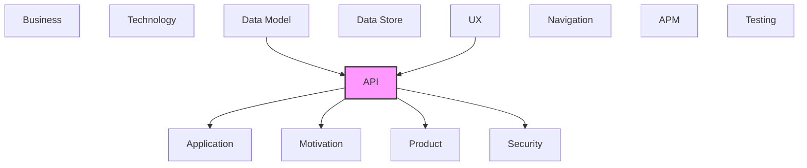

# API

[← Back to README](../README.md)

REST APIs, operations, endpoints, and API integrations.

## Report Index

- [Layer Introduction](#layer-introduction)
- [Intra-Layer Relationships](#intra-layer-relationships)
- [Inter-Layer Dependencies](#inter-layer-dependencies)
- [Inter-Layer Relationships Table](#inter-layer-relationships-table)
- [Element Reference](#element-reference)

## Layer Introduction

| Metric                    | Count |
| ------------------------- | ----- |
| Elements                  | 477   |
| Intra-Layer Relationships | 374   |
| Inter-Layer Relationships | 537   |
| Inbound Relationships     | 207   |
| Outbound Relationships    | 330   |

**Cross-Layer References**:

- **Upstream layers**: [Data Model](./08-data-model-layer-report.md), [UX](./10-ux-layer-report.md)
- **Downstream layers**: [Application](./05-application-layer-report.md), [Motivation](./01-motivation-layer-report.md), [Product](./03-product-layer-report.md), [Security](./04-security-layer-report.md)

## Intra-Layer Relationships

*This layer has >30 elements. Summary table shown instead of diagram.*

| Element                                                        | Type              | Relationships |
| -------------------------------------------------------------- | ----------------- | ------------- |
| `api.info.context-studio-api`                                  | `info`            | 1             |
| `api.openapidocument.context-studio-open-api-spec`             | `openapidocument` | 1             |
| `api.operation.accept-rest-of-comparison`                      | `operation`       | 2             |
| `api.operation.add-parent-class-to-individual`                 | `operation`       | 2             |
| `api.operation.add-proposal-operations`                        | `operation`       | 2             |
| `api.operation.add-source`                                     | `operation`       | 2             |
| `api.operation.analyze-text`                                   | `operation`       | 2             |
| `api.operation.apply-pipeline-run`                             | `operation`       | 2             |
| `api.operation.apply-proposal`                                 | `operation`       | 2             |
| `api.operation.build-graph`                                    | `operation`       | 1             |
| `api.operation.cancel-batch-runs`                              | `operation`       | 1             |
| `api.operation.cancel-pipeline-run`                            | `operation`       | 1             |
| `api.operation.check-cycle`                                    | `operation`       | 2             |
| `api.operation.clear-claim-verdict`                            | `operation`       | 1             |
| `api.operation.clear-proposal-landed`                          | `operation`       | 1             |
| `api.operation.compare-proposals`                              | `operation`       | 1             |
| `api.operation.create-attribute-definition`                    | `operation`       | 2             |
| `api.operation.create-batch`                                   | `operation`       | 1             |
| `api.operation.create-class`                                   | `operation`       | 2             |
| `api.operation.create-concept-scheme`                          | `operation`       | 2             |
| `api.operation.create-conversation`                            | `operation`       | 1             |
| `api.operation.create-dataset`                                 | `operation`       | 2             |
| `api.operation.create-grounding-workflow`                      | `operation`       | 2             |
| `api.operation.create-individual`                              | `operation`       | 2             |
| `api.operation.create-pipeline-configuration`                  | `operation`       | 2             |
| `api.operation.create-property-definition`                     | `operation`       | 2             |
| `api.operation.create-proposal`                                | `operation`       | 2             |
| `api.operation.create-relationship`                            | `operation`       | 2             |
| `api.operation.create-taxonomy`                                | `operation`       | 2             |
| `api.operation.decide-comparison-pair`                         | `operation`       | 2             |
| `api.operation.delete-attribute-definition`                    | `operation`       | 0             |
| `api.operation.delete-class`                                   | `operation`       | 1             |
| `api.operation.delete-concept-scheme`                          | `operation`       | 1             |
| `api.operation.delete-conversation`                            | `operation`       | 0             |
| `api.operation.delete-dataset`                                 | `operation`       | 1             |
| `api.operation.delete-grounding-workflow`                      | `operation`       | 0             |
| `api.operation.delete-individual`                              | `operation`       | 1             |
| `api.operation.delete-pipeline-configuration`                  | `operation`       | 1             |
| `api.operation.delete-property-definition`                     | `operation`       | 1             |
| `api.operation.delete-relationship`                            | `operation`       | 1             |
| `api.operation.delete-taxonomy`                                | `operation`       | 1             |
| `api.operation.dr-spec-drift`                                  | `operation`       | 2             |
| `api.operation.enqueue-batch-runs`                             | `operation`       | 2             |
| `api.operation.enrich-from-references`                         | `operation`       | 2             |
| `api.operation.execute-pipeline`                               | `operation`       | 2             |
| `api.operation.execute-sparql`                                 | `operation`       | 2             |
| `api.operation.export-bundle`                                  | `operation`       | 0             |
| `api.operation.export-claims`                                  | `operation`       | 0             |
| `api.operation.export-gold`                                    | `operation`       | 0             |
| `api.operation.export-ontology`                                | `operation`       | 2             |
| `api.operation.extract-entities`                               | `operation`       | 2             |
| `api.operation.extract-source`                                 | `operation`       | 2             |
| `api.operation.get-all-paths`                                  | `operation`       | 1             |
| `api.operation.get-approval-policy`                            | `operation`       | 1             |
| `api.operation.get-attribute-definition`                       | `operation`       | 1             |
| `api.operation.get-background-task`                            | `operation`       | 1             |
| `api.operation.get-batch`                                      | `operation`       | 1             |
| `api.operation.get-centrality`                                 | `operation`       | 1             |
| `api.operation.get-change-history-all`                         | `operation`       | 1             |
| `api.operation.get-change-history-by-entity`                   | `operation`       | 1             |
| `api.operation.get-chat-status`                                | `operation`       | 1             |
| `api.operation.get-claim`                                      | `operation`       | 1             |
| `api.operation.get-class`                                      | `operation`       | 1             |
| `api.operation.get-communities`                                | `operation`       | 1             |
| `api.operation.get-concept-scheme`                             | `operation`       | 1             |
| `api.operation.get-configuration`                              | `operation`       | 1             |
| `api.operation.get-conversation`                               | `operation`       | 1             |
| `api.operation.get-database-health`                            | `operation`       | 1             |
| `api.operation.get-degree-distribution`                        | `operation`       | 1             |
| `api.operation.get-embedding-health`                           | `operation`       | 1             |
| `api.operation.get-graph-metrics`                              | `operation`       | 1             |
| `api.operation.get-graph-view`                                 | `operation`       | 1             |
| `api.operation.get-grounding-workflow`                         | `operation`       | 1             |
| `api.operation.get-import-run`                                 | `operation`       | 1             |
| `api.operation.get-individual`                                 | `operation`       | 1             |
| `api.operation.get-individual-extraction-candidates`           | `operation`       | 1             |
| `api.operation.get-individual-inherited-properties`            | `operation`       | 1             |
| `api.operation.get-individual-sources`                         | `operation`       | 1             |
| `api.operation.get-mcp-connection-details`                     | `operation`       | 1             |
| `api.operation.get-neighbors`                                  | `operation`       | 1             |
| `api.operation.get-nlp-health`                                 | `operation`       | 1             |
| `api.operation.get-pipeline-candidates-generic`                | `operation`       | 1             |
| `api.operation.get-pipeline-configuration`                     | `operation`       | 1             |
| `api.operation.get-pipeline-executions`                        | `operation`       | 1             |
| `api.operation.get-pipeline-run`                               | `operation`       | 1             |
| `api.operation.get-pipeline-run-change-events`                 | `operation`       | 1             |
| `api.operation.get-property-definition`                        | `operation`       | 1             |
| `api.operation.get-proposal`                                   | `operation`       | 1             |
| `api.operation.get-proposal-decisions`                         | `operation`       | 1             |
| `api.operation.get-publish-diff-stats`                         | `operation`       | 1             |
| `api.operation.get-rdf-triple-count`                           | `operation`       | 1             |
| `api.operation.get-rdf-triples`                                | `operation`       | 1             |
| `api.operation.get-reference-relations`                        | `operation`       | 2             |
| `api.operation.get-reference-status`                           | `operation`       | 1             |
| `api.operation.get-relationship`                               | `operation`       | 1             |
| `api.operation.get-relationship-sources`                       | `operation`       | 1             |
| `api.operation.get-run-change-events`                          | `operation`       | 1             |
| `api.operation.get-schema-extraction-candidates`               | `operation`       | 1             |
| `api.operation.get-schema-grounding-candidates`                | `operation`       | 1             |
| `api.operation.get-schema-refinement-candidates`               | `operation`       | 1             |
| `api.operation.get-scheme-class-counts`                        | `operation`       | 1             |
| `api.operation.get-service-metrics`                            | `operation`       | 1             |
| `api.operation.get-shortest-path`                              | `operation`       | 1             |
| `api.operation.get-source`                                     | `operation`       | 1             |
| `api.operation.get-source-text`                                | `operation`       | 1             |
| `api.operation.get-stats-trends`                               | `operation`       | 1             |
| `api.operation.get-subgraph`                                   | `operation`       | 1             |
| `api.operation.get-subgraph-by-depth`                          | `operation`       | 1             |
| `api.operation.get-sync-status`                                | `operation`       | 1             |
| `api.operation.get-system-health`                              | `operation`       | 1             |
| `api.operation.get-tasks-health`                               | `operation`       | 1             |
| `api.operation.get-taxonomy`                                   | `operation`       | 1             |
| `api.operation.get-taxonomy-scheme-counts`                     | `operation`       | 1             |
| `api.operation.import-bundle`                                  | `operation`       | 2             |
| `api.operation.import-ontology`                                | `operation`       | 2             |
| `api.operation.list-background-tasks`                          | `operation`       | 1             |
| `api.operation.list-claims`                                    | `operation`       | 1             |
| `api.operation.list-class-attribute-definitions`               | `operation`       | 1             |
| `api.operation.list-classes`                                   | `operation`       | 1             |
| `api.operation.list-concept-schemes`                           | `operation`       | 1             |
| `api.operation.list-conversations`                             | `operation`       | 1             |
| `api.operation.list-datasets`                                  | `operation`       | 1             |
| `api.operation.list-decision-models`                           | `operation`       | 1             |
| `api.operation.list-demo-datasets`                             | `operation`       | 1             |
| `api.operation.list-edge-attributes`                           | `operation`       | 1             |
| `api.operation.list-extraction-examples`                       | `operation`       | 1             |
| `api.operation.list-gold`                                      | `operation`       | 1             |
| `api.operation.list-grounding-workflows`                       | `operation`       | 1             |
| `api.operation.list-implementations`                           | `operation`       | 1             |
| `api.operation.list-import-runs`                               | `operation`       | 1             |
| `api.operation.list-individuals`                               | `operation`       | 1             |
| `api.operation.list-pipeline-configurations`                   | `operation`       | 1             |
| `api.operation.list-pipeline-types`                            | `operation`       | 1             |
| `api.operation.list-predicates-by-ids`                         | `operation`       | 1             |
| `api.operation.list-property-definitions`                      | `operation`       | 1             |
| `api.operation.list-proposals`                                 | `operation`       | 1             |
| `api.operation.list-relationships`                             | `operation`       | 1             |
| `api.operation.list-sources`                                   | `operation`       | 1             |
| `api.operation.list-taxonomies`                                | `operation`       | 1             |
| `api.operation.list-taxonomy-classes`                          | `operation`       | 1             |
| `api.operation.list-taxonomy-predicates`                       | `operation`       | 1             |
| `api.operation.list-workflow-runs`                             | `operation`       | 1             |
| `api.operation.load-demo-dataset`                              | `operation`       | 1             |
| `api.operation.mark-proposal-landed`                           | `operation`       | 2             |
| `api.operation.mcp-endpoint`                                   | `operation`       | 1             |
| `api.operation.move-class`                                     | `operation`       | 2             |
| `api.operation.preview-recognition`                            | `operation`       | 2             |
| `api.operation.publish-taxonomy`                               | `operation`       | 2             |
| `api.operation.pull-changes`                                   | `operation`       | 1             |
| `api.operation.push-changes`                                   | `operation`       | 1             |
| `api.operation.reject-proposal`                                | `operation`       | 2             |
| `api.operation.remove-parent-class-from-individual`            | `operation`       | 1             |
| `api.operation.remove-source`                                  | `operation`       | 1             |
| `api.operation.reopen-operations`                              | `operation`       | 2             |
| `api.operation.reorder-individual-classes`                     | `operation`       | 2             |
| `api.operation.reset-configuration`                            | `operation`       | 1             |
| `api.operation.resume-batch-runs`                              | `operation`       | 1             |
| `api.operation.revert-pipeline-run`                            | `operation`       | 1             |
| `api.operation.revert-proposal`                                | `operation`       | 1             |
| `api.operation.run-grounding-workflow`                         | `operation`       | 1             |
| `api.operation.search-references`                              | `operation`       | 2             |
| `api.operation.send-message`                                   | `operation`       | 1             |
| `api.operation.set-approval-policy`                            | `operation`       | 2             |
| `api.operation.set-claim-verdict`                              | `operation`       | 2             |
| `api.operation.submit-claims`                                  | `operation`       | 2             |
| `api.operation.update-attribute-definition`                    | `operation`       | 2             |
| `api.operation.update-class`                                   | `operation`       | 2             |
| `api.operation.update-concept-scheme`                          | `operation`       | 2             |
| `api.operation.update-configuration-section`                   | `operation`       | 2             |
| `api.operation.update-grounding-workflow`                      | `operation`       | 2             |
| `api.operation.update-individual`                              | `operation`       | 2             |
| `api.operation.update-pipeline-configuration`                  | `operation`       | 2             |
| `api.operation.update-property-definition`                     | `operation`       | 2             |
| `api.operation.update-taxonomy`                                | `operation`       | 2             |
| `api.ratelimit.external-reference-api-rate-limit`              | `ratelimit`       | 0             |
| `api.requestbody.accept-rest-request`                          | `requestbody`     | 1             |
| `api.requestbody.add-individual-request`                       | `requestbody`     | 1             |
| `api.requestbody.add-source-request`                           | `requestbody`     | 1             |
| `api.requestbody.analyze-text-request`                         | `requestbody`     | 1             |
| `api.requestbody.apply-run-request`                            | `requestbody`     | 1             |
| `api.requestbody.approval-policy-request`                      | `requestbody`     | 1             |
| `api.requestbody.attribute-definition-create-request`          | `requestbody`     | 1             |
| `api.requestbody.attribute-definition-update-request`          | `requestbody`     | 1             |
| `api.requestbody.bundle-document`                              | `requestbody`     | 1             |
| `api.requestbody.change-proposal-apply-request`                | `requestbody`     | 1             |
| `api.requestbody.change-proposal-create-request`               | `requestbody`     | 1             |
| `api.requestbody.change-proposal-landed-request`               | `requestbody`     | 1             |
| `api.requestbody.change-proposal-reject-request`               | `requestbody`     | 1             |
| `api.requestbody.change-proposal-reopen-request`               | `requestbody`     | 1             |
| `api.requestbody.claim-verdict-request`                        | `requestbody`     | 1             |
| `api.requestbody.claims-submit-request`                        | `requestbody`     | 1             |
| `api.requestbody.class-create-request`                         | `requestbody`     | 1             |
| `api.requestbody.class-move-request`                           | `requestbody`     | 1             |
| `api.requestbody.class-update-request`                         | `requestbody`     | 1             |
| `api.requestbody.concept-scheme-create-request`                | `requestbody`     | 1             |
| `api.requestbody.concept-scheme-update-request`                | `requestbody`     | 1             |
| `api.requestbody.config-section-update-request`                | `requestbody`     | 1             |
| `api.requestbody.cycle-check-request`                          | `requestbody`     | 1             |
| `api.requestbody.dataset-create-request`                       | `requestbody`     | 1             |
| `api.requestbody.dr-spec-drift-request`                        | `requestbody`     | 1             |
| `api.requestbody.enqueue-batch-runs-request`                   | `requestbody`     | 1             |
| `api.requestbody.enrich-from-references-request`               | `requestbody`     | 1             |
| `api.requestbody.export-request`                               | `requestbody`     | 1             |
| `api.requestbody.extract-request`                              | `requestbody`     | 1             |
| `api.requestbody.grounding-workflow-create`                    | `requestbody`     | 1             |
| `api.requestbody.grounding-workflow-update`                    | `requestbody`     | 1             |
| `api.requestbody.import-ontology-upload`                       | `requestbody`     | 1             |
| `api.requestbody.individual-class-list-request`                | `requestbody`     | 1             |
| `api.requestbody.individual-class-request`                     | `requestbody`     | 1             |
| `api.requestbody.individual-create-request`                    | `requestbody`     | 1             |
| `api.requestbody.individual-update-request`                    | `requestbody`     | 1             |
| `api.requestbody.pair-decision-request`                        | `requestbody`     | 1             |
| `api.requestbody.pipeline-configuration-create-request`        | `requestbody`     | 1             |
| `api.requestbody.pipeline-configuration-update-request`        | `requestbody`     | 1             |
| `api.requestbody.pipeline-run-request`                         | `requestbody`     | 1             |
| `api.requestbody.property-definition-create-request`           | `requestbody`     | 1             |
| `api.requestbody.property-definition-update-request`           | `requestbody`     | 1             |
| `api.requestbody.recognition-preview-request`                  | `requestbody`     | 1             |
| `api.requestbody.reference-relations-request`                  | `requestbody`     | 1             |
| `api.requestbody.reference-search-request`                     | `requestbody`     | 1             |
| `api.requestbody.relationship-create-request`                  | `requestbody`     | 1             |
| `api.requestbody.send-message-request`                         | `requestbody`     | 1             |
| `api.requestbody.source-extract-request`                       | `requestbody`     | 1             |
| `api.requestbody.sparqlrequest`                                | `requestbody`     | 1             |
| `api.requestbody.taxonomy-create-request`                      | `requestbody`     | 1             |
| `api.requestbody.taxonomy-publish-request`                     | `requestbody`     | 1             |
| `api.requestbody.taxonomy-update-request`                      | `requestbody`     | 1             |
| `api.response.accept-rest-response`                            | `response`        | 1             |
| `api.response.app-configuration-response`                      | `response`        | 3             |
| `api.response.apply-run-response`                              | `response`        | 1             |
| `api.response.approval-policy-response`                        | `response`        | 2             |
| `api.response.attribute-definition-response`                   | `response`        | 5             |
| `api.response.background-task-response`                        | `response`        | 2             |
| `api.response.background-task-summary-response`                | `response`        | 1             |
| `api.response.batch-response`                                  | `response`        | 2             |
| `api.response.bundle-import-response`                          | `response`        | 1             |
| `api.response.cancel-batch-response`                           | `response`        | 1             |
| `api.response.candidate-item`                                  | `response`        | 5             |
| `api.response.centrality-response`                             | `response`        | 1             |
| `api.response.change-history-response`                         | `response`        | 2             |
| `api.response.change-proposal-response`                        | `response`        | 9             |
| `api.response.change-proposal-revert-response`                 | `response`        | 1             |
| `api.response.chat-status-response`                            | `response`        | 1             |
| `api.response.claim-response`                                  | `response`        | 5             |
| `api.response.class-counts-response`                           | `response`        | 1             |
| `api.response.class-response`                                  | `response`        | 6             |
| `api.response.communities-response`                            | `response`        | 1             |
| `api.response.component-status-response`                       | `response`        | 2             |
| `api.response.concept-scheme-response`                         | `response`        | 4             |
| `api.response.conversation-detail-response`                    | `response`        | 1             |
| `api.response.conversation-response`                           | `response`        | 2             |
| `api.response.cycle-check-response`                            | `response`        | 1             |
| `api.response.data-property-value-response`                    | `response`        | 1             |
| `api.response.database-health-response`                        | `response`        | 1             |
| `api.response.dataset-deletion-response`                       | `response`        | 1             |
| `api.response.dataset-response`                                | `response`        | 2             |
| `api.response.decision-model-list-response`                    | `response`        | 1             |
| `api.response.degree-distribution-response`                    | `response`        | 1             |
| `api.response.demo-dataset-descriptor-response`                | `response`        | 1             |
| `api.response.demo-dataset-load-response`                      | `response`        | 1             |
| `api.response.dr-decision-response`                            | `response`        | 1             |
| `api.response.drift-response`                                  | `response`        | 1             |
| `api.response.enqueue-batch-runs-response`                     | `response`        | 1             |
| `api.response.entity-source-response`                          | `response`        | 2             |
| `api.response.extraction-example-response`                     | `response`        | 1             |
| `api.response.extraction-result-schema`                        | `response`        | 3             |
| `api.response.gold-decision-response`                          | `response`        | 1             |
| `api.response.graph-metrics-response`                          | `response`        | 1             |
| `api.response.graph-view-response`                             | `response`        | 1             |
| `api.response.grounding-workflow-response`                     | `response`        | 4             |
| `api.response.implementation-response`                         | `response`        | 1             |
| `api.response.import-plan-response`                            | `response`        | 1             |
| `api.response.import-run-response`                             | `response`        | 3             |
| `api.response.individual-response`                             | `response`        | 6             |
| `api.response.interchange-change-event-response`               | `response`        | 1             |
| `api.response.knowledge-graph-response`                        | `response`        | 1             |
| `api.response.mcp-connection-response`                         | `response`        | 1             |
| `api.response.neighbors-response`                              | `response`        | 1             |
| `api.response.pair-decision-response`                          | `response`        | 1             |
| `api.response.path-result-response`                            | `response`        | 2             |
| `api.response.pipeline-configuration-response`                 | `response`        | 4             |
| `api.response.pipeline-run-response`                           | `response`        | 4             |
| `api.response.pipeline-type-response`                          | `response`        | 1             |
| `api.response.predicate-response`                              | `response`        | 2             |
| `api.response.property-definition-response`                    | `response`        | 4             |
| `api.response.proposal-comparison-response`                    | `response`        | 1             |
| `api.response.publish-diff-stats`                              | `response`        | 1             |
| `api.response.recognition-preview-response`                    | `response`        | 1             |
| `api.response.reference-relations-response-schema`             | `response`        | 1             |
| `api.response.reference-search-response-schema`                | `response`        | 1             |
| `api.response.reference-status-response-schema`                | `response`        | 1             |
| `api.response.relationship-response`                           | `response`        | 3             |
| `api.response.resolution-record-response`                      | `response`        | 0             |
| `api.response.resume-batch-response`                           | `response`        | 1             |
| `api.response.revert-run-response`                             | `response`        | 1             |
| `api.response.scheme-counts-response`                          | `response`        | 1             |
| `api.response.service-metrics-response`                        | `response`        | 1             |
| `api.response.source-extract-response`                         | `response`        | 1             |
| `api.response.source-response`                                 | `response`        | 4             |
| `api.response.source-text-response`                            | `response`        | 1             |
| `api.response.sparqlresponse`                                  | `response`        | 1             |
| `api.response.stats-trends-response`                           | `response`        | 1             |
| `api.response.subgraph-data-response`                          | `response`        | 1             |
| `api.response.subgraph-result-response`                        | `response`        | 1             |
| `api.response.sync-result-response`                            | `response`        | 2             |
| `api.response.sync-status-response`                            | `response`        | 1             |
| `api.response.system-health-response`                          | `response`        | 1             |
| `api.response.taxonomy-response`                               | `response`        | 5             |
| `api.response.triple-count-response`                           | `response`        | 1             |
| `api.response.triples-response`                                | `response`        | 1             |
| `api.response.versioning-change-event-response`                | `response`        | 1             |
| `api.response.workflow-run-response`                           | `response`        | 2             |
| `api.responses.accept-rest-of-comparison-responses`            | `responses`       | 2             |
| `api.responses.add-parent-class-to-individual-responses`       | `responses`       | 2             |
| `api.responses.add-proposal-operations-responses`              | `responses`       | 2             |
| `api.responses.add-source-responses`                           | `responses`       | 2             |
| `api.responses.analyze-text-responses`                         | `responses`       | 2             |
| `api.responses.apply-pipeline-run-responses`                   | `responses`       | 2             |
| `api.responses.apply-proposal-responses`                       | `responses`       | 2             |
| `api.responses.build-graph-responses`                          | `responses`       | 2             |
| `api.responses.cancel-batch-runs-responses`                    | `responses`       | 2             |
| `api.responses.cancel-pipeline-run-responses`                  | `responses`       | 2             |
| `api.responses.check-cycle-responses`                          | `responses`       | 2             |
| `api.responses.clear-claim-verdict-responses`                  | `responses`       | 2             |
| `api.responses.clear-proposal-landed-responses`                | `responses`       | 2             |
| `api.responses.compare-proposals-responses`                    | `responses`       | 2             |
| `api.responses.create-attribute-definition-responses`          | `responses`       | 2             |
| `api.responses.create-batch-responses`                         | `responses`       | 2             |
| `api.responses.create-class-responses`                         | `responses`       | 2             |
| `api.responses.create-concept-scheme-responses`                | `responses`       | 2             |
| `api.responses.create-conversation-responses`                  | `responses`       | 2             |
| `api.responses.create-dataset-responses`                       | `responses`       | 2             |
| `api.responses.create-grounding-workflow-responses`            | `responses`       | 2             |
| `api.responses.create-individual-responses`                    | `responses`       | 2             |
| `api.responses.create-pipeline-configuration-responses`        | `responses`       | 2             |
| `api.responses.create-property-definition-responses`           | `responses`       | 2             |
| `api.responses.create-proposal-responses`                      | `responses`       | 2             |
| `api.responses.create-relationship-responses`                  | `responses`       | 2             |
| `api.responses.create-taxonomy-responses`                      | `responses`       | 2             |
| `api.responses.decide-comparison-pair-responses`               | `responses`       | 2             |
| `api.responses.delete-class-responses`                         | `responses`       | 1             |
| `api.responses.delete-concept-scheme-responses`                | `responses`       | 1             |
| `api.responses.delete-dataset-responses`                       | `responses`       | 2             |
| `api.responses.delete-individual-responses`                    | `responses`       | 1             |
| `api.responses.delete-pipeline-configuration-responses`        | `responses`       | 1             |
| `api.responses.delete-property-definition-responses`           | `responses`       | 1             |
| `api.responses.delete-relationship-responses`                  | `responses`       | 1             |
| `api.responses.delete-taxonomy-responses`                      | `responses`       | 1             |
| `api.responses.dr-spec-drift-responses`                        | `responses`       | 2             |
| `api.responses.enqueue-batch-runs-responses`                   | `responses`       | 2             |
| `api.responses.enrich-from-references-responses`               | `responses`       | 2             |
| `api.responses.execute-pipeline-responses`                     | `responses`       | 2             |
| `api.responses.execute-sparql-responses`                       | `responses`       | 2             |
| `api.responses.export-ontology-responses`                      | `responses`       | 1             |
| `api.responses.extract-entities-responses`                     | `responses`       | 2             |
| `api.responses.extract-source-responses`                       | `responses`       | 2             |
| `api.responses.get-all-paths-responses`                        | `responses`       | 2             |
| `api.responses.get-approval-policy-responses`                  | `responses`       | 2             |
| `api.responses.get-attribute-definition-responses`             | `responses`       | 2             |
| `api.responses.get-background-task-responses`                  | `responses`       | 2             |
| `api.responses.get-batch-responses`                            | `responses`       | 2             |
| `api.responses.get-centrality-responses`                       | `responses`       | 2             |
| `api.responses.get-change-history-all-responses`               | `responses`       | 2             |
| `api.responses.get-change-history-by-entity-responses`         | `responses`       | 2             |
| `api.responses.get-chat-status-responses`                      | `responses`       | 2             |
| `api.responses.get-claim-responses`                            | `responses`       | 2             |
| `api.responses.get-class-responses`                            | `responses`       | 2             |
| `api.responses.get-communities-responses`                      | `responses`       | 2             |
| `api.responses.get-concept-scheme-responses`                   | `responses`       | 2             |
| `api.responses.get-configuration-responses`                    | `responses`       | 2             |
| `api.responses.get-conversation-responses`                     | `responses`       | 2             |
| `api.responses.get-database-health-responses`                  | `responses`       | 2             |
| `api.responses.get-degree-distribution-responses`              | `responses`       | 2             |
| `api.responses.get-embedding-health-responses`                 | `responses`       | 2             |
| `api.responses.get-graph-metrics-responses`                    | `responses`       | 2             |
| `api.responses.get-graph-view-responses`                       | `responses`       | 2             |
| `api.responses.get-grounding-workflow-responses`               | `responses`       | 2             |
| `api.responses.get-import-run-responses`                       | `responses`       | 2             |
| `api.responses.get-individual-extraction-candidates-responses` | `responses`       | 2             |
| `api.responses.get-individual-inherited-properties-responses`  | `responses`       | 2             |
| `api.responses.get-individual-responses`                       | `responses`       | 2             |
| `api.responses.get-individual-sources-responses`               | `responses`       | 2             |
| `api.responses.get-mcp-connection-details-responses`           | `responses`       | 2             |
| `api.responses.get-neighbors-responses`                        | `responses`       | 2             |
| `api.responses.get-nlp-health-responses`                       | `responses`       | 2             |
| `api.responses.get-pipeline-candidates-generic-responses`      | `responses`       | 2             |
| `api.responses.get-pipeline-configuration-responses`           | `responses`       | 2             |
| `api.responses.get-pipeline-executions-responses`              | `responses`       | 2             |
| `api.responses.get-pipeline-run-change-events-responses`       | `responses`       | 2             |
| `api.responses.get-pipeline-run-responses`                     | `responses`       | 2             |
| `api.responses.get-property-definition-responses`              | `responses`       | 2             |
| `api.responses.get-proposal-decisions-responses`               | `responses`       | 2             |
| `api.responses.get-proposal-responses`                         | `responses`       | 2             |
| `api.responses.get-publish-diff-stats-responses`               | `responses`       | 2             |
| `api.responses.get-rdf-triple-count-responses`                 | `responses`       | 2             |
| `api.responses.get-rdf-triples-responses`                      | `responses`       | 2             |
| `api.responses.get-reference-relations-responses`              | `responses`       | 2             |
| `api.responses.get-reference-status-responses`                 | `responses`       | 2             |
| `api.responses.get-relationship-responses`                     | `responses`       | 2             |
| `api.responses.get-relationship-sources-responses`             | `responses`       | 2             |
| `api.responses.get-run-change-events-responses`                | `responses`       | 2             |
| `api.responses.get-schema-extraction-candidates-responses`     | `responses`       | 2             |
| `api.responses.get-schema-grounding-candidates-responses`      | `responses`       | 2             |
| `api.responses.get-schema-refinement-candidates-responses`     | `responses`       | 2             |
| `api.responses.get-scheme-class-counts-responses`              | `responses`       | 2             |
| `api.responses.get-service-metrics-responses`                  | `responses`       | 2             |
| `api.responses.get-shortest-path-responses`                    | `responses`       | 2             |
| `api.responses.get-source-responses`                           | `responses`       | 2             |
| `api.responses.get-source-text-responses`                      | `responses`       | 2             |
| `api.responses.get-stats-trends-responses`                     | `responses`       | 2             |
| `api.responses.get-subgraph-by-depth-responses`                | `responses`       | 2             |
| `api.responses.get-subgraph-responses`                         | `responses`       | 2             |
| `api.responses.get-sync-status-responses`                      | `responses`       | 2             |
| `api.responses.get-system-health-responses`                    | `responses`       | 2             |
| `api.responses.get-tasks-health-responses`                     | `responses`       | 2             |
| `api.responses.get-taxonomy-responses`                         | `responses`       | 2             |
| `api.responses.get-taxonomy-scheme-counts-responses`           | `responses`       | 2             |
| `api.responses.import-bundle-responses`                        | `responses`       | 2             |
| `api.responses.import-ontology-responses`                      | `responses`       | 3             |
| `api.responses.list-background-tasks-responses`                | `responses`       | 2             |
| `api.responses.list-claims-responses`                          | `responses`       | 2             |
| `api.responses.list-class-attribute-definitions-responses`     | `responses`       | 2             |
| `api.responses.list-classes-responses`                         | `responses`       | 2             |
| `api.responses.list-concept-schemes-responses`                 | `responses`       | 2             |
| `api.responses.list-conversations-responses`                   | `responses`       | 2             |
| `api.responses.list-datasets-responses`                        | `responses`       | 2             |
| `api.responses.list-decision-models-responses`                 | `responses`       | 2             |
| `api.responses.list-demo-datasets-responses`                   | `responses`       | 2             |
| `api.responses.list-edge-attributes-responses`                 | `responses`       | 2             |
| `api.responses.list-extraction-examples-responses`             | `responses`       | 2             |
| `api.responses.list-gold-responses`                            | `responses`       | 2             |
| `api.responses.list-grounding-workflows-responses`             | `responses`       | 2             |
| `api.responses.list-implementations-responses`                 | `responses`       | 2             |
| `api.responses.list-import-runs-responses`                     | `responses`       | 2             |
| `api.responses.list-individuals-responses`                     | `responses`       | 2             |
| `api.responses.list-pipeline-configurations-responses`         | `responses`       | 2             |
| `api.responses.list-pipeline-types-responses`                  | `responses`       | 2             |
| `api.responses.list-predicates-by-ids-responses`               | `responses`       | 2             |
| `api.responses.list-property-definitions-responses`            | `responses`       | 2             |
| `api.responses.list-proposals-responses`                       | `responses`       | 2             |
| `api.responses.list-relationships-responses`                   | `responses`       | 2             |
| `api.responses.list-sources-responses`                         | `responses`       | 2             |
| `api.responses.list-taxonomies-responses`                      | `responses`       | 2             |
| `api.responses.list-taxonomy-classes-responses`                | `responses`       | 2             |
| `api.responses.list-taxonomy-predicates-responses`             | `responses`       | 2             |
| `api.responses.list-workflow-runs-responses`                   | `responses`       | 2             |
| `api.responses.load-demo-dataset-responses`                    | `responses`       | 2             |
| `api.responses.mark-proposal-landed-responses`                 | `responses`       | 2             |
| `api.responses.move-class-responses`                           | `responses`       | 2             |
| `api.responses.preview-recognition-responses`                  | `responses`       | 2             |
| `api.responses.publish-taxonomy-responses`                     | `responses`       | 2             |
| `api.responses.pull-changes-responses`                         | `responses`       | 2             |
| `api.responses.push-changes-responses`                         | `responses`       | 2             |
| `api.responses.reject-proposal-responses`                      | `responses`       | 2             |
| `api.responses.remove-parent-class-from-individual-responses`  | `responses`       | 1             |
| `api.responses.remove-source-responses`                        | `responses`       | 2             |
| `api.responses.reopen-operations-responses`                    | `responses`       | 2             |
| `api.responses.reorder-individual-classes-responses`           | `responses`       | 2             |
| `api.responses.reset-configuration-responses`                  | `responses`       | 2             |
| `api.responses.resume-batch-runs-responses`                    | `responses`       | 2             |
| `api.responses.revert-pipeline-run-responses`                  | `responses`       | 2             |
| `api.responses.revert-proposal-responses`                      | `responses`       | 2             |
| `api.responses.run-grounding-workflow-responses`               | `responses`       | 2             |
| `api.responses.search-references-responses`                    | `responses`       | 2             |
| `api.responses.set-approval-policy-responses`                  | `responses`       | 2             |
| `api.responses.set-claim-verdict-responses`                    | `responses`       | 2             |
| `api.responses.submit-claims-responses`                        | `responses`       | 2             |
| `api.responses.update-attribute-definition-responses`          | `responses`       | 2             |
| `api.responses.update-class-responses`                         | `responses`       | 2             |
| `api.responses.update-concept-scheme-responses`                | `responses`       | 2             |
| `api.responses.update-configuration-section-responses`         | `responses`       | 2             |
| `api.responses.update-grounding-workflow-responses`            | `responses`       | 2             |
| `api.responses.update-individual-responses`                    | `responses`       | 2             |
| `api.responses.update-pipeline-configuration-responses`        | `responses`       | 2             |
| `api.responses.update-property-definition-responses`           | `responses`       | 2             |
| `api.responses.update-taxonomy-responses`                      | `responses`       | 2             |
| `api.securityscheme.mcp-bearer-token`                          | `securityscheme`  | 1             |

## Inter-Layer Dependencies

## Inter-Layer Relationships Table

| Relationship ID                                           | Source Node                                          | Dest Node                                                           | Dest Layer    | Predicate    | Cardinality  | Strength |
| --------------------------------------------------------- | ---------------------------------------------------- | ------------------------------------------------------------------- | ------------- | ------------ | ------------ | -------- |
| `api.operation.exposes.product.feature`                   | `api.operation.accept-rest-of-comparison`            | `product.feature.compare-two-pipelines`                             | `product`     | `exposes`    | many-to-many | medium   |
| `api.operation.references.application.applicationservice` | `api.operation.accept-rest-of-comparison`            | `application.applicationservice.proposal-comparison-service`        | `application` | `references` | many-to-many | medium   |
| `api.operation.exposes.product.feature`                   | `api.operation.add-parent-class-to-individual`       | `product.feature.schema-and-data-pages`                             | `product`     | `exposes`    | many-to-many | medium   |
| `api.operation.references.application.applicationservice` | `api.operation.add-parent-class-to-individual`       | `application.applicationservice.ontology-service`                   | `application` | `references` | many-to-many | medium   |
| `api.operation.exposes.product.feature`                   | `api.operation.add-proposal-operations`              | `product.feature.proposal-queue-and-detail`                         | `product`     | `exposes`    | many-to-many | medium   |
| `api.operation.exposes.product.feature`                   | `api.operation.add-proposal-operations`              | `product.feature.proposal-review-page`                              | `product`     | `exposes`    | many-to-many | medium   |
| `api.operation.references.application.applicationservice` | `api.operation.add-proposal-operations`              | `application.applicationservice.proposal-service`                   | `application` | `references` | many-to-many | medium   |
| `api.operation.exposes.product.feature`                   | `api.operation.add-source`                           | `product.feature.sources-page-and-extract-flow`                     | `product`     | `exposes`    | many-to-many | medium   |
| `api.operation.references.application.applicationservice` | `api.operation.add-source`                           | `application.applicationservice.source-service`                     | `application` | `references` | many-to-many | medium   |
| `api.operation.references.security.threat`                | `api.operation.add-source`                           | `security.threat.server-side-request-forgery-via-url-sources`       | `security`    | `references` | many-to-many | medium   |
| `api.operation.references.application.applicationservice` | `api.operation.analyze-text`                         | `application.applicationservice.extraction-service`                 | `application` | `references` | many-to-many | medium   |
| `api.operation.references.application.applicationservice` | `api.operation.apply-pipeline-run`                   | `application.applicationservice.proposal-service`                   | `application` | `references` | many-to-many | medium   |
| `api.operation.exposes.product.feature`                   | `api.operation.apply-proposal`                       | `product.feature.proposal-queue-and-detail`                         | `product`     | `exposes`    | many-to-many | medium   |
| `api.operation.references.application.applicationservice` | `api.operation.apply-proposal`                       | `application.applicationservice.proposal-service`                   | `application` | `references` | many-to-many | medium   |
| `api.operation.exposes.product.feature`                   | `api.operation.build-graph`                          | `product.feature.graph-view`                                        | `product`     | `exposes`    | many-to-many | medium   |
| `api.operation.references.application.applicationservice` | `api.operation.build-graph`                          | `application.applicationservice.graph-analysis-service`             | `application` | `references` | many-to-many | medium   |
| `api.operation.exposes.product.feature`                   | `api.operation.cancel-batch-runs`                    | `product.feature.runs-page`                                         | `product`     | `exposes`    | many-to-many | medium   |
| `api.operation.references.application.applicationservice` | `api.operation.cancel-batch-runs`                    | `application.applicationservice.pipeline-selection-service`         | `application` | `references` | many-to-many | medium   |
| `api.operation.exposes.product.feature`                   | `api.operation.cancel-pipeline-run`                  | `product.feature.runs-page`                                         | `product`     | `exposes`    | many-to-many | medium   |
| `api.operation.references.application.applicationservice` | `api.operation.cancel-pipeline-run`                  | `application.applicationservice.pipeline-selection-service`         | `application` | `references` | many-to-many | medium   |
| `api.operation.exposes.product.feature`                   | `api.operation.check-cycle`                          | `product.feature.graph-view`                                        | `product`     | `exposes`    | many-to-many | medium   |
| `api.operation.references.application.applicationservice` | `api.operation.check-cycle`                          | `application.applicationservice.graph-analysis-service`             | `application` | `references` | many-to-many | medium   |
| `api.operation.exposes.product.feature`                   | `api.operation.clear-claim-verdict`                  | `product.feature.claims-page`                                       | `product`     | `exposes`    | many-to-many | medium   |
| `api.operation.references.application.applicationservice` | `api.operation.clear-claim-verdict`                  | `application.applicationservice.claim-service`                      | `application` | `references` | many-to-many | medium   |
| `api.operation.exposes.product.feature`                   | `api.operation.clear-proposal-landed`                | `product.feature.proposal-queue-and-detail`                         | `product`     | `exposes`    | many-to-many | medium   |
| `api.operation.references.application.applicationservice` | `api.operation.clear-proposal-landed`                | `application.applicationservice.proposal-service`                   | `application` | `references` | many-to-many | medium   |
| `api.operation.exposes.product.feature`                   | `api.operation.compare-proposals`                    | `product.feature.compare-two-pipelines`                             | `product`     | `exposes`    | many-to-many | medium   |
| `api.operation.references.application.applicationservice` | `api.operation.compare-proposals`                    | `application.applicationservice.proposal-comparison-service`        | `application` | `references` | many-to-many | medium   |
| `api.operation.exposes.product.feature`                   | `api.operation.create-attribute-definition`          | `product.feature.schema-and-data-pages`                             | `product`     | `exposes`    | many-to-many | medium   |
| `api.operation.references.application.applicationservice` | `api.operation.create-attribute-definition`          | `application.applicationservice.ontology-service`                   | `application` | `references` | many-to-many | medium   |
| `api.operation.exposes.product.feature`                   | `api.operation.create-batch`                         | `product.feature.runs-page`                                         | `product`     | `exposes`    | many-to-many | medium   |
| `api.operation.references.application.applicationservice` | `api.operation.create-batch`                         | `application.applicationservice.pipeline-selection-service`         | `application` | `references` | many-to-many | medium   |
| `api.operation.exposes.product.feature`                   | `api.operation.create-class`                         | `product.feature.schema-and-data-pages`                             | `product`     | `exposes`    | many-to-many | medium   |
| `api.operation.references.application.applicationservice` | `api.operation.create-class`                         | `application.applicationservice.ontology-service`                   | `application` | `references` | many-to-many | medium   |
| `api.operation.references.application.applicationservice` | `api.operation.create-concept-scheme`                | `application.applicationservice.ontology-service`                   | `application` | `references` | many-to-many | medium   |
| `api.operation.exposes.product.feature`                   | `api.operation.create-conversation`                  | `product.feature.chat-panel`                                        | `product`     | `exposes`    | many-to-many | medium   |
| `api.operation.references.application.applicationservice` | `api.operation.create-conversation`                  | `application.applicationservice.chat-service`                       | `application` | `references` | many-to-many | medium   |
| `api.operation.exposes.product.feature`                   | `api.operation.create-dataset`                       | `product.feature.schema-and-data-pages`                             | `product`     | `exposes`    | many-to-many | medium   |
| `api.operation.references.application.applicationservice` | `api.operation.create-dataset`                       | `application.applicationservice.ontology-service`                   | `application` | `references` | many-to-many | medium   |
| `api.operation.references.application.applicationservice` | `api.operation.create-grounding-workflow`            | `application.applicationservice.extraction-service`                 | `application` | `references` | many-to-many | medium   |
| `api.operation.exposes.product.feature`                   | `api.operation.create-individual`                    | `product.feature.schema-and-data-pages`                             | `product`     | `exposes`    | many-to-many | medium   |
| `api.operation.references.application.applicationservice` | `api.operation.create-individual`                    | `application.applicationservice.ontology-service`                   | `application` | `references` | many-to-many | medium   |
| `api.operation.references.application.applicationservice` | `api.operation.create-pipeline-configuration`        | `application.applicationservice.pipeline-registry`                  | `application` | `references` | many-to-many | medium   |
| `api.operation.exposes.product.feature`                   | `api.operation.create-property-definition`           | `product.feature.schema-and-data-pages`                             | `product`     | `exposes`    | many-to-many | medium   |
| `api.operation.references.application.applicationservice` | `api.operation.create-property-definition`           | `application.applicationservice.ontology-service`                   | `application` | `references` | many-to-many | medium   |
| `api.operation.exposes.product.feature`                   | `api.operation.create-proposal`                      | `product.feature.proposal-queue-and-detail`                         | `product`     | `exposes`    | many-to-many | medium   |
| `api.operation.references.application.applicationservice` | `api.operation.create-proposal`                      | `application.applicationservice.proposal-service`                   | `application` | `references` | many-to-many | medium   |
| `api.operation.references.application.applicationservice` | `api.operation.create-relationship`                  | `application.applicationservice.ontology-service`                   | `application` | `references` | many-to-many | medium   |
| `api.operation.references.application.applicationservice` | `api.operation.create-taxonomy`                      | `application.applicationservice.ontology-service`                   | `application` | `references` | many-to-many | medium   |
| `api.operation.exposes.product.feature`                   | `api.operation.decide-comparison-pair`               | `product.feature.compare-two-pipelines`                             | `product`     | `exposes`    | many-to-many | medium   |
| `api.operation.references.application.applicationservice` | `api.operation.decide-comparison-pair`               | `application.applicationservice.proposal-comparison-service`        | `application` | `references` | many-to-many | medium   |
| `api.operation.exposes.product.feature`                   | `api.operation.delete-attribute-definition`          | `product.feature.schema-and-data-pages`                             | `product`     | `exposes`    | many-to-many | medium   |
| `api.operation.references.application.applicationservice` | `api.operation.delete-attribute-definition`          | `application.applicationservice.ontology-service`                   | `application` | `references` | many-to-many | medium   |
| `api.operation.exposes.product.feature`                   | `api.operation.delete-class`                         | `product.feature.schema-and-data-pages`                             | `product`     | `exposes`    | many-to-many | medium   |
| `api.operation.references.application.applicationservice` | `api.operation.delete-class`                         | `application.applicationservice.ontology-service`                   | `application` | `references` | many-to-many | medium   |
| `api.operation.exposes.product.feature`                   | `api.operation.delete-concept-scheme`                | `product.feature.schema-and-data-pages`                             | `product`     | `exposes`    | many-to-many | medium   |
| `api.operation.references.application.applicationservice` | `api.operation.delete-concept-scheme`                | `application.applicationservice.ontology-service`                   | `application` | `references` | many-to-many | medium   |
| `api.operation.exposes.product.feature`                   | `api.operation.delete-conversation`                  | `product.feature.chat-panel`                                        | `product`     | `exposes`    | many-to-many | medium   |
| `api.operation.references.application.applicationservice` | `api.operation.delete-conversation`                  | `application.applicationservice.chat-service`                       | `application` | `references` | many-to-many | medium   |
| `api.operation.exposes.product.feature`                   | `api.operation.delete-dataset`                       | `product.feature.schema-and-data-pages`                             | `product`     | `exposes`    | many-to-many | medium   |
| `api.operation.references.application.applicationservice` | `api.operation.delete-dataset`                       | `application.applicationservice.ontology-service`                   | `application` | `references` | many-to-many | medium   |
| `api.operation.exposes.product.feature`                   | `api.operation.delete-grounding-workflow`            | `product.feature.reference-sources-and-grounding-workflows`         | `product`     | `exposes`    | many-to-many | medium   |
| `api.operation.references.application.applicationservice` | `api.operation.delete-grounding-workflow`            | `application.applicationservice.extraction-service`                 | `application` | `references` | many-to-many | medium   |
| `api.operation.exposes.product.feature`                   | `api.operation.delete-individual`                    | `product.feature.schema-and-data-pages`                             | `product`     | `exposes`    | many-to-many | medium   |
| `api.operation.references.application.applicationservice` | `api.operation.delete-individual`                    | `application.applicationservice.ontology-service`                   | `application` | `references` | many-to-many | medium   |
| `api.operation.references.application.applicationservice` | `api.operation.delete-pipeline-configuration`        | `application.applicationservice.pipeline-registry`                  | `application` | `references` | many-to-many | medium   |
| `api.operation.exposes.product.feature`                   | `api.operation.delete-property-definition`           | `product.feature.schema-and-data-pages`                             | `product`     | `exposes`    | many-to-many | medium   |
| `api.operation.references.application.applicationservice` | `api.operation.delete-property-definition`           | `application.applicationservice.ontology-service`                   | `application` | `references` | many-to-many | medium   |
| `api.operation.exposes.product.feature`                   | `api.operation.delete-relationship`                  | `product.feature.schema-and-data-pages`                             | `product`     | `exposes`    | many-to-many | medium   |
| `api.operation.references.application.applicationservice` | `api.operation.delete-relationship`                  | `application.applicationservice.ontology-service`                   | `application` | `references` | many-to-many | medium   |
| `api.operation.exposes.product.feature`                   | `api.operation.delete-taxonomy`                      | `product.feature.schema-and-data-pages`                             | `product`     | `exposes`    | many-to-many | medium   |
| `api.operation.references.application.applicationservice` | `api.operation.delete-taxonomy`                      | `application.applicationservice.ontology-service`                   | `application` | `references` | many-to-many | medium   |
| `api.operation.exposes.product.feature`                   | `api.operation.dr-spec-drift`                        | `product.feature.check-drift`                                       | `product`     | `exposes`    | many-to-many | medium   |
| `api.operation.references.application.applicationservice` | `api.operation.dr-spec-drift`                        | `application.applicationservice.drift-import-service`               | `application` | `references` | many-to-many | medium   |
| `api.operation.exposes.product.feature`                   | `api.operation.enqueue-batch-runs`                   | `product.feature.runs-page`                                         | `product`     | `exposes`    | many-to-many | medium   |
| `api.operation.references.application.applicationservice` | `api.operation.enqueue-batch-runs`                   | `application.applicationservice.pipeline-selection-service`         | `application` | `references` | many-to-many | medium   |
| `api.operation.references.application.applicationservice` | `api.operation.enrich-from-references`               | `application.applicationservice.extraction-service`                 | `application` | `references` | many-to-many | medium   |
| `api.operation.references.application.applicationservice` | `api.operation.execute-pipeline`                     | `application.applicationservice.pipeline-selection-service`         | `application` | `references` | many-to-many | medium   |
| `api.operation.exposes.product.feature`                   | `api.operation.execute-sparql`                       | `product.feature.graph-view`                                        | `product`     | `exposes`    | many-to-many | medium   |
| `api.operation.references.application.applicationservice` | `api.operation.execute-sparql`                       | `application.applicationservice.graph-analysis-service`             | `application` | `references` | many-to-many | medium   |
| `api.operation.exposes.product.feature`                   | `api.operation.export-bundle`                        | `product.feature.export-bundle`                                     | `product`     | `exposes`    | many-to-many | medium   |
| `api.operation.references.application.applicationservice` | `api.operation.export-bundle`                        | `application.applicationservice.bundle-export-service`              | `application` | `references` | many-to-many | medium   |
| `api.operation.exposes.product.feature`                   | `api.operation.export-claims`                        | `product.feature.claims-page`                                       | `product`     | `exposes`    | many-to-many | medium   |
| `api.operation.references.application.applicationservice` | `api.operation.export-claims`                        | `application.applicationservice.claim-service`                      | `application` | `references` | many-to-many | medium   |
| `api.operation.exposes.product.feature`                   | `api.operation.export-gold`                          | `product.feature.gold-mode`                                         | `product`     | `exposes`    | many-to-many | medium   |
| `api.operation.references.application.applicationservice` | `api.operation.export-gold`                          | `application.applicationservice.proposal-service`                   | `application` | `references` | many-to-many | medium   |
| `api.operation.exposes.product.feature`                   | `api.operation.export-ontology`                      | `product.feature.owl-skos-and-graph-ml-import-and-export`           | `product`     | `exposes`    | many-to-many | medium   |
| `api.operation.references.application.applicationservice` | `api.operation.export-ontology`                      | `application.applicationservice.import-run-service`                 | `application` | `references` | many-to-many | medium   |
| `api.operation.references.application.applicationservice` | `api.operation.extract-entities`                     | `application.applicationservice.extraction-service`                 | `application` | `references` | many-to-many | medium   |
| `api.operation.exposes.product.feature`                   | `api.operation.extract-source`                       | `product.feature.sources-page-and-extract-flow`                     | `product`     | `exposes`    | many-to-many | medium   |
| `api.operation.references.application.applicationservice` | `api.operation.extract-source`                       | `application.applicationservice.source-extraction-service`          | `application` | `references` | many-to-many | medium   |
| `api.operation.exposes.product.feature`                   | `api.operation.get-all-paths`                        | `product.feature.graph-view`                                        | `product`     | `exposes`    | many-to-many | medium   |
| `api.operation.references.application.applicationservice` | `api.operation.get-all-paths`                        | `application.applicationservice.graph-analysis-service`             | `application` | `references` | many-to-many | medium   |
| `api.operation.exposes.product.feature`                   | `api.operation.get-approval-policy`                  | `product.feature.approval-policy`                                   | `product`     | `exposes`    | many-to-many | medium   |
| `api.operation.references.application.applicationservice` | `api.operation.get-approval-policy`                  | `application.applicationservice.approval-policy-service`            | `application` | `references` | many-to-many | medium   |
| `api.operation.exposes.product.feature`                   | `api.operation.get-attribute-definition`             | `product.feature.schema-and-data-pages`                             | `product`     | `exposes`    | many-to-many | medium   |
| `api.operation.references.application.applicationservice` | `api.operation.get-attribute-definition`             | `application.applicationservice.ontology-service`                   | `application` | `references` | many-to-many | medium   |
| `api.operation.exposes.product.feature`                   | `api.operation.get-background-task`                  | `product.feature.system-health-and-background-tasks`                | `product`     | `exposes`    | many-to-many | medium   |
| `api.operation.references.application.applicationservice` | `api.operation.get-background-task`                  | `application.applicationservice.admin-service`                      | `application` | `references` | many-to-many | medium   |
| `api.operation.exposes.product.feature`                   | `api.operation.get-batch`                            | `product.feature.runs-page`                                         | `product`     | `exposes`    | many-to-many | medium   |
| `api.operation.references.application.applicationservice` | `api.operation.get-batch`                            | `application.applicationservice.pipeline-selection-service`         | `application` | `references` | many-to-many | medium   |
| `api.operation.exposes.product.feature`                   | `api.operation.get-centrality`                       | `product.feature.graph-view`                                        | `product`     | `exposes`    | many-to-many | medium   |
| `api.operation.references.application.applicationservice` | `api.operation.get-centrality`                       | `application.applicationservice.graph-analysis-service`             | `application` | `references` | many-to-many | medium   |
| `api.operation.exposes.product.feature`                   | `api.operation.get-change-history-all`               | `product.feature.change-history-and-sync`                           | `product`     | `exposes`    | many-to-many | medium   |
| `api.operation.references.application.applicationservice` | `api.operation.get-change-history-all`               | `application.applicationservice.versioning-service`                 | `application` | `references` | many-to-many | medium   |
| `api.operation.exposes.product.feature`                   | `api.operation.get-change-history-by-entity`         | `product.feature.change-history-and-sync`                           | `product`     | `exposes`    | many-to-many | medium   |
| `api.operation.references.application.applicationservice` | `api.operation.get-change-history-by-entity`         | `application.applicationservice.versioning-service`                 | `application` | `references` | many-to-many | medium   |
| `api.operation.exposes.product.feature`                   | `api.operation.get-chat-status`                      | `product.feature.chat-panel`                                        | `product`     | `exposes`    | many-to-many | medium   |
| `api.operation.references.application.applicationservice` | `api.operation.get-chat-status`                      | `application.applicationservice.chat-service`                       | `application` | `references` | many-to-many | medium   |
| `api.operation.exposes.product.feature`                   | `api.operation.get-claim`                            | `product.feature.claims-page`                                       | `product`     | `exposes`    | many-to-many | medium   |
| `api.operation.references.application.applicationservice` | `api.operation.get-claim`                            | `application.applicationservice.claim-service`                      | `application` | `references` | many-to-many | medium   |
| `api.operation.exposes.product.feature`                   | `api.operation.get-class`                            | `product.feature.schema-and-data-pages`                             | `product`     | `exposes`    | many-to-many | medium   |
| `api.operation.references.application.applicationservice` | `api.operation.get-class`                            | `application.applicationservice.ontology-service`                   | `application` | `references` | many-to-many | medium   |
| `api.operation.exposes.product.feature`                   | `api.operation.get-communities`                      | `product.feature.graph-view`                                        | `product`     | `exposes`    | many-to-many | medium   |
| `api.operation.references.application.applicationservice` | `api.operation.get-communities`                      | `application.applicationservice.graph-analysis-service`             | `application` | `references` | many-to-many | medium   |
| `api.operation.exposes.product.feature`                   | `api.operation.get-concept-scheme`                   | `product.feature.schema-and-data-pages`                             | `product`     | `exposes`    | many-to-many | medium   |
| `api.operation.references.application.applicationservice` | `api.operation.get-concept-scheme`                   | `application.applicationservice.ontology-service`                   | `application` | `references` | many-to-many | medium   |
| `api.operation.exposes.product.feature`                   | `api.operation.get-configuration`                    | `product.feature.configuration-settings`                            | `product`     | `exposes`    | many-to-many | medium   |
| `api.operation.references.application.applicationservice` | `api.operation.get-configuration`                    | `application.applicationservice.admin-service`                      | `application` | `references` | many-to-many | medium   |
| `api.operation.exposes.product.feature`                   | `api.operation.get-conversation`                     | `product.feature.chat-panel`                                        | `product`     | `exposes`    | many-to-many | medium   |
| `api.operation.references.application.applicationservice` | `api.operation.get-conversation`                     | `application.applicationservice.chat-service`                       | `application` | `references` | many-to-many | medium   |
| `api.operation.exposes.product.feature`                   | `api.operation.get-database-health`                  | `product.feature.system-health-and-background-tasks`                | `product`     | `exposes`    | many-to-many | medium   |
| `api.operation.references.application.applicationservice` | `api.operation.get-database-health`                  | `application.applicationservice.admin-service`                      | `application` | `references` | many-to-many | medium   |
| `api.operation.exposes.product.feature`                   | `api.operation.get-degree-distribution`              | `product.feature.graph-view`                                        | `product`     | `exposes`    | many-to-many | medium   |
| `api.operation.references.application.applicationservice` | `api.operation.get-degree-distribution`              | `application.applicationservice.graph-analysis-service`             | `application` | `references` | many-to-many | medium   |
| `api.operation.exposes.product.feature`                   | `api.operation.get-embedding-health`                 | `product.feature.system-health-and-background-tasks`                | `product`     | `exposes`    | many-to-many | medium   |
| `api.operation.references.application.applicationservice` | `api.operation.get-embedding-health`                 | `application.applicationservice.admin-service`                      | `application` | `references` | many-to-many | medium   |
| `api.operation.exposes.product.feature`                   | `api.operation.get-graph-metrics`                    | `product.feature.graph-view`                                        | `product`     | `exposes`    | many-to-many | medium   |
| `api.operation.references.application.applicationservice` | `api.operation.get-graph-metrics`                    | `application.applicationservice.graph-analysis-service`             | `application` | `references` | many-to-many | medium   |
| `api.operation.exposes.product.feature`                   | `api.operation.get-graph-view`                       | `product.feature.graph-view`                                        | `product`     | `exposes`    | many-to-many | medium   |
| `api.operation.references.application.applicationservice` | `api.operation.get-graph-view`                       | `application.applicationservice.graph-analysis-service`             | `application` | `references` | many-to-many | medium   |
| `api.operation.exposes.product.feature`                   | `api.operation.get-grounding-workflow`               | `product.feature.reference-sources-and-grounding-workflows`         | `product`     | `exposes`    | many-to-many | medium   |
| `api.operation.references.application.applicationservice` | `api.operation.get-grounding-workflow`               | `application.applicationservice.extraction-service`                 | `application` | `references` | many-to-many | medium   |
| `api.operation.exposes.product.feature`                   | `api.operation.get-import-run`                       | `product.feature.owl-skos-and-graph-ml-import-and-export`           | `product`     | `exposes`    | many-to-many | medium   |
| `api.operation.references.application.applicationservice` | `api.operation.get-import-run`                       | `application.applicationservice.import-run-service`                 | `application` | `references` | many-to-many | medium   |
| `api.operation.exposes.product.feature`                   | `api.operation.get-individual`                       | `product.feature.schema-and-data-pages`                             | `product`     | `exposes`    | many-to-many | medium   |
| `api.operation.exposes.product.feature`                   | `api.operation.get-individual-extraction-candidates` | `product.feature.runs-page`                                         | `product`     | `exposes`    | many-to-many | medium   |
| `api.operation.references.application.applicationservice` | `api.operation.get-individual-extraction-candidates` | `application.applicationservice.pipeline-selection-service`         | `application` | `references` | many-to-many | medium   |
| `api.operation.exposes.product.feature`                   | `api.operation.get-individual-inherited-properties`  | `product.feature.schema-and-data-pages`                             | `product`     | `exposes`    | many-to-many | medium   |
| `api.operation.references.application.applicationservice` | `api.operation.get-individual-inherited-properties`  | `application.applicationservice.ontology-service`                   | `application` | `references` | many-to-many | medium   |
| `api.operation.references.application.applicationservice` | `api.operation.get-individual`                       | `application.applicationservice.ontology-service`                   | `application` | `references` | many-to-many | medium   |
| `api.operation.exposes.product.feature`                   | `api.operation.get-individual-sources`               | `product.feature.source-citations-on-entity-pages`                  | `product`     | `exposes`    | many-to-many | medium   |
| `api.operation.references.application.applicationservice` | `api.operation.get-individual-sources`               | `application.applicationservice.ontology-service`                   | `application` | `references` | many-to-many | medium   |
| `api.operation.satisfies.motivation.requirement`          | `api.operation.get-individual-sources`               | `motivation.requirement.extracted-facts-cite-their-source`          | `motivation`  | `satisfies`  | many-to-many | medium   |
| `api.operation.exposes.product.feature`                   | `api.operation.get-mcp-connection-details`           | `product.feature.mcp-integration-settings`                          | `product`     | `exposes`    | many-to-many | medium   |
| `api.operation.references.application.applicationservice` | `api.operation.get-mcp-connection-details`           | `application.applicationservice.admin-service`                      | `application` | `references` | many-to-many | medium   |
| `api.operation.references.security.secureresource`        | `api.operation.get-mcp-connection-details`           | `security.secureresource.mcp-endpoint`                              | `security`    | `references` | many-to-many | medium   |
| `api.operation.references.security.threat`                | `api.operation.get-mcp-connection-details`           | `security.threat.lan-exposure-via-the-vite-dev-server`              | `security`    | `references` | many-to-many | medium   |
| `api.operation.exposes.product.feature`                   | `api.operation.get-neighbors`                        | `product.feature.graph-view`                                        | `product`     | `exposes`    | many-to-many | medium   |
| `api.operation.references.application.applicationservice` | `api.operation.get-neighbors`                        | `application.applicationservice.graph-analysis-service`             | `application` | `references` | many-to-many | medium   |
| `api.operation.exposes.product.feature`                   | `api.operation.get-nlp-health`                       | `product.feature.system-health-and-background-tasks`                | `product`     | `exposes`    | many-to-many | medium   |
| `api.operation.references.application.applicationservice` | `api.operation.get-nlp-health`                       | `application.applicationservice.admin-service`                      | `application` | `references` | many-to-many | medium   |
| `api.operation.exposes.product.feature`                   | `api.operation.get-pipeline-candidates-generic`      | `product.feature.runs-page`                                         | `product`     | `exposes`    | many-to-many | medium   |
| `api.operation.references.application.applicationservice` | `api.operation.get-pipeline-candidates-generic`      | `application.applicationservice.pipeline-selection-service`         | `application` | `references` | many-to-many | medium   |
| `api.operation.references.application.applicationservice` | `api.operation.get-pipeline-configuration`           | `application.applicationservice.pipeline-registry`                  | `application` | `references` | many-to-many | medium   |
| `api.operation.exposes.product.feature`                   | `api.operation.get-pipeline-executions`              | `product.feature.runs-page`                                         | `product`     | `exposes`    | many-to-many | medium   |
| `api.operation.references.application.applicationservice` | `api.operation.get-pipeline-executions`              | `application.applicationservice.pipeline-selection-service`         | `application` | `references` | many-to-many | medium   |
| `api.operation.exposes.product.feature`                   | `api.operation.get-pipeline-run-change-events`       | `product.feature.runs-page`                                         | `product`     | `exposes`    | many-to-many | medium   |
| `api.operation.references.application.applicationservice` | `api.operation.get-pipeline-run-change-events`       | `application.applicationservice.pipeline-selection-service`         | `application` | `references` | many-to-many | medium   |
| `api.operation.exposes.product.feature`                   | `api.operation.get-pipeline-run`                     | `product.feature.runs-page`                                         | `product`     | `exposes`    | many-to-many | medium   |
| `api.operation.references.application.applicationservice` | `api.operation.get-pipeline-run`                     | `application.applicationservice.pipeline-selection-service`         | `application` | `references` | many-to-many | medium   |
| `api.operation.exposes.product.feature`                   | `api.operation.get-property-definition`              | `product.feature.schema-and-data-pages`                             | `product`     | `exposes`    | many-to-many | medium   |
| `api.operation.references.application.applicationservice` | `api.operation.get-property-definition`              | `application.applicationservice.ontology-service`                   | `application` | `references` | many-to-many | medium   |
| `api.operation.exposes.product.feature`                   | `api.operation.get-proposal-decisions`               | `product.feature.proposal-queue-and-detail`                         | `product`     | `exposes`    | many-to-many | medium   |
| `api.operation.references.application.applicationservice` | `api.operation.get-proposal-decisions`               | `application.applicationservice.proposal-service`                   | `application` | `references` | many-to-many | medium   |
| `api.operation.exposes.product.feature`                   | `api.operation.get-proposal`                         | `product.feature.proposal-queue-and-detail`                         | `product`     | `exposes`    | many-to-many | medium   |
| `api.operation.references.application.applicationservice` | `api.operation.get-proposal`                         | `application.applicationservice.proposal-service`                   | `application` | `references` | many-to-many | medium   |
| `api.operation.exposes.product.feature`                   | `api.operation.get-publish-diff-stats`               | `product.feature.schema-and-data-pages`                             | `product`     | `exposes`    | many-to-many | medium   |
| `api.operation.references.application.applicationservice` | `api.operation.get-publish-diff-stats`               | `application.applicationservice.ontology-service`                   | `application` | `references` | many-to-many | medium   |
| `api.operation.exposes.product.feature`                   | `api.operation.get-rdf-triple-count`                 | `product.feature.graph-view`                                        | `product`     | `exposes`    | many-to-many | medium   |
| `api.operation.references.application.applicationservice` | `api.operation.get-rdf-triple-count`                 | `application.applicationservice.graph-analysis-service`             | `application` | `references` | many-to-many | medium   |
| `api.operation.exposes.product.feature`                   | `api.operation.get-rdf-triples`                      | `product.feature.graph-view`                                        | `product`     | `exposes`    | many-to-many | medium   |
| `api.operation.references.application.applicationservice` | `api.operation.get-rdf-triples`                      | `application.applicationservice.graph-analysis-service`             | `application` | `references` | many-to-many | medium   |
| `api.operation.exposes.product.feature`                   | `api.operation.get-reference-relations`              | `product.feature.reference-sources-and-grounding-workflows`         | `product`     | `exposes`    | many-to-many | medium   |
| `api.operation.references.application.applicationservice` | `api.operation.get-reference-relations`              | `application.applicationservice.extraction-service`                 | `application` | `references` | many-to-many | medium   |
| `api.operation.exposes.product.feature`                   | `api.operation.get-reference-status`                 | `product.feature.reference-sources-and-grounding-workflows`         | `product`     | `exposes`    | many-to-many | medium   |
| `api.operation.references.application.applicationservice` | `api.operation.get-reference-status`                 | `application.applicationservice.extraction-service`                 | `application` | `references` | many-to-many | medium   |
| `api.operation.exposes.product.feature`                   | `api.operation.get-relationship`                     | `product.feature.schema-and-data-pages`                             | `product`     | `exposes`    | many-to-many | medium   |
| `api.operation.references.application.applicationservice` | `api.operation.get-relationship`                     | `application.applicationservice.ontology-service`                   | `application` | `references` | many-to-many | medium   |
| `api.operation.exposes.product.feature`                   | `api.operation.get-relationship-sources`             | `product.feature.source-citations-on-entity-pages`                  | `product`     | `exposes`    | many-to-many | medium   |
| `api.operation.references.application.applicationservice` | `api.operation.get-relationship-sources`             | `application.applicationservice.ontology-service`                   | `application` | `references` | many-to-many | medium   |
| `api.operation.exposes.product.feature`                   | `api.operation.get-run-change-events`                | `product.feature.owl-skos-and-graph-ml-import-and-export`           | `product`     | `exposes`    | many-to-many | medium   |
| `api.operation.references.application.applicationservice` | `api.operation.get-run-change-events`                | `application.applicationservice.import-run-service`                 | `application` | `references` | many-to-many | medium   |
| `api.operation.exposes.product.feature`                   | `api.operation.get-schema-extraction-candidates`     | `product.feature.runs-page`                                         | `product`     | `exposes`    | many-to-many | medium   |
| `api.operation.references.application.applicationservice` | `api.operation.get-schema-extraction-candidates`     | `application.applicationservice.pipeline-selection-service`         | `application` | `references` | many-to-many | medium   |
| `api.operation.exposes.product.feature`                   | `api.operation.get-schema-grounding-candidates`      | `product.feature.runs-page`                                         | `product`     | `exposes`    | many-to-many | medium   |
| `api.operation.references.application.applicationservice` | `api.operation.get-schema-grounding-candidates`      | `application.applicationservice.pipeline-selection-service`         | `application` | `references` | many-to-many | medium   |
| `api.operation.exposes.product.feature`                   | `api.operation.get-schema-refinement-candidates`     | `product.feature.runs-page`                                         | `product`     | `exposes`    | many-to-many | medium   |
| `api.operation.references.application.applicationservice` | `api.operation.get-schema-refinement-candidates`     | `application.applicationservice.pipeline-selection-service`         | `application` | `references` | many-to-many | medium   |
| `api.operation.exposes.product.feature`                   | `api.operation.get-scheme-class-counts`              | `product.feature.schema-and-data-pages`                             | `product`     | `exposes`    | many-to-many | medium   |
| `api.operation.references.application.applicationservice` | `api.operation.get-scheme-class-counts`              | `application.applicationservice.ontology-service`                   | `application` | `references` | many-to-many | medium   |
| `api.operation.exposes.product.feature`                   | `api.operation.get-service-metrics`                  | `product.feature.system-health-and-background-tasks`                | `product`     | `exposes`    | many-to-many | medium   |
| `api.operation.references.application.applicationservice` | `api.operation.get-service-metrics`                  | `application.applicationservice.admin-service`                      | `application` | `references` | many-to-many | medium   |
| `api.operation.exposes.product.feature`                   | `api.operation.get-shortest-path`                    | `product.feature.graph-view`                                        | `product`     | `exposes`    | many-to-many | medium   |
| `api.operation.references.application.applicationservice` | `api.operation.get-shortest-path`                    | `application.applicationservice.graph-analysis-service`             | `application` | `references` | many-to-many | medium   |
| `api.operation.exposes.product.feature`                   | `api.operation.get-source`                           | `product.feature.sources-page-and-extract-flow`                     | `product`     | `exposes`    | many-to-many | medium   |
| `api.operation.references.application.applicationservice` | `api.operation.get-source`                           | `application.applicationservice.source-service`                     | `application` | `references` | many-to-many | medium   |
| `api.operation.exposes.product.feature`                   | `api.operation.get-source-text`                      | `product.feature.proposal-review-page`                              | `product`     | `exposes`    | many-to-many | medium   |
| `api.operation.exposes.product.feature`                   | `api.operation.get-source-text`                      | `product.feature.sources-page-and-extract-flow`                     | `product`     | `exposes`    | many-to-many | medium   |
| `api.operation.references.application.applicationservice` | `api.operation.get-source-text`                      | `application.applicationservice.source-service`                     | `application` | `references` | many-to-many | medium   |
| `api.operation.exposes.product.feature`                   | `api.operation.get-stats-trends`                     | `product.feature.system-health-and-background-tasks`                | `product`     | `exposes`    | many-to-many | medium   |
| `api.operation.references.application.applicationservice` | `api.operation.get-stats-trends`                     | `application.applicationservice.admin-service`                      | `application` | `references` | many-to-many | medium   |
| `api.operation.exposes.product.feature`                   | `api.operation.get-subgraph-by-depth`                | `product.feature.graph-view`                                        | `product`     | `exposes`    | many-to-many | medium   |
| `api.operation.references.application.applicationservice` | `api.operation.get-subgraph-by-depth`                | `application.applicationservice.graph-analysis-service`             | `application` | `references` | many-to-many | medium   |
| `api.operation.exposes.product.feature`                   | `api.operation.get-subgraph`                         | `product.feature.graph-view`                                        | `product`     | `exposes`    | many-to-many | medium   |
| `api.operation.references.application.applicationservice` | `api.operation.get-subgraph`                         | `application.applicationservice.graph-analysis-service`             | `application` | `references` | many-to-many | medium   |
| `api.operation.exposes.product.feature`                   | `api.operation.get-sync-status`                      | `product.feature.change-history-and-sync`                           | `product`     | `exposes`    | many-to-many | medium   |
| `api.operation.references.application.applicationservice` | `api.operation.get-sync-status`                      | `application.applicationservice.versioning-service`                 | `application` | `references` | many-to-many | medium   |
| `api.operation.exposes.product.feature`                   | `api.operation.get-system-health`                    | `product.feature.system-health-and-background-tasks`                | `product`     | `exposes`    | many-to-many | medium   |
| `api.operation.references.application.applicationservice` | `api.operation.get-system-health`                    | `application.applicationservice.admin-service`                      | `application` | `references` | many-to-many | medium   |
| `api.operation.exposes.product.feature`                   | `api.operation.get-tasks-health`                     | `product.feature.system-health-and-background-tasks`                | `product`     | `exposes`    | many-to-many | medium   |
| `api.operation.references.application.applicationservice` | `api.operation.get-tasks-health`                     | `application.applicationservice.admin-service`                      | `application` | `references` | many-to-many | medium   |
| `api.operation.exposes.product.feature`                   | `api.operation.get-taxonomy`                         | `product.feature.schema-and-data-pages`                             | `product`     | `exposes`    | many-to-many | medium   |
| `api.operation.references.application.applicationservice` | `api.operation.get-taxonomy`                         | `application.applicationservice.ontology-service`                   | `application` | `references` | many-to-many | medium   |
| `api.operation.exposes.product.feature`                   | `api.operation.get-taxonomy-scheme-counts`           | `product.feature.schema-and-data-pages`                             | `product`     | `exposes`    | many-to-many | medium   |
| `api.operation.references.application.applicationservice` | `api.operation.get-taxonomy-scheme-counts`           | `application.applicationservice.ontology-service`                   | `application` | `references` | many-to-many | medium   |
| `api.operation.references.application.applicationservice` | `api.operation.import-bundle`                        | `application.applicationservice.bundle-import-service`              | `application` | `references` | many-to-many | medium   |
| `api.operation.exposes.product.feature`                   | `api.operation.import-ontology`                      | `product.feature.owl-skos-and-graph-ml-import-and-export`           | `product`     | `exposes`    | many-to-many | medium   |
| `api.operation.references.application.applicationservice` | `api.operation.import-ontology`                      | `application.applicationservice.import-run-service`                 | `application` | `references` | many-to-many | medium   |
| `api.operation.exposes.product.feature`                   | `api.operation.list-background-tasks`                | `product.feature.system-health-and-background-tasks`                | `product`     | `exposes`    | many-to-many | medium   |
| `api.operation.references.application.applicationservice` | `api.operation.list-background-tasks`                | `application.applicationservice.admin-service`                      | `application` | `references` | many-to-many | medium   |
| `api.operation.exposes.product.feature`                   | `api.operation.list-claims`                          | `product.feature.claims-page`                                       | `product`     | `exposes`    | many-to-many | medium   |
| `api.operation.references.application.applicationservice` | `api.operation.list-claims`                          | `application.applicationservice.claim-service`                      | `application` | `references` | many-to-many | medium   |
| `api.operation.exposes.product.feature`                   | `api.operation.list-class-attribute-definitions`     | `product.feature.schema-and-data-pages`                             | `product`     | `exposes`    | many-to-many | medium   |
| `api.operation.references.application.applicationservice` | `api.operation.list-class-attribute-definitions`     | `application.applicationservice.ontology-service`                   | `application` | `references` | many-to-many | medium   |
| `api.operation.exposes.product.feature`                   | `api.operation.list-classes`                         | `product.feature.schema-and-data-pages`                             | `product`     | `exposes`    | many-to-many | medium   |
| `api.operation.references.application.applicationservice` | `api.operation.list-classes`                         | `application.applicationservice.ontology-service`                   | `application` | `references` | many-to-many | medium   |
| `api.operation.exposes.product.feature`                   | `api.operation.list-concept-schemes`                 | `product.feature.schema-and-data-pages`                             | `product`     | `exposes`    | many-to-many | medium   |
| `api.operation.references.application.applicationservice` | `api.operation.list-concept-schemes`                 | `application.applicationservice.ontology-service`                   | `application` | `references` | many-to-many | medium   |
| `api.operation.exposes.product.feature`                   | `api.operation.list-conversations`                   | `product.feature.chat-panel`                                        | `product`     | `exposes`    | many-to-many | medium   |
| `api.operation.references.application.applicationservice` | `api.operation.list-conversations`                   | `application.applicationservice.chat-service`                       | `application` | `references` | many-to-many | medium   |
| `api.operation.exposes.product.feature`                   | `api.operation.list-datasets`                        | `product.feature.schema-and-data-pages`                             | `product`     | `exposes`    | many-to-many | medium   |
| `api.operation.references.application.applicationservice` | `api.operation.list-datasets`                        | `application.applicationservice.ontology-service`                   | `application` | `references` | many-to-many | medium   |
| `api.operation.exposes.product.feature`                   | `api.operation.list-decision-models`                 | `product.feature.pipeline-run-wizard`                               | `product`     | `exposes`    | many-to-many | medium   |
| `api.operation.exposes.product.feature`                   | `api.operation.list-demo-datasets`                   | `product.feature.demo-dataset-loader`                               | `product`     | `exposes`    | many-to-many | medium   |
| `api.operation.references.application.applicationservice` | `api.operation.list-demo-datasets`                   | `application.applicationservice.demo-dataset-service`               | `application` | `references` | many-to-many | medium   |
| `api.operation.exposes.product.feature`                   | `api.operation.list-edge-attributes`                 | `product.feature.schema-and-data-pages`                             | `product`     | `exposes`    | many-to-many | medium   |
| `api.operation.references.application.applicationservice` | `api.operation.list-edge-attributes`                 | `application.applicationservice.ontology-service`                   | `application` | `references` | many-to-many | medium   |
| `api.operation.references.application.applicationservice` | `api.operation.list-extraction-examples`             | `application.applicationservice.pipeline-registry`                  | `application` | `references` | many-to-many | medium   |
| `api.operation.exposes.product.feature`                   | `api.operation.list-gold`                            | `product.feature.gold-mode`                                         | `product`     | `exposes`    | many-to-many | medium   |
| `api.operation.references.application.applicationservice` | `api.operation.list-gold`                            | `application.applicationservice.proposal-service`                   | `application` | `references` | many-to-many | medium   |
| `api.operation.exposes.product.feature`                   | `api.operation.list-grounding-workflows`             | `product.feature.reference-sources-and-grounding-workflows`         | `product`     | `exposes`    | many-to-many | medium   |
| `api.operation.references.application.applicationservice` | `api.operation.list-grounding-workflows`             | `application.applicationservice.extraction-service`                 | `application` | `references` | many-to-many | medium   |
| `api.operation.references.application.applicationservice` | `api.operation.list-implementations`                 | `application.applicationservice.pipeline-registry`                  | `application` | `references` | many-to-many | medium   |
| `api.operation.exposes.product.feature`                   | `api.operation.list-import-runs`                     | `product.feature.owl-skos-and-graph-ml-import-and-export`           | `product`     | `exposes`    | many-to-many | medium   |
| `api.operation.references.application.applicationservice` | `api.operation.list-import-runs`                     | `application.applicationservice.import-run-service`                 | `application` | `references` | many-to-many | medium   |
| `api.operation.exposes.product.feature`                   | `api.operation.list-individuals`                     | `product.feature.schema-and-data-pages`                             | `product`     | `exposes`    | many-to-many | medium   |
| `api.operation.references.application.applicationservice` | `api.operation.list-individuals`                     | `application.applicationservice.ontology-service`                   | `application` | `references` | many-to-many | medium   |
| `api.operation.references.application.applicationservice` | `api.operation.list-pipeline-configurations`         | `application.applicationservice.pipeline-registry`                  | `application` | `references` | many-to-many | medium   |
| `api.operation.references.application.applicationservice` | `api.operation.list-pipeline-types`                  | `application.applicationservice.pipeline-registry`                  | `application` | `references` | many-to-many | medium   |
| `api.operation.exposes.product.feature`                   | `api.operation.list-predicates-by-ids`               | `product.feature.schema-and-data-pages`                             | `product`     | `exposes`    | many-to-many | medium   |
| `api.operation.references.application.applicationservice` | `api.operation.list-predicates-by-ids`               | `application.applicationservice.ontology-service`                   | `application` | `references` | many-to-many | medium   |
| `api.operation.exposes.product.feature`                   | `api.operation.list-property-definitions`            | `product.feature.schema-and-data-pages`                             | `product`     | `exposes`    | many-to-many | medium   |
| `api.operation.references.application.applicationservice` | `api.operation.list-property-definitions`            | `application.applicationservice.ontology-service`                   | `application` | `references` | many-to-many | medium   |
| `api.operation.exposes.product.feature`                   | `api.operation.list-proposals`                       | `product.feature.proposal-queue-and-detail`                         | `product`     | `exposes`    | many-to-many | medium   |
| `api.operation.references.application.applicationservice` | `api.operation.list-proposals`                       | `application.applicationservice.proposal-service`                   | `application` | `references` | many-to-many | medium   |
| `api.operation.exposes.product.feature`                   | `api.operation.list-relationships`                   | `product.feature.schema-and-data-pages`                             | `product`     | `exposes`    | many-to-many | medium   |
| `api.operation.references.application.applicationservice` | `api.operation.list-relationships`                   | `application.applicationservice.ontology-service`                   | `application` | `references` | many-to-many | medium   |
| `api.operation.exposes.product.feature`                   | `api.operation.list-sources`                         | `product.feature.sources-page-and-extract-flow`                     | `product`     | `exposes`    | many-to-many | medium   |
| `api.operation.references.application.applicationservice` | `api.operation.list-sources`                         | `application.applicationservice.source-service`                     | `application` | `references` | many-to-many | medium   |
| `api.operation.exposes.product.feature`                   | `api.operation.list-taxonomies`                      | `product.feature.schema-and-data-pages`                             | `product`     | `exposes`    | many-to-many | medium   |
| `api.operation.references.application.applicationservice` | `api.operation.list-taxonomies`                      | `application.applicationservice.ontology-service`                   | `application` | `references` | many-to-many | medium   |
| `api.operation.exposes.product.feature`                   | `api.operation.list-taxonomy-classes`                | `product.feature.schema-and-data-pages`                             | `product`     | `exposes`    | many-to-many | medium   |
| `api.operation.references.application.applicationservice` | `api.operation.list-taxonomy-classes`                | `application.applicationservice.ontology-service`                   | `application` | `references` | many-to-many | medium   |
| `api.operation.exposes.product.feature`                   | `api.operation.list-taxonomy-predicates`             | `product.feature.schema-and-data-pages`                             | `product`     | `exposes`    | many-to-many | medium   |
| `api.operation.references.application.applicationservice` | `api.operation.list-taxonomy-predicates`             | `application.applicationservice.ontology-service`                   | `application` | `references` | many-to-many | medium   |
| `api.operation.exposes.product.feature`                   | `api.operation.list-workflow-runs`                   | `product.feature.reference-sources-and-grounding-workflows`         | `product`     | `exposes`    | many-to-many | medium   |
| `api.operation.references.application.applicationservice` | `api.operation.list-workflow-runs`                   | `application.applicationservice.extraction-service`                 | `application` | `references` | many-to-many | medium   |
| `api.operation.exposes.product.feature`                   | `api.operation.load-demo-dataset`                    | `product.feature.demo-dataset-loader`                               | `product`     | `exposes`    | many-to-many | medium   |
| `api.operation.references.application.applicationservice` | `api.operation.load-demo-dataset`                    | `application.applicationservice.demo-dataset-service`               | `application` | `references` | many-to-many | medium   |
| `api.operation.exposes.product.feature`                   | `api.operation.mark-proposal-landed`                 | `product.feature.proposal-queue-and-detail`                         | `product`     | `exposes`    | many-to-many | medium   |
| `api.operation.references.application.applicationservice` | `api.operation.mark-proposal-landed`                 | `application.applicationservice.proposal-service`                   | `application` | `references` | many-to-many | medium   |
| `api.operation.references.security.secureresource`        | `api.operation.mcp-endpoint`                         | `security.secureresource.mcp-endpoint`                              | `security`    | `references` | many-to-many | medium   |
| `api.operation.uses.application.applicationinterface`     | `api.operation.mcp-endpoint`                         | `application.applicationinterface.mcp-interface`                    | `application` | `uses`       | many-to-many | medium   |
| `api.operation.references.application.applicationservice` | `api.operation.move-class`                           | `application.applicationservice.ontology-service`                   | `application` | `references` | many-to-many | medium   |
| `api.operation.references.application.applicationservice` | `api.operation.preview-recognition`                  | `application.applicationservice.schema-recognition-preview-service` | `application` | `references` | many-to-many | medium   |
| `api.operation.exposes.product.feature`                   | `api.operation.publish-taxonomy`                     | `product.feature.schema-and-data-pages`                             | `product`     | `exposes`    | many-to-many | medium   |
| `api.operation.references.application.applicationservice` | `api.operation.publish-taxonomy`                     | `application.applicationservice.ontology-service`                   | `application` | `references` | many-to-many | medium   |
| `api.operation.exposes.product.feature`                   | `api.operation.pull-changes`                         | `product.feature.change-history-and-sync`                           | `product`     | `exposes`    | many-to-many | medium   |
| `api.operation.references.application.applicationservice` | `api.operation.pull-changes`                         | `application.applicationservice.versioning-service`                 | `application` | `references` | many-to-many | medium   |
| `api.operation.exposes.product.feature`                   | `api.operation.push-changes`                         | `product.feature.change-history-and-sync`                           | `product`     | `exposes`    | many-to-many | medium   |
| `api.operation.references.application.applicationservice` | `api.operation.push-changes`                         | `application.applicationservice.versioning-service`                 | `application` | `references` | many-to-many | medium   |
| `api.operation.exposes.product.feature`                   | `api.operation.reject-proposal`                      | `product.feature.proposal-queue-and-detail`                         | `product`     | `exposes`    | many-to-many | medium   |
| `api.operation.references.application.applicationservice` | `api.operation.reject-proposal`                      | `application.applicationservice.proposal-service`                   | `application` | `references` | many-to-many | medium   |
| `api.operation.exposes.product.feature`                   | `api.operation.remove-parent-class-from-individual`  | `product.feature.schema-and-data-pages`                             | `product`     | `exposes`    | many-to-many | medium   |
| `api.operation.references.application.applicationservice` | `api.operation.remove-parent-class-from-individual`  | `application.applicationservice.ontology-service`                   | `application` | `references` | many-to-many | medium   |
| `api.operation.exposes.product.feature`                   | `api.operation.remove-source`                        | `product.feature.sources-page-and-extract-flow`                     | `product`     | `exposes`    | many-to-many | medium   |
| `api.operation.references.application.applicationservice` | `api.operation.remove-source`                        | `application.applicationservice.source-service`                     | `application` | `references` | many-to-many | medium   |
| `api.operation.exposes.product.feature`                   | `api.operation.reopen-operations`                    | `product.feature.proposal-queue-and-detail`                         | `product`     | `exposes`    | many-to-many | medium   |
| `api.operation.references.application.applicationservice` | `api.operation.reopen-operations`                    | `application.applicationservice.proposal-service`                   | `application` | `references` | many-to-many | medium   |
| `api.operation.exposes.product.feature`                   | `api.operation.reorder-individual-classes`           | `product.feature.schema-and-data-pages`                             | `product`     | `exposes`    | many-to-many | medium   |
| `api.operation.references.application.applicationservice` | `api.operation.reorder-individual-classes`           | `application.applicationservice.ontology-service`                   | `application` | `references` | many-to-many | medium   |
| `api.operation.exposes.product.feature`                   | `api.operation.reset-configuration`                  | `product.feature.configuration-settings`                            | `product`     | `exposes`    | many-to-many | medium   |
| `api.operation.references.application.applicationservice` | `api.operation.reset-configuration`                  | `application.applicationservice.admin-service`                      | `application` | `references` | many-to-many | medium   |
| `api.operation.exposes.product.feature`                   | `api.operation.resume-batch-runs`                    | `product.feature.runs-page`                                         | `product`     | `exposes`    | many-to-many | medium   |
| `api.operation.references.application.applicationservice` | `api.operation.resume-batch-runs`                    | `application.applicationservice.pipeline-selection-service`         | `application` | `references` | many-to-many | medium   |
| `api.operation.references.application.applicationservice` | `api.operation.revert-pipeline-run`                  | `application.applicationservice.revert-service`                     | `application` | `references` | many-to-many | medium   |
| `api.operation.exposes.product.feature`                   | `api.operation.revert-proposal`                      | `product.feature.proposal-queue-and-detail`                         | `product`     | `exposes`    | many-to-many | medium   |
| `api.operation.references.application.applicationservice` | `api.operation.revert-proposal`                      | `application.applicationservice.revert-service`                     | `application` | `references` | many-to-many | medium   |
| `api.operation.satisfies.motivation.requirement`          | `api.operation.revert-proposal`                      | `motivation.requirement.every-applied-proposal-is-revertible`       | `motivation`  | `satisfies`  | many-to-many | medium   |
| `api.operation.exposes.product.feature`                   | `api.operation.run-grounding-workflow`               | `product.feature.reference-sources-and-grounding-workflows`         | `product`     | `exposes`    | many-to-many | medium   |
| `api.operation.references.application.applicationservice` | `api.operation.run-grounding-workflow`               | `application.applicationservice.extraction-service`                 | `application` | `references` | many-to-many | medium   |
| `api.operation.exposes.product.feature`                   | `api.operation.search-references`                    | `product.feature.reference-sources-and-grounding-workflows`         | `product`     | `exposes`    | many-to-many | medium   |
| `api.operation.references.application.applicationservice` | `api.operation.search-references`                    | `application.applicationservice.extraction-service`                 | `application` | `references` | many-to-many | medium   |
| `api.operation.exposes.product.feature`                   | `api.operation.send-message`                         | `product.feature.chat-panel`                                        | `product`     | `exposes`    | many-to-many | medium   |
| `api.operation.references.application.applicationservice` | `api.operation.send-message`                         | `application.applicationservice.chat-service`                       | `application` | `references` | many-to-many | medium   |
| `api.operation.exposes.product.feature`                   | `api.operation.set-approval-policy`                  | `product.feature.approval-policy`                                   | `product`     | `exposes`    | many-to-many | medium   |
| `api.operation.references.application.applicationservice` | `api.operation.set-approval-policy`                  | `application.applicationservice.approval-policy-service`            | `application` | `references` | many-to-many | medium   |
| `api.operation.satisfies.motivation.requirement`          | `api.operation.set-approval-policy`                  | `motivation.requirement.breaking-changes-never-auto-apply`          | `motivation`  | `satisfies`  | many-to-many | medium   |
| `api.operation.exposes.product.feature`                   | `api.operation.set-claim-verdict`                    | `product.feature.claims-page`                                       | `product`     | `exposes`    | many-to-many | medium   |
| `api.operation.references.application.applicationservice` | `api.operation.set-claim-verdict`                    | `application.applicationservice.claim-service`                      | `application` | `references` | many-to-many | medium   |
| `api.operation.exposes.product.feature`                   | `api.operation.submit-claims`                        | `product.feature.claims-page`                                       | `product`     | `exposes`    | many-to-many | medium   |
| `api.operation.references.application.applicationservice` | `api.operation.submit-claims`                        | `application.applicationservice.claim-service`                      | `application` | `references` | many-to-many | medium   |
| `api.operation.exposes.product.feature`                   | `api.operation.update-attribute-definition`          | `product.feature.schema-and-data-pages`                             | `product`     | `exposes`    | many-to-many | medium   |
| `api.operation.references.application.applicationservice` | `api.operation.update-attribute-definition`          | `application.applicationservice.ontology-service`                   | `application` | `references` | many-to-many | medium   |
| `api.operation.exposes.product.feature`                   | `api.operation.update-class`                         | `product.feature.schema-and-data-pages`                             | `product`     | `exposes`    | many-to-many | medium   |
| `api.operation.references.application.applicationservice` | `api.operation.update-class`                         | `application.applicationservice.ontology-service`                   | `application` | `references` | many-to-many | medium   |
| `api.operation.references.application.applicationservice` | `api.operation.update-concept-scheme`                | `application.applicationservice.ontology-service`                   | `application` | `references` | many-to-many | medium   |
| `api.operation.exposes.product.feature`                   | `api.operation.update-configuration-section`         | `product.feature.configuration-settings`                            | `product`     | `exposes`    | many-to-many | medium   |
| `api.operation.references.application.applicationservice` | `api.operation.update-configuration-section`         | `application.applicationservice.admin-service`                      | `application` | `references` | many-to-many | medium   |
| `api.operation.references.application.applicationservice` | `api.operation.update-grounding-workflow`            | `application.applicationservice.extraction-service`                 | `application` | `references` | many-to-many | medium   |
| `api.operation.exposes.product.feature`                   | `api.operation.update-individual`                    | `product.feature.schema-and-data-pages`                             | `product`     | `exposes`    | many-to-many | medium   |
| `api.operation.references.application.applicationservice` | `api.operation.update-individual`                    | `application.applicationservice.ontology-service`                   | `application` | `references` | many-to-many | medium   |
| `api.operation.references.application.applicationservice` | `api.operation.update-pipeline-configuration`        | `application.applicationservice.pipeline-registry`                  | `application` | `references` | many-to-many | medium   |
| `api.operation.exposes.product.feature`                   | `api.operation.update-property-definition`           | `product.feature.schema-and-data-pages`                             | `product`     | `exposes`    | many-to-many | medium   |
| `api.operation.references.application.applicationservice` | `api.operation.update-property-definition`           | `application.applicationservice.ontology-service`                   | `application` | `references` | many-to-many | medium   |
| `api.operation.references.application.applicationservice` | `api.operation.update-taxonomy`                      | `application.applicationservice.ontology-service`                   | `application` | `references` | many-to-many | medium   |
| `api.ratelimit.satisfies.motivation.constraint`           | `api.ratelimit.external-reference-api-rate-limit`    | `motivation.constraint.external-reference-source-rate-limits`       | `motivation`  | `satisfies`  | many-to-many | medium   |
| `api.securityscheme.references.security.secureresource`   | `api.securityscheme.mcp-bearer-token`                | `security.secureresource.mcp-endpoint`                              | `security`    | `references` | many-to-many | medium   |
| `api.securityscheme.satisfies.motivation.requirement`     | `api.securityscheme.mcp-bearer-token`                | `motivation.requirement.mcp-requires-a-bearer-token-on-loopback`    | `motivation`  | `satisfies`  | many-to-many | medium   |
| `data-model.objectschema.maps-to.api.response`            | `data-model.objectschema.app-configuration`          | `api.response.app-configuration-response`                           | `api`         | `maps-to`    | many-to-many | medium   |
| `data-model.objectschema.maps-to.api.response`            | `data-model.objectschema.background-task`            | `api.response.background-task-response`                             | `api`         | `maps-to`    | many-to-many | medium   |
| `data-model.objectschema.maps-to.api.response`            | `data-model.objectschema.change-event-entity`        | `api.response.change-history-response`                              | `api`         | `maps-to`    | many-to-many | medium   |
| `data-model.objectschema.maps-to.api.response`            | `data-model.objectschema.concept-scheme-entity`      | `api.response.concept-scheme-response`                              | `api`         | `maps-to`    | many-to-many | medium   |
| `data-model.objectschema.maps-to.api.response`            | `data-model.objectschema.extracted-entity`           | `api.response.extraction-result-schema`                             | `api`         | `maps-to`    | many-to-many | medium   |
| `data-model.objectschema.maps-to.api.response`            | `data-model.objectschema.extraction-result`          | `api.response.extraction-result-schema`                             | `api`         | `maps-to`    | many-to-many | medium   |
| `data-model.objectschema.maps-to.api.response`            | `data-model.objectschema.extraction-run`             | `api.response.extraction-result-schema`                             | `api`         | `maps-to`    | many-to-many | medium   |
| `data-model.objectschema.maps-to.api.response`            | `data-model.objectschema.graph-metrics`              | `api.response.graph-metrics-response`                               | `api`         | `maps-to`    | many-to-many | medium   |
| `data-model.objectschema.maps-to.api.response`            | `data-model.objectschema.import-run-entity`          | `api.response.import-run-response`                                  | `api`         | `maps-to`    | many-to-many | medium   |
| `data-model.objectschema.maps-to.api.requestbody`         | `data-model.objectschema.individual-class`           | `api.requestbody.individual-class-list-request`                     | `api`         | `maps-to`    | many-to-many | medium   |
| `data-model.objectschema.maps-to.api.requestbody`         | `data-model.objectschema.individual-class`           | `api.requestbody.individual-class-request`                          | `api`         | `maps-to`    | many-to-many | medium   |
| `data-model.objectschema.maps-to.api.response`            | `data-model.objectschema.individual-entity`          | `api.response.individual-response`                                  | `api`         | `maps-to`    | many-to-many | medium   |
| `data-model.objectschema.maps-to.api.response`            | `data-model.objectschema.knowledge-graph`            | `api.response.knowledge-graph-response`                             | `api`         | `maps-to`    | many-to-many | medium   |
| `data-model.objectschema.maps-to.api.response`            | `data-model.objectschema.ontology-class-entity`      | `api.response.class-response`                                       | `api`         | `maps-to`    | many-to-many | medium   |
| `data-model.objectschema.maps-to.api.response`            | `data-model.objectschema.path-result`                | `api.response.path-result-response`                                 | `api`         | `maps-to`    | many-to-many | medium   |
| `data-model.objectschema.maps-to.api.response`            | `data-model.objectschema.processing-metrics`         | `api.response.service-metrics-response`                             | `api`         | `maps-to`    | many-to-many | medium   |
| `data-model.objectschema.maps-to.api.requestbody`         | `data-model.objectschema.property-definition-entity` | `api.requestbody.property-definition-create-request`                | `api`         | `maps-to`    | many-to-many | medium   |
| `data-model.objectschema.maps-to.api.requestbody`         | `data-model.objectschema.property-definition`        | `api.requestbody.property-definition-create-request`                | `api`         | `maps-to`    | many-to-many | medium   |
| `data-model.objectschema.maps-to.api.response`            | `data-model.objectschema.property-definition`        | `api.response.property-definition-response`                         | `api`         | `maps-to`    | many-to-many | medium   |
| `data-model.objectschema.maps-to.api.response`            | `data-model.objectschema.relationship-entity`        | `api.response.relationship-response`                                | `api`         | `maps-to`    | many-to-many | medium   |
| `data-model.objectschema.maps-to.api.response`            | `data-model.objectschema.resolution-record`          | `api.response.resolution-record-response`                           | `api`         | `maps-to`    | many-to-many | medium   |
| `data-model.objectschema.maps-to.api.response`            | `data-model.objectschema.subgraph`                   | `api.response.subgraph-data-response`                               | `api`         | `maps-to`    | many-to-many | medium   |
| `data-model.objectschema.maps-to.api.response`            | `data-model.objectschema.subgraph-result`            | `api.response.subgraph-result-response`                             | `api`         | `maps-to`    | many-to-many | medium   |
| `data-model.objectschema.maps-to.api.response`            | `data-model.objectschema.system-health`              | `api.response.database-health-response`                             | `api`         | `maps-to`    | many-to-many | medium   |
| `data-model.objectschema.maps-to.api.response`            | `data-model.objectschema.taxonomy-entity`            | `api.response.taxonomy-response`                                    | `api`         | `maps-to`    | many-to-many | medium   |
| `data-model.objectschema.maps-to.api.response`            | `data-model.objectschema.triple-extraction-result`   | `api.response.triples-response`                                     | `api`         | `maps-to`    | many-to-many | medium   |
| `ux.dataconfig.maps-to.api.requestbody`                   | `ux.dataconfig.use-accept-rest`                      | `api.requestbody.accept-rest-request`                               | `api`         | `maps-to`    | many-to-many | medium   |
| `ux.dataconfig.maps-to.api.response`                      | `ux.dataconfig.use-accept-rest`                      | `api.response.accept-rest-response`                                 | `api`         | `maps-to`    | many-to-many | medium   |
| `ux.dataconfig.maps-to.api.requestbody`                   | `ux.dataconfig.use-add-class-to-individual`          | `api.requestbody.individual-class-request`                          | `api`         | `maps-to`    | many-to-many | medium   |
| `ux.dataconfig.maps-to.api.response`                      | `ux.dataconfig.use-add-class-to-individual`          | `api.response.individual-response`                                  | `api`         | `maps-to`    | many-to-many | medium   |
| `ux.dataconfig.maps-to.api.requestbody`                   | `ux.dataconfig.use-add-proposal-individual`          | `api.requestbody.add-individual-request`                            | `api`         | `maps-to`    | many-to-many | medium   |
| `ux.dataconfig.maps-to.api.response`                      | `ux.dataconfig.use-add-proposal-individual`          | `api.response.change-proposal-response`                             | `api`         | `maps-to`    | many-to-many | medium   |
| `ux.dataconfig.maps-to.api.requestbody`                   | `ux.dataconfig.use-add-source`                       | `api.requestbody.add-source-request`                                | `api`         | `maps-to`    | many-to-many | medium   |
| `ux.dataconfig.maps-to.api.response`                      | `ux.dataconfig.use-add-source`                       | `api.response.source-response`                                      | `api`         | `maps-to`    | many-to-many | medium   |
| `ux.dataconfig.maps-to.api.response`                      | `ux.dataconfig.use-all-change-proposals`             | `api.response.change-proposal-response`                             | `api`         | `maps-to`    | many-to-many | medium   |
| `ux.dataconfig.maps-to.api.requestbody`                   | `ux.dataconfig.use-apply-change-proposal`            | `api.requestbody.change-proposal-apply-request`                     | `api`         | `maps-to`    | many-to-many | medium   |
| `ux.dataconfig.maps-to.api.response`                      | `ux.dataconfig.use-apply-change-proposal`            | `api.response.change-proposal-response`                             | `api`         | `maps-to`    | many-to-many | medium   |
| `ux.dataconfig.maps-to.api.response`                      | `ux.dataconfig.use-apply-reviewed-run`               | `api.response.apply-run-response`                                   | `api`         | `maps-to`    | many-to-many | medium   |
| `ux.dataconfig.maps-to.api.requestbody`                   | `ux.dataconfig.use-apply-run`                        | `api.requestbody.apply-run-request`                                 | `api`         | `maps-to`    | many-to-many | medium   |
| `ux.dataconfig.maps-to.api.response`                      | `ux.dataconfig.use-apply-run`                        | `api.response.apply-run-response`                                   | `api`         | `maps-to`    | many-to-many | medium   |
| `ux.dataconfig.maps-to.api.response`                      | `ux.dataconfig.use-attribute-definitions-by-ids`     | `api.response.attribute-definition-response`                        | `api`         | `maps-to`    | many-to-many | medium   |
| `ux.dataconfig.maps-to.api.response`                      | `ux.dataconfig.use-build-graph`                      | `api.response.knowledge-graph-response`                             | `api`         | `maps-to`    | many-to-many | medium   |
| `ux.dataconfig.maps-to.api.response`                      | `ux.dataconfig.use-cancel-extraction-run`            | `api.response.pipeline-run-response`                                | `api`         | `maps-to`    | many-to-many | medium   |
| `ux.dataconfig.maps-to.api.response`                      | `ux.dataconfig.use-change-proposal`                  | `api.response.change-proposal-response`                             | `api`         | `maps-to`    | many-to-many | medium   |
| `ux.dataconfig.maps-to.api.response`                      | `ux.dataconfig.use-change-proposals`                 | `api.response.change-proposal-response`                             | `api`         | `maps-to`    | many-to-many | medium   |
| `ux.dataconfig.maps-to.api.response`                      | `ux.dataconfig.use-changes`                          | `api.response.change-history-response`                              | `api`         | `maps-to`    | many-to-many | medium   |
| `ux.dataconfig.maps-to.api.response`                      | `ux.dataconfig.use-chat-session`                     | `api.response.chat-status-response`                                 | `api`         | `maps-to`    | many-to-many | medium   |
| `ux.dataconfig.maps-to.api.response`                      | `ux.dataconfig.use-chat-session`                     | `api.response.conversation-detail-response`                         | `api`         | `maps-to`    | many-to-many | medium   |
| `ux.dataconfig.maps-to.api.response`                      | `ux.dataconfig.use-chat-session`                     | `api.response.conversation-response`                                | `api`         | `maps-to`    | many-to-many | medium   |
| `ux.dataconfig.maps-to.api.response`                      | `ux.dataconfig.use-chat-status`                      | `api.response.chat-status-response`                                 | `api`         | `maps-to`    | many-to-many | medium   |
| `ux.dataconfig.maps-to.api.response`                      | `ux.dataconfig.use-claim`                            | `api.response.claim-response`                                       | `api`         | `maps-to`    | many-to-many | medium   |
| `ux.dataconfig.maps-to.api.response`                      | `ux.dataconfig.use-claims`                           | `api.response.claim-response`                                       | `api`         | `maps-to`    | many-to-many | medium   |
| `ux.dataconfig.maps-to.api.response`                      | `ux.dataconfig.use-class-attribute-definitions`      | `api.response.attribute-definition-response`                        | `api`         | `maps-to`    | many-to-many | medium   |
| `ux.dataconfig.maps-to.api.response`                      | `ux.dataconfig.use-class-counts-by-scheme`           | `api.response.class-response`                                       | `api`         | `maps-to`    | many-to-many | medium   |
| `ux.dataconfig.maps-to.api.response`                      | `ux.dataconfig.use-class-counts`                     | `api.response.class-counts-response`                                | `api`         | `maps-to`    | many-to-many | medium   |
| `ux.dataconfig.maps-to.api.response`                      | `ux.dataconfig.use-class`                            | `api.response.class-response`                                       | `api`         | `maps-to`    | many-to-many | medium   |
| `ux.dataconfig.maps-to.api.response`                      | `ux.dataconfig.use-class-search`                     | `api.response.class-response`                                       | `api`         | `maps-to`    | many-to-many | medium   |
| `ux.dataconfig.maps-to.api.response`                      | `ux.dataconfig.use-classes-by-ids`                   | `api.response.class-response`                                       | `api`         | `maps-to`    | many-to-many | medium   |
| `ux.dataconfig.maps-to.api.response`                      | `ux.dataconfig.use-classes`                          | `api.response.class-response`                                       | `api`         | `maps-to`    | many-to-many | medium   |
| `ux.dataconfig.maps-to.api.response`                      | `ux.dataconfig.use-clear-claim-verdict`              | `api.response.claim-response`                                       | `api`         | `maps-to`    | many-to-many | medium   |
| `ux.dataconfig.maps-to.api.response`                      | `ux.dataconfig.use-config`                           | `api.response.app-configuration-response`                           | `api`         | `maps-to`    | many-to-many | medium   |
| `ux.dataconfig.maps-to.api.requestbody`                   | `ux.dataconfig.use-create-class`                     | `api.requestbody.class-create-request`                              | `api`         | `maps-to`    | many-to-many | medium   |
| `ux.dataconfig.maps-to.api.response`                      | `ux.dataconfig.use-create-class`                     | `api.response.class-response`                                       | `api`         | `maps-to`    | many-to-many | medium   |
| `ux.dataconfig.maps-to.api.requestbody`                   | `ux.dataconfig.use-create-configuration`             | `api.requestbody.pipeline-configuration-create-request`             | `api`         | `maps-to`    | many-to-many | medium   |
| `ux.dataconfig.maps-to.api.response`                      | `ux.dataconfig.use-create-configuration`             | `api.response.pipeline-configuration-response`                      | `api`         | `maps-to`    | many-to-many | medium   |
| `ux.dataconfig.maps-to.api.requestbody`                   | `ux.dataconfig.use-create-dataset`                   | `api.requestbody.dataset-create-request`                            | `api`         | `maps-to`    | many-to-many | medium   |
| `ux.dataconfig.maps-to.api.response`                      | `ux.dataconfig.use-create-dataset`                   | `api.response.dataset-response`                                     | `api`         | `maps-to`    | many-to-many | medium   |
| `ux.dataconfig.maps-to.api.requestbody`                   | `ux.dataconfig.use-create-grounding-workflow`        | `api.requestbody.grounding-workflow-create`                         | `api`         | `maps-to`    | many-to-many | medium   |
| `ux.dataconfig.maps-to.api.response`                      | `ux.dataconfig.use-create-grounding-workflow`        | `api.response.grounding-workflow-response`                          | `api`         | `maps-to`    | many-to-many | medium   |
| `ux.dataconfig.maps-to.api.requestbody`                   | `ux.dataconfig.use-create-individual`                | `api.requestbody.individual-create-request`                         | `api`         | `maps-to`    | many-to-many | medium   |
| `ux.dataconfig.maps-to.api.response`                      | `ux.dataconfig.use-create-individual`                | `api.response.individual-response`                                  | `api`         | `maps-to`    | many-to-many | medium   |
| `ux.dataconfig.maps-to.api.requestbody`                   | `ux.dataconfig.use-create-property`                  | `api.requestbody.property-definition-create-request`                | `api`         | `maps-to`    | many-to-many | medium   |
| `ux.dataconfig.maps-to.api.response`                      | `ux.dataconfig.use-create-property`                  | `api.response.property-definition-response`                         | `api`         | `maps-to`    | many-to-many | medium   |
| `ux.dataconfig.maps-to.api.requestbody`                   | `ux.dataconfig.use-create-relationship`              | `api.requestbody.relationship-create-request`                       | `api`         | `maps-to`    | many-to-many | medium   |
| `ux.dataconfig.maps-to.api.response`                      | `ux.dataconfig.use-create-relationship`              | `api.response.relationship-response`                                | `api`         | `maps-to`    | many-to-many | medium   |
| `ux.dataconfig.maps-to.api.requestbody`                   | `ux.dataconfig.use-create-scheme`                    | `api.requestbody.concept-scheme-create-request`                     | `api`         | `maps-to`    | many-to-many | medium   |
| `ux.dataconfig.maps-to.api.response`                      | `ux.dataconfig.use-create-scheme`                    | `api.response.concept-scheme-response`                              | `api`         | `maps-to`    | many-to-many | medium   |
| `ux.dataconfig.maps-to.api.requestbody`                   | `ux.dataconfig.use-create-taxonomy`                  | `api.requestbody.taxonomy-create-request`                           | `api`         | `maps-to`    | many-to-many | medium   |
| `ux.dataconfig.maps-to.api.response`                      | `ux.dataconfig.use-create-taxonomy`                  | `api.response.taxonomy-response`                                    | `api`         | `maps-to`    | many-to-many | medium   |
| `ux.dataconfig.maps-to.api.response`                      | `ux.dataconfig.use-datasets`                         | `api.response.dataset-response`                                     | `api`         | `maps-to`    | many-to-many | medium   |
| `ux.dataconfig.maps-to.api.requestbody`                   | `ux.dataconfig.use-decide-pair`                      | `api.requestbody.pair-decision-request`                             | `api`         | `maps-to`    | many-to-many | medium   |
| `ux.dataconfig.maps-to.api.response`                      | `ux.dataconfig.use-decide-pair`                      | `api.response.pair-decision-response`                               | `api`         | `maps-to`    | many-to-many | medium   |
| `ux.dataconfig.maps-to.api.response`                      | `ux.dataconfig.use-delete-dataset`                   | `api.response.dataset-deletion-response`                            | `api`         | `maps-to`    | many-to-many | medium   |
| `ux.dataconfig.maps-to.api.response`                      | `ux.dataconfig.use-demo-datasets`                    | `api.response.demo-dataset-descriptor-response`                     | `api`         | `maps-to`    | many-to-many | medium   |
| `ux.dataconfig.maps-to.api.requestbody`                   | `ux.dataconfig.use-dr-spec-drift`                    | `api.requestbody.dr-spec-drift-request`                             | `api`         | `maps-to`    | many-to-many | medium   |
| `ux.dataconfig.maps-to.api.response`                      | `ux.dataconfig.use-dr-spec-drift`                    | `api.response.drift-response`                                       | `api`         | `maps-to`    | many-to-many | medium   |
| `ux.dataconfig.maps-to.api.response`                      | `ux.dataconfig.use-edge-attributes`                  | `api.response.attribute-definition-response`                        | `api`         | `maps-to`    | many-to-many | medium   |
| `ux.dataconfig.maps-to.api.requestbody`                   | `ux.dataconfig.use-enqueue-batch-runs`               | `api.requestbody.enqueue-batch-runs-request`                        | `api`         | `maps-to`    | many-to-many | medium   |
| `ux.dataconfig.maps-to.api.response`                      | `ux.dataconfig.use-enqueue-batch-runs`               | `api.response.enqueue-batch-runs-response`                          | `api`         | `maps-to`    | many-to-many | medium   |
| `ux.dataconfig.maps-to.api.response`                      | `ux.dataconfig.use-entities-by-id`                   | `api.response.class-response`                                       | `api`         | `maps-to`    | many-to-many | medium   |
| `ux.dataconfig.maps-to.api.response`                      | `ux.dataconfig.use-entities-by-id`                   | `api.response.concept-scheme-response`                              | `api`         | `maps-to`    | many-to-many | medium   |
| `ux.dataconfig.maps-to.api.response`                      | `ux.dataconfig.use-entities-by-id`                   | `api.response.individual-response`                                  | `api`         | `maps-to`    | many-to-many | medium   |
| `ux.dataconfig.maps-to.api.response`                      | `ux.dataconfig.use-entities-by-id`                   | `api.response.property-definition-response`                         | `api`         | `maps-to`    | many-to-many | medium   |
| `ux.dataconfig.maps-to.api.response`                      | `ux.dataconfig.use-entities-by-id`                   | `api.response.taxonomy-response`                                    | `api`         | `maps-to`    | many-to-many | medium   |
| `ux.dataconfig.maps-to.api.response`                      | `ux.dataconfig.use-entity-counts`                    | `api.response.class-response`                                       | `api`         | `maps-to`    | many-to-many | medium   |
| `ux.dataconfig.maps-to.api.response`                      | `ux.dataconfig.use-entity-counts`                    | `api.response.concept-scheme-response`                              | `api`         | `maps-to`    | many-to-many | medium   |
| `ux.dataconfig.maps-to.api.response`                      | `ux.dataconfig.use-entity-counts`                    | `api.response.individual-response`                                  | `api`         | `maps-to`    | many-to-many | medium   |
| `ux.dataconfig.maps-to.api.response`                      | `ux.dataconfig.use-entity-counts`                    | `api.response.property-definition-response`                         | `api`         | `maps-to`    | many-to-many | medium   |
| `ux.dataconfig.maps-to.api.response`                      | `ux.dataconfig.use-entity-counts`                    | `api.response.relationship-response`                                | `api`         | `maps-to`    | many-to-many | medium   |
| `ux.dataconfig.maps-to.api.response`                      | `ux.dataconfig.use-entity-counts`                    | `api.response.taxonomy-response`                                    | `api`         | `maps-to`    | many-to-many | medium   |
| `ux.dataconfig.maps-to.api.response`                      | `ux.dataconfig.use-entity-sources`                   | `api.response.entity-source-response`                               | `api`         | `maps-to`    | many-to-many | medium   |
| `ux.dataconfig.maps-to.api.response`                      | `ux.dataconfig.use-entity-type-query`                | `api.response.class-response`                                       | `api`         | `maps-to`    | many-to-many | medium   |
| `ux.dataconfig.maps-to.api.response`                      | `ux.dataconfig.use-entity-type-query`                | `api.response.concept-scheme-response`                              | `api`         | `maps-to`    | many-to-many | medium   |
| `ux.dataconfig.maps-to.api.response`                      | `ux.dataconfig.use-entity-type-query`                | `api.response.individual-response`                                  | `api`         | `maps-to`    | many-to-many | medium   |
| `ux.dataconfig.maps-to.api.response`                      | `ux.dataconfig.use-entity-type-query`                | `api.response.property-definition-response`                         | `api`         | `maps-to`    | many-to-many | medium   |
| `ux.dataconfig.maps-to.api.response`                      | `ux.dataconfig.use-entity-type-query`                | `api.response.taxonomy-response`                                    | `api`         | `maps-to`    | many-to-many | medium   |
| `ux.dataconfig.maps-to.api.response`                      | `ux.dataconfig.use-export-proposal-decisions`        | `api.response.dr-decision-response`                                 | `api`         | `maps-to`    | many-to-many | medium   |
| `ux.dataconfig.maps-to.api.requestbody`                   | `ux.dataconfig.use-extract-source`                   | `api.requestbody.source-extract-request`                            | `api`         | `maps-to`    | many-to-many | medium   |
| `ux.dataconfig.maps-to.api.response`                      | `ux.dataconfig.use-extract-source`                   | `api.response.source-extract-response`                              | `api`         | `maps-to`    | many-to-many | medium   |
| `ux.dataconfig.maps-to.api.response`                      | `ux.dataconfig.use-extraction-examples`              | `api.response.extraction-example-response`                          | `api`         | `maps-to`    | many-to-many | medium   |
| `ux.dataconfig.maps-to.api.response`                      | `ux.dataconfig.use-extraction-review-runs`           | `api.response.pipeline-run-response`                                | `api`         | `maps-to`    | many-to-many | medium   |
| `ux.dataconfig.maps-to.api.response`                      | `ux.dataconfig.use-extraction-run`                   | `api.response.pipeline-run-response`                                | `api`         | `maps-to`    | many-to-many | medium   |
| `ux.dataconfig.maps-to.api.response`                      | `ux.dataconfig.use-graph-metrics`                    | `api.response.graph-metrics-response`                               | `api`         | `maps-to`    | many-to-many | medium   |
| `ux.dataconfig.maps-to.api.response`                      | `ux.dataconfig.use-graph-view`                       | `api.response.graph-view-response`                                  | `api`         | `maps-to`    | many-to-many | medium   |
| `ux.dataconfig.maps-to.api.response`                      | `ux.dataconfig.use-grounding-workflow`               | `api.response.grounding-workflow-response`                          | `api`         | `maps-to`    | many-to-many | medium   |
| `ux.dataconfig.maps-to.api.response`                      | `ux.dataconfig.use-grounding-workflow-runs`          | `api.response.workflow-run-response`                                | `api`         | `maps-to`    | many-to-many | medium   |
| `ux.dataconfig.maps-to.api.response`                      | `ux.dataconfig.use-grounding-workflows`              | `api.response.grounding-workflow-response`                          | `api`         | `maps-to`    | many-to-many | medium   |
| `ux.dataconfig.maps-to.api.response`                      | `ux.dataconfig.use-health`                           | `api.response.system-health-response`                               | `api`         | `maps-to`    | many-to-many | medium   |
| `ux.dataconfig.maps-to.api.response`                      | `ux.dataconfig.use-individual-extraction-candidates` | `api.response.candidate-item`                                       | `api`         | `maps-to`    | many-to-many | medium   |
| `ux.dataconfig.maps-to.api.response`                      | `ux.dataconfig.use-individual-inherited-properties`  | `api.response.data-property-value-response`                         | `api`         | `maps-to`    | many-to-many | medium   |
| `ux.dataconfig.maps-to.api.response`                      | `ux.dataconfig.use-individual`                       | `api.response.individual-response`                                  | `api`         | `maps-to`    | many-to-many | medium   |
| `ux.dataconfig.maps-to.api.response`                      | `ux.dataconfig.use-individual-search`                | `api.response.individual-response`                                  | `api`         | `maps-to`    | many-to-many | medium   |
| `ux.dataconfig.maps-to.api.response`                      | `ux.dataconfig.use-individuals-by-ids`               | `api.response.individual-response`                                  | `api`         | `maps-to`    | many-to-many | medium   |
| `ux.dataconfig.maps-to.api.response`                      | `ux.dataconfig.use-individuals-in-classes`           | `api.response.individual-response`                                  | `api`         | `maps-to`    | many-to-many | medium   |
| `ux.dataconfig.maps-to.api.response`                      | `ux.dataconfig.use-individuals`                      | `api.response.individual-response`                                  | `api`         | `maps-to`    | many-to-many | medium   |
| `ux.dataconfig.maps-to.api.response`                      | `ux.dataconfig.use-load-demo-dataset`                | `api.response.demo-dataset-load-response`                           | `api`         | `maps-to`    | many-to-many | medium   |
| `ux.dataconfig.maps-to.api.response`                      | `ux.dataconfig.use-mcp-connection`                   | `api.response.mcp-connection-response`                              | `api`         | `maps-to`    | many-to-many | medium   |
| `ux.dataconfig.maps-to.api.requestbody`                   | `ux.dataconfig.use-move-class`                       | `api.requestbody.class-move-request`                                | `api`         | `maps-to`    | many-to-many | medium   |
| `ux.dataconfig.maps-to.api.response`                      | `ux.dataconfig.use-move-class`                       | `api.response.class-response`                                       | `api`         | `maps-to`    | many-to-many | medium   |
| `ux.dataconfig.maps-to.api.requestbody`                   | `ux.dataconfig.use-move-scheme`                      | `api.requestbody.concept-scheme-update-request`                     | `api`         | `maps-to`    | many-to-many | medium   |
| `ux.dataconfig.maps-to.api.response`                      | `ux.dataconfig.use-move-scheme`                      | `api.response.concept-scheme-response`                              | `api`         | `maps-to`    | many-to-many | medium   |
| `ux.dataconfig.maps-to.api.response`                      | `ux.dataconfig.use-pipeline-candidates`              | `api.response.candidate-item`                                       | `api`         | `maps-to`    | many-to-many | medium   |
| `ux.dataconfig.maps-to.api.response`                      | `ux.dataconfig.use-pipeline-configurations`          | `api.response.pipeline-configuration-response`                      | `api`         | `maps-to`    | many-to-many | medium   |
| `ux.dataconfig.maps-to.api.response`                      | `ux.dataconfig.use-pipeline-implementations`         | `api.response.implementation-response`                              | `api`         | `maps-to`    | many-to-many | medium   |
| `ux.dataconfig.maps-to.api.response`                      | `ux.dataconfig.use-pipeline-run-change-events`       | `api.response.versioning-change-event-response`                     | `api`         | `maps-to`    | many-to-many | medium   |
| `ux.dataconfig.maps-to.api.response`                      | `ux.dataconfig.use-pipeline-run`                     | `api.response.pipeline-run-response`                                | `api`         | `maps-to`    | many-to-many | medium   |
| `ux.dataconfig.maps-to.api.response`                      | `ux.dataconfig.use-pipeline-runs`                    | `api.response.pipeline-run-response`                                | `api`         | `maps-to`    | many-to-many | medium   |
| `ux.dataconfig.maps-to.api.response`                      | `ux.dataconfig.use-pipeline-types`                   | `api.response.pipeline-type-response`                               | `api`         | `maps-to`    | many-to-many | medium   |
| `ux.dataconfig.maps-to.api.response`                      | `ux.dataconfig.use-predicates-by-ids`                | `api.response.predicate-response`                                   | `api`         | `maps-to`    | many-to-many | medium   |
| `ux.dataconfig.maps-to.api.response`                      | `ux.dataconfig.use-properties-by-ids`                | `api.response.property-definition-response`                         | `api`         | `maps-to`    | many-to-many | medium   |
| `ux.dataconfig.maps-to.api.response`                      | `ux.dataconfig.use-properties`                       | `api.response.property-definition-response`                         | `api`         | `maps-to`    | many-to-many | medium   |
| `ux.dataconfig.maps-to.api.response`                      | `ux.dataconfig.use-proposal-comparison`              | `api.response.proposal-comparison-response`                         | `api`         | `maps-to`    | many-to-many | medium   |
| `ux.dataconfig.maps-to.api.response`                      | `ux.dataconfig.use-proposal-decisions`               | `api.response.gold-decision-response`                               | `api`         | `maps-to`    | many-to-many | medium   |
| `ux.dataconfig.maps-to.api.response`                      | `ux.dataconfig.use-publish-diff-stats`               | `api.response.publish-diff-stats`                                   | `api`         | `maps-to`    | many-to-many | medium   |
| `ux.dataconfig.maps-to.api.requestbody`                   | `ux.dataconfig.use-publish-taxonomy`                 | `api.requestbody.taxonomy-publish-request`                          | `api`         | `maps-to`    | many-to-many | medium   |
| `ux.dataconfig.maps-to.api.response`                      | `ux.dataconfig.use-publish-taxonomy`                 | `api.response.taxonomy-response`                                    | `api`         | `maps-to`    | many-to-many | medium   |
| `ux.dataconfig.maps-to.api.response`                      | `ux.dataconfig.use-pull-sync`                        | `api.response.sync-result-response`                                 | `api`         | `maps-to`    | many-to-many | medium   |
| `ux.dataconfig.maps-to.api.response`                      | `ux.dataconfig.use-push-sync`                        | `api.response.sync-result-response`                                 | `api`         | `maps-to`    | many-to-many | medium   |
| `ux.dataconfig.maps-to.api.response`                      | `ux.dataconfig.use-recognition-preview`              | `api.response.recognition-preview-response`                         | `api`         | `maps-to`    | many-to-many | medium   |
| `ux.dataconfig.maps-to.api.response`                      | `ux.dataconfig.use-reference-status`                 | `api.response.reference-status-response-schema`                     | `api`         | `maps-to`    | many-to-many | medium   |
| `ux.dataconfig.maps-to.api.response`                      | `ux.dataconfig.use-registered-models`                | `api.response.pipeline-configuration-response`                      | `api`         | `maps-to`    | many-to-many | medium   |
| `ux.dataconfig.maps-to.api.requestbody`                   | `ux.dataconfig.use-reject-change-proposal`           | `api.requestbody.change-proposal-reject-request`                    | `api`         | `maps-to`    | many-to-many | medium   |
| `ux.dataconfig.maps-to.api.response`                      | `ux.dataconfig.use-reject-change-proposal`           | `api.response.change-proposal-response`                             | `api`         | `maps-to`    | many-to-many | medium   |
| `ux.dataconfig.maps-to.api.response`                      | `ux.dataconfig.use-relationships-by-ids`             | `api.response.relationship-response`                                | `api`         | `maps-to`    | many-to-many | medium   |
| `ux.dataconfig.maps-to.api.response`                      | `ux.dataconfig.use-relationships`                    | `api.response.relationship-response`                                | `api`         | `maps-to`    | many-to-many | medium   |
| `ux.dataconfig.maps-to.api.response`                      | `ux.dataconfig.use-relationships-touching`           | `api.response.relationship-response`                                | `api`         | `maps-to`    | many-to-many | medium   |
| `ux.dataconfig.maps-to.api.response`                      | `ux.dataconfig.use-remove-source`                    | `api.response.source-response`                                      | `api`         | `maps-to`    | many-to-many | medium   |
| `ux.dataconfig.maps-to.api.requestbody`                   | `ux.dataconfig.use-reopen-proposal-operations`       | `api.requestbody.change-proposal-reopen-request`                    | `api`         | `maps-to`    | many-to-many | medium   |
| `ux.dataconfig.maps-to.api.response`                      | `ux.dataconfig.use-reopen-proposal-operations`       | `api.response.change-proposal-response`                             | `api`         | `maps-to`    | many-to-many | medium   |
| `ux.dataconfig.maps-to.api.requestbody`                   | `ux.dataconfig.use-reorder-individual-classes`       | `api.requestbody.individual-class-list-request`                     | `api`         | `maps-to`    | many-to-many | medium   |
| `ux.dataconfig.maps-to.api.response`                      | `ux.dataconfig.use-reorder-individual-classes`       | `api.response.individual-response`                                  | `api`         | `maps-to`    | many-to-many | medium   |
| `ux.dataconfig.maps-to.api.response`                      | `ux.dataconfig.use-revert-change-proposal`           | `api.response.change-proposal-revert-response`                      | `api`         | `maps-to`    | many-to-many | medium   |
| `ux.dataconfig.maps-to.api.response`                      | `ux.dataconfig.use-revert-run`                       | `api.response.revert-run-response`                                  | `api`         | `maps-to`    | many-to-many | medium   |
| `ux.dataconfig.maps-to.api.response`                      | `ux.dataconfig.use-run-grounding-workflow`           | `api.response.workflow-run-response`                                | `api`         | `maps-to`    | many-to-many | medium   |
| `ux.dataconfig.maps-to.api.requestbody`                   | `ux.dataconfig.use-run-pipeline`                     | `api.requestbody.pipeline-run-request`                              | `api`         | `maps-to`    | many-to-many | medium   |
| `ux.dataconfig.maps-to.api.response`                      | `ux.dataconfig.use-run-pipeline`                     | `api.response.pipeline-run-response`                                | `api`         | `maps-to`    | many-to-many | medium   |
| `ux.dataconfig.maps-to.api.response`                      | `ux.dataconfig.use-run-wizard`                       | `api.response.pipeline-run-response`                                | `api`         | `maps-to`    | many-to-many | medium   |
| `ux.dataconfig.maps-to.api.response`                      | `ux.dataconfig.use-schema-extraction-candidates`     | `api.response.candidate-item`                                       | `api`         | `maps-to`    | many-to-many | medium   |
| `ux.dataconfig.maps-to.api.response`                      | `ux.dataconfig.use-scheme-counts-for-taxonomies`     | `api.response.scheme-counts-response`                               | `api`         | `maps-to`    | many-to-many | medium   |
| `ux.dataconfig.maps-to.api.response`                      | `ux.dataconfig.use-scheme-counts`                    | `api.response.scheme-counts-response`                               | `api`         | `maps-to`    | many-to-many | medium   |
| `ux.dataconfig.maps-to.api.response`                      | `ux.dataconfig.use-scheme`                           | `api.response.concept-scheme-response`                              | `api`         | `maps-to`    | many-to-many | medium   |
| `ux.dataconfig.maps-to.api.response`                      | `ux.dataconfig.use-schemes-by-ids`                   | `api.response.concept-scheme-response`                              | `api`         | `maps-to`    | many-to-many | medium   |
| `ux.dataconfig.maps-to.api.response`                      | `ux.dataconfig.use-schemes`                          | `api.response.concept-scheme-response`                              | `api`         | `maps-to`    | many-to-many | medium   |
| `ux.dataconfig.maps-to.api.requestbody`                   | `ux.dataconfig.use-set-claim-verdict`                | `api.requestbody.claim-verdict-request`                             | `api`         | `maps-to`    | many-to-many | medium   |
| `ux.dataconfig.maps-to.api.response`                      | `ux.dataconfig.use-set-claim-verdict`                | `api.response.claim-response`                                       | `api`         | `maps-to`    | many-to-many | medium   |
| `ux.dataconfig.maps-to.api.requestbody`                   | `ux.dataconfig.use-set-property-relevance`           | `api.requestbody.property-definition-update-request`                | `api`         | `maps-to`    | many-to-many | medium   |
| `ux.dataconfig.maps-to.api.response`                      | `ux.dataconfig.use-set-property-relevance`           | `api.response.property-definition-response`                         | `api`         | `maps-to`    | many-to-many | medium   |
| `ux.dataconfig.maps-to.api.response`                      | `ux.dataconfig.use-shortest-path`                    | `api.response.path-result-response`                                 | `api`         | `maps-to`    | many-to-many | medium   |
| `ux.dataconfig.maps-to.api.response`                      | `ux.dataconfig.use-source`                           | `api.response.source-response`                                      | `api`         | `maps-to`    | many-to-many | medium   |
| `ux.dataconfig.maps-to.api.response`                      | `ux.dataconfig.use-source-text`                      | `api.response.source-text-response`                                 | `api`         | `maps-to`    | many-to-many | medium   |
| `ux.dataconfig.maps-to.api.response`                      | `ux.dataconfig.use-sources-by-ids`                   | `api.response.source-response`                                      | `api`         | `maps-to`    | many-to-many | medium   |
| `ux.dataconfig.maps-to.api.response`                      | `ux.dataconfig.use-sources`                          | `api.response.source-response`                                      | `api`         | `maps-to`    | many-to-many | medium   |
| `ux.dataconfig.maps-to.api.requestbody`                   | `ux.dataconfig.use-sparql-query`                     | `api.requestbody.sparqlrequest`                                     | `api`         | `maps-to`    | many-to-many | medium   |
| `ux.dataconfig.maps-to.api.response`                      | `ux.dataconfig.use-sparql-query`                     | `api.response.sparqlresponse`                                       | `api`         | `maps-to`    | many-to-many | medium   |
| `ux.dataconfig.maps-to.api.response`                      | `ux.dataconfig.use-stats-trends`                     | `api.response.stats-trends-response`                                | `api`         | `maps-to`    | many-to-many | medium   |
| `ux.dataconfig.maps-to.api.response`                      | `ux.dataconfig.use-sync-status`                      | `api.response.sync-status-response`                                 | `api`         | `maps-to`    | many-to-many | medium   |
| `ux.dataconfig.maps-to.api.response`                      | `ux.dataconfig.use-taxonomies-by-ids`                | `api.response.taxonomy-response`                                    | `api`         | `maps-to`    | many-to-many | medium   |
| `ux.dataconfig.maps-to.api.response`                      | `ux.dataconfig.use-taxonomies`                       | `api.response.taxonomy-response`                                    | `api`         | `maps-to`    | many-to-many | medium   |
| `ux.dataconfig.maps-to.api.response`                      | `ux.dataconfig.use-taxonomy-classes`                 | `api.response.class-response`                                       | `api`         | `maps-to`    | many-to-many | medium   |
| `ux.dataconfig.maps-to.api.response`                      | `ux.dataconfig.use-taxonomy`                         | `api.response.taxonomy-response`                                    | `api`         | `maps-to`    | many-to-many | medium   |
| `ux.dataconfig.maps-to.api.response`                      | `ux.dataconfig.use-taxonomy-predicates`              | `api.response.predicate-response`                                   | `api`         | `maps-to`    | many-to-many | medium   |
| `ux.dataconfig.maps-to.api.requestbody`                   | `ux.dataconfig.use-update-class`                     | `api.requestbody.class-update-request`                              | `api`         | `maps-to`    | many-to-many | medium   |
| `ux.dataconfig.maps-to.api.response`                      | `ux.dataconfig.use-update-class`                     | `api.response.class-response`                                       | `api`         | `maps-to`    | many-to-many | medium   |
| `ux.dataconfig.maps-to.api.requestbody`                   | `ux.dataconfig.use-update-config`                    | `api.requestbody.config-section-update-request`                     | `api`         | `maps-to`    | many-to-many | medium   |
| `ux.dataconfig.maps-to.api.response`                      | `ux.dataconfig.use-update-config`                    | `api.response.app-configuration-response`                           | `api`         | `maps-to`    | many-to-many | medium   |
| `ux.dataconfig.maps-to.api.requestbody`                   | `ux.dataconfig.use-update-configuration`             | `api.requestbody.pipeline-configuration-update-request`             | `api`         | `maps-to`    | many-to-many | medium   |
| `ux.dataconfig.maps-to.api.response`                      | `ux.dataconfig.use-update-configuration`             | `api.response.pipeline-configuration-response`                      | `api`         | `maps-to`    | many-to-many | medium   |
| `ux.dataconfig.maps-to.api.requestbody`                   | `ux.dataconfig.use-update-grounding-workflow`        | `api.requestbody.grounding-workflow-update`                         | `api`         | `maps-to`    | many-to-many | medium   |
| `ux.dataconfig.maps-to.api.response`                      | `ux.dataconfig.use-update-grounding-workflow`        | `api.response.grounding-workflow-response`                          | `api`         | `maps-to`    | many-to-many | medium   |
| `ux.dataconfig.maps-to.api.requestbody`                   | `ux.dataconfig.use-update-individual`                | `api.requestbody.individual-update-request`                         | `api`         | `maps-to`    | many-to-many | medium   |
| `ux.dataconfig.maps-to.api.response`                      | `ux.dataconfig.use-update-individual`                | `api.response.individual-response`                                  | `api`         | `maps-to`    | many-to-many | medium   |
| `ux.dataconfig.maps-to.api.requestbody`                   | `ux.dataconfig.use-update-property`                  | `api.requestbody.property-definition-update-request`                | `api`         | `maps-to`    | many-to-many | medium   |
| `ux.dataconfig.maps-to.api.response`                      | `ux.dataconfig.use-update-property`                  | `api.response.property-definition-response`                         | `api`         | `maps-to`    | many-to-many | medium   |
| `ux.dataconfig.maps-to.api.requestbody`                   | `ux.dataconfig.use-update-scheme`                    | `api.requestbody.concept-scheme-update-request`                     | `api`         | `maps-to`    | many-to-many | medium   |
| `ux.dataconfig.maps-to.api.response`                      | `ux.dataconfig.use-update-scheme`                    | `api.response.concept-scheme-response`                              | `api`         | `maps-to`    | many-to-many | medium   |
| `ux.dataconfig.maps-to.api.requestbody`                   | `ux.dataconfig.use-update-taxonomy`                  | `api.requestbody.taxonomy-update-request`                           | `api`         | `maps-to`    | many-to-many | medium   |
| `ux.dataconfig.maps-to.api.response`                      | `ux.dataconfig.use-update-taxonomy`                  | `api.response.taxonomy-response`                                    | `api`         | `maps-to`    | many-to-many | medium   |

## Element Reference

### Context Studio API {#context-studio-api}

**ID**: `api.info.context-studio-api`

**Type**: `info`

OpenAPI Info object for the Context Studio local-server REST API — knowledge graph management, RAG pipeline, and system administration endpoints

#### Attributes

| Name        | Value                                                           |
| ----------- | --------------------------------------------------------------- |
| description | Local-first knowledge graph API for RAG and ontology management |
| title       | Context Studio API                                              |
| version     | 0.1.0                                                           |

#### Relationships

| Type        | Related Element                                    | Predicate  | Direction |
| ----------- | -------------------------------------------------- | ---------- | --------- |
| intra-layer | `api.openapidocument.context-studio-open-api-spec` | `composes` | inbound   |

### Context Studio OpenAPI Spec {#context-studio-openapi-spec}

**ID**: `api.openapidocument.context-studio-open-api-spec`

**Type**: `openapidocument`

The generated OpenAPI specification document for the Context Studio local server. Generated by scripts/update_api_specs.py from FastAPI route definitions and written to local-server/documentation/openapi.json and ux/documentation/openapi.json. `update_api_specs.py --check` writes nothing and exits 1 when either committed copy differs from the generated spec; /context-studio-check uses it as the freshness gate.

#### Attributes

| Name    | Value                      |
| ------- | -------------------------- |
| info    | Context Studio API v0.1.0  |
| openapi | 3.0.3                      |
| paths   | /local-server/openapi.json |

#### Relationships

| Type        | Related Element               | Predicate  | Direction |
| ----------- | ----------------------------- | ---------- | --------- |
| intra-layer | `api.info.context-studio-api` | `composes` | outbound  |

### Accept Rest Of Comparison {#accept-rest-of-comparison}

**ID**: `api.operation.accept-rest-of-comparison`

**Type**: `operation`

Accept every same-class pair outside the sample whose copies are both pending.

#### Attributes

| Name        | Value                                                            |
| ----------- | ---------------------------------------------------------------- |
| http_method | POST                                                             |
| http_path   | /api/proposals/\{a_id\}/compare/\{b_id\}/accept-rest             |
| operationId | accept_rest_api_proposals__a_id__compare__b_id__accept_rest_post |
| summary     | Accept Rest                                                      |
| tags        | proposals                                                        |

#### Relationships

| Type        | Related Element                                              | Predicate    | Direction |
| ----------- | ------------------------------------------------------------ | ------------ | --------- |
| inter-layer | `product.feature.compare-two-pipelines`                      | `exposes`    | outbound  |
| inter-layer | `application.applicationservice.proposal-comparison-service` | `references` | outbound  |
| intra-layer | `api.requestbody.accept-rest-request`                        | `composes`   | outbound  |
| intra-layer | `api.responses.accept-rest-of-comparison-responses`          | `composes`   | outbound  |

### Add Parent Class To Individual {#add-parent-class-to-individual}

**ID**: `api.operation.add-parent-class-to-individual`

**Type**: `operation`

POST /api/individuals/\{individual_id\}/classes — add a parent class assignment to an individual

#### Attributes

| Name        | Value                                                                       |
| ----------- | --------------------------------------------------------------------------- |
| http_method | POST                                                                        |
| http_path   | /api/individuals/\{individual_id\}/classes                                  |
| operationId | add_parent_class_to_individual_api_individuals__individual_id__classes_post |
| summary     | Add Parent Class To Individual                                              |
| tags        | ontology                                                                    |

#### Relationships

| Type        | Related Element                                          | Predicate    | Direction |
| ----------- | -------------------------------------------------------- | ------------ | --------- |
| inter-layer | `product.feature.schema-and-data-pages`                  | `exposes`    | outbound  |
| inter-layer | `application.applicationservice.ontology-service`        | `references` | outbound  |
| intra-layer | `api.requestbody.individual-class-request`               | `composes`   | outbound  |
| intra-layer | `api.responses.add-parent-class-to-individual-responses` | `composes`   | outbound  |

### Add Proposal Operations {#add-proposal-operations}

**ID**: `api.operation.add-proposal-operations`

**Type**: `operation`

Add an individual the extraction missed, as the reviewer found it in the source.

#### Attributes

| Name        | Value                                                      |
| ----------- | ---------------------------------------------------------- |
| http_method | POST                                                       |
| http_path   | /api/proposals/\{proposal_id\}/operations                  |
| operationId | add_individual_api_proposals__proposal_id__operations_post |
| summary     | Add Individual                                             |
| tags        | proposals                                                  |

#### Relationships

| Type        | Related Element                                   | Predicate    | Direction |
| ----------- | ------------------------------------------------- | ------------ | --------- |
| inter-layer | `product.feature.proposal-queue-and-detail`       | `exposes`    | outbound  |
| inter-layer | `product.feature.proposal-review-page`            | `exposes`    | outbound  |
| inter-layer | `application.applicationservice.proposal-service` | `references` | outbound  |
| intra-layer | `api.requestbody.add-individual-request`          | `composes`   | outbound  |
| intra-layer | `api.responses.add-proposal-operations-responses` | `composes`   | outbound  |

### Add Source {#add-source}

**ID**: `api.operation.add-source`

**Type**: `operation`

Add a source: a multipart file (PDF, Markdown, HTML or plain text), or JSON URL/text.

#### Attributes

| Name        | Value                       |
| ----------- | --------------------------- |
| http_method | POST                        |
| http_path   | /api/sources                |
| operationId | add_source_api_sources_post |
| summary     | Add Source                  |
| tags        | sources                     |

#### Relationships

| Type        | Related Element                                               | Predicate    | Direction |
| ----------- | ------------------------------------------------------------- | ------------ | --------- |
| inter-layer | `product.feature.sources-page-and-extract-flow`               | `exposes`    | outbound  |
| inter-layer | `application.applicationservice.source-service`               | `references` | outbound  |
| inter-layer | `security.threat.server-side-request-forgery-via-url-sources` | `references` | outbound  |
| intra-layer | `api.requestbody.add-source-request`                          | `composes`   | outbound  |
| intra-layer | `api.responses.add-source-responses`                          | `composes`   | outbound  |

### Analyze Text {#analyze-text}

**ID**: `api.operation.analyze-text`

**Type**: `operation`

POST /api/analyze_text — analyze text for entities, concepts, and relationships without persisting

#### Attributes

| Name        | Value                              |
| ----------- | ---------------------------------- |
| http_method | POST                               |
| http_path   | /api/analyze_text                  |
| operationId | analyze_text_api_analyze_text_post |
| summary     | Analyze Text                       |
| tags        | extraction                         |

#### Relationships

| Type        | Related Element                                     | Predicate    | Direction |
| ----------- | --------------------------------------------------- | ------------ | --------- |
| inter-layer | `application.applicationservice.extraction-service` | `references` | outbound  |
| intra-layer | `api.requestbody.analyze-text-request`              | `composes`   | outbound  |
| intra-layer | `api.responses.analyze-text-responses`              | `composes`   | outbound  |

### Apply Pipeline Run {#apply-pipeline-run}

**ID**: `api.operation.apply-pipeline-run`

**Type**: `operation`

Apply a completed pipeline run's output to the ontology.

#### Attributes

| Name        | Value                                                     |
| ----------- | --------------------------------------------------------- |
| http_method | POST                                                      |
| http_path   | /api/pipelines/runs/\{run_id\}/apply                      |
| operationId | apply_pipeline_run_api_pipelines_runs__run_id__apply_post |
| summary     | Apply Pipeline Run                                        |
| tags        | pipelines                                                 |

#### Relationships

| Type        | Related Element                                   | Predicate    | Direction |
| ----------- | ------------------------------------------------- | ------------ | --------- |
| inter-layer | `application.applicationservice.proposal-service` | `references` | outbound  |
| intra-layer | `api.requestbody.apply-run-request`               | `composes`   | outbound  |
| intra-layer | `api.responses.apply-pipeline-run-responses`      | `composes`   | outbound  |

### Apply Proposal {#apply-proposal}

**ID**: `api.operation.apply-proposal`

**Type**: `operation`

Apply the chosen operations in seq order under the proposal's run.

#### Attributes

| Name        | Value                                                 |
| ----------- | ----------------------------------------------------- |
| http_method | POST                                                  |
| http_path   | /api/proposals/\{proposal_id\}/apply                  |
| operationId | apply_proposal_api_proposals__proposal_id__apply_post |
| summary     | Apply Proposal                                        |
| tags        | proposals                                             |

#### Relationships

| Type        | Related Element                                   | Predicate    | Direction |
| ----------- | ------------------------------------------------- | ------------ | --------- |
| inter-layer | `product.feature.proposal-queue-and-detail`       | `exposes`    | outbound  |
| inter-layer | `application.applicationservice.proposal-service` | `references` | outbound  |
| intra-layer | `api.requestbody.change-proposal-apply-request`   | `composes`   | outbound  |
| intra-layer | `api.responses.apply-proposal-responses`          | `composes`   | outbound  |

### Build Graph {#build-graph}

**ID**: `api.operation.build-graph`

**Type**: `operation`

Explicitly build the in-memory graph from current ontology data; allows on-demand graph refresh and validates that construction succeeds without errors

#### Attributes

| Name        | Value                            |
| ----------- | -------------------------------- |
| http_method | POST                             |
| http_path   | /api/graph/build                 |
| operationId | build_graph_api_graph_build_post |
| summary     | Build Graph                      |
| tags        | graph                            |

#### Relationships

| Type        | Related Element                                         | Predicate    | Direction |
| ----------- | ------------------------------------------------------- | ------------ | --------- |
| inter-layer | `product.feature.graph-view`                            | `exposes`    | outbound  |
| inter-layer | `application.applicationservice.graph-analysis-service` | `references` | outbound  |
| intra-layer | `api.responses.build-graph-responses`                   | `composes`   | outbound  |

### Cancel Batch Runs {#cancel-batch-runs}

**ID**: `api.operation.cancel-batch-runs`

**Type**: `operation`

Cancel a batch's pending runs, and those executing in the background.

#### Attributes

| Name        | Value                                                          |
| ----------- | -------------------------------------------------------------- |
| http_method | POST                                                           |
| http_path   | /api/pipelines/batches/\{batch_id\}/cancel                     |
| operationId | cancel_batch_runs_api_pipelines_batches__batch_id__cancel_post |
| summary     | Cancel Batch Runs                                              |
| tags        | pipelines                                                      |

#### Relationships

| Type        | Related Element                                             | Predicate    | Direction |
| ----------- | ----------------------------------------------------------- | ------------ | --------- |
| inter-layer | `product.feature.runs-page`                                 | `exposes`    | outbound  |
| inter-layer | `application.applicationservice.pipeline-selection-service` | `references` | outbound  |
| intra-layer | `api.responses.cancel-batch-runs-responses`                 | `composes`   | outbound  |

### Cancel Pipeline Run {#cancel-pipeline-run}

**ID**: `api.operation.cancel-pipeline-run`

**Type**: `operation`

#### Attributes

| Name        | Value                                                       |
| ----------- | ----------------------------------------------------------- |
| http_method | POST                                                        |
| http_path   | /api/pipelines/runs/\{run_id\}/cancel                       |
| operationId | cancel_pipeline_run_api_pipelines_runs__run_id__cancel_post |
| summary     | Cancel Pipeline Run                                         |
| tags        | pipelines                                                   |

#### Relationships

| Type        | Related Element                                             | Predicate    | Direction |
| ----------- | ----------------------------------------------------------- | ------------ | --------- |
| inter-layer | `product.feature.runs-page`                                 | `exposes`    | outbound  |
| inter-layer | `application.applicationservice.pipeline-selection-service` | `references` | outbound  |
| intra-layer | `api.responses.cancel-pipeline-run-responses`               | `composes`   | outbound  |

### Check Cycle {#check-cycle}

**ID**: `api.operation.check-cycle`

**Type**: `operation`

POST /api/graph/cycle-check — detect if adding a directed edge would create a cycle

#### Attributes

| Name        | Value                                  |
| ----------- | -------------------------------------- |
| http_method | POST                                   |
| http_path   | /api/graph/cycle-check                 |
| operationId | check_cycle_api_graph_cycle_check_post |
| summary     | Check Cycle                            |
| tags        | graph                                  |

#### Relationships

| Type        | Related Element                                         | Predicate    | Direction |
| ----------- | ------------------------------------------------------- | ------------ | --------- |
| inter-layer | `product.feature.graph-view`                            | `exposes`    | outbound  |
| inter-layer | `application.applicationservice.graph-analysis-service` | `references` | outbound  |
| intra-layer | `api.requestbody.cycle-check-request`                   | `composes`   | outbound  |
| intra-layer | `api.responses.check-cycle-responses`                   | `composes`   | outbound  |

### Clear Claim Verdict {#clear-claim-verdict}

**ID**: `api.operation.clear-claim-verdict`

**Type**: `operation`

#### Attributes

| Name        | Value                                                    |
| ----------- | -------------------------------------------------------- |
| http_method | DELETE                                                   |
| http_path   | /api/claims/\{claim_id\}/verdict                         |
| operationId | clear_claim_verdict_api_claims__claim_id__verdict_delete |
| summary     | Clear Claim Verdict                                      |
| tags        | claims                                                   |

#### Relationships

| Type        | Related Element                                | Predicate    | Direction |
| ----------- | ---------------------------------------------- | ------------ | --------- |
| inter-layer | `product.feature.claims-page`                  | `exposes`    | outbound  |
| inter-layer | `application.applicationservice.claim-service` | `references` | outbound  |
| intra-layer | `api.responses.clear-claim-verdict-responses`  | `composes`   | outbound  |

### Clear Proposal Landed {#clear-proposal-landed}

**ID**: `api.operation.clear-proposal-landed`

**Type**: `operation`

Forget that the proposal landed, to correct a wrong mark.

#### Attributes

| Name        | Value                                                           |
| ----------- | --------------------------------------------------------------- |
| http_method | DELETE                                                          |
| http_path   | /api/proposals/\{proposal_id\}/landed                           |
| operationId | clear_proposal_landed_api_proposals__proposal_id__landed_delete |
| summary     | Clear Proposal Landed                                           |
| tags        | proposals                                                       |

#### Relationships

| Type        | Related Element                                   | Predicate    | Direction |
| ----------- | ------------------------------------------------- | ------------ | --------- |
| inter-layer | `product.feature.proposal-queue-and-detail`       | `exposes`    | outbound  |
| inter-layer | `application.applicationservice.proposal-service` | `references` | outbound  |
| intra-layer | `api.responses.clear-proposal-landed-responses`   | `composes`   | outbound  |

### Compare Proposals {#compare-proposals}

**ID**: `api.operation.compare-proposals`

**Type**: `operation`

Two individual extractions of one source, their individual creates paired.

#### Attributes

| Name        | Value                                                     |
| ----------- | --------------------------------------------------------- |
| http_method | GET                                                       |
| http_path   | /api/proposals/\{a_id\}/compare/\{b_id\}                  |
| operationId | compare_proposals_api_proposals__a_id__compare__b_id__get |
| summary     | Compare Proposals                                         |
| tags        | proposals                                                 |

#### Relationships

| Type        | Related Element                                              | Predicate    | Direction |
| ----------- | ------------------------------------------------------------ | ------------ | --------- |
| inter-layer | `product.feature.compare-two-pipelines`                      | `exposes`    | outbound  |
| inter-layer | `application.applicationservice.proposal-comparison-service` | `references` | outbound  |
| intra-layer | `api.responses.compare-proposals-responses`                  | `composes`   | outbound  |

### Create Attribute Definition {#create-attribute-definition}

**ID**: `api.operation.create-attribute-definition`

**Type**: `operation`

Create a new attribute definition scoped to a class.

#### Attributes

| Name        | Value                                                                         |
| ----------- | ----------------------------------------------------------------------------- |
| http_method | POST                                                                          |
| http_path   | /api/classes/\{class_id\}/attribute-definitions                               |
| operationId | create_attribute_definition_api_classes__class_id__attribute_definitions_post |
| summary     | Create Attribute Definition                                                   |
| tags        | ontology                                                                      |

#### Relationships

| Type        | Related Element                                       | Predicate    | Direction |
| ----------- | ----------------------------------------------------- | ------------ | --------- |
| inter-layer | `product.feature.schema-and-data-pages`               | `exposes`    | outbound  |
| inter-layer | `application.applicationservice.ontology-service`     | `references` | outbound  |
| intra-layer | `api.requestbody.attribute-definition-create-request` | `composes`   | outbound  |
| intra-layer | `api.responses.create-attribute-definition-responses` | `composes`   | outbound  |

### Create Batch {#create-batch}

**ID**: `api.operation.create-batch`

**Type**: `operation`

#### Attributes

| Name        | Value                                   |
| ----------- | --------------------------------------- |
| http_method | POST                                    |
| http_path   | /api/pipelines/batches                  |
| operationId | create_batch_api_pipelines_batches_post |
| summary     | Create Batch                            |
| tags        | pipelines                               |

#### Relationships

| Type        | Related Element                                             | Predicate    | Direction |
| ----------- | ----------------------------------------------------------- | ------------ | --------- |
| inter-layer | `product.feature.runs-page`                                 | `exposes`    | outbound  |
| inter-layer | `application.applicationservice.pipeline-selection-service` | `references` | outbound  |
| intra-layer | `api.responses.create-batch-responses`                      | `composes`   | outbound  |

### Create Class {#create-class}

**ID**: `api.operation.create-class`

**Type**: `operation`

POST /api/schemes/\{scheme_id\}/classes — create a class within a concept scheme

#### Attributes

| Name        | Value                                             |
| ----------- | ------------------------------------------------- |
| http_method | POST                                              |
| http_path   | /api/schemes/\{scheme_id\}/classes                |
| operationId | create_class_api_schemes__scheme_id__classes_post |
| summary     | Create Class                                      |
| tags        | ontology                                          |

#### Relationships

| Type        | Related Element                                   | Predicate    | Direction |
| ----------- | ------------------------------------------------- | ------------ | --------- |
| inter-layer | `product.feature.schema-and-data-pages`           | `exposes`    | outbound  |
| inter-layer | `application.applicationservice.ontology-service` | `references` | outbound  |
| intra-layer | `api.requestbody.class-create-request`            | `composes`   | outbound  |
| intra-layer | `api.responses.create-class-responses`            | `composes`   | outbound  |

### Create Concept Scheme {#create-concept-scheme}

**ID**: `api.operation.create-concept-scheme`

**Type**: `operation`

POST /api/taxonomies/\{taxonomy_id\}/schemes — create a concept scheme within a taxonomy

#### Attributes

| Name        | Value                                                           |
| ----------- | --------------------------------------------------------------- |
| http_method | POST                                                            |
| http_path   | /api/taxonomies/\{taxonomy_id\}/schemes                         |
| operationId | create_concept_scheme_api_taxonomies__taxonomy_id__schemes_post |
| summary     | Create Concept Scheme                                           |
| tags        | ontology                                                        |

#### Relationships

| Type        | Related Element                                   | Predicate    | Direction |
| ----------- | ------------------------------------------------- | ------------ | --------- |
| inter-layer | `application.applicationservice.ontology-service` | `references` | outbound  |
| intra-layer | `api.requestbody.concept-scheme-create-request`   | `composes`   | outbound  |
| intra-layer | `api.responses.create-concept-scheme-responses`   | `composes`   | outbound  |

### Create Conversation {#create-conversation}

**ID**: `api.operation.create-conversation`

**Type**: `operation`

Start an empty conversation.

#### Attributes

| Name        | Value                                           |
| ----------- | ----------------------------------------------- |
| http_method | POST                                            |
| http_path   | /api/chat/conversations                         |
| operationId | create_conversation_api_chat_conversations_post |
| summary     | Create Conversation                             |
| tags        | chat                                            |

#### Relationships

| Type        | Related Element                               | Predicate    | Direction |
| ----------- | --------------------------------------------- | ------------ | --------- |
| inter-layer | `product.feature.chat-panel`                  | `exposes`    | outbound  |
| inter-layer | `application.applicationservice.chat-service` | `references` | outbound  |
| intra-layer | `api.responses.create-conversation-responses` | `composes`   | outbound  |

### Create Dataset {#create-dataset}

**ID**: `api.operation.create-dataset`

**Type**: `operation`

Create a dataset over a taxonomy's schema. A direct action, not a proposal.

#### Attributes

| Name        | Value                            |
| ----------- | -------------------------------- |
| http_method | POST                             |
| http_path   | /api/datasets                    |
| operationId | create_dataset_api_datasets_post |
| summary     | Create Dataset                   |
| tags        | ontology                         |

#### Relationships

| Type        | Related Element                                   | Predicate    | Direction |
| ----------- | ------------------------------------------------- | ------------ | --------- |
| inter-layer | `product.feature.schema-and-data-pages`           | `exposes`    | outbound  |
| inter-layer | `application.applicationservice.ontology-service` | `references` | outbound  |
| intra-layer | `api.requestbody.dataset-create-request`          | `composes`   | outbound  |
| intra-layer | `api.responses.create-dataset-responses`          | `composes`   | outbound  |

### Create Grounding Workflow {#create-grounding-workflow}

**ID**: `api.operation.create-grounding-workflow`

**Type**: `operation`

#### Attributes

| Name        | Value                                                            |
| ----------- | ---------------------------------------------------------------- |
| http_method | POST                                                             |
| http_path   | /api/reference/grounding-workflows                               |
| operationId | create_grounding_workflow_api_reference_grounding_workflows_post |
| summary     | Create Grounding Workflow                                        |
| tags        | reference                                                        |

#### Relationships

| Type        | Related Element                                     | Predicate    | Direction |
| ----------- | --------------------------------------------------- | ------------ | --------- |
| inter-layer | `application.applicationservice.extraction-service` | `references` | outbound  |
| intra-layer | `api.requestbody.grounding-workflow-create`         | `composes`   | outbound  |
| intra-layer | `api.responses.create-grounding-workflow-responses` | `composes`   | outbound  |

### Create Individual {#create-individual}

**ID**: `api.operation.create-individual`

**Type**: `operation`

POST /api/individuals — create an individual (named instance) of one or more classes

#### Attributes

| Name        | Value                                  |
| ----------- | -------------------------------------- |
| http_method | POST                                   |
| http_path   | /api/individuals                       |
| operationId | create_individual_api_individuals_post |
| summary     | Create Individual                      |
| tags        | ontology                               |

#### Relationships

| Type        | Related Element                                   | Predicate    | Direction |
| ----------- | ------------------------------------------------- | ------------ | --------- |
| inter-layer | `product.feature.schema-and-data-pages`           | `exposes`    | outbound  |
| inter-layer | `application.applicationservice.ontology-service` | `references` | outbound  |
| intra-layer | `api.requestbody.individual-create-request`       | `composes`   | outbound  |
| intra-layer | `api.responses.create-individual-responses`       | `composes`   | outbound  |

### Create Pipeline Configuration {#create-pipeline-configuration}

**ID**: `api.operation.create-pipeline-configuration`

**Type**: `operation`

Create a user configuration for a pipeline type's implementation.

#### Attributes

| Name        | Value                                                                                                  |
| ----------- | ------------------------------------------------------------------------------------------------------ |
| http_method | POST                                                                                                   |
| http_path   | /api/pipelines/types/\{pipeline_type\}/implementations/\{impl_id\}/configurations                      |
| operationId | create_configuration_api_pipelines_types__pipeline_type__implementations__impl_id__configurations_post |
| summary     | Create Configuration                                                                                   |
| tags        | pipelines                                                                                              |

#### Relationships

| Type        | Related Element                                         | Predicate    | Direction |
| ----------- | ------------------------------------------------------- | ------------ | --------- |
| inter-layer | `application.applicationservice.pipeline-registry`      | `references` | outbound  |
| intra-layer | `api.requestbody.pipeline-configuration-create-request` | `composes`   | outbound  |
| intra-layer | `api.responses.create-pipeline-configuration-responses` | `composes`   | outbound  |

### Create Property Definition {#create-property-definition}

**ID**: `api.operation.create-property-definition`

**Type**: `operation`

POST /api/properties — define a new relationship type (object property) in the ontology

#### Attributes

| Name        | Value                                          |
| ----------- | ---------------------------------------------- |
| http_method | POST                                           |
| http_path   | /api/properties                                |
| operationId | create_property_definition_api_properties_post |
| summary     | Create Property Definition                     |
| tags        | ontology                                       |

#### Relationships

| Type        | Related Element                                      | Predicate    | Direction |
| ----------- | ---------------------------------------------------- | ------------ | --------- |
| inter-layer | `product.feature.schema-and-data-pages`              | `exposes`    | outbound  |
| inter-layer | `application.applicationservice.ontology-service`    | `references` | outbound  |
| intra-layer | `api.requestbody.property-definition-create-request` | `composes`   | outbound  |
| intra-layer | `api.responses.create-property-definition-responses` | `composes`   | outbound  |

### Create Proposal {#create-proposal}

**ID**: `api.operation.create-proposal`

**Type**: `operation`

Propose changes to a taxonomy; every operation starts pending.

#### Attributes

| Name        | Value                              |
| ----------- | ---------------------------------- |
| http_method | POST                               |
| http_path   | /api/proposals                     |
| operationId | create_proposal_api_proposals_post |
| summary     | Create Proposal                    |
| tags        | proposals                          |

#### Relationships

| Type        | Related Element                                   | Predicate    | Direction |
| ----------- | ------------------------------------------------- | ------------ | --------- |
| inter-layer | `product.feature.proposal-queue-and-detail`       | `exposes`    | outbound  |
| inter-layer | `application.applicationservice.proposal-service` | `references` | outbound  |
| intra-layer | `api.requestbody.change-proposal-create-request`  | `composes`   | outbound  |
| intra-layer | `api.responses.create-proposal-responses`         | `composes`   | outbound  |

### Create Relationship {#create-relationship}

**ID**: `api.operation.create-relationship`

**Type**: `operation`

POST /api/relationships — create a typed directed relationship between two ontology entities

#### Attributes

| Name        | Value                                      |
| ----------- | ------------------------------------------ |
| http_method | POST                                       |
| http_path   | /api/relationships                         |
| operationId | create_relationship_api_relationships_post |
| summary     | Create Relationship                        |
| tags        | ontology                                   |

#### Relationships

| Type        | Related Element                                   | Predicate    | Direction |
| ----------- | ------------------------------------------------- | ------------ | --------- |
| inter-layer | `application.applicationservice.ontology-service` | `references` | outbound  |
| intra-layer | `api.requestbody.relationship-create-request`     | `composes`   | outbound  |
| intra-layer | `api.responses.create-relationship-responses`     | `composes`   | outbound  |

### Create Taxonomy {#create-taxonomy}

**ID**: `api.operation.create-taxonomy`

**Type**: `operation`

POST /api/taxonomies — create a new taxonomy in the ontology management context

#### Attributes

| Name        | Value                               |
| ----------- | ----------------------------------- |
| http_method | POST                                |
| http_path   | /api/taxonomies                     |
| operationId | create_taxonomy_api_taxonomies_post |
| summary     | Create Taxonomy                     |
| tags        | ontology                            |

#### Relationships

| Type        | Related Element                                   | Predicate    | Direction |
| ----------- | ------------------------------------------------- | ------------ | --------- |
| inter-layer | `application.applicationservice.ontology-service` | `references` | outbound  |
| intra-layer | `api.requestbody.taxonomy-create-request`         | `composes`   | outbound  |
| intra-layer | `api.responses.create-taxonomy-responses`         | `composes`   | outbound  |

### Decide Comparison Pair {#decide-comparison-pair}

**ID**: `api.operation.decide-comparison-pair`

**Type**: `operation`

Decide one pair once for both proposals.

#### Attributes

| Name        | Value                                                       |
| ----------- | ----------------------------------------------------------- |
| http_method | POST                                                        |
| http_path   | /api/proposals/\{a_id\}/compare/\{b_id\}/decide             |
| operationId | decide_pair_api_proposals__a_id__compare__b_id__decide_post |
| summary     | Decide Pair                                                 |
| tags        | proposals                                                   |

#### Relationships

| Type        | Related Element                                              | Predicate    | Direction |
| ----------- | ------------------------------------------------------------ | ------------ | --------- |
| inter-layer | `product.feature.compare-two-pipelines`                      | `exposes`    | outbound  |
| inter-layer | `application.applicationservice.proposal-comparison-service` | `references` | outbound  |
| intra-layer | `api.requestbody.pair-decision-request`                      | `composes`   | outbound  |
| intra-layer | `api.responses.decide-comparison-pair-responses`             | `composes`   | outbound  |

### Delete Attribute Definition {#delete-attribute-definition}

**ID**: `api.operation.delete-attribute-definition`

**Type**: `operation`

#### Attributes

| Name        | Value                                                                                  |
| ----------- | -------------------------------------------------------------------------------------- |
| http_method | DELETE                                                                                 |
| http_path   | /api/attribute-definitions/\{attribute_definition_id\}                                 |
| operationId | delete_attribute_definition_api_attribute_definitions__attribute_definition_id__delete |
| summary     | Delete Attribute Definition                                                            |
| tags        | ontology                                                                               |

#### Relationships

| Type        | Related Element                                   | Predicate    | Direction |
| ----------- | ------------------------------------------------- | ------------ | --------- |
| inter-layer | `product.feature.schema-and-data-pages`           | `exposes`    | outbound  |
| inter-layer | `application.applicationservice.ontology-service` | `references` | outbound  |

### Delete Class {#delete-class}

**ID**: `api.operation.delete-class`

**Type**: `operation`

DELETE /api/classes/\{class_id\} — delete a class and cascade to subclasses

#### Attributes

| Name        | Value                                      |
| ----------- | ------------------------------------------ |
| http_method | DELETE                                     |
| http_path   | /api/classes/\{class_id\}                  |
| operationId | delete_class_api_classes__class_id__delete |
| summary     | Delete Class                               |
| tags        | ontology                                   |

#### Relationships

| Type        | Related Element                                   | Predicate    | Direction |
| ----------- | ------------------------------------------------- | ------------ | --------- |
| inter-layer | `product.feature.schema-and-data-pages`           | `exposes`    | outbound  |
| inter-layer | `application.applicationservice.ontology-service` | `references` | outbound  |
| intra-layer | `api.responses.delete-class-responses`            | `composes`   | outbound  |

### Delete Concept Scheme {#delete-concept-scheme}

**ID**: `api.operation.delete-concept-scheme`

**Type**: `operation`

DELETE /api/schemes/\{scheme_id\} — delete a concept scheme and its classes

#### Attributes

| Name        | Value                                                |
| ----------- | ---------------------------------------------------- |
| http_method | DELETE                                               |
| http_path   | /api/schemes/\{scheme_id\}                           |
| operationId | delete_concept_scheme_api_schemes__scheme_id__delete |
| summary     | Delete Concept Scheme                                |
| tags        | ontology                                             |

#### Relationships

| Type        | Related Element                                   | Predicate    | Direction |
| ----------- | ------------------------------------------------- | ------------ | --------- |
| inter-layer | `product.feature.schema-and-data-pages`           | `exposes`    | outbound  |
| inter-layer | `application.applicationservice.ontology-service` | `references` | outbound  |
| intra-layer | `api.responses.delete-concept-scheme-responses`   | `composes`   | outbound  |

### Delete Conversation {#delete-conversation}

**ID**: `api.operation.delete-conversation`

**Type**: `operation`

Delete a conversation and its messages.

#### Attributes

| Name        | Value                                                               |
| ----------- | ------------------------------------------------------------------- |
| http_method | DELETE                                                              |
| http_path   | /api/chat/conversations/\{conversation_id\}                         |
| operationId | delete_conversation_api_chat_conversations__conversation_id__delete |
| summary     | Delete Conversation                                                 |
| tags        | chat                                                                |

#### Relationships

| Type        | Related Element                               | Predicate    | Direction |
| ----------- | --------------------------------------------- | ------------ | --------- |
| inter-layer | `product.feature.chat-panel`                  | `exposes`    | outbound  |
| inter-layer | `application.applicationservice.chat-service` | `references` | outbound  |

### Delete Dataset {#delete-dataset}

**ID**: `api.operation.delete-dataset`

**Type**: `operation`

Delete a dataset with its individuals and their relationships. A direct action, not a proposal.

#### Attributes

| Name        | Value                                           |
| ----------- | ----------------------------------------------- |
| http_method | DELETE                                          |
| http_path   | /api/datasets/\{dataset_id\}                    |
| operationId | delete_dataset_api_datasets__dataset_id__delete |
| summary     | Delete Dataset                                  |
| tags        | ontology                                        |

#### Relationships

| Type        | Related Element                                   | Predicate    | Direction |
| ----------- | ------------------------------------------------- | ------------ | --------- |
| inter-layer | `product.feature.schema-and-data-pages`           | `exposes`    | outbound  |
| inter-layer | `application.applicationservice.ontology-service` | `references` | outbound  |
| intra-layer | `api.responses.delete-dataset-responses`          | `composes`   | outbound  |

### Delete Grounding Workflow {#delete-grounding-workflow}

**ID**: `api.operation.delete-grounding-workflow`

**Type**: `operation`

Delete a grounding workflow and all its runs.

#### Attributes

| Name        | Value                                                                            |
| ----------- | -------------------------------------------------------------------------------- |
| http_method | DELETE                                                                           |
| http_path   | /api/reference/grounding-workflows/\{workflow_id\}                               |
| operationId | delete_grounding_workflow_api_reference_grounding_workflows__workflow_id__delete |
| summary     | Delete Grounding Workflow                                                        |
| tags        | reference                                                                        |

#### Relationships

| Type        | Related Element                                             | Predicate    | Direction |
| ----------- | ----------------------------------------------------------- | ------------ | --------- |
| inter-layer | `product.feature.reference-sources-and-grounding-workflows` | `exposes`    | outbound  |
| inter-layer | `application.applicationservice.extraction-service`         | `references` | outbound  |

### Delete Individual {#delete-individual}

**ID**: `api.operation.delete-individual`

**Type**: `operation`

DELETE /api/individuals/\{individual_id\} — delete an individual

#### Attributes

| Name        | Value                                                    |
| ----------- | -------------------------------------------------------- |
| http_method | DELETE                                                   |
| http_path   | /api/individuals/\{individual_id\}                       |
| operationId | delete_individual_api_individuals__individual_id__delete |
| summary     | Delete Individual                                        |
| tags        | ontology                                                 |

#### Relationships

| Type        | Related Element                                   | Predicate    | Direction |
| ----------- | ------------------------------------------------- | ------------ | --------- |
| inter-layer | `product.feature.schema-and-data-pages`           | `exposes`    | outbound  |
| inter-layer | `application.applicationservice.ontology-service` | `references` | outbound  |
| intra-layer | `api.responses.delete-individual-responses`       | `composes`   | outbound  |

### Delete Pipeline Configuration {#delete-pipeline-configuration}

**ID**: `api.operation.delete-pipeline-configuration`

**Type**: `operation`

Delete a user-created pipeline configuration.

#### Attributes

| Name        | Value                                                               |
| ----------- | ------------------------------------------------------------------- |
| http_method | DELETE                                                              |
| http_path   | /api/pipeline_configurations/\{config_id\}                          |
| operationId | delete_configuration_api_pipeline_configurations__config_id__delete |
| summary     | Delete Configuration                                                |
| tags        | pipelines                                                           |

#### Relationships

| Type        | Related Element                                         | Predicate    | Direction |
| ----------- | ------------------------------------------------------- | ------------ | --------- |
| inter-layer | `application.applicationservice.pipeline-registry`      | `references` | outbound  |
| intra-layer | `api.responses.delete-pipeline-configuration-responses` | `composes`   | outbound  |

### Delete Property Definition {#delete-property-definition}

**ID**: `api.operation.delete-property-definition`

**Type**: `operation`

DELETE /api/properties/\{property_id\} — delete a property definition

#### Attributes

| Name        | Value                                                          |
| ----------- | -------------------------------------------------------------- |
| http_method | DELETE                                                         |
| http_path   | /api/properties/\{property_id\}                                |
| operationId | delete_property_definition_api_properties__property_id__delete |
| summary     | Delete Property Definition                                     |
| tags        | ontology                                                       |

#### Relationships

| Type        | Related Element                                      | Predicate    | Direction |
| ----------- | ---------------------------------------------------- | ------------ | --------- |
| inter-layer | `product.feature.schema-and-data-pages`              | `exposes`    | outbound  |
| inter-layer | `application.applicationservice.ontology-service`    | `references` | outbound  |
| intra-layer | `api.responses.delete-property-definition-responses` | `composes`   | outbound  |

### Delete Relationship {#delete-relationship}

**ID**: `api.operation.delete-relationship`

**Type**: `operation`

DELETE /api/relationships/\{relationship_id\} — remove a typed relationship between ontology entities

#### Attributes

| Name        | Value                                                          |
| ----------- | -------------------------------------------------------------- |
| http_method | DELETE                                                         |
| http_path   | /api/relationships/\{relationship_id\}                         |
| operationId | delete_relationship_api_relationships__relationship_id__delete |
| summary     | Delete Relationship                                            |
| tags        | ontology                                                       |

#### Relationships

| Type        | Related Element                                   | Predicate    | Direction |
| ----------- | ------------------------------------------------- | ------------ | --------- |
| inter-layer | `product.feature.schema-and-data-pages`           | `exposes`    | outbound  |
| inter-layer | `application.applicationservice.ontology-service` | `references` | outbound  |
| intra-layer | `api.responses.delete-relationship-responses`     | `composes`   | outbound  |

### Delete Taxonomy {#delete-taxonomy}

**ID**: `api.operation.delete-taxonomy`

**Type**: `operation`

DELETE /api/taxonomies/\{taxonomy_id\} — delete a taxonomy and cascade to child entities

#### Attributes

| Name        | Value                                               |
| ----------- | --------------------------------------------------- |
| http_method | DELETE                                              |
| http_path   | /api/taxonomies/\{taxonomy_id\}                     |
| operationId | delete_taxonomy_api_taxonomies__taxonomy_id__delete |
| summary     | Delete Taxonomy                                     |
| tags        | ontology                                            |

#### Relationships

| Type        | Related Element                                   | Predicate    | Direction |
| ----------- | ------------------------------------------------- | ------------ | --------- |
| inter-layer | `product.feature.schema-and-data-pages`           | `exposes`    | outbound  |
| inter-layer | `application.applicationservice.ontology-service` | `references` | outbound  |
| intra-layer | `api.responses.delete-taxonomy-responses`         | `composes`   | outbound  |

### Dr Spec Drift {#dr-spec-drift}

**ID**: `api.operation.dr-spec-drift`

**Type**: `operation`

Report, or propose, the drift between the DR spec and its taxonomy.

#### Attributes

| Name        | Value                                               |
| ----------- | --------------------------------------------------- |
| http_method | POST                                                |
| http_path   | /api/v1/interchange/dr-spec/drift                   |
| operationId | dr_spec_drift_api_v1_interchange_dr_spec_drift_post |
| summary     | Dr Spec Drift                                       |
| tags        | interchange                                         |

#### Relationships

| Type        | Related Element                                       | Predicate    | Direction |
| ----------- | ----------------------------------------------------- | ------------ | --------- |
| inter-layer | `product.feature.check-drift`                         | `exposes`    | outbound  |
| inter-layer | `application.applicationservice.drift-import-service` | `references` | outbound  |
| intra-layer | `api.requestbody.dr-spec-drift-request`               | `composes`   | outbound  |
| intra-layer | `api.responses.dr-spec-drift-responses`               | `composes`   | outbound  |

### Enqueue Batch Runs {#enqueue-batch-runs}

**ID**: `api.operation.enqueue-batch-runs`

**Type**: `operation`

Enqueue multiple runs in a batch.

#### Attributes

| Name        | Value                                                         |
| ----------- | ------------------------------------------------------------- |
| http_method | POST                                                          |
| http_path   | /api/pipelines/batches/\{batch_id\}/runs                      |
| operationId | enqueue_batch_runs_api_pipelines_batches__batch_id__runs_post |
| summary     | Enqueue Batch Runs                                            |
| tags        | pipelines                                                     |

#### Relationships

| Type        | Related Element                                             | Predicate    | Direction |
| ----------- | ----------------------------------------------------------- | ------------ | --------- |
| inter-layer | `product.feature.runs-page`                                 | `exposes`    | outbound  |
| inter-layer | `application.applicationservice.pipeline-selection-service` | `references` | outbound  |
| intra-layer | `api.requestbody.enqueue-batch-runs-request`                | `composes`   | outbound  |
| intra-layer | `api.responses.enqueue-batch-runs-responses`                | `composes`   | outbound  |

### Enrich From References {#enrich-from-references}

**ID**: `api.operation.enrich-from-references`

**Type**: `operation`

POST /api/enrich_from_references — enrich existing ontology entities with data from external reference sources

#### Attributes

| Name        | Value                                                  |
| ----------- | ------------------------------------------------------ |
| http_method | POST                                                   |
| http_path   | /api/enrich_from_references                            |
| operationId | enrich_from_references_api_enrich_from_references_post |
| summary     | Enrich From References                                 |
| tags        | extraction                                             |

#### Relationships

| Type        | Related Element                                     | Predicate    | Direction |
| ----------- | --------------------------------------------------- | ------------ | --------- |
| inter-layer | `application.applicationservice.extraction-service` | `references` | outbound  |
| intra-layer | `api.requestbody.enrich-from-references-request`    | `composes`   | outbound  |
| intra-layer | `api.responses.enrich-from-references-responses`    | `composes`   | outbound  |

### Execute Pipeline {#execute-pipeline}

**ID**: `api.operation.execute-pipeline`

**Type**: `operation`

Start a pipeline run of the given type (implementation and configuration resolved by the registry); runs in the background.

#### Attributes

| Name        | Value                                               |
| ----------- | --------------------------------------------------- |
| http_method | POST                                                |
| http_path   | /api/pipelines/\{pipeline_type\}/run                |
| operationId | run_pipeline_api_pipelines__pipeline_type__run_post |
| summary     | Run Pipeline                                        |
| tags        | pipelines                                           |

#### Relationships

| Type        | Related Element                                             | Predicate    | Direction |
| ----------- | ----------------------------------------------------------- | ------------ | --------- |
| inter-layer | `application.applicationservice.pipeline-selection-service` | `references` | outbound  |
| intra-layer | `api.requestbody.pipeline-run-request`                      | `composes`   | outbound  |
| intra-layer | `api.responses.execute-pipeline-responses`                  | `composes`   | outbound  |

### Execute SPARQL {#execute-sparql}

**ID**: `api.operation.execute-sparql`

**Type**: `operation`

POST /api/graph/sparql — execute a SPARQL SELECT query over the in-memory RDF graph

#### Attributes

| Name        | Value                                |
| ----------- | ------------------------------------ |
| http_method | POST                                 |
| http_path   | /api/graph/sparql                    |
| operationId | execute_sparql_api_graph_sparql_post |
| summary     | Execute SPARQL                       |
| tags        | graph                                |

#### Relationships

| Type        | Related Element                                         | Predicate    | Direction |
| ----------- | ------------------------------------------------------- | ------------ | --------- |
| inter-layer | `product.feature.graph-view`                            | `exposes`    | outbound  |
| inter-layer | `application.applicationservice.graph-analysis-service` | `references` | outbound  |
| intra-layer | `api.requestbody.sparqlrequest`                         | `composes`   | outbound  |
| intra-layer | `api.responses.execute-sparql-responses`                | `composes`   | outbound  |

### Export Bundle {#export-bundle}

**ID**: `api.operation.export-bundle`

**Type**: `operation`

Export one taxonomy as a Context Studio bundle (v1).

#### Attributes

| Name        | Value                                                      |
| ----------- | ---------------------------------------------------------- |
| http_method | GET                                                        |
| http_path   | /api/v1/interchange/bundles/\{taxonomy_id\}                |
| operationId | export_bundle_api_v1_interchange_bundles__taxonomy_id__get |
| summary     | Export Bundle                                              |
| tags        | interchange                                                |

#### Relationships

| Type        | Related Element                                        | Predicate    | Direction |
| ----------- | ------------------------------------------------------ | ------------ | --------- |
| inter-layer | `product.feature.export-bundle`                        | `exposes`    | outbound  |
| inter-layer | `application.applicationservice.bundle-export-service` | `references` | outbound  |

### Export Claims {#export-claims}

**ID**: `api.operation.export-claims`

**Type**: `operation`

The taxonomy's claims as JSONL.

#### Attributes

| Name        | Value                                                        |
| ----------- | ------------------------------------------------------------ |
| http_method | GET                                                          |
| http_path   | /api/taxonomies/\{taxonomy_id\}/claims/export                |
| operationId | export_claims_api_taxonomies__taxonomy_id__claims_export_get |
| summary     | Export Claims                                                |
| tags        | claims                                                       |

#### Relationships

| Type        | Related Element                                | Predicate    | Direction |
| ----------- | ---------------------------------------------- | ------------ | --------- |
| inter-layer | `product.feature.claims-page`                  | `exposes`    | outbound  |
| inter-layer | `application.applicationservice.claim-service` | `references` | outbound  |

### Export Gold {#export-gold}

**ID**: `api.operation.export-gold`

**Type**: `operation`

The taxonomy's gold as JSONL.

#### Attributes

| Name        | Value                                                    |
| ----------- | -------------------------------------------------------- |
| http_method | GET                                                      |
| http_path   | /api/taxonomies/\{taxonomy_id\}/gold/export              |
| operationId | export_gold_api_taxonomies__taxonomy_id__gold_export_get |
| summary     | Export Gold                                              |
| tags        | proposals                                                |

#### Relationships

| Type        | Related Element                                   | Predicate    | Direction |
| ----------- | ------------------------------------------------- | ------------ | --------- |
| inter-layer | `product.feature.gold-mode`                       | `exposes`    | outbound  |
| inter-layer | `application.applicationservice.proposal-service` | `references` | outbound  |

### Export Ontology {#export-ontology}

**ID**: `api.operation.export-ontology`

**Type**: `operation`

POST /api/v1/interchange/export — export ontology in SKOS, OWL, or GraphML format as streaming response

#### Attributes

| Name        | Value                                          |
| ----------- | ---------------------------------------------- |
| http_method | POST                                           |
| http_path   | /api/v1/interchange/export                     |
| operationId | export_ontology_api_v1_interchange_export_post |
| summary     | Export Ontology                                |
| tags        | interchange                                    |

#### Relationships

| Type        | Related Element                                           | Predicate    | Direction |
| ----------- | --------------------------------------------------------- | ------------ | --------- |
| inter-layer | `product.feature.owl-skos-and-graph-ml-import-and-export` | `exposes`    | outbound  |
| inter-layer | `application.applicationservice.import-run-service`       | `references` | outbound  |
| intra-layer | `api.requestbody.export-request`                          | `composes`   | outbound  |
| intra-layer | `api.responses.export-ontology-responses`                 | `composes`   | outbound  |

### Extract Entities {#extract-entities}

**ID**: `api.operation.extract-entities`

**Type**: `operation`

POST /api/extract — extract ontology entities from a text corpus using NLP and LLM pipelines

#### Attributes

| Name        | Value                             |
| ----------- | --------------------------------- |
| http_method | POST                              |
| http_path   | /api/extract                      |
| operationId | extract_entities_api_extract_post |
| summary     | Extract Entities                  |
| tags        | extraction                        |

#### Relationships

| Type        | Related Element                                     | Predicate    | Direction |
| ----------- | --------------------------------------------------- | ------------ | --------- |
| inter-layer | `application.applicationservice.extraction-service` | `references` | outbound  |
| intra-layer | `api.requestbody.extract-request`                   | `composes`   | outbound  |
| intra-layer | `api.responses.extract-entities-responses`          | `composes`   | outbound  |

### Extract Source {#extract-source}

**ID**: `api.operation.extract-source`

**Type**: `operation`

Extract a ready source into proposals, in the background.

#### Attributes

| Name        | Value                                               |
| ----------- | --------------------------------------------------- |
| http_method | POST                                                |
| http_path   | /api/sources/\{source_id\}/extract                  |
| operationId | extract_source_api_sources__source_id__extract_post |
| summary     | Extract Source                                      |
| tags        | sources                                             |

#### Relationships

| Type        | Related Element                                            | Predicate    | Direction |
| ----------- | ---------------------------------------------------------- | ------------ | --------- |
| inter-layer | `product.feature.sources-page-and-extract-flow`            | `exposes`    | outbound  |
| inter-layer | `application.applicationservice.source-extraction-service` | `references` | outbound  |
| intra-layer | `api.requestbody.source-extract-request`                   | `composes`   | outbound  |
| intra-layer | `api.responses.extract-source-responses`                   | `composes`   | outbound  |

### Get All Paths {#get-all-paths}

**ID**: `api.operation.get-all-paths`

**Type**: `operation`

GET /api/graph/paths/all — find all paths between two graph nodes up to a maximum depth

#### Attributes

| Name        | Value                                 |
| ----------- | ------------------------------------- |
| http_method | GET                                   |
| http_path   | /api/graph/paths/all                  |
| operationId | get_all_paths_api_graph_paths_all_get |
| summary     | Get All Paths                         |
| tags        | graph                                 |

#### Relationships

| Type        | Related Element                                         | Predicate    | Direction |
| ----------- | ------------------------------------------------------- | ------------ | --------- |
| inter-layer | `product.feature.graph-view`                            | `exposes`    | outbound  |
| inter-layer | `application.applicationservice.graph-analysis-service` | `references` | outbound  |
| intra-layer | `api.responses.get-all-paths-responses`                 | `composes`   | outbound  |

### Get Approval Policy {#get-approval-policy}

**ID**: `api.operation.get-approval-policy`

**Type**: `operation`

The taxonomy's approval policy; empty (nothing auto-applies) if none is set.

#### Attributes

| Name        | Value                                                                |
| ----------- | -------------------------------------------------------------------- |
| http_method | GET                                                                  |
| http_path   | /api/taxonomies/\{taxonomy_id\}/approval-policy                      |
| operationId | get_approval_policy_api_taxonomies__taxonomy_id__approval_policy_get |
| summary     | Get Approval Policy                                                  |
| tags        | proposals                                                            |

#### Relationships

| Type        | Related Element                                          | Predicate    | Direction |
| ----------- | -------------------------------------------------------- | ------------ | --------- |
| inter-layer | `product.feature.approval-policy`                        | `exposes`    | outbound  |
| inter-layer | `application.applicationservice.approval-policy-service` | `references` | outbound  |
| intra-layer | `api.responses.get-approval-policy-responses`            | `composes`   | outbound  |

### Get Attribute Definition {#get-attribute-definition}

**ID**: `api.operation.get-attribute-definition`

**Type**: `operation`

#### Attributes

| Name        | Value                                                                            |
| ----------- | -------------------------------------------------------------------------------- |
| http_method | GET                                                                              |
| http_path   | /api/attribute-definitions/\{attribute_definition_id\}                           |
| operationId | get_attribute_definition_api_attribute_definitions__attribute_definition_id__get |
| summary     | Get Attribute Definition                                                         |
| tags        | ontology                                                                         |

#### Relationships

| Type        | Related Element                                    | Predicate    | Direction |
| ----------- | -------------------------------------------------- | ------------ | --------- |
| inter-layer | `product.feature.schema-and-data-pages`            | `exposes`    | outbound  |
| inter-layer | `application.applicationservice.ontology-service`  | `references` | outbound  |
| intra-layer | `api.responses.get-attribute-definition-responses` | `composes`   | outbound  |

### Get Background Task {#get-background-task}

**ID**: `api.operation.get-background-task`

**Type**: `operation`

GET /api/v1/admin/tasks/\{task_id\} — retrieve a single background task by ID

#### Attributes

| Name        | Value                                     |
| ----------- | ----------------------------------------- |
| http_method | GET                                       |
| http_path   | /api/v1/admin/tasks/\{task_id\}           |
| operationId | get_task_api_v1_admin_tasks__task_id__get |
| summary     | Get Task                                  |
| tags        | admin                                     |

#### Relationships

| Type        | Related Element                                      | Predicate    | Direction |
| ----------- | ---------------------------------------------------- | ------------ | --------- |
| inter-layer | `product.feature.system-health-and-background-tasks` | `exposes`    | outbound  |
| inter-layer | `application.applicationservice.admin-service`       | `references` | outbound  |
| intra-layer | `api.responses.get-background-task-responses`        | `composes`   | outbound  |

### Get Batch {#get-batch}

**ID**: `api.operation.get-batch`

**Type**: `operation`

Get batch info and aggregate status over child runs.

#### Attributes

| Name        | Value                                          |
| ----------- | ---------------------------------------------- |
| http_method | GET                                            |
| http_path   | /api/pipelines/batches/\{batch_id\}            |
| operationId | get_batch_api_pipelines_batches__batch_id__get |
| summary     | Get Batch                                      |
| tags        | pipelines                                      |

#### Relationships

| Type        | Related Element                                             | Predicate    | Direction |
| ----------- | ----------------------------------------------------------- | ------------ | --------- |
| inter-layer | `product.feature.runs-page`                                 | `exposes`    | outbound  |
| inter-layer | `application.applicationservice.pipeline-selection-service` | `references` | outbound  |
| intra-layer | `api.responses.get-batch-responses`                         | `composes`   | outbound  |

### Get Centrality {#get-centrality}

**ID**: `api.operation.get-centrality`

**Type**: `operation`

GET /api/graph/centrality — compute node centrality scores (betweenness, pagerank, closeness, degree)

#### Attributes

| Name        | Value                                   |
| ----------- | --------------------------------------- |
| http_method | GET                                     |
| http_path   | /api/graph/centrality                   |
| operationId | get_centrality_api_graph_centrality_get |
| summary     | Get Centrality                          |
| tags        | graph                                   |

#### Relationships

| Type        | Related Element                                         | Predicate    | Direction |
| ----------- | ------------------------------------------------------- | ------------ | --------- |
| inter-layer | `product.feature.graph-view`                            | `exposes`    | outbound  |
| inter-layer | `application.applicationservice.graph-analysis-service` | `references` | outbound  |
| intra-layer | `api.responses.get-centrality-responses`                | `composes`   | outbound  |

### Get Change History All {#get-change-history-all}

**ID**: `api.operation.get-change-history-all`

**Type**: `operation`

GET /api/v1/versioning/changes — retrieve full change history for all entities

#### Attributes

| Name        | Value                                                |
| ----------- | ---------------------------------------------------- |
| http_method | GET                                                  |
| http_path   | /api/v1/versioning/changes                           |
| operationId | get_change_history_all_api_v1_versioning_changes_get |
| summary     | Get Change History All                               |
| tags        | versioning                                           |

#### Relationships

| Type        | Related Element                                     | Predicate    | Direction |
| ----------- | --------------------------------------------------- | ------------ | --------- |
| inter-layer | `product.feature.change-history-and-sync`           | `exposes`    | outbound  |
| inter-layer | `application.applicationservice.versioning-service` | `references` | outbound  |
| intra-layer | `api.responses.get-change-history-all-responses`    | `composes`   | outbound  |

### Get Change History By Entity {#get-change-history-by-entity}

**ID**: `api.operation.get-change-history-by-entity`

**Type**: `operation`

GET /api/v1/versioning/changes/\{entity_id\} — retrieve change history for a specific entity

#### Attributes

| Name        | Value                                                                  |
| ----------- | ---------------------------------------------------------------------- |
| http_method | GET                                                                    |
| http_path   | /api/v1/versioning/changes/\{entity_id\}                               |
| operationId | get_change_history_by_entity_api_v1_versioning_changes__entity_id__get |
| summary     | Get Change History By Entity                                           |
| tags        | versioning                                                             |

#### Relationships

| Type        | Related Element                                        | Predicate    | Direction |
| ----------- | ------------------------------------------------------ | ------------ | --------- |
| inter-layer | `product.feature.change-history-and-sync`              | `exposes`    | outbound  |
| inter-layer | `application.applicationservice.versioning-service`    | `references` | outbound  |
| intra-layer | `api.responses.get-change-history-by-entity-responses` | `composes`   | outbound  |

### Get Chat Status {#get-chat-status}

**ID**: `api.operation.get-chat-status`

**Type**: `operation`

Report the configured chat model and whether a configured provider serves it.

#### Attributes

| Name        | Value                          |
| ----------- | ------------------------------ |
| http_method | GET                            |
| http_path   | /api/chat/status               |
| operationId | get_status_api_chat_status_get |
| summary     | Get Status                     |
| tags        | chat                           |

#### Relationships

| Type        | Related Element                               | Predicate    | Direction |
| ----------- | --------------------------------------------- | ------------ | --------- |
| inter-layer | `product.feature.chat-panel`                  | `exposes`    | outbound  |
| inter-layer | `application.applicationservice.chat-service` | `references` | outbound  |
| intra-layer | `api.responses.get-chat-status-responses`     | `composes`   | outbound  |

### Get Claim {#get-claim}

**ID**: `api.operation.get-claim`

**Type**: `operation`

One claim, with its triage and verdict.

#### Attributes

| Name        | Value                               |
| ----------- | ----------------------------------- |
| http_method | GET                                 |
| http_path   | /api/claims/\{claim_id\}            |
| operationId | get_claim_api_claims__claim_id__get |
| summary     | Get Claim                           |
| tags        | claims                              |

#### Relationships

| Type        | Related Element                                | Predicate    | Direction |
| ----------- | ---------------------------------------------- | ------------ | --------- |
| inter-layer | `product.feature.claims-page`                  | `exposes`    | outbound  |
| inter-layer | `application.applicationservice.claim-service` | `references` | outbound  |
| intra-layer | `api.responses.get-claim-responses`            | `composes`   | outbound  |

### Get Class {#get-class}

**ID**: `api.operation.get-class`

**Type**: `operation`

GET /api/classes/\{class_id\} — retrieve a single ontology class by ID

#### Attributes

| Name        | Value                                |
| ----------- | ------------------------------------ |
| http_method | GET                                  |
| http_path   | /api/classes/\{class_id\}            |
| operationId | get_class_api_classes__class_id__get |
| summary     | Get Class                            |
| tags        | ontology                             |

#### Relationships

| Type        | Related Element                                   | Predicate    | Direction |
| ----------- | ------------------------------------------------- | ------------ | --------- |
| inter-layer | `product.feature.schema-and-data-pages`           | `exposes`    | outbound  |
| inter-layer | `application.applicationservice.ontology-service` | `references` | outbound  |
| intra-layer | `api.responses.get-class-responses`               | `composes`   | outbound  |

### Get Communities {#get-communities}

**ID**: `api.operation.get-communities`

**Type**: `operation`

GET /api/graph/communities — detect communities/clusters in the knowledge graph

#### Attributes

| Name        | Value                                     |
| ----------- | ----------------------------------------- |
| http_method | GET                                       |
| http_path   | /api/graph/communities                    |
| operationId | get_communities_api_graph_communities_get |
| summary     | Get Communities                           |
| tags        | graph                                     |

#### Relationships

| Type        | Related Element                                         | Predicate    | Direction |
| ----------- | ------------------------------------------------------- | ------------ | --------- |
| inter-layer | `product.feature.graph-view`                            | `exposes`    | outbound  |
| inter-layer | `application.applicationservice.graph-analysis-service` | `references` | outbound  |
| intra-layer | `api.responses.get-communities-responses`               | `composes`   | outbound  |

### Get Concept Scheme {#get-concept-scheme}

**ID**: `api.operation.get-concept-scheme`

**Type**: `operation`

GET /api/schemes/\{scheme_id\} — retrieve a single concept scheme by ID

#### Attributes

| Name        | Value                                          |
| ----------- | ---------------------------------------------- |
| http_method | GET                                            |
| http_path   | /api/schemes/\{scheme_id\}                     |
| operationId | get_concept_scheme_api_schemes__scheme_id__get |
| summary     | Get Concept Scheme                             |
| tags        | ontology                                       |

#### Relationships

| Type        | Related Element                                   | Predicate    | Direction |
| ----------- | ------------------------------------------------- | ------------ | --------- |
| inter-layer | `product.feature.schema-and-data-pages`           | `exposes`    | outbound  |
| inter-layer | `application.applicationservice.ontology-service` | `references` | outbound  |
| intra-layer | `api.responses.get-concept-scheme-responses`      | `composes`   | outbound  |

### Get Configuration {#get-configuration}

**ID**: `api.operation.get-configuration`

**Type**: `operation`

GET /api/v1/admin/configuration — retrieve current application configuration

#### Attributes

| Name        | Value                                            |
| ----------- | ------------------------------------------------ |
| http_method | GET                                              |
| http_path   | /api/v1/admin/configuration                      |
| operationId | get_configuration_api_v1_admin_configuration_get |
| summary     | Get Configuration                                |
| tags        | admin                                            |

#### Relationships

| Type        | Related Element                                | Predicate    | Direction |
| ----------- | ---------------------------------------------- | ------------ | --------- |
| inter-layer | `product.feature.configuration-settings`       | `exposes`    | outbound  |
| inter-layer | `application.applicationservice.admin-service` | `references` | outbound  |
| intra-layer | `api.responses.get-configuration-responses`    | `composes`   | outbound  |

### Get Conversation {#get-conversation}

**ID**: `api.operation.get-conversation`

**Type**: `operation`

Return a conversation with its messages, for resuming it.

#### Attributes

| Name        | Value                                                         |
| ----------- | ------------------------------------------------------------- |
| http_method | GET                                                           |
| http_path   | /api/chat/conversations/\{conversation_id\}                   |
| operationId | get_conversation_api_chat_conversations__conversation_id__get |
| summary     | Get Conversation                                              |
| tags        | chat                                                          |

#### Relationships

| Type        | Related Element                               | Predicate    | Direction |
| ----------- | --------------------------------------------- | ------------ | --------- |
| inter-layer | `product.feature.chat-panel`                  | `exposes`    | outbound  |
| inter-layer | `application.applicationservice.chat-service` | `references` | outbound  |
| intra-layer | `api.responses.get-conversation-responses`    | `composes`   | outbound  |

### Get Database Health {#get-database-health}

**ID**: `api.operation.get-database-health`

**Type**: `operation`

GET /api/v1/admin/health/database — check database connectivity and integrity for local.db and operations.db

#### Attributes

| Name        | Value                                                |
| ----------- | ---------------------------------------------------- |
| http_method | GET                                                  |
| http_path   | /api/v1/admin/health/database                        |
| operationId | get_database_health_api_v1_admin_health_database_get |
| summary     | Get Database Health                                  |
| tags        | admin                                                |

#### Relationships

| Type        | Related Element                                      | Predicate    | Direction |
| ----------- | ---------------------------------------------------- | ------------ | --------- |
| inter-layer | `product.feature.system-health-and-background-tasks` | `exposes`    | outbound  |
| inter-layer | `application.applicationservice.admin-service`       | `references` | outbound  |
| intra-layer | `api.responses.get-database-health-responses`        | `composes`   | outbound  |

### Get Degree Distribution {#get-degree-distribution}

**ID**: `api.operation.get-degree-distribution`

**Type**: `operation`

GET /api/graph/degree-distribution — retrieve node degree distribution histogram

#### Attributes

| Name        | Value                                                     |
| ----------- | --------------------------------------------------------- |
| http_method | GET                                                       |
| http_path   | /api/graph/degree-distribution                            |
| operationId | get_degree_distribution_api_graph_degree_distribution_get |
| summary     | Get Degree Distribution                                   |
| tags        | graph                                                     |

#### Relationships

| Type        | Related Element                                         | Predicate    | Direction |
| ----------- | ------------------------------------------------------- | ------------ | --------- |
| inter-layer | `product.feature.graph-view`                            | `exposes`    | outbound  |
| inter-layer | `application.applicationservice.graph-analysis-service` | `references` | outbound  |
| intra-layer | `api.responses.get-degree-distribution-responses`       | `composes`   | outbound  |

### Get Embedding Health {#get-embedding-health}

**ID**: `api.operation.get-embedding-health`

**Type**: `operation`

GET /api/v1/admin/health/embedding — check embedding model availability and readiness

#### Attributes

| Name        | Value                                                  |
| ----------- | ------------------------------------------------------ |
| http_method | GET                                                    |
| http_path   | /api/v1/admin/health/embedding                         |
| operationId | get_embedding_status_api_v1_admin_health_embedding_get |
| summary     | Get Embedding Status                                   |
| tags        | admin                                                  |

#### Relationships

| Type        | Related Element                                      | Predicate    | Direction |
| ----------- | ---------------------------------------------------- | ------------ | --------- |
| inter-layer | `product.feature.system-health-and-background-tasks` | `exposes`    | outbound  |
| inter-layer | `application.applicationservice.admin-service`       | `references` | outbound  |
| intra-layer | `api.responses.get-embedding-health-responses`       | `composes`   | outbound  |

### Get Graph Metrics {#get-graph-metrics}

**ID**: `api.operation.get-graph-metrics`

**Type**: `operation`

GET /api/graph/metrics — retrieve global graph statistics (node count, edge count, density, diameter)

#### Attributes

| Name        | Value                             |
| ----------- | --------------------------------- |
| http_method | GET                               |
| http_path   | /api/graph/metrics                |
| operationId | get_metrics_api_graph_metrics_get |
| summary     | Get Graph Metrics                 |
| tags        | graph                             |

#### Relationships

| Type        | Related Element                                         | Predicate    | Direction |
| ----------- | ------------------------------------------------------- | ------------ | --------- |
| inter-layer | `product.feature.graph-view`                            | `exposes`    | outbound  |
| inter-layer | `application.applicationservice.graph-analysis-service` | `references` | outbound  |
| intra-layer | `api.responses.get-graph-metrics-responses`             | `composes`   | outbound  |

### Get Graph View {#get-graph-view}

**ID**: `api.operation.get-graph-view`

**Type**: `operation`

Get a labelled read model of the ontology graph for visualization.

#### Attributes

| Name        | Value                             |
| ----------- | --------------------------------- |
| http_method | GET                               |
| http_path   | /api/graph/view                   |
| operationId | get_graph_view_api_graph_view_get |
| summary     | Get Graph View                    |
| tags        | graph                             |

#### Relationships

| Type        | Related Element                                         | Predicate    | Direction |
| ----------- | ------------------------------------------------------- | ------------ | --------- |
| inter-layer | `product.feature.graph-view`                            | `exposes`    | outbound  |
| inter-layer | `application.applicationservice.graph-analysis-service` | `references` | outbound  |
| intra-layer | `api.responses.get-graph-view-responses`                | `composes`   | outbound  |

### Get Grounding Workflow {#get-grounding-workflow}

**ID**: `api.operation.get-grounding-workflow`

**Type**: `operation`

#### Attributes

| Name        | Value                                                                      |
| ----------- | -------------------------------------------------------------------------- |
| http_method | GET                                                                        |
| http_path   | /api/reference/grounding-workflows/\{workflow_id\}                         |
| operationId | get_grounding_workflow_api_reference_grounding_workflows__workflow_id__get |
| summary     | Get Grounding Workflow                                                     |
| tags        | reference                                                                  |

#### Relationships

| Type        | Related Element                                             | Predicate    | Direction |
| ----------- | ----------------------------------------------------------- | ------------ | --------- |
| inter-layer | `product.feature.reference-sources-and-grounding-workflows` | `exposes`    | outbound  |
| inter-layer | `application.applicationservice.extraction-service`         | `references` | outbound  |
| intra-layer | `api.responses.get-grounding-workflow-responses`            | `composes`   | outbound  |

### Get Import Run {#get-import-run}

**ID**: `api.operation.get-import-run`

**Type**: `operation`

GET /api/v1/interchange/runs/\{run_id\} — retrieve a single import run record by ID

#### Attributes

| Name        | Value                                               |
| ----------- | --------------------------------------------------- |
| http_method | GET                                                 |
| http_path   | /api/v1/interchange/runs/\{run_id\}                 |
| operationId | get_import_run_api_v1_interchange_runs__run_id__get |
| summary     | Get Import Run                                      |
| tags        | interchange                                         |

#### Relationships

| Type        | Related Element                                           | Predicate    | Direction |
| ----------- | --------------------------------------------------------- | ------------ | --------- |
| inter-layer | `product.feature.owl-skos-and-graph-ml-import-and-export` | `exposes`    | outbound  |
| inter-layer | `application.applicationservice.import-run-service`       | `references` | outbound  |
| intra-layer | `api.responses.get-import-run-responses`                  | `composes`   | outbound  |

### Get Individual {#get-individual}

**ID**: `api.operation.get-individual`

**Type**: `operation`

GET /api/individuals/\{individual_id\} — retrieve a single individual by ID

#### Attributes

| Name        | Value                                              |
| ----------- | -------------------------------------------------- |
| http_method | GET                                                |
| http_path   | /api/individuals/\{individual_id\}                 |
| operationId | get_individual_api_individuals__individual_id__get |
| summary     | Get Individual                                     |
| tags        | ontology                                           |

#### Relationships

| Type        | Related Element                                   | Predicate    | Direction |
| ----------- | ------------------------------------------------- | ------------ | --------- |
| inter-layer | `product.feature.schema-and-data-pages`           | `exposes`    | outbound  |
| inter-layer | `application.applicationservice.ontology-service` | `references` | outbound  |
| intra-layer | `api.responses.get-individual-responses`          | `composes`   | outbound  |

### Get Individual Extraction Candidates {#get-individual-extraction-candidates}

**ID**: `api.operation.get-individual-extraction-candidates`

**Type**: `operation`

Retrieve candidates from an individual_extraction pipeline run.

#### Attributes

| Name        | Value                                                                                                 |
| ----------- | ----------------------------------------------------------------------------------------------------- |
| http_method | GET                                                                                                   |
| http_path   | /api/pipelines/runs/\{run_id\}/individual-extraction-candidates                                       |
| operationId | get_individual_extraction_candidates_api_pipelines_runs__run_id__individual_extraction_candidates_get |
| summary     | Get Individual Extraction Candidates                                                                  |
| tags        | pipelines                                                                                             |

#### Relationships

| Type        | Related Element                                                | Predicate    | Direction |
| ----------- | -------------------------------------------------------------- | ------------ | --------- |
| inter-layer | `product.feature.runs-page`                                    | `exposes`    | outbound  |
| inter-layer | `application.applicationservice.pipeline-selection-service`    | `references` | outbound  |
| intra-layer | `api.responses.get-individual-extraction-candidates-responses` | `composes`   | outbound  |

### Get Individual Inherited Properties {#get-individual-inherited-properties}

**ID**: `api.operation.get-individual-inherited-properties`

**Type**: `operation`

GET /api/individuals/\{individual_id\}/inherited-properties — retrieve data properties inherited from parent classes

#### Attributes

| Name        | Value                                                                                        |
| ----------- | -------------------------------------------------------------------------------------------- |
| http_method | GET                                                                                          |
| http_path   | /api/individuals/\{individual_id\}/inherited-properties                                      |
| operationId | get_individual_inherited_properties_api_individuals__individual_id__inherited_properties_get |
| summary     | Get Individual Inherited Properties                                                          |
| tags        | ontology                                                                                     |

#### Relationships

| Type        | Related Element                                               | Predicate    | Direction |
| ----------- | ------------------------------------------------------------- | ------------ | --------- |
| inter-layer | `product.feature.schema-and-data-pages`                       | `exposes`    | outbound  |
| inter-layer | `application.applicationservice.ontology-service`             | `references` | outbound  |
| intra-layer | `api.responses.get-individual-inherited-properties-responses` | `composes`   | outbound  |

### Get Individual Sources {#get-individual-sources}

**ID**: `api.operation.get-individual-sources`

**Type**: `operation`

The source passages an individual was extracted from (its provenance).

#### Attributes

| Name        | Value                                                              |
| ----------- | ------------------------------------------------------------------ |
| http_method | GET                                                                |
| http_path   | /api/individuals/\{individual_id\}/sources                         |
| operationId | get_individual_sources_api_individuals__individual_id__sources_get |
| summary     | Get Individual Sources                                             |
| tags        | ontology                                                           |

#### Relationships

| Type        | Related Element                                            | Predicate    | Direction |
| ----------- | ---------------------------------------------------------- | ------------ | --------- |
| inter-layer | `product.feature.source-citations-on-entity-pages`         | `exposes`    | outbound  |
| inter-layer | `application.applicationservice.ontology-service`          | `references` | outbound  |
| inter-layer | `motivation.requirement.extracted-facts-cite-their-source` | `satisfies`  | outbound  |
| intra-layer | `api.responses.get-individual-sources-responses`           | `composes`   | outbound  |

### Get Mcp Connection Details {#get-mcp-connection-details}

**ID**: `api.operation.get-mcp-connection-details`

**Type**: `operation`

Return the MCP endpoint URL and bearer token for the settings page.

#### Attributes

| Name        | Value                                           |
| ----------- | ----------------------------------------------- |
| http_method | GET                                             |
| http_path   | /api/v1/admin/mcp                               |
| operationId | get_mcp_connection_details_api_v1_admin_mcp_get |
| summary     | Get Mcp Connection Details                      |
| tags        | admin                                           |

#### Relationships

| Type        | Related Element                                        | Predicate    | Direction |
| ----------- | ------------------------------------------------------ | ------------ | --------- |
| inter-layer | `product.feature.mcp-integration-settings`             | `exposes`    | outbound  |
| inter-layer | `application.applicationservice.admin-service`         | `references` | outbound  |
| inter-layer | `security.secureresource.mcp-endpoint`                 | `references` | outbound  |
| inter-layer | `security.threat.lan-exposure-via-the-vite-dev-server` | `references` | outbound  |
| intra-layer | `api.responses.get-mcp-connection-details-responses`   | `composes`   | outbound  |

### Get Neighbors {#get-neighbors}

**ID**: `api.operation.get-neighbors`

**Type**: `operation`

GET /api/graph/nodes/\{node_id\}/neighbors — retrieve immediate neighbors of a graph node

#### Attributes

| Name        | Value                                                 |
| ----------- | ----------------------------------------------------- |
| http_method | GET                                                   |
| http_path   | /api/graph/nodes/\{node_id\}/neighbors                |
| operationId | get_neighbors_api_graph_nodes__node_id__neighbors_get |
| summary     | Get Neighbors                                         |
| tags        | graph                                                 |

#### Relationships

| Type        | Related Element                                         | Predicate    | Direction |
| ----------- | ------------------------------------------------------- | ------------ | --------- |
| inter-layer | `product.feature.graph-view`                            | `exposes`    | outbound  |
| inter-layer | `application.applicationservice.graph-analysis-service` | `references` | outbound  |
| intra-layer | `api.responses.get-neighbors-responses`                 | `composes`   | outbound  |

### Get NLP Health {#get-nlp-health}

**ID**: `api.operation.get-nlp-health`

**Type**: `operation`

GET /api/v1/admin/health/nlp — check spaCy NLP processor availability and readiness

#### Attributes

| Name        | Value                                      |
| ----------- | ------------------------------------------ |
| http_method | GET                                        |
| http_path   | /api/v1/admin/health/nlp                   |
| operationId | get_nlp_status_api_v1_admin_health_nlp_get |
| summary     | Get Nlp Status                             |
| tags        | admin                                      |

#### Relationships

| Type        | Related Element                                      | Predicate    | Direction |
| ----------- | ---------------------------------------------------- | ------------ | --------- |
| inter-layer | `product.feature.system-health-and-background-tasks` | `exposes`    | outbound  |
| inter-layer | `application.applicationservice.admin-service`       | `references` | outbound  |
| intra-layer | `api.responses.get-nlp-health-responses`             | `composes`   | outbound  |

### Get Pipeline Candidates Generic {#get-pipeline-candidates-generic}

**ID**: `api.operation.get-pipeline-candidates-generic`

**Type**: `operation`

Retrieve candidates from a completed pipeline run (generic endpoint).

#### Attributes

| Name        | Value                                                                      |
| ----------- | -------------------------------------------------------------------------- |
| http_method | GET                                                                        |
| http_path   | /api/pipelines/runs/\{run_id\}/candidates                                  |
| operationId | get_pipeline_candidates_generic_api_pipelines_runs__run_id__candidates_get |
| summary     | Get Pipeline Candidates Generic                                            |
| tags        | pipelines                                                                  |

#### Relationships

| Type        | Related Element                                             | Predicate    | Direction |
| ----------- | ----------------------------------------------------------- | ------------ | --------- |
| inter-layer | `product.feature.runs-page`                                 | `exposes`    | outbound  |
| inter-layer | `application.applicationservice.pipeline-selection-service` | `references` | outbound  |
| intra-layer | `api.responses.get-pipeline-candidates-generic-responses`   | `composes`   | outbound  |

### Get Pipeline Configuration {#get-pipeline-configuration}

**ID**: `api.operation.get-pipeline-configuration`

**Type**: `operation`

Get one user-created pipeline configuration.

#### Attributes

| Name        | Value                                                         |
| ----------- | ------------------------------------------------------------- |
| http_method | GET                                                           |
| http_path   | /api/pipeline_configurations/\{config_id\}                    |
| operationId | get_configuration_api_pipeline_configurations__config_id__get |
| summary     | Get Configuration                                             |
| tags        | pipelines                                                     |

#### Relationships

| Type        | Related Element                                      | Predicate    | Direction |
| ----------- | ---------------------------------------------------- | ------------ | --------- |
| inter-layer | `application.applicationservice.pipeline-registry`   | `references` | outbound  |
| intra-layer | `api.responses.get-pipeline-configuration-responses` | `composes`   | outbound  |

### Get Pipeline Executions {#get-pipeline-executions}

**ID**: `api.operation.get-pipeline-executions`

**Type**: `operation`

List pipeline runs, newest first, filterable by type, status and batch.

#### Attributes

| Name        | Value                                     |
| ----------- | ----------------------------------------- |
| http_method | GET                                       |
| http_path   | /api/pipelines/runs                       |
| operationId | list_pipeline_runs_api_pipelines_runs_get |
| summary     | List Pipeline Runs                        |
| tags        | pipelines                                 |

#### Relationships

| Type        | Related Element                                             | Predicate    | Direction |
| ----------- | ----------------------------------------------------------- | ------------ | --------- |
| inter-layer | `product.feature.runs-page`                                 | `exposes`    | outbound  |
| inter-layer | `application.applicationservice.pipeline-selection-service` | `references` | outbound  |
| intra-layer | `api.responses.get-pipeline-executions-responses`           | `composes`   | outbound  |

### Get Pipeline Run {#get-pipeline-run}

**ID**: `api.operation.get-pipeline-run`

**Type**: `operation`

Fetch a PipelineRun by ID.

#### Attributes

| Name        | Value                                            |
| ----------- | ------------------------------------------------ |
| http_method | GET                                              |
| http_path   | /api/pipelines/runs/\{run_id\}                   |
| operationId | get_pipeline_run_api_pipelines_runs__run_id__get |
| summary     | Get Pipeline Run                                 |
| tags        | pipelines                                        |

#### Relationships

| Type        | Related Element                                             | Predicate    | Direction |
| ----------- | ----------------------------------------------------------- | ------------ | --------- |
| inter-layer | `product.feature.runs-page`                                 | `exposes`    | outbound  |
| inter-layer | `application.applicationservice.pipeline-selection-service` | `references` | outbound  |
| intra-layer | `api.responses.get-pipeline-run-responses`                  | `composes`   | outbound  |

### Get Pipeline Run Change Events {#get-pipeline-run-change-events}

**ID**: `api.operation.get-pipeline-run-change-events`

**Type**: `operation`

Get change events produced by applying a pipeline run.

#### Attributes

| Name        | Value                                                                        |
| ----------- | ---------------------------------------------------------------------------- |
| http_method | GET                                                                          |
| http_path   | /api/pipelines/runs/\{run_id\}/change-events                                 |
| operationId | get_pipeline_run_change_events_api_pipelines_runs__run_id__change_events_get |
| summary     | Get Pipeline Run Change Events                                               |
| tags        | pipelines                                                                    |

#### Relationships

| Type        | Related Element                                             | Predicate    | Direction |
| ----------- | ----------------------------------------------------------- | ------------ | --------- |
| inter-layer | `product.feature.runs-page`                                 | `exposes`    | outbound  |
| inter-layer | `application.applicationservice.pipeline-selection-service` | `references` | outbound  |
| intra-layer | `api.responses.get-pipeline-run-change-events-responses`    | `composes`   | outbound  |

### Get Property Definition {#get-property-definition}

**ID**: `api.operation.get-property-definition`

**Type**: `operation`

GET /api/properties/\{property_id\} — retrieve a single property definition by ID

#### Attributes

| Name        | Value                                                    |
| ----------- | -------------------------------------------------------- |
| http_method | GET                                                      |
| http_path   | /api/properties/\{property_id\}                          |
| operationId | get_property_definition_api_properties__property_id__get |
| summary     | Get Property Definition                                  |
| tags        | ontology                                                 |

#### Relationships

| Type        | Related Element                                   | Predicate    | Direction |
| ----------- | ------------------------------------------------- | ------------ | --------- |
| inter-layer | `product.feature.schema-and-data-pages`           | `exposes`    | outbound  |
| inter-layer | `application.applicationservice.ontology-service` | `references` | outbound  |
| intra-layer | `api.responses.get-property-definition-responses` | `composes`   | outbound  |

### Get Proposal {#get-proposal}

**ID**: `api.operation.get-proposal`

**Type**: `operation`

A proposal; each pending or failed operation says whether it is stale.

#### Attributes

| Name        | Value                                        |
| ----------- | -------------------------------------------- |
| http_method | GET                                          |
| http_path   | /api/proposals/\{proposal_id\}               |
| operationId | get_proposal_api_proposals__proposal_id__get |
| summary     | Get Proposal                                 |
| tags        | proposals                                    |

#### Relationships

| Type        | Related Element                                   | Predicate    | Direction |
| ----------- | ------------------------------------------------- | ------------ | --------- |
| inter-layer | `product.feature.proposal-queue-and-detail`       | `exposes`    | outbound  |
| inter-layer | `application.applicationservice.proposal-service` | `references` | outbound  |
| intra-layer | `api.responses.get-proposal-responses`            | `composes`   | outbound  |

### Get Proposal Decisions {#get-proposal-decisions}

**ID**: `api.operation.get-proposal-decisions`

**Type**: `operation`

The decisions on a DR reflection-plan proposal, for DR's client.

#### Attributes

| Name        | Value                                                            |
| ----------- | ---------------------------------------------------------------- |
| http_method | GET                                                              |
| http_path   | /api/proposals/\{proposal_id\}/decisions                         |
| operationId | get_proposal_decisions_api_proposals__proposal_id__decisions_get |
| summary     | Get Proposal Decisions                                           |
| tags        | proposals                                                        |

#### Relationships

| Type        | Related Element                                   | Predicate    | Direction |
| ----------- | ------------------------------------------------- | ------------ | --------- |
| inter-layer | `product.feature.proposal-queue-and-detail`       | `exposes`    | outbound  |
| inter-layer | `application.applicationservice.proposal-service` | `references` | outbound  |
| intra-layer | `api.responses.get-proposal-decisions-responses`  | `composes`   | outbound  |

### Get Publish Diff Stats {#get-publish-diff-stats}

**ID**: `api.operation.get-publish-diff-stats`

**Type**: `operation`

Get statistics about changes between draft and published state of a taxonomy

#### Attributes

| Name        | Value                                                                |
| ----------- | -------------------------------------------------------------------- |
| http_method | GET                                                                  |
| http_path   | /api/taxonomies/\{taxonomy_id\}/publish-diff                         |
| operationId | get_publish_diff_stats_api_taxonomies__taxonomy_id__publish_diff_get |
| summary     | Get Publish Diff Stats                                               |
| tags        | ontology                                                             |

#### Relationships

| Type        | Related Element                                   | Predicate    | Direction |
| ----------- | ------------------------------------------------- | ------------ | --------- |
| inter-layer | `product.feature.schema-and-data-pages`           | `exposes`    | outbound  |
| inter-layer | `application.applicationservice.ontology-service` | `references` | outbound  |
| intra-layer | `api.responses.get-publish-diff-stats-responses`  | `composes`   | outbound  |

### Get RDF Triple Count {#get-rdf-triple-count}

**ID**: `api.operation.get-rdf-triple-count`

**Type**: `operation`

GET /api/graph/rdf/count — get the count of RDF triples in the knowledge graph

#### Attributes

| Name        | Value                                        |
| ----------- | -------------------------------------------- |
| http_method | GET                                          |
| http_path   | /api/graph/rdf/count                         |
| operationId | get_rdf_triple_count_api_graph_rdf_count_get |
| summary     | Get Rdf Triple Count                         |
| tags        | graph                                        |

#### Relationships

| Type        | Related Element                                         | Predicate    | Direction |
| ----------- | ------------------------------------------------------- | ------------ | --------- |
| inter-layer | `product.feature.graph-view`                            | `exposes`    | outbound  |
| inter-layer | `application.applicationservice.graph-analysis-service` | `references` | outbound  |
| intra-layer | `api.responses.get-rdf-triple-count-responses`          | `composes`   | outbound  |

### Get RDF Triples {#get-rdf-triples}

**ID**: `api.operation.get-rdf-triples`

**Type**: `operation`

GET /api/graph/rdf/triples — retrieve all RDF triples from the knowledge graph

#### Attributes

| Name        | Value                                     |
| ----------- | ----------------------------------------- |
| http_method | GET                                       |
| http_path   | /api/graph/rdf/triples                    |
| operationId | get_rdf_triples_api_graph_rdf_triples_get |
| summary     | Get Rdf Triples                           |
| tags        | graph                                     |

#### Relationships

| Type        | Related Element                                         | Predicate    | Direction |
| ----------- | ------------------------------------------------------- | ------------ | --------- |
| inter-layer | `product.feature.graph-view`                            | `exposes`    | outbound  |
| inter-layer | `application.applicationservice.graph-analysis-service` | `references` | outbound  |
| intra-layer | `api.responses.get-rdf-triples-responses`               | `composes`   | outbound  |

### Get Reference Relations {#get-reference-relations}

**ID**: `api.operation.get-reference-relations`

**Type**: `operation`

POST /api/reference/relations — retrieve semantic relations for a concept from external reference sources

#### Attributes

| Name        | Value                                                |
| ----------- | ---------------------------------------------------- |
| http_method | POST                                                 |
| http_path   | /api/reference/relations                             |
| operationId | get_reference_relations_api_reference_relations_post |
| summary     | Get Reference Relations                              |
| tags        | reference                                            |

#### Relationships

| Type        | Related Element                                             | Predicate    | Direction |
| ----------- | ----------------------------------------------------------- | ------------ | --------- |
| inter-layer | `product.feature.reference-sources-and-grounding-workflows` | `exposes`    | outbound  |
| inter-layer | `application.applicationservice.extraction-service`         | `references` | outbound  |
| intra-layer | `api.requestbody.reference-relations-request`               | `composes`   | outbound  |
| intra-layer | `api.responses.get-reference-relations-responses`           | `composes`   | outbound  |

### Get Reference Status {#get-reference-status}

**ID**: `api.operation.get-reference-status`

**Type**: `operation`

GET /api/reference/status — check availability and status of external reference sources (ConceptNet, DBpedia, Wikidata, schema.org)

#### Attributes

| Name        | Value                                     |
| ----------- | ----------------------------------------- |
| http_method | GET                                       |
| http_path   | /api/reference/status                     |
| operationId | reference_status_api_reference_status_get |
| summary     | Reference Status                          |
| tags        | reference                                 |

#### Relationships

| Type        | Related Element                                             | Predicate    | Direction |
| ----------- | ----------------------------------------------------------- | ------------ | --------- |
| inter-layer | `product.feature.reference-sources-and-grounding-workflows` | `exposes`    | outbound  |
| inter-layer | `application.applicationservice.extraction-service`         | `references` | outbound  |
| intra-layer | `api.responses.get-reference-status-responses`              | `composes`   | outbound  |

### Get Relationship {#get-relationship}

**ID**: `api.operation.get-relationship`

**Type**: `operation`

GET /api/relationships/\{relationship_id\} — retrieve a single relationship by ID

#### Attributes

| Name        | Value                                                    |
| ----------- | -------------------------------------------------------- |
| http_method | GET                                                      |
| http_path   | /api/relationships/\{relationship_id\}                   |
| operationId | get_relationship_api_relationships__relationship_id__get |
| summary     | Get Relationship                                         |
| tags        | ontology                                                 |

#### Relationships

| Type        | Related Element                                   | Predicate    | Direction |
| ----------- | ------------------------------------------------- | ------------ | --------- |
| inter-layer | `product.feature.schema-and-data-pages`           | `exposes`    | outbound  |
| inter-layer | `application.applicationservice.ontology-service` | `references` | outbound  |
| intra-layer | `api.responses.get-relationship-responses`        | `composes`   | outbound  |

### Get Relationship Sources {#get-relationship-sources}

**ID**: `api.operation.get-relationship-sources`

**Type**: `operation`

The source passages a relationship was extracted from (its provenance).

#### Attributes

| Name        | Value                                                                    |
| ----------- | ------------------------------------------------------------------------ |
| http_method | GET                                                                      |
| http_path   | /api/relationships/\{relationship_id\}/sources                           |
| operationId | get_relationship_sources_api_relationships__relationship_id__sources_get |
| summary     | Get Relationship Sources                                                 |
| tags        | ontology                                                                 |

#### Relationships

| Type        | Related Element                                    | Predicate    | Direction |
| ----------- | -------------------------------------------------- | ------------ | --------- |
| inter-layer | `product.feature.source-citations-on-entity-pages` | `exposes`    | outbound  |
| inter-layer | `application.applicationservice.ontology-service`  | `references` | outbound  |
| intra-layer | `api.responses.get-relationship-sources-responses` | `composes`   | outbound  |

### Get Run Change Events {#get-run-change-events}

**ID**: `api.operation.get-run-change-events`

**Type**: `operation`

GET /api/v1/interchange/runs/\{run_id\}/change-events — retrieve all change events generated by an import run

#### Attributes

| Name        | Value                                                                    |
| ----------- | ------------------------------------------------------------------------ |
| http_method | GET                                                                      |
| http_path   | /api/v1/interchange/runs/\{run_id\}/change-events                        |
| operationId | get_run_change_events_api_v1_interchange_runs__run_id__change_events_get |
| summary     | Get Run Change Events                                                    |
| tags        | interchange                                                              |

#### Relationships

| Type        | Related Element                                           | Predicate    | Direction |
| ----------- | --------------------------------------------------------- | ------------ | --------- |
| inter-layer | `product.feature.owl-skos-and-graph-ml-import-and-export` | `exposes`    | outbound  |
| inter-layer | `application.applicationservice.import-run-service`       | `references` | outbound  |
| intra-layer | `api.responses.get-run-change-events-responses`           | `composes`   | outbound  |

### Get Schema Extraction Candidates {#get-schema-extraction-candidates}

**ID**: `api.operation.get-schema-extraction-candidates`

**Type**: `operation`

Retrieve candidates from a schema_extraction pipeline run.

#### Attributes

| Name        | Value                                                                                         |
| ----------- | --------------------------------------------------------------------------------------------- |
| http_method | GET                                                                                           |
| http_path   | /api/pipelines/runs/\{run_id\}/schema-extraction-candidates                                   |
| operationId | get_schema_extraction_candidates_api_pipelines_runs__run_id__schema_extraction_candidates_get |
| summary     | Get Schema Extraction Candidates                                                              |
| tags        | pipelines                                                                                     |

#### Relationships

| Type        | Related Element                                             | Predicate    | Direction |
| ----------- | ----------------------------------------------------------- | ------------ | --------- |
| inter-layer | `product.feature.runs-page`                                 | `exposes`    | outbound  |
| inter-layer | `application.applicationservice.pipeline-selection-service` | `references` | outbound  |
| intra-layer | `api.responses.get-schema-extraction-candidates-responses`  | `composes`   | outbound  |

### Get Schema Grounding Candidates {#get-schema-grounding-candidates}

**ID**: `api.operation.get-schema-grounding-candidates`

**Type**: `operation`

Retrieve candidates from a schema_node_grounding pipeline run.

#### Attributes

| Name        | Value                                                                                       |
| ----------- | ------------------------------------------------------------------------------------------- |
| http_method | GET                                                                                         |
| http_path   | /api/pipelines/runs/\{run_id\}/schema-grounding-candidates                                  |
| operationId | get_schema_grounding_candidates_api_pipelines_runs__run_id__schema_grounding_candidates_get |
| summary     | Get Schema Grounding Candidates                                                             |
| tags        | pipelines                                                                                   |

#### Relationships

| Type        | Related Element                                             | Predicate    | Direction |
| ----------- | ----------------------------------------------------------- | ------------ | --------- |
| inter-layer | `product.feature.runs-page`                                 | `exposes`    | outbound  |
| inter-layer | `application.applicationservice.pipeline-selection-service` | `references` | outbound  |
| intra-layer | `api.responses.get-schema-grounding-candidates-responses`   | `composes`   | outbound  |

### Get Schema Refinement Candidates {#get-schema-refinement-candidates}

**ID**: `api.operation.get-schema-refinement-candidates`

**Type**: `operation`

Retrieve candidates from schema refinement pipeline runs.

#### Attributes

| Name        | Value                                                                                         |
| ----------- | --------------------------------------------------------------------------------------------- |
| http_method | GET                                                                                           |
| http_path   | /api/pipelines/runs/\{run_id\}/schema-refinement-candidates                                   |
| operationId | get_schema_refinement_candidates_api_pipelines_runs__run_id__schema_refinement_candidates_get |
| summary     | Get Schema Refinement Candidates                                                              |
| tags        | pipelines                                                                                     |

#### Relationships

| Type        | Related Element                                             | Predicate    | Direction |
| ----------- | ----------------------------------------------------------- | ------------ | --------- |
| inter-layer | `product.feature.runs-page`                                 | `exposes`    | outbound  |
| inter-layer | `application.applicationservice.pipeline-selection-service` | `references` | outbound  |
| intra-layer | `api.responses.get-schema-refinement-candidates-responses`  | `composes`   | outbound  |

### Get Scheme Class Counts {#get-scheme-class-counts}

**ID**: `api.operation.get-scheme-class-counts`

**Type**: `operation`

Count the individuals, domain property definitions and outgoing relationships per class.

#### Attributes

| Name        | Value                                                            |
| ----------- | ---------------------------------------------------------------- |
| http_method | GET                                                              |
| http_path   | /api/schemes/\{scheme_id\}/class-counts                          |
| operationId | get_scheme_class_counts_api_schemes__scheme_id__class_counts_get |
| summary     | Get Scheme Class Counts                                          |
| tags        | ontology                                                         |

#### Relationships

| Type        | Related Element                                   | Predicate    | Direction |
| ----------- | ------------------------------------------------- | ------------ | --------- |
| inter-layer | `product.feature.schema-and-data-pages`           | `exposes`    | outbound  |
| inter-layer | `application.applicationservice.ontology-service` | `references` | outbound  |
| intra-layer | `api.responses.get-scheme-class-counts-responses` | `composes`   | outbound  |

### Get Service Metrics {#get-service-metrics}

**ID**: `api.operation.get-service-metrics`

**Type**: `operation`

GET /api/v1/admin/health/services — retrieve per-service metrics and uptime statistics

#### Attributes

| Name        | Value                                                |
| ----------- | ---------------------------------------------------- |
| http_method | GET                                                  |
| http_path   | /api/v1/admin/health/services                        |
| operationId | get_service_metrics_api_v1_admin_health_services_get |
| summary     | Get Service Metrics                                  |
| tags        | admin                                                |

#### Relationships

| Type        | Related Element                                      | Predicate    | Direction |
| ----------- | ---------------------------------------------------- | ------------ | --------- |
| inter-layer | `product.feature.system-health-and-background-tasks` | `exposes`    | outbound  |
| inter-layer | `application.applicationservice.admin-service`       | `references` | outbound  |
| intra-layer | `api.responses.get-service-metrics-responses`        | `composes`   | outbound  |

### Get Shortest Path {#get-shortest-path}

**ID**: `api.operation.get-shortest-path`

**Type**: `operation`

GET /api/graph/paths/shortest — find shortest path between two graph nodes

#### Attributes

| Name        | Value                                          |
| ----------- | ---------------------------------------------- |
| http_method | GET                                            |
| http_path   | /api/graph/paths/shortest                      |
| operationId | get_shortest_path_api_graph_paths_shortest_get |
| summary     | Get Shortest Path                              |
| tags        | graph                                          |

#### Relationships

| Type        | Related Element                                         | Predicate    | Direction |
| ----------- | ------------------------------------------------------- | ------------ | --------- |
| inter-layer | `product.feature.graph-view`                            | `exposes`    | outbound  |
| inter-layer | `application.applicationservice.graph-analysis-service` | `references` | outbound  |
| intra-layer | `api.responses.get-shortest-path-responses`             | `composes`   | outbound  |

### Get Source {#get-source}

**ID**: `api.operation.get-source`

**Type**: `operation`

One source, without its text, with its last extraction.

#### Attributes

| Name        | Value                                  |
| ----------- | -------------------------------------- |
| http_method | GET                                    |
| http_path   | /api/sources/\{source_id\}             |
| operationId | get_source_api_sources__source_id__get |
| summary     | Get Source                             |
| tags        | sources                                |

#### Relationships

| Type        | Related Element                                 | Predicate    | Direction |
| ----------- | ----------------------------------------------- | ------------ | --------- |
| inter-layer | `product.feature.sources-page-and-extract-flow` | `exposes`    | outbound  |
| inter-layer | `application.applicationservice.source-service` | `references` | outbound  |
| intra-layer | `api.responses.get-source-responses`            | `composes`   | outbound  |

### Get Source Text {#get-source-text}

**ID**: `api.operation.get-source-text`

**Type**: `operation`

A source's text, one page or all of it, with its offsets in the whole text.

#### Attributes

| Name        | Value                                            |
| ----------- | ------------------------------------------------ |
| http_method | GET                                              |
| http_path   | /api/sources/\{source_id\}/text                  |
| operationId | get_source_text_api_sources__source_id__text_get |
| summary     | Get Source Text                                  |
| tags        | sources                                          |

#### Relationships

| Type        | Related Element                                 | Predicate    | Direction |
| ----------- | ----------------------------------------------- | ------------ | --------- |
| inter-layer | `product.feature.proposal-review-page`          | `exposes`    | outbound  |
| inter-layer | `product.feature.sources-page-and-extract-flow` | `exposes`    | outbound  |
| inter-layer | `application.applicationservice.source-service` | `references` | outbound  |
| intra-layer | `api.responses.get-source-text-responses`       | `composes`   | outbound  |

### Get Stats Trends {#get-stats-trends}

**ID**: `api.operation.get-stats-trends`

**Type**: `operation`

Get rolling daily creation counts per entity type.

#### Attributes

| Name        | Value                                          |
| ----------- | ---------------------------------------------- |
| http_method | GET                                            |
| http_path   | /api/v1/admin/stats/trends                     |
| operationId | get_stats_trends_api_v1_admin_stats_trends_get |
| summary     | Get Stats Trends                               |
| tags        | admin                                          |

#### Relationships

| Type        | Related Element                                      | Predicate    | Direction |
| ----------- | ---------------------------------------------------- | ------------ | --------- |
| inter-layer | `product.feature.system-health-and-background-tasks` | `exposes`    | outbound  |
| inter-layer | `application.applicationservice.admin-service`       | `references` | outbound  |
| intra-layer | `api.responses.get-stats-trends-responses`           | `composes`   | outbound  |

### Get Subgraph {#get-subgraph}

**ID**: `api.operation.get-subgraph`

**Type**: `operation`

GET /api/graph/subgraph — extract a subgraph for a set of root node IDs

#### Attributes

| Name        | Value                               |
| ----------- | ----------------------------------- |
| http_method | GET                                 |
| http_path   | /api/graph/subgraph                 |
| operationId | get_subgraph_api_graph_subgraph_get |
| summary     | Get Subgraph                        |
| tags        | graph                               |

#### Relationships

| Type        | Related Element                                         | Predicate    | Direction |
| ----------- | ------------------------------------------------------- | ------------ | --------- |
| inter-layer | `product.feature.graph-view`                            | `exposes`    | outbound  |
| inter-layer | `application.applicationservice.graph-analysis-service` | `references` | outbound  |
| intra-layer | `api.responses.get-subgraph-responses`                  | `composes`   | outbound  |

### Get Subgraph By Depth {#get-subgraph-by-depth}

**ID**: `api.operation.get-subgraph-by-depth`

**Type**: `operation`

GET /api/graph/nodes/\{node_id\}/subgraph — extract a depth-bounded subgraph rooted at a node

#### Attributes

| Name        | Value                                                        |
| ----------- | ------------------------------------------------------------ |
| http_method | GET                                                          |
| http_path   | /api/graph/nodes/\{node_id\}/subgraph                        |
| operationId | get_subgraph_by_depth_api_graph_nodes__node_id__subgraph_get |
| summary     | Get Subgraph By Depth                                        |
| tags        | graph                                                        |

#### Relationships

| Type        | Related Element                                         | Predicate    | Direction |
| ----------- | ------------------------------------------------------- | ------------ | --------- |
| inter-layer | `product.feature.graph-view`                            | `exposes`    | outbound  |
| inter-layer | `application.applicationservice.graph-analysis-service` | `references` | outbound  |
| intra-layer | `api.responses.get-subgraph-by-depth-responses`         | `composes`   | outbound  |

### Get Sync Status {#get-sync-status}

**ID**: `api.operation.get-sync-status`

**Type**: `operation`

GET /api/v1/versioning/sync/status — retrieve current remote sync status and last sync timestamps

#### Attributes

| Name        | Value                                             |
| ----------- | ------------------------------------------------- |
| http_method | GET                                               |
| http_path   | /api/v1/versioning/sync/status                    |
| operationId | get_sync_status_api_v1_versioning_sync_status_get |
| summary     | Get Sync Status                                   |
| tags        | versioning                                        |

#### Relationships

| Type        | Related Element                                     | Predicate    | Direction |
| ----------- | --------------------------------------------------- | ------------ | --------- |
| inter-layer | `product.feature.change-history-and-sync`           | `exposes`    | outbound  |
| inter-layer | `application.applicationservice.versioning-service` | `references` | outbound  |
| intra-layer | `api.responses.get-sync-status-responses`           | `composes`   | outbound  |

### Get System Health {#get-system-health}

**ID**: `api.operation.get-system-health`

**Type**: `operation`

GET /api/v1/admin/health — retrieve overall system health status across all services

#### Attributes

| Name        | Value                                |
| ----------- | ------------------------------------ |
| http_method | GET                                  |
| http_path   | /api/v1/admin/health                 |
| operationId | check_health_api_v1_admin_health_get |
| summary     | Check Health                         |
| tags        | admin                                |

#### Relationships

| Type        | Related Element                                      | Predicate    | Direction |
| ----------- | ---------------------------------------------------- | ------------ | --------- |
| inter-layer | `product.feature.system-health-and-background-tasks` | `exposes`    | outbound  |
| inter-layer | `application.applicationservice.admin-service`       | `references` | outbound  |
| intra-layer | `api.responses.get-system-health-responses`          | `composes`   | outbound  |

### Get Tasks Health {#get-tasks-health}

**ID**: `api.operation.get-tasks-health`

**Type**: `operation`

Get summary of background task execution status with counts grouped by status (pending, running, completed, failed)

#### Attributes

| Name        | Value                                          |
| ----------- | ---------------------------------------------- |
| http_method | GET                                            |
| http_path   | /api/v1/admin/health/tasks                     |
| operationId | get_task_summary_api_v1_admin_health_tasks_get |
| summary     | Get Task Summary                               |
| tags        | admin                                          |

#### Relationships

| Type        | Related Element                                      | Predicate    | Direction |
| ----------- | ---------------------------------------------------- | ------------ | --------- |
| inter-layer | `product.feature.system-health-and-background-tasks` | `exposes`    | outbound  |
| inter-layer | `application.applicationservice.admin-service`       | `references` | outbound  |
| intra-layer | `api.responses.get-tasks-health-responses`           | `composes`   | outbound  |

### Get Taxonomy {#get-taxonomy}

**ID**: `api.operation.get-taxonomy`

**Type**: `operation`

GET /api/taxonomies/\{taxonomy_id\} — retrieve a single taxonomy by ID

#### Attributes

| Name        | Value                                         |
| ----------- | --------------------------------------------- |
| http_method | GET                                           |
| http_path   | /api/taxonomies/\{taxonomy_id\}               |
| operationId | get_taxonomy_api_taxonomies__taxonomy_id__get |
| summary     | Get Taxonomy                                  |
| tags        | ontology                                      |

#### Relationships

| Type        | Related Element                                   | Predicate    | Direction |
| ----------- | ------------------------------------------------- | ------------ | --------- |
| inter-layer | `product.feature.schema-and-data-pages`           | `exposes`    | outbound  |
| inter-layer | `application.applicationservice.ontology-service` | `references` | outbound  |
| intra-layer | `api.responses.get-taxonomy-responses`            | `composes`   | outbound  |

### Get Taxonomy Scheme Counts {#get-taxonomy-scheme-counts}

**ID**: `api.operation.get-taxonomy-scheme-counts`

**Type**: `operation`

Count the classes, individuals and property definitions of each scheme in a taxonomy.

#### Attributes

| Name        | Value                                                                     |
| ----------- | ------------------------------------------------------------------------- |
| http_method | GET                                                                       |
| http_path   | /api/taxonomies/\{taxonomy_id\}/scheme-counts                             |
| operationId | get_taxonomy_scheme_counts_api_taxonomies__taxonomy_id__scheme_counts_get |
| summary     | Get Taxonomy Scheme Counts                                                |
| tags        | ontology                                                                  |

#### Relationships

| Type        | Related Element                                      | Predicate    | Direction |
| ----------- | ---------------------------------------------------- | ------------ | --------- |
| inter-layer | `product.feature.schema-and-data-pages`              | `exposes`    | outbound  |
| inter-layer | `application.applicationservice.ontology-service`    | `references` | outbound  |
| intra-layer | `api.responses.get-taxonomy-scheme-counts-responses` | `composes`   | outbound  |

### Import Bundle {#import-bundle}

**ID**: `api.operation.import-bundle`

**Type**: `operation`

Plan a Context Studio bundle and propose it.

#### Attributes

| Name        | Value                                         |
| ----------- | --------------------------------------------- |
| http_method | POST                                          |
| http_path   | /api/v1/interchange/bundles                   |
| operationId | import_bundle_api_v1_interchange_bundles_post |
| summary     | Import Bundle                                 |
| tags        | interchange                                   |

#### Relationships

| Type        | Related Element                                        | Predicate    | Direction |
| ----------- | ------------------------------------------------------ | ------------ | --------- |
| inter-layer | `application.applicationservice.bundle-import-service` | `references` | outbound  |
| intra-layer | `api.requestbody.bundle-document`                      | `composes`   | outbound  |
| intra-layer | `api.responses.import-bundle-responses`                | `composes`   | outbound  |

### Import Ontology {#import-ontology}

**ID**: `api.operation.import-ontology`

**Type**: `operation`

POST /api/v1/interchange/import — import ontology from SKOS, OWL, or GraphML file; creates ImportRun record

#### Attributes

| Name        | Value                                          |
| ----------- | ---------------------------------------------- |
| http_method | POST                                           |
| http_path   | /api/v1/interchange/import                     |
| operationId | import_ontology_api_v1_interchange_import_post |
| summary     | Import Ontology                                |
| tags        | interchange                                    |

#### Relationships

| Type        | Related Element                                           | Predicate    | Direction |
| ----------- | --------------------------------------------------------- | ------------ | --------- |
| inter-layer | `product.feature.owl-skos-and-graph-ml-import-and-export` | `exposes`    | outbound  |
| inter-layer | `application.applicationservice.import-run-service`       | `references` | outbound  |
| intra-layer | `api.requestbody.import-ontology-upload`                  | `composes`   | outbound  |
| intra-layer | `api.responses.import-ontology-responses`                 | `composes`   | outbound  |

### List Background Tasks {#list-background-tasks}

**ID**: `api.operation.list-background-tasks`

**Type**: `operation`

GET /api/v1/admin/tasks — list all background tasks with status

#### Attributes

| Name        | Value                             |
| ----------- | --------------------------------- |
| http_method | GET                               |
| http_path   | /api/v1/admin/tasks               |
| operationId | list_tasks_api_v1_admin_tasks_get |
| summary     | List Tasks                        |
| tags        | admin                             |

#### Relationships

| Type        | Related Element                                      | Predicate    | Direction |
| ----------- | ---------------------------------------------------- | ------------ | --------- |
| inter-layer | `product.feature.system-health-and-background-tasks` | `exposes`    | outbound  |
| inter-layer | `application.applicationservice.admin-service`       | `references` | outbound  |
| intra-layer | `api.responses.list-background-tasks-responses`      | `composes`   | outbound  |

### List Claims {#list-claims}

**ID**: `api.operation.list-claims`

**Type**: `operation`

The taxonomy's claims, oldest first.

#### Attributes

| Name        | Value                                               |
| ----------- | --------------------------------------------------- |
| http_method | GET                                                 |
| http_path   | /api/taxonomies/\{taxonomy_id\}/claims              |
| operationId | list_claims_api_taxonomies__taxonomy_id__claims_get |
| summary     | List Claims                                         |
| tags        | claims                                              |

#### Relationships

| Type        | Related Element                                | Predicate    | Direction |
| ----------- | ---------------------------------------------- | ------------ | --------- |
| inter-layer | `product.feature.claims-page`                  | `exposes`    | outbound  |
| inter-layer | `application.applicationservice.claim-service` | `references` | outbound  |
| intra-layer | `api.responses.list-claims-responses`          | `composes`   | outbound  |

### List Class Attribute Definitions {#list-class-attribute-definitions}

**ID**: `api.operation.list-class-attribute-definitions`

**Type**: `operation`

Retrieve attribute definitions for a class with pagination.

#### Attributes

| Name        | Value                                                                             |
| ----------- | --------------------------------------------------------------------------------- |
| http_method | GET                                                                               |
| http_path   | /api/classes/\{class_id\}/attribute-definitions                                   |
| operationId | list_class_attribute_definitions_api_classes__class_id__attribute_definitions_get |
| summary     | List Class Attribute Definitions                                                  |
| tags        | ontology                                                                          |

#### Relationships

| Type        | Related Element                                            | Predicate    | Direction |
| ----------- | ---------------------------------------------------------- | ------------ | --------- |
| inter-layer | `product.feature.schema-and-data-pages`                    | `exposes`    | outbound  |
| inter-layer | `application.applicationservice.ontology-service`          | `references` | outbound  |
| intra-layer | `api.responses.list-class-attribute-definitions-responses` | `composes`   | outbound  |

### List Classes {#list-classes}

**ID**: `api.operation.list-classes`

**Type**: `operation`

GET /api/classes — list all classes with optional filtering by scheme, parent, search

#### Attributes

| Name        | Value                        |
| ----------- | ---------------------------- |
| http_method | GET                          |
| http_path   | /api/classes                 |
| operationId | list_classes_api_classes_get |
| summary     | List Classes                 |
| tags        | ontology                     |

#### Relationships

| Type        | Related Element                                   | Predicate    | Direction |
| ----------- | ------------------------------------------------- | ------------ | --------- |
| inter-layer | `product.feature.schema-and-data-pages`           | `exposes`    | outbound  |
| inter-layer | `application.applicationservice.ontology-service` | `references` | outbound  |
| intra-layer | `api.responses.list-classes-responses`            | `composes`   | outbound  |

### List Concept Schemes {#list-concept-schemes}

**ID**: `api.operation.list-concept-schemes`

**Type**: `operation`

GET /api/schemes — list all concept schemes with optional taxonomy filter

#### Attributes

| Name        | Value                                |
| ----------- | ------------------------------------ |
| http_method | GET                                  |
| http_path   | /api/schemes                         |
| operationId | list_concept_schemes_api_schemes_get |
| summary     | List Concept Schemes                 |
| tags        | ontology                             |

#### Relationships

| Type        | Related Element                                   | Predicate    | Direction |
| ----------- | ------------------------------------------------- | ------------ | --------- |
| inter-layer | `product.feature.schema-and-data-pages`           | `exposes`    | outbound  |
| inter-layer | `application.applicationservice.ontology-service` | `references` | outbound  |
| intra-layer | `api.responses.list-concept-schemes-responses`    | `composes`   | outbound  |

### List Conversations {#list-conversations}

**ID**: `api.operation.list-conversations`

**Type**: `operation`

List conversations, most recently updated first.

#### Attributes

| Name        | Value                                         |
| ----------- | --------------------------------------------- |
| http_method | GET                                           |
| http_path   | /api/chat/conversations                       |
| operationId | list_conversations_api_chat_conversations_get |
| summary     | List Conversations                            |
| tags        | chat                                          |

#### Relationships

| Type        | Related Element                               | Predicate    | Direction |
| ----------- | --------------------------------------------- | ------------ | --------- |
| inter-layer | `product.feature.chat-panel`                  | `exposes`    | outbound  |
| inter-layer | `application.applicationservice.chat-service` | `references` | outbound  |
| intra-layer | `api.responses.list-conversations-responses`  | `composes`   | outbound  |

### List Datasets {#list-datasets}

**ID**: `api.operation.list-datasets`

**Type**: `operation`

List datasets (named bodies of data over a taxonomy's schema), by title, with their size.

#### Attributes

| Name        | Value                          |
| ----------- | ------------------------------ |
| http_method | GET                            |
| http_path   | /api/datasets                  |
| operationId | list_datasets_api_datasets_get |
| summary     | List Datasets                  |
| tags        | ontology                       |

#### Relationships

| Type        | Related Element                                   | Predicate    | Direction |
| ----------- | ------------------------------------------------- | ------------ | --------- |
| inter-layer | `product.feature.schema-and-data-pages`           | `exposes`    | outbound  |
| inter-layer | `application.applicationservice.ontology-service` | `references` | outbound  |
| intra-layer | `api.responses.list-datasets-responses`           | `composes`   | outbound  |

### List Decision Models {#list-decision-models}

**ID**: `api.operation.list-decision-models`

**Type**: `operation`

List the configured decision-model instances: name, adapter, model, configured.

#### Attributes

| Name        | Value                                        |
| ----------- | -------------------------------------------- |
| http_method | GET                                          |
| http_path   | /api/decision-models                         |
| operationId | list_decision_models_api_decision_models_get |
| summary     | List Decision Models                         |
| tags        | decision-models                              |

#### Relationships

| Type        | Related Element                                | Predicate  | Direction |
| ----------- | ---------------------------------------------- | ---------- | --------- |
| inter-layer | `product.feature.pipeline-run-wizard`          | `exposes`  | outbound  |
| intra-layer | `api.responses.list-decision-models-responses` | `composes` | outbound  |

### List Demo Datasets {#list-demo-datasets}

**ID**: `api.operation.list-demo-datasets`

**Type**: `operation`

List demo datasets available to load.

#### Attributes

| Name        | Value                                             |
| ----------- | ------------------------------------------------- |
| http_method | GET                                               |
| http_path   | /api/v1/admin/demo-datasets                       |
| operationId | list_demo_datasets_api_v1_admin_demo_datasets_get |
| summary     | List Demo Datasets                                |
| tags        | admin                                             |

#### Relationships

| Type        | Related Element                                       | Predicate    | Direction |
| ----------- | ----------------------------------------------------- | ------------ | --------- |
| inter-layer | `product.feature.demo-dataset-loader`                 | `exposes`    | outbound  |
| inter-layer | `application.applicationservice.demo-dataset-service` | `references` | outbound  |
| intra-layer | `api.responses.list-demo-datasets-responses`          | `composes`   | outbound  |

### List Edge Attributes {#list-edge-attributes}

**ID**: `api.operation.list-edge-attributes`

**Type**: `operation`

The relationship type's edge attributes: the values its relationships may carry.

#### Attributes

| Name        | Value                                                            |
| ----------- | ---------------------------------------------------------------- |
| http_method | GET                                                              |
| http_path   | /api/properties/\{property_id\}/attributes                       |
| operationId | list_edge_attributes_api_properties__property_id__attributes_get |
| summary     | List Edge Attributes                                             |
| tags        | ontology                                                         |

#### Relationships

| Type        | Related Element                                   | Predicate    | Direction |
| ----------- | ------------------------------------------------- | ------------ | --------- |
| inter-layer | `product.feature.schema-and-data-pages`           | `exposes`    | outbound  |
| inter-layer | `application.applicationservice.ontology-service` | `references` | outbound  |
| intra-layer | `api.responses.list-edge-attributes-responses`    | `composes`   | outbound  |

### List Extraction Examples {#list-extraction-examples}

**ID**: `api.operation.list-extraction-examples`

**Type**: `operation`

The library of example paragraphs for trying the extraction pipelines.

#### Attributes

| Name        | Value                                                          |
| ----------- | -------------------------------------------------------------- |
| http_method | GET                                                            |
| http_path   | /api/pipelines/extraction-examples                             |
| operationId | list_extraction_examples_api_pipelines_extraction_examples_get |
| summary     | List Extraction Examples                                       |
| tags        | pipelines                                                      |

#### Relationships

| Type        | Related Element                                    | Predicate    | Direction |
| ----------- | -------------------------------------------------- | ------------ | --------- |
| inter-layer | `application.applicationservice.pipeline-registry` | `references` | outbound  |
| intra-layer | `api.responses.list-extraction-examples-responses` | `composes`   | outbound  |

### List Gold {#list-gold}

**ID**: `api.operation.list-gold`

**Type**: `operation`

The taxonomy's gold: every reviewer or policy decision on its proposals.

#### Attributes

| Name        | Value                                           |
| ----------- | ----------------------------------------------- |
| http_method | GET                                             |
| http_path   | /api/taxonomies/\{taxonomy_id\}/gold            |
| operationId | list_gold_api_taxonomies__taxonomy_id__gold_get |
| summary     | List Gold                                       |
| tags        | proposals                                       |

#### Relationships

| Type        | Related Element                                   | Predicate    | Direction |
| ----------- | ------------------------------------------------- | ------------ | --------- |
| inter-layer | `product.feature.gold-mode`                       | `exposes`    | outbound  |
| inter-layer | `application.applicationservice.proposal-service` | `references` | outbound  |
| intra-layer | `api.responses.list-gold-responses`               | `composes`   | outbound  |

### List Grounding Workflows {#list-grounding-workflows}

**ID**: `api.operation.list-grounding-workflows`

**Type**: `operation`

#### Attributes

| Name        | Value                                                          |
| ----------- | -------------------------------------------------------------- |
| http_method | GET                                                            |
| http_path   | /api/reference/grounding-workflows                             |
| operationId | list_grounding_workflows_api_reference_grounding_workflows_get |
| summary     | List Grounding Workflows                                       |
| tags        | reference                                                      |

#### Relationships

| Type        | Related Element                                             | Predicate    | Direction |
| ----------- | ----------------------------------------------------------- | ------------ | --------- |
| inter-layer | `product.feature.reference-sources-and-grounding-workflows` | `exposes`    | outbound  |
| inter-layer | `application.applicationservice.extraction-service`         | `references` | outbound  |
| intra-layer | `api.responses.list-grounding-workflows-responses`          | `composes`   | outbound  |

### List Implementations {#list-implementations}

**ID**: `api.operation.list-implementations`

**Type**: `operation`

List all registered implementations for a pipeline type.

#### Attributes

| Name        | Value                                                                        |
| ----------- | ---------------------------------------------------------------------------- |
| http_method | GET                                                                          |
| http_path   | /api/pipelines/types/\{pipeline_type\}/implementations                       |
| operationId | list_implementations_api_pipelines_types__pipeline_type__implementations_get |
| summary     | List Implementations                                                         |
| tags        | pipelines                                                                    |

#### Relationships

| Type        | Related Element                                    | Predicate    | Direction |
| ----------- | -------------------------------------------------- | ------------ | --------- |
| inter-layer | `application.applicationservice.pipeline-registry` | `references` | outbound  |
| intra-layer | `api.responses.list-implementations-responses`     | `composes`   | outbound  |

### List Import Runs {#list-import-runs}

**ID**: `api.operation.list-import-runs`

**Type**: `operation`

GET /api/v1/interchange/runs — list all import run records with status and metadata

#### Attributes

| Name        | Value                                        |
| ----------- | -------------------------------------------- |
| http_method | GET                                          |
| http_path   | /api/v1/interchange/runs                     |
| operationId | list_import_runs_api_v1_interchange_runs_get |
| summary     | List Import Runs                             |
| tags        | interchange                                  |

#### Relationships

| Type        | Related Element                                           | Predicate    | Direction |
| ----------- | --------------------------------------------------------- | ------------ | --------- |
| inter-layer | `product.feature.owl-skos-and-graph-ml-import-and-export` | `exposes`    | outbound  |
| inter-layer | `application.applicationservice.import-run-service`       | `references` | outbound  |
| intra-layer | `api.responses.list-import-runs-responses`                | `composes`   | outbound  |

### List Individuals {#list-individuals}

**ID**: `api.operation.list-individuals`

**Type**: `operation`

GET /api/individuals — list all individuals with optional class/scheme filtering

#### Attributes

| Name        | Value                                |
| ----------- | ------------------------------------ |
| http_method | GET                                  |
| http_path   | /api/individuals                     |
| operationId | list_individuals_api_individuals_get |
| summary     | List Individuals                     |
| tags        | ontology                             |

#### Relationships

| Type        | Related Element                                   | Predicate    | Direction |
| ----------- | ------------------------------------------------- | ------------ | --------- |
| inter-layer | `product.feature.schema-and-data-pages`           | `exposes`    | outbound  |
| inter-layer | `application.applicationservice.ontology-service` | `references` | outbound  |
| intra-layer | `api.responses.list-individuals-responses`        | `composes`   | outbound  |

### List Pipeline Configurations {#list-pipeline-configurations}

**ID**: `api.operation.list-pipeline-configurations`

**Type**: `operation`

List the built-in and user configurations of a pipeline type's implementation.

#### Attributes

| Name        | Value                                                                                                |
| ----------- | ---------------------------------------------------------------------------------------------------- |
| http_method | GET                                                                                                  |
| http_path   | /api/pipelines/types/\{pipeline_type\}/implementations/\{impl_id\}/configurations                    |
| operationId | list_configurations_api_pipelines_types__pipeline_type__implementations__impl_id__configurations_get |
| summary     | List Configurations                                                                                  |
| tags        | pipelines                                                                                            |

#### Relationships

| Type        | Related Element                                        | Predicate    | Direction |
| ----------- | ------------------------------------------------------ | ------------ | --------- |
| inter-layer | `application.applicationservice.pipeline-registry`     | `references` | outbound  |
| intra-layer | `api.responses.list-pipeline-configurations-responses` | `composes`   | outbound  |

### List Pipeline Types {#list-pipeline-types}

**ID**: `api.operation.list-pipeline-types`

**Type**: `operation`

List all registered pipeline types with input/output contracts.

#### Attributes

| Name        | Value                                       |
| ----------- | ------------------------------------------- |
| http_method | GET                                         |
| http_path   | /api/pipelines/types                        |
| operationId | list_pipeline_types_api_pipelines_types_get |
| summary     | List Pipeline Types                         |
| tags        | pipelines                                   |

#### Relationships

| Type        | Related Element                                    | Predicate    | Direction |
| ----------- | -------------------------------------------------- | ------------ | --------- |
| inter-layer | `application.applicationservice.pipeline-registry` | `references` | outbound  |
| intra-layer | `api.responses.list-pipeline-types-responses`      | `composes`   | outbound  |

### List Predicates By Ids {#list-predicates-by-ids}

**ID**: `api.operation.list-predicates-by-ids`

**Type**: `operation`

The predicates with these IDs, in any taxonomy; unknown IDs are left out.

#### Attributes

| Name        | Value                                     |
| ----------- | ----------------------------------------- |
| http_method | GET                                       |
| http_path   | /api/predicates                           |
| operationId | list_predicates_by_ids_api_predicates_get |
| summary     | List Predicates By Ids                    |
| tags        | ontology                                  |

#### Relationships

| Type        | Related Element                                   | Predicate    | Direction |
| ----------- | ------------------------------------------------- | ------------ | --------- |
| inter-layer | `product.feature.schema-and-data-pages`           | `exposes`    | outbound  |
| inter-layer | `application.applicationservice.ontology-service` | `references` | outbound  |
| intra-layer | `api.responses.list-predicates-by-ids-responses`  | `composes`   | outbound  |

### List Property Definitions {#list-property-definitions}

**ID**: `api.operation.list-property-definitions`

**Type**: `operation`

GET /api/properties — list all property definitions (relationship types)

#### Attributes

| Name        | Value                                        |
| ----------- | -------------------------------------------- |
| http_method | GET                                          |
| http_path   | /api/properties                              |
| operationId | list_property_definitions_api_properties_get |
| summary     | List Property Definitions                    |
| tags        | ontology                                     |

#### Relationships

| Type        | Related Element                                     | Predicate    | Direction |
| ----------- | --------------------------------------------------- | ------------ | --------- |
| inter-layer | `product.feature.schema-and-data-pages`             | `exposes`    | outbound  |
| inter-layer | `application.applicationservice.ontology-service`   | `references` | outbound  |
| intra-layer | `api.responses.list-property-definitions-responses` | `composes`   | outbound  |

### List Proposals {#list-proposals}

**ID**: `api.operation.list-proposals`

**Type**: `operation`

List proposals, newest first, each operation with its stale flag.

#### Attributes

| Name        | Value                            |
| ----------- | -------------------------------- |
| http_method | GET                              |
| http_path   | /api/proposals                   |
| operationId | list_proposals_api_proposals_get |
| summary     | List Proposals                   |
| tags        | proposals                        |

#### Relationships

| Type        | Related Element                                   | Predicate    | Direction |
| ----------- | ------------------------------------------------- | ------------ | --------- |
| inter-layer | `product.feature.proposal-queue-and-detail`       | `exposes`    | outbound  |
| inter-layer | `application.applicationservice.proposal-service` | `references` | outbound  |
| intra-layer | `api.responses.list-proposals-responses`          | `composes`   | outbound  |

### List Relationships {#list-relationships}

**ID**: `api.operation.list-relationships`

**Type**: `operation`

GET /api/relationships — list relationships with optional source/target/type filtering

#### Attributes

| Name        | Value                                    |
| ----------- | ---------------------------------------- |
| http_method | GET                                      |
| http_path   | /api/relationships                       |
| operationId | list_relationships_api_relationships_get |
| summary     | List Relationships                       |
| tags        | ontology                                 |

#### Relationships

| Type        | Related Element                                   | Predicate    | Direction |
| ----------- | ------------------------------------------------- | ------------ | --------- |
| inter-layer | `product.feature.schema-and-data-pages`           | `exposes`    | outbound  |
| inter-layer | `application.applicationservice.ontology-service` | `references` | outbound  |
| intra-layer | `api.responses.list-relationships-responses`      | `composes`   | outbound  |

### List Sources {#list-sources}

**ID**: `api.operation.list-sources`

**Type**: `operation`

A taxonomy's sources, newest first, each with its last extraction.

#### Attributes

| Name        | Value                        |
| ----------- | ---------------------------- |
| http_method | GET                          |
| http_path   | /api/sources                 |
| operationId | list_sources_api_sources_get |
| summary     | List Sources                 |
| tags        | sources                      |

#### Relationships

| Type        | Related Element                                 | Predicate    | Direction |
| ----------- | ----------------------------------------------- | ------------ | --------- |
| inter-layer | `product.feature.sources-page-and-extract-flow` | `exposes`    | outbound  |
| inter-layer | `application.applicationservice.source-service` | `references` | outbound  |
| intra-layer | `api.responses.list-sources-responses`          | `composes`   | outbound  |

### List Taxonomies {#list-taxonomies}

**ID**: `api.operation.list-taxonomies`

**Type**: `operation`

GET /api/taxonomies — list all taxonomies with optional filtering

#### Attributes

| Name        | Value                              |
| ----------- | ---------------------------------- |
| http_method | GET                                |
| http_path   | /api/taxonomies                    |
| operationId | list_taxonomies_api_taxonomies_get |
| summary     | List Taxonomies                    |
| tags        | ontology                           |

#### Relationships

| Type        | Related Element                                   | Predicate    | Direction |
| ----------- | ------------------------------------------------- | ------------ | --------- |
| inter-layer | `product.feature.schema-and-data-pages`           | `exposes`    | outbound  |
| inter-layer | `application.applicationservice.ontology-service` | `references` | outbound  |
| intra-layer | `api.responses.list-taxonomies-responses`         | `composes`   | outbound  |

### List Taxonomy Classes {#list-taxonomy-classes}

**ID**: `api.operation.list-taxonomy-classes`

**Type**: `operation`

Every class of the taxonomy, across its concept schemes, by title, in one request.

#### Attributes

| Name        | Value                                                          |
| ----------- | -------------------------------------------------------------- |
| http_method | GET                                                            |
| http_path   | /api/taxonomies/\{taxonomy_id\}/classes                        |
| operationId | list_taxonomy_classes_api_taxonomies__taxonomy_id__classes_get |
| summary     | List Taxonomy Classes                                          |
| tags        | ontology                                                       |

#### Relationships

| Type        | Related Element                                   | Predicate    | Direction |
| ----------- | ------------------------------------------------- | ------------ | --------- |
| inter-layer | `product.feature.schema-and-data-pages`           | `exposes`    | outbound  |
| inter-layer | `application.applicationservice.ontology-service` | `references` | outbound  |
| intra-layer | `api.responses.list-taxonomy-classes-responses`   | `composes`   | outbound  |

### List Taxonomy Predicates {#list-taxonomy-predicates}

**ID**: `api.operation.list-taxonomy-predicates`

**Type**: `operation`

The taxonomy's predicate catalog: the relation verbs its relationship types use.

#### Attributes

| Name        | Value                                                                |
| ----------- | -------------------------------------------------------------------- |
| http_method | GET                                                                  |
| http_path   | /api/taxonomies/\{taxonomy_id\}/predicates                           |
| operationId | list_taxonomy_predicates_api_taxonomies__taxonomy_id__predicates_get |
| summary     | List Taxonomy Predicates                                             |
| tags        | ontology                                                             |

#### Relationships

| Type        | Related Element                                    | Predicate    | Direction |
| ----------- | -------------------------------------------------- | ------------ | --------- |
| inter-layer | `product.feature.schema-and-data-pages`            | `exposes`    | outbound  |
| inter-layer | `application.applicationservice.ontology-service`  | `references` | outbound  |
| intra-layer | `api.responses.list-taxonomy-predicates-responses` | `composes`   | outbound  |

### List Workflow Runs {#list-workflow-runs}

**ID**: `api.operation.list-workflow-runs`

**Type**: `operation`

List all runs for a grounding workflow.

#### Attributes

| Name        | Value                                                                       |
| ----------- | --------------------------------------------------------------------------- |
| http_method | GET                                                                         |
| http_path   | /api/reference/grounding-workflows/\{workflow_id\}/runs                     |
| operationId | list_workflow_runs_api_reference_grounding_workflows__workflow_id__runs_get |
| summary     | List Workflow Runs                                                          |
| tags        | reference                                                                   |

#### Relationships

| Type        | Related Element                                             | Predicate    | Direction |
| ----------- | ----------------------------------------------------------- | ------------ | --------- |
| inter-layer | `product.feature.reference-sources-and-grounding-workflows` | `exposes`    | outbound  |
| inter-layer | `application.applicationservice.extraction-service`         | `references` | outbound  |
| intra-layer | `api.responses.list-workflow-runs-responses`                | `composes`   | outbound  |

### Load Demo Dataset {#load-demo-dataset}

**ID**: `api.operation.load-demo-dataset`

**Type**: `operation`

Load a demo dataset into the ontology repository.

#### Attributes

| Name        | Value                                                         |
| ----------- | ------------------------------------------------------------- |
| http_method | POST                                                          |
| http_path   | /api/v1/admin/demo-datasets/\{name\}/load                     |
| operationId | load_demo_dataset_api_v1_admin_demo_datasets__name__load_post |
| summary     | Load Demo Dataset                                             |
| tags        | admin                                                         |

#### Relationships

| Type        | Related Element                                       | Predicate    | Direction |
| ----------- | ----------------------------------------------------- | ------------ | --------- |
| inter-layer | `product.feature.demo-dataset-loader`                 | `exposes`    | outbound  |
| inter-layer | `application.applicationservice.demo-dataset-service` | `references` | outbound  |
| intra-layer | `api.responses.load-demo-dataset-responses`           | `composes`   | outbound  |

### Mark Proposal Landed {#mark-proposal-landed}

**ID**: `api.operation.mark-proposal-landed`

**Type**: `operation`

Record that the client landed this decided proposal in the taxonomy's source.

#### Attributes

| Name        | Value                                                       |
| ----------- | ----------------------------------------------------------- |
| http_method | PUT                                                         |
| http_path   | /api/proposals/\{proposal_id\}/landed                       |
| operationId | mark_proposal_landed_api_proposals__proposal_id__landed_put |
| summary     | Mark Proposal Landed                                        |
| tags        | proposals                                                   |

#### Relationships

| Type        | Related Element                                   | Predicate    | Direction |
| ----------- | ------------------------------------------------- | ------------ | --------- |
| inter-layer | `product.feature.proposal-queue-and-detail`       | `exposes`    | outbound  |
| inter-layer | `application.applicationservice.proposal-service` | `references` | outbound  |
| intra-layer | `api.requestbody.change-proposal-landed-request`  | `composes`   | outbound  |
| intra-layer | `api.responses.mark-proposal-landed-responses`    | `composes`   | outbound  |

### MCP Endpoint {#mcp-endpoint}

**ID**: `api.operation.mcp-endpoint`

**Type**: `operation`

Streamable-HTTP MCP endpoint mounted on the FastAPI app; agent clients (DR, House) call the chat and proposal tools through it with a bearer token.

#### Attributes

| Name        | Value                                 |
| ----------- | ------------------------------------- |
| http_method | POST                                  |
| http_path   | /mcp                                  |
| operationId | mcp_endpoint                          |
| summary     | MCP server endpoint (streamable HTTP) |
| tags        | mcp                                   |

#### Relationships

| Type        | Related Element                                  | Predicate    | Direction |
| ----------- | ------------------------------------------------ | ------------ | --------- |
| inter-layer | `security.secureresource.mcp-endpoint`           | `references` | outbound  |
| inter-layer | `application.applicationinterface.mcp-interface` | `uses`       | outbound  |
| intra-layer | `api.securityscheme.mcp-bearer-token`            | `uses`       | outbound  |

### Move Class {#move-class}

**ID**: `api.operation.move-class`

**Type**: `operation`

POST /api/classes/\{class_id\}/move — move a class to a different parent within the hierarchy

#### Attributes

| Name        | Value                                       |
| ----------- | ------------------------------------------- |
| http_method | POST                                        |
| http_path   | /api/classes/\{class_id\}/move              |
| operationId | move_class_api_classes__class_id__move_post |
| summary     | Move Class                                  |
| tags        | ontology                                    |

#### Relationships

| Type        | Related Element                                   | Predicate    | Direction |
| ----------- | ------------------------------------------------- | ------------ | --------- |
| inter-layer | `application.applicationservice.ontology-service` | `references` | outbound  |
| intra-layer | `api.requestbody.class-move-request`              | `composes`   | outbound  |
| intra-layer | `api.responses.move-class-responses`              | `composes`   | outbound  |

### Preview Recognition {#preview-recognition}

**ID**: `api.operation.preview-recognition`

**Type**: `operation`

Preview which extracted candidates would match existing ontology entities.

#### Attributes

| Name        | Value                                                                    |
| ----------- | ------------------------------------------------------------------------ |
| http_method | POST                                                                     |
| http_path   | /api/pipelines/runs/\{run_id\}/recognition-preview                       |
| operationId | preview_recognition_api_pipelines_runs__run_id__recognition_preview_post |
| summary     | Preview Recognition                                                      |
| tags        | pipelines                                                                |

#### Relationships

| Type        | Related Element                                                     | Predicate    | Direction |
| ----------- | ------------------------------------------------------------------- | ------------ | --------- |
| inter-layer | `application.applicationservice.schema-recognition-preview-service` | `references` | outbound  |
| intra-layer | `api.requestbody.recognition-preview-request`                       | `composes`   | outbound  |
| intra-layer | `api.responses.preview-recognition-responses`                       | `composes`   | outbound  |

### Publish Taxonomy {#publish-taxonomy}

**ID**: `api.operation.publish-taxonomy`

**Type**: `operation`

Publish a taxonomy draft, committing staged changes to the published state

#### Attributes

| Name        | Value                                                      |
| ----------- | ---------------------------------------------------------- |
| http_method | POST                                                       |
| http_path   | /api/taxonomies/\{taxonomy_id\}/publish                    |
| operationId | publish_taxonomy_api_taxonomies__taxonomy_id__publish_post |
| summary     | Publish Taxonomy                                           |
| tags        | ontology                                                   |

#### Relationships

| Type        | Related Element                                   | Predicate    | Direction |
| ----------- | ------------------------------------------------- | ------------ | --------- |
| inter-layer | `product.feature.schema-and-data-pages`           | `exposes`    | outbound  |
| inter-layer | `application.applicationservice.ontology-service` | `references` | outbound  |
| intra-layer | `api.requestbody.taxonomy-publish-request`        | `composes`   | outbound  |
| intra-layer | `api.responses.publish-taxonomy-responses`        | `composes`   | outbound  |

### Pull Changes {#pull-changes}

**ID**: `api.operation.pull-changes`

**Type**: `operation`

POST /api/v1/versioning/sync/pull — pull remote changes from sync target into local ontology

#### Attributes

| Name        | Value                                         |
| ----------- | --------------------------------------------- |
| http_method | POST                                          |
| http_path   | /api/v1/versioning/sync/pull                  |
| operationId | pull_changes_api_v1_versioning_sync_pull_post |
| summary     | Pull Changes                                  |
| tags        | versioning                                    |

#### Relationships

| Type        | Related Element                                     | Predicate    | Direction |
| ----------- | --------------------------------------------------- | ------------ | --------- |
| inter-layer | `product.feature.change-history-and-sync`           | `exposes`    | outbound  |
| inter-layer | `application.applicationservice.versioning-service` | `references` | outbound  |
| intra-layer | `api.responses.pull-changes-responses`              | `composes`   | outbound  |

### Push Changes {#push-changes}

**ID**: `api.operation.push-changes`

**Type**: `operation`

POST /api/v1/versioning/sync/push — push local changes to remote sync target (S3/DuckDB)

#### Attributes

| Name        | Value                                         |
| ----------- | --------------------------------------------- |
| http_method | POST                                          |
| http_path   | /api/v1/versioning/sync/push                  |
| operationId | push_changes_api_v1_versioning_sync_push_post |
| summary     | Push Changes                                  |
| tags        | versioning                                    |

#### Relationships

| Type        | Related Element                                     | Predicate    | Direction |
| ----------- | --------------------------------------------------- | ------------ | --------- |
| inter-layer | `product.feature.change-history-and-sync`           | `exposes`    | outbound  |
| inter-layer | `application.applicationservice.versioning-service` | `references` | outbound  |
| intra-layer | `api.responses.push-changes-responses`              | `composes`   | outbound  |

### Reject Proposal {#reject-proposal}

**ID**: `api.operation.reject-proposal`

**Type**: `operation`

Reject a proposal: its pending operations are decided rejected with a reason.

#### Attributes

| Name        | Value                                                   |
| ----------- | ------------------------------------------------------- |
| http_method | POST                                                    |
| http_path   | /api/proposals/\{proposal_id\}/reject                   |
| operationId | reject_proposal_api_proposals__proposal_id__reject_post |
| summary     | Reject Proposal                                         |
| tags        | proposals                                               |

#### Relationships

| Type        | Related Element                                   | Predicate    | Direction |
| ----------- | ------------------------------------------------- | ------------ | --------- |
| inter-layer | `product.feature.proposal-queue-and-detail`       | `exposes`    | outbound  |
| inter-layer | `application.applicationservice.proposal-service` | `references` | outbound  |
| intra-layer | `api.requestbody.change-proposal-reject-request`  | `composes`   | outbound  |
| intra-layer | `api.responses.reject-proposal-responses`         | `composes`   | outbound  |

### Remove Parent Class From Individual {#remove-parent-class-from-individual}

**ID**: `api.operation.remove-parent-class-from-individual`

**Type**: `operation`

DELETE /api/individuals/\{individual_id\}/classes/\{class_id\} — remove a class assignment from an individual

#### Attributes

| Name        | Value                                                                                         |
| ----------- | --------------------------------------------------------------------------------------------- |
| http_method | DELETE                                                                                        |
| http_path   | /api/individuals/\{individual_id\}/classes/\{class_id\}                                       |
| operationId | remove_parent_class_from_individual_api_individuals__individual_id__classes__class_id__delete |
| summary     | Remove Parent Class From Individual                                                           |
| tags        | ontology                                                                                      |

#### Relationships

| Type        | Related Element                                               | Predicate    | Direction |
| ----------- | ------------------------------------------------------------- | ------------ | --------- |
| inter-layer | `product.feature.schema-and-data-pages`                       | `exposes`    | outbound  |
| inter-layer | `application.applicationservice.ontology-service`             | `references` | outbound  |
| intra-layer | `api.responses.remove-parent-class-from-individual-responses` | `composes`   | outbound  |

### Remove Source {#remove-source}

**ID**: `api.operation.remove-source`

**Type**: `operation`

Remove a source: it leaves the list and its original file is deleted.

#### Attributes

| Name        | Value                                        |
| ----------- | -------------------------------------------- |
| http_method | DELETE                                       |
| http_path   | /api/sources/\{source_id\}                   |
| operationId | remove_source_api_sources__source_id__delete |
| summary     | Remove Source                                |
| tags        | sources                                      |

#### Relationships

| Type        | Related Element                                 | Predicate    | Direction |
| ----------- | ----------------------------------------------- | ------------ | --------- |
| inter-layer | `product.feature.sources-page-and-extract-flow` | `exposes`    | outbound  |
| inter-layer | `application.applicationservice.source-service` | `references` | outbound  |
| intra-layer | `api.responses.remove-source-responses`         | `composes`   | outbound  |

### Reopen Operations {#reopen-operations}

**ID**: `api.operation.reopen-operations`

**Type**: `operation`

Reopen decided individual and relationship creates, to decide them again.

#### Attributes

| Name        | Value                                                     |
| ----------- | --------------------------------------------------------- |
| http_method | POST                                                      |
| http_path   | /api/proposals/\{proposal_id\}/reopen                     |
| operationId | reopen_operations_api_proposals__proposal_id__reopen_post |
| summary     | Reopen Operations                                         |
| tags        | proposals                                                 |

#### Relationships

| Type        | Related Element                                   | Predicate    | Direction |
| ----------- | ------------------------------------------------- | ------------ | --------- |
| inter-layer | `product.feature.proposal-queue-and-detail`       | `exposes`    | outbound  |
| inter-layer | `application.applicationservice.proposal-service` | `references` | outbound  |
| intra-layer | `api.requestbody.change-proposal-reopen-request`  | `composes`   | outbound  |
| intra-layer | `api.responses.reopen-operations-responses`       | `composes`   | outbound  |

### Reorder Individual Classes {#reorder-individual-classes}

**ID**: `api.operation.reorder-individual-classes`

**Type**: `operation`

PUT /api/individuals/\{individual_id\}/classes — reorder the class assignments on an individual

#### Attributes

| Name        | Value                                                                  |
| ----------- | ---------------------------------------------------------------------- |
| http_method | PUT                                                                    |
| http_path   | /api/individuals/\{individual_id\}/classes                             |
| operationId | reorder_individual_classes_api_individuals__individual_id__classes_put |
| summary     | Reorder Individual Classes                                             |
| tags        | ontology                                                               |

#### Relationships

| Type        | Related Element                                      | Predicate    | Direction |
| ----------- | ---------------------------------------------------- | ------------ | --------- |
| inter-layer | `product.feature.schema-and-data-pages`              | `exposes`    | outbound  |
| inter-layer | `application.applicationservice.ontology-service`    | `references` | outbound  |
| intra-layer | `api.requestbody.individual-class-list-request`      | `composes`   | outbound  |
| intra-layer | `api.responses.reorder-individual-classes-responses` | `composes`   | outbound  |

### Reset Configuration {#reset-configuration}

**ID**: `api.operation.reset-configuration`

**Type**: `operation`

POST /api/v1/admin/configuration/reset — reset configuration to defaults from config.json

#### Attributes

| Name        | Value                                                     |
| ----------- | --------------------------------------------------------- |
| http_method | POST                                                      |
| http_path   | /api/v1/admin/configuration/reset                         |
| operationId | reset_configuration_api_v1_admin_configuration_reset_post |
| summary     | Reset Configuration                                       |
| tags        | admin                                                     |

#### Relationships

| Type        | Related Element                                | Predicate    | Direction |
| ----------- | ---------------------------------------------- | ------------ | --------- |
| inter-layer | `product.feature.configuration-settings`       | `exposes`    | outbound  |
| inter-layer | `application.applicationservice.admin-service` | `references` | outbound  |
| intra-layer | `api.responses.reset-configuration-responses`  | `composes`   | outbound  |

### Resume Batch Runs {#resume-batch-runs}

**ID**: `api.operation.resume-batch-runs`

**Type**: `operation`

Re-queue a batch's cancelled, failed or interrupted runs that carry a stored input.

#### Attributes

| Name        | Value                                                          |
| ----------- | -------------------------------------------------------------- |
| http_method | POST                                                           |
| http_path   | /api/pipelines/batches/\{batch_id\}/resume                     |
| operationId | resume_batch_runs_api_pipelines_batches__batch_id__resume_post |
| summary     | Resume Batch Runs                                              |
| tags        | pipelines                                                      |

#### Relationships

| Type        | Related Element                                             | Predicate    | Direction |
| ----------- | ----------------------------------------------------------- | ------------ | --------- |
| inter-layer | `product.feature.runs-page`                                 | `exposes`    | outbound  |
| inter-layer | `application.applicationservice.pipeline-selection-service` | `references` | outbound  |
| intra-layer | `api.responses.resume-batch-runs-responses`                 | `composes`   | outbound  |

### Revert Pipeline Run {#revert-pipeline-run}

**ID**: `api.operation.revert-pipeline-run`

**Type**: `operation`

Revert all changes made by a specific pipeline run.

#### Attributes

| Name        | Value                                                       |
| ----------- | ----------------------------------------------------------- |
| http_method | POST                                                        |
| http_path   | /api/pipelines/runs/\{run_id\}/revert                       |
| operationId | revert_pipeline_run_api_pipelines_runs__run_id__revert_post |
| summary     | Revert Pipeline Run                                         |
| tags        | pipelines                                                   |

#### Relationships

| Type        | Related Element                                 | Predicate    | Direction |
| ----------- | ----------------------------------------------- | ------------ | --------- |
| inter-layer | `application.applicationservice.revert-service` | `references` | outbound  |
| intra-layer | `api.responses.revert-pipeline-run-responses`   | `composes`   | outbound  |

### Revert Proposal {#revert-proposal}

**ID**: `api.operation.revert-proposal`

**Type**: `operation`

Undo everything applied from the proposal and mark it reverted.

#### Attributes

| Name        | Value                                                   |
| ----------- | ------------------------------------------------------- |
| http_method | POST                                                    |
| http_path   | /api/proposals/\{proposal_id\}/revert                   |
| operationId | revert_proposal_api_proposals__proposal_id__revert_post |
| summary     | Revert Proposal                                         |
| tags        | proposals                                               |

#### Relationships

| Type        | Related Element                                               | Predicate    | Direction |
| ----------- | ------------------------------------------------------------- | ------------ | --------- |
| inter-layer | `product.feature.proposal-queue-and-detail`                   | `exposes`    | outbound  |
| inter-layer | `application.applicationservice.revert-service`               | `references` | outbound  |
| inter-layer | `motivation.requirement.every-applied-proposal-is-revertible` | `satisfies`  | outbound  |
| intra-layer | `api.responses.revert-proposal-responses`                     | `composes`   | outbound  |

### Run Grounding Workflow {#run-grounding-workflow}

**ID**: `api.operation.run-grounding-workflow`

**Type**: `operation`

Trigger a grounding workflow run.

#### Attributes

| Name        | Value                                                                           |
| ----------- | ------------------------------------------------------------------------------- |
| http_method | POST                                                                            |
| http_path   | /api/reference/grounding-workflows/\{workflow_id\}/run                          |
| operationId | run_grounding_workflow_api_reference_grounding_workflows__workflow_id__run_post |
| summary     | Run Grounding Workflow                                                          |
| tags        | reference                                                                       |

#### Relationships

| Type        | Related Element                                             | Predicate    | Direction |
| ----------- | ----------------------------------------------------------- | ------------ | --------- |
| inter-layer | `product.feature.reference-sources-and-grounding-workflows` | `exposes`    | outbound  |
| inter-layer | `application.applicationservice.extraction-service`         | `references` | outbound  |
| intra-layer | `api.responses.run-grounding-workflow-responses`            | `composes`   | outbound  |

### Search References {#search-references}

**ID**: `api.operation.search-references`

**Type**: `operation`

POST /api/reference/search — search external reference sources for concepts matching a query

#### Attributes

| Name        | Value                                       |
| ----------- | ------------------------------------------- |
| http_method | POST                                        |
| http_path   | /api/reference/search                       |
| operationId | search_references_api_reference_search_post |
| summary     | Search References                           |
| tags        | reference                                   |

#### Relationships

| Type        | Related Element                                             | Predicate    | Direction |
| ----------- | ----------------------------------------------------------- | ------------ | --------- |
| inter-layer | `product.feature.reference-sources-and-grounding-workflows` | `exposes`    | outbound  |
| inter-layer | `application.applicationservice.extraction-service`         | `references` | outbound  |
| intra-layer | `api.requestbody.reference-search-request`                  | `composes`   | outbound  |
| intra-layer | `api.responses.search-references-responses`                 | `composes`   | outbound  |

### Send Message {#send-message}

**ID**: `api.operation.send-message`

**Type**: `operation`

Send a user message and stream the assistant's turn as Server-Sent Events.

#### Attributes

| Name        | Value                                                               |
| ----------- | ------------------------------------------------------------------- |
| http_method | POST                                                                |
| http_path   | /api/chat/conversations/\{conversation_id\}/messages                |
| operationId | send_message_api_chat_conversations__conversation_id__messages_post |
| summary     | Send Message                                                        |
| tags        | chat                                                                |

#### Relationships

| Type        | Related Element                               | Predicate    | Direction |
| ----------- | --------------------------------------------- | ------------ | --------- |
| inter-layer | `product.feature.chat-panel`                  | `exposes`    | outbound  |
| inter-layer | `application.applicationservice.chat-service` | `references` | outbound  |
| intra-layer | `api.requestbody.send-message-request`        | `composes`   | outbound  |

### Set Approval Policy {#set-approval-policy}

**ID**: `api.operation.set-approval-policy`

**Type**: `operation`

Replace the taxonomy's approval policy.

#### Attributes

| Name        | Value                                                                |
| ----------- | -------------------------------------------------------------------- |
| http_method | PUT                                                                  |
| http_path   | /api/taxonomies/\{taxonomy_id\}/approval-policy                      |
| operationId | set_approval_policy_api_taxonomies__taxonomy_id__approval_policy_put |
| summary     | Set Approval Policy                                                  |
| tags        | proposals                                                            |

#### Relationships

| Type        | Related Element                                            | Predicate    | Direction |
| ----------- | ---------------------------------------------------------- | ------------ | --------- |
| inter-layer | `product.feature.approval-policy`                          | `exposes`    | outbound  |
| inter-layer | `application.applicationservice.approval-policy-service`   | `references` | outbound  |
| inter-layer | `motivation.requirement.breaking-changes-never-auto-apply` | `satisfies`  | outbound  |
| intra-layer | `api.requestbody.approval-policy-request`                  | `composes`   | outbound  |
| intra-layer | `api.responses.set-approval-policy-responses`              | `composes`   | outbound  |

### Set Claim Verdict {#set-claim-verdict}

**ID**: `api.operation.set-claim-verdict`

**Type**: `operation`

Record a person's verdict on a claim, replacing any earlier one.

#### Attributes

| Name        | Value                                               |
| ----------- | --------------------------------------------------- |
| http_method | PUT                                                 |
| http_path   | /api/claims/\{claim_id\}/verdict                    |
| operationId | set_claim_verdict_api_claims__claim_id__verdict_put |
| summary     | Set Claim Verdict                                   |
| tags        | claims                                              |

#### Relationships

| Type        | Related Element                                | Predicate    | Direction |
| ----------- | ---------------------------------------------- | ------------ | --------- |
| inter-layer | `product.feature.claims-page`                  | `exposes`    | outbound  |
| inter-layer | `application.applicationservice.claim-service` | `references` | outbound  |
| intra-layer | `api.requestbody.claim-verdict-request`        | `composes`   | outbound  |
| intra-layer | `api.responses.set-claim-verdict-responses`    | `composes`   | outbound  |

### Submit Claims {#submit-claims}

**ID**: `api.operation.submit-claims`

**Type**: `operation`

Add claims, or replace those whose key the taxonomy already has.

#### Attributes

| Name        | Value                                                  |
| ----------- | ------------------------------------------------------ |
| http_method | POST                                                   |
| http_path   | /api/taxonomies/\{taxonomy_id\}/claims                 |
| operationId | submit_claims_api_taxonomies__taxonomy_id__claims_post |
| summary     | Submit Claims                                          |
| tags        | claims                                                 |

#### Relationships

| Type        | Related Element                                | Predicate    | Direction |
| ----------- | ---------------------------------------------- | ------------ | --------- |
| inter-layer | `product.feature.claims-page`                  | `exposes`    | outbound  |
| inter-layer | `application.applicationservice.claim-service` | `references` | outbound  |
| intra-layer | `api.requestbody.claims-submit-request`        | `composes`   | outbound  |
| intra-layer | `api.responses.submit-claims-responses`        | `composes`   | outbound  |

### Update Attribute Definition {#update-attribute-definition}

**ID**: `api.operation.update-attribute-definition`

**Type**: `operation`

Update an attribute definition (partial update).

#### Attributes

| Name        | Value                                                                               |
| ----------- | ----------------------------------------------------------------------------------- |
| http_method | PUT                                                                                 |
| http_path   | /api/attribute-definitions/\{attribute_definition_id\}                              |
| operationId | update_attribute_definition_api_attribute_definitions__attribute_definition_id__put |
| summary     | Update Attribute Definition                                                         |
| tags        | ontology                                                                            |

#### Relationships

| Type        | Related Element                                       | Predicate    | Direction |
| ----------- | ----------------------------------------------------- | ------------ | --------- |
| inter-layer | `product.feature.schema-and-data-pages`               | `exposes`    | outbound  |
| inter-layer | `application.applicationservice.ontology-service`     | `references` | outbound  |
| intra-layer | `api.requestbody.attribute-definition-update-request` | `composes`   | outbound  |
| intra-layer | `api.responses.update-attribute-definition-responses` | `composes`   | outbound  |

### Update Class {#update-class}

**ID**: `api.operation.update-class`

**Type**: `operation`

PUT /api/classes/\{class_id\} — update an existing ontology class

#### Attributes

| Name        | Value                                   |
| ----------- | --------------------------------------- |
| http_method | PUT                                     |
| http_path   | /api/classes/\{class_id\}               |
| operationId | update_class_api_classes__class_id__put |
| summary     | Update Class                            |
| tags        | ontology                                |

#### Relationships

| Type        | Related Element                                   | Predicate    | Direction |
| ----------- | ------------------------------------------------- | ------------ | --------- |
| inter-layer | `product.feature.schema-and-data-pages`           | `exposes`    | outbound  |
| inter-layer | `application.applicationservice.ontology-service` | `references` | outbound  |
| intra-layer | `api.requestbody.class-update-request`            | `composes`   | outbound  |
| intra-layer | `api.responses.update-class-responses`            | `composes`   | outbound  |

### Update Concept Scheme {#update-concept-scheme}

**ID**: `api.operation.update-concept-scheme`

**Type**: `operation`

PUT /api/schemes/\{scheme_id\} — update an existing concept scheme

#### Attributes

| Name        | Value                                             |
| ----------- | ------------------------------------------------- |
| http_method | PUT                                               |
| http_path   | /api/schemes/\{scheme_id\}                        |
| operationId | update_concept_scheme_api_schemes__scheme_id__put |
| summary     | Update Concept Scheme                             |
| tags        | ontology                                          |

#### Relationships

| Type        | Related Element                                   | Predicate    | Direction |
| ----------- | ------------------------------------------------- | ------------ | --------- |
| inter-layer | `application.applicationservice.ontology-service` | `references` | outbound  |
| intra-layer | `api.requestbody.concept-scheme-update-request`   | `composes`   | outbound  |
| intra-layer | `api.responses.update-concept-scheme-responses`   | `composes`   | outbound  |

### Update Configuration Section {#update-configuration-section}

**ID**: `api.operation.update-configuration-section`

**Type**: `operation`

PATCH /api/v1/admin/configuration — update a section of the application configuration

#### Attributes

| Name        | Value                                                           |
| ----------- | --------------------------------------------------------------- |
| http_method | PATCH                                                           |
| http_path   | /api/v1/admin/configuration/\{section\}                         |
| operationId | update_configuration_api_v1_admin_configuration__section__patch |
| summary     | Update Configuration                                            |
| tags        | admin                                                           |

#### Relationships

| Type        | Related Element                                        | Predicate    | Direction |
| ----------- | ------------------------------------------------------ | ------------ | --------- |
| inter-layer | `product.feature.configuration-settings`               | `exposes`    | outbound  |
| inter-layer | `application.applicationservice.admin-service`         | `references` | outbound  |
| intra-layer | `api.requestbody.config-section-update-request`        | `composes`   | outbound  |
| intra-layer | `api.responses.update-configuration-section-responses` | `composes`   | outbound  |

### Update Grounding Workflow {#update-grounding-workflow}

**ID**: `api.operation.update-grounding-workflow`

**Type**: `operation`

#### Attributes

| Name        | Value                                                                         |
| ----------- | ----------------------------------------------------------------------------- |
| http_method | PUT                                                                           |
| http_path   | /api/reference/grounding-workflows/\{workflow_id\}                            |
| operationId | update_grounding_workflow_api_reference_grounding_workflows__workflow_id__put |
| summary     | Update Grounding Workflow                                                     |
| tags        | reference                                                                     |

#### Relationships

| Type        | Related Element                                     | Predicate    | Direction |
| ----------- | --------------------------------------------------- | ------------ | --------- |
| inter-layer | `application.applicationservice.extraction-service` | `references` | outbound  |
| intra-layer | `api.requestbody.grounding-workflow-update`         | `composes`   | outbound  |
| intra-layer | `api.responses.update-grounding-workflow-responses` | `composes`   | outbound  |

### Update Individual {#update-individual}

**ID**: `api.operation.update-individual`

**Type**: `operation`

PUT /api/individuals/\{individual_id\} — update an existing individual

#### Attributes

| Name        | Value                                                 |
| ----------- | ----------------------------------------------------- |
| http_method | PUT                                                   |
| http_path   | /api/individuals/\{individual_id\}                    |
| operationId | update_individual_api_individuals__individual_id__put |
| summary     | Update Individual                                     |
| tags        | ontology                                              |

#### Relationships

| Type        | Related Element                                   | Predicate    | Direction |
| ----------- | ------------------------------------------------- | ------------ | --------- |
| inter-layer | `product.feature.schema-and-data-pages`           | `exposes`    | outbound  |
| inter-layer | `application.applicationservice.ontology-service` | `references` | outbound  |
| intra-layer | `api.requestbody.individual-update-request`       | `composes`   | outbound  |
| intra-layer | `api.responses.update-individual-responses`       | `composes`   | outbound  |

### Update Pipeline Configuration {#update-pipeline-configuration}

**ID**: `api.operation.update-pipeline-configuration`

**Type**: `operation`

Update a user-created pipeline configuration (a new version).

#### Attributes

| Name        | Value                                                            |
| ----------- | ---------------------------------------------------------------- |
| http_method | PUT                                                              |
| http_path   | /api/pipeline_configurations/\{config_id\}                       |
| operationId | update_configuration_api_pipeline_configurations__config_id__put |
| summary     | Update Configuration                                             |
| tags        | pipelines                                                        |

#### Relationships

| Type        | Related Element                                         | Predicate    | Direction |
| ----------- | ------------------------------------------------------- | ------------ | --------- |
| inter-layer | `application.applicationservice.pipeline-registry`      | `references` | outbound  |
| intra-layer | `api.requestbody.pipeline-configuration-update-request` | `composes`   | outbound  |
| intra-layer | `api.responses.update-pipeline-configuration-responses` | `composes`   | outbound  |

### Update Property Definition {#update-property-definition}

**ID**: `api.operation.update-property-definition`

**Type**: `operation`

PUT /api/properties/\{property_id\} — update an existing property definition

#### Attributes

| Name        | Value                                                       |
| ----------- | ----------------------------------------------------------- |
| http_method | PUT                                                         |
| http_path   | /api/properties/\{property_id\}                             |
| operationId | update_property_definition_api_properties__property_id__put |
| summary     | Update Property Definition                                  |
| tags        | ontology                                                    |

#### Relationships

| Type        | Related Element                                      | Predicate    | Direction |
| ----------- | ---------------------------------------------------- | ------------ | --------- |
| inter-layer | `product.feature.schema-and-data-pages`              | `exposes`    | outbound  |
| inter-layer | `application.applicationservice.ontology-service`    | `references` | outbound  |
| intra-layer | `api.requestbody.property-definition-update-request` | `composes`   | outbound  |
| intra-layer | `api.responses.update-property-definition-responses` | `composes`   | outbound  |

### Update Taxonomy {#update-taxonomy}

**ID**: `api.operation.update-taxonomy`

**Type**: `operation`

PUT /api/taxonomies/\{taxonomy_id\} — update an existing taxonomy

#### Attributes

| Name        | Value                                            |
| ----------- | ------------------------------------------------ |
| http_method | PUT                                              |
| http_path   | /api/taxonomies/\{taxonomy_id\}                  |
| operationId | update_taxonomy_api_taxonomies__taxonomy_id__put |
| summary     | Update Taxonomy                                  |
| tags        | ontology                                         |

#### Relationships

| Type        | Related Element                                   | Predicate    | Direction |
| ----------- | ------------------------------------------------- | ------------ | --------- |
| inter-layer | `application.applicationservice.ontology-service` | `references` | outbound  |
| intra-layer | `api.requestbody.taxonomy-update-request`         | `composes`   | outbound  |
| intra-layer | `api.responses.update-taxonomy-responses`         | `composes`   | outbound  |

### External Reference API Rate Limit {#external-reference-api-rate-limit}

**ID**: `api.ratelimit.external-reference-api-rate-limit`

**Type**: `ratelimit`

Per-source rate limits for external knowledge base requests (ConceptNet, DBpedia, Wikidata, schema.org) — configured per-source in config.json reference_sources

#### Attributes

| Name     | Value    |
| -------- | -------- |
| action   | throttle |
| keyBy    | source   |
| requests | 60       |
| scope    | global   |
| window   | PT1M     |

#### Relationships

| Type        | Related Element                                               | Predicate   | Direction |
| ----------- | ------------------------------------------------------------- | ----------- | --------- |
| inter-layer | `motivation.constraint.external-reference-source-rate-limits` | `satisfies` | outbound  |

### AcceptRestRequest {#acceptrestrequest}

**ID**: `api.requestbody.accept-rest-request`

**Type**: `requestbody`

#### Relationships

| Type        | Related Element                           | Predicate  | Direction |
| ----------- | ----------------------------------------- | ---------- | --------- |
| inter-layer | `ux.dataconfig.use-accept-rest`           | `maps-to`  | inbound   |
| intra-layer | `api.operation.accept-rest-of-comparison` | `composes` | inbound   |

### AddIndividualRequest {#addindividualrequest}

**ID**: `api.requestbody.add-individual-request`

**Type**: `requestbody`

#### Relationships

| Type        | Related Element                             | Predicate  | Direction |
| ----------- | ------------------------------------------- | ---------- | --------- |
| inter-layer | `ux.dataconfig.use-add-proposal-individual` | `maps-to`  | inbound   |
| intra-layer | `api.operation.add-proposal-operations`     | `composes` | inbound   |

### Add Source Request {#add-source-request}

**ID**: `api.requestbody.add-source-request`

**Type**: `requestbody`

Either a multipart/form-data file upload (PDF, Markdown, HTML or plain text) or a JSON body with a url to fetch or a title and pasted text (read from the request in the handler, no Pydantic model).

#### Attributes

| Name     | Value |
| -------- | ----- |
| required | true  |

#### Relationships

| Type        | Related Element                | Predicate  | Direction |
| ----------- | ------------------------------ | ---------- | --------- |
| inter-layer | `ux.dataconfig.use-add-source` | `maps-to`  | inbound   |
| intra-layer | `api.operation.add-source`     | `composes` | inbound   |

### AnalyzeTextRequest {#analyzetextrequest}

**ID**: `api.requestbody.analyze-text-request`

**Type**: `requestbody`

Request body containing text for NLP analysis including entity recognition and relationship detection

#### Relationships

| Type        | Related Element              | Predicate  | Direction |
| ----------- | ---------------------------- | ---------- | --------- |
| intra-layer | `api.operation.analyze-text` | `composes` | inbound   |

### ApplyRunRequest {#applyrunrequest}

**ID**: `api.requestbody.apply-run-request`

**Type**: `requestbody`

#### Relationships

| Type        | Related Element                    | Predicate  | Direction |
| ----------- | ---------------------------------- | ---------- | --------- |
| inter-layer | `ux.dataconfig.use-apply-run`      | `maps-to`  | inbound   |
| intra-layer | `api.operation.apply-pipeline-run` | `composes` | inbound   |

### ApprovalPolicyRequest {#approvalpolicyrequest}

**ID**: `api.requestbody.approval-policy-request`

**Type**: `requestbody`

#### Relationships

| Type        | Related Element                     | Predicate  | Direction |
| ----------- | ----------------------------------- | ---------- | --------- |
| intra-layer | `api.operation.set-approval-policy` | `composes` | inbound   |

### AttributeDefinitionCreateRequest {#attributedefinitioncreaterequest}

**ID**: `api.requestbody.attribute-definition-create-request`

**Type**: `requestbody`

#### Relationships

| Type        | Related Element                             | Predicate  | Direction |
| ----------- | ------------------------------------------- | ---------- | --------- |
| intra-layer | `api.operation.create-attribute-definition` | `composes` | inbound   |

### AttributeDefinitionUpdateRequest {#attributedefinitionupdaterequest}

**ID**: `api.requestbody.attribute-definition-update-request`

**Type**: `requestbody`

#### Relationships

| Type        | Related Element                             | Predicate  | Direction |
| ----------- | ------------------------------------------- | ---------- | --------- |
| intra-layer | `api.operation.update-attribute-definition` | `composes` | inbound   |

### Bundle Document {#bundle-document}

**ID**: `api.requestbody.bundle-document`

**Type**: `requestbody`

A context-studio-bundle JSON document (v1; v0 still imports), taken as a free-form object.

#### Attributes

| Name     | Value |
| -------- | ----- |
| required | true  |

#### Relationships

| Type        | Related Element               | Predicate  | Direction |
| ----------- | ----------------------------- | ---------- | --------- |
| intra-layer | `api.operation.import-bundle` | `composes` | inbound   |

### ChangeProposalApplyRequest {#changeproposalapplyrequest}

**ID**: `api.requestbody.change-proposal-apply-request`

**Type**: `requestbody`

#### Relationships

| Type        | Related Element                           | Predicate  | Direction |
| ----------- | ----------------------------------------- | ---------- | --------- |
| inter-layer | `ux.dataconfig.use-apply-change-proposal` | `maps-to`  | inbound   |
| intra-layer | `api.operation.apply-proposal`            | `composes` | inbound   |

### ChangeProposalCreateRequest {#changeproposalcreaterequest}

**ID**: `api.requestbody.change-proposal-create-request`

**Type**: `requestbody`

#### Relationships

| Type        | Related Element                 | Predicate  | Direction |
| ----------- | ------------------------------- | ---------- | --------- |
| intra-layer | `api.operation.create-proposal` | `composes` | inbound   |

### ChangeProposalLandedRequest {#changeproposallandedrequest}

**ID**: `api.requestbody.change-proposal-landed-request`

**Type**: `requestbody`

#### Relationships

| Type        | Related Element                      | Predicate  | Direction |
| ----------- | ------------------------------------ | ---------- | --------- |
| intra-layer | `api.operation.mark-proposal-landed` | `composes` | inbound   |

### ChangeProposalRejectRequest {#changeproposalrejectrequest}

**ID**: `api.requestbody.change-proposal-reject-request`

**Type**: `requestbody`

Operations to reject (all pending or failed ones when omitted) and an optional note stored as each operation's reason.

#### Attributes

| Name     | Value |
| -------- | ----- |
| required | true  |

#### Relationships

| Type        | Related Element                            | Predicate  | Direction |
| ----------- | ------------------------------------------ | ---------- | --------- |
| inter-layer | `ux.dataconfig.use-reject-change-proposal` | `maps-to`  | inbound   |
| intra-layer | `api.operation.reject-proposal`            | `composes` | inbound   |

### ChangeProposalReopenRequest {#changeproposalreopenrequest}

**ID**: `api.requestbody.change-proposal-reopen-request`

**Type**: `requestbody`

#### Relationships

| Type        | Related Element                                | Predicate  | Direction |
| ----------- | ---------------------------------------------- | ---------- | --------- |
| inter-layer | `ux.dataconfig.use-reopen-proposal-operations` | `maps-to`  | inbound   |
| intra-layer | `api.operation.reopen-operations`              | `composes` | inbound   |

### ClaimVerdictRequest {#claimverdictrequest}

**ID**: `api.requestbody.claim-verdict-request`

**Type**: `requestbody`

#### Relationships

| Type        | Related Element                       | Predicate  | Direction |
| ----------- | ------------------------------------- | ---------- | --------- |
| inter-layer | `ux.dataconfig.use-set-claim-verdict` | `maps-to`  | inbound   |
| intra-layer | `api.operation.set-claim-verdict`     | `composes` | inbound   |

### ClaimsSubmitRequest {#claimssubmitrequest}

**ID**: `api.requestbody.claims-submit-request`

**Type**: `requestbody`

#### Relationships

| Type        | Related Element               | Predicate  | Direction |
| ----------- | ----------------------------- | ---------- | --------- |
| intra-layer | `api.operation.submit-claims` | `composes` | inbound   |

### ClassCreateRequest {#classcreaterequest}

**ID**: `api.requestbody.class-create-request`

**Type**: `requestbody`

Request body to create a new ontology class with label, definition, and optional parent class

#### Relationships

| Type        | Related Element                  | Predicate  | Direction |
| ----------- | -------------------------------- | ---------- | --------- |
| inter-layer | `ux.dataconfig.use-create-class` | `maps-to`  | inbound   |
| intra-layer | `api.operation.create-class`     | `composes` | inbound   |

### ClassMoveRequest {#classmoverequest}

**ID**: `api.requestbody.class-move-request`

**Type**: `requestbody`

Request body to move an ontology class to a new parent class in the hierarchy

#### Relationships

| Type        | Related Element                | Predicate  | Direction |
| ----------- | ------------------------------ | ---------- | --------- |
| inter-layer | `ux.dataconfig.use-move-class` | `maps-to`  | inbound   |
| intra-layer | `api.operation.move-class`     | `composes` | inbound   |

### ClassUpdateRequest {#classupdaterequest}

**ID**: `api.requestbody.class-update-request`

**Type**: `requestbody`

Request body to update an existing ontology class label or definition

#### Relationships

| Type        | Related Element                  | Predicate  | Direction |
| ----------- | -------------------------------- | ---------- | --------- |
| inter-layer | `ux.dataconfig.use-update-class` | `maps-to`  | inbound   |
| intra-layer | `api.operation.update-class`     | `composes` | inbound   |

### ConceptSchemeCreateRequest {#conceptschemecreaterequest}

**ID**: `api.requestbody.concept-scheme-create-request`

**Type**: `requestbody`

Request body to create a new SKOS concept scheme with title and optional description

#### Relationships

| Type        | Related Element                       | Predicate  | Direction |
| ----------- | ------------------------------------- | ---------- | --------- |
| inter-layer | `ux.dataconfig.use-create-scheme`     | `maps-to`  | inbound   |
| intra-layer | `api.operation.create-concept-scheme` | `composes` | inbound   |

### ConceptSchemeUpdateRequest {#conceptschemeupdaterequest}

**ID**: `api.requestbody.concept-scheme-update-request`

**Type**: `requestbody`

Request body to update an existing concept scheme's title or description

#### Relationships

| Type        | Related Element                       | Predicate  | Direction |
| ----------- | ------------------------------------- | ---------- | --------- |
| inter-layer | `ux.dataconfig.use-move-scheme`       | `maps-to`  | inbound   |
| inter-layer | `ux.dataconfig.use-update-scheme`     | `maps-to`  | inbound   |
| intra-layer | `api.operation.update-concept-scheme` | `composes` | inbound   |

### ConfigSectionUpdateRequest {#configsectionupdaterequest}

**ID**: `api.requestbody.config-section-update-request`

**Type**: `requestbody`

Request body containing key-value pairs to update a specific section of the application configuration

#### Relationships

| Type        | Related Element                              | Predicate  | Direction |
| ----------- | -------------------------------------------- | ---------- | --------- |
| inter-layer | `ux.dataconfig.use-update-config`            | `maps-to`  | inbound   |
| intra-layer | `api.operation.update-configuration-section` | `composes` | inbound   |

### CycleCheckRequest {#cyclecheckrequest}

**ID**: `api.requestbody.cycle-check-request`

**Type**: `requestbody`

Request body specifying a starting node ID for directed cycle detection in the knowledge graph

#### Relationships

| Type        | Related Element             | Predicate  | Direction |
| ----------- | --------------------------- | ---------- | --------- |
| intra-layer | `api.operation.check-cycle` | `composes` | inbound   |

### DatasetCreateRequest {#datasetcreaterequest}

**ID**: `api.requestbody.dataset-create-request`

**Type**: `requestbody`

#### Relationships

| Type        | Related Element                    | Predicate  | Direction |
| ----------- | ---------------------------------- | ---------- | --------- |
| inter-layer | `ux.dataconfig.use-create-dataset` | `maps-to`  | inbound   |
| intra-layer | `api.operation.create-dataset`     | `composes` | inbound   |

### DrSpecDriftRequest {#drspecdriftrequest}

**ID**: `api.requestbody.dr-spec-drift-request`

**Type**: `requestbody`

#### Relationships

| Type        | Related Element                   | Predicate  | Direction |
| ----------- | --------------------------------- | ---------- | --------- |
| inter-layer | `ux.dataconfig.use-dr-spec-drift` | `maps-to`  | inbound   |
| intra-layer | `api.operation.dr-spec-drift`     | `composes` | inbound   |

### EnqueueBatchRunsRequest {#enqueuebatchrunsrequest}

**ID**: `api.requestbody.enqueue-batch-runs-request`

**Type**: `requestbody`

#### Relationships

| Type        | Related Element                        | Predicate  | Direction |
| ----------- | -------------------------------------- | ---------- | --------- |
| inter-layer | `ux.dataconfig.use-enqueue-batch-runs` | `maps-to`  | inbound   |
| intra-layer | `api.operation.enqueue-batch-runs`     | `composes` | inbound   |

### EnrichFromReferencesRequest {#enrichfromreferencesrequest}

**ID**: `api.requestbody.enrich-from-references-request`

**Type**: `requestbody`

Request body specifying entity IDs and reference sources for enriching ontology entities from external knowledge

#### Relationships

| Type        | Related Element                        | Predicate  | Direction |
| ----------- | -------------------------------------- | ---------- | --------- |
| intra-layer | `api.operation.enrich-from-references` | `composes` | inbound   |

### ExportRequest {#exportrequest}

**ID**: `api.requestbody.export-request`

**Type**: `requestbody`

Request body specifying export format (SKOS/OWL/GraphML) and scope for data interchange export

#### Relationships

| Type        | Related Element                 | Predicate  | Direction |
| ----------- | ------------------------------- | ---------- | --------- |
| intra-layer | `api.operation.export-ontology` | `composes` | inbound   |

### ExtractRequest {#extractrequest}

**ID**: `api.requestbody.extract-request`

**Type**: `requestbody`

Request body specifying text and optional configuration for entity extraction from unstructured text

#### Relationships

| Type        | Related Element                  | Predicate  | Direction |
| ----------- | -------------------------------- | ---------- | --------- |
| intra-layer | `api.operation.extract-entities` | `composes` | inbound   |

### GroundingWorkflowCreate {#groundingworkflowcreate}

**ID**: `api.requestbody.grounding-workflow-create`

**Type**: `requestbody`

#### Relationships

| Type        | Related Element                               | Predicate  | Direction |
| ----------- | --------------------------------------------- | ---------- | --------- |
| inter-layer | `ux.dataconfig.use-create-grounding-workflow` | `maps-to`  | inbound   |
| intra-layer | `api.operation.create-grounding-workflow`     | `composes` | inbound   |

### GroundingWorkflowUpdate {#groundingworkflowupdate}

**ID**: `api.requestbody.grounding-workflow-update`

**Type**: `requestbody`

#### Relationships

| Type        | Related Element                               | Predicate  | Direction |
| ----------- | --------------------------------------------- | ---------- | --------- |
| inter-layer | `ux.dataconfig.use-update-grounding-workflow` | `maps-to`  | inbound   |
| intra-layer | `api.operation.update-grounding-workflow`     | `composes` | inbound   |

### Import Ontology Upload {#import-ontology-upload}

**ID**: `api.requestbody.import-ontology-upload`

**Type**: `requestbody`

multipart/form-data upload for an ontology import: format, the file, dry_run and conflict resolutions (FastAPI form parameters, no Pydantic model).

#### Attributes

| Name     | Value |
| -------- | ----- |
| required | true  |

#### Relationships

| Type        | Related Element                 | Predicate  | Direction |
| ----------- | ------------------------------- | ---------- | --------- |
| intra-layer | `api.operation.import-ontology` | `composes` | inbound   |

### IndividualClassListRequest {#individualclasslistrequest}

**ID**: `api.requestbody.individual-class-list-request`

**Type**: `requestbody`

Request body providing an ordered list of class IDs to reorder individual class membership

#### Relationships

| Type        | Related Element                                | Predicate  | Direction |
| ----------- | ---------------------------------------------- | ---------- | --------- |
| inter-layer | `data-model.objectschema.individual-class`     | `maps-to`  | inbound   |
| inter-layer | `ux.dataconfig.use-reorder-individual-classes` | `maps-to`  | inbound   |
| intra-layer | `api.operation.reorder-individual-classes`     | `composes` | inbound   |

### IndividualClassRequest {#individualclassrequest}

**ID**: `api.requestbody.individual-class-request`

**Type**: `requestbody`

Request body specifying a single class ID for managing individual class membership

#### Relationships

| Type        | Related Element                                | Predicate  | Direction |
| ----------- | ---------------------------------------------- | ---------- | --------- |
| inter-layer | `data-model.objectschema.individual-class`     | `maps-to`  | inbound   |
| inter-layer | `ux.dataconfig.use-add-class-to-individual`    | `maps-to`  | inbound   |
| intra-layer | `api.operation.add-parent-class-to-individual` | `composes` | inbound   |

### IndividualCreateRequest {#individualcreaterequest}

**ID**: `api.requestbody.individual-create-request`

**Type**: `requestbody`

Request body to create a new ontology individual (named instance) with class membership and properties

#### Relationships

| Type        | Related Element                       | Predicate  | Direction |
| ----------- | ------------------------------------- | ---------- | --------- |
| inter-layer | `ux.dataconfig.use-create-individual` | `maps-to`  | inbound   |
| intra-layer | `api.operation.create-individual`     | `composes` | inbound   |

### IndividualUpdateRequest {#individualupdaterequest}

**ID**: `api.requestbody.individual-update-request`

**Type**: `requestbody`

Request body to update an existing ontology individual's label or properties

#### Relationships

| Type        | Related Element                       | Predicate  | Direction |
| ----------- | ------------------------------------- | ---------- | --------- |
| inter-layer | `ux.dataconfig.use-update-individual` | `maps-to`  | inbound   |
| intra-layer | `api.operation.update-individual`     | `composes` | inbound   |

### PairDecisionRequest {#pairdecisionrequest}

**ID**: `api.requestbody.pair-decision-request`

**Type**: `requestbody`

#### Relationships

| Type        | Related Element                        | Predicate  | Direction |
| ----------- | -------------------------------------- | ---------- | --------- |
| inter-layer | `ux.dataconfig.use-decide-pair`        | `maps-to`  | inbound   |
| intra-layer | `api.operation.decide-comparison-pair` | `composes` | inbound   |

### PipelineConfigurationCreateRequest {#pipelineconfigurationcreaterequest}

**ID**: `api.requestbody.pipeline-configuration-create-request`

**Type**: `requestbody`

Request body for creating a user pipeline configuration of an implementation.

#### Attributes

| Name     | Value |
| -------- | ----- |
| required | true  |

#### Relationships

| Type        | Related Element                               | Predicate  | Direction |
| ----------- | --------------------------------------------- | ---------- | --------- |
| inter-layer | `ux.dataconfig.use-create-configuration`      | `maps-to`  | inbound   |
| intra-layer | `api.operation.create-pipeline-configuration` | `composes` | inbound   |

### PipelineConfigurationUpdateRequest {#pipelineconfigurationupdaterequest}

**ID**: `api.requestbody.pipeline-configuration-update-request`

**Type**: `requestbody`

Request body for updating a user pipeline configuration.

#### Attributes

| Name     | Value |
| -------- | ----- |
| required | true  |

#### Relationships

| Type        | Related Element                               | Predicate  | Direction |
| ----------- | --------------------------------------------- | ---------- | --------- |
| inter-layer | `ux.dataconfig.use-update-configuration`      | `maps-to`  | inbound   |
| intra-layer | `api.operation.update-pipeline-configuration` | `composes` | inbound   |

### PipelineRunRequest {#pipelinerunrequest}

**ID**: `api.requestbody.pipeline-run-request`

**Type**: `requestbody`

Polymorphic request to run a pipeline of a type: the source, the selected implementation and configuration, and run parameters.

#### Attributes

| Name     | Value |
| -------- | ----- |
| required | true  |

#### Relationships

| Type        | Related Element                  | Predicate  | Direction |
| ----------- | -------------------------------- | ---------- | --------- |
| inter-layer | `ux.dataconfig.use-run-pipeline` | `maps-to`  | inbound   |
| intra-layer | `api.operation.execute-pipeline` | `composes` | inbound   |

### PropertyDefinitionCreateRequest {#propertydefinitioncreaterequest}

**ID**: `api.requestbody.property-definition-create-request`

**Type**: `requestbody`

Request body to create a new property definition (object property) for ontology relationships

#### Relationships

| Type        | Related Element                                      | Predicate  | Direction |
| ----------- | ---------------------------------------------------- | ---------- | --------- |
| inter-layer | `data-model.objectschema.property-definition-entity` | `maps-to`  | inbound   |
| inter-layer | `data-model.objectschema.property-definition`        | `maps-to`  | inbound   |
| inter-layer | `ux.dataconfig.use-create-property`                  | `maps-to`  | inbound   |
| intra-layer | `api.operation.create-property-definition`           | `composes` | inbound   |

### PropertyDefinitionUpdateRequest {#propertydefinitionupdaterequest}

**ID**: `api.requestbody.property-definition-update-request`

**Type**: `requestbody`

Request body to update an existing property definition's label or metadata

#### Relationships

| Type        | Related Element                            | Predicate  | Direction |
| ----------- | ------------------------------------------ | ---------- | --------- |
| inter-layer | `ux.dataconfig.use-set-property-relevance` | `maps-to`  | inbound   |
| inter-layer | `ux.dataconfig.use-update-property`        | `maps-to`  | inbound   |
| intra-layer | `api.operation.update-property-definition` | `composes` | inbound   |

### RecognitionPreviewRequest {#recognitionpreviewrequest}

**ID**: `api.requestbody.recognition-preview-request`

**Type**: `requestbody`

#### Relationships

| Type        | Related Element                     | Predicate  | Direction |
| ----------- | ----------------------------------- | ---------- | --------- |
| intra-layer | `api.operation.preview-recognition` | `composes` | inbound   |

### ReferenceRelationsRequest {#referencerelationsrequest}

**ID**: `api.requestbody.reference-relations-request`

**Type**: `requestbody`

Request body specifying a concept URI and relation types to fetch from external reference sources

#### Relationships

| Type        | Related Element                         | Predicate  | Direction |
| ----------- | --------------------------------------- | ---------- | --------- |
| intra-layer | `api.operation.get-reference-relations` | `composes` | inbound   |

### ReferenceSearchRequest {#referencesearchrequest}

**ID**: `api.requestbody.reference-search-request`

**Type**: `requestbody`

Request body with a search query and optional source filters for searching external knowledge references

#### Relationships

| Type        | Related Element                   | Predicate  | Direction |
| ----------- | --------------------------------- | ---------- | --------- |
| intra-layer | `api.operation.search-references` | `composes` | inbound   |

### RelationshipCreateRequest {#relationshipcreaterequest}

**ID**: `api.requestbody.relationship-create-request`

**Type**: `requestbody`

Request body to create a directed typed relationship between two ontology entities

#### Relationships

| Type        | Related Element                         | Predicate  | Direction |
| ----------- | --------------------------------------- | ---------- | --------- |
| inter-layer | `ux.dataconfig.use-create-relationship` | `maps-to`  | inbound   |
| intra-layer | `api.operation.create-relationship`     | `composes` | inbound   |

### SendMessageRequest {#sendmessagerequest}

**ID**: `api.requestbody.send-message-request`

**Type**: `requestbody`

#### Relationships

| Type        | Related Element              | Predicate  | Direction |
| ----------- | ---------------------------- | ---------- | --------- |
| intra-layer | `api.operation.send-message` | `composes` | inbound   |

### SourceExtractRequest {#sourceextractrequest}

**ID**: `api.requestbody.source-extract-request`

**Type**: `requestbody`

#### Relationships

| Type        | Related Element                    | Predicate  | Direction |
| ----------- | ---------------------------------- | ---------- | --------- |
| inter-layer | `ux.dataconfig.use-extract-source` | `maps-to`  | inbound   |
| intra-layer | `api.operation.extract-source`     | `composes` | inbound   |

### SPARQLRequest {#sparqlrequest}

**ID**: `api.requestbody.sparqlrequest`

**Type**: `requestbody`

Request body containing a SPARQL query string with optional result limit for knowledge graph querying

#### Relationships

| Type        | Related Element                  | Predicate  | Direction |
| ----------- | -------------------------------- | ---------- | --------- |
| inter-layer | `ux.dataconfig.use-sparql-query` | `maps-to`  | inbound   |
| intra-layer | `api.operation.execute-sparql`   | `composes` | inbound   |

### TaxonomyCreateRequest {#taxonomycreaterequest}

**ID**: `api.requestbody.taxonomy-create-request`

**Type**: `requestbody`

Request body to create a new taxonomy with title and optional description

#### Relationships

| Type        | Related Element                     | Predicate  | Direction |
| ----------- | ----------------------------------- | ---------- | --------- |
| inter-layer | `ux.dataconfig.use-create-taxonomy` | `maps-to`  | inbound   |
| intra-layer | `api.operation.create-taxonomy`     | `composes` | inbound   |

### TaxonomyPublishRequest {#taxonomypublishrequest}

**ID**: `api.requestbody.taxonomy-publish-request`

**Type**: `requestbody`

Request body for publishing a taxonomy with optional commit message

#### Relationships

| Type        | Related Element                      | Predicate  | Direction |
| ----------- | ------------------------------------ | ---------- | --------- |
| inter-layer | `ux.dataconfig.use-publish-taxonomy` | `maps-to`  | inbound   |
| intra-layer | `api.operation.publish-taxonomy`     | `composes` | inbound   |

### TaxonomyUpdateRequest {#taxonomyupdaterequest}

**ID**: `api.requestbody.taxonomy-update-request`

**Type**: `requestbody`

Request body to update an existing taxonomy's title or description

#### Relationships

| Type        | Related Element                     | Predicate  | Direction |
| ----------- | ----------------------------------- | ---------- | --------- |
| inter-layer | `ux.dataconfig.use-update-taxonomy` | `maps-to`  | inbound   |
| intra-layer | `api.operation.update-taxonomy`     | `composes` | inbound   |

### AcceptRestResponse {#acceptrestresponse}

**ID**: `api.response.accept-rest-response`

**Type**: `response`

#### Attributes

| Name        | Value              |
| ----------- | ------------------ |
| description | AcceptRestResponse |

#### Relationships

| Type        | Related Element                                     | Predicate  | Direction |
| ----------- | --------------------------------------------------- | ---------- | --------- |
| inter-layer | `ux.dataconfig.use-accept-rest`                     | `maps-to`  | inbound   |
| intra-layer | `api.responses.accept-rest-of-comparison-responses` | `composes` | inbound   |

### AppConfigurationResponse {#appconfigurationresponse}

**ID**: `api.response.app-configuration-response`

**Type**: `response`

Response containing the full application configuration with all sections and current values

#### Attributes

| Name        | Value                                                |
| ----------- | ---------------------------------------------------- |
| description | API response schema for app  configuration  response |

#### Relationships

| Type        | Related Element                                        | Predicate  | Direction |
| ----------- | ------------------------------------------------------ | ---------- | --------- |
| inter-layer | `data-model.objectschema.app-configuration`            | `maps-to`  | inbound   |
| inter-layer | `ux.dataconfig.use-config`                             | `maps-to`  | inbound   |
| inter-layer | `ux.dataconfig.use-update-config`                      | `maps-to`  | inbound   |
| intra-layer | `api.responses.get-configuration-responses`            | `composes` | inbound   |
| intra-layer | `api.responses.reset-configuration-responses`          | `composes` | inbound   |
| intra-layer | `api.responses.update-configuration-section-responses` | `composes` | inbound   |

### ApplyRunResponse {#applyrunresponse}

**ID**: `api.response.apply-run-response`

**Type**: `response`

#### Attributes

| Name        | Value            |
| ----------- | ---------------- |
| description | ApplyRunResponse |

#### Relationships

| Type        | Related Element                              | Predicate  | Direction |
| ----------- | -------------------------------------------- | ---------- | --------- |
| inter-layer | `ux.dataconfig.use-apply-reviewed-run`       | `maps-to`  | inbound   |
| inter-layer | `ux.dataconfig.use-apply-run`                | `maps-to`  | inbound   |
| intra-layer | `api.responses.apply-pipeline-run-responses` | `composes` | inbound   |

### ApprovalPolicyResponse {#approvalpolicyresponse}

**ID**: `api.response.approval-policy-response`

**Type**: `response`

#### Attributes

| Name        | Value                  |
| ----------- | ---------------------- |
| description | ApprovalPolicyResponse |

#### Relationships

| Type        | Related Element                               | Predicate  | Direction |
| ----------- | --------------------------------------------- | ---------- | --------- |
| intra-layer | `api.responses.get-approval-policy-responses` | `composes` | inbound   |
| intra-layer | `api.responses.set-approval-policy-responses` | `composes` | inbound   |

### AttributeDefinitionResponse {#attributedefinitionresponse}

**ID**: `api.response.attribute-definition-response`

**Type**: `response`

#### Attributes

| Name        | Value                       |
| ----------- | --------------------------- |
| description | AttributeDefinitionResponse |

#### Relationships

| Type        | Related Element                                            | Predicate  | Direction |
| ----------- | ---------------------------------------------------------- | ---------- | --------- |
| inter-layer | `ux.dataconfig.use-attribute-definitions-by-ids`           | `maps-to`  | inbound   |
| inter-layer | `ux.dataconfig.use-class-attribute-definitions`            | `maps-to`  | inbound   |
| inter-layer | `ux.dataconfig.use-edge-attributes`                        | `maps-to`  | inbound   |
| intra-layer | `api.responses.create-attribute-definition-responses`      | `composes` | inbound   |
| intra-layer | `api.responses.get-attribute-definition-responses`         | `composes` | inbound   |
| intra-layer | `api.responses.list-class-attribute-definitions-responses` | `composes` | inbound   |
| intra-layer | `api.responses.list-edge-attributes-responses`             | `composes` | inbound   |
| intra-layer | `api.responses.update-attribute-definition-responses`      | `composes` | inbound   |

### BackgroundTaskResponse {#backgroundtaskresponse}

**ID**: `api.response.background-task-response`

**Type**: `response`

Response containing a background task's ID, status, progress percentage, and result or error details

#### Attributes

| Name        | Value                                              |
| ----------- | -------------------------------------------------- |
| description | API response schema for background  task  response |

#### Relationships

| Type        | Related Element                                 | Predicate  | Direction |
| ----------- | ----------------------------------------------- | ---------- | --------- |
| inter-layer | `data-model.objectschema.background-task`       | `maps-to`  | inbound   |
| intra-layer | `api.responses.get-background-task-responses`   | `composes` | inbound   |
| intra-layer | `api.responses.list-background-tasks-responses` | `composes` | inbound   |

### BackgroundTaskSummaryResponse {#backgroundtasksummaryresponse}

**ID**: `api.response.background-task-summary-response`

**Type**: `response`

Response containing a summary of background task statuses with counts by state

#### Attributes

| Name        | Value                                                       |
| ----------- | ----------------------------------------------------------- |
| description | API response schema for background  task  summary  response |

#### Relationships

| Type        | Related Element                            | Predicate  | Direction |
| ----------- | ------------------------------------------ | ---------- | --------- |
| intra-layer | `api.responses.get-tasks-health-responses` | `composes` | inbound   |

### BatchResponse {#batchresponse}

**ID**: `api.response.batch-response`

**Type**: `response`

#### Attributes

| Name        | Value         |
| ----------- | ------------- |
| description | BatchResponse |

#### Relationships

| Type        | Related Element                        | Predicate  | Direction |
| ----------- | -------------------------------------- | ---------- | --------- |
| intra-layer | `api.responses.create-batch-responses` | `composes` | inbound   |
| intra-layer | `api.responses.get-batch-responses`    | `composes` | inbound   |

### BundleImportResponse {#bundleimportresponse}

**ID**: `api.response.bundle-import-response`

**Type**: `response`

#### Attributes

| Name        | Value                |
| ----------- | -------------------- |
| description | BundleImportResponse |

#### Relationships

| Type        | Related Element                         | Predicate  | Direction |
| ----------- | --------------------------------------- | ---------- | --------- |
| intra-layer | `api.responses.import-bundle-responses` | `composes` | inbound   |

### CancelBatchResponse {#cancelbatchresponse}

**ID**: `api.response.cancel-batch-response`

**Type**: `response`

#### Attributes

| Name        | Value               |
| ----------- | ------------------- |
| description | CancelBatchResponse |

#### Relationships

| Type        | Related Element                             | Predicate  | Direction |
| ----------- | ------------------------------------------- | ---------- | --------- |
| intra-layer | `api.responses.cancel-batch-runs-responses` | `composes` | inbound   |

### CandidateItem {#candidateitem}

**ID**: `api.response.candidate-item`

**Type**: `response`

A pipeline run's candidate, discriminated by candidate_type: schema class, property, attribute or connection, triple, grounding or refinement candidate.

#### Attributes

| Name        | Value                                                              |
| ----------- | ------------------------------------------------------------------ |
| description | List of a run's candidates (discriminated union on candidate_type) |

#### Relationships

| Type        | Related Element                                                | Predicate  | Direction |
| ----------- | -------------------------------------------------------------- | ---------- | --------- |
| inter-layer | `ux.dataconfig.use-individual-extraction-candidates`           | `maps-to`  | inbound   |
| inter-layer | `ux.dataconfig.use-pipeline-candidates`                        | `maps-to`  | inbound   |
| inter-layer | `ux.dataconfig.use-schema-extraction-candidates`               | `maps-to`  | inbound   |
| intra-layer | `api.responses.get-individual-extraction-candidates-responses` | `composes` | inbound   |
| intra-layer | `api.responses.get-pipeline-candidates-generic-responses`      | `composes` | inbound   |
| intra-layer | `api.responses.get-schema-extraction-candidates-responses`     | `composes` | inbound   |
| intra-layer | `api.responses.get-schema-grounding-candidates-responses`      | `composes` | inbound   |
| intra-layer | `api.responses.get-schema-refinement-candidates-responses`     | `composes` | inbound   |

### CentralityResponse {#centralityresponse}

**ID**: `api.response.centrality-response`

**Type**: `response`

Response containing node centrality scores (degree, betweenness, pagerank) for knowledge graph nodes

#### Attributes

| Name        | Value                                        |
| ----------- | -------------------------------------------- |
| description | API response schema for centrality  response |

#### Relationships

| Type        | Related Element                          | Predicate  | Direction |
| ----------- | ---------------------------------------- | ---------- | --------- |
| intra-layer | `api.responses.get-centrality-responses` | `composes` | inbound   |

### ChangeHistoryResponse {#changehistoryresponse}

**ID**: `api.response.change-history-response`

**Type**: `response`

Response containing paginated change history for an entity with ordered change events

#### Attributes

| Name        | Value                                             |
| ----------- | ------------------------------------------------- |
| description | API response schema for change  history  response |

#### Relationships

| Type        | Related Element                                        | Predicate  | Direction |
| ----------- | ------------------------------------------------------ | ---------- | --------- |
| inter-layer | `data-model.objectschema.change-event-entity`          | `maps-to`  | inbound   |
| inter-layer | `ux.dataconfig.use-changes`                            | `maps-to`  | inbound   |
| intra-layer | `api.responses.get-change-history-all-responses`       | `composes` | inbound   |
| intra-layer | `api.responses.get-change-history-by-entity-responses` | `composes` | inbound   |

### ChangeProposalResponse {#changeproposalresponse}

**ID**: `api.response.change-proposal-response`

**Type**: `response`

#### Attributes

| Name        | Value                  |
| ----------- | ---------------------- |
| description | ChangeProposalResponse |

#### Relationships

| Type        | Related Element                                   | Predicate  | Direction |
| ----------- | ------------------------------------------------- | ---------- | --------- |
| inter-layer | `ux.dataconfig.use-add-proposal-individual`       | `maps-to`  | inbound   |
| inter-layer | `ux.dataconfig.use-all-change-proposals`          | `maps-to`  | inbound   |
| inter-layer | `ux.dataconfig.use-apply-change-proposal`         | `maps-to`  | inbound   |
| inter-layer | `ux.dataconfig.use-change-proposal`               | `maps-to`  | inbound   |
| inter-layer | `ux.dataconfig.use-change-proposals`              | `maps-to`  | inbound   |
| inter-layer | `ux.dataconfig.use-reject-change-proposal`        | `maps-to`  | inbound   |
| inter-layer | `ux.dataconfig.use-reopen-proposal-operations`    | `maps-to`  | inbound   |
| intra-layer | `api.responses.add-proposal-operations-responses` | `composes` | inbound   |
| intra-layer | `api.responses.apply-proposal-responses`          | `composes` | inbound   |
| intra-layer | `api.responses.clear-proposal-landed-responses`   | `composes` | inbound   |
| intra-layer | `api.responses.create-proposal-responses`         | `composes` | inbound   |
| intra-layer | `api.responses.get-proposal-responses`            | `composes` | inbound   |
| intra-layer | `api.responses.list-proposals-responses`          | `composes` | inbound   |
| intra-layer | `api.responses.mark-proposal-landed-responses`    | `composes` | inbound   |
| intra-layer | `api.responses.reject-proposal-responses`         | `composes` | inbound   |
| intra-layer | `api.responses.reopen-operations-responses`       | `composes` | inbound   |

### ChangeProposalRevertResponse {#changeproposalrevertresponse}

**ID**: `api.response.change-proposal-revert-response`

**Type**: `response`

#### Attributes

| Name        | Value                        |
| ----------- | ---------------------------- |
| description | ChangeProposalRevertResponse |

#### Relationships

| Type        | Related Element                            | Predicate  | Direction |
| ----------- | ------------------------------------------ | ---------- | --------- |
| inter-layer | `ux.dataconfig.use-revert-change-proposal` | `maps-to`  | inbound   |
| intra-layer | `api.responses.revert-proposal-responses`  | `composes` | inbound   |

### ChatStatusResponse {#chatstatusresponse}

**ID**: `api.response.chat-status-response`

**Type**: `response`

#### Attributes

| Name        | Value              |
| ----------- | ------------------ |
| description | ChatStatusResponse |

#### Relationships

| Type        | Related Element                           | Predicate  | Direction |
| ----------- | ----------------------------------------- | ---------- | --------- |
| inter-layer | `ux.dataconfig.use-chat-session`          | `maps-to`  | inbound   |
| inter-layer | `ux.dataconfig.use-chat-status`           | `maps-to`  | inbound   |
| intra-layer | `api.responses.get-chat-status-responses` | `composes` | inbound   |

### ClaimResponse {#claimresponse}

**ID**: `api.response.claim-response`

**Type**: `response`

#### Attributes

| Name        | Value         |
| ----------- | ------------- |
| description | ClaimResponse |

#### Relationships

| Type        | Related Element                               | Predicate  | Direction |
| ----------- | --------------------------------------------- | ---------- | --------- |
| inter-layer | `ux.dataconfig.use-claim`                     | `maps-to`  | inbound   |
| inter-layer | `ux.dataconfig.use-claims`                    | `maps-to`  | inbound   |
| inter-layer | `ux.dataconfig.use-clear-claim-verdict`       | `maps-to`  | inbound   |
| inter-layer | `ux.dataconfig.use-set-claim-verdict`         | `maps-to`  | inbound   |
| intra-layer | `api.responses.clear-claim-verdict-responses` | `composes` | inbound   |
| intra-layer | `api.responses.get-claim-responses`           | `composes` | inbound   |
| intra-layer | `api.responses.list-claims-responses`         | `composes` | inbound   |
| intra-layer | `api.responses.set-claim-verdict-responses`   | `composes` | inbound   |
| intra-layer | `api.responses.submit-claims-responses`       | `composes` | inbound   |

### ClassCountsResponse {#classcountsresponse}

**ID**: `api.response.class-counts-response`

**Type**: `response`

#### Attributes

| Name        | Value               |
| ----------- | ------------------- |
| description | ClassCountsResponse |

#### Relationships

| Type        | Related Element                                   | Predicate  | Direction |
| ----------- | ------------------------------------------------- | ---------- | --------- |
| inter-layer | `ux.dataconfig.use-class-counts`                  | `maps-to`  | inbound   |
| intra-layer | `api.responses.get-scheme-class-counts-responses` | `composes` | inbound   |

### ClassResponse {#classresponse}

**ID**: `api.response.class-response`

**Type**: `response`

Response containing an ontology class with ID, label, definition, parent hierarchy, and child count

#### Attributes

| Name        | Value                                   |
| ----------- | --------------------------------------- |
| description | API response schema for class  response |

#### Relationships

| Type        | Related Element                                 | Predicate  | Direction |
| ----------- | ----------------------------------------------- | ---------- | --------- |
| inter-layer | `data-model.objectschema.ontology-class-entity` | `maps-to`  | inbound   |
| inter-layer | `ux.dataconfig.use-class-counts-by-scheme`      | `maps-to`  | inbound   |
| inter-layer | `ux.dataconfig.use-class`                       | `maps-to`  | inbound   |
| inter-layer | `ux.dataconfig.use-class-search`                | `maps-to`  | inbound   |
| inter-layer | `ux.dataconfig.use-classes-by-ids`              | `maps-to`  | inbound   |
| inter-layer | `ux.dataconfig.use-classes`                     | `maps-to`  | inbound   |
| inter-layer | `ux.dataconfig.use-create-class`                | `maps-to`  | inbound   |
| inter-layer | `ux.dataconfig.use-entities-by-id`              | `maps-to`  | inbound   |
| inter-layer | `ux.dataconfig.use-entity-counts`               | `maps-to`  | inbound   |
| inter-layer | `ux.dataconfig.use-entity-type-query`           | `maps-to`  | inbound   |
| inter-layer | `ux.dataconfig.use-move-class`                  | `maps-to`  | inbound   |
| inter-layer | `ux.dataconfig.use-taxonomy-classes`            | `maps-to`  | inbound   |
| inter-layer | `ux.dataconfig.use-update-class`                | `maps-to`  | inbound   |
| intra-layer | `api.responses.create-class-responses`          | `composes` | inbound   |
| intra-layer | `api.responses.get-class-responses`             | `composes` | inbound   |
| intra-layer | `api.responses.list-classes-responses`          | `composes` | inbound   |
| intra-layer | `api.responses.list-taxonomy-classes-responses` | `composes` | inbound   |
| intra-layer | `api.responses.move-class-responses`            | `composes` | inbound   |
| intra-layer | `api.responses.update-class-responses`          | `composes` | inbound   |

### CommunitiesResponse {#communitiesresponse}

**ID**: `api.response.communities-response`

**Type**: `response`

Response containing detected graph communities with member node IDs and community metadata

#### Attributes

| Name        | Value                                         |
| ----------- | --------------------------------------------- |
| description | API response schema for communities  response |

#### Relationships

| Type        | Related Element                           | Predicate  | Direction |
| ----------- | ----------------------------------------- | ---------- | --------- |
| intra-layer | `api.responses.get-communities-responses` | `composes` | inbound   |

### ComponentStatusResponse {#componentstatusresponse}

**ID**: `api.response.component-status-response`

**Type**: `response`

Response containing the operational status of a named system component with details

#### Attributes

| Name        | Value                                               |
| ----------- | --------------------------------------------------- |
| description | API response schema for component  status  response |

#### Relationships

| Type        | Related Element                                | Predicate  | Direction |
| ----------- | ---------------------------------------------- | ---------- | --------- |
| intra-layer | `api.responses.get-embedding-health-responses` | `composes` | inbound   |
| intra-layer | `api.responses.get-nlp-health-responses`       | `composes` | inbound   |

### ConceptSchemeResponse {#conceptschemeresponse}

**ID**: `api.response.concept-scheme-response`

**Type**: `response`

Response containing a concept scheme's ID, title, description, and root concept count

#### Attributes

| Name        | Value                                             |
| ----------- | ------------------------------------------------- |
| description | API response schema for concept  scheme  response |

#### Relationships

| Type        | Related Element                                 | Predicate  | Direction |
| ----------- | ----------------------------------------------- | ---------- | --------- |
| inter-layer | `data-model.objectschema.concept-scheme-entity` | `maps-to`  | inbound   |
| inter-layer | `ux.dataconfig.use-create-scheme`               | `maps-to`  | inbound   |
| inter-layer | `ux.dataconfig.use-entities-by-id`              | `maps-to`  | inbound   |
| inter-layer | `ux.dataconfig.use-entity-counts`               | `maps-to`  | inbound   |
| inter-layer | `ux.dataconfig.use-entity-type-query`           | `maps-to`  | inbound   |
| inter-layer | `ux.dataconfig.use-move-scheme`                 | `maps-to`  | inbound   |
| inter-layer | `ux.dataconfig.use-scheme`                      | `maps-to`  | inbound   |
| inter-layer | `ux.dataconfig.use-schemes-by-ids`              | `maps-to`  | inbound   |
| inter-layer | `ux.dataconfig.use-schemes`                     | `maps-to`  | inbound   |
| inter-layer | `ux.dataconfig.use-update-scheme`               | `maps-to`  | inbound   |
| intra-layer | `api.responses.create-concept-scheme-responses` | `composes` | inbound   |
| intra-layer | `api.responses.get-concept-scheme-responses`    | `composes` | inbound   |
| intra-layer | `api.responses.list-concept-schemes-responses`  | `composes` | inbound   |
| intra-layer | `api.responses.update-concept-scheme-responses` | `composes` | inbound   |

### ConversationDetailResponse {#conversationdetailresponse}

**ID**: `api.response.conversation-detail-response`

**Type**: `response`

#### Attributes

| Name        | Value                      |
| ----------- | -------------------------- |
| description | ConversationDetailResponse |

#### Relationships

| Type        | Related Element                            | Predicate  | Direction |
| ----------- | ------------------------------------------ | ---------- | --------- |
| inter-layer | `ux.dataconfig.use-chat-session`           | `maps-to`  | inbound   |
| intra-layer | `api.responses.get-conversation-responses` | `composes` | inbound   |

### ConversationResponse {#conversationresponse}

**ID**: `api.response.conversation-response`

**Type**: `response`

#### Attributes

| Name        | Value                |
| ----------- | -------------------- |
| description | ConversationResponse |

#### Relationships

| Type        | Related Element                               | Predicate  | Direction |
| ----------- | --------------------------------------------- | ---------- | --------- |
| inter-layer | `ux.dataconfig.use-chat-session`              | `maps-to`  | inbound   |
| intra-layer | `api.responses.create-conversation-responses` | `composes` | inbound   |
| intra-layer | `api.responses.list-conversations-responses`  | `composes` | inbound   |

### CycleCheckResponse {#cyclecheckresponse}

**ID**: `api.response.cycle-check-response`

**Type**: `response`

Response indicating whether directed cycles exist from a starting node with cycle path details

#### Attributes

| Name        | Value                                          |
| ----------- | ---------------------------------------------- |
| description | API response schema for cycle  check  response |

#### Relationships

| Type        | Related Element                       | Predicate  | Direction |
| ----------- | ------------------------------------- | ---------- | --------- |
| intra-layer | `api.responses.check-cycle-responses` | `composes` | inbound   |

### DataPropertyValueResponse {#datapropertyvalueresponse}

**ID**: `api.response.data-property-value-response`

**Type**: `response`

Response containing a data property value with property ID, typed value, and unit

#### Attributes

| Name        | Value                                                   |
| ----------- | ------------------------------------------------------- |
| description | API response schema for data  property  value  response |

#### Relationships

| Type        | Related Element                                               | Predicate  | Direction |
| ----------- | ------------------------------------------------------------- | ---------- | --------- |
| inter-layer | `ux.dataconfig.use-individual-inherited-properties`           | `maps-to`  | inbound   |
| intra-layer | `api.responses.get-individual-inherited-properties-responses` | `composes` | inbound   |

### DatabaseHealthResponse {#databasehealthresponse}

**ID**: `api.response.database-health-response`

**Type**: `response`

Response containing database health details including connection status, size, and migration version

#### Attributes

| Name        | Value                                              |
| ----------- | -------------------------------------------------- |
| description | API response schema for database  health  response |

#### Relationships

| Type        | Related Element                               | Predicate  | Direction |
| ----------- | --------------------------------------------- | ---------- | --------- |
| inter-layer | `data-model.objectschema.system-health`       | `maps-to`  | inbound   |
| intra-layer | `api.responses.get-database-health-responses` | `composes` | inbound   |

### DatasetDeletionResponse {#datasetdeletionresponse}

**ID**: `api.response.dataset-deletion-response`

**Type**: `response`

#### Attributes

| Name        | Value                   |
| ----------- | ----------------------- |
| description | DatasetDeletionResponse |

#### Relationships

| Type        | Related Element                          | Predicate  | Direction |
| ----------- | ---------------------------------------- | ---------- | --------- |
| inter-layer | `ux.dataconfig.use-delete-dataset`       | `maps-to`  | inbound   |
| intra-layer | `api.responses.delete-dataset-responses` | `composes` | inbound   |

### DatasetResponse {#datasetresponse}

**ID**: `api.response.dataset-response`

**Type**: `response`

#### Attributes

| Name        | Value           |
| ----------- | --------------- |
| description | DatasetResponse |

#### Relationships

| Type        | Related Element                          | Predicate  | Direction |
| ----------- | ---------------------------------------- | ---------- | --------- |
| inter-layer | `ux.dataconfig.use-create-dataset`       | `maps-to`  | inbound   |
| inter-layer | `ux.dataconfig.use-datasets`             | `maps-to`  | inbound   |
| intra-layer | `api.responses.create-dataset-responses` | `composes` | inbound   |
| intra-layer | `api.responses.list-datasets-responses`  | `composes` | inbound   |

### DecisionModelListResponse {#decisionmodellistresponse}

**ID**: `api.response.decision-model-list-response`

**Type**: `response`

#### Attributes

| Name        | Value                     |
| ----------- | ------------------------- |
| description | DecisionModelListResponse |

#### Relationships

| Type        | Related Element                                | Predicate  | Direction |
| ----------- | ---------------------------------------------- | ---------- | --------- |
| intra-layer | `api.responses.list-decision-models-responses` | `composes` | inbound   |

### DegreeDistributionResponse {#degreedistributionresponse}

**ID**: `api.response.degree-distribution-response`

**Type**: `response`

Response containing the degree distribution histogram of the knowledge graph

#### Attributes

| Name        | Value                                                  |
| ----------- | ------------------------------------------------------ |
| description | API response schema for degree  distribution  response |

#### Relationships

| Type        | Related Element                                   | Predicate  | Direction |
| ----------- | ------------------------------------------------- | ---------- | --------- |
| intra-layer | `api.responses.get-degree-distribution-responses` | `composes` | inbound   |

### DemoDatasetDescriptorResponse {#demodatasetdescriptorresponse}

**ID**: `api.response.demo-dataset-descriptor-response`

**Type**: `response`

#### Attributes

| Name        | Value                         |
| ----------- | ----------------------------- |
| description | DemoDatasetDescriptorResponse |

#### Relationships

| Type        | Related Element                              | Predicate  | Direction |
| ----------- | -------------------------------------------- | ---------- | --------- |
| inter-layer | `ux.dataconfig.use-demo-datasets`            | `maps-to`  | inbound   |
| intra-layer | `api.responses.list-demo-datasets-responses` | `composes` | inbound   |

### DemoDatasetLoadResponse {#demodatasetloadresponse}

**ID**: `api.response.demo-dataset-load-response`

**Type**: `response`

#### Attributes

| Name        | Value                   |
| ----------- | ----------------------- |
| description | DemoDatasetLoadResponse |

#### Relationships

| Type        | Related Element                             | Predicate  | Direction |
| ----------- | ------------------------------------------- | ---------- | --------- |
| inter-layer | `ux.dataconfig.use-load-demo-dataset`       | `maps-to`  | inbound   |
| intra-layer | `api.responses.load-demo-dataset-responses` | `composes` | inbound   |

### DrDecisionResponse {#drdecisionresponse}

**ID**: `api.response.dr-decision-response`

**Type**: `response`

#### Attributes

| Name        | Value              |
| ----------- | ------------------ |
| description | DrDecisionResponse |

#### Relationships

| Type        | Related Element                                  | Predicate  | Direction |
| ----------- | ------------------------------------------------ | ---------- | --------- |
| inter-layer | `ux.dataconfig.use-export-proposal-decisions`    | `maps-to`  | inbound   |
| intra-layer | `api.responses.get-proposal-decisions-responses` | `composes` | inbound   |

### DriftResponse {#driftresponse}

**ID**: `api.response.drift-response`

**Type**: `response`

#### Attributes

| Name        | Value         |
| ----------- | ------------- |
| description | DriftResponse |

#### Relationships

| Type        | Related Element                         | Predicate  | Direction |
| ----------- | --------------------------------------- | ---------- | --------- |
| inter-layer | `ux.dataconfig.use-dr-spec-drift`       | `maps-to`  | inbound   |
| intra-layer | `api.responses.dr-spec-drift-responses` | `composes` | inbound   |

### EnqueueBatchRunsResponse {#enqueuebatchrunsresponse}

**ID**: `api.response.enqueue-batch-runs-response`

**Type**: `response`

#### Attributes

| Name        | Value                    |
| ----------- | ------------------------ |
| description | EnqueueBatchRunsResponse |

#### Relationships

| Type        | Related Element                              | Predicate  | Direction |
| ----------- | -------------------------------------------- | ---------- | --------- |
| inter-layer | `ux.dataconfig.use-enqueue-batch-runs`       | `maps-to`  | inbound   |
| intra-layer | `api.responses.enqueue-batch-runs-responses` | `composes` | inbound   |

### EntitySourceResponse {#entitysourceresponse}

**ID**: `api.response.entity-source-response`

**Type**: `response`

#### Attributes

| Name        | Value                |
| ----------- | -------------------- |
| description | EntitySourceResponse |

#### Relationships

| Type        | Related Element                                    | Predicate  | Direction |
| ----------- | -------------------------------------------------- | ---------- | --------- |
| inter-layer | `ux.dataconfig.use-entity-sources`                 | `maps-to`  | inbound   |
| intra-layer | `api.responses.get-individual-sources-responses`   | `composes` | inbound   |
| intra-layer | `api.responses.get-relationship-sources-responses` | `composes` | inbound   |

### ExtractionExampleResponse {#extractionexampleresponse}

**ID**: `api.response.extraction-example-response`

**Type**: `response`

#### Attributes

| Name        | Value                     |
| ----------- | ------------------------- |
| description | ExtractionExampleResponse |

#### Relationships

| Type        | Related Element                                    | Predicate  | Direction |
| ----------- | -------------------------------------------------- | ---------- | --------- |
| inter-layer | `ux.dataconfig.use-extraction-examples`            | `maps-to`  | inbound   |
| intra-layer | `api.responses.list-extraction-examples-responses` | `composes` | inbound   |

### ExtractionResultSchema {#extractionresultschema}

**ID**: `api.response.extraction-result-schema`

**Type**: `response`

Response containing extraction results organized by layer with extracted entities and confidence scores

#### Attributes

| Name        | Value                                      |
| ----------- | ------------------------------------------ |
| description | API response schema for extraction  result |

#### Relationships

| Type        | Related Element                                  | Predicate  | Direction |
| ----------- | ------------------------------------------------ | ---------- | --------- |
| inter-layer | `data-model.objectschema.extracted-entity`       | `maps-to`  | inbound   |
| inter-layer | `data-model.objectschema.extraction-result`      | `maps-to`  | inbound   |
| inter-layer | `data-model.objectschema.extraction-run`         | `maps-to`  | inbound   |
| intra-layer | `api.responses.analyze-text-responses`           | `composes` | inbound   |
| intra-layer | `api.responses.enrich-from-references-responses` | `composes` | inbound   |
| intra-layer | `api.responses.extract-entities-responses`       | `composes` | inbound   |

### GoldDecisionResponse {#golddecisionresponse}

**ID**: `api.response.gold-decision-response`

**Type**: `response`

One reviewer or policy decision on a proposal operation (gold), returned in a paged list.

#### Attributes

| Name        | Value                                                          |
| ----------- | -------------------------------------------------------------- |
| description | One reviewer or policy decision on a proposal operation (gold) |

#### Relationships

| Type        | Related Element                        | Predicate  | Direction |
| ----------- | -------------------------------------- | ---------- | --------- |
| inter-layer | `ux.dataconfig.use-proposal-decisions` | `maps-to`  | inbound   |
| intra-layer | `api.responses.list-gold-responses`    | `composes` | inbound   |

### GraphMetricsResponse {#graphmetricsresponse}

**ID**: `api.response.graph-metrics-response`

**Type**: `response`

Response containing computed graph metrics including node count, edge count, density, diameter, and clustering coefficient

#### Attributes

| Name        | Value                                            |
| ----------- | ------------------------------------------------ |
| description | API response schema for graph  metrics  response |

#### Relationships

| Type        | Related Element                             | Predicate  | Direction |
| ----------- | ------------------------------------------- | ---------- | --------- |
| inter-layer | `data-model.objectschema.graph-metrics`     | `maps-to`  | inbound   |
| inter-layer | `ux.dataconfig.use-graph-metrics`           | `maps-to`  | inbound   |
| intra-layer | `api.responses.get-graph-metrics-responses` | `composes` | inbound   |

### GraphViewResponse {#graphviewresponse}

**ID**: `api.response.graph-view-response`

**Type**: `response`

#### Attributes

| Name        | Value             |
| ----------- | ----------------- |
| description | GraphViewResponse |

#### Relationships

| Type        | Related Element                          | Predicate  | Direction |
| ----------- | ---------------------------------------- | ---------- | --------- |
| inter-layer | `ux.dataconfig.use-graph-view`           | `maps-to`  | inbound   |
| intra-layer | `api.responses.get-graph-view-responses` | `composes` | inbound   |

### GroundingWorkflowResponse {#groundingworkflowresponse}

**ID**: `api.response.grounding-workflow-response`

**Type**: `response`

#### Attributes

| Name        | Value                     |
| ----------- | ------------------------- |
| description | GroundingWorkflowResponse |

#### Relationships

| Type        | Related Element                                     | Predicate  | Direction |
| ----------- | --------------------------------------------------- | ---------- | --------- |
| inter-layer | `ux.dataconfig.use-create-grounding-workflow`       | `maps-to`  | inbound   |
| inter-layer | `ux.dataconfig.use-grounding-workflow`              | `maps-to`  | inbound   |
| inter-layer | `ux.dataconfig.use-grounding-workflows`             | `maps-to`  | inbound   |
| inter-layer | `ux.dataconfig.use-update-grounding-workflow`       | `maps-to`  | inbound   |
| intra-layer | `api.responses.create-grounding-workflow-responses` | `composes` | inbound   |
| intra-layer | `api.responses.get-grounding-workflow-responses`    | `composes` | inbound   |
| intra-layer | `api.responses.list-grounding-workflows-responses`  | `composes` | inbound   |
| intra-layer | `api.responses.update-grounding-workflow-responses` | `composes` | inbound   |

### ImplementationResponse {#implementationresponse}

**ID**: `api.response.implementation-response`

**Type**: `response`

#### Attributes

| Name        | Value                  |
| ----------- | ---------------------- |
| description | ImplementationResponse |

#### Relationships

| Type        | Related Element                                | Predicate  | Direction |
| ----------- | ---------------------------------------------- | ---------- | --------- |
| inter-layer | `ux.dataconfig.use-pipeline-implementations`   | `maps-to`  | inbound   |
| intra-layer | `api.responses.list-implementations-responses` | `composes` | inbound   |

### ImportPlanResponse {#importplanresponse}

**ID**: `api.response.import-plan-response`

**Type**: `response`

Response containing a preview import plan with entity counts, conflicts, and resolution recommendations

#### Attributes

| Name        | Value                                          |
| ----------- | ---------------------------------------------- |
| description | API response schema for import  plan  response |

#### Relationships

| Type        | Related Element                           | Predicate  | Direction |
| ----------- | ----------------------------------------- | ---------- | --------- |
| intra-layer | `api.responses.import-ontology-responses` | `composes` | inbound   |

### ImportRunResponse {#importrunresponse}

**ID**: `api.response.import-run-response`

**Type**: `response`

Response containing the result of an executed import with imported, skipped, and conflicted entity counts

#### Attributes

| Name        | Value                                         |
| ----------- | --------------------------------------------- |
| description | API response schema for import  run  response |

#### Relationships

| Type        | Related Element                             | Predicate  | Direction |
| ----------- | ------------------------------------------- | ---------- | --------- |
| inter-layer | `data-model.objectschema.import-run-entity` | `maps-to`  | inbound   |
| intra-layer | `api.responses.get-import-run-responses`    | `composes` | inbound   |
| intra-layer | `api.responses.import-ontology-responses`   | `composes` | inbound   |
| intra-layer | `api.responses.list-import-runs-responses`  | `composes` | inbound   |

### IndividualResponse {#individualresponse}

**ID**: `api.response.individual-response`

**Type**: `response`

Response containing a named ontology individual with class memberships, lexical senses, and property values

#### Attributes

| Name        | Value                                        |
| ----------- | -------------------------------------------- |
| description | API response schema for individual  response |

#### Relationships

| Type        | Related Element                                          | Predicate  | Direction |
| ----------- | -------------------------------------------------------- | ---------- | --------- |
| inter-layer | `data-model.objectschema.individual-entity`              | `maps-to`  | inbound   |
| inter-layer | `ux.dataconfig.use-add-class-to-individual`              | `maps-to`  | inbound   |
| inter-layer | `ux.dataconfig.use-create-individual`                    | `maps-to`  | inbound   |
| inter-layer | `ux.dataconfig.use-entities-by-id`                       | `maps-to`  | inbound   |
| inter-layer | `ux.dataconfig.use-entity-counts`                        | `maps-to`  | inbound   |
| inter-layer | `ux.dataconfig.use-entity-type-query`                    | `maps-to`  | inbound   |
| inter-layer | `ux.dataconfig.use-individual`                           | `maps-to`  | inbound   |
| inter-layer | `ux.dataconfig.use-individual-search`                    | `maps-to`  | inbound   |
| inter-layer | `ux.dataconfig.use-individuals-by-ids`                   | `maps-to`  | inbound   |
| inter-layer | `ux.dataconfig.use-individuals-in-classes`               | `maps-to`  | inbound   |
| inter-layer | `ux.dataconfig.use-individuals`                          | `maps-to`  | inbound   |
| inter-layer | `ux.dataconfig.use-reorder-individual-classes`           | `maps-to`  | inbound   |
| inter-layer | `ux.dataconfig.use-update-individual`                    | `maps-to`  | inbound   |
| intra-layer | `api.responses.add-parent-class-to-individual-responses` | `composes` | inbound   |
| intra-layer | `api.responses.create-individual-responses`              | `composes` | inbound   |
| intra-layer | `api.responses.get-individual-responses`                 | `composes` | inbound   |
| intra-layer | `api.responses.list-individuals-responses`               | `composes` | inbound   |
| intra-layer | `api.responses.reorder-individual-classes-responses`     | `composes` | inbound   |
| intra-layer | `api.responses.update-individual-responses`              | `composes` | inbound   |

### InterchangeChangeEventResponse {#interchangechangeeventresponse}

**ID**: `api.response.interchange-change-event-response`

**Type**: `response`

Response containing a change event generated during an interchange import or export operation

#### Attributes

| Name        | Value                                                        |
| ----------- | ------------------------------------------------------------ |
| description | API response schema for interchange  change  event  response |

#### Relationships

| Type        | Related Element                                 | Predicate  | Direction |
| ----------- | ----------------------------------------------- | ---------- | --------- |
| intra-layer | `api.responses.get-run-change-events-responses` | `composes` | inbound   |

### KnowledgeGraphResponse {#knowledgegraphresponse}

**ID**: `api.response.knowledge-graph-response`

**Type**: `response`

Response containing the full in-memory knowledge graph with nodes, edges, and metadata

#### Attributes

| Name        | Value                                              |
| ----------- | -------------------------------------------------- |
| description | API response schema for knowledge  graph  response |

#### Relationships

| Type        | Related Element                           | Predicate  | Direction |
| ----------- | ----------------------------------------- | ---------- | --------- |
| inter-layer | `data-model.objectschema.knowledge-graph` | `maps-to`  | inbound   |
| inter-layer | `ux.dataconfig.use-build-graph`           | `maps-to`  | inbound   |
| intra-layer | `api.responses.build-graph-responses`     | `composes` | inbound   |

### McpConnectionResponse {#mcpconnectionresponse}

**ID**: `api.response.mcp-connection-response`

**Type**: `response`

#### Attributes

| Name        | Value                 |
| ----------- | --------------------- |
| description | McpConnectionResponse |

#### Relationships

| Type        | Related Element                                      | Predicate  | Direction |
| ----------- | ---------------------------------------------------- | ---------- | --------- |
| inter-layer | `ux.dataconfig.use-mcp-connection`                   | `maps-to`  | inbound   |
| intra-layer | `api.responses.get-mcp-connection-details-responses` | `composes` | inbound   |

### NeighborsResponse {#neighborsresponse}

**ID**: `api.response.neighbors-response`

**Type**: `response`

Response containing direct neighbors of a node with relationship type and direction

#### Attributes

| Name        | Value                                       |
| ----------- | ------------------------------------------- |
| description | API response schema for neighbors  response |

#### Relationships

| Type        | Related Element                         | Predicate  | Direction |
| ----------- | --------------------------------------- | ---------- | --------- |
| intra-layer | `api.responses.get-neighbors-responses` | `composes` | inbound   |

### PairDecisionResponse {#pairdecisionresponse}

**ID**: `api.response.pair-decision-response`

**Type**: `response`

#### Attributes

| Name        | Value                |
| ----------- | -------------------- |
| description | PairDecisionResponse |

#### Relationships

| Type        | Related Element                                  | Predicate  | Direction |
| ----------- | ------------------------------------------------ | ---------- | --------- |
| inter-layer | `ux.dataconfig.use-decide-pair`                  | `maps-to`  | inbound   |
| intra-layer | `api.responses.decide-comparison-pair-responses` | `composes` | inbound   |

### PathResultResponse {#pathresultresponse}

**ID**: `api.response.path-result-response`

**Type**: `response`

Response containing shortest path results between two nodes with node sequence and path length

#### Attributes

| Name        | Value                                          |
| ----------- | ---------------------------------------------- |
| description | API response schema for path  result  response |

#### Relationships

| Type        | Related Element                             | Predicate  | Direction |
| ----------- | ------------------------------------------- | ---------- | --------- |
| inter-layer | `data-model.objectschema.path-result`       | `maps-to`  | inbound   |
| inter-layer | `ux.dataconfig.use-shortest-path`           | `maps-to`  | inbound   |
| intra-layer | `api.responses.get-all-paths-responses`     | `composes` | inbound   |
| intra-layer | `api.responses.get-shortest-path-responses` | `composes` | inbound   |

### PipelineConfigurationResponse {#pipelineconfigurationresponse}

**ID**: `api.response.pipeline-configuration-response`

**Type**: `response`

Response containing a pipeline configuration with ID, name, provider, model, and parameter settings

#### Attributes

| Name        | Value                                                     |
| ----------- | --------------------------------------------------------- |
| description | API response schema for pipeline  configuration  response |

#### Relationships

| Type        | Related Element                                         | Predicate  | Direction |
| ----------- | ------------------------------------------------------- | ---------- | --------- |
| inter-layer | `ux.dataconfig.use-create-configuration`                | `maps-to`  | inbound   |
| inter-layer | `ux.dataconfig.use-pipeline-configurations`             | `maps-to`  | inbound   |
| inter-layer | `ux.dataconfig.use-registered-models`                   | `maps-to`  | inbound   |
| inter-layer | `ux.dataconfig.use-update-configuration`                | `maps-to`  | inbound   |
| intra-layer | `api.responses.create-pipeline-configuration-responses` | `composes` | inbound   |
| intra-layer | `api.responses.get-pipeline-configuration-responses`    | `composes` | inbound   |
| intra-layer | `api.responses.list-pipeline-configurations-responses`  | `composes` | inbound   |
| intra-layer | `api.responses.update-pipeline-configuration-responses` | `composes` | inbound   |

### PipelineRunResponse {#pipelinerunresponse}

**ID**: `api.response.pipeline-run-response`

**Type**: `response`

#### Attributes

| Name        | Value               |
| ----------- | ------------------- |
| description | PipelineRunResponse |

#### Relationships

| Type        | Related Element                                   | Predicate  | Direction |
| ----------- | ------------------------------------------------- | ---------- | --------- |
| inter-layer | `ux.dataconfig.use-cancel-extraction-run`         | `maps-to`  | inbound   |
| inter-layer | `ux.dataconfig.use-extraction-review-runs`        | `maps-to`  | inbound   |
| inter-layer | `ux.dataconfig.use-extraction-run`                | `maps-to`  | inbound   |
| inter-layer | `ux.dataconfig.use-pipeline-run`                  | `maps-to`  | inbound   |
| inter-layer | `ux.dataconfig.use-pipeline-runs`                 | `maps-to`  | inbound   |
| inter-layer | `ux.dataconfig.use-run-pipeline`                  | `maps-to`  | inbound   |
| inter-layer | `ux.dataconfig.use-run-wizard`                    | `maps-to`  | inbound   |
| intra-layer | `api.responses.cancel-pipeline-run-responses`     | `composes` | inbound   |
| intra-layer | `api.responses.execute-pipeline-responses`        | `composes` | inbound   |
| intra-layer | `api.responses.get-pipeline-executions-responses` | `composes` | inbound   |
| intra-layer | `api.responses.get-pipeline-run-responses`        | `composes` | inbound   |

### PipelineTypeResponse {#pipelinetyperesponse}

**ID**: `api.response.pipeline-type-response`

**Type**: `response`

#### Attributes

| Name        | Value                |
| ----------- | -------------------- |
| description | PipelineTypeResponse |

#### Relationships

| Type        | Related Element                               | Predicate  | Direction |
| ----------- | --------------------------------------------- | ---------- | --------- |
| inter-layer | `ux.dataconfig.use-pipeline-types`            | `maps-to`  | inbound   |
| intra-layer | `api.responses.list-pipeline-types-responses` | `composes` | inbound   |

### PredicateResponse {#predicateresponse}

**ID**: `api.response.predicate-response`

**Type**: `response`

#### Attributes

| Name        | Value             |
| ----------- | ----------------- |
| description | PredicateResponse |

#### Relationships

| Type        | Related Element                                    | Predicate  | Direction |
| ----------- | -------------------------------------------------- | ---------- | --------- |
| inter-layer | `ux.dataconfig.use-predicates-by-ids`              | `maps-to`  | inbound   |
| inter-layer | `ux.dataconfig.use-taxonomy-predicates`            | `maps-to`  | inbound   |
| intra-layer | `api.responses.list-predicates-by-ids-responses`   | `composes` | inbound   |
| intra-layer | `api.responses.list-taxonomy-predicates-responses` | `composes` | inbound   |

### PropertyDefinitionResponse {#propertydefinitionresponse}

**ID**: `api.response.property-definition-response`

**Type**: `response`

Response containing a property definition with ID, label, domain/range constraints, and symmetry metadata

#### Attributes

| Name        | Value                                                  |
| ----------- | ------------------------------------------------------ |
| description | API response schema for property  definition  response |

#### Relationships

| Type        | Related Element                                      | Predicate  | Direction |
| ----------- | ---------------------------------------------------- | ---------- | --------- |
| inter-layer | `data-model.objectschema.property-definition`        | `maps-to`  | inbound   |
| inter-layer | `ux.dataconfig.use-create-property`                  | `maps-to`  | inbound   |
| inter-layer | `ux.dataconfig.use-entities-by-id`                   | `maps-to`  | inbound   |
| inter-layer | `ux.dataconfig.use-entity-counts`                    | `maps-to`  | inbound   |
| inter-layer | `ux.dataconfig.use-entity-type-query`                | `maps-to`  | inbound   |
| inter-layer | `ux.dataconfig.use-properties-by-ids`                | `maps-to`  | inbound   |
| inter-layer | `ux.dataconfig.use-properties`                       | `maps-to`  | inbound   |
| inter-layer | `ux.dataconfig.use-set-property-relevance`           | `maps-to`  | inbound   |
| inter-layer | `ux.dataconfig.use-update-property`                  | `maps-to`  | inbound   |
| intra-layer | `api.responses.create-property-definition-responses` | `composes` | inbound   |
| intra-layer | `api.responses.get-property-definition-responses`    | `composes` | inbound   |
| intra-layer | `api.responses.list-property-definitions-responses`  | `composes` | inbound   |
| intra-layer | `api.responses.update-property-definition-responses` | `composes` | inbound   |

### ProposalComparisonResponse {#proposalcomparisonresponse}

**ID**: `api.response.proposal-comparison-response`

**Type**: `response`

#### Attributes

| Name        | Value                      |
| ----------- | -------------------------- |
| description | ProposalComparisonResponse |

#### Relationships

| Type        | Related Element                             | Predicate  | Direction |
| ----------- | ------------------------------------------- | ---------- | --------- |
| inter-layer | `ux.dataconfig.use-proposal-comparison`     | `maps-to`  | inbound   |
| intra-layer | `api.responses.compare-proposals-responses` | `composes` | inbound   |

### PublishDiffStats {#publishdiffstats}

**ID**: `api.response.publish-diff-stats`

**Type**: `response`

Statistics about differences between draft and published taxonomy state: added, modified, removed class counts

#### Attributes

| Name        | Value                                                        |
| ----------- | ------------------------------------------------------------ |
| description | Publish diff statistics with added, modified, removed counts |

#### Relationships

| Type        | Related Element                                  | Predicate  | Direction |
| ----------- | ------------------------------------------------ | ---------- | --------- |
| inter-layer | `ux.dataconfig.use-publish-diff-stats`           | `maps-to`  | inbound   |
| intra-layer | `api.responses.get-publish-diff-stats-responses` | `composes` | inbound   |

### RecognitionPreviewResponse {#recognitionpreviewresponse}

**ID**: `api.response.recognition-preview-response`

**Type**: `response`

#### Attributes

| Name        | Value                      |
| ----------- | -------------------------- |
| description | RecognitionPreviewResponse |

#### Relationships

| Type        | Related Element                               | Predicate  | Direction |
| ----------- | --------------------------------------------- | ---------- | --------- |
| inter-layer | `ux.dataconfig.use-recognition-preview`       | `maps-to`  | inbound   |
| intra-layer | `api.responses.preview-recognition-responses` | `composes` | inbound   |

### ReferenceRelationsResponseSchema {#referencerelationsresponseschema}

**ID**: `api.response.reference-relations-response-schema`

**Type**: `response`

Response containing typed relations for a concept from external knowledge sources

#### Attributes

| Name        | Value                                                  |
| ----------- | ------------------------------------------------------ |
| description | API response schema for reference  relations  response |

#### Relationships

| Type        | Related Element                                   | Predicate  | Direction |
| ----------- | ------------------------------------------------- | ---------- | --------- |
| intra-layer | `api.responses.get-reference-relations-responses` | `composes` | inbound   |

### ReferenceSearchResponseSchema {#referencesearchresponseschema}

**ID**: `api.response.reference-search-response-schema`

**Type**: `response`

Response containing paginated external reference search results with total count

#### Attributes

| Name        | Value                                               |
| ----------- | --------------------------------------------------- |
| description | API response schema for reference  search  response |

#### Relationships

| Type        | Related Element                             | Predicate  | Direction |
| ----------- | ------------------------------------------- | ---------- | --------- |
| intra-layer | `api.responses.search-references-responses` | `composes` | inbound   |

### ReferenceStatusResponseSchema {#referencestatusresponseschema}

**ID**: `api.response.reference-status-response-schema`

**Type**: `response`

Response containing the status of all configured external reference sources

#### Attributes

| Name        | Value                                               |
| ----------- | --------------------------------------------------- |
| description | API response schema for reference  status  response |

#### Relationships

| Type        | Related Element                                | Predicate  | Direction |
| ----------- | ---------------------------------------------- | ---------- | --------- |
| inter-layer | `ux.dataconfig.use-reference-status`           | `maps-to`  | inbound   |
| intra-layer | `api.responses.get-reference-status-responses` | `composes` | inbound   |

### RelationshipResponse {#relationshipresponse}

**ID**: `api.response.relationship-response`

**Type**: `response`

Response containing a typed directed relationship between two ontology entities with property definition details

#### Attributes

| Name        | Value                                          |
| ----------- | ---------------------------------------------- |
| description | API response schema for relationship  response |

#### Relationships

| Type        | Related Element                               | Predicate  | Direction |
| ----------- | --------------------------------------------- | ---------- | --------- |
| inter-layer | `data-model.objectschema.relationship-entity` | `maps-to`  | inbound   |
| inter-layer | `ux.dataconfig.use-create-relationship`       | `maps-to`  | inbound   |
| inter-layer | `ux.dataconfig.use-entity-counts`             | `maps-to`  | inbound   |
| inter-layer | `ux.dataconfig.use-relationships-by-ids`      | `maps-to`  | inbound   |
| inter-layer | `ux.dataconfig.use-relationships`             | `maps-to`  | inbound   |
| inter-layer | `ux.dataconfig.use-relationships-touching`    | `maps-to`  | inbound   |
| intra-layer | `api.responses.create-relationship-responses` | `composes` | inbound   |
| intra-layer | `api.responses.get-relationship-responses`    | `composes` | inbound   |
| intra-layer | `api.responses.list-relationships-responses`  | `composes` | inbound   |

### ResolutionRecordResponse {#resolutionrecordresponse}

**ID**: `api.response.resolution-record-response`

**Type**: `response`

Response recording the resolution applied to an import conflict with resolution strategy

#### Attributes

| Name        | Value                                                |
| ----------- | ---------------------------------------------------- |
| description | API response schema for resolution  record  response |

#### Relationships

| Type        | Related Element                             | Predicate | Direction |
| ----------- | ------------------------------------------- | --------- | --------- |
| inter-layer | `data-model.objectschema.resolution-record` | `maps-to` | inbound   |

### ResumeBatchResponse {#resumebatchresponse}

**ID**: `api.response.resume-batch-response`

**Type**: `response`

#### Attributes

| Name        | Value               |
| ----------- | ------------------- |
| description | ResumeBatchResponse |

#### Relationships

| Type        | Related Element                             | Predicate  | Direction |
| ----------- | ------------------------------------------- | ---------- | --------- |
| intra-layer | `api.responses.resume-batch-runs-responses` | `composes` | inbound   |

### RevertRunResponse {#revertrunresponse}

**ID**: `api.response.revert-run-response`

**Type**: `response`

#### Attributes

| Name        | Value             |
| ----------- | ----------------- |
| description | RevertRunResponse |

#### Relationships

| Type        | Related Element                               | Predicate  | Direction |
| ----------- | --------------------------------------------- | ---------- | --------- |
| inter-layer | `ux.dataconfig.use-revert-run`                | `maps-to`  | inbound   |
| intra-layer | `api.responses.revert-pipeline-run-responses` | `composes` | inbound   |

### SchemeCountsResponse {#schemecountsresponse}

**ID**: `api.response.scheme-counts-response`

**Type**: `response`

#### Attributes

| Name        | Value                |
| ----------- | -------------------- |
| description | SchemeCountsResponse |

#### Relationships

| Type        | Related Element                                      | Predicate  | Direction |
| ----------- | ---------------------------------------------------- | ---------- | --------- |
| inter-layer | `ux.dataconfig.use-scheme-counts-for-taxonomies`     | `maps-to`  | inbound   |
| inter-layer | `ux.dataconfig.use-scheme-counts`                    | `maps-to`  | inbound   |
| intra-layer | `api.responses.get-taxonomy-scheme-counts-responses` | `composes` | inbound   |

### ServiceMetricsResponse {#servicemetricsresponse}

**ID**: `api.response.service-metrics-response`

**Type**: `response`

Response containing service-level metrics including request counts, error rates, and latency percentiles

#### Attributes

| Name        | Value                                              |
| ----------- | -------------------------------------------------- |
| description | API response schema for service  metrics  response |

#### Relationships

| Type        | Related Element                               | Predicate  | Direction |
| ----------- | --------------------------------------------- | ---------- | --------- |
| inter-layer | `data-model.objectschema.processing-metrics`  | `maps-to`  | inbound   |
| intra-layer | `api.responses.get-service-metrics-responses` | `composes` | inbound   |

### SourceExtractResponse {#sourceextractresponse}

**ID**: `api.response.source-extract-response`

**Type**: `response`

#### Attributes

| Name        | Value                 |
| ----------- | --------------------- |
| description | SourceExtractResponse |

#### Relationships

| Type        | Related Element                          | Predicate  | Direction |
| ----------- | ---------------------------------------- | ---------- | --------- |
| inter-layer | `ux.dataconfig.use-extract-source`       | `maps-to`  | inbound   |
| intra-layer | `api.responses.extract-source-responses` | `composes` | inbound   |

### SourceResponse {#sourceresponse}

**ID**: `api.response.source-response`

**Type**: `response`

#### Attributes

| Name        | Value          |
| ----------- | -------------- |
| description | SourceResponse |

#### Relationships

| Type        | Related Element                         | Predicate  | Direction |
| ----------- | --------------------------------------- | ---------- | --------- |
| inter-layer | `ux.dataconfig.use-add-source`          | `maps-to`  | inbound   |
| inter-layer | `ux.dataconfig.use-remove-source`       | `maps-to`  | inbound   |
| inter-layer | `ux.dataconfig.use-source`              | `maps-to`  | inbound   |
| inter-layer | `ux.dataconfig.use-sources-by-ids`      | `maps-to`  | inbound   |
| inter-layer | `ux.dataconfig.use-sources`             | `maps-to`  | inbound   |
| intra-layer | `api.responses.add-source-responses`    | `composes` | inbound   |
| intra-layer | `api.responses.get-source-responses`    | `composes` | inbound   |
| intra-layer | `api.responses.list-sources-responses`  | `composes` | inbound   |
| intra-layer | `api.responses.remove-source-responses` | `composes` | inbound   |

### SourceTextResponse {#sourcetextresponse}

**ID**: `api.response.source-text-response`

**Type**: `response`

#### Attributes

| Name        | Value              |
| ----------- | ------------------ |
| description | SourceTextResponse |

#### Relationships

| Type        | Related Element                           | Predicate  | Direction |
| ----------- | ----------------------------------------- | ---------- | --------- |
| inter-layer | `ux.dataconfig.use-source-text`           | `maps-to`  | inbound   |
| intra-layer | `api.responses.get-source-text-responses` | `composes` | inbound   |

### SPARQLResponse {#sparqlresponse}

**ID**: `api.response.sparqlresponse`

**Type**: `response`

Response containing SPARQL query results as variable bindings with row count

#### Attributes

| Name        | Value                                  |
| ----------- | -------------------------------------- |
| description | API response schema for sparqlresponse |

#### Relationships

| Type        | Related Element                          | Predicate  | Direction |
| ----------- | ---------------------------------------- | ---------- | --------- |
| inter-layer | `ux.dataconfig.use-sparql-query`         | `maps-to`  | inbound   |
| intra-layer | `api.responses.execute-sparql-responses` | `composes` | inbound   |

### StatsTrendsResponse {#statstrendsresponse}

**ID**: `api.response.stats-trends-response`

**Type**: `response`

#### Attributes

| Name        | Value               |
| ----------- | ------------------- |
| description | StatsTrendsResponse |

#### Relationships

| Type        | Related Element                            | Predicate  | Direction |
| ----------- | ------------------------------------------ | ---------- | --------- |
| inter-layer | `ux.dataconfig.use-stats-trends`           | `maps-to`  | inbound   |
| intra-layer | `api.responses.get-stats-trends-responses` | `composes` | inbound   |

### SubgraphDataResponse {#subgraphdataresponse}

**ID**: `api.response.subgraph-data-response`

**Type**: `response`

Response containing subgraph node and edge data for a given node set and depth

#### Attributes

| Name        | Value                                            |
| ----------- | ------------------------------------------------ |
| description | API response schema for subgraph  data  response |

#### Relationships

| Type        | Related Element                        | Predicate  | Direction |
| ----------- | -------------------------------------- | ---------- | --------- |
| inter-layer | `data-model.objectschema.subgraph`     | `maps-to`  | inbound   |
| intra-layer | `api.responses.get-subgraph-responses` | `composes` | inbound   |

### SubgraphResultResponse {#subgraphresultresponse}

**ID**: `api.response.subgraph-result-response`

**Type**: `response`

Response containing the result of a subgraph extraction with node/edge counts and data

#### Attributes

| Name        | Value                                              |
| ----------- | -------------------------------------------------- |
| description | API response schema for subgraph  result  response |

#### Relationships

| Type        | Related Element                                 | Predicate  | Direction |
| ----------- | ----------------------------------------------- | ---------- | --------- |
| inter-layer | `data-model.objectschema.subgraph-result`       | `maps-to`  | inbound   |
| intra-layer | `api.responses.get-subgraph-by-depth-responses` | `composes` | inbound   |

### SyncResultResponse {#syncresultresponse}

**ID**: `api.response.sync-result-response`

**Type**: `response`

Response containing the result of a sync operation with pushed/pulled entity counts and conflict summary

#### Attributes

| Name        | Value                                          |
| ----------- | ---------------------------------------------- |
| description | API response schema for sync  result  response |

#### Relationships

| Type        | Related Element                        | Predicate  | Direction |
| ----------- | -------------------------------------- | ---------- | --------- |
| inter-layer | `ux.dataconfig.use-pull-sync`          | `maps-to`  | inbound   |
| inter-layer | `ux.dataconfig.use-push-sync`          | `maps-to`  | inbound   |
| intra-layer | `api.responses.pull-changes-responses` | `composes` | inbound   |
| intra-layer | `api.responses.push-changes-responses` | `composes` | inbound   |

### SyncStatusResponse {#syncstatusresponse}

**ID**: `api.response.sync-status-response`

**Type**: `response`

Response containing current sync status with remote, including last sync time and pending change count

#### Attributes

| Name        | Value                                          |
| ----------- | ---------------------------------------------- |
| description | API response schema for sync  status  response |

#### Relationships

| Type        | Related Element                           | Predicate  | Direction |
| ----------- | ----------------------------------------- | ---------- | --------- |
| inter-layer | `ux.dataconfig.use-sync-status`           | `maps-to`  | inbound   |
| intra-layer | `api.responses.get-sync-status-responses` | `composes` | inbound   |

### SystemHealthResponse {#systemhealthresponse}

**ID**: `api.response.system-health-response`

**Type**: `response`

Response containing overall system health status with per-service health checks and uptime

#### Attributes

| Name        | Value                                            |
| ----------- | ------------------------------------------------ |
| description | API response schema for system  health  response |

#### Relationships

| Type        | Related Element                             | Predicate  | Direction |
| ----------- | ------------------------------------------- | ---------- | --------- |
| inter-layer | `ux.dataconfig.use-health`                  | `maps-to`  | inbound   |
| intra-layer | `api.responses.get-system-health-responses` | `composes` | inbound   |

### TaxonomyResponse {#taxonomyresponse}

**ID**: `api.response.taxonomy-response`

**Type**: `response`

Response containing a taxonomy's ID, title, description, and associated concept schemes

#### Attributes

| Name        | Value                                      |
| ----------- | ------------------------------------------ |
| description | API response schema for taxonomy  response |

#### Relationships

| Type        | Related Element                            | Predicate  | Direction |
| ----------- | ------------------------------------------ | ---------- | --------- |
| inter-layer | `data-model.objectschema.taxonomy-entity`  | `maps-to`  | inbound   |
| inter-layer | `ux.dataconfig.use-create-taxonomy`        | `maps-to`  | inbound   |
| inter-layer | `ux.dataconfig.use-entities-by-id`         | `maps-to`  | inbound   |
| inter-layer | `ux.dataconfig.use-entity-counts`          | `maps-to`  | inbound   |
| inter-layer | `ux.dataconfig.use-entity-type-query`      | `maps-to`  | inbound   |
| inter-layer | `ux.dataconfig.use-publish-taxonomy`       | `maps-to`  | inbound   |
| inter-layer | `ux.dataconfig.use-taxonomies-by-ids`      | `maps-to`  | inbound   |
| inter-layer | `ux.dataconfig.use-taxonomies`             | `maps-to`  | inbound   |
| inter-layer | `ux.dataconfig.use-taxonomy`               | `maps-to`  | inbound   |
| inter-layer | `ux.dataconfig.use-update-taxonomy`        | `maps-to`  | inbound   |
| intra-layer | `api.responses.create-taxonomy-responses`  | `composes` | inbound   |
| intra-layer | `api.responses.get-taxonomy-responses`     | `composes` | inbound   |
| intra-layer | `api.responses.list-taxonomies-responses`  | `composes` | inbound   |
| intra-layer | `api.responses.publish-taxonomy-responses` | `composes` | inbound   |
| intra-layer | `api.responses.update-taxonomy-responses`  | `composes` | inbound   |

### TripleCountResponse {#triplecountresponse}

**ID**: `api.response.triple-count-response`

**Type**: `response`

Response containing the total count of RDF triples in the knowledge graph

#### Attributes

| Name        | Value                                           |
| ----------- | ----------------------------------------------- |
| description | API response schema for triple  count  response |

#### Relationships

| Type        | Related Element                                | Predicate  | Direction |
| ----------- | ---------------------------------------------- | ---------- | --------- |
| intra-layer | `api.responses.get-rdf-triple-count-responses` | `composes` | inbound   |

### TriplesResponse {#triplesresponse}

**ID**: `api.response.triples-response`

**Type**: `response`

Response containing a collection of RDF triples extracted from the knowledge graph

#### Attributes

| Name        | Value                                     |
| ----------- | ----------------------------------------- |
| description | API response schema for triples  response |

#### Relationships

| Type        | Related Element                                    | Predicate  | Direction |
| ----------- | -------------------------------------------------- | ---------- | --------- |
| inter-layer | `data-model.objectschema.triple-extraction-result` | `maps-to`  | inbound   |
| intra-layer | `api.responses.get-rdf-triples-responses`          | `composes` | inbound   |

### VersioningChangeEventResponse {#versioningchangeeventresponse}

**ID**: `api.response.versioning-change-event-response`

**Type**: `response`

Response containing a versioning change event with operation type, entity reference, before/after state, and author

#### Attributes

| Name        | Value                                                       |
| ----------- | ----------------------------------------------------------- |
| description | API response schema for versioning  change  event  response |

#### Relationships

| Type        | Related Element                                          | Predicate  | Direction |
| ----------- | -------------------------------------------------------- | ---------- | --------- |
| inter-layer | `ux.dataconfig.use-pipeline-run-change-events`           | `maps-to`  | inbound   |
| intra-layer | `api.responses.get-pipeline-run-change-events-responses` | `composes` | inbound   |

### WorkflowRunResponse {#workflowrunresponse}

**ID**: `api.response.workflow-run-response`

**Type**: `response`

#### Attributes

| Name        | Value               |
| ----------- | ------------------- |
| description | WorkflowRunResponse |

#### Relationships

| Type        | Related Element                                  | Predicate  | Direction |
| ----------- | ------------------------------------------------ | ---------- | --------- |
| inter-layer | `ux.dataconfig.use-grounding-workflow-runs`      | `maps-to`  | inbound   |
| inter-layer | `ux.dataconfig.use-run-grounding-workflow`       | `maps-to`  | inbound   |
| intra-layer | `api.responses.list-workflow-runs-responses`     | `composes` | inbound   |
| intra-layer | `api.responses.run-grounding-workflow-responses` | `composes` | inbound   |

### accept-rest-of-comparison-responses {#accept-rest-of-comparison-responses}

**ID**: `api.responses.accept-rest-of-comparison-responses`

**Type**: `responses`

#### Relationships

| Type        | Related Element                           | Predicate  | Direction |
| ----------- | ----------------------------------------- | ---------- | --------- |
| intra-layer | `api.operation.accept-rest-of-comparison` | `composes` | inbound   |
| intra-layer | `api.response.accept-rest-response`       | `composes` | outbound  |

### add-parent-class-to-individual-responses {#add-parent-class-to-individual-responses}

**ID**: `api.responses.add-parent-class-to-individual-responses`

**Type**: `responses`

Responses map of the add-parent-class-to-individual operation.

#### Relationships

| Type        | Related Element                                | Predicate  | Direction |
| ----------- | ---------------------------------------------- | ---------- | --------- |
| intra-layer | `api.operation.add-parent-class-to-individual` | `composes` | inbound   |
| intra-layer | `api.response.individual-response`             | `composes` | outbound  |

### add-proposal-operations-responses {#add-proposal-operations-responses}

**ID**: `api.responses.add-proposal-operations-responses`

**Type**: `responses`

#### Relationships

| Type        | Related Element                         | Predicate  | Direction |
| ----------- | --------------------------------------- | ---------- | --------- |
| intra-layer | `api.operation.add-proposal-operations` | `composes` | inbound   |
| intra-layer | `api.response.change-proposal-response` | `composes` | outbound  |

### add-source-responses {#add-source-responses}

**ID**: `api.responses.add-source-responses`

**Type**: `responses`

#### Relationships

| Type        | Related Element                | Predicate  | Direction |
| ----------- | ------------------------------ | ---------- | --------- |
| intra-layer | `api.operation.add-source`     | `composes` | inbound   |
| intra-layer | `api.response.source-response` | `composes` | outbound  |

### analyze-text-responses {#analyze-text-responses}

**ID**: `api.responses.analyze-text-responses`

**Type**: `responses`

Responses map of the analyze-text operation.

#### Relationships

| Type        | Related Element                         | Predicate  | Direction |
| ----------- | --------------------------------------- | ---------- | --------- |
| intra-layer | `api.operation.analyze-text`            | `composes` | inbound   |
| intra-layer | `api.response.extraction-result-schema` | `composes` | outbound  |

### apply-pipeline-run-responses {#apply-pipeline-run-responses}

**ID**: `api.responses.apply-pipeline-run-responses`

**Type**: `responses`

#### Relationships

| Type        | Related Element                    | Predicate  | Direction |
| ----------- | ---------------------------------- | ---------- | --------- |
| intra-layer | `api.operation.apply-pipeline-run` | `composes` | inbound   |
| intra-layer | `api.response.apply-run-response`  | `composes` | outbound  |

### apply-proposal-responses {#apply-proposal-responses}

**ID**: `api.responses.apply-proposal-responses`

**Type**: `responses`

#### Relationships

| Type        | Related Element                         | Predicate  | Direction |
| ----------- | --------------------------------------- | ---------- | --------- |
| intra-layer | `api.operation.apply-proposal`          | `composes` | inbound   |
| intra-layer | `api.response.change-proposal-response` | `composes` | outbound  |

### build-graph-responses {#build-graph-responses}

**ID**: `api.responses.build-graph-responses`

**Type**: `responses`

#### Relationships

| Type        | Related Element                         | Predicate  | Direction |
| ----------- | --------------------------------------- | ---------- | --------- |
| intra-layer | `api.operation.build-graph`             | `composes` | inbound   |
| intra-layer | `api.response.knowledge-graph-response` | `composes` | outbound  |

### cancel-batch-runs-responses {#cancel-batch-runs-responses}

**ID**: `api.responses.cancel-batch-runs-responses`

**Type**: `responses`

#### Relationships

| Type        | Related Element                      | Predicate  | Direction |
| ----------- | ------------------------------------ | ---------- | --------- |
| intra-layer | `api.operation.cancel-batch-runs`    | `composes` | inbound   |
| intra-layer | `api.response.cancel-batch-response` | `composes` | outbound  |

### cancel-pipeline-run-responses {#cancel-pipeline-run-responses}

**ID**: `api.responses.cancel-pipeline-run-responses`

**Type**: `responses`

#### Relationships

| Type        | Related Element                      | Predicate  | Direction |
| ----------- | ------------------------------------ | ---------- | --------- |
| intra-layer | `api.operation.cancel-pipeline-run`  | `composes` | inbound   |
| intra-layer | `api.response.pipeline-run-response` | `composes` | outbound  |

### check-cycle-responses {#check-cycle-responses}

**ID**: `api.responses.check-cycle-responses`

**Type**: `responses`

Responses map of the check-cycle operation.

#### Relationships

| Type        | Related Element                     | Predicate  | Direction |
| ----------- | ----------------------------------- | ---------- | --------- |
| intra-layer | `api.operation.check-cycle`         | `composes` | inbound   |
| intra-layer | `api.response.cycle-check-response` | `composes` | outbound  |

### clear-claim-verdict-responses {#clear-claim-verdict-responses}

**ID**: `api.responses.clear-claim-verdict-responses`

**Type**: `responses`

#### Relationships

| Type        | Related Element                     | Predicate  | Direction |
| ----------- | ----------------------------------- | ---------- | --------- |
| intra-layer | `api.operation.clear-claim-verdict` | `composes` | inbound   |
| intra-layer | `api.response.claim-response`       | `composes` | outbound  |

### clear-proposal-landed-responses {#clear-proposal-landed-responses}

**ID**: `api.responses.clear-proposal-landed-responses`

**Type**: `responses`

#### Relationships

| Type        | Related Element                         | Predicate  | Direction |
| ----------- | --------------------------------------- | ---------- | --------- |
| intra-layer | `api.operation.clear-proposal-landed`   | `composes` | inbound   |
| intra-layer | `api.response.change-proposal-response` | `composes` | outbound  |

### compare-proposals-responses {#compare-proposals-responses}

**ID**: `api.responses.compare-proposals-responses`

**Type**: `responses`

#### Relationships

| Type        | Related Element                             | Predicate  | Direction |
| ----------- | ------------------------------------------- | ---------- | --------- |
| intra-layer | `api.operation.compare-proposals`           | `composes` | inbound   |
| intra-layer | `api.response.proposal-comparison-response` | `composes` | outbound  |

### create-attribute-definition-responses {#create-attribute-definition-responses}

**ID**: `api.responses.create-attribute-definition-responses`

**Type**: `responses`

#### Relationships

| Type        | Related Element                              | Predicate  | Direction |
| ----------- | -------------------------------------------- | ---------- | --------- |
| intra-layer | `api.operation.create-attribute-definition`  | `composes` | inbound   |
| intra-layer | `api.response.attribute-definition-response` | `composes` | outbound  |

### create-batch-responses {#create-batch-responses}

**ID**: `api.responses.create-batch-responses`

**Type**: `responses`

#### Relationships

| Type        | Related Element               | Predicate  | Direction |
| ----------- | ----------------------------- | ---------- | --------- |
| intra-layer | `api.operation.create-batch`  | `composes` | inbound   |
| intra-layer | `api.response.batch-response` | `composes` | outbound  |

### create-class-responses {#create-class-responses}

**ID**: `api.responses.create-class-responses`

**Type**: `responses`

Responses map of the create-class operation.

#### Relationships

| Type        | Related Element               | Predicate  | Direction |
| ----------- | ----------------------------- | ---------- | --------- |
| intra-layer | `api.operation.create-class`  | `composes` | inbound   |
| intra-layer | `api.response.class-response` | `composes` | outbound  |

### create-concept-scheme-responses {#create-concept-scheme-responses}

**ID**: `api.responses.create-concept-scheme-responses`

**Type**: `responses`

Responses map of the create-concept-scheme operation.

#### Relationships

| Type        | Related Element                        | Predicate  | Direction |
| ----------- | -------------------------------------- | ---------- | --------- |
| intra-layer | `api.operation.create-concept-scheme`  | `composes` | inbound   |
| intra-layer | `api.response.concept-scheme-response` | `composes` | outbound  |

### create-conversation-responses {#create-conversation-responses}

**ID**: `api.responses.create-conversation-responses`

**Type**: `responses`

#### Relationships

| Type        | Related Element                      | Predicate  | Direction |
| ----------- | ------------------------------------ | ---------- | --------- |
| intra-layer | `api.operation.create-conversation`  | `composes` | inbound   |
| intra-layer | `api.response.conversation-response` | `composes` | outbound  |

### create-dataset-responses {#create-dataset-responses}

**ID**: `api.responses.create-dataset-responses`

**Type**: `responses`

#### Relationships

| Type        | Related Element                 | Predicate  | Direction |
| ----------- | ------------------------------- | ---------- | --------- |
| intra-layer | `api.operation.create-dataset`  | `composes` | inbound   |
| intra-layer | `api.response.dataset-response` | `composes` | outbound  |

### create-grounding-workflow-responses {#create-grounding-workflow-responses}

**ID**: `api.responses.create-grounding-workflow-responses`

**Type**: `responses`

#### Relationships

| Type        | Related Element                            | Predicate  | Direction |
| ----------- | ------------------------------------------ | ---------- | --------- |
| intra-layer | `api.operation.create-grounding-workflow`  | `composes` | inbound   |
| intra-layer | `api.response.grounding-workflow-response` | `composes` | outbound  |

### create-individual-responses {#create-individual-responses}

**ID**: `api.responses.create-individual-responses`

**Type**: `responses`

Responses map of the create-individual operation.

#### Relationships

| Type        | Related Element                    | Predicate  | Direction |
| ----------- | ---------------------------------- | ---------- | --------- |
| intra-layer | `api.operation.create-individual`  | `composes` | inbound   |
| intra-layer | `api.response.individual-response` | `composes` | outbound  |

### create-pipeline-configuration-responses {#create-pipeline-configuration-responses}

**ID**: `api.responses.create-pipeline-configuration-responses`

**Type**: `responses`

Responses map of the create-pipeline-configuration operation.

#### Relationships

| Type        | Related Element                                | Predicate  | Direction |
| ----------- | ---------------------------------------------- | ---------- | --------- |
| intra-layer | `api.operation.create-pipeline-configuration`  | `composes` | inbound   |
| intra-layer | `api.response.pipeline-configuration-response` | `composes` | outbound  |

### create-property-definition-responses {#create-property-definition-responses}

**ID**: `api.responses.create-property-definition-responses`

**Type**: `responses`

Responses map of the create-property-definition operation.

#### Relationships

| Type        | Related Element                             | Predicate  | Direction |
| ----------- | ------------------------------------------- | ---------- | --------- |
| intra-layer | `api.operation.create-property-definition`  | `composes` | inbound   |
| intra-layer | `api.response.property-definition-response` | `composes` | outbound  |

### create-proposal-responses {#create-proposal-responses}

**ID**: `api.responses.create-proposal-responses`

**Type**: `responses`

#### Relationships

| Type        | Related Element                         | Predicate  | Direction |
| ----------- | --------------------------------------- | ---------- | --------- |
| intra-layer | `api.operation.create-proposal`         | `composes` | inbound   |
| intra-layer | `api.response.change-proposal-response` | `composes` | outbound  |

### create-relationship-responses {#create-relationship-responses}

**ID**: `api.responses.create-relationship-responses`

**Type**: `responses`

Responses map of the create-relationship operation.

#### Relationships

| Type        | Related Element                      | Predicate  | Direction |
| ----------- | ------------------------------------ | ---------- | --------- |
| intra-layer | `api.operation.create-relationship`  | `composes` | inbound   |
| intra-layer | `api.response.relationship-response` | `composes` | outbound  |

### create-taxonomy-responses {#create-taxonomy-responses}

**ID**: `api.responses.create-taxonomy-responses`

**Type**: `responses`

Responses map of the create-taxonomy operation.

#### Relationships

| Type        | Related Element                  | Predicate  | Direction |
| ----------- | -------------------------------- | ---------- | --------- |
| intra-layer | `api.operation.create-taxonomy`  | `composes` | inbound   |
| intra-layer | `api.response.taxonomy-response` | `composes` | outbound  |

### decide-comparison-pair-responses {#decide-comparison-pair-responses}

**ID**: `api.responses.decide-comparison-pair-responses`

**Type**: `responses`

#### Relationships

| Type        | Related Element                        | Predicate  | Direction |
| ----------- | -------------------------------------- | ---------- | --------- |
| intra-layer | `api.operation.decide-comparison-pair` | `composes` | inbound   |
| intra-layer | `api.response.pair-decision-response`  | `composes` | outbound  |

### delete-class-responses {#delete-class-responses}

**ID**: `api.responses.delete-class-responses`

**Type**: `responses`

Responses map of the delete-class operation.

#### Relationships

| Type        | Related Element              | Predicate  | Direction |
| ----------- | ---------------------------- | ---------- | --------- |
| intra-layer | `api.operation.delete-class` | `composes` | inbound   |

### delete-concept-scheme-responses {#delete-concept-scheme-responses}

**ID**: `api.responses.delete-concept-scheme-responses`

**Type**: `responses`

Responses map of the delete-concept-scheme operation.

#### Relationships

| Type        | Related Element                       | Predicate  | Direction |
| ----------- | ------------------------------------- | ---------- | --------- |
| intra-layer | `api.operation.delete-concept-scheme` | `composes` | inbound   |

### delete-dataset-responses {#delete-dataset-responses}

**ID**: `api.responses.delete-dataset-responses`

**Type**: `responses`

#### Relationships

| Type        | Related Element                          | Predicate  | Direction |
| ----------- | ---------------------------------------- | ---------- | --------- |
| intra-layer | `api.operation.delete-dataset`           | `composes` | inbound   |
| intra-layer | `api.response.dataset-deletion-response` | `composes` | outbound  |

### delete-individual-responses {#delete-individual-responses}

**ID**: `api.responses.delete-individual-responses`

**Type**: `responses`

Responses map of the delete-individual operation.

#### Relationships

| Type        | Related Element                   | Predicate  | Direction |
| ----------- | --------------------------------- | ---------- | --------- |
| intra-layer | `api.operation.delete-individual` | `composes` | inbound   |

### delete-pipeline-configuration-responses {#delete-pipeline-configuration-responses}

**ID**: `api.responses.delete-pipeline-configuration-responses`

**Type**: `responses`

Responses map of the delete-pipeline-configuration operation.

#### Relationships

| Type        | Related Element                               | Predicate  | Direction |
| ----------- | --------------------------------------------- | ---------- | --------- |
| intra-layer | `api.operation.delete-pipeline-configuration` | `composes` | inbound   |

### delete-property-definition-responses {#delete-property-definition-responses}

**ID**: `api.responses.delete-property-definition-responses`

**Type**: `responses`

Responses map of the delete-property-definition operation.

#### Relationships

| Type        | Related Element                            | Predicate  | Direction |
| ----------- | ------------------------------------------ | ---------- | --------- |
| intra-layer | `api.operation.delete-property-definition` | `composes` | inbound   |

### delete-relationship-responses {#delete-relationship-responses}

**ID**: `api.responses.delete-relationship-responses`

**Type**: `responses`

Responses map of the delete-relationship operation.

#### Relationships

| Type        | Related Element                     | Predicate  | Direction |
| ----------- | ----------------------------------- | ---------- | --------- |
| intra-layer | `api.operation.delete-relationship` | `composes` | inbound   |

### delete-taxonomy-responses {#delete-taxonomy-responses}

**ID**: `api.responses.delete-taxonomy-responses`

**Type**: `responses`

Responses map of the delete-taxonomy operation.

#### Relationships

| Type        | Related Element                 | Predicate  | Direction |
| ----------- | ------------------------------- | ---------- | --------- |
| intra-layer | `api.operation.delete-taxonomy` | `composes` | inbound   |

### dr-spec-drift-responses {#dr-spec-drift-responses}

**ID**: `api.responses.dr-spec-drift-responses`

**Type**: `responses`

#### Relationships

| Type        | Related Element               | Predicate  | Direction |
| ----------- | ----------------------------- | ---------- | --------- |
| intra-layer | `api.operation.dr-spec-drift` | `composes` | inbound   |
| intra-layer | `api.response.drift-response` | `composes` | outbound  |

### enqueue-batch-runs-responses {#enqueue-batch-runs-responses}

**ID**: `api.responses.enqueue-batch-runs-responses`

**Type**: `responses`

#### Relationships

| Type        | Related Element                            | Predicate  | Direction |
| ----------- | ------------------------------------------ | ---------- | --------- |
| intra-layer | `api.operation.enqueue-batch-runs`         | `composes` | inbound   |
| intra-layer | `api.response.enqueue-batch-runs-response` | `composes` | outbound  |

### enrich-from-references-responses {#enrich-from-references-responses}

**ID**: `api.responses.enrich-from-references-responses`

**Type**: `responses`

Responses map of the enrich-from-references operation.

#### Relationships

| Type        | Related Element                         | Predicate  | Direction |
| ----------- | --------------------------------------- | ---------- | --------- |
| intra-layer | `api.operation.enrich-from-references`  | `composes` | inbound   |
| intra-layer | `api.response.extraction-result-schema` | `composes` | outbound  |

### execute-pipeline-responses {#execute-pipeline-responses}

**ID**: `api.responses.execute-pipeline-responses`

**Type**: `responses`

Responses map of the execute-pipeline operation.

#### Relationships

| Type        | Related Element                      | Predicate  | Direction |
| ----------- | ------------------------------------ | ---------- | --------- |
| intra-layer | `api.operation.execute-pipeline`     | `composes` | inbound   |
| intra-layer | `api.response.pipeline-run-response` | `composes` | outbound  |

### execute-sparql-responses {#execute-sparql-responses}

**ID**: `api.responses.execute-sparql-responses`

**Type**: `responses`

Responses map of the execute-sparql operation.

#### Relationships

| Type        | Related Element                | Predicate  | Direction |
| ----------- | ------------------------------ | ---------- | --------- |
| intra-layer | `api.operation.execute-sparql` | `composes` | inbound   |
| intra-layer | `api.response.sparqlresponse`  | `composes` | outbound  |

### export-ontology-responses {#export-ontology-responses}

**ID**: `api.responses.export-ontology-responses`

**Type**: `responses`

Responses map of the export-ontology operation.

#### Relationships

| Type        | Related Element                 | Predicate  | Direction |
| ----------- | ------------------------------- | ---------- | --------- |
| intra-layer | `api.operation.export-ontology` | `composes` | inbound   |

### extract-entities-responses {#extract-entities-responses}

**ID**: `api.responses.extract-entities-responses`

**Type**: `responses`

Responses map of the extract-entities operation.

#### Relationships

| Type        | Related Element                         | Predicate  | Direction |
| ----------- | --------------------------------------- | ---------- | --------- |
| intra-layer | `api.operation.extract-entities`        | `composes` | inbound   |
| intra-layer | `api.response.extraction-result-schema` | `composes` | outbound  |

### extract-source-responses {#extract-source-responses}

**ID**: `api.responses.extract-source-responses`

**Type**: `responses`

#### Relationships

| Type        | Related Element                        | Predicate  | Direction |
| ----------- | -------------------------------------- | ---------- | --------- |
| intra-layer | `api.operation.extract-source`         | `composes` | inbound   |
| intra-layer | `api.response.source-extract-response` | `composes` | outbound  |

### get-all-paths-responses {#get-all-paths-responses}

**ID**: `api.responses.get-all-paths-responses`

**Type**: `responses`

Responses map of the get-all-paths operation.

#### Relationships

| Type        | Related Element                     | Predicate  | Direction |
| ----------- | ----------------------------------- | ---------- | --------- |
| intra-layer | `api.operation.get-all-paths`       | `composes` | inbound   |
| intra-layer | `api.response.path-result-response` | `composes` | outbound  |

### get-approval-policy-responses {#get-approval-policy-responses}

**ID**: `api.responses.get-approval-policy-responses`

**Type**: `responses`

#### Relationships

| Type        | Related Element                         | Predicate  | Direction |
| ----------- | --------------------------------------- | ---------- | --------- |
| intra-layer | `api.operation.get-approval-policy`     | `composes` | inbound   |
| intra-layer | `api.response.approval-policy-response` | `composes` | outbound  |

### get-attribute-definition-responses {#get-attribute-definition-responses}

**ID**: `api.responses.get-attribute-definition-responses`

**Type**: `responses`

#### Relationships

| Type        | Related Element                              | Predicate  | Direction |
| ----------- | -------------------------------------------- | ---------- | --------- |
| intra-layer | `api.operation.get-attribute-definition`     | `composes` | inbound   |
| intra-layer | `api.response.attribute-definition-response` | `composes` | outbound  |

### get-background-task-responses {#get-background-task-responses}

**ID**: `api.responses.get-background-task-responses`

**Type**: `responses`

Responses map of the get-background-task operation.

#### Relationships

| Type        | Related Element                         | Predicate  | Direction |
| ----------- | --------------------------------------- | ---------- | --------- |
| intra-layer | `api.operation.get-background-task`     | `composes` | inbound   |
| intra-layer | `api.response.background-task-response` | `composes` | outbound  |

### get-batch-responses {#get-batch-responses}

**ID**: `api.responses.get-batch-responses`

**Type**: `responses`

#### Relationships

| Type        | Related Element               | Predicate  | Direction |
| ----------- | ----------------------------- | ---------- | --------- |
| intra-layer | `api.operation.get-batch`     | `composes` | inbound   |
| intra-layer | `api.response.batch-response` | `composes` | outbound  |

### get-centrality-responses {#get-centrality-responses}

**ID**: `api.responses.get-centrality-responses`

**Type**: `responses`

Responses map of the get-centrality operation.

#### Relationships

| Type        | Related Element                    | Predicate  | Direction |
| ----------- | ---------------------------------- | ---------- | --------- |
| intra-layer | `api.operation.get-centrality`     | `composes` | inbound   |
| intra-layer | `api.response.centrality-response` | `composes` | outbound  |

### get-change-history-all-responses {#get-change-history-all-responses}

**ID**: `api.responses.get-change-history-all-responses`

**Type**: `responses`

Responses map of the get-change-history-all operation.

#### Relationships

| Type        | Related Element                        | Predicate  | Direction |
| ----------- | -------------------------------------- | ---------- | --------- |
| intra-layer | `api.operation.get-change-history-all` | `composes` | inbound   |
| intra-layer | `api.response.change-history-response` | `composes` | outbound  |

### get-change-history-by-entity-responses {#get-change-history-by-entity-responses}

**ID**: `api.responses.get-change-history-by-entity-responses`

**Type**: `responses`

Responses map of the get-change-history-by-entity operation.

#### Relationships

| Type        | Related Element                              | Predicate  | Direction |
| ----------- | -------------------------------------------- | ---------- | --------- |
| intra-layer | `api.operation.get-change-history-by-entity` | `composes` | inbound   |
| intra-layer | `api.response.change-history-response`       | `composes` | outbound  |

### get-chat-status-responses {#get-chat-status-responses}

**ID**: `api.responses.get-chat-status-responses`

**Type**: `responses`

#### Relationships

| Type        | Related Element                     | Predicate  | Direction |
| ----------- | ----------------------------------- | ---------- | --------- |
| intra-layer | `api.operation.get-chat-status`     | `composes` | inbound   |
| intra-layer | `api.response.chat-status-response` | `composes` | outbound  |

### get-claim-responses {#get-claim-responses}

**ID**: `api.responses.get-claim-responses`

**Type**: `responses`

#### Relationships

| Type        | Related Element               | Predicate  | Direction |
| ----------- | ----------------------------- | ---------- | --------- |
| intra-layer | `api.operation.get-claim`     | `composes` | inbound   |
| intra-layer | `api.response.claim-response` | `composes` | outbound  |

### get-class-responses {#get-class-responses}

**ID**: `api.responses.get-class-responses`

**Type**: `responses`

Responses map of the get-class operation.

#### Relationships

| Type        | Related Element               | Predicate  | Direction |
| ----------- | ----------------------------- | ---------- | --------- |
| intra-layer | `api.operation.get-class`     | `composes` | inbound   |
| intra-layer | `api.response.class-response` | `composes` | outbound  |

### get-communities-responses {#get-communities-responses}

**ID**: `api.responses.get-communities-responses`

**Type**: `responses`

Responses map of the get-communities operation.

#### Relationships

| Type        | Related Element                     | Predicate  | Direction |
| ----------- | ----------------------------------- | ---------- | --------- |
| intra-layer | `api.operation.get-communities`     | `composes` | inbound   |
| intra-layer | `api.response.communities-response` | `composes` | outbound  |

### get-concept-scheme-responses {#get-concept-scheme-responses}

**ID**: `api.responses.get-concept-scheme-responses`

**Type**: `responses`

Responses map of the get-concept-scheme operation.

#### Relationships

| Type        | Related Element                        | Predicate  | Direction |
| ----------- | -------------------------------------- | ---------- | --------- |
| intra-layer | `api.operation.get-concept-scheme`     | `composes` | inbound   |
| intra-layer | `api.response.concept-scheme-response` | `composes` | outbound  |

### get-configuration-responses {#get-configuration-responses}

**ID**: `api.responses.get-configuration-responses`

**Type**: `responses`

Responses map of the get-configuration operation.

#### Relationships

| Type        | Related Element                           | Predicate  | Direction |
| ----------- | ----------------------------------------- | ---------- | --------- |
| intra-layer | `api.operation.get-configuration`         | `composes` | inbound   |
| intra-layer | `api.response.app-configuration-response` | `composes` | outbound  |

### get-conversation-responses {#get-conversation-responses}

**ID**: `api.responses.get-conversation-responses`

**Type**: `responses`

#### Relationships

| Type        | Related Element                             | Predicate  | Direction |
| ----------- | ------------------------------------------- | ---------- | --------- |
| intra-layer | `api.operation.get-conversation`            | `composes` | inbound   |
| intra-layer | `api.response.conversation-detail-response` | `composes` | outbound  |

### get-database-health-responses {#get-database-health-responses}

**ID**: `api.responses.get-database-health-responses`

**Type**: `responses`

Responses map of the get-database-health operation.

#### Relationships

| Type        | Related Element                         | Predicate  | Direction |
| ----------- | --------------------------------------- | ---------- | --------- |
| intra-layer | `api.operation.get-database-health`     | `composes` | inbound   |
| intra-layer | `api.response.database-health-response` | `composes` | outbound  |

### get-degree-distribution-responses {#get-degree-distribution-responses}

**ID**: `api.responses.get-degree-distribution-responses`

**Type**: `responses`

Responses map of the get-degree-distribution operation.

#### Relationships

| Type        | Related Element                             | Predicate  | Direction |
| ----------- | ------------------------------------------- | ---------- | --------- |
| intra-layer | `api.operation.get-degree-distribution`     | `composes` | inbound   |
| intra-layer | `api.response.degree-distribution-response` | `composes` | outbound  |

### get-embedding-health-responses {#get-embedding-health-responses}

**ID**: `api.responses.get-embedding-health-responses`

**Type**: `responses`

Responses map of the get-embedding-health operation.

#### Relationships

| Type        | Related Element                          | Predicate  | Direction |
| ----------- | ---------------------------------------- | ---------- | --------- |
| intra-layer | `api.operation.get-embedding-health`     | `composes` | inbound   |
| intra-layer | `api.response.component-status-response` | `composes` | outbound  |

### get-graph-metrics-responses {#get-graph-metrics-responses}

**ID**: `api.responses.get-graph-metrics-responses`

**Type**: `responses`

Responses map of the get-graph-metrics operation.

#### Relationships

| Type        | Related Element                       | Predicate  | Direction |
| ----------- | ------------------------------------- | ---------- | --------- |
| intra-layer | `api.operation.get-graph-metrics`     | `composes` | inbound   |
| intra-layer | `api.response.graph-metrics-response` | `composes` | outbound  |

### get-graph-view-responses {#get-graph-view-responses}

**ID**: `api.responses.get-graph-view-responses`

**Type**: `responses`

#### Relationships

| Type        | Related Element                    | Predicate  | Direction |
| ----------- | ---------------------------------- | ---------- | --------- |
| intra-layer | `api.operation.get-graph-view`     | `composes` | inbound   |
| intra-layer | `api.response.graph-view-response` | `composes` | outbound  |

### get-grounding-workflow-responses {#get-grounding-workflow-responses}

**ID**: `api.responses.get-grounding-workflow-responses`

**Type**: `responses`

#### Relationships

| Type        | Related Element                            | Predicate  | Direction |
| ----------- | ------------------------------------------ | ---------- | --------- |
| intra-layer | `api.operation.get-grounding-workflow`     | `composes` | inbound   |
| intra-layer | `api.response.grounding-workflow-response` | `composes` | outbound  |

### get-import-run-responses {#get-import-run-responses}

**ID**: `api.responses.get-import-run-responses`

**Type**: `responses`

Responses map of the get-import-run operation.

#### Relationships

| Type        | Related Element                    | Predicate  | Direction |
| ----------- | ---------------------------------- | ---------- | --------- |
| intra-layer | `api.operation.get-import-run`     | `composes` | inbound   |
| intra-layer | `api.response.import-run-response` | `composes` | outbound  |

### get-individual-extraction-candidates-responses {#get-individual-extraction-candidates-responses}

**ID**: `api.responses.get-individual-extraction-candidates-responses`

**Type**: `responses`

#### Relationships

| Type        | Related Element                                      | Predicate  | Direction |
| ----------- | ---------------------------------------------------- | ---------- | --------- |
| intra-layer | `api.operation.get-individual-extraction-candidates` | `composes` | inbound   |
| intra-layer | `api.response.candidate-item`                        | `composes` | outbound  |

### get-individual-inherited-properties-responses {#get-individual-inherited-properties-responses}

**ID**: `api.responses.get-individual-inherited-properties-responses`

**Type**: `responses`

Responses map of the get-individual-inherited-properties operation.

#### Relationships

| Type        | Related Element                                     | Predicate  | Direction |
| ----------- | --------------------------------------------------- | ---------- | --------- |
| intra-layer | `api.operation.get-individual-inherited-properties` | `composes` | inbound   |
| intra-layer | `api.response.data-property-value-response`         | `composes` | outbound  |

### get-individual-responses {#get-individual-responses}

**ID**: `api.responses.get-individual-responses`

**Type**: `responses`

Responses map of the get-individual operation.

#### Relationships

| Type        | Related Element                    | Predicate  | Direction |
| ----------- | ---------------------------------- | ---------- | --------- |
| intra-layer | `api.operation.get-individual`     | `composes` | inbound   |
| intra-layer | `api.response.individual-response` | `composes` | outbound  |

### get-individual-sources-responses {#get-individual-sources-responses}

**ID**: `api.responses.get-individual-sources-responses`

**Type**: `responses`

#### Relationships

| Type        | Related Element                        | Predicate  | Direction |
| ----------- | -------------------------------------- | ---------- | --------- |
| intra-layer | `api.operation.get-individual-sources` | `composes` | inbound   |
| intra-layer | `api.response.entity-source-response`  | `composes` | outbound  |

### get-mcp-connection-details-responses {#get-mcp-connection-details-responses}

**ID**: `api.responses.get-mcp-connection-details-responses`

**Type**: `responses`

#### Relationships

| Type        | Related Element                            | Predicate  | Direction |
| ----------- | ------------------------------------------ | ---------- | --------- |
| intra-layer | `api.operation.get-mcp-connection-details` | `composes` | inbound   |
| intra-layer | `api.response.mcp-connection-response`     | `composes` | outbound  |

### get-neighbors-responses {#get-neighbors-responses}

**ID**: `api.responses.get-neighbors-responses`

**Type**: `responses`

Responses map of the get-neighbors operation.

#### Relationships

| Type        | Related Element                   | Predicate  | Direction |
| ----------- | --------------------------------- | ---------- | --------- |
| intra-layer | `api.operation.get-neighbors`     | `composes` | inbound   |
| intra-layer | `api.response.neighbors-response` | `composes` | outbound  |

### get-nlp-health-responses {#get-nlp-health-responses}

**ID**: `api.responses.get-nlp-health-responses`

**Type**: `responses`

Responses map of the get-nlp-health operation.

#### Relationships

| Type        | Related Element                          | Predicate  | Direction |
| ----------- | ---------------------------------------- | ---------- | --------- |
| intra-layer | `api.operation.get-nlp-health`           | `composes` | inbound   |
| intra-layer | `api.response.component-status-response` | `composes` | outbound  |

### get-pipeline-candidates-generic-responses {#get-pipeline-candidates-generic-responses}

**ID**: `api.responses.get-pipeline-candidates-generic-responses`

**Type**: `responses`

#### Relationships

| Type        | Related Element                                 | Predicate  | Direction |
| ----------- | ----------------------------------------------- | ---------- | --------- |
| intra-layer | `api.operation.get-pipeline-candidates-generic` | `composes` | inbound   |
| intra-layer | `api.response.candidate-item`                   | `composes` | outbound  |

### get-pipeline-configuration-responses {#get-pipeline-configuration-responses}

**ID**: `api.responses.get-pipeline-configuration-responses`

**Type**: `responses`

Responses map of the get-pipeline-configuration operation.

#### Relationships

| Type        | Related Element                                | Predicate  | Direction |
| ----------- | ---------------------------------------------- | ---------- | --------- |
| intra-layer | `api.operation.get-pipeline-configuration`     | `composes` | inbound   |
| intra-layer | `api.response.pipeline-configuration-response` | `composes` | outbound  |

### get-pipeline-executions-responses {#get-pipeline-executions-responses}

**ID**: `api.responses.get-pipeline-executions-responses`

**Type**: `responses`

Responses map of the get-pipeline-executions operation.

#### Relationships

| Type        | Related Element                         | Predicate  | Direction |
| ----------- | --------------------------------------- | ---------- | --------- |
| intra-layer | `api.operation.get-pipeline-executions` | `composes` | inbound   |
| intra-layer | `api.response.pipeline-run-response`    | `composes` | outbound  |

### get-pipeline-run-change-events-responses {#get-pipeline-run-change-events-responses}

**ID**: `api.responses.get-pipeline-run-change-events-responses`

**Type**: `responses`

#### Relationships

| Type        | Related Element                                 | Predicate  | Direction |
| ----------- | ----------------------------------------------- | ---------- | --------- |
| intra-layer | `api.operation.get-pipeline-run-change-events`  | `composes` | inbound   |
| intra-layer | `api.response.versioning-change-event-response` | `composes` | outbound  |

### get-pipeline-run-responses {#get-pipeline-run-responses}

**ID**: `api.responses.get-pipeline-run-responses`

**Type**: `responses`

#### Relationships

| Type        | Related Element                      | Predicate  | Direction |
| ----------- | ------------------------------------ | ---------- | --------- |
| intra-layer | `api.operation.get-pipeline-run`     | `composes` | inbound   |
| intra-layer | `api.response.pipeline-run-response` | `composes` | outbound  |

### get-property-definition-responses {#get-property-definition-responses}

**ID**: `api.responses.get-property-definition-responses`

**Type**: `responses`

Responses map of the get-property-definition operation.

#### Relationships

| Type        | Related Element                             | Predicate  | Direction |
| ----------- | ------------------------------------------- | ---------- | --------- |
| intra-layer | `api.operation.get-property-definition`     | `composes` | inbound   |
| intra-layer | `api.response.property-definition-response` | `composes` | outbound  |

### get-proposal-decisions-responses {#get-proposal-decisions-responses}

**ID**: `api.responses.get-proposal-decisions-responses`

**Type**: `responses`

#### Relationships

| Type        | Related Element                        | Predicate  | Direction |
| ----------- | -------------------------------------- | ---------- | --------- |
| intra-layer | `api.operation.get-proposal-decisions` | `composes` | inbound   |
| intra-layer | `api.response.dr-decision-response`    | `composes` | outbound  |

### get-proposal-responses {#get-proposal-responses}

**ID**: `api.responses.get-proposal-responses`

**Type**: `responses`

#### Relationships

| Type        | Related Element                         | Predicate  | Direction |
| ----------- | --------------------------------------- | ---------- | --------- |
| intra-layer | `api.operation.get-proposal`            | `composes` | inbound   |
| intra-layer | `api.response.change-proposal-response` | `composes` | outbound  |

### get-publish-diff-stats-responses {#get-publish-diff-stats-responses}

**ID**: `api.responses.get-publish-diff-stats-responses`

**Type**: `responses`

Responses map of the get-publish-diff-stats operation.

#### Relationships

| Type        | Related Element                        | Predicate  | Direction |
| ----------- | -------------------------------------- | ---------- | --------- |
| intra-layer | `api.operation.get-publish-diff-stats` | `composes` | inbound   |
| intra-layer | `api.response.publish-diff-stats`      | `composes` | outbound  |

### get-rdf-triple-count-responses {#get-rdf-triple-count-responses}

**ID**: `api.responses.get-rdf-triple-count-responses`

**Type**: `responses`

Responses map of the get-rdf-triple-count operation.

#### Relationships

| Type        | Related Element                      | Predicate  | Direction |
| ----------- | ------------------------------------ | ---------- | --------- |
| intra-layer | `api.operation.get-rdf-triple-count` | `composes` | inbound   |
| intra-layer | `api.response.triple-count-response` | `composes` | outbound  |

### get-rdf-triples-responses {#get-rdf-triples-responses}

**ID**: `api.responses.get-rdf-triples-responses`

**Type**: `responses`

Responses map of the get-rdf-triples operation.

#### Relationships

| Type        | Related Element                 | Predicate  | Direction |
| ----------- | ------------------------------- | ---------- | --------- |
| intra-layer | `api.operation.get-rdf-triples` | `composes` | inbound   |
| intra-layer | `api.response.triples-response` | `composes` | outbound  |

### get-reference-relations-responses {#get-reference-relations-responses}

**ID**: `api.responses.get-reference-relations-responses`

**Type**: `responses`

Responses map of the get-reference-relations operation.

#### Relationships

| Type        | Related Element                                    | Predicate  | Direction |
| ----------- | -------------------------------------------------- | ---------- | --------- |
| intra-layer | `api.operation.get-reference-relations`            | `composes` | inbound   |
| intra-layer | `api.response.reference-relations-response-schema` | `composes` | outbound  |

### get-reference-status-responses {#get-reference-status-responses}

**ID**: `api.responses.get-reference-status-responses`

**Type**: `responses`

Responses map of the get-reference-status operation.

#### Relationships

| Type        | Related Element                                 | Predicate  | Direction |
| ----------- | ----------------------------------------------- | ---------- | --------- |
| intra-layer | `api.operation.get-reference-status`            | `composes` | inbound   |
| intra-layer | `api.response.reference-status-response-schema` | `composes` | outbound  |

### get-relationship-responses {#get-relationship-responses}

**ID**: `api.responses.get-relationship-responses`

**Type**: `responses`

Responses map of the get-relationship operation.

#### Relationships

| Type        | Related Element                      | Predicate  | Direction |
| ----------- | ------------------------------------ | ---------- | --------- |
| intra-layer | `api.operation.get-relationship`     | `composes` | inbound   |
| intra-layer | `api.response.relationship-response` | `composes` | outbound  |

### get-relationship-sources-responses {#get-relationship-sources-responses}

**ID**: `api.responses.get-relationship-sources-responses`

**Type**: `responses`

#### Relationships

| Type        | Related Element                          | Predicate  | Direction |
| ----------- | ---------------------------------------- | ---------- | --------- |
| intra-layer | `api.operation.get-relationship-sources` | `composes` | inbound   |
| intra-layer | `api.response.entity-source-response`    | `composes` | outbound  |

### get-run-change-events-responses {#get-run-change-events-responses}

**ID**: `api.responses.get-run-change-events-responses`

**Type**: `responses`

Responses map of the get-run-change-events operation.

#### Relationships

| Type        | Related Element                                  | Predicate  | Direction |
| ----------- | ------------------------------------------------ | ---------- | --------- |
| intra-layer | `api.operation.get-run-change-events`            | `composes` | inbound   |
| intra-layer | `api.response.interchange-change-event-response` | `composes` | outbound  |

### get-schema-extraction-candidates-responses {#get-schema-extraction-candidates-responses}

**ID**: `api.responses.get-schema-extraction-candidates-responses`

**Type**: `responses`

#### Relationships

| Type        | Related Element                                  | Predicate  | Direction |
| ----------- | ------------------------------------------------ | ---------- | --------- |
| intra-layer | `api.operation.get-schema-extraction-candidates` | `composes` | inbound   |
| intra-layer | `api.response.candidate-item`                    | `composes` | outbound  |

### get-schema-grounding-candidates-responses {#get-schema-grounding-candidates-responses}

**ID**: `api.responses.get-schema-grounding-candidates-responses`

**Type**: `responses`

#### Relationships

| Type        | Related Element                                 | Predicate  | Direction |
| ----------- | ----------------------------------------------- | ---------- | --------- |
| intra-layer | `api.operation.get-schema-grounding-candidates` | `composes` | inbound   |
| intra-layer | `api.response.candidate-item`                   | `composes` | outbound  |

### get-schema-refinement-candidates-responses {#get-schema-refinement-candidates-responses}

**ID**: `api.responses.get-schema-refinement-candidates-responses`

**Type**: `responses`

#### Relationships

| Type        | Related Element                                  | Predicate  | Direction |
| ----------- | ------------------------------------------------ | ---------- | --------- |
| intra-layer | `api.operation.get-schema-refinement-candidates` | `composes` | inbound   |
| intra-layer | `api.response.candidate-item`                    | `composes` | outbound  |

### get-scheme-class-counts-responses {#get-scheme-class-counts-responses}

**ID**: `api.responses.get-scheme-class-counts-responses`

**Type**: `responses`

#### Relationships

| Type        | Related Element                         | Predicate  | Direction |
| ----------- | --------------------------------------- | ---------- | --------- |
| intra-layer | `api.operation.get-scheme-class-counts` | `composes` | inbound   |
| intra-layer | `api.response.class-counts-response`    | `composes` | outbound  |

### get-service-metrics-responses {#get-service-metrics-responses}

**ID**: `api.responses.get-service-metrics-responses`

**Type**: `responses`

Responses map of the get-service-metrics operation.

#### Relationships

| Type        | Related Element                         | Predicate  | Direction |
| ----------- | --------------------------------------- | ---------- | --------- |
| intra-layer | `api.operation.get-service-metrics`     | `composes` | inbound   |
| intra-layer | `api.response.service-metrics-response` | `composes` | outbound  |

### get-shortest-path-responses {#get-shortest-path-responses}

**ID**: `api.responses.get-shortest-path-responses`

**Type**: `responses`

Responses map of the get-shortest-path operation.

#### Relationships

| Type        | Related Element                     | Predicate  | Direction |
| ----------- | ----------------------------------- | ---------- | --------- |
| intra-layer | `api.operation.get-shortest-path`   | `composes` | inbound   |
| intra-layer | `api.response.path-result-response` | `composes` | outbound  |

### get-source-responses {#get-source-responses}

**ID**: `api.responses.get-source-responses`

**Type**: `responses`

#### Relationships

| Type        | Related Element                | Predicate  | Direction |
| ----------- | ------------------------------ | ---------- | --------- |
| intra-layer | `api.operation.get-source`     | `composes` | inbound   |
| intra-layer | `api.response.source-response` | `composes` | outbound  |

### get-source-text-responses {#get-source-text-responses}

**ID**: `api.responses.get-source-text-responses`

**Type**: `responses`

#### Relationships

| Type        | Related Element                     | Predicate  | Direction |
| ----------- | ----------------------------------- | ---------- | --------- |
| intra-layer | `api.operation.get-source-text`     | `composes` | inbound   |
| intra-layer | `api.response.source-text-response` | `composes` | outbound  |

### get-stats-trends-responses {#get-stats-trends-responses}

**ID**: `api.responses.get-stats-trends-responses`

**Type**: `responses`

#### Relationships

| Type        | Related Element                      | Predicate  | Direction |
| ----------- | ------------------------------------ | ---------- | --------- |
| intra-layer | `api.operation.get-stats-trends`     | `composes` | inbound   |
| intra-layer | `api.response.stats-trends-response` | `composes` | outbound  |

### get-subgraph-by-depth-responses {#get-subgraph-by-depth-responses}

**ID**: `api.responses.get-subgraph-by-depth-responses`

**Type**: `responses`

Responses map of the get-subgraph-by-depth operation.

#### Relationships

| Type        | Related Element                         | Predicate  | Direction |
| ----------- | --------------------------------------- | ---------- | --------- |
| intra-layer | `api.operation.get-subgraph-by-depth`   | `composes` | inbound   |
| intra-layer | `api.response.subgraph-result-response` | `composes` | outbound  |

### get-subgraph-responses {#get-subgraph-responses}

**ID**: `api.responses.get-subgraph-responses`

**Type**: `responses`

Responses map of the get-subgraph operation.

#### Relationships

| Type        | Related Element                       | Predicate  | Direction |
| ----------- | ------------------------------------- | ---------- | --------- |
| intra-layer | `api.operation.get-subgraph`          | `composes` | inbound   |
| intra-layer | `api.response.subgraph-data-response` | `composes` | outbound  |

### get-sync-status-responses {#get-sync-status-responses}

**ID**: `api.responses.get-sync-status-responses`

**Type**: `responses`

Responses map of the get-sync-status operation.

#### Relationships

| Type        | Related Element                     | Predicate  | Direction |
| ----------- | ----------------------------------- | ---------- | --------- |
| intra-layer | `api.operation.get-sync-status`     | `composes` | inbound   |
| intra-layer | `api.response.sync-status-response` | `composes` | outbound  |

### get-system-health-responses {#get-system-health-responses}

**ID**: `api.responses.get-system-health-responses`

**Type**: `responses`

Responses map of the get-system-health operation.

#### Relationships

| Type        | Related Element                       | Predicate  | Direction |
| ----------- | ------------------------------------- | ---------- | --------- |
| intra-layer | `api.operation.get-system-health`     | `composes` | inbound   |
| intra-layer | `api.response.system-health-response` | `composes` | outbound  |

### get-tasks-health-responses {#get-tasks-health-responses}

**ID**: `api.responses.get-tasks-health-responses`

**Type**: `responses`

#### Relationships

| Type        | Related Element                                 | Predicate  | Direction |
| ----------- | ----------------------------------------------- | ---------- | --------- |
| intra-layer | `api.operation.get-tasks-health`                | `composes` | inbound   |
| intra-layer | `api.response.background-task-summary-response` | `composes` | outbound  |

### get-taxonomy-responses {#get-taxonomy-responses}

**ID**: `api.responses.get-taxonomy-responses`

**Type**: `responses`

Responses map of the get-taxonomy operation.

#### Relationships

| Type        | Related Element                  | Predicate  | Direction |
| ----------- | -------------------------------- | ---------- | --------- |
| intra-layer | `api.operation.get-taxonomy`     | `composes` | inbound   |
| intra-layer | `api.response.taxonomy-response` | `composes` | outbound  |

### get-taxonomy-scheme-counts-responses {#get-taxonomy-scheme-counts-responses}

**ID**: `api.responses.get-taxonomy-scheme-counts-responses`

**Type**: `responses`

#### Relationships

| Type        | Related Element                            | Predicate  | Direction |
| ----------- | ------------------------------------------ | ---------- | --------- |
| intra-layer | `api.operation.get-taxonomy-scheme-counts` | `composes` | inbound   |
| intra-layer | `api.response.scheme-counts-response`      | `composes` | outbound  |

### import-bundle-responses {#import-bundle-responses}

**ID**: `api.responses.import-bundle-responses`

**Type**: `responses`

#### Relationships

| Type        | Related Element                       | Predicate  | Direction |
| ----------- | ------------------------------------- | ---------- | --------- |
| intra-layer | `api.operation.import-bundle`         | `composes` | inbound   |
| intra-layer | `api.response.bundle-import-response` | `composes` | outbound  |

### import-ontology-responses {#import-ontology-responses}

**ID**: `api.responses.import-ontology-responses`

**Type**: `responses`

Responses map of the import-ontology operation.

#### Relationships

| Type        | Related Element                     | Predicate  | Direction |
| ----------- | ----------------------------------- | ---------- | --------- |
| intra-layer | `api.operation.import-ontology`     | `composes` | inbound   |
| intra-layer | `api.response.import-plan-response` | `composes` | outbound  |
| intra-layer | `api.response.import-run-response`  | `composes` | outbound  |

### list-background-tasks-responses {#list-background-tasks-responses}

**ID**: `api.responses.list-background-tasks-responses`

**Type**: `responses`

Responses map of the list-background-tasks operation.

#### Relationships

| Type        | Related Element                         | Predicate  | Direction |
| ----------- | --------------------------------------- | ---------- | --------- |
| intra-layer | `api.operation.list-background-tasks`   | `composes` | inbound   |
| intra-layer | `api.response.background-task-response` | `composes` | outbound  |

### list-claims-responses {#list-claims-responses}

**ID**: `api.responses.list-claims-responses`

**Type**: `responses`

#### Relationships

| Type        | Related Element               | Predicate  | Direction |
| ----------- | ----------------------------- | ---------- | --------- |
| intra-layer | `api.operation.list-claims`   | `composes` | inbound   |
| intra-layer | `api.response.claim-response` | `composes` | outbound  |

### list-class-attribute-definitions-responses {#list-class-attribute-definitions-responses}

**ID**: `api.responses.list-class-attribute-definitions-responses`

**Type**: `responses`

#### Relationships

| Type        | Related Element                                  | Predicate  | Direction |
| ----------- | ------------------------------------------------ | ---------- | --------- |
| intra-layer | `api.operation.list-class-attribute-definitions` | `composes` | inbound   |
| intra-layer | `api.response.attribute-definition-response`     | `composes` | outbound  |

### list-classes-responses {#list-classes-responses}

**ID**: `api.responses.list-classes-responses`

**Type**: `responses`

Responses map of the list-classes operation.

#### Relationships

| Type        | Related Element               | Predicate  | Direction |
| ----------- | ----------------------------- | ---------- | --------- |
| intra-layer | `api.operation.list-classes`  | `composes` | inbound   |
| intra-layer | `api.response.class-response` | `composes` | outbound  |

### list-concept-schemes-responses {#list-concept-schemes-responses}

**ID**: `api.responses.list-concept-schemes-responses`

**Type**: `responses`

Responses map of the list-concept-schemes operation.

#### Relationships

| Type        | Related Element                        | Predicate  | Direction |
| ----------- | -------------------------------------- | ---------- | --------- |
| intra-layer | `api.operation.list-concept-schemes`   | `composes` | inbound   |
| intra-layer | `api.response.concept-scheme-response` | `composes` | outbound  |

### list-conversations-responses {#list-conversations-responses}

**ID**: `api.responses.list-conversations-responses`

**Type**: `responses`

#### Relationships

| Type        | Related Element                      | Predicate  | Direction |
| ----------- | ------------------------------------ | ---------- | --------- |
| intra-layer | `api.operation.list-conversations`   | `composes` | inbound   |
| intra-layer | `api.response.conversation-response` | `composes` | outbound  |

### list-datasets-responses {#list-datasets-responses}

**ID**: `api.responses.list-datasets-responses`

**Type**: `responses`

#### Relationships

| Type        | Related Element                 | Predicate  | Direction |
| ----------- | ------------------------------- | ---------- | --------- |
| intra-layer | `api.operation.list-datasets`   | `composes` | inbound   |
| intra-layer | `api.response.dataset-response` | `composes` | outbound  |

### list-decision-models-responses {#list-decision-models-responses}

**ID**: `api.responses.list-decision-models-responses`

**Type**: `responses`

#### Relationships

| Type        | Related Element                             | Predicate  | Direction |
| ----------- | ------------------------------------------- | ---------- | --------- |
| intra-layer | `api.operation.list-decision-models`        | `composes` | inbound   |
| intra-layer | `api.response.decision-model-list-response` | `composes` | outbound  |

### list-demo-datasets-responses {#list-demo-datasets-responses}

**ID**: `api.responses.list-demo-datasets-responses`

**Type**: `responses`

#### Relationships

| Type        | Related Element                                 | Predicate  | Direction |
| ----------- | ----------------------------------------------- | ---------- | --------- |
| intra-layer | `api.operation.list-demo-datasets`              | `composes` | inbound   |
| intra-layer | `api.response.demo-dataset-descriptor-response` | `composes` | outbound  |

### list-edge-attributes-responses {#list-edge-attributes-responses}

**ID**: `api.responses.list-edge-attributes-responses`

**Type**: `responses`

#### Relationships

| Type        | Related Element                              | Predicate  | Direction |
| ----------- | -------------------------------------------- | ---------- | --------- |
| intra-layer | `api.operation.list-edge-attributes`         | `composes` | inbound   |
| intra-layer | `api.response.attribute-definition-response` | `composes` | outbound  |

### list-extraction-examples-responses {#list-extraction-examples-responses}

**ID**: `api.responses.list-extraction-examples-responses`

**Type**: `responses`

#### Relationships

| Type        | Related Element                            | Predicate  | Direction |
| ----------- | ------------------------------------------ | ---------- | --------- |
| intra-layer | `api.operation.list-extraction-examples`   | `composes` | inbound   |
| intra-layer | `api.response.extraction-example-response` | `composes` | outbound  |

### list-gold-responses {#list-gold-responses}

**ID**: `api.responses.list-gold-responses`

**Type**: `responses`

#### Relationships

| Type        | Related Element                       | Predicate  | Direction |
| ----------- | ------------------------------------- | ---------- | --------- |
| intra-layer | `api.operation.list-gold`             | `composes` | inbound   |
| intra-layer | `api.response.gold-decision-response` | `composes` | outbound  |

### list-grounding-workflows-responses {#list-grounding-workflows-responses}

**ID**: `api.responses.list-grounding-workflows-responses`

**Type**: `responses`

#### Relationships

| Type        | Related Element                            | Predicate  | Direction |
| ----------- | ------------------------------------------ | ---------- | --------- |
| intra-layer | `api.operation.list-grounding-workflows`   | `composes` | inbound   |
| intra-layer | `api.response.grounding-workflow-response` | `composes` | outbound  |

### list-implementations-responses {#list-implementations-responses}

**ID**: `api.responses.list-implementations-responses`

**Type**: `responses`

#### Relationships

| Type        | Related Element                        | Predicate  | Direction |
| ----------- | -------------------------------------- | ---------- | --------- |
| intra-layer | `api.operation.list-implementations`   | `composes` | inbound   |
| intra-layer | `api.response.implementation-response` | `composes` | outbound  |

### list-import-runs-responses {#list-import-runs-responses}

**ID**: `api.responses.list-import-runs-responses`

**Type**: `responses`

Responses map of the list-import-runs operation.

#### Relationships

| Type        | Related Element                    | Predicate  | Direction |
| ----------- | ---------------------------------- | ---------- | --------- |
| intra-layer | `api.operation.list-import-runs`   | `composes` | inbound   |
| intra-layer | `api.response.import-run-response` | `composes` | outbound  |

### list-individuals-responses {#list-individuals-responses}

**ID**: `api.responses.list-individuals-responses`

**Type**: `responses`

Responses map of the list-individuals operation.

#### Relationships

| Type        | Related Element                    | Predicate  | Direction |
| ----------- | ---------------------------------- | ---------- | --------- |
| intra-layer | `api.operation.list-individuals`   | `composes` | inbound   |
| intra-layer | `api.response.individual-response` | `composes` | outbound  |

### list-pipeline-configurations-responses {#list-pipeline-configurations-responses}

**ID**: `api.responses.list-pipeline-configurations-responses`

**Type**: `responses`

Responses map of the list-pipeline-configurations operation.

#### Relationships

| Type        | Related Element                                | Predicate  | Direction |
| ----------- | ---------------------------------------------- | ---------- | --------- |
| intra-layer | `api.operation.list-pipeline-configurations`   | `composes` | inbound   |
| intra-layer | `api.response.pipeline-configuration-response` | `composes` | outbound  |

### list-pipeline-types-responses {#list-pipeline-types-responses}

**ID**: `api.responses.list-pipeline-types-responses`

**Type**: `responses`

#### Relationships

| Type        | Related Element                       | Predicate  | Direction |
| ----------- | ------------------------------------- | ---------- | --------- |
| intra-layer | `api.operation.list-pipeline-types`   | `composes` | inbound   |
| intra-layer | `api.response.pipeline-type-response` | `composes` | outbound  |

### list-predicates-by-ids-responses {#list-predicates-by-ids-responses}

**ID**: `api.responses.list-predicates-by-ids-responses`

**Type**: `responses`

#### Relationships

| Type        | Related Element                        | Predicate  | Direction |
| ----------- | -------------------------------------- | ---------- | --------- |
| intra-layer | `api.operation.list-predicates-by-ids` | `composes` | inbound   |
| intra-layer | `api.response.predicate-response`      | `composes` | outbound  |

### list-property-definitions-responses {#list-property-definitions-responses}

**ID**: `api.responses.list-property-definitions-responses`

**Type**: `responses`

Responses map of the list-property-definitions operation.

#### Relationships

| Type        | Related Element                             | Predicate  | Direction |
| ----------- | ------------------------------------------- | ---------- | --------- |
| intra-layer | `api.operation.list-property-definitions`   | `composes` | inbound   |
| intra-layer | `api.response.property-definition-response` | `composes` | outbound  |

### list-proposals-responses {#list-proposals-responses}

**ID**: `api.responses.list-proposals-responses`

**Type**: `responses`

#### Relationships

| Type        | Related Element                         | Predicate  | Direction |
| ----------- | --------------------------------------- | ---------- | --------- |
| intra-layer | `api.operation.list-proposals`          | `composes` | inbound   |
| intra-layer | `api.response.change-proposal-response` | `composes` | outbound  |

### list-relationships-responses {#list-relationships-responses}

**ID**: `api.responses.list-relationships-responses`

**Type**: `responses`

Responses map of the list-relationships operation.

#### Relationships

| Type        | Related Element                      | Predicate  | Direction |
| ----------- | ------------------------------------ | ---------- | --------- |
| intra-layer | `api.operation.list-relationships`   | `composes` | inbound   |
| intra-layer | `api.response.relationship-response` | `composes` | outbound  |

### list-sources-responses {#list-sources-responses}

**ID**: `api.responses.list-sources-responses`

**Type**: `responses`

#### Relationships

| Type        | Related Element                | Predicate  | Direction |
| ----------- | ------------------------------ | ---------- | --------- |
| intra-layer | `api.operation.list-sources`   | `composes` | inbound   |
| intra-layer | `api.response.source-response` | `composes` | outbound  |

### list-taxonomies-responses {#list-taxonomies-responses}

**ID**: `api.responses.list-taxonomies-responses`

**Type**: `responses`

Responses map of the list-taxonomies operation.

#### Relationships

| Type        | Related Element                  | Predicate  | Direction |
| ----------- | -------------------------------- | ---------- | --------- |
| intra-layer | `api.operation.list-taxonomies`  | `composes` | inbound   |
| intra-layer | `api.response.taxonomy-response` | `composes` | outbound  |

### list-taxonomy-classes-responses {#list-taxonomy-classes-responses}

**ID**: `api.responses.list-taxonomy-classes-responses`

**Type**: `responses`

#### Relationships

| Type        | Related Element                       | Predicate  | Direction |
| ----------- | ------------------------------------- | ---------- | --------- |
| intra-layer | `api.operation.list-taxonomy-classes` | `composes` | inbound   |
| intra-layer | `api.response.class-response`         | `composes` | outbound  |

### list-taxonomy-predicates-responses {#list-taxonomy-predicates-responses}

**ID**: `api.responses.list-taxonomy-predicates-responses`

**Type**: `responses`

#### Relationships

| Type        | Related Element                          | Predicate  | Direction |
| ----------- | ---------------------------------------- | ---------- | --------- |
| intra-layer | `api.operation.list-taxonomy-predicates` | `composes` | inbound   |
| intra-layer | `api.response.predicate-response`        | `composes` | outbound  |

### list-workflow-runs-responses {#list-workflow-runs-responses}

**ID**: `api.responses.list-workflow-runs-responses`

**Type**: `responses`

#### Relationships

| Type        | Related Element                      | Predicate  | Direction |
| ----------- | ------------------------------------ | ---------- | --------- |
| intra-layer | `api.operation.list-workflow-runs`   | `composes` | inbound   |
| intra-layer | `api.response.workflow-run-response` | `composes` | outbound  |

### load-demo-dataset-responses {#load-demo-dataset-responses}

**ID**: `api.responses.load-demo-dataset-responses`

**Type**: `responses`

#### Relationships

| Type        | Related Element                           | Predicate  | Direction |
| ----------- | ----------------------------------------- | ---------- | --------- |
| intra-layer | `api.operation.load-demo-dataset`         | `composes` | inbound   |
| intra-layer | `api.response.demo-dataset-load-response` | `composes` | outbound  |

### mark-proposal-landed-responses {#mark-proposal-landed-responses}

**ID**: `api.responses.mark-proposal-landed-responses`

**Type**: `responses`

#### Relationships

| Type        | Related Element                         | Predicate  | Direction |
| ----------- | --------------------------------------- | ---------- | --------- |
| intra-layer | `api.operation.mark-proposal-landed`    | `composes` | inbound   |
| intra-layer | `api.response.change-proposal-response` | `composes` | outbound  |

### move-class-responses {#move-class-responses}

**ID**: `api.responses.move-class-responses`

**Type**: `responses`

Responses map of the move-class operation.

#### Relationships

| Type        | Related Element               | Predicate  | Direction |
| ----------- | ----------------------------- | ---------- | --------- |
| intra-layer | `api.operation.move-class`    | `composes` | inbound   |
| intra-layer | `api.response.class-response` | `composes` | outbound  |

### preview-recognition-responses {#preview-recognition-responses}

**ID**: `api.responses.preview-recognition-responses`

**Type**: `responses`

#### Relationships

| Type        | Related Element                             | Predicate  | Direction |
| ----------- | ------------------------------------------- | ---------- | --------- |
| intra-layer | `api.operation.preview-recognition`         | `composes` | inbound   |
| intra-layer | `api.response.recognition-preview-response` | `composes` | outbound  |

### publish-taxonomy-responses {#publish-taxonomy-responses}

**ID**: `api.responses.publish-taxonomy-responses`

**Type**: `responses`

Responses map of the publish-taxonomy operation.

#### Relationships

| Type        | Related Element                  | Predicate  | Direction |
| ----------- | -------------------------------- | ---------- | --------- |
| intra-layer | `api.operation.publish-taxonomy` | `composes` | inbound   |
| intra-layer | `api.response.taxonomy-response` | `composes` | outbound  |

### pull-changes-responses {#pull-changes-responses}

**ID**: `api.responses.pull-changes-responses`

**Type**: `responses`

Responses map of the pull-changes operation.

#### Relationships

| Type        | Related Element                     | Predicate  | Direction |
| ----------- | ----------------------------------- | ---------- | --------- |
| intra-layer | `api.operation.pull-changes`        | `composes` | inbound   |
| intra-layer | `api.response.sync-result-response` | `composes` | outbound  |

### push-changes-responses {#push-changes-responses}

**ID**: `api.responses.push-changes-responses`

**Type**: `responses`

Responses map of the push-changes operation.

#### Relationships

| Type        | Related Element                     | Predicate  | Direction |
| ----------- | ----------------------------------- | ---------- | --------- |
| intra-layer | `api.operation.push-changes`        | `composes` | inbound   |
| intra-layer | `api.response.sync-result-response` | `composes` | outbound  |

### reject-proposal-responses {#reject-proposal-responses}

**ID**: `api.responses.reject-proposal-responses`

**Type**: `responses`

Responses map of the reject-proposal operation.

#### Relationships

| Type        | Related Element                         | Predicate  | Direction |
| ----------- | --------------------------------------- | ---------- | --------- |
| intra-layer | `api.operation.reject-proposal`         | `composes` | inbound   |
| intra-layer | `api.response.change-proposal-response` | `composes` | outbound  |

### remove-parent-class-from-individual-responses {#remove-parent-class-from-individual-responses}

**ID**: `api.responses.remove-parent-class-from-individual-responses`

**Type**: `responses`

Responses map of the remove-parent-class-from-individual operation.

#### Relationships

| Type        | Related Element                                     | Predicate  | Direction |
| ----------- | --------------------------------------------------- | ---------- | --------- |
| intra-layer | `api.operation.remove-parent-class-from-individual` | `composes` | inbound   |

### remove-source-responses {#remove-source-responses}

**ID**: `api.responses.remove-source-responses`

**Type**: `responses`

#### Relationships

| Type        | Related Element                | Predicate  | Direction |
| ----------- | ------------------------------ | ---------- | --------- |
| intra-layer | `api.operation.remove-source`  | `composes` | inbound   |
| intra-layer | `api.response.source-response` | `composes` | outbound  |

### reopen-operations-responses {#reopen-operations-responses}

**ID**: `api.responses.reopen-operations-responses`

**Type**: `responses`

#### Relationships

| Type        | Related Element                         | Predicate  | Direction |
| ----------- | --------------------------------------- | ---------- | --------- |
| intra-layer | `api.operation.reopen-operations`       | `composes` | inbound   |
| intra-layer | `api.response.change-proposal-response` | `composes` | outbound  |

### reorder-individual-classes-responses {#reorder-individual-classes-responses}

**ID**: `api.responses.reorder-individual-classes-responses`

**Type**: `responses`

Responses map of the reorder-individual-classes operation.

#### Relationships

| Type        | Related Element                            | Predicate  | Direction |
| ----------- | ------------------------------------------ | ---------- | --------- |
| intra-layer | `api.operation.reorder-individual-classes` | `composes` | inbound   |
| intra-layer | `api.response.individual-response`         | `composes` | outbound  |

### reset-configuration-responses {#reset-configuration-responses}

**ID**: `api.responses.reset-configuration-responses`

**Type**: `responses`

Responses map of the reset-configuration operation.

#### Relationships

| Type        | Related Element                           | Predicate  | Direction |
| ----------- | ----------------------------------------- | ---------- | --------- |
| intra-layer | `api.operation.reset-configuration`       | `composes` | inbound   |
| intra-layer | `api.response.app-configuration-response` | `composes` | outbound  |

### resume-batch-runs-responses {#resume-batch-runs-responses}

**ID**: `api.responses.resume-batch-runs-responses`

**Type**: `responses`

#### Relationships

| Type        | Related Element                      | Predicate  | Direction |
| ----------- | ------------------------------------ | ---------- | --------- |
| intra-layer | `api.operation.resume-batch-runs`    | `composes` | inbound   |
| intra-layer | `api.response.resume-batch-response` | `composes` | outbound  |

### revert-pipeline-run-responses {#revert-pipeline-run-responses}

**ID**: `api.responses.revert-pipeline-run-responses`

**Type**: `responses`

#### Relationships

| Type        | Related Element                     | Predicate  | Direction |
| ----------- | ----------------------------------- | ---------- | --------- |
| intra-layer | `api.operation.revert-pipeline-run` | `composes` | inbound   |
| intra-layer | `api.response.revert-run-response`  | `composes` | outbound  |

### revert-proposal-responses {#revert-proposal-responses}

**ID**: `api.responses.revert-proposal-responses`

**Type**: `responses`

#### Relationships

| Type        | Related Element                                | Predicate  | Direction |
| ----------- | ---------------------------------------------- | ---------- | --------- |
| intra-layer | `api.operation.revert-proposal`                | `composes` | inbound   |
| intra-layer | `api.response.change-proposal-revert-response` | `composes` | outbound  |

### run-grounding-workflow-responses {#run-grounding-workflow-responses}

**ID**: `api.responses.run-grounding-workflow-responses`

**Type**: `responses`

#### Relationships

| Type        | Related Element                        | Predicate  | Direction |
| ----------- | -------------------------------------- | ---------- | --------- |
| intra-layer | `api.operation.run-grounding-workflow` | `composes` | inbound   |
| intra-layer | `api.response.workflow-run-response`   | `composes` | outbound  |

### search-references-responses {#search-references-responses}

**ID**: `api.responses.search-references-responses`

**Type**: `responses`

Responses map of the search-references operation.

#### Relationships

| Type        | Related Element                                 | Predicate  | Direction |
| ----------- | ----------------------------------------------- | ---------- | --------- |
| intra-layer | `api.operation.search-references`               | `composes` | inbound   |
| intra-layer | `api.response.reference-search-response-schema` | `composes` | outbound  |

### set-approval-policy-responses {#set-approval-policy-responses}

**ID**: `api.responses.set-approval-policy-responses`

**Type**: `responses`

#### Relationships

| Type        | Related Element                         | Predicate  | Direction |
| ----------- | --------------------------------------- | ---------- | --------- |
| intra-layer | `api.operation.set-approval-policy`     | `composes` | inbound   |
| intra-layer | `api.response.approval-policy-response` | `composes` | outbound  |

### set-claim-verdict-responses {#set-claim-verdict-responses}

**ID**: `api.responses.set-claim-verdict-responses`

**Type**: `responses`

#### Relationships

| Type        | Related Element                   | Predicate  | Direction |
| ----------- | --------------------------------- | ---------- | --------- |
| intra-layer | `api.operation.set-claim-verdict` | `composes` | inbound   |
| intra-layer | `api.response.claim-response`     | `composes` | outbound  |

### submit-claims-responses {#submit-claims-responses}

**ID**: `api.responses.submit-claims-responses`

**Type**: `responses`

#### Relationships

| Type        | Related Element               | Predicate  | Direction |
| ----------- | ----------------------------- | ---------- | --------- |
| intra-layer | `api.operation.submit-claims` | `composes` | inbound   |
| intra-layer | `api.response.claim-response` | `composes` | outbound  |

### update-attribute-definition-responses {#update-attribute-definition-responses}

**ID**: `api.responses.update-attribute-definition-responses`

**Type**: `responses`

#### Relationships

| Type        | Related Element                              | Predicate  | Direction |
| ----------- | -------------------------------------------- | ---------- | --------- |
| intra-layer | `api.operation.update-attribute-definition`  | `composes` | inbound   |
| intra-layer | `api.response.attribute-definition-response` | `composes` | outbound  |

### update-class-responses {#update-class-responses}

**ID**: `api.responses.update-class-responses`

**Type**: `responses`

Responses map of the update-class operation.

#### Relationships

| Type        | Related Element               | Predicate  | Direction |
| ----------- | ----------------------------- | ---------- | --------- |
| intra-layer | `api.operation.update-class`  | `composes` | inbound   |
| intra-layer | `api.response.class-response` | `composes` | outbound  |

### update-concept-scheme-responses {#update-concept-scheme-responses}

**ID**: `api.responses.update-concept-scheme-responses`

**Type**: `responses`

Responses map of the update-concept-scheme operation.

#### Relationships

| Type        | Related Element                        | Predicate  | Direction |
| ----------- | -------------------------------------- | ---------- | --------- |
| intra-layer | `api.operation.update-concept-scheme`  | `composes` | inbound   |
| intra-layer | `api.response.concept-scheme-response` | `composes` | outbound  |

### update-configuration-section-responses {#update-configuration-section-responses}

**ID**: `api.responses.update-configuration-section-responses`

**Type**: `responses`

Responses map of the update-configuration-section operation.

#### Relationships

| Type        | Related Element                              | Predicate  | Direction |
| ----------- | -------------------------------------------- | ---------- | --------- |
| intra-layer | `api.operation.update-configuration-section` | `composes` | inbound   |
| intra-layer | `api.response.app-configuration-response`    | `composes` | outbound  |

### update-grounding-workflow-responses {#update-grounding-workflow-responses}

**ID**: `api.responses.update-grounding-workflow-responses`

**Type**: `responses`

#### Relationships

| Type        | Related Element                            | Predicate  | Direction |
| ----------- | ------------------------------------------ | ---------- | --------- |
| intra-layer | `api.operation.update-grounding-workflow`  | `composes` | inbound   |
| intra-layer | `api.response.grounding-workflow-response` | `composes` | outbound  |

### update-individual-responses {#update-individual-responses}

**ID**: `api.responses.update-individual-responses`

**Type**: `responses`

Responses map of the update-individual operation.

#### Relationships

| Type        | Related Element                    | Predicate  | Direction |
| ----------- | ---------------------------------- | ---------- | --------- |
| intra-layer | `api.operation.update-individual`  | `composes` | inbound   |
| intra-layer | `api.response.individual-response` | `composes` | outbound  |

### update-pipeline-configuration-responses {#update-pipeline-configuration-responses}

**ID**: `api.responses.update-pipeline-configuration-responses`

**Type**: `responses`

Responses map of the update-pipeline-configuration operation.

#### Relationships

| Type        | Related Element                                | Predicate  | Direction |
| ----------- | ---------------------------------------------- | ---------- | --------- |
| intra-layer | `api.operation.update-pipeline-configuration`  | `composes` | inbound   |
| intra-layer | `api.response.pipeline-configuration-response` | `composes` | outbound  |

### update-property-definition-responses {#update-property-definition-responses}

**ID**: `api.responses.update-property-definition-responses`

**Type**: `responses`

Responses map of the update-property-definition operation.

#### Relationships

| Type        | Related Element                             | Predicate  | Direction |
| ----------- | ------------------------------------------- | ---------- | --------- |
| intra-layer | `api.operation.update-property-definition`  | `composes` | inbound   |
| intra-layer | `api.response.property-definition-response` | `composes` | outbound  |

### update-taxonomy-responses {#update-taxonomy-responses}

**ID**: `api.responses.update-taxonomy-responses`

**Type**: `responses`

Responses map of the update-taxonomy operation.

#### Relationships

| Type        | Related Element                  | Predicate  | Direction |
| ----------- | -------------------------------- | ---------- | --------- |
| intra-layer | `api.operation.update-taxonomy`  | `composes` | inbound   |
| intra-layer | `api.response.taxonomy-response` | `composes` | outbound  |

### MCP Bearer Token {#mcp-bearer-token}

**ID**: `api.securityscheme.mcp-bearer-token`

**Type**: `securityscheme`

Bearer token required on the /mcp endpoint (Authorization: Bearer &lt;auth_token&gt;); the token is shown in Settings. The REST API has no auth scheme: the Request Guard refuses disallowed Origin/Host headers instead.

#### Attributes

| Name   | Value  |
| ------ | ------ |
| scheme | bearer |
| type   | http   |

#### Relationships

| Type        | Related Element                                                  | Predicate    | Direction |
| ----------- | ---------------------------------------------------------------- | ------------ | --------- |
| inter-layer | `security.secureresource.mcp-endpoint`                           | `references` | outbound  |
| inter-layer | `motivation.requirement.mcp-requires-a-bearer-token-on-loopback` | `satisfies`  | outbound  |
| intra-layer | `api.operation.mcp-endpoint`                                     | `uses`       | inbound   |

---

Generated: 2026-11-24T15:59:58.228Z | Model Version: 0.1.0
