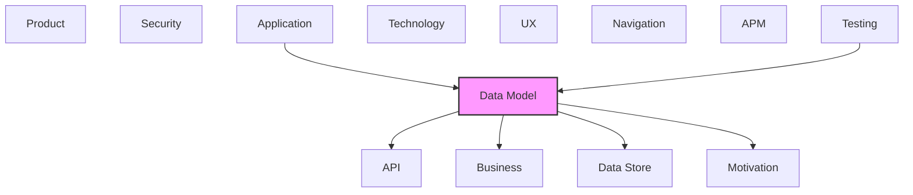

# Data Model

[← Back to README](../README.md)

Data entities, relationships, and data structure definitions.

## Report Index

- [Layer Introduction](#layer-introduction)
- [Intra-Layer Relationships](#intra-layer-relationships)
- [Inter-Layer Dependencies](#inter-layer-dependencies)
- [Inter-Layer Relationships Table](#inter-layer-relationships-table)
- [Element Reference](#element-reference)

## Layer Introduction

| Metric                    | Count |
| ------------------------- | ----- |
| Elements                  | 55    |
| Intra-Layer Relationships | 10    |
| Inter-Layer Relationships | 127   |
| Inbound Relationships     | 57    |
| Outbound Relationships    | 70    |

**Cross-Layer References**:

- **Upstream layers**: [Application](./05-application-layer-report.md), [Testing](./13-testing-layer-report.md)
- **Downstream layers**: [API](./07-api-layer-report.md), [Business](./02-business-layer-report.md), [Data Store](./09-data-store-layer-report.md), [Motivation](./01-motivation-layer-report.md)

## Intra-Layer Relationships

*This layer has >30 elements. Summary table shown instead of diagram.*

| Element                                                 | Type           | Relationships |
| ------------------------------------------------------- | -------------- | ------------- |
| `data-model.arrayschema.external-references-list`       | `arrayschema`  | 3             |
| `data-model.objectschema.app-configuration`             | `objectschema` | 0             |
| `data-model.objectschema.approval-policy-entity`        | `objectschema` | 0             |
| `data-model.objectschema.attribute-definition-entity`   | `objectschema` | 0             |
| `data-model.objectschema.background-task`               | `objectschema` | 0             |
| `data-model.objectschema.batch-entity`                  | `objectschema` | 0             |
| `data-model.objectschema.change-event`                  | `objectschema` | 3             |
| `data-model.objectschema.change-event-entity`           | `objectschema` | 1             |
| `data-model.objectschema.chat-message-entity`           | `objectschema` | 0             |
| `data-model.objectschema.claim-entity`                  | `objectschema` | 0             |
| `data-model.objectschema.concept-scheme-entity`         | `objectschema` | 0             |
| `data-model.objectschema.conversation-entity`           | `objectschema` | 0             |
| `data-model.objectschema.dataset-entity`                | `objectschema` | 0             |
| `data-model.objectschema.entity-source-entity`          | `objectschema` | 0             |
| `data-model.objectschema.extracted-entity`              | `objectschema` | 0             |
| `data-model.objectschema.extraction-result`             | `objectschema` | 0             |
| `data-model.objectschema.extraction-run`                | `objectschema` | 0             |
| `data-model.objectschema.graph-metrics`                 | `objectschema` | 0             |
| `data-model.objectschema.graph-view`                    | `objectschema` | 0             |
| `data-model.objectschema.import-run`                    | `objectschema` | 2             |
| `data-model.objectschema.import-run-entity`             | `objectschema` | 1             |
| `data-model.objectschema.individual-class`              | `objectschema` | 0             |
| `data-model.objectschema.individual-entity`             | `objectschema` | 0             |
| `data-model.objectschema.knowledge-graph`               | `objectschema` | 0             |
| `data-model.objectschema.ontology-class-entity`         | `objectschema` | 0             |
| `data-model.objectschema.ontology-entity`               | `objectschema` | 3             |
| `data-model.objectschema.operation-amendment`           | `objectschema` | 0             |
| `data-model.objectschema.operation-count`               | `objectschema` | 0             |
| `data-model.objectschema.operation-draft`               | `objectschema` | 0             |
| `data-model.objectschema.path-result`                   | `objectschema` | 0             |
| `data-model.objectschema.pipeline-configuration`        | `objectschema` | 1             |
| `data-model.objectschema.pipeline-configuration-entity` | `objectschema` | 1             |
| `data-model.objectschema.pipeline-run-entity`           | `objectschema` | 0             |
| `data-model.objectschema.pre-review-verdict`            | `objectschema` | 0             |
| `data-model.objectschema.predicate-entity`              | `objectschema` | 0             |
| `data-model.objectschema.processing-metrics`            | `objectschema` | 0             |
| `data-model.objectschema.property-definition`           | `objectschema` | 0             |
| `data-model.objectschema.property-definition-entity`    | `objectschema` | 0             |
| `data-model.objectschema.proposal`                      | `objectschema` | 1             |
| `data-model.objectschema.proposal-decision-entity`      | `objectschema` | 0             |
| `data-model.objectschema.proposal-entity`               | `objectschema` | 1             |
| `data-model.objectschema.proposal-link`                 | `objectschema` | 0             |
| `data-model.objectschema.proposed-operation`            | `objectschema` | 0             |
| `data-model.objectschema.relationship`                  | `objectschema` | 1             |
| `data-model.objectschema.relationship-entity`           | `objectschema` | 0             |
| `data-model.objectschema.resolution-record`             | `objectschema` | 0             |
| `data-model.objectschema.revert-preview-result`         | `objectschema` | 0             |
| `data-model.objectschema.source-entity`                 | `objectschema` | 0             |
| `data-model.objectschema.subgraph`                      | `objectschema` | 0             |
| `data-model.objectschema.subgraph-result`               | `objectschema` | 0             |
| `data-model.objectschema.system-health`                 | `objectschema` | 0             |
| `data-model.objectschema.taxonomy-entity`               | `objectschema` | 0             |
| `data-model.objectschema.triple-extraction-result`      | `objectschema` | 0             |
| `data-model.stringschema.iso-8601-datetime`             | `stringschema` | 1             |
| `data-model.stringschema.uuid-string`                   | `stringschema` | 1             |

## Inter-Layer Dependencies

## Inter-Layer Relationships Table

| Relationship ID                                                     | Source Node                                                                 | Dest Node                                                                            | Dest Layer   | Predicate   | Cardinality  | Strength |
| ------------------------------------------------------------------- | --------------------------------------------------------------------------- | ------------------------------------------------------------------------------------ | ------------ | ----------- | ------------ | -------- |
| `application.applicationcomponent.accesses.data-model.objectschema` | `application.applicationcomponent.canon-demo-dataset-loader`                | `data-model.objectschema.concept-scheme-entity`                                      | `data-model` | `accesses`  | many-to-many | medium   |
| `application.applicationcomponent.accesses.data-model.objectschema` | `application.applicationcomponent.canon-demo-dataset-loader`                | `data-model.objectschema.ontology-class-entity`                                      | `data-model` | `accesses`  | many-to-many | medium   |
| `application.applicationcomponent.accesses.data-model.objectschema` | `application.applicationcomponent.canon-demo-dataset-loader`                | `data-model.objectschema.property-definition-entity`                                 | `data-model` | `accesses`  | many-to-many | medium   |
| `application.applicationcomponent.accesses.data-model.objectschema` | `application.applicationcomponent.canon-demo-dataset-loader`                | `data-model.objectschema.taxonomy-entity`                                            | `data-model` | `accesses`  | many-to-many | medium   |
| `application.applicationcomponent.accesses.data-model.objectschema` | `application.applicationcomponent.duck-db-sync-adapter`                     | `data-model.objectschema.change-event-entity`                                        | `data-model` | `accesses`  | many-to-many | medium   |
| `application.applicationcomponent.accesses.data-model.objectschema` | `application.applicationcomponent.json-file-config-store`                   | `data-model.objectschema.app-configuration`                                          | `data-model` | `accesses`  | many-to-many | medium   |
| `application.applicationcomponent.accesses.data-model.objectschema` | `application.applicationcomponent.network-x-graph-engine-adapter`           | `data-model.objectschema.graph-view`                                                 | `data-model` | `accesses`  | many-to-many | medium   |
| `application.applicationcomponent.accesses.data-model.objectschema` | `application.applicationcomponent.owl-interchange-adapter`                  | `data-model.objectschema.concept-scheme-entity`                                      | `data-model` | `accesses`  | many-to-many | medium   |
| `application.applicationcomponent.accesses.data-model.objectschema` | `application.applicationcomponent.rdflib-query-engine-adapter`              | `data-model.objectschema.concept-scheme-entity`                                      | `data-model` | `accesses`  | many-to-many | medium   |
| `application.applicationcomponent.accesses.data-model.objectschema` | `application.applicationcomponent.rdflib-query-engine-adapter`              | `data-model.objectschema.ontology-class-entity`                                      | `data-model` | `accesses`  | many-to-many | medium   |
| `application.applicationcomponent.accesses.data-model.objectschema` | `application.applicationcomponent.rdflib-query-engine-adapter`              | `data-model.objectschema.taxonomy-entity`                                            | `data-model` | `accesses`  | many-to-many | medium   |
| `application.applicationcomponent.accesses.data-model.objectschema` | `application.applicationcomponent.s3-sync-adapter`                          | `data-model.objectschema.change-event-entity`                                        | `data-model` | `accesses`  | many-to-many | medium   |
| `application.applicationcomponent.accesses.data-model.objectschema` | `application.applicationcomponent.skos-interchange-adapter`                 | `data-model.objectschema.concept-scheme-entity`                                      | `data-model` | `accesses`  | many-to-many | medium   |
| `application.applicationcomponent.accesses.data-model.objectschema` | `application.applicationcomponent.sqlite-approval-policy-repository`        | `data-model.objectschema.approval-policy-entity`                                     | `data-model` | `accesses`  | many-to-many | medium   |
| `application.applicationcomponent.accesses.data-model.objectschema` | `application.applicationcomponent.sqlite-batch-repository`                  | `data-model.objectschema.batch-entity`                                               | `data-model` | `accesses`  | many-to-many | medium   |
| `application.applicationcomponent.accesses.data-model.objectschema` | `application.applicationcomponent.sqlite-change-proposal-repository`        | `data-model.objectschema.proposal`                                                   | `data-model` | `accesses`  | many-to-many | medium   |
| `application.applicationcomponent.accesses.data-model.objectschema` | `application.applicationcomponent.sqlite-change-proposal-repository`        | `data-model.objectschema.proposal-decision-entity`                                   | `data-model` | `accesses`  | many-to-many | medium   |
| `application.applicationcomponent.accesses.data-model.objectschema` | `application.applicationcomponent.sqlite-change-proposal-repository`        | `data-model.objectschema.proposal-entity`                                            | `data-model` | `accesses`  | many-to-many | medium   |
| `application.applicationcomponent.accesses.data-model.objectschema` | `application.applicationcomponent.sqlite-change-proposal-repository`        | `data-model.objectschema.proposed-operation`                                         | `data-model` | `accesses`  | many-to-many | medium   |
| `application.applicationcomponent.accesses.data-model.objectschema` | `application.applicationcomponent.sqlite-change-repository`                 | `data-model.objectschema.change-event`                                               | `data-model` | `accesses`  | many-to-many | medium   |
| `application.applicationcomponent.accesses.data-model.objectschema` | `application.applicationcomponent.sqlite-change-repository`                 | `data-model.objectschema.change-event-entity`                                        | `data-model` | `accesses`  | many-to-many | medium   |
| `application.applicationcomponent.accesses.data-model.objectschema` | `application.applicationcomponent.sqlite-claim-repository`                  | `data-model.objectschema.claim-entity`                                               | `data-model` | `accesses`  | many-to-many | medium   |
| `application.applicationcomponent.accesses.data-model.objectschema` | `application.applicationcomponent.sqlite-conversation-repository`           | `data-model.objectschema.chat-message-entity`                                        | `data-model` | `accesses`  | many-to-many | medium   |
| `application.applicationcomponent.accesses.data-model.objectschema` | `application.applicationcomponent.sqlite-conversation-repository`           | `data-model.objectschema.conversation-entity`                                        | `data-model` | `accesses`  | many-to-many | medium   |
| `application.applicationcomponent.accesses.data-model.objectschema` | `application.applicationcomponent.sqlite-entity-source-repository`          | `data-model.objectschema.entity-source-entity`                                       | `data-model` | `accesses`  | many-to-many | medium   |
| `application.applicationcomponent.accesses.data-model.objectschema` | `application.applicationcomponent.sqlite-extraction-repository`             | `data-model.objectschema.extracted-entity`                                           | `data-model` | `accesses`  | many-to-many | medium   |
| `application.applicationcomponent.accesses.data-model.objectschema` | `application.applicationcomponent.sqlite-extraction-repository`             | `data-model.objectschema.extraction-result`                                          | `data-model` | `accesses`  | many-to-many | medium   |
| `application.applicationcomponent.accesses.data-model.objectschema` | `application.applicationcomponent.sqlite-extraction-run-repository`         | `data-model.objectschema.extraction-run`                                             | `data-model` | `accesses`  | many-to-many | medium   |
| `application.applicationcomponent.accesses.data-model.objectschema` | `application.applicationcomponent.sqlite-interchange-repository`            | `data-model.objectschema.import-run`                                                 | `data-model` | `accesses`  | many-to-many | medium   |
| `application.applicationcomponent.accesses.data-model.objectschema` | `application.applicationcomponent.sqlite-interchange-repository`            | `data-model.objectschema.import-run-entity`                                          | `data-model` | `accesses`  | many-to-many | medium   |
| `application.applicationcomponent.accesses.data-model.objectschema` | `application.applicationcomponent.sqlite-interchange-repository`            | `data-model.objectschema.resolution-record`                                          | `data-model` | `accesses`  | many-to-many | medium   |
| `application.applicationcomponent.accesses.data-model.objectschema` | `application.applicationcomponent.sqlite-ontology-repository`               | `data-model.objectschema.attribute-definition-entity`                                | `data-model` | `accesses`  | many-to-many | medium   |
| `application.applicationcomponent.accesses.data-model.objectschema` | `application.applicationcomponent.sqlite-ontology-repository`               | `data-model.objectschema.concept-scheme-entity`                                      | `data-model` | `accesses`  | many-to-many | medium   |
| `application.applicationcomponent.accesses.data-model.objectschema` | `application.applicationcomponent.sqlite-ontology-repository`               | `data-model.objectschema.dataset-entity`                                             | `data-model` | `accesses`  | many-to-many | medium   |
| `application.applicationcomponent.accesses.data-model.objectschema` | `application.applicationcomponent.sqlite-ontology-repository`               | `data-model.objectschema.individual-class`                                           | `data-model` | `accesses`  | many-to-many | medium   |
| `application.applicationcomponent.accesses.data-model.objectschema` | `application.applicationcomponent.sqlite-ontology-repository`               | `data-model.objectschema.individual-entity`                                          | `data-model` | `accesses`  | many-to-many | medium   |
| `application.applicationcomponent.accesses.data-model.objectschema` | `application.applicationcomponent.sqlite-ontology-repository`               | `data-model.objectschema.ontology-class-entity`                                      | `data-model` | `accesses`  | many-to-many | medium   |
| `application.applicationcomponent.accesses.data-model.objectschema` | `application.applicationcomponent.sqlite-ontology-repository`               | `data-model.objectschema.ontology-entity`                                            | `data-model` | `accesses`  | many-to-many | medium   |
| `application.applicationcomponent.accesses.data-model.objectschema` | `application.applicationcomponent.sqlite-ontology-repository`               | `data-model.objectschema.predicate-entity`                                           | `data-model` | `accesses`  | many-to-many | medium   |
| `application.applicationcomponent.accesses.data-model.objectschema` | `application.applicationcomponent.sqlite-ontology-repository`               | `data-model.objectschema.property-definition`                                        | `data-model` | `accesses`  | many-to-many | medium   |
| `application.applicationcomponent.accesses.data-model.objectschema` | `application.applicationcomponent.sqlite-ontology-repository`               | `data-model.objectschema.property-definition-entity`                                 | `data-model` | `accesses`  | many-to-many | medium   |
| `application.applicationcomponent.accesses.data-model.objectschema` | `application.applicationcomponent.sqlite-ontology-repository`               | `data-model.objectschema.relationship-entity`                                        | `data-model` | `accesses`  | many-to-many | medium   |
| `application.applicationcomponent.accesses.data-model.objectschema` | `application.applicationcomponent.sqlite-ontology-repository`               | `data-model.objectschema.taxonomy-entity`                                            | `data-model` | `accesses`  | many-to-many | medium   |
| `application.applicationcomponent.accesses.data-model.objectschema` | `application.applicationcomponent.sqlite-pipeline-configuration-repository` | `data-model.objectschema.pipeline-configuration`                                     | `data-model` | `accesses`  | many-to-many | medium   |
| `application.applicationcomponent.accesses.data-model.objectschema` | `application.applicationcomponent.sqlite-pipeline-configuration-repository` | `data-model.objectschema.pipeline-configuration-entity`                              | `data-model` | `accesses`  | many-to-many | medium   |
| `application.applicationcomponent.accesses.data-model.objectschema` | `application.applicationcomponent.sqlite-pipeline-repository`               | `data-model.objectschema.pipeline-run-entity`                                        | `data-model` | `accesses`  | many-to-many | medium   |
| `application.applicationcomponent.accesses.data-model.objectschema` | `application.applicationcomponent.sqlite-source-repository`                 | `data-model.objectschema.source-entity`                                              | `data-model` | `accesses`  | many-to-many | medium   |
| `application.applicationfunction.accesses.data-model.objectschema`  | `application.applicationfunction.individual-pre-review`                     | `data-model.objectschema.pipeline-configuration-entity`                              | `data-model` | `accesses`  | many-to-many | medium   |
| `application.applicationfunction.accesses.data-model.objectschema`  | `application.applicationfunction.individual-pre-review`                     | `data-model.objectschema.pre-review-verdict`                                         | `data-model` | `accesses`  | many-to-many | medium   |
| `application.applicationfunction.accesses.data-model.objectschema`  | `application.applicationfunction.proposal-amendment`                        | `data-model.objectschema.operation-amendment`                                        | `data-model` | `accesses`  | many-to-many | medium   |
| `application.applicationfunction.accesses.data-model.objectschema`  | `application.applicationfunction.proposal-linking`                          | `data-model.objectschema.proposal-link`                                              | `data-model` | `accesses`  | many-to-many | medium   |
| `application.applicationfunction.accesses.data-model.objectschema`  | `application.applicationfunction.reversal-planning`                         | `data-model.objectschema.change-event-entity`                                        | `data-model` | `accesses`  | many-to-many | medium   |
| `application.applicationfunction.accesses.data-model.objectschema`  | `application.applicationfunction.reversal-planning`                         | `data-model.objectschema.proposal-entity`                                            | `data-model` | `accesses`  | many-to-many | medium   |
| `application.applicationfunction.accesses.data-model.objectschema`  | `application.applicationfunction.reversal-planning`                         | `data-model.objectschema.proposed-operation`                                         | `data-model` | `accesses`  | many-to-many | medium   |
| `application.applicationfunction.accesses.data-model.objectschema`  | `application.applicationfunction.revert-preview`                            | `data-model.objectschema.change-event-entity`                                        | `data-model` | `accesses`  | many-to-many | medium   |
| `application.applicationfunction.accesses.data-model.objectschema`  | `application.applicationfunction.revert-preview`                            | `data-model.objectschema.revert-preview-result`                                      | `data-model` | `accesses`  | many-to-many | medium   |
| `data-model.objectschema.maps-to.api.response`                      | `data-model.objectschema.app-configuration`                                 | `api.response.app-configuration-response`                                            | `api`        | `maps-to`   | many-to-many | medium   |
| `data-model.objectschema.maps-to.data-store.collection`             | `data-model.objectschema.approval-policy-entity`                            | `data-store.collection.approval-policies`                                            | `data-store` | `maps-to`   | many-to-many | medium   |
| `data-model.objectschema.maps-to.data-store.collection`             | `data-model.objectschema.attribute-definition-entity`                       | `data-store.collection.attribute-definitions`                                        | `data-store` | `maps-to`   | many-to-many | medium   |
| `data-model.objectschema.maps-to.api.response`                      | `data-model.objectschema.background-task`                                   | `api.response.background-task-response`                                              | `api`        | `maps-to`   | many-to-many | medium   |
| `data-model.objectschema.maps-to.data-store.collection`             | `data-model.objectschema.batch-entity`                                      | `data-store.collection.batches`                                                      | `data-store` | `maps-to`   | many-to-many | medium   |
| `data-model.objectschema.maps-to.api.response`                      | `data-model.objectschema.change-event-entity`                               | `api.response.change-history-response`                                               | `api`        | `maps-to`   | many-to-many | medium   |
| `data-model.objectschema.maps-to.data-store.collection`             | `data-model.objectschema.change-event-entity`                               | `data-store.collection.change-events`                                                | `data-store` | `maps-to`   | many-to-many | medium   |
| `data-model.objectschema.maps-to.data-store.collection`             | `data-model.objectschema.change-event`                                      | `data-store.collection.change-events`                                                | `data-store` | `maps-to`   | many-to-many | medium   |
| `data-model.objectschema.maps-to.data-store.collection`             | `data-model.objectschema.chat-message-entity`                               | `data-store.collection.chat-messages`                                                | `data-store` | `maps-to`   | many-to-many | medium   |
| `data-model.objectschema.maps-to.data-store.collection`             | `data-model.objectschema.claim-entity`                                      | `data-store.collection.claims`                                                       | `data-store` | `maps-to`   | many-to-many | medium   |
| `data-model.objectschema.realizes.business.businessobject`          | `data-model.objectschema.claim-entity`                                      | `business.businessobject.claim`                                                      | `business`   | `realizes`  | many-to-many | medium   |
| `data-model.objectschema.maps-to.api.response`                      | `data-model.objectschema.concept-scheme-entity`                             | `api.response.concept-scheme-response`                                               | `api`        | `maps-to`   | many-to-many | medium   |
| `data-model.objectschema.maps-to.data-store.collection`             | `data-model.objectschema.concept-scheme-entity`                             | `data-store.collection.ontology-entities`                                            | `data-store` | `maps-to`   | many-to-many | medium   |
| `data-model.objectschema.maps-to.data-store.collection`             | `data-model.objectschema.conversation-entity`                               | `data-store.collection.chat-conversations`                                           | `data-store` | `maps-to`   | many-to-many | medium   |
| `data-model.objectschema.maps-to.data-store.collection`             | `data-model.objectschema.dataset-entity`                                    | `data-store.collection.datasets`                                                     | `data-store` | `maps-to`   | many-to-many | medium   |
| `data-model.objectschema.maps-to.data-store.collection`             | `data-model.objectschema.entity-source-entity`                              | `data-store.collection.entity-sources`                                               | `data-store` | `maps-to`   | many-to-many | medium   |
| `data-model.objectschema.maps-to.api.response`                      | `data-model.objectschema.extracted-entity`                                  | `api.response.extraction-result-schema`                                              | `api`        | `maps-to`   | many-to-many | medium   |
| `data-model.objectschema.maps-to.api.response`                      | `data-model.objectschema.extraction-result`                                 | `api.response.extraction-result-schema`                                              | `api`        | `maps-to`   | many-to-many | medium   |
| `data-model.objectschema.maps-to.data-store.collection`             | `data-model.objectschema.extraction-result`                                 | `data-store.collection.extraction-results-table`                                     | `data-store` | `maps-to`   | many-to-many | medium   |
| `data-model.objectschema.maps-to.api.response`                      | `data-model.objectschema.extraction-run`                                    | `api.response.extraction-result-schema`                                              | `api`        | `maps-to`   | many-to-many | medium   |
| `data-model.objectschema.maps-to.data-store.collection`             | `data-model.objectschema.extraction-run`                                    | `data-store.collection.extraction-runs`                                              | `data-store` | `maps-to`   | many-to-many | medium   |
| `data-model.objectschema.maps-to.api.response`                      | `data-model.objectschema.graph-metrics`                                     | `api.response.graph-metrics-response`                                                | `api`        | `maps-to`   | many-to-many | medium   |
| `data-model.objectschema.maps-to.api.response`                      | `data-model.objectschema.import-run-entity`                                 | `api.response.import-run-response`                                                   | `api`        | `maps-to`   | many-to-many | medium   |
| `data-model.objectschema.maps-to.data-store.collection`             | `data-model.objectschema.import-run-entity`                                 | `data-store.collection.import-runs-table`                                            | `data-store` | `maps-to`   | many-to-many | medium   |
| `data-model.objectschema.maps-to.data-store.collection`             | `data-model.objectschema.import-run`                                        | `data-store.collection.import-runs-table`                                            | `data-store` | `maps-to`   | many-to-many | medium   |
| `data-model.objectschema.maps-to.api.requestbody`                   | `data-model.objectschema.individual-class`                                  | `api.requestbody.individual-class-list-request`                                      | `api`        | `maps-to`   | many-to-many | medium   |
| `data-model.objectschema.maps-to.api.requestbody`                   | `data-model.objectschema.individual-class`                                  | `api.requestbody.individual-class-request`                                           | `api`        | `maps-to`   | many-to-many | medium   |
| `data-model.objectschema.maps-to.data-store.collection`             | `data-model.objectschema.individual-class`                                  | `data-store.collection.individual-classes-table`                                     | `data-store` | `maps-to`   | many-to-many | medium   |
| `data-model.objectschema.maps-to.api.response`                      | `data-model.objectschema.individual-entity`                                 | `api.response.individual-response`                                                   | `api`        | `maps-to`   | many-to-many | medium   |
| `data-model.objectschema.maps-to.data-store.collection`             | `data-model.objectschema.individual-entity`                                 | `data-store.collection.ontology-entities`                                            | `data-store` | `maps-to`   | many-to-many | medium   |
| `data-model.objectschema.maps-to.api.response`                      | `data-model.objectschema.knowledge-graph`                                   | `api.response.knowledge-graph-response`                                              | `api`        | `maps-to`   | many-to-many | medium   |
| `data-model.objectschema.maps-to.api.response`                      | `data-model.objectschema.ontology-class-entity`                             | `api.response.class-response`                                                        | `api`        | `maps-to`   | many-to-many | medium   |
| `data-model.objectschema.maps-to.data-store.collection`             | `data-model.objectschema.ontology-class-entity`                             | `data-store.collection.ontology-entities`                                            | `data-store` | `maps-to`   | many-to-many | medium   |
| `data-model.objectschema.maps-to.data-store.collection`             | `data-model.objectschema.ontology-entity`                                   | `data-store.collection.ontology-entities`                                            | `data-store` | `maps-to`   | many-to-many | medium   |
| `data-model.objectschema.maps-to.data-store.collection`             | `data-model.objectschema.operation-amendment`                               | `data-store.collection.proposal-operations`                                          | `data-store` | `maps-to`   | many-to-many | medium   |
| `data-model.objectschema.satisfies.motivation.requirement`          | `data-model.objectschema.operation-amendment`                               | `motivation.requirement.an-amended-operation-shows-what-it-replaced`                 | `motivation` | `satisfies` | many-to-many | medium   |
| `data-model.objectschema.maps-to.api.response`                      | `data-model.objectschema.operation-count`                                   | `api.response.operation-count-response`                                              | `api`        | `maps-to`   | many-to-many | medium   |
| `data-model.objectschema.satisfies.motivation.requirement`          | `data-model.objectschema.operation-draft`                                   | `motivation.requirement.contexts-depend-on-each-other-only-through-public-contracts` | `motivation` | `satisfies` | many-to-many | medium   |
| `data-model.objectschema.maps-to.api.response`                      | `data-model.objectschema.path-result`                                       | `api.response.path-result-response`                                                  | `api`        | `maps-to`   | many-to-many | medium   |
| `data-model.objectschema.maps-to.data-store.collection`             | `data-model.objectschema.pipeline-configuration`                            | `data-store.collection.pipeline-configurations-table`                                | `data-store` | `maps-to`   | many-to-many | medium   |
| `data-model.objectschema.maps-to.data-store.collection`             | `data-model.objectschema.pipeline-run-entity`                               | `data-store.collection.pipeline-runs`                                                | `data-store` | `maps-to`   | many-to-many | medium   |
| `data-model.objectschema.maps-to.data-store.collection`             | `data-model.objectschema.predicate-entity`                                  | `data-store.collection.predicates`                                                   | `data-store` | `maps-to`   | many-to-many | medium   |
| `data-model.objectschema.satisfies.motivation.requirement`          | `data-model.objectschema.predicate-entity`                                  | `motivation.requirement.relationships-limited-to-allowed-types`                      | `motivation` | `satisfies` | many-to-many | medium   |
| `data-model.objectschema.maps-to.api.response`                      | `data-model.objectschema.processing-metrics`                                | `api.response.service-metrics-response`                                              | `api`        | `maps-to`   | many-to-many | medium   |
| `data-model.objectschema.maps-to.api.requestbody`                   | `data-model.objectschema.property-definition-entity`                        | `api.requestbody.property-definition-create-request`                                 | `api`        | `maps-to`   | many-to-many | medium   |
| `data-model.objectschema.maps-to.data-store.collection`             | `data-model.objectschema.property-definition-entity`                        | `data-store.collection.property-definitions-table`                                   | `data-store` | `maps-to`   | many-to-many | medium   |
| `data-model.objectschema.maps-to.api.requestbody`                   | `data-model.objectschema.property-definition`                               | `api.requestbody.property-definition-create-request`                                 | `api`        | `maps-to`   | many-to-many | medium   |
| `data-model.objectschema.maps-to.api.response`                      | `data-model.objectschema.property-definition`                               | `api.response.property-definition-response`                                          | `api`        | `maps-to`   | many-to-many | medium   |
| `data-model.objectschema.maps-to.data-store.collection`             | `data-model.objectschema.property-definition`                               | `data-store.collection.property-definitions-table`                                   | `data-store` | `maps-to`   | many-to-many | medium   |
| `data-model.objectschema.maps-to.data-store.collection`             | `data-model.objectschema.proposal-decision-entity`                          | `data-store.collection.proposal-decisions`                                           | `data-store` | `maps-to`   | many-to-many | medium   |
| `data-model.objectschema.satisfies.motivation.requirement`          | `data-model.objectschema.proposal-decision-entity`                          | `motivation.requirement.reason-codes-for-every-reject`                               | `motivation` | `satisfies` | many-to-many | medium   |
| `data-model.objectschema.maps-to.data-store.collection`             | `data-model.objectschema.proposal-entity`                                   | `data-store.collection.proposals-table`                                              | `data-store` | `maps-to`   | many-to-many | medium   |
| `data-model.objectschema.satisfies.motivation.requirement`          | `data-model.objectschema.proposal-entity`                                   | `motivation.requirement.reversed-proposal-status`                                    | `motivation` | `satisfies` | many-to-many | medium   |
| `data-model.objectschema.maps-to.api.response`                      | `data-model.objectschema.proposal-link`                                     | `api.response.proposal-link-response`                                                | `api`        | `maps-to`   | many-to-many | medium   |
| `data-model.objectschema.maps-to.data-store.collection`             | `data-model.objectschema.proposal-link`                                     | `data-store.collection.proposal-links`                                               | `data-store` | `maps-to`   | many-to-many | medium   |
| `data-model.objectschema.satisfies.motivation.requirement`          | `data-model.objectschema.proposal-link`                                     | `motivation.requirement.proposals-link-to-each-other-through-one-link-model`         | `motivation` | `satisfies` | many-to-many | medium   |
| `data-model.objectschema.maps-to.data-store.collection`             | `data-model.objectschema.proposal`                                          | `data-store.collection.proposals-table`                                              | `data-store` | `maps-to`   | many-to-many | medium   |
| `data-model.objectschema.maps-to.data-store.collection`             | `data-model.objectschema.proposed-operation`                                | `data-store.collection.proposal-operations`                                          | `data-store` | `maps-to`   | many-to-many | medium   |
| `data-model.objectschema.maps-to.api.response`                      | `data-model.objectschema.relationship-entity`                               | `api.response.relationship-response`                                                 | `api`        | `maps-to`   | many-to-many | medium   |
| `data-model.objectschema.maps-to.data-store.collection`             | `data-model.objectschema.relationship-entity`                               | `data-store.collection.relationships`                                                | `data-store` | `maps-to`   | many-to-many | medium   |
| `data-model.objectschema.maps-to.data-store.collection`             | `data-model.objectschema.relationship`                                      | `data-store.collection.relationships`                                                | `data-store` | `maps-to`   | many-to-many | medium   |
| `data-model.objectschema.maps-to.api.response`                      | `data-model.objectschema.resolution-record`                                 | `api.response.resolution-record-response`                                            | `api`        | `maps-to`   | many-to-many | medium   |
| `data-model.objectschema.maps-to.api.response`                      | `data-model.objectschema.revert-preview-result`                             | `api.response.revert-preview-response`                                               | `api`        | `maps-to`   | many-to-many | medium   |
| `data-model.objectschema.maps-to.data-store.collection`             | `data-model.objectschema.source-entity`                                     | `data-store.collection.sources`                                                      | `data-store` | `maps-to`   | many-to-many | medium   |
| `data-model.objectschema.maps-to.api.response`                      | `data-model.objectschema.subgraph`                                          | `api.response.subgraph-data-response`                                                | `api`        | `maps-to`   | many-to-many | medium   |
| `data-model.objectschema.maps-to.api.response`                      | `data-model.objectschema.subgraph-result`                                   | `api.response.subgraph-result-response`                                              | `api`        | `maps-to`   | many-to-many | medium   |
| `data-model.objectschema.maps-to.api.response`                      | `data-model.objectschema.system-health`                                     | `api.response.database-health-response`                                              | `api`        | `maps-to`   | many-to-many | medium   |
| `data-model.objectschema.maps-to.api.response`                      | `data-model.objectschema.taxonomy-entity`                                   | `api.response.taxonomy-response`                                                     | `api`        | `maps-to`   | many-to-many | medium   |
| `data-model.objectschema.maps-to.data-store.collection`             | `data-model.objectschema.taxonomy-entity`                                   | `data-store.collection.ontology-entities`                                            | `data-store` | `maps-to`   | many-to-many | medium   |
| `data-model.objectschema.maps-to.api.response`                      | `data-model.objectschema.triple-extraction-result`                          | `api.response.triples-response`                                                      | `api`        | `maps-to`   | many-to-many | medium   |
| `testing.testcoveragetarget.covers.data-model.objectschema`         | `testing.testcoveragetarget.reject-reason-codes`                            | `data-model.objectschema.proposal-decision-entity`                                   | `data-model` | `covers`    | many-to-many | medium   |

## Element Reference

### external_references list {#external-references-list}

**ID**: `data-model.arrayschema.external-references-list`

**Type**: `arrayschema`

Array schema for the external_references list on the Class entity — holds enrichment references from ConceptNet, DBpedia, Wikidata, and schema.org

#### Attributes

| Name        | Value  |
| ----------- | ------ |
| items       | string |
| minItems    | 0      |
| uniqueItems | true   |

#### Relationships

| Type        | Related Element                             | Predicate  | Direction |
| ----------- | ------------------------------------------- | ---------- | --------- |
| intra-layer | `data-model.objectschema.ontology-entity`   | `composes` | outbound  |
| intra-layer | `data-model.stringschema.iso-8601-datetime` | `composes` | outbound  |
| intra-layer | `data-model.stringschema.uuid-string`       | `composes` | outbound  |

### App Configuration {#app-configuration}

**ID**: `data-model.objectschema.app-configuration`

**Type**: `objectschema`

Domain entity representing application configuration organized into sections: server, database, llm, nlp, embedding, reference_sources, logging, and optional sync; API key values are unmasked at domain layer

#### Attributes

| Name | Value  |
| ---- | ------ |
| type | object |

#### Relationships

| Type        | Related Element                                           | Predicate  | Direction |
| ----------- | --------------------------------------------------------- | ---------- | --------- |
| inter-layer | `application.applicationcomponent.json-file-config-store` | `accesses` | inbound   |
| inter-layer | `api.response.app-configuration-response`                 | `maps-to`  | outbound  |

### Approval Policy Entity {#approval-policy-entity}

**ID**: `data-model.objectschema.approval-policy-entity`

**Type**: `objectschema`

Domain entity: a taxonomy's approval policy, the rules for which proposal operations auto-apply.

#### Attributes

| Name | Value  |
| ---- | ------ |
| type | object |

#### Relationships

| Type        | Related Element                                                      | Predicate  | Direction |
| ----------- | -------------------------------------------------------------------- | ---------- | --------- |
| inter-layer | `application.applicationcomponent.sqlite-approval-policy-repository` | `accesses` | inbound   |
| inter-layer | `data-store.collection.approval-policies`                            | `maps-to`  | outbound  |

### Attribute Definition Entity {#attribute-definition-entity}

**ID**: `data-model.objectschema.attribute-definition-entity`

**Type**: `objectschema`

Domain entity: an attribute a class's individuals may carry (name, data type, cardinality).

#### Attributes

| Name | Value  |
| ---- | ------ |
| type | object |

#### Relationships

| Type        | Related Element                                               | Predicate  | Direction |
| ----------- | ------------------------------------------------------------- | ---------- | --------- |
| inter-layer | `application.applicationcomponent.sqlite-ontology-repository` | `accesses` | inbound   |
| inter-layer | `data-store.collection.attribute-definitions`                 | `maps-to`  | outbound  |

### Background Task {#background-task}

**ID**: `data-model.objectschema.background-task`

**Type**: `objectschema`

Domain entity representing a long-running background task with id, name, status (pending/running/completed/failed), timestamps, and optional error/result; enforces valid state transitions via transition_to()

#### Attributes

| Name | Value  |
| ---- | ------ |
| type | object |

#### Relationships

| Type        | Related Element                         | Predicate | Direction |
| ----------- | --------------------------------------- | --------- | --------- |
| inter-layer | `api.response.background-task-response` | `maps-to` | outbound  |

### Batch Entity {#batch-entity}

**ID**: `data-model.objectschema.batch-entity`

**Type**: `objectschema`

Domain entity: a batch of pipeline runs with aggregate status.

#### Attributes

| Name | Value  |
| ---- | ------ |
| type | object |

#### Relationships

| Type        | Related Element                                            | Predicate  | Direction |
| ----------- | ---------------------------------------------------------- | ---------- | --------- |
| inter-layer | `application.applicationcomponent.sqlite-batch-repository` | `accesses` | inbound   |
| inter-layer | `data-store.collection.batches`                            | `maps-to`  | outbound  |

### Change Event {#change-event}

**ID**: `data-model.objectschema.change-event`

**Type**: `objectschema`

ORM schema for the audit trail of all entity mutations — stores entity_id, entity_type, operation (CREATE/UPDATE/DELETE), new_state and previous_state JSON snapshots, user_id, change_reason, and optional import_run_id correlation

#### Attributes

| Name | Value  |
| ---- | ------ |
| type | object |

#### Relationships

| Type        | Related Element                                             | Predicate     | Direction |
| ----------- | ----------------------------------------------------------- | ------------- | --------- |
| inter-layer | `application.applicationcomponent.sqlite-change-repository` | `accesses`    | inbound   |
| inter-layer | `data-store.collection.change-events`                       | `maps-to`     | outbound  |
| intra-layer | `data-model.objectschema.change-event-entity`               | `specializes` | inbound   |
| intra-layer | `data-model.objectschema.ontology-entity`                   | `specializes` | outbound  |
| intra-layer | `data-model.objectschema.import-run`                        | `specializes` | inbound   |

### Change Event Entity {#change-event-entity}

**ID**: `data-model.objectschema.change-event-entity`

**Type**: `objectschema`

Domain entity recording a single change to an entity; carries entity_id, entity_type, operation, new_state snapshot, timestamp, optional previous_state, user_id, change_reason, changeset_id, batch_run_id, and processed flag

#### Attributes

| Name | Value  |
| ---- | ------ |
| type | object |

#### Relationships

| Type        | Related Element                                             | Predicate     | Direction |
| ----------- | ----------------------------------------------------------- | ------------- | --------- |
| inter-layer | `application.applicationcomponent.duck-db-sync-adapter`     | `accesses`    | inbound   |
| inter-layer | `application.applicationcomponent.s3-sync-adapter`          | `accesses`    | inbound   |
| inter-layer | `application.applicationcomponent.sqlite-change-repository` | `accesses`    | inbound   |
| inter-layer | `application.applicationfunction.reversal-planning`         | `accesses`    | inbound   |
| inter-layer | `application.applicationfunction.revert-preview`            | `accesses`    | inbound   |
| inter-layer | `api.response.change-history-response`                      | `maps-to`     | outbound  |
| inter-layer | `data-store.collection.change-events`                       | `maps-to`     | outbound  |
| intra-layer | `data-model.objectschema.change-event`                      | `specializes` | outbound  |

### Chat Message Entity {#chat-message-entity}

**ID**: `data-model.objectschema.chat-message-entity`

**Type**: `objectschema`

Domain entity: one chat message (role and content blocks: text, tool use, tool result, reasoning).

#### Attributes

| Name | Value  |
| ---- | ------ |
| type | object |

#### Relationships

| Type        | Related Element                                                   | Predicate  | Direction |
| ----------- | ----------------------------------------------------------------- | ---------- | --------- |
| inter-layer | `application.applicationcomponent.sqlite-conversation-repository` | `accesses` | inbound   |
| inter-layer | `data-store.collection.chat-messages`                             | `maps-to`  | outbound  |

### Claim Entity {#claim-entity}

**ID**: `data-model.objectschema.claim-entity`

**Type**: `objectschema`

Domain entity: a claim about a taxonomy (from notes or a client), with its triage and verdict.

#### Attributes

| Name | Value  |
| ---- | ------ |
| type | object |

#### Relationships

| Type        | Related Element                                            | Predicate  | Direction |
| ----------- | ---------------------------------------------------------- | ---------- | --------- |
| inter-layer | `application.applicationcomponent.sqlite-claim-repository` | `accesses` | inbound   |
| inter-layer | `data-store.collection.claims`                             | `maps-to`  | outbound  |
| inter-layer | `business.businessobject.claim`                            | `realizes` | outbound  |

### Concept Scheme Entity {#concept-scheme-entity}

**ID**: `data-model.objectschema.concept-scheme-entity`

**Type**: `objectschema`

Domain entity for a concept scheme that groups classes within a taxonomy; has id, taxonomy_id, title, optional description, timestamps, and version

#### Attributes

| Name | Value  |
| ---- | ------ |
| type | object |

#### Relationships

| Type        | Related Element                                                | Predicate  | Direction |
| ----------- | -------------------------------------------------------------- | ---------- | --------- |
| inter-layer | `application.applicationcomponent.canon-demo-dataset-loader`   | `accesses` | inbound   |
| inter-layer | `application.applicationcomponent.owl-interchange-adapter`     | `accesses` | inbound   |
| inter-layer | `application.applicationcomponent.rdflib-query-engine-adapter` | `accesses` | inbound   |
| inter-layer | `application.applicationcomponent.skos-interchange-adapter`    | `accesses` | inbound   |
| inter-layer | `application.applicationcomponent.sqlite-ontology-repository`  | `accesses` | inbound   |
| inter-layer | `api.response.concept-scheme-response`                         | `maps-to`  | outbound  |
| inter-layer | `data-store.collection.ontology-entities`                      | `maps-to`  | outbound  |

### Conversation Entity {#conversation-entity}

**ID**: `data-model.objectschema.conversation-entity`

**Type**: `objectschema`

Domain entity: a chat conversation with its messages.

#### Attributes

| Name | Value  |
| ---- | ------ |
| type | object |

#### Relationships

| Type        | Related Element                                                   | Predicate  | Direction |
| ----------- | ----------------------------------------------------------------- | ---------- | --------- |
| inter-layer | `application.applicationcomponent.sqlite-conversation-repository` | `accesses` | inbound   |
| inter-layer | `data-store.collection.chat-conversations`                        | `maps-to`  | outbound  |

### Dataset Entity {#dataset-entity}

**ID**: `data-model.objectschema.dataset-entity`

**Type**: `objectschema`

Domain entity: a named body of data (individuals and their relationships) over a taxonomy's schema.

#### Attributes

| Name | Value  |
| ---- | ------ |
| type | object |

#### Relationships

| Type        | Related Element                                               | Predicate  | Direction |
| ----------- | ------------------------------------------------------------- | ---------- | --------- |
| inter-layer | `application.applicationcomponent.sqlite-ontology-repository` | `accesses` | inbound   |
| inter-layer | `data-store.collection.datasets`                              | `maps-to`  | outbound  |

### Entity Source Entity {#entity-source-entity}

**ID**: `data-model.objectschema.entity-source-entity`

**Type**: `objectschema`

Domain entity: provenance linking an ontology entity to the source passage it was extracted from.

#### Attributes

| Name | Value  |
| ---- | ------ |
| type | object |

#### Relationships

| Type        | Related Element                                                    | Predicate  | Direction |
| ----------- | ------------------------------------------------------------------ | ---------- | --------- |
| inter-layer | `application.applicationcomponent.sqlite-entity-source-repository` | `accesses` | inbound   |
| inter-layer | `data-store.collection.entity-sources`                             | `maps-to`  | outbound  |

### Extracted Entity {#extracted-entity}

**ID**: `data-model.objectschema.extracted-entity`

**Type**: `objectschema`

Domain entity for an entity extracted from text through one or more extraction layers; carries label, entity_type, source_layer (0=KG, 1=LLM, 2=NLP, 3=reference), confidence, optional class match and URI

#### Attributes

| Name | Value  |
| ---- | ------ |
| type | object |

#### Relationships

| Type        | Related Element                                                 | Predicate  | Direction |
| ----------- | --------------------------------------------------------------- | ---------- | --------- |
| inter-layer | `application.applicationcomponent.sqlite-extraction-repository` | `accesses` | inbound   |
| inter-layer | `api.response.extraction-result-schema`                         | `maps-to`  | outbound  |

### Extraction Result {#extraction-result}

**ID**: `data-model.objectschema.extraction-result`

**Type**: `objectschema`

ORM schema for persisted extraction results — stores source text, NLP/LLM pipeline output (JSON), extracted entity IDs, processing metrics, and run timestamps

#### Attributes

| Name | Value  |
| ---- | ------ |
| type | object |

#### Relationships

| Type        | Related Element                                                 | Predicate  | Direction |
| ----------- | --------------------------------------------------------------- | ---------- | --------- |
| inter-layer | `application.applicationcomponent.sqlite-extraction-repository` | `accesses` | inbound   |
| inter-layer | `api.response.extraction-result-schema`                         | `maps-to`  | outbound  |
| inter-layer | `data-store.collection.extraction-results-table`                | `maps-to`  | outbound  |

### Extraction Run {#extraction-run}

**ID**: `data-model.objectschema.extraction-run`

**Type**: `objectschema`

First-class domain entity (audit record) tracking an extraction operation; records pipeline config ref, LLM model, temperature, tokens used, duration, triples extracted vs committed, and status; immutable once constructed

#### Attributes

| Name | Value  |
| ---- | ------ |
| type | object |

#### Relationships

| Type        | Related Element                                                     | Predicate  | Direction |
| ----------- | ------------------------------------------------------------------- | ---------- | --------- |
| inter-layer | `application.applicationcomponent.sqlite-extraction-run-repository` | `accesses` | inbound   |
| inter-layer | `api.response.extraction-result-schema`                             | `maps-to`  | outbound  |
| inter-layer | `data-store.collection.extraction-runs`                             | `maps-to`  | outbound  |

### Graph Metrics {#graph-metrics}

**ID**: `data-model.objectschema.graph-metrics`

**Type**: `objectschema`

Computed structural metrics for a knowledge graph: density, average_degree, connected_components, degree_distribution, centrality scores, community sets, algorithm name, and computed_at timestamp

#### Attributes

| Name | Value  |
| ---- | ------ |
| type | object |

#### Relationships

| Type        | Related Element                       | Predicate | Direction |
| ----------- | ------------------------------------- | --------- | --------- |
| inter-layer | `api.response.graph-metrics-response` | `maps-to` | outbound  |

### Graph View {#graph-view}

**ID**: `data-model.objectschema.graph-view`

**Type**: `objectschema`

Domain read model: labelled nodes, edges, layers and taxonomies of the ontology graph for visualization.

#### Attributes

| Name | Value  |
| ---- | ------ |
| type | object |

#### Relationships

| Type        | Related Element                                                   | Predicate  | Direction |
| ----------- | ----------------------------------------------------------------- | ---------- | --------- |
| inter-layer | `application.applicationcomponent.network-x-graph-engine-adapter` | `accesses` | inbound   |

### Import Run {#import-run}

**ID**: `data-model.objectschema.import-run`

**Type**: `objectschema`

ORM schema tracking interchange import operations (SKOS/OWL/GraphML) — stores format, source_hash, source_uri, scope, status (PENDING/COMMITTED/FAILED/ROLLED_BACK), resolution records, and created_by for auditability

#### Attributes

| Name | Value  |
| ---- | ------ |
| type | object |

#### Relationships

| Type        | Related Element                                                  | Predicate     | Direction |
| ----------- | ---------------------------------------------------------------- | ------------- | --------- |
| inter-layer | `application.applicationcomponent.sqlite-interchange-repository` | `accesses`    | inbound   |
| inter-layer | `data-store.collection.import-runs-table`                        | `maps-to`     | outbound  |
| intra-layer | `data-model.objectschema.import-run-entity`                      | `specializes` | inbound   |
| intra-layer | `data-model.objectschema.change-event`                           | `specializes` | outbound  |

### Import Run Entity {#import-run-entity}

**ID**: `data-model.objectschema.import-run-entity`

**Type**: `objectschema`

Domain entity tracking an import operation from inception through completion; records format, source URI/hash, scope, applied conflict resolutions, affected entity IDs, and status (pending/committed/failed/rolled_back)

#### Attributes

| Name | Value  |
| ---- | ------ |
| type | object |

#### Relationships

| Type        | Related Element                                                  | Predicate     | Direction |
| ----------- | ---------------------------------------------------------------- | ------------- | --------- |
| inter-layer | `application.applicationcomponent.sqlite-interchange-repository` | `accesses`    | inbound   |
| inter-layer | `api.response.import-run-response`                               | `maps-to`     | outbound  |
| inter-layer | `data-store.collection.import-runs-table`                        | `maps-to`     | outbound  |
| intra-layer | `data-model.objectschema.import-run`                             | `specializes` | outbound  |

### Individual Class {#individual-class}

**ID**: `data-model.objectschema.individual-class`

**Type**: `objectschema`

Association table ORM schema linking individual instances to their parent classes — stores individual_id, class_id FK pair with ordering index for class priority

#### Attributes

| Name | Value  |
| ---- | ------ |
| type | object |

#### Relationships

| Type        | Related Element                                               | Predicate  | Direction |
| ----------- | ------------------------------------------------------------- | ---------- | --------- |
| inter-layer | `application.applicationcomponent.sqlite-ontology-repository` | `accesses` | inbound   |
| inter-layer | `api.requestbody.individual-class-list-request`               | `maps-to`  | outbound  |
| inter-layer | `api.requestbody.individual-class-request`                    | `maps-to`  | outbound  |
| inter-layer | `data-store.collection.individual-classes-table`              | `maps-to`  | outbound  |

### Individual Entity {#individual-entity}

**ID**: `data-model.objectschema.individual-entity`

**Type**: `objectschema`

Domain entity representing an instance of one or more classes; maintains an ordered class_ids list where order determines property inheritance priority; holds data properties and external references

#### Attributes

| Name | Value  |
| ---- | ------ |
| type | object |

#### Relationships

| Type        | Related Element                                               | Predicate  | Direction |
| ----------- | ------------------------------------------------------------- | ---------- | --------- |
| inter-layer | `application.applicationcomponent.sqlite-ontology-repository` | `accesses` | inbound   |
| inter-layer | `api.response.individual-response`                            | `maps-to`  | outbound  |
| inter-layer | `data-store.collection.ontology-entities`                     | `maps-to`  | outbound  |

### Knowledge Graph {#knowledge-graph}

**ID**: `data-model.objectschema.knowledge-graph`

**Type**: `objectschema`

Lightweight snapshot descriptor of the in-memory knowledge graph state; carries node_count, edge_count, is_directed, and last_built timestamp; not a persistent entity

#### Attributes

| Name | Value  |
| ---- | ------ |
| type | object |

#### Relationships

| Type        | Related Element                         | Predicate | Direction |
| ----------- | --------------------------------------- | --------- | --------- |
| inter-layer | `api.response.knowledge-graph-response` | `maps-to` | outbound  |

### Ontology Class Entity {#ontology-class-entity}

**ID**: `data-model.objectschema.ontology-class-entity`

**Type**: `objectschema`

Domain entity representing a concept (OntologyClass) in the ontology hierarchy; has concept_scheme_id, taxonomy_id, title, optional parent_class_id, structural property, external references, lexical senses, data properties, and embedding

#### Attributes

| Name | Value  |
| ---- | ------ |
| type | object |

#### Relationships

| Type        | Related Element                                                | Predicate  | Direction |
| ----------- | -------------------------------------------------------------- | ---------- | --------- |
| inter-layer | `application.applicationcomponent.canon-demo-dataset-loader`   | `accesses` | inbound   |
| inter-layer | `application.applicationcomponent.rdflib-query-engine-adapter` | `accesses` | inbound   |
| inter-layer | `application.applicationcomponent.sqlite-ontology-repository`  | `accesses` | inbound   |
| inter-layer | `api.response.class-response`                                  | `maps-to`  | outbound  |
| inter-layer | `data-store.collection.ontology-entities`                      | `maps-to`  | outbound  |

### Ontology Entity {#ontology-entity}

**ID**: `data-model.objectschema.ontology-entity`

**Type**: `objectschema`

Single-table inheritance ORM schema for all ontology entities (taxonomy, concept_scheme, class, individual, property_definition) — stores title, description, hierarchy FKs, JSON value objects (external_references, lexical_senses, data_properties), binary embedding, and optimistic-locking version

#### Attributes

| Name | Value  |
| ---- | ------ |
| type | object |

#### Relationships

| Type        | Related Element                                               | Predicate     | Direction |
| ----------- | ------------------------------------------------------------- | ------------- | --------- |
| inter-layer | `application.applicationcomponent.sqlite-ontology-repository` | `accesses`    | inbound   |
| inter-layer | `data-store.collection.ontology-entities`                     | `maps-to`     | outbound  |
| intra-layer | `data-model.arrayschema.external-references-list`             | `composes`    | inbound   |
| intra-layer | `data-model.objectschema.change-event`                        | `specializes` | inbound   |
| intra-layer | `data-model.objectschema.relationship`                        | `specializes` | outbound  |

### Operation Amendment {#operation-amendment}

**ID**: `data-model.objectschema.operation-amendment`

**Type**: `objectschema`

One earlier version of an amended operation: its fields, base and rationale, and when it was replaced.

#### Attributes

| Name     | Value                |
| -------- | -------------------- |
| required | [fields, amended_at] |
| type     | object               |

#### Relationships

| Type        | Related Element                                                      | Predicate   | Direction |
| ----------- | -------------------------------------------------------------------- | ----------- | --------- |
| inter-layer | `application.applicationfunction.proposal-amendment`                 | `accesses`  | inbound   |
| inter-layer | `data-store.collection.proposal-operations`                          | `maps-to`   | outbound  |
| inter-layer | `motivation.requirement.an-amended-operation-shows-what-it-replaced` | `satisfies` | outbound  |

### Operation Count {#operation-count}

**ID**: `data-model.objectschema.operation-count`

**Type**: `objectschema`

How many of a proposal's operations share one op, kind, status and scope; a list summary carries these instead of the operations.

#### Attributes

| Name     | Value                            |
| -------- | -------------------------------- |
| required | [op, kind, status, scope, count] |
| type     | object                           |

#### Relationships

| Type        | Related Element                         | Predicate | Direction |
| ----------- | --------------------------------------- | --------- | --------- |
| inter-layer | `api.response.operation-count-response` | `maps-to` | outbound  |

### Operation Draft {#operation-draft}

**ID**: `data-model.objectschema.operation-draft`

**Type**: `objectschema`

One operation a pipeline or client drafts for a change proposal, before ProposalService validates and stores it. A value object of the versioning context (domain/versioning/proposals.py), so other contexts import it without the service module.

#### Attributes

| Name | Value  |
| ---- | ------ |
| type | object |

#### Relationships

| Type        | Related Element                                                                      | Predicate   | Direction |
| ----------- | ------------------------------------------------------------------------------------ | ----------- | --------- |
| inter-layer | `motivation.requirement.contexts-depend-on-each-other-only-through-public-contracts` | `satisfies` | outbound  |

### Path Result {#path-result}

**ID**: `data-model.objectschema.path-result`

**Type**: `objectschema`

An ordered path traversal between two nodes in the knowledge graph; contains source_id, target_id, ordered path node list, edge count (length), and relationship labels traversed

#### Attributes

| Name | Value  |
| ---- | ------ |
| type | object |

#### Relationships

| Type        | Related Element                     | Predicate | Direction |
| ----------- | ----------------------------------- | --------- | --------- |
| inter-layer | `api.response.path-result-response` | `maps-to` | outbound  |

### Pipeline Configuration {#pipeline-configuration}

**ID**: `data-model.objectschema.pipeline-configuration`

**Type**: `objectschema`

ORM model for user-created pipeline configurations (operations.db pipeline_configurations): type, implementation, versioned settings.

#### Attributes

| Name | Value  |
| ---- | ------ |
| type | object |

#### Relationships

| Type        | Related Element                                                             | Predicate     | Direction |
| ----------- | --------------------------------------------------------------------------- | ------------- | --------- |
| inter-layer | `application.applicationcomponent.sqlite-pipeline-configuration-repository` | `accesses`    | inbound   |
| inter-layer | `data-store.collection.pipeline-configurations-table`                       | `maps-to`     | outbound  |
| intra-layer | `data-model.objectschema.pipeline-configuration-entity`                     | `specializes` | inbound   |

### Pipeline Configuration Entity {#pipeline-configuration-entity}

**ID**: `data-model.objectschema.pipeline-configuration-entity`

**Type**: `objectschema`

Domain value: one version of a pipeline implementation's configuration (built-in or user), as the registry resolves it.

#### Attributes

| Name | Value  |
| ---- | ------ |
| type | object |

#### Relationships

| Type        | Related Element                                                             | Predicate     | Direction |
| ----------- | --------------------------------------------------------------------------- | ------------- | --------- |
| inter-layer | `application.applicationcomponent.sqlite-pipeline-configuration-repository` | `accesses`    | inbound   |
| inter-layer | `application.applicationfunction.individual-pre-review`                     | `accesses`    | inbound   |
| intra-layer | `data-model.objectschema.pipeline-configuration`                            | `specializes` | outbound  |

### Pipeline Run Entity {#pipeline-run-entity}

**ID**: `data-model.objectschema.pipeline-run-entity`

**Type**: `objectschema`

Domain entity: one run of a pipeline (type, implementation, configuration version, status, stage progress), specialized per pipeline type.

#### Attributes

| Name | Value  |
| ---- | ------ |
| type | object |

#### Relationships

| Type        | Related Element                                               | Predicate  | Direction |
| ----------- | ------------------------------------------------------------- | ---------- | --------- |
| inter-layer | `application.applicationcomponent.sqlite-pipeline-repository` | `accesses` | inbound   |
| inter-layer | `data-store.collection.pipeline-runs`                         | `maps-to`  | outbound  |

### Pre-Review Verdict {#pre-review-verdict}

**ID**: `data-model.objectschema.pre-review-verdict`

**Type**: `objectschema`

Domain value (dataclass, domain/extraction/entities.py): the pre-review stage's answer for one extracted individual. answer (keep, split, retype, unsure), question, reasoning, original title and class, the retype's class, the classes compared, a split's parts (each with title, class and passage), model.

#### Attributes

| Name     | Value                                           |
| -------- | ----------------------------------------------- |
| required | [verdict, question, reasoning, original, model] |
| type     | object                                          |

#### Relationships

| Type        | Related Element                                         | Predicate  | Direction |
| ----------- | ------------------------------------------------------- | ---------- | --------- |
| inter-layer | `application.applicationfunction.individual-pre-review` | `accesses` | inbound   |

### Predicate Entity {#predicate-entity}

**ID**: `data-model.objectschema.predicate-entity`

**Type**: `objectschema`

Domain entity: a relation verb in a taxonomy's predicate catalog, used by relationship types.

#### Attributes

| Name | Value  |
| ---- | ------ |
| type | object |

#### Relationships

| Type        | Related Element                                                 | Predicate   | Direction |
| ----------- | --------------------------------------------------------------- | ----------- | --------- |
| inter-layer | `application.applicationcomponent.sqlite-ontology-repository`   | `accesses`  | inbound   |
| inter-layer | `data-store.collection.predicates`                              | `maps-to`   | outbound  |
| inter-layer | `motivation.requirement.relationships-limited-to-allowed-types` | `satisfies` | outbound  |

### Processing Metrics {#processing-metrics}

**ID**: `data-model.objectschema.processing-metrics`

**Type**: `objectschema`

Frozen dataclass capturing metrics for a single extraction layer run: layer_name, duration_ms, tokens_processed, entities_found, relationships_found, error_count, and skipped_count

#### Attributes

| Name | Value  |
| ---- | ------ |
| type | object |

#### Relationships

| Type        | Related Element                         | Predicate | Direction |
| ----------- | --------------------------------------- | --------- | --------- |
| inter-layer | `api.response.service-metrics-response` | `maps-to` | outbound  |

### Property Definition {#property-definition}

**ID**: `data-model.objectschema.property-definition`

**Type**: `objectschema`

ORM schema for property definitions (relationship types/object properties) — stores name, description, domain_id and range_id class FKs, and optional inverse property ID

#### Attributes

| Name | Value  |
| ---- | ------ |
| type | object |

#### Relationships

| Type        | Related Element                                               | Predicate  | Direction |
| ----------- | ------------------------------------------------------------- | ---------- | --------- |
| inter-layer | `application.applicationcomponent.sqlite-ontology-repository` | `accesses` | inbound   |
| inter-layer | `api.requestbody.property-definition-create-request`          | `maps-to`  | outbound  |
| inter-layer | `api.response.property-definition-response`                   | `maps-to`  | outbound  |
| inter-layer | `data-store.collection.property-definitions-table`            | `maps-to`  | outbound  |

### Property Definition Entity {#property-definition-entity}

**ID**: `data-model.objectschema.property-definition-entity`

**Type**: `objectschema`

Domain entity defining a property (relationship type) with identifier, title, optional description, ontology_mapping, relevance flag, timestamps, and version

#### Attributes

| Name | Value  |
| ---- | ------ |
| type | object |

#### Relationships

| Type        | Related Element                                               | Predicate  | Direction |
| ----------- | ------------------------------------------------------------- | ---------- | --------- |
| inter-layer | `application.applicationcomponent.canon-demo-dataset-loader`  | `accesses` | inbound   |
| inter-layer | `application.applicationcomponent.sqlite-ontology-repository` | `accesses` | inbound   |
| inter-layer | `api.requestbody.property-definition-create-request`          | `maps-to`  | outbound  |
| inter-layer | `data-store.collection.property-definitions-table`            | `maps-to`  | outbound  |

### Proposal {#proposal}

**ID**: `data-model.objectschema.proposal`

**Type**: `objectschema`

ORM model for change proposals (change_proposals, a batch_runs subtype): taxonomy, origin, status (open, done, reverted, reversed in batch_runs.status) and landing. A reversal's link to the proposal it reverses is a proposal_links row of kind reverses (#1624), not a column here.

#### Attributes

| Name | Value  |
| ---- | ------ |
| type | object |

#### Relationships

| Type        | Related Element                                                      | Predicate     | Direction |
| ----------- | -------------------------------------------------------------------- | ------------- | --------- |
| inter-layer | `application.applicationcomponent.sqlite-change-proposal-repository` | `accesses`    | inbound   |
| inter-layer | `data-store.collection.proposals-table`                              | `maps-to`     | outbound  |
| intra-layer | `data-model.objectschema.proposal-entity`                            | `specializes` | inbound   |

### Proposal Decision Entity {#proposal-decision-entity}

**ID**: `data-model.objectschema.proposal-decision-entity`

**Type**: `objectschema`

Domain entity: a reviewer's or policy's decision on a proposal operation, with reason code (one set for every operation kind: not_in_text, mentioned_only, too_generic, duplicate, out_of_scope, incorrect, keep_current, outdated, other) and timing (the gold record).

#### Attributes

| Name | Value  |
| ---- | ------ |
| type | object |

#### Relationships

| Type        | Related Element                                                      | Predicate   | Direction |
| ----------- | -------------------------------------------------------------------- | ----------- | --------- |
| inter-layer | `application.applicationcomponent.sqlite-change-proposal-repository` | `accesses`  | inbound   |
| inter-layer | `data-store.collection.proposal-decisions`                           | `maps-to`   | outbound  |
| inter-layer | `motivation.requirement.reason-codes-for-every-reject`               | `satisfies` | outbound  |
| inter-layer | `testing.testcoveragetarget.reject-reason-codes`                     | `covers`    | inbound   |

### Proposal Entity {#proposal-entity}

**ID**: `data-model.objectschema.proposal-entity`

**Type**: `objectschema`

ChangeProposal: a set of proposed ontology changes on one taxonomy, decided per operation, with its ordered proposed operations, origin and landing; review_only keeps the approval policy off it (#1628). Status open, done, reverted, withdrawn (its proposer withdrew it; anything it had applied is rolled back) or reversed. Its links to other proposals (supersedes / superseded_by, reverses / reversed_by) come from proposal_links (#1624): a reversal is linked to the proposal it reverses by a link of kind reverses, so the original knows its reversal (reversed_by) and how many of the reversal's changes were applied.

#### Attributes

| Name | Value  |
| ---- | ------ |
| type | object |

#### Relationships

| Type        | Related Element                                                      | Predicate     | Direction |
| ----------- | -------------------------------------------------------------------- | ------------- | --------- |
| inter-layer | `application.applicationcomponent.sqlite-change-proposal-repository` | `accesses`    | inbound   |
| inter-layer | `application.applicationfunction.reversal-planning`                  | `accesses`    | inbound   |
| inter-layer | `data-store.collection.proposals-table`                              | `maps-to`     | outbound  |
| inter-layer | `motivation.requirement.reversed-proposal-status`                    | `satisfies`   | outbound  |
| intra-layer | `data-model.objectschema.proposal`                                   | `specializes` | outbound  |

### Proposal Link {#proposal-link}

**ID**: `data-model.objectschema.proposal-link`

**Type**: `objectschema`

ProposalLink (domain/versioning/proposals.py): source_proposal_id, kind (ProposalLinkKind: supersedes \| reverses), target_proposal_id, created_at, note.

#### Attributes

| Name     | Value                                                      |
| -------- | ---------------------------------------------------------- |
| required | [source_proposal_id, kind, target_proposal_id, created_at] |
| type     | object                                                     |

#### Relationships

| Type        | Related Element                                                              | Predicate   | Direction |
| ----------- | ---------------------------------------------------------------------------- | ----------- | --------- |
| inter-layer | `application.applicationfunction.proposal-linking`                           | `accesses`  | inbound   |
| inter-layer | `api.response.proposal-link-response`                                        | `maps-to`   | outbound  |
| inter-layer | `data-store.collection.proposal-links`                                       | `maps-to`   | outbound  |
| inter-layer | `motivation.requirement.proposals-link-to-each-other-through-one-link-model` | `satisfies` | outbound  |

### Proposed Operation {#proposed-operation}

**ID**: `data-model.objectschema.proposed-operation`

**Type**: `objectschema`

ProposedOperation: one proposed change (create, update or delete of an entity), with its status and decision. Status pending, applied, rejected, failed, or withdrawn (removed by its proposer, or its proposal withdrawn: not a decision). amended_at and amendments record changes its proposer made while it was pending. A restore create names a free target id (the deleted entity's snapshot id), so a reversal recreates it with its old id; a rejection carries a RejectionReason code (incorrect, keep_current and outdated added).

#### Attributes

| Name | Value  |
| ---- | ------ |
| type | object |

#### Relationships

| Type        | Related Element                                                      | Predicate  | Direction |
| ----------- | -------------------------------------------------------------------- | ---------- | --------- |
| inter-layer | `application.applicationcomponent.sqlite-change-proposal-repository` | `accesses` | inbound   |
| inter-layer | `application.applicationfunction.reversal-planning`                  | `accesses` | inbound   |
| inter-layer | `data-store.collection.proposal-operations`                          | `maps-to`  | outbound  |

### Relationship {#relationship}

**ID**: `data-model.objectschema.relationship`

**Type**: `objectschema`

ORM schema for typed directed edges between ontology entities — stores source_id, target_id, optional property_definition_id FK, float weight (0–1), and JSON metadata; used by GraphAnalysisService for graph construction

#### Attributes

| Name | Value  |
| ---- | ------ |
| type | object |

#### Relationships

| Type        | Related Element                           | Predicate     | Direction |
| ----------- | ----------------------------------------- | ------------- | --------- |
| inter-layer | `data-store.collection.relationships`     | `maps-to`     | outbound  |
| intra-layer | `data-model.objectschema.ontology-entity` | `specializes` | inbound   |

### Relationship Entity {#relationship-entity}

**ID**: `data-model.objectschema.relationship-entity`

**Type**: `objectschema`

Domain entity for a typed relationship between two ontology entities; carries source_id, target_id, and property_definition_id; validates source != target

#### Attributes

| Name | Value  |
| ---- | ------ |
| type | object |

#### Relationships

| Type        | Related Element                                               | Predicate  | Direction |
| ----------- | ------------------------------------------------------------- | ---------- | --------- |
| inter-layer | `application.applicationcomponent.sqlite-ontology-repository` | `accesses` | inbound   |
| inter-layer | `api.response.relationship-response`                          | `maps-to`  | outbound  |
| inter-layer | `data-store.collection.relationships`                         | `maps-to`  | outbound  |

### Resolution Record {#resolution-record}

**ID**: `data-model.objectschema.resolution-record`

**Type**: `objectschema`

A recorded resolution for a specific conflict in an import run; captures match_kind, entity_id, and the resolution_chosen strategy applied

#### Attributes

| Name | Value  |
| ---- | ------ |
| type | object |

#### Relationships

| Type        | Related Element                                                  | Predicate  | Direction |
| ----------- | ---------------------------------------------------------------- | ---------- | --------- |
| inter-layer | `application.applicationcomponent.sqlite-interchange-repository` | `accesses` | inbound   |
| inter-layer | `api.response.resolution-record-response`                        | `maps-to`  | outbound  |

### Revert Preview Result {#revert-preview-result}

**ID**: `data-model.objectschema.revert-preview-result`

**Type**: `objectschema`

Domain value: the later edits an in-place revert would overwrite, per entity and field, with the applied value and the current value.

#### Attributes

| Name | Value  |
| ---- | ------ |
| type | object |

#### Relationships

| Type        | Related Element                                  | Predicate  | Direction |
| ----------- | ------------------------------------------------ | ---------- | --------- |
| inter-layer | `application.applicationfunction.revert-preview` | `accesses` | inbound   |
| inter-layer | `api.response.revert-preview-response`           | `maps-to`  | outbound  |

### Source Entity {#source-entity}

**ID**: `data-model.objectschema.source-entity`

**Type**: `objectschema`

Domain entity: a source document (file, web page or text) of a taxonomy's dataset, with status and pages.

#### Attributes

| Name | Value  |
| ---- | ------ |
| type | object |

#### Relationships

| Type        | Related Element                                             | Predicate  | Direction |
| ----------- | ----------------------------------------------------------- | ---------- | --------- |
| inter-layer | `application.applicationcomponent.sqlite-source-repository` | `accesses` | inbound   |
| inter-layer | `data-store.collection.sources`                             | `maps-to`  | outbound  |

### Subgraph {#subgraph}

**ID**: `data-model.objectschema.subgraph`

**Type**: `objectschema`

A subgraph containing a specified set of nodes and edges; carries node_ids, edge_ids (source/target tuples), node_count, and edge_count

#### Attributes

| Name | Value  |
| ---- | ------ |
| type | object |

#### Relationships

| Type        | Related Element                       | Predicate | Direction |
| ----------- | ------------------------------------- | --------- | --------- |
| inter-layer | `api.response.subgraph-data-response` | `maps-to` | outbound  |

### Subgraph Result {#subgraph-result}

**ID**: `data-model.objectschema.subgraph-result`

**Type**: `objectschema`

Result of depth-based subgraph extraction around a center node; contains center_node_id, node_ids, edge_ids, node_count, edge_count, depth, and extracted_at timestamp

#### Attributes

| Name | Value  |
| ---- | ------ |
| type | object |

#### Relationships

| Type        | Related Element                         | Predicate | Direction |
| ----------- | --------------------------------------- | --------- | --------- |
| inter-layer | `api.response.subgraph-result-response` | `maps-to` | outbound  |

### System Health {#system-health}

**ID**: `data-model.objectschema.system-health`

**Type**: `objectschema`

Domain entity representing overall system health status; includes database connectivity, NLP pipeline readiness, embedding model load status, available LLM providers, uptime, and any identified issues

#### Attributes

| Name | Value  |
| ---- | ------ |
| type | object |

#### Relationships

| Type        | Related Element                         | Predicate | Direction |
| ----------- | --------------------------------------- | --------- | --------- |
| inter-layer | `api.response.database-health-response` | `maps-to` | outbound  |

### Taxonomy Entity {#taxonomy-entity}

**ID**: `data-model.objectschema.taxonomy-entity`

**Type**: `objectschema`

Domain entity for a taxonomy that organizes concepts at the top level; has id, title, optional description, timestamps, and version for optimistic concurrency control

#### Attributes

| Name | Value  |
| ---- | ------ |
| type | object |

#### Relationships

| Type        | Related Element                                                | Predicate  | Direction |
| ----------- | -------------------------------------------------------------- | ---------- | --------- |
| inter-layer | `application.applicationcomponent.canon-demo-dataset-loader`   | `accesses` | inbound   |
| inter-layer | `application.applicationcomponent.rdflib-query-engine-adapter` | `accesses` | inbound   |
| inter-layer | `application.applicationcomponent.sqlite-ontology-repository`  | `accesses` | inbound   |
| inter-layer | `api.response.taxonomy-response`                               | `maps-to`  | outbound  |
| inter-layer | `data-store.collection.ontology-entities`                      | `maps-to`  | outbound  |

### Triple Extraction Result {#triple-extraction-result}

**ID**: `data-model.objectschema.triple-extraction-result`

**Type**: `objectschema`

Result of triple extraction from text; contains the list of extracted triple dicts, warnings, and metadata (model, tokens_used, duration_ms)

#### Attributes

| Name | Value  |
| ---- | ------ |
| type | object |

#### Relationships

| Type        | Related Element                 | Predicate | Direction |
| ----------- | ------------------------------- | --------- | --------- |
| inter-layer | `api.response.triples-response` | `maps-to` | outbound  |

### ISO 8601 datetime {#iso-8601-datetime}

**ID**: `data-model.stringschema.iso-8601-datetime`

**Type**: `stringschema`

String schema for timestamp fields (created_at, updated_at) — ISO 8601 format stored as TEXT in SQLite

#### Attributes

| Name   | Value     |
| ------ | --------- |
| format | date-time |
| type   | string    |

#### Relationships

| Type        | Related Element                                   | Predicate  | Direction |
| ----------- | ------------------------------------------------- | ---------- | --------- |
| intra-layer | `data-model.arrayschema.external-references-list` | `composes` | inbound   |

### UUID string {#uuid-string}

**ID**: `data-model.stringschema.uuid-string`

**Type**: `stringschema`

String schema for entity identifiers — UUID v4 format, used as primary keys across all ontology entities and stored as TEXT in SQLite

#### Attributes

| Name      | Value  |
| --------- | ------ |
| format    | uuid   |
| maxLength | 36     |
| minLength | 36     |
| type      | string |

#### Relationships

| Type        | Related Element                                   | Predicate  | Direction |
| ----------- | ------------------------------------------------- | ---------- | --------- |
| intra-layer | `data-model.arrayschema.external-references-list` | `composes` | inbound   |

---

Generated: 2026-11-24T21:17:13.774Z | Model Version: 0.1.0
