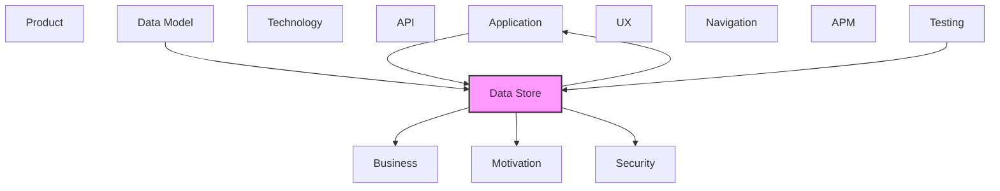

# Data Store

[← Back to README](../README.md)

Databases, data stores, and persistence mechanisms.

## Report Index

- [Layer Introduction](#layer-introduction)
- [Intra-Layer Relationships](#intra-layer-relationships)
- [Inter-Layer Dependencies](#inter-layer-dependencies)
- [Inter-Layer Relationships Table](#inter-layer-relationships-table)
- [Element Reference](#element-reference)

## Layer Introduction

| Metric                    | Count |
| ------------------------- | ----- |
| Elements                  | 62    |
| Intra-Layer Relationships | 91    |
| Inter-Layer Relationships | 102   |
| Inbound Relationships     | 77    |
| Outbound Relationships    | 25    |

**Cross-Layer References**:

- **Upstream layers**: [Application](./05-application-layer-report.md), [Data Model](./08-data-model-layer-report.md), [Testing](./13-testing-layer-report.md)
- **Downstream layers**: [Application](./05-application-layer-report.md), [Business](./02-business-layer-report.md), [Motivation](./01-motivation-layer-report.md), [Security](./04-security-layer-report.md)

## Intra-Layer Relationships

*This layer has >30 elements. Summary table shown instead of diagram.*

| Element                                                          | Type              | Relationships |
| ---------------------------------------------------------------- | ----------------- | ------------- |
| `data-store.accesspattern.entity-by-parent-range-scan`           | `accesspattern`   | 1             |
| `data-store.accesspattern.vector-similarity-search`              | `accesspattern`   | 1             |
| `data-store.collection.approval-policies`                        | `collection`      | 2             |
| `data-store.collection.attribute-definitions`                    | `collection`      | 4             |
| `data-store.collection.batch-runs`                               | `collection`      | 7             |
| `data-store.collection.batches`                                  | `collection`      | 2             |
| `data-store.collection.change-events`                            | `collection`      | 2             |
| `data-store.collection.chat-conversations`                       | `collection`      | 2             |
| `data-store.collection.chat-messages`                            | `collection`      | 3             |
| `data-store.collection.claim-triage-runs`                        | `collection`      | 2             |
| `data-store.collection.claims`                                   | `collection`      | 3             |
| `data-store.collection.datasets`                                 | `collection`      | 5             |
| `data-store.collection.entity-sources`                           | `collection`      | 2             |
| `data-store.collection.extraction-results-table`                 | `collection`      | 1             |
| `data-store.collection.extraction-runs`                          | `collection`      | 2             |
| `data-store.collection.grounding-workflows`                      | `collection`      | 2             |
| `data-store.collection.import-runs-table`                        | `collection`      | 2             |
| `data-store.collection.individual-classes-table`                 | `collection`      | 3             |
| `data-store.collection.individual-extraction-runs`               | `collection`      | 2             |
| `data-store.collection.no-op-runs`                               | `collection`      | 2             |
| `data-store.collection.notes-to-claims-runs`                     | `collection`      | 2             |
| `data-store.collection.ontology-entities`                        | `collection`      | 15            |
| `data-store.collection.pipeline-configurations-table`            | `collection`      | 1             |
| `data-store.collection.pipeline-runs`                            | `collection`      | 11            |
| `data-store.collection.predicates`                               | `collection`      | 4             |
| `data-store.collection.property-definitions-table`               | `collection`      | 2             |
| `data-store.collection.proposal-decisions`                       | `collection`      | 3             |
| `data-store.collection.proposal-links`                           | `collection`      | 4             |
| `data-store.collection.proposal-operations`                      | `collection`      | 6             |
| `data-store.collection.proposals-table`                          | `collection`      | 8             |
| `data-store.collection.reference-relations`                      | `collection`      | 1             |
| `data-store.collection.references`                               | `collection`      | 1             |
| `data-store.collection.relationships`                            | `collection`      | 3             |
| `data-store.collection.schema-extraction-runs`                   | `collection`      | 2             |
| `data-store.collection.schema-node-connection-refinement-runs`   | `collection`      | 2             |
| `data-store.collection.schema-node-definition-refinement-runs`   | `collection`      | 2             |
| `data-store.collection.schema-node-grounding-runs`               | `collection`      | 2             |
| `data-store.collection.schema-relationship-reflection-runs`      | `collection`      | 2             |
| `data-store.collection.sources`                                  | `collection`      | 3             |
| `data-store.collection.workflow-runs`                            | `collection`      | 2             |
| `data-store.database.localdb`                                    | `database`        | 32            |
| `data-store.database.operationsdb`                               | `database`        | 3             |
| `data-store.database.reference-api-cachedb`                      | `database`        | 0             |
| `data-store.database.referencedb`                                | `database`        | 2             |
| `data-store.field.amended-at`                                    | `field`           | 1             |
| `data-store.field.amendments`                                    | `field`           | 1             |
| `data-store.field.review-only`                                   | `field`           | 1             |
| `data-store.index.ix-proposal-links-target-proposal-id`          | `index`           | 1             |
| `data-store.retentionpolicy.reference-api-cache-cleanup`         | `retentionpolicy` | 0             |
| `data-store.validationrule.entity-cascade-delete`                | `validationrule`  | 1             |
| `data-store.validationrule.fk-proposal-links-source`             | `validationrule`  | 2             |
| `data-store.validationrule.fk-proposal-links-target`             | `validationrule`  | 2             |
| `data-store.validationrule.uk-attribute-class-identifier`        | `validationrule`  | 1             |
| `data-store.validationrule.uk-attribute-property-identifier`     | `validationrule`  | 1             |
| `data-store.validationrule.uk-chat-message-seq`                  | `validationrule`  | 1             |
| `data-store.validationrule.uk-dataset-taxonomy-identifier`       | `validationrule`  | 1             |
| `data-store.validationrule.uk-individual-position`               | `validationrule`  | 1             |
| `data-store.validationrule.uk-predicate-taxonomy-identifier`     | `validationrule`  | 1             |
| `data-store.validationrule.uk-relationship-triple`               | `validationrule`  | 1             |
| `data-store.validationrule.uq-claim-taxonomy-key`                | `validationrule`  | 1             |
| `data-store.validationrule.uq-proposal-links-source-kind-target` | `validationrule`  | 1             |
| `data-store.validationrule.uq-proposal-operation-seq`            | `validationrule`  | 1             |

## Inter-Layer Dependencies

## Inter-Layer Relationships Table

| Relationship ID                                                   | Source Node                                                                 | Dest Node                                                                    | Dest Layer    | Predicate    | Cardinality  | Strength |
| ----------------------------------------------------------------- | --------------------------------------------------------------------------- | ---------------------------------------------------------------------------- | ------------- | ------------ | ------------ | -------- |
| `application.applicationcomponent.accesses.data-store.collection` | `application.applicationcomponent.sqlite-approval-policy-repository`        | `data-store.collection.approval-policies`                                    | `data-store`  | `accesses`   | many-to-many | medium   |
| `application.applicationcomponent.accesses.data-store.collection` | `application.applicationcomponent.sqlite-batch-repository`                  | `data-store.collection.batches`                                              | `data-store`  | `accesses`   | many-to-many | medium   |
| `application.applicationcomponent.accesses.data-store.collection` | `application.applicationcomponent.sqlite-change-proposal-repository`        | `data-store.collection.proposal-decisions`                                   | `data-store`  | `accesses`   | many-to-many | medium   |
| `application.applicationcomponent.accesses.data-store.collection` | `application.applicationcomponent.sqlite-change-proposal-repository`        | `data-store.collection.proposal-operations`                                  | `data-store`  | `accesses`   | many-to-many | medium   |
| `application.applicationcomponent.accesses.data-store.collection` | `application.applicationcomponent.sqlite-change-proposal-repository`        | `data-store.collection.proposals-table`                                      | `data-store`  | `accesses`   | many-to-many | medium   |
| `application.applicationcomponent.accesses.data-store.collection` | `application.applicationcomponent.sqlite-change-repository`                 | `data-store.collection.change-events`                                        | `data-store`  | `accesses`   | many-to-many | medium   |
| `application.applicationcomponent.accesses.data-store.collection` | `application.applicationcomponent.sqlite-claim-repository`                  | `data-store.collection.claims`                                               | `data-store`  | `accesses`   | many-to-many | medium   |
| `application.applicationcomponent.accesses.data-store.collection` | `application.applicationcomponent.sqlite-conversation-repository`           | `data-store.collection.chat-conversations`                                   | `data-store`  | `accesses`   | many-to-many | medium   |
| `application.applicationcomponent.accesses.data-store.collection` | `application.applicationcomponent.sqlite-conversation-repository`           | `data-store.collection.chat-messages`                                        | `data-store`  | `accesses`   | many-to-many | medium   |
| `application.applicationcomponent.accesses.data-store.collection` | `application.applicationcomponent.sqlite-entity-source-repository`          | `data-store.collection.entity-sources`                                       | `data-store`  | `accesses`   | many-to-many | medium   |
| `application.applicationcomponent.accesses.data-store.collection` | `application.applicationcomponent.sqlite-extraction-repository`             | `data-store.collection.extraction-results-table`                             | `data-store`  | `accesses`   | many-to-many | medium   |
| `application.applicationcomponent.accesses.data-store.collection` | `application.applicationcomponent.sqlite-extraction-repository`             | `data-store.collection.extraction-runs`                                      | `data-store`  | `accesses`   | many-to-many | medium   |
| `application.applicationcomponent.accesses.data-store.collection` | `application.applicationcomponent.sqlite-extraction-run-repository`         | `data-store.collection.extraction-runs`                                      | `data-store`  | `accesses`   | many-to-many | medium   |
| `application.applicationcomponent.accesses.data-store.collection` | `application.applicationcomponent.sqlite-individual-vector-index`           | `data-store.collection.ontology-entities`                                    | `data-store`  | `accesses`   | many-to-many | medium   |
| `application.applicationcomponent.accesses.data-store.collection` | `application.applicationcomponent.sqlite-interchange-repository`            | `data-store.collection.batch-runs`                                           | `data-store`  | `accesses`   | many-to-many | medium   |
| `application.applicationcomponent.accesses.data-store.collection` | `application.applicationcomponent.sqlite-interchange-repository`            | `data-store.collection.import-runs-table`                                    | `data-store`  | `accesses`   | many-to-many | medium   |
| `application.applicationcomponent.accesses.data-store.collection` | `application.applicationcomponent.sqlite-ontology-repository`               | `data-store.collection.attribute-definitions`                                | `data-store`  | `accesses`   | many-to-many | medium   |
| `application.applicationcomponent.accesses.data-store.collection` | `application.applicationcomponent.sqlite-ontology-repository`               | `data-store.collection.datasets`                                             | `data-store`  | `accesses`   | many-to-many | medium   |
| `application.applicationcomponent.accesses.data-store.collection` | `application.applicationcomponent.sqlite-ontology-repository`               | `data-store.collection.individual-classes-table`                             | `data-store`  | `accesses`   | many-to-many | medium   |
| `application.applicationcomponent.accesses.data-store.collection` | `application.applicationcomponent.sqlite-ontology-repository`               | `data-store.collection.ontology-entities`                                    | `data-store`  | `accesses`   | many-to-many | medium   |
| `application.applicationcomponent.accesses.data-store.collection` | `application.applicationcomponent.sqlite-ontology-repository`               | `data-store.collection.predicates`                                           | `data-store`  | `accesses`   | many-to-many | medium   |
| `application.applicationcomponent.accesses.data-store.collection` | `application.applicationcomponent.sqlite-ontology-repository`               | `data-store.collection.property-definitions-table`                           | `data-store`  | `accesses`   | many-to-many | medium   |
| `application.applicationcomponent.accesses.data-store.collection` | `application.applicationcomponent.sqlite-ontology-repository`               | `data-store.collection.relationships`                                        | `data-store`  | `accesses`   | many-to-many | medium   |
| `application.applicationcomponent.accesses.data-store.collection` | `application.applicationcomponent.sqlite-pipeline-configuration-repository` | `data-store.collection.pipeline-configurations-table`                        | `data-store`  | `accesses`   | many-to-many | medium   |
| `application.applicationcomponent.accesses.data-store.collection` | `application.applicationcomponent.sqlite-pipeline-repository`               | `data-store.collection.batch-runs`                                           | `data-store`  | `accesses`   | many-to-many | medium   |
| `application.applicationcomponent.accesses.data-store.collection` | `application.applicationcomponent.sqlite-pipeline-repository`               | `data-store.collection.claim-triage-runs`                                    | `data-store`  | `accesses`   | many-to-many | medium   |
| `application.applicationcomponent.accesses.data-store.collection` | `application.applicationcomponent.sqlite-pipeline-repository`               | `data-store.collection.individual-extraction-runs`                           | `data-store`  | `accesses`   | many-to-many | medium   |
| `application.applicationcomponent.accesses.data-store.collection` | `application.applicationcomponent.sqlite-pipeline-repository`               | `data-store.collection.no-op-runs`                                           | `data-store`  | `accesses`   | many-to-many | medium   |
| `application.applicationcomponent.accesses.data-store.collection` | `application.applicationcomponent.sqlite-pipeline-repository`               | `data-store.collection.notes-to-claims-runs`                                 | `data-store`  | `accesses`   | many-to-many | medium   |
| `application.applicationcomponent.accesses.data-store.collection` | `application.applicationcomponent.sqlite-pipeline-repository`               | `data-store.collection.pipeline-runs`                                        | `data-store`  | `accesses`   | many-to-many | medium   |
| `application.applicationcomponent.accesses.data-store.collection` | `application.applicationcomponent.sqlite-pipeline-repository`               | `data-store.collection.schema-extraction-runs`                               | `data-store`  | `accesses`   | many-to-many | medium   |
| `application.applicationcomponent.accesses.data-store.collection` | `application.applicationcomponent.sqlite-pipeline-repository`               | `data-store.collection.schema-node-connection-refinement-runs`               | `data-store`  | `accesses`   | many-to-many | medium   |
| `application.applicationcomponent.accesses.data-store.collection` | `application.applicationcomponent.sqlite-pipeline-repository`               | `data-store.collection.schema-node-definition-refinement-runs`               | `data-store`  | `accesses`   | many-to-many | medium   |
| `application.applicationcomponent.accesses.data-store.collection` | `application.applicationcomponent.sqlite-pipeline-repository`               | `data-store.collection.schema-node-grounding-runs`                           | `data-store`  | `accesses`   | many-to-many | medium   |
| `application.applicationcomponent.accesses.data-store.collection` | `application.applicationcomponent.sqlite-pipeline-repository`               | `data-store.collection.schema-relationship-reflection-runs`                  | `data-store`  | `accesses`   | many-to-many | medium   |
| `application.applicationcomponent.accesses.data-store.collection` | `application.applicationcomponent.sqlite-schema-vector-index`               | `data-store.collection.ontology-entities`                                    | `data-store`  | `accesses`   | many-to-many | medium   |
| `application.applicationcomponent.accesses.data-store.collection` | `application.applicationcomponent.sqlite-source-repository`                 | `data-store.collection.sources`                                              | `data-store`  | `accesses`   | many-to-many | medium   |
| `application.applicationfunction.accesses.data-store.collection`  | `application.applicationfunction.reversal-planning`                         | `data-store.collection.change-events`                                        | `data-store`  | `accesses`   | many-to-many | medium   |
| `application.applicationfunction.accesses.data-store.collection`  | `application.applicationfunction.reversal-planning`                         | `data-store.collection.proposals-table`                                      | `data-store`  | `accesses`   | many-to-many | medium   |
| `application.applicationfunction.accesses.data-store.collection`  | `application.applicationfunction.revert-preview`                            | `data-store.collection.change-events`                                        | `data-store`  | `accesses`   | many-to-many | medium   |
| `data-model.objectschema.maps-to.data-store.collection`           | `data-model.objectschema.approval-policy-entity`                            | `data-store.collection.approval-policies`                                    | `data-store`  | `maps-to`    | many-to-many | medium   |
| `data-model.objectschema.maps-to.data-store.collection`           | `data-model.objectschema.attribute-definition-entity`                       | `data-store.collection.attribute-definitions`                                | `data-store`  | `maps-to`    | many-to-many | medium   |
| `data-model.objectschema.maps-to.data-store.collection`           | `data-model.objectschema.batch-entity`                                      | `data-store.collection.batches`                                              | `data-store`  | `maps-to`    | many-to-many | medium   |
| `data-model.objectschema.maps-to.data-store.collection`           | `data-model.objectschema.change-event-entity`                               | `data-store.collection.change-events`                                        | `data-store`  | `maps-to`    | many-to-many | medium   |
| `data-model.objectschema.maps-to.data-store.collection`           | `data-model.objectschema.change-event`                                      | `data-store.collection.change-events`                                        | `data-store`  | `maps-to`    | many-to-many | medium   |
| `data-model.objectschema.maps-to.data-store.collection`           | `data-model.objectschema.chat-message-entity`                               | `data-store.collection.chat-messages`                                        | `data-store`  | `maps-to`    | many-to-many | medium   |
| `data-model.objectschema.maps-to.data-store.collection`           | `data-model.objectschema.claim-entity`                                      | `data-store.collection.claims`                                               | `data-store`  | `maps-to`    | many-to-many | medium   |
| `data-model.objectschema.maps-to.data-store.collection`           | `data-model.objectschema.concept-scheme-entity`                             | `data-store.collection.ontology-entities`                                    | `data-store`  | `maps-to`    | many-to-many | medium   |
| `data-model.objectschema.maps-to.data-store.collection`           | `data-model.objectschema.conversation-entity`                               | `data-store.collection.chat-conversations`                                   | `data-store`  | `maps-to`    | many-to-many | medium   |
| `data-model.objectschema.maps-to.data-store.collection`           | `data-model.objectschema.dataset-entity`                                    | `data-store.collection.datasets`                                             | `data-store`  | `maps-to`    | many-to-many | medium   |
| `data-model.objectschema.maps-to.data-store.collection`           | `data-model.objectschema.entity-source-entity`                              | `data-store.collection.entity-sources`                                       | `data-store`  | `maps-to`    | many-to-many | medium   |
| `data-model.objectschema.maps-to.data-store.collection`           | `data-model.objectschema.extraction-result`                                 | `data-store.collection.extraction-results-table`                             | `data-store`  | `maps-to`    | many-to-many | medium   |
| `data-model.objectschema.maps-to.data-store.collection`           | `data-model.objectschema.extraction-run`                                    | `data-store.collection.extraction-runs`                                      | `data-store`  | `maps-to`    | many-to-many | medium   |
| `data-model.objectschema.maps-to.data-store.collection`           | `data-model.objectschema.import-run-entity`                                 | `data-store.collection.import-runs-table`                                    | `data-store`  | `maps-to`    | many-to-many | medium   |
| `data-model.objectschema.maps-to.data-store.collection`           | `data-model.objectschema.import-run`                                        | `data-store.collection.import-runs-table`                                    | `data-store`  | `maps-to`    | many-to-many | medium   |
| `data-model.objectschema.maps-to.data-store.collection`           | `data-model.objectschema.individual-class`                                  | `data-store.collection.individual-classes-table`                             | `data-store`  | `maps-to`    | many-to-many | medium   |
| `data-model.objectschema.maps-to.data-store.collection`           | `data-model.objectschema.individual-entity`                                 | `data-store.collection.ontology-entities`                                    | `data-store`  | `maps-to`    | many-to-many | medium   |
| `data-model.objectschema.maps-to.data-store.collection`           | `data-model.objectschema.ontology-class-entity`                             | `data-store.collection.ontology-entities`                                    | `data-store`  | `maps-to`    | many-to-many | medium   |
| `data-model.objectschema.maps-to.data-store.collection`           | `data-model.objectschema.ontology-entity`                                   | `data-store.collection.ontology-entities`                                    | `data-store`  | `maps-to`    | many-to-many | medium   |
| `data-model.objectschema.maps-to.data-store.collection`           | `data-model.objectschema.operation-amendment`                               | `data-store.collection.proposal-operations`                                  | `data-store`  | `maps-to`    | many-to-many | medium   |
| `data-model.objectschema.maps-to.data-store.collection`           | `data-model.objectschema.pipeline-configuration`                            | `data-store.collection.pipeline-configurations-table`                        | `data-store`  | `maps-to`    | many-to-many | medium   |
| `data-model.objectschema.maps-to.data-store.collection`           | `data-model.objectschema.pipeline-run-entity`                               | `data-store.collection.pipeline-runs`                                        | `data-store`  | `maps-to`    | many-to-many | medium   |
| `data-model.objectschema.maps-to.data-store.collection`           | `data-model.objectschema.predicate-entity`                                  | `data-store.collection.predicates`                                           | `data-store`  | `maps-to`    | many-to-many | medium   |
| `data-model.objectschema.maps-to.data-store.collection`           | `data-model.objectschema.property-definition-entity`                        | `data-store.collection.property-definitions-table`                           | `data-store`  | `maps-to`    | many-to-many | medium   |
| `data-model.objectschema.maps-to.data-store.collection`           | `data-model.objectschema.property-definition`                               | `data-store.collection.property-definitions-table`                           | `data-store`  | `maps-to`    | many-to-many | medium   |
| `data-model.objectschema.maps-to.data-store.collection`           | `data-model.objectschema.proposal-decision-entity`                          | `data-store.collection.proposal-decisions`                                   | `data-store`  | `maps-to`    | many-to-many | medium   |
| `data-model.objectschema.maps-to.data-store.collection`           | `data-model.objectschema.proposal-entity`                                   | `data-store.collection.proposals-table`                                      | `data-store`  | `maps-to`    | many-to-many | medium   |
| `data-model.objectschema.maps-to.data-store.collection`           | `data-model.objectschema.proposal-link`                                     | `data-store.collection.proposal-links`                                       | `data-store`  | `maps-to`    | many-to-many | medium   |
| `data-model.objectschema.maps-to.data-store.collection`           | `data-model.objectschema.proposal`                                          | `data-store.collection.proposals-table`                                      | `data-store`  | `maps-to`    | many-to-many | medium   |
| `data-model.objectschema.maps-to.data-store.collection`           | `data-model.objectschema.proposed-operation`                                | `data-store.collection.proposal-operations`                                  | `data-store`  | `maps-to`    | many-to-many | medium   |
| `data-model.objectschema.maps-to.data-store.collection`           | `data-model.objectschema.relationship-entity`                               | `data-store.collection.relationships`                                        | `data-store`  | `maps-to`    | many-to-many | medium   |
| `data-model.objectschema.maps-to.data-store.collection`           | `data-model.objectschema.relationship`                                      | `data-store.collection.relationships`                                        | `data-store`  | `maps-to`    | many-to-many | medium   |
| `data-model.objectschema.maps-to.data-store.collection`           | `data-model.objectschema.source-entity`                                     | `data-store.collection.sources`                                              | `data-store`  | `maps-to`    | many-to-many | medium   |
| `data-model.objectschema.maps-to.data-store.collection`           | `data-model.objectschema.taxonomy-entity`                                   | `data-store.collection.ontology-entities`                                    | `data-store`  | `maps-to`    | many-to-many | medium   |
| `data-store.accesspattern.serves.application.applicationfunction` | `data-store.accesspattern.entity-by-parent-range-scan`                      | `application.applicationfunction.sparql-query-function`                      | `application` | `serves`     | many-to-many | medium   |
| `data-store.accesspattern.serves.application.applicationfunction` | `data-store.accesspattern.vector-similarity-search`                         | `application.applicationfunction.embedding-generation`                       | `application` | `serves`     | many-to-many | medium   |
| `data-store.collection.satisfies.motivation.requirement`          | `data-store.collection.approval-policies`                                   | `motivation.requirement.breaking-changes-never-auto-apply`                   | `motivation`  | `satisfies`  | many-to-many | medium   |
| `data-store.collection.satisfies.motivation.requirement`          | `data-store.collection.change-events`                                       | `motivation.requirement.every-applied-proposal-is-revertible`                | `motivation`  | `satisfies`  | many-to-many | medium   |
| `data-store.collection.references.security.dataclassification`    | `data-store.collection.chat-messages`                                       | `security.dataclassification.internal-knowledge-graph-data`                  | `security`    | `references` | many-to-many | medium   |
| `data-store.collection.realizes.business.businessobject`          | `data-store.collection.claims`                                              | `business.businessobject.claim`                                              | `business`    | `realizes`   | many-to-many | medium   |
| `data-store.collection.satisfies.motivation.requirement`          | `data-store.collection.datasets`                                            | `motivation.requirement.individuals-belong-to-one-dataset`                   | `motivation`  | `satisfies`  | many-to-many | medium   |
| `data-store.collection.satisfies.motivation.requirement`          | `data-store.collection.entity-sources`                                      | `motivation.requirement.extracted-facts-cite-their-source`                   | `motivation`  | `satisfies`  | many-to-many | medium   |
| `data-store.collection.references.security.dataclassification`    | `data-store.collection.ontology-entities`                                   | `security.dataclassification.internal-knowledge-graph-data`                  | `security`    | `references` | many-to-many | medium   |
| `data-store.collection.satisfies.motivation.requirement`          | `data-store.collection.predicates`                                          | `motivation.requirement.relationships-limited-to-allowed-types`              | `motivation`  | `satisfies`  | many-to-many | medium   |
| `data-store.collection.satisfies.motivation.requirement`          | `data-store.collection.proposal-decisions`                                  | `motivation.requirement.reason-codes-for-every-reject`                       | `motivation`  | `satisfies`  | many-to-many | medium   |
| `data-store.collection.satisfies.motivation.requirement`          | `data-store.collection.proposal-links`                                      | `motivation.requirement.proposals-link-to-each-other-through-one-link-model` | `motivation`  | `satisfies`  | many-to-many | medium   |
| `data-store.collection.references.security.dataclassification`    | `data-store.collection.proposals-table`                                     | `security.dataclassification.internal-knowledge-graph-data`                  | `security`    | `references` | many-to-many | medium   |
| `data-store.collection.satisfies.motivation.requirement`          | `data-store.collection.proposals-table`                                     | `motivation.requirement.landed-proposals-are-undone-by-a-reversal-proposal`  | `motivation`  | `satisfies`  | many-to-many | medium   |
| `data-store.collection.satisfies.motivation.requirement`          | `data-store.collection.proposals-table`                                     | `motivation.requirement.proposals-record-their-pipeline-and-version`         | `motivation`  | `satisfies`  | many-to-many | medium   |
| `data-store.collection.satisfies.motivation.requirement`          | `data-store.collection.proposals-table`                                     | `motivation.requirement.reversal-is-decided-like-any-proposal`               | `motivation`  | `satisfies`  | many-to-many | medium   |
| `data-store.collection.satisfies.motivation.requirement`          | `data-store.collection.proposals-table`                                     | `motivation.requirement.reversed-proposal-status`                            | `motivation`  | `satisfies`  | many-to-many | medium   |
| `data-store.collection.references.security.dataclassification`    | `data-store.collection.sources`                                             | `security.dataclassification.internal-knowledge-graph-data`                  | `security`    | `references` | many-to-many | medium   |
| `data-store.database.satisfies.motivation.constraint`             | `data-store.database.localdb`                                               | `motivation.constraint.sqlite-only-persistence`                              | `motivation`  | `satisfies`  | many-to-many | medium   |
| `data-store.database.satisfies.motivation.constraint`             | `data-store.database.operationsdb`                                          | `motivation.constraint.sqlite-only-persistence`                              | `motivation`  | `satisfies`  | many-to-many | medium   |
| `data-store.database.satisfies.motivation.constraint`             | `data-store.database.reference-api-cachedb`                                 | `motivation.constraint.sqlite-only-persistence`                              | `motivation`  | `satisfies`  | many-to-many | medium   |
| `data-store.database.satisfies.motivation.constraint`             | `data-store.database.referencedb`                                           | `motivation.constraint.sqlite-only-persistence`                              | `motivation`  | `satisfies`  | many-to-many | medium   |
| `data-store.retentionpolicy.satisfies.motivation.constraint`      | `data-store.retentionpolicy.reference-api-cache-cleanup`                    | `motivation.constraint.external-reference-source-rate-limits`                | `motivation`  | `satisfies`  | many-to-many | medium   |
| `data-store.validationrule.satisfies.motivation.requirement`      | `data-store.validationrule.uk-dataset-taxonomy-identifier`                  | `motivation.requirement.individuals-belong-to-one-dataset`                   | `motivation`  | `satisfies`  | many-to-many | medium   |
| `data-store.validationrule.satisfies.motivation.requirement`      | `data-store.validationrule.uk-relationship-triple`                          | `motivation.requirement.relationships-limited-to-allowed-types`              | `motivation`  | `satisfies`  | many-to-many | medium   |
| `testing.testcoveragetarget.covers.data-store.collection`         | `testing.testcoveragetarget.e2e-test-suite`                                 | `data-store.collection.ontology-entities`                                    | `data-store`  | `covers`     | many-to-many | medium   |
| `testing.testcoveragetarget.covers.data-store.collection`         | `testing.testcoveragetarget.performance-test-suite`                         | `data-store.collection.ontology-entities`                                    | `data-store`  | `covers`     | many-to-many | medium   |
| `testing.testcoveragetarget.covers.data-store.collection`         | `testing.testcoveragetarget.proposal-reversal`                              | `data-store.collection.proposals-table`                                      | `data-store`  | `covers`     | many-to-many | medium   |

## Element Reference

### entity_by_parent RANGE_SCAN {#entity-by-parent-range-scan}

**ID**: `data-store.accesspattern.entity-by-parent-range-scan`

**Type**: `accesspattern`

Range scan access pattern for retrieving all ontology entities with a specific parent_entity_id — supports hierarchy traversal in the Ontology Management bounded context

#### Attributes

| Name                   | Value                         |
| ---------------------- | ----------------------------- |
| consistencyRequirement | STRONG                        |
| expectedFrequency      | FREQUENT                      |
| keyCondition           | parent_entity_id = :parent_id |
| patternType            | RANGE_SCAN                    |
| targetCollection       | ontology_entities             |

#### Relationships

| Type        | Related Element                                         | Predicate  | Direction |
| ----------- | ------------------------------------------------------- | ---------- | --------- |
| inter-layer | `application.applicationfunction.sparql-query-function` | `serves`   | outbound  |
| intra-layer | `data-store.collection.ontology-entities`               | `accesses` | outbound  |

### vector_similarity_search {#vector-similarity-search}

**ID**: `data-store.accesspattern.vector-similarity-search`

**Type**: `accesspattern`

Vector similarity search over ontology_entities: brute-force cosine (numpy) over the title/definition embedding columns stored on each row, read through the same SQLAlchemy session as the structured data (no sqlite-vec extension yet).

#### Attributes

| Name                   | Value                                                                |
| ---------------------- | -------------------------------------------------------------------- |
| consistencyRequirement | EVENTUAL                                                             |
| expectedFrequency      | FREQUENT                                                             |
| keyCondition           | cosine(title_embedding \| definition_embedding, :query_vector) top-k |
| patternType            | VECTOR_SIMILARITY                                                    |
| targetCollection       | ontology_entities                                                    |

#### Relationships

| Type        | Related Element                                        | Predicate  | Direction |
| ----------- | ------------------------------------------------------ | ---------- | --------- |
| inter-layer | `application.applicationfunction.embedding-generation` | `serves`   | outbound  |
| intra-layer | `data-store.collection.ontology-entities`              | `accesses` | outbound  |

### approval_policies {#approval-policies}

**ID**: `data-store.collection.approval-policies`

**Type**: `collection`

One approval policy per taxonomy (local.db).

#### Attributes

| Name           | Value |
| -------------- | ----- |
| collectionType | TABLE |

#### Relationships

| Type        | Related Element                                                      | Predicate    | Direction |
| ----------- | -------------------------------------------------------------------- | ------------ | --------- |
| inter-layer | `application.applicationcomponent.sqlite-approval-policy-repository` | `accesses`   | inbound   |
| inter-layer | `data-model.objectschema.approval-policy-entity`                     | `maps-to`    | inbound   |
| inter-layer | `motivation.requirement.breaking-changes-never-auto-apply`           | `satisfies`  | outbound  |
| intra-layer | `data-store.collection.ontology-entities`                            | `references` | outbound  |
| intra-layer | `data-store.database.localdb`                                        | `composes`   | inbound   |

### attribute_definitions {#attribute-definitions}

**ID**: `data-store.collection.attribute-definitions`

**Type**: `collection`

Attribute definitions scoped to classes (local.db).

#### Attributes

| Name           | Value |
| -------------- | ----- |
| collectionType | TABLE |

#### Relationships

| Type        | Related Element                                               | Predicate    | Direction |
| ----------- | ------------------------------------------------------------- | ------------ | --------- |
| inter-layer | `application.applicationcomponent.sqlite-ontology-repository` | `accesses`   | inbound   |
| inter-layer | `data-model.objectschema.attribute-definition-entity`         | `maps-to`    | inbound   |
| intra-layer | `data-store.validationrule.uk-attribute-class-identifier`     | `composes`   | outbound  |
| intra-layer | `data-store.validationrule.uk-attribute-property-identifier`  | `composes`   | outbound  |
| intra-layer | `data-store.collection.ontology-entities`                     | `references` | outbound  |
| intra-layer | `data-store.database.localdb`                                 | `composes`   | inbound   |

### batch_runs {#batch-runs}

**ID**: `data-store.collection.batch-runs`

**Type**: `collection`

Base table for every run (joined-table inheritance): import runs, extraction runs, pipeline runs and change proposals share its id, status and timestamps.

#### Relationships

| Type        | Related Element                                                  | Predicate    | Direction |
| ----------- | ---------------------------------------------------------------- | ------------ | --------- |
| inter-layer | `application.applicationcomponent.sqlite-interchange-repository` | `accesses`   | inbound   |
| inter-layer | `application.applicationcomponent.sqlite-pipeline-repository`    | `accesses`   | inbound   |
| intra-layer | `data-store.collection.batches`                                  | `references` | outbound  |
| intra-layer | `data-store.collection.change-events`                            | `references` | inbound   |
| intra-layer | `data-store.collection.extraction-runs`                          | `references` | inbound   |
| intra-layer | `data-store.collection.import-runs-table`                        | `references` | inbound   |
| intra-layer | `data-store.collection.pipeline-runs`                            | `references` | inbound   |
| intra-layer | `data-store.collection.proposals-table`                          | `references` | inbound   |
| intra-layer | `data-store.database.localdb`                                    | `composes`   | inbound   |

### batches {#batches}

**ID**: `data-store.collection.batches`

**Type**: `collection`

Batches of pipeline runs (local.db).

#### Attributes

| Name           | Value |
| -------------- | ----- |
| collectionType | TABLE |

#### Relationships

| Type        | Related Element                                            | Predicate    | Direction |
| ----------- | ---------------------------------------------------------- | ------------ | --------- |
| inter-layer | `application.applicationcomponent.sqlite-batch-repository` | `accesses`   | inbound   |
| inter-layer | `data-model.objectschema.batch-entity`                     | `maps-to`    | inbound   |
| intra-layer | `data-store.collection.batch-runs`                         | `references` | inbound   |
| intra-layer | `data-store.database.localdb`                              | `composes`   | inbound   |

### change_events {#change-events}

**ID**: `data-store.collection.change-events`

**Type**: `collection`

Audit trail of all entity changes — stores entity_id, entity_type, event_type, actor, timestamp, and before/after snapshots for versioning and audit compliance

#### Attributes

| Name           | Value |
| -------------- | ----- |
| collectionType | TABLE |

#### Relationships

| Type        | Related Element                                               | Predicate    | Direction |
| ----------- | ------------------------------------------------------------- | ------------ | --------- |
| inter-layer | `application.applicationcomponent.sqlite-change-repository`   | `accesses`   | inbound   |
| inter-layer | `application.applicationfunction.reversal-planning`           | `accesses`   | inbound   |
| inter-layer | `application.applicationfunction.revert-preview`              | `accesses`   | inbound   |
| inter-layer | `data-model.objectschema.change-event-entity`                 | `maps-to`    | inbound   |
| inter-layer | `data-model.objectschema.change-event`                        | `maps-to`    | inbound   |
| inter-layer | `motivation.requirement.every-applied-proposal-is-revertible` | `satisfies`  | outbound  |
| intra-layer | `data-store.collection.batch-runs`                            | `references` | outbound  |
| intra-layer | `data-store.database.localdb`                                 | `composes`   | inbound   |

### chat_conversations {#chat-conversations}

**ID**: `data-store.collection.chat-conversations`

**Type**: `collection`

Chat conversations (operations.db).

#### Attributes

| Name           | Value |
| -------------- | ----- |
| collectionType | TABLE |

#### Relationships

| Type        | Related Element                                                   | Predicate    | Direction |
| ----------- | ----------------------------------------------------------------- | ------------ | --------- |
| inter-layer | `application.applicationcomponent.sqlite-conversation-repository` | `accesses`   | inbound   |
| inter-layer | `data-model.objectschema.conversation-entity`                     | `maps-to`    | inbound   |
| intra-layer | `data-store.collection.chat-messages`                             | `references` | inbound   |
| intra-layer | `data-store.database.operationsdb`                                | `composes`   | inbound   |

### chat_messages {#chat-messages}

**ID**: `data-store.collection.chat-messages`

**Type**: `collection`

Chat messages with their content blocks (operations.db).

#### Attributes

| Name           | Value |
| -------------- | ----- |
| collectionType | TABLE |

#### Relationships

| Type        | Related Element                                                   | Predicate    | Direction |
| ----------- | ----------------------------------------------------------------- | ------------ | --------- |
| inter-layer | `application.applicationcomponent.sqlite-conversation-repository` | `accesses`   | inbound   |
| inter-layer | `data-model.objectschema.chat-message-entity`                     | `maps-to`    | inbound   |
| inter-layer | `security.dataclassification.internal-knowledge-graph-data`       | `references` | outbound  |
| intra-layer | `data-store.validationrule.uk-chat-message-seq`                   | `composes`   | outbound  |
| intra-layer | `data-store.collection.chat-conversations`                        | `references` | outbound  |
| intra-layer | `data-store.database.operationsdb`                                | `composes`   | inbound   |

### claim_triage_runs {#claim-triage-runs}

**ID**: `data-store.collection.claim-triage-runs`

**Type**: `collection`

Claim-triage pipeline runs (pipeline_runs subtype).

#### Attributes

| Name           | Value |
| -------------- | ----- |
| collectionType | TABLE |

#### Relationships

| Type        | Related Element                                               | Predicate    | Direction |
| ----------- | ------------------------------------------------------------- | ------------ | --------- |
| inter-layer | `application.applicationcomponent.sqlite-pipeline-repository` | `accesses`   | inbound   |
| intra-layer | `data-store.collection.pipeline-runs`                         | `references` | outbound  |
| intra-layer | `data-store.database.localdb`                                 | `composes`   | inbound   |

### claims {#claims}

**ID**: `data-store.collection.claims`

**Type**: `collection`

A taxonomy's claims, with triage answers and verdicts (local.db).

#### Attributes

| Name           | Value |
| -------------- | ----- |
| collectionType | TABLE |

#### Relationships

| Type        | Related Element                                            | Predicate    | Direction |
| ----------- | ---------------------------------------------------------- | ------------ | --------- |
| inter-layer | `application.applicationcomponent.sqlite-claim-repository` | `accesses`   | inbound   |
| inter-layer | `data-model.objectschema.claim-entity`                     | `maps-to`    | inbound   |
| inter-layer | `business.businessobject.claim`                            | `realizes`   | outbound  |
| intra-layer | `data-store.validationrule.uq-claim-taxonomy-key`          | `composes`   | outbound  |
| intra-layer | `data-store.collection.ontology-entities`                  | `references` | outbound  |
| intra-layer | `data-store.database.localdb`                              | `composes`   | inbound   |

### datasets {#datasets}

**ID**: `data-store.collection.datasets`

**Type**: `collection`

Datasets: named bodies of data over a taxonomy's schema (local.db).

#### Attributes

| Name           | Value |
| -------------- | ----- |
| collectionType | TABLE |

#### Relationships

| Type        | Related Element                                               | Predicate    | Direction |
| ----------- | ------------------------------------------------------------- | ------------ | --------- |
| inter-layer | `application.applicationcomponent.sqlite-ontology-repository` | `accesses`   | inbound   |
| inter-layer | `data-model.objectschema.dataset-entity`                      | `maps-to`    | inbound   |
| inter-layer | `motivation.requirement.individuals-belong-to-one-dataset`    | `satisfies`  | outbound  |
| intra-layer | `data-store.validationrule.uk-dataset-taxonomy-identifier`    | `composes`   | outbound  |
| intra-layer | `data-store.collection.ontology-entities`                     | `references` | outbound  |
| intra-layer | `data-store.collection.ontology-entities`                     | `references` | inbound   |
| intra-layer | `data-store.collection.sources`                               | `references` | inbound   |
| intra-layer | `data-store.database.localdb`                                 | `composes`   | inbound   |

### entity_sources {#entity-sources}

**ID**: `data-store.collection.entity-sources`

**Type**: `collection`

Provenance: which source passage each entity or relationship was extracted from (local.db).

#### Attributes

| Name           | Value |
| -------------- | ----- |
| collectionType | TABLE |

#### Relationships

| Type        | Related Element                                                    | Predicate    | Direction |
| ----------- | ------------------------------------------------------------------ | ------------ | --------- |
| inter-layer | `application.applicationcomponent.sqlite-entity-source-repository` | `accesses`   | inbound   |
| inter-layer | `data-model.objectschema.entity-source-entity`                     | `maps-to`    | inbound   |
| inter-layer | `motivation.requirement.extracted-facts-cite-their-source`         | `satisfies`  | outbound  |
| intra-layer | `data-store.collection.proposals-table`                            | `references` | outbound  |
| intra-layer | `data-store.database.localdb`                                      | `composes`   | inbound   |

### extraction_results table {#extraction-results-table}

**ID**: `data-store.collection.extraction-results-table`

**Type**: `collection`

SQLite table: extraction_results — stores NLP/LLM extraction run outputs, source text, extracted entity IDs, and processing metrics; in local.db

#### Attributes

| Name           | Value |
| -------------- | ----- |
| collectionType | TABLE |

#### Relationships

| Type        | Related Element                                                 | Predicate  | Direction |
| ----------- | --------------------------------------------------------------- | ---------- | --------- |
| inter-layer | `application.applicationcomponent.sqlite-extraction-repository` | `accesses` | inbound   |
| inter-layer | `data-model.objectschema.extraction-result`                     | `maps-to`  | inbound   |
| intra-layer | `data-store.database.localdb`                                   | `composes` | inbound   |

### extraction_runs {#extraction-runs}

**ID**: `data-store.collection.extraction-runs`

**Type**: `collection`

Tracks individual extraction pipeline runs, including NLP and LLM extraction phases. Stored in local.db as a subtype of batch_runs.

#### Relationships

| Type        | Related Element                                                     | Predicate    | Direction |
| ----------- | ------------------------------------------------------------------- | ------------ | --------- |
| inter-layer | `application.applicationcomponent.sqlite-extraction-repository`     | `accesses`   | inbound   |
| inter-layer | `application.applicationcomponent.sqlite-extraction-run-repository` | `accesses`   | inbound   |
| inter-layer | `data-model.objectschema.extraction-run`                            | `maps-to`    | inbound   |
| intra-layer | `data-store.collection.batch-runs`                                  | `references` | outbound  |
| intra-layer | `data-store.database.localdb`                                       | `composes`   | inbound   |

### grounding_workflows {#grounding-workflows}

**ID**: `data-store.collection.grounding-workflows`

**Type**: `collection`

Saved grounding workflows (local.db).

#### Attributes

| Name           | Value |
| -------------- | ----- |
| collectionType | TABLE |

#### Relationships

| Type        | Related Element                       | Predicate    | Direction |
| ----------- | ------------------------------------- | ------------ | --------- |
| intra-layer | `data-store.collection.workflow-runs` | `references` | inbound   |
| intra-layer | `data-store.database.localdb`         | `composes`   | inbound   |

### import_runs table {#import-runs-table}

**ID**: `data-store.collection.import-runs-table`

**Type**: `collection`

SQLite table: import_runs — stores interchange import run metadata (format, status, entity counts, error details, timestamps); in local.db

#### Attributes

| Name           | Value |
| -------------- | ----- |
| collectionType | TABLE |

#### Relationships

| Type        | Related Element                                                  | Predicate    | Direction |
| ----------- | ---------------------------------------------------------------- | ------------ | --------- |
| inter-layer | `application.applicationcomponent.sqlite-interchange-repository` | `accesses`   | inbound   |
| inter-layer | `data-model.objectschema.import-run-entity`                      | `maps-to`    | inbound   |
| inter-layer | `data-model.objectschema.import-run`                             | `maps-to`    | inbound   |
| intra-layer | `data-store.collection.batch-runs`                               | `references` | outbound  |
| intra-layer | `data-store.database.localdb`                                    | `composes`   | inbound   |

### individual_classes table {#individual-classes-table}

**ID**: `data-store.collection.individual-classes-table`

**Type**: `collection`

SQLite table: individual_classes — association table mapping individual instances to their parent classes with ordering index; in local.db

#### Attributes

| Name           | Value |
| -------------- | ----- |
| collectionType | TABLE |

#### Relationships

| Type        | Related Element                                               | Predicate    | Direction |
| ----------- | ------------------------------------------------------------- | ------------ | --------- |
| inter-layer | `application.applicationcomponent.sqlite-ontology-repository` | `accesses`   | inbound   |
| inter-layer | `data-model.objectschema.individual-class`                    | `maps-to`    | inbound   |
| intra-layer | `data-store.validationrule.uk-individual-position`            | `composes`   | outbound  |
| intra-layer | `data-store.collection.ontology-entities`                     | `references` | outbound  |
| intra-layer | `data-store.database.localdb`                                 | `composes`   | inbound   |

### individual_extraction_runs {#individual-extraction-runs}

**ID**: `data-store.collection.individual-extraction-runs`

**Type**: `collection`

Individual-extraction pipeline runs (pipeline_runs subtype).

#### Attributes

| Name           | Value |
| -------------- | ----- |
| collectionType | TABLE |

#### Relationships

| Type        | Related Element                                               | Predicate    | Direction |
| ----------- | ------------------------------------------------------------- | ------------ | --------- |
| inter-layer | `application.applicationcomponent.sqlite-pipeline-repository` | `accesses`   | inbound   |
| intra-layer | `data-store.collection.pipeline-runs`                         | `references` | outbound  |
| intra-layer | `data-store.database.localdb`                                 | `composes`   | inbound   |

### no_op_runs {#no-op-runs}

**ID**: `data-store.collection.no-op-runs`

**Type**: `collection`

No-op pipeline runs (pipeline_runs subtype).

#### Attributes

| Name           | Value |
| -------------- | ----- |
| collectionType | TABLE |

#### Relationships

| Type        | Related Element                                               | Predicate    | Direction |
| ----------- | ------------------------------------------------------------- | ------------ | --------- |
| inter-layer | `application.applicationcomponent.sqlite-pipeline-repository` | `accesses`   | inbound   |
| intra-layer | `data-store.collection.pipeline-runs`                         | `references` | outbound  |
| intra-layer | `data-store.database.localdb`                                 | `composes`   | inbound   |

### notes_to_claims_runs {#notes-to-claims-runs}

**ID**: `data-store.collection.notes-to-claims-runs`

**Type**: `collection`

Notes-to-claims pipeline runs (pipeline_runs subtype).

#### Attributes

| Name           | Value |
| -------------- | ----- |
| collectionType | TABLE |

#### Relationships

| Type        | Related Element                                               | Predicate    | Direction |
| ----------- | ------------------------------------------------------------- | ------------ | --------- |
| inter-layer | `application.applicationcomponent.sqlite-pipeline-repository` | `accesses`   | inbound   |
| intra-layer | `data-store.collection.pipeline-runs`                         | `references` | outbound  |
| intra-layer | `data-store.database.localdb`                                 | `composes`   | inbound   |

### ontology_entities {#ontology-entities}

**ID**: `data-store.collection.ontology-entities`

**Type**: `collection`

Unified table for all ontology entities (Taxonomy, ConceptScheme, Class, Individual) using single-table inheritance with node_type discriminator — includes vector embedding column for semantic search via sqlite-vec

#### Attributes

| Name           | Value |
| -------------- | ----- |
| collectionType | TABLE |

#### Relationships

| Type        | Related Element                                                   | Predicate    | Direction |
| ----------- | ----------------------------------------------------------------- | ------------ | --------- |
| inter-layer | `application.applicationcomponent.sqlite-individual-vector-index` | `accesses`   | inbound   |
| inter-layer | `application.applicationcomponent.sqlite-ontology-repository`     | `accesses`   | inbound   |
| inter-layer | `application.applicationcomponent.sqlite-schema-vector-index`     | `accesses`   | inbound   |
| inter-layer | `data-model.objectschema.concept-scheme-entity`                   | `maps-to`    | inbound   |
| inter-layer | `data-model.objectschema.individual-entity`                       | `maps-to`    | inbound   |
| inter-layer | `data-model.objectschema.ontology-class-entity`                   | `maps-to`    | inbound   |
| inter-layer | `data-model.objectschema.ontology-entity`                         | `maps-to`    | inbound   |
| inter-layer | `data-model.objectschema.taxonomy-entity`                         | `maps-to`    | inbound   |
| inter-layer | `security.dataclassification.internal-knowledge-graph-data`       | `references` | outbound  |
| inter-layer | `testing.testcoveragetarget.e2e-test-suite`                       | `covers`     | inbound   |
| inter-layer | `testing.testcoveragetarget.performance-test-suite`               | `covers`     | inbound   |
| intra-layer | `data-store.accesspattern.entity-by-parent-range-scan`            | `accesses`   | inbound   |
| intra-layer | `data-store.accesspattern.vector-similarity-search`               | `accesses`   | inbound   |
| intra-layer | `data-store.collection.approval-policies`                         | `references` | inbound   |
| intra-layer | `data-store.collection.attribute-definitions`                     | `references` | inbound   |
| intra-layer | `data-store.collection.claims`                                    | `references` | inbound   |
| intra-layer | `data-store.collection.datasets`                                  | `references` | inbound   |
| intra-layer | `data-store.collection.individual-classes-table`                  | `references` | inbound   |
| intra-layer | `data-store.validationrule.entity-cascade-delete`                 | `composes`   | outbound  |
| intra-layer | `data-store.collection.datasets`                                  | `references` | outbound  |
| intra-layer | `data-store.collection.predicates`                                | `references` | outbound  |
| intra-layer | `data-store.collection.predicates`                                | `references` | inbound   |
| intra-layer | `data-store.collection.property-definitions-table`                | `references` | inbound   |
| intra-layer | `data-store.collection.relationships`                             | `references` | inbound   |
| intra-layer | `data-store.collection.sources`                                   | `references` | inbound   |
| intra-layer | `data-store.database.localdb`                                     | `composes`   | inbound   |

### pipeline_configurations table {#pipeline-configurations-table}

**ID**: `data-store.collection.pipeline-configurations-table`

**Type**: `collection`

SQLite table: pipeline_configurations — stores LLM pipeline definitions (provider, model, prompt templates, parameters) in operations.db

#### Attributes

| Name           | Value |
| -------------- | ----- |
| collectionType | TABLE |

#### Relationships

| Type        | Related Element                                                             | Predicate  | Direction |
| ----------- | --------------------------------------------------------------------------- | ---------- | --------- |
| inter-layer | `application.applicationcomponent.sqlite-pipeline-configuration-repository` | `accesses` | inbound   |
| inter-layer | `data-model.objectschema.pipeline-configuration`                            | `maps-to`  | inbound   |
| intra-layer | `data-store.database.operationsdb`                                          | `composes` | inbound   |

### pipeline_runs {#pipeline-runs}

**ID**: `data-store.collection.pipeline-runs`

**Type**: `collection`

Pipeline runs (a batch_runs subtype): type, implementation, configuration version, input, candidates and LLM metadata; specialized by one table per pipeline type.

#### Attributes

| Name           | Value |
| -------------- | ----- |
| collectionType | TABLE |

#### Relationships

| Type        | Related Element                                                | Predicate    | Direction |
| ----------- | -------------------------------------------------------------- | ------------ | --------- |
| inter-layer | `application.applicationcomponent.sqlite-pipeline-repository`  | `accesses`   | inbound   |
| inter-layer | `data-model.objectschema.pipeline-run-entity`                  | `maps-to`    | inbound   |
| intra-layer | `data-store.collection.claim-triage-runs`                      | `references` | inbound   |
| intra-layer | `data-store.collection.individual-extraction-runs`             | `references` | inbound   |
| intra-layer | `data-store.collection.no-op-runs`                             | `references` | inbound   |
| intra-layer | `data-store.collection.notes-to-claims-runs`                   | `references` | inbound   |
| intra-layer | `data-store.collection.batch-runs`                             | `references` | outbound  |
| intra-layer | `data-store.collection.schema-extraction-runs`                 | `references` | inbound   |
| intra-layer | `data-store.collection.schema-node-connection-refinement-runs` | `references` | inbound   |
| intra-layer | `data-store.collection.schema-node-definition-refinement-runs` | `references` | inbound   |
| intra-layer | `data-store.collection.schema-node-grounding-runs`             | `references` | inbound   |
| intra-layer | `data-store.collection.schema-relationship-reflection-runs`    | `references` | inbound   |
| intra-layer | `data-store.database.localdb`                                  | `composes`   | inbound   |

### predicates {#predicates}

**ID**: `data-store.collection.predicates`

**Type**: `collection`

A taxonomy's predicate catalog: relation verbs used by property definitions (local.db).

#### Attributes

| Name           | Value |
| -------------- | ----- |
| collectionType | TABLE |

#### Relationships

| Type        | Related Element                                                 | Predicate    | Direction |
| ----------- | --------------------------------------------------------------- | ------------ | --------- |
| inter-layer | `application.applicationcomponent.sqlite-ontology-repository`   | `accesses`   | inbound   |
| inter-layer | `data-model.objectschema.predicate-entity`                      | `maps-to`    | inbound   |
| inter-layer | `motivation.requirement.relationships-limited-to-allowed-types` | `satisfies`  | outbound  |
| intra-layer | `data-store.collection.ontology-entities`                       | `references` | inbound   |
| intra-layer | `data-store.validationrule.uk-predicate-taxonomy-identifier`    | `composes`   | outbound  |
| intra-layer | `data-store.collection.ontology-entities`                       | `references` | outbound  |
| intra-layer | `data-store.database.localdb`                                   | `composes`   | inbound   |

### property_definitions table {#property-definitions-table}

**ID**: `data-store.collection.property-definitions-table`

**Type**: `collection`

SQLite table: property_definitions — stores relationship type definitions (object properties) with domain, range, and inverse property FKs; in local.db

#### Attributes

| Name           | Value |
| -------------- | ----- |
| collectionType | TABLE |

#### Relationships

| Type        | Related Element                                               | Predicate    | Direction |
| ----------- | ------------------------------------------------------------- | ------------ | --------- |
| inter-layer | `application.applicationcomponent.sqlite-ontology-repository` | `accesses`   | inbound   |
| inter-layer | `data-model.objectschema.property-definition-entity`          | `maps-to`    | inbound   |
| inter-layer | `data-model.objectschema.property-definition`                 | `maps-to`    | inbound   |
| intra-layer | `data-store.collection.ontology-entities`                     | `references` | outbound  |
| intra-layer | `data-store.database.localdb`                                 | `composes`   | inbound   |

### proposal_decisions {#proposal-decisions}

**ID**: `data-store.collection.proposal-decisions`

**Type**: `collection`

Reviewer and policy decisions on proposal operations, with reason codes and timing: the gold record (local.db).

#### Attributes

| Name           | Value |
| -------------- | ----- |
| collectionType | TABLE |

#### Relationships

| Type        | Related Element                                                      | Predicate    | Direction |
| ----------- | -------------------------------------------------------------------- | ------------ | --------- |
| inter-layer | `application.applicationcomponent.sqlite-change-proposal-repository` | `accesses`   | inbound   |
| inter-layer | `data-model.objectschema.proposal-decision-entity`                   | `maps-to`    | inbound   |
| inter-layer | `motivation.requirement.reason-codes-for-every-reject`               | `satisfies`  | outbound  |
| intra-layer | `data-store.collection.proposal-operations`                          | `references` | outbound  |
| intra-layer | `data-store.collection.proposals-table`                              | `references` | outbound  |
| intra-layer | `data-store.database.localdb`                                        | `composes`   | inbound   |

### proposal_links {#proposal-links}

**ID**: `data-store.collection.proposal-links`

**Type**: `collection`

local.db table proposal_links: one row per link between two proposals. Columns: id (VARCHAR 36, PK), source_proposal_id and target_proposal_id (VARCHAR 36, FK change_proposals.id ON DELETE CASCADE), kind (VARCHAR 20: supersedes \| reverses), created_at, note (TEXT, nullable). Added by an autogenerated Alembic migration after #1628's.

#### Relationships

| Type        | Related Element                                                              | Predicate   | Direction |
| ----------- | ---------------------------------------------------------------------------- | ----------- | --------- |
| inter-layer | `data-model.objectschema.proposal-link`                                      | `maps-to`   | inbound   |
| inter-layer | `motivation.requirement.proposals-link-to-each-other-through-one-link-model` | `satisfies` | outbound  |
| intra-layer | `data-store.index.ix-proposal-links-target-proposal-id`                      | `composes`  | outbound  |
| intra-layer | `data-store.validationrule.fk-proposal-links-source`                         | `composes`  | outbound  |
| intra-layer | `data-store.validationrule.fk-proposal-links-target`                         | `composes`  | outbound  |
| intra-layer | `data-store.validationrule.uq-proposal-links-source-kind-target`             | `composes`  | outbound  |

### proposal_operations {#proposal-operations}

**ID**: `data-store.collection.proposal-operations`

**Type**: `collection`

The ordered operations of each change proposal, with status and payload (local.db).

#### Attributes

| Name           | Value |
| -------------- | ----- |
| collectionType | TABLE |

#### Relationships

| Type        | Related Element                                                      | Predicate    | Direction |
| ----------- | -------------------------------------------------------------------- | ------------ | --------- |
| inter-layer | `application.applicationcomponent.sqlite-change-proposal-repository` | `accesses`   | inbound   |
| inter-layer | `data-model.objectschema.operation-amendment`                        | `maps-to`    | inbound   |
| inter-layer | `data-model.objectschema.proposed-operation`                         | `maps-to`    | inbound   |
| intra-layer | `data-store.collection.proposal-decisions`                           | `references` | inbound   |
| intra-layer | `data-store.field.amended-at`                                        | `composes`   | outbound  |
| intra-layer | `data-store.field.amendments`                                        | `composes`   | outbound  |
| intra-layer | `data-store.validationrule.uq-proposal-operation-seq`                | `composes`   | outbound  |
| intra-layer | `data-store.collection.proposals-table`                              | `references` | outbound  |
| intra-layer | `data-store.database.localdb`                                        | `composes`   | inbound   |

### change_proposals {#change-proposals}

**ID**: `data-store.collection.proposals-table`

**Type**: `collection`

Change proposals (a batch_runs subtype): taxonomy, origin, status and landing of each proposal. Links between proposals, a reversal's to the proposal it reverses among them, are in proposal_links (#1624).

#### Attributes

| Name           | Value |
| -------------- | ----- |
| collectionType | TABLE |

#### Relationships

| Type        | Related Element                                                             | Predicate     | Direction |
| ----------- | --------------------------------------------------------------------------- | ------------- | --------- |
| inter-layer | `application.applicationcomponent.sqlite-change-proposal-repository`        | `accesses`    | inbound   |
| inter-layer | `application.applicationfunction.reversal-planning`                         | `accesses`    | inbound   |
| inter-layer | `data-model.objectschema.proposal-entity`                                   | `maps-to`     | inbound   |
| inter-layer | `data-model.objectschema.proposal`                                          | `maps-to`     | inbound   |
| inter-layer | `security.dataclassification.internal-knowledge-graph-data`                 | `references`  | outbound  |
| inter-layer | `motivation.requirement.landed-proposals-are-undone-by-a-reversal-proposal` | `satisfies`   | outbound  |
| inter-layer | `motivation.requirement.proposals-record-their-pipeline-and-version`        | `satisfies`   | outbound  |
| inter-layer | `motivation.requirement.reversal-is-decided-like-any-proposal`              | `satisfies`   | outbound  |
| inter-layer | `motivation.requirement.reversed-proposal-status`                           | `satisfies`   | outbound  |
| inter-layer | `testing.testcoveragetarget.proposal-reversal`                              | `covers`      | inbound   |
| intra-layer | `data-store.collection.entity-sources`                                      | `references`  | inbound   |
| intra-layer | `data-store.collection.proposal-decisions`                                  | `references`  | inbound   |
| intra-layer | `data-store.collection.proposal-operations`                                 | `references`  | inbound   |
| intra-layer | `data-store.field.review-only`                                              | `composes`    | outbound  |
| intra-layer | `data-store.collection.batch-runs`                                          | `references`  | outbound  |
| intra-layer | `data-store.database.localdb`                                               | `composes`    | inbound   |
| intra-layer | `data-store.validationrule.fk-proposal-links-source`                        | `cascades-to` | inbound   |
| intra-layer | `data-store.validationrule.fk-proposal-links-target`                        | `cascades-to` | inbound   |

### reference_relations {#reference-relations}

**ID**: `data-store.collection.reference-relations`

**Type**: `collection`

reference.db table of imported reference triples: subject_uri, predicate, object_uri, source. Created by LocalReferenceRepository on first use; no migrations.

#### Attributes

| Name           | Value |
| -------------- | ----- |
| collectionType | TABLE |

#### Relationships

| Type        | Related Element                   | Predicate  | Direction |
| ----------- | --------------------------------- | ---------- | --------- |
| intra-layer | `data-store.database.referencedb` | `composes` | inbound   |

### references {#references}

**ID**: `data-store.collection.references`

**Type**: `collection`

reference.db table of imported reference entities (ConceptNet, DBpedia, schema.org): uri (unique), label, description, source. Created by LocalReferenceRepository on first use; no migrations.

#### Attributes

| Name           | Value |
| -------------- | ----- |
| collectionType | TABLE |

#### Relationships

| Type        | Related Element                   | Predicate  | Direction |
| ----------- | --------------------------------- | ---------- | --------- |
| intra-layer | `data-store.database.referencedb` | `composes` | inbound   |

### relationships {#relationships}

**ID**: `data-store.collection.relationships`

**Type**: `collection`

Typed directed edges between ontology entities — stores source/target entity references, relationship type, and optional metadata for the knowledge graph structure

#### Attributes

| Name           | Value |
| -------------- | ----- |
| collectionType | TABLE |

#### Relationships

| Type        | Related Element                                               | Predicate    | Direction |
| ----------- | ------------------------------------------------------------- | ------------ | --------- |
| inter-layer | `application.applicationcomponent.sqlite-ontology-repository` | `accesses`   | inbound   |
| inter-layer | `data-model.objectschema.relationship-entity`                 | `maps-to`    | inbound   |
| inter-layer | `data-model.objectschema.relationship`                        | `maps-to`    | inbound   |
| intra-layer | `data-store.validationrule.uk-relationship-triple`            | `composes`   | outbound  |
| intra-layer | `data-store.collection.ontology-entities`                     | `references` | outbound  |
| intra-layer | `data-store.database.localdb`                                 | `composes`   | inbound   |

### schema_extraction_runs {#schema-extraction-runs}

**ID**: `data-store.collection.schema-extraction-runs`

**Type**: `collection`

Schema-extraction pipeline runs (pipeline_runs subtype).

#### Attributes

| Name           | Value |
| -------------- | ----- |
| collectionType | TABLE |

#### Relationships

| Type        | Related Element                                               | Predicate    | Direction |
| ----------- | ------------------------------------------------------------- | ------------ | --------- |
| inter-layer | `application.applicationcomponent.sqlite-pipeline-repository` | `accesses`   | inbound   |
| intra-layer | `data-store.collection.pipeline-runs`                         | `references` | outbound  |
| intra-layer | `data-store.database.localdb`                                 | `composes`   | inbound   |

### schema_node_connection_refinement_runs {#schema-node-connection-refinement-runs}

**ID**: `data-store.collection.schema-node-connection-refinement-runs`

**Type**: `collection`

Connection-refinement pipeline runs (pipeline_runs subtype).

#### Attributes

| Name           | Value |
| -------------- | ----- |
| collectionType | TABLE |

#### Relationships

| Type        | Related Element                                               | Predicate    | Direction |
| ----------- | ------------------------------------------------------------- | ------------ | --------- |
| inter-layer | `application.applicationcomponent.sqlite-pipeline-repository` | `accesses`   | inbound   |
| intra-layer | `data-store.collection.pipeline-runs`                         | `references` | outbound  |
| intra-layer | `data-store.database.localdb`                                 | `composes`   | inbound   |

### schema_node_definition_refinement_runs {#schema-node-definition-refinement-runs}

**ID**: `data-store.collection.schema-node-definition-refinement-runs`

**Type**: `collection`

Definition-refinement pipeline runs (pipeline_runs subtype).

#### Attributes

| Name           | Value |
| -------------- | ----- |
| collectionType | TABLE |

#### Relationships

| Type        | Related Element                                               | Predicate    | Direction |
| ----------- | ------------------------------------------------------------- | ------------ | --------- |
| inter-layer | `application.applicationcomponent.sqlite-pipeline-repository` | `accesses`   | inbound   |
| intra-layer | `data-store.collection.pipeline-runs`                         | `references` | outbound  |
| intra-layer | `data-store.database.localdb`                                 | `composes`   | inbound   |

### schema_node_grounding_runs {#schema-node-grounding-runs}

**ID**: `data-store.collection.schema-node-grounding-runs`

**Type**: `collection`

Schema-node grounding pipeline runs (pipeline_runs subtype).

#### Attributes

| Name           | Value |
| -------------- | ----- |
| collectionType | TABLE |

#### Relationships

| Type        | Related Element                                               | Predicate    | Direction |
| ----------- | ------------------------------------------------------------- | ------------ | --------- |
| inter-layer | `application.applicationcomponent.sqlite-pipeline-repository` | `accesses`   | inbound   |
| intra-layer | `data-store.collection.pipeline-runs`                         | `references` | outbound  |
| intra-layer | `data-store.database.localdb`                                 | `composes`   | inbound   |

### schema_relationship_reflection_runs {#schema-relationship-reflection-runs}

**ID**: `data-store.collection.schema-relationship-reflection-runs`

**Type**: `collection`

Relationship-reflection pipeline runs (pipeline_runs subtype).

#### Attributes

| Name           | Value |
| -------------- | ----- |
| collectionType | TABLE |

#### Relationships

| Type        | Related Element                                               | Predicate    | Direction |
| ----------- | ------------------------------------------------------------- | ------------ | --------- |
| inter-layer | `application.applicationcomponent.sqlite-pipeline-repository` | `accesses`   | inbound   |
| intra-layer | `data-store.collection.pipeline-runs`                         | `references` | outbound  |
| intra-layer | `data-store.database.localdb`                                 | `composes`   | inbound   |

### sources {#sources}

**ID**: `data-store.collection.sources`

**Type**: `collection`

Source documents of a taxonomy's dataset: kind, status, text and pages (local.db).

#### Attributes

| Name           | Value |
| -------------- | ----- |
| collectionType | TABLE |

#### Relationships

| Type        | Related Element                                             | Predicate    | Direction |
| ----------- | ----------------------------------------------------------- | ------------ | --------- |
| inter-layer | `application.applicationcomponent.sqlite-source-repository` | `accesses`   | inbound   |
| inter-layer | `data-model.objectschema.source-entity`                     | `maps-to`    | inbound   |
| inter-layer | `security.dataclassification.internal-knowledge-graph-data` | `references` | outbound  |
| intra-layer | `data-store.collection.datasets`                            | `references` | outbound  |
| intra-layer | `data-store.collection.ontology-entities`                   | `references` | outbound  |
| intra-layer | `data-store.database.localdb`                               | `composes`   | inbound   |

### workflow_runs {#workflow-runs}

**ID**: `data-store.collection.workflow-runs`

**Type**: `collection`

Runs of grounding workflows (local.db).

#### Attributes

| Name           | Value |
| -------------- | ----- |
| collectionType | TABLE |

#### Relationships

| Type        | Related Element                             | Predicate    | Direction |
| ----------- | ------------------------------------------- | ------------ | --------- |
| intra-layer | `data-store.collection.grounding-workflows` | `references` | outbound  |
| intra-layer | `data-store.database.localdb`               | `composes`   | inbound   |

### local.db {#local-db}

**ID**: `data-store.database.localdb`

**Type**: `database`

Primary workspace database (Alembic-managed SQLite) — stores ontology entities, relationships, property definitions, change events, extraction results, versioning artefacts, and interchange import runs

#### Attributes

| Name     | Value      |
| -------- | ---------- |
| engine   | SQLite     |
| paradigm | RELATIONAL |

#### Relationships

| Type        | Related Element                                                | Predicate   | Direction |
| ----------- | -------------------------------------------------------------- | ----------- | --------- |
| inter-layer | `motivation.constraint.sqlite-only-persistence`                | `satisfies` | outbound  |
| intra-layer | `data-store.collection.approval-policies`                      | `composes`  | outbound  |
| intra-layer | `data-store.collection.attribute-definitions`                  | `composes`  | outbound  |
| intra-layer | `data-store.collection.batch-runs`                             | `composes`  | outbound  |
| intra-layer | `data-store.collection.batches`                                | `composes`  | outbound  |
| intra-layer | `data-store.collection.change-events`                          | `composes`  | outbound  |
| intra-layer | `data-store.collection.claim-triage-runs`                      | `composes`  | outbound  |
| intra-layer | `data-store.collection.claims`                                 | `composes`  | outbound  |
| intra-layer | `data-store.collection.datasets`                               | `composes`  | outbound  |
| intra-layer | `data-store.collection.entity-sources`                         | `composes`  | outbound  |
| intra-layer | `data-store.collection.extraction-results-table`               | `composes`  | outbound  |
| intra-layer | `data-store.collection.extraction-runs`                        | `composes`  | outbound  |
| intra-layer | `data-store.collection.grounding-workflows`                    | `composes`  | outbound  |
| intra-layer | `data-store.collection.import-runs-table`                      | `composes`  | outbound  |
| intra-layer | `data-store.collection.individual-classes-table`               | `composes`  | outbound  |
| intra-layer | `data-store.collection.individual-extraction-runs`             | `composes`  | outbound  |
| intra-layer | `data-store.collection.no-op-runs`                             | `composes`  | outbound  |
| intra-layer | `data-store.collection.notes-to-claims-runs`                   | `composes`  | outbound  |
| intra-layer | `data-store.collection.ontology-entities`                      | `composes`  | outbound  |
| intra-layer | `data-store.collection.pipeline-runs`                          | `composes`  | outbound  |
| intra-layer | `data-store.collection.predicates`                             | `composes`  | outbound  |
| intra-layer | `data-store.collection.property-definitions-table`             | `composes`  | outbound  |
| intra-layer | `data-store.collection.proposal-decisions`                     | `composes`  | outbound  |
| intra-layer | `data-store.collection.proposal-operations`                    | `composes`  | outbound  |
| intra-layer | `data-store.collection.proposals-table`                        | `composes`  | outbound  |
| intra-layer | `data-store.collection.relationships`                          | `composes`  | outbound  |
| intra-layer | `data-store.collection.schema-extraction-runs`                 | `composes`  | outbound  |
| intra-layer | `data-store.collection.schema-node-connection-refinement-runs` | `composes`  | outbound  |
| intra-layer | `data-store.collection.schema-node-definition-refinement-runs` | `composes`  | outbound  |
| intra-layer | `data-store.collection.schema-node-grounding-runs`             | `composes`  | outbound  |
| intra-layer | `data-store.collection.schema-relationship-reflection-runs`    | `composes`  | outbound  |
| intra-layer | `data-store.collection.sources`                                | `composes`  | outbound  |
| intra-layer | `data-store.collection.workflow-runs`                          | `composes`  | outbound  |

### operations.db {#operations-db}

**ID**: `data-store.database.operationsdb`

**Type**: `database`

Operational database (Alembic-managed SQLite) — stores pipeline configurations and execution records with LLM traceability logs

#### Attributes

| Name     | Value      |
| -------- | ---------- |
| engine   | SQLite     |
| paradigm | RELATIONAL |

#### Relationships

| Type        | Related Element                                       | Predicate   | Direction |
| ----------- | ----------------------------------------------------- | ----------- | --------- |
| inter-layer | `motivation.constraint.sqlite-only-persistence`       | `satisfies` | outbound  |
| intra-layer | `data-store.collection.chat-conversations`            | `composes`  | outbound  |
| intra-layer | `data-store.collection.chat-messages`                 | `composes`  | outbound  |
| intra-layer | `data-store.collection.pipeline-configurations-table` | `composes`  | outbound  |

### reference_api_cache.db {#reference-api-cache-db}

**ID**: `data-store.database.reference-api-cachedb`

**Type**: `database`

SQLite cache database of the in-process reference proxy (cache_db_path): successful upstream responses from ConceptNet, DBpedia, Wikidata and schema.org. Can be dropped and rebuilt.

#### Attributes

| Name     | Value      |
| -------- | ---------- |
| engine   | SQLite     |
| paradigm | RELATIONAL |

#### Relationships

| Type        | Related Element                                 | Predicate   | Direction |
| ----------- | ----------------------------------------------- | ----------- | --------- |
| inter-layer | `motivation.constraint.sqlite-only-persistence` | `satisfies` | outbound  |

### reference.db {#reference-db}

**ID**: `data-store.database.referencedb`

**Type**: `database`

Imported reference data from ConceptNet, DBpedia, Wikidata, and schema.org — no Alembic migrations, can be dropped and rebuilt from source APIs

#### Attributes

| Name     | Value      |
| -------- | ---------- |
| engine   | SQLite     |
| paradigm | RELATIONAL |

#### Relationships

| Type        | Related Element                                 | Predicate   | Direction |
| ----------- | ----------------------------------------------- | ----------- | --------- |
| inter-layer | `motivation.constraint.sqlite-only-persistence` | `satisfies` | outbound  |
| intra-layer | `data-store.collection.reference-relations`     | `composes`  | outbound  |
| intra-layer | `data-store.collection.references`              | `composes`  | outbound  |

### amended_at {#amended-at}

**ID**: `data-store.field.amended-at`

**Type**: `field`

proposal_operations.amended_at: when the operation's fields were last amended by its proposer (NULL: never).

#### Attributes

| Name     | Value    |
| -------- | -------- |
| dataType | DATETIME |
| nullable | true     |

#### Relationships

| Type        | Related Element                             | Predicate  | Direction |
| ----------- | ------------------------------------------- | ---------- | --------- |
| intra-layer | `data-store.collection.proposal-operations` | `composes` | inbound   |

### amendments {#amendments}

**ID**: `data-store.field.amendments`

**Type**: `field`

proposal_operations.amendments: the operation's earlier versions, oldest first, each \{fields, base, rationale, amended_at\}. JSON, default \[\].

#### Attributes

| Name     | Value |
| -------- | ----- |
| dataType | JSON  |
| nullable | false |

#### Relationships

| Type        | Related Element                             | Predicate  | Direction |
| ----------- | ------------------------------------------- | ---------- | --------- |
| intra-layer | `data-store.collection.proposal-operations` | `composes` | inbound   |

### review_only {#review-only}

**ID**: `data-store.field.review-only`

**Type**: `field`

change_proposals.review_only: set at create time; true keeps the approval policy off the proposal. BOOLEAN NOT NULL, server default false. Added by an autogenerated Alembic migration (lane B1's first of the round: #1628, then #1624, then #1667).

#### Attributes

| Name     | Value   |
| -------- | ------- |
| dataType | BOOLEAN |
| nullable | false   |

#### Relationships

| Type        | Related Element                         | Predicate  | Direction |
| ----------- | --------------------------------------- | ---------- | --------- |
| intra-layer | `data-store.collection.proposals-table` | `composes` | inbound   |

### ix_proposal_links_target_proposal_id {#ix-proposal-links-target-proposal-id}

**ID**: `data-store.index.ix-proposal-links-target-proposal-id`

**Type**: `index`

Finds the links into a proposal: what supersedes or reverses it (superseded_by, reversed_by), and the open reversal that blocks a second one.

#### Attributes

| Name   | Value              |
| ------ | ------------------ |
| fields | target_proposal_id |
| method | BTREE              |
| unique | false              |

#### Relationships

| Type        | Related Element                        | Predicate  | Direction |
| ----------- | -------------------------------------- | ---------- | --------- |
| intra-layer | `data-store.collection.proposal-links` | `composes` | inbound   |

### reference_api_cache cleanup {#reference-api-cache-cleanup}

**ID**: `data-store.retentionpolicy.reference-api-cache-cleanup`

**Type**: `retentionpolicy`

TTL on the reference API proxy's response cache (reference_api_cache.db, schema owned by reference-api-buddy): entries expire after reference.proxy.cache_ttl_hours (default 7 days) and the cache is capped at 100,000 entries; only successful upstream answers are cached.

#### Attributes

| Name              | Value               |
| ----------------- | ------------------- |
| action            | DELETE              |
| enabled           | true                |
| retentionDuration | P7D                 |
| targetCollection  | reference_api_cache |

#### Relationships

| Type        | Related Element                                               | Predicate   | Direction |
| ----------- | ------------------------------------------------------------- | ----------- | --------- |
| inter-layer | `motivation.constraint.external-reference-source-rate-limits` | `satisfies` | outbound  |

### entity_cascade_delete {#entity-cascade-delete}

**ID**: `data-store.validationrule.entity-cascade-delete`

**Type**: `validationrule`

Foreign key cascade delete rule on parent_entity_id in ontology_entities — deleting a parent Taxonomy or ConceptScheme cascades to child entities

#### Attributes

| Name                 | Value             |
| -------------------- | ----------------- |
| enforcement          | STRICT            |
| onDelete             | CASCADE           |
| onUpdate             | NO_ACTION         |
| referencedCollection | ontology_entities |
| referencedFields     | id                |
| ruleType             | FOREIGN_KEY       |
| targetFields         | parent_entity_id  |

#### Relationships

| Type        | Related Element                           | Predicate  | Direction |
| ----------- | ----------------------------------------- | ---------- | --------- |
| intra-layer | `data-store.collection.ontology-entities` | `composes` | inbound   |

### fk_proposal_links_source {#fk-proposal-links-source}

**ID**: `data-store.validationrule.fk-proposal-links-source`

**Type**: `validationrule`

proposal_links.source_proposal_id references change_proposals.id; deleting the proposal deletes its links.

#### Attributes

| Name     | Value       |
| -------- | ----------- |
| ruleType | FOREIGN_KEY |

#### Relationships

| Type        | Related Element                         | Predicate     | Direction |
| ----------- | --------------------------------------- | ------------- | --------- |
| intra-layer | `data-store.collection.proposal-links`  | `composes`    | inbound   |
| intra-layer | `data-store.collection.proposals-table` | `cascades-to` | outbound  |

### fk_proposal_links_target {#fk-proposal-links-target}

**ID**: `data-store.validationrule.fk-proposal-links-target`

**Type**: `validationrule`

proposal_links.target_proposal_id references change_proposals.id; deleting the proposal deletes its links.

#### Attributes

| Name     | Value       |
| -------- | ----------- |
| ruleType | FOREIGN_KEY |

#### Relationships

| Type        | Related Element                         | Predicate     | Direction |
| ----------- | --------------------------------------- | ------------- | --------- |
| intra-layer | `data-store.collection.proposal-links`  | `composes`    | inbound   |
| intra-layer | `data-store.collection.proposals-table` | `cascades-to` | outbound  |

### uk_attribute_class_identifier {#uk-attribute-class-identifier}

**ID**: `data-store.validationrule.uk-attribute-class-identifier`

**Type**: `validationrule`

An attribute definition's identifier is unique within its class.

#### Attributes

| Name         | Value                |
| ------------ | -------------------- |
| enforcement  | STRICT               |
| ruleType     | UNIQUE               |
| targetFields | class_id, identifier |

#### Relationships

| Type        | Related Element                               | Predicate  | Direction |
| ----------- | --------------------------------------------- | ---------- | --------- |
| intra-layer | `data-store.collection.attribute-definitions` | `composes` | inbound   |

### uk_attribute_property_identifier {#uk-attribute-property-identifier}

**ID**: `data-store.validationrule.uk-attribute-property-identifier`

**Type**: `validationrule`

An edge attribute's identifier is unique within its property definition.

#### Attributes

| Name         | Value                              |
| ------------ | ---------------------------------- |
| enforcement  | STRICT                             |
| ruleType     | UNIQUE                             |
| targetFields | property_definition_id, identifier |

#### Relationships

| Type        | Related Element                               | Predicate  | Direction |
| ----------- | --------------------------------------------- | ---------- | --------- |
| intra-layer | `data-store.collection.attribute-definitions` | `composes` | inbound   |

### uk_chat_message_seq {#uk-chat-message-seq}

**ID**: `data-store.validationrule.uk-chat-message-seq`

**Type**: `validationrule`

A conversation's messages have distinct sequence numbers.

#### Attributes

| Name         | Value                |
| ------------ | -------------------- |
| enforcement  | STRICT               |
| ruleType     | UNIQUE               |
| targetFields | conversation_id, seq |

#### Relationships

| Type        | Related Element                       | Predicate  | Direction |
| ----------- | ------------------------------------- | ---------- | --------- |
| intra-layer | `data-store.collection.chat-messages` | `composes` | inbound   |

### uk_dataset_taxonomy_identifier {#uk-dataset-taxonomy-identifier}

**ID**: `data-store.validationrule.uk-dataset-taxonomy-identifier`

**Type**: `validationrule`

A dataset's identifier is unique within its taxonomy.

#### Attributes

| Name         | Value                   |
| ------------ | ----------------------- |
| enforcement  | STRICT                  |
| ruleType     | UNIQUE                  |
| targetFields | taxonomy_id, identifier |

#### Relationships

| Type        | Related Element                                            | Predicate   | Direction |
| ----------- | ---------------------------------------------------------- | ----------- | --------- |
| inter-layer | `motivation.requirement.individuals-belong-to-one-dataset` | `satisfies` | outbound  |
| intra-layer | `data-store.collection.datasets`                           | `composes`  | inbound   |

### uk_individual_position {#uk-individual-position}

**ID**: `data-store.validationrule.uk-individual-position`

**Type**: `validationrule`

An individual's class memberships have distinct positions (ordered parent classes).

#### Attributes

| Name         | Value                   |
| ------------ | ----------------------- |
| enforcement  | STRICT                  |
| ruleType     | UNIQUE                  |
| targetFields | individual_id, position |

#### Relationships

| Type        | Related Element                                  | Predicate  | Direction |
| ----------- | ------------------------------------------------ | ---------- | --------- |
| intra-layer | `data-store.collection.individual-classes-table` | `composes` | inbound   |

### uk_predicate_taxonomy_identifier {#uk-predicate-taxonomy-identifier}

**ID**: `data-store.validationrule.uk-predicate-taxonomy-identifier`

**Type**: `validationrule`

A predicate's identifier is unique within its taxonomy.

#### Attributes

| Name         | Value                   |
| ------------ | ----------------------- |
| enforcement  | STRICT                  |
| ruleType     | UNIQUE                  |
| targetFields | taxonomy_id, identifier |

#### Relationships

| Type        | Related Element                    | Predicate  | Direction |
| ----------- | ---------------------------------- | ---------- | --------- |
| intra-layer | `data-store.collection.predicates` | `composes` | inbound   |

### uk_relationship_triple {#uk-relationship-triple}

**ID**: `data-store.validationrule.uk-relationship-triple`

**Type**: `validationrule`

At most one relationship per (source, target, property definition) triple.

#### Attributes

| Name         | Value                                        |
| ------------ | -------------------------------------------- |
| enforcement  | STRICT                                       |
| ruleType     | UNIQUE                                       |
| targetFields | source_id, target_id, property_definition_id |

#### Relationships

| Type        | Related Element                                                 | Predicate   | Direction |
| ----------- | --------------------------------------------------------------- | ----------- | --------- |
| inter-layer | `motivation.requirement.relationships-limited-to-allowed-types` | `satisfies` | outbound  |
| intra-layer | `data-store.collection.relationships`                           | `composes`  | inbound   |

### uq_claim_taxonomy_key {#uq-claim-taxonomy-key}

**ID**: `data-store.validationrule.uq-claim-taxonomy-key`

**Type**: `validationrule`

A claim's key is unique within its taxonomy (resubmitting a claim updates it).

#### Attributes

| Name         | Value            |
| ------------ | ---------------- |
| enforcement  | STRICT           |
| ruleType     | UNIQUE           |
| targetFields | taxonomy_id, key |

#### Relationships

| Type        | Related Element                | Predicate  | Direction |
| ----------- | ------------------------------ | ---------- | --------- |
| intra-layer | `data-store.collection.claims` | `composes` | inbound   |

### uq_proposal_links_source_kind_target {#uq-proposal-links-source-kind-target}

**ID**: `data-store.validationrule.uq-proposal-links-source-kind-target`

**Type**: `validationrule`

A link is recorded once: unique (source_proposal_id, kind, target_proposal_id).

#### Attributes

| Name     | Value  |
| -------- | ------ |
| ruleType | UNIQUE |

#### Relationships

| Type        | Related Element                        | Predicate  | Direction |
| ----------- | -------------------------------------- | ---------- | --------- |
| intra-layer | `data-store.collection.proposal-links` | `composes` | inbound   |

### uq_proposal_operation_seq {#uq-proposal-operation-seq}

**ID**: `data-store.validationrule.uq-proposal-operation-seq`

**Type**: `validationrule`

A proposal's operations have distinct sequence numbers.

#### Attributes

| Name         | Value            |
| ------------ | ---------------- |
| enforcement  | STRICT           |
| ruleType     | UNIQUE           |
| targetFields | proposal_id, seq |

#### Relationships

| Type        | Related Element                             | Predicate  | Direction |
| ----------- | ------------------------------------------- | ---------- | --------- |
| intra-layer | `data-store.collection.proposal-operations` | `composes` | inbound   |

---

Generated: 2026-11-24T21:17:13.774Z | Model Version: 0.1.0
