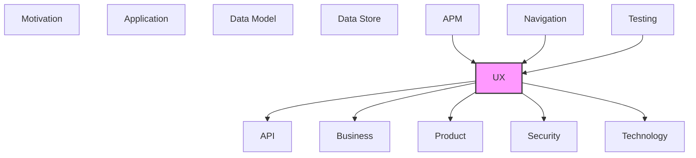

# UX

[← Back to README](../README.md)

User interface components, screens, and user experience elements.

## Report Index

- [Layer Introduction](#layer-introduction)
- [Intra-Layer Relationships](#intra-layer-relationships)
- [Inter-Layer Dependencies](#inter-layer-dependencies)
- [Inter-Layer Relationships Table](#inter-layer-relationships-table)
- [Element Reference](#element-reference)

## Layer Introduction

| Metric                    | Count |
| ------------------------- | ----- |
| Elements                  | 231   |
| Intra-Layer Relationships | 471   |
| Inter-Layer Relationships | 323   |
| Inbound Relationships     | 54    |
| Outbound Relationships    | 269   |

**Cross-Layer References**:

- **Upstream layers**: [APM](./12-apm-layer-report.md), [Navigation](./11-navigation-layer-report.md), [Testing](./13-testing-layer-report.md)
- **Downstream layers**: [API](./07-api-layer-report.md), [Business](./02-business-layer-report.md), [Product](./03-product-layer-report.md), [Security](./04-security-layer-report.md), [Technology](./06-technology-layer-report.md)

## Intra-Layer Relationships

*This layer has >30 elements. Summary table shown instead of diagram.*

| Element                                              | Type               | Relationships |
| ---------------------------------------------------- | ------------------ | ------------- |
| `ux.dataconfig.use-accept-rest`                      | `dataconfig`       | 1             |
| `ux.dataconfig.use-add-class-to-individual`          | `dataconfig`       | 1             |
| `ux.dataconfig.use-add-proposal-individual`          | `dataconfig`       | 1             |
| `ux.dataconfig.use-add-source`                       | `dataconfig`       | 1             |
| `ux.dataconfig.use-all-change-proposals`             | `dataconfig`       | 1             |
| `ux.dataconfig.use-apply-change-proposal`            | `dataconfig`       | 2             |
| `ux.dataconfig.use-apply-reviewed-run`               | `dataconfig`       | 2             |
| `ux.dataconfig.use-apply-run`                        | `dataconfig`       | 6             |
| `ux.dataconfig.use-attribute-definitions-by-ids`     | `dataconfig`       | 6             |
| `ux.dataconfig.use-build-graph`                      | `dataconfig`       | 1             |
| `ux.dataconfig.use-cancel-extraction-run`            | `dataconfig`       | 1             |
| `ux.dataconfig.use-change-proposal`                  | `dataconfig`       | 5             |
| `ux.dataconfig.use-change-proposals`                 | `dataconfig`       | 7             |
| `ux.dataconfig.use-changes`                          | `dataconfig`       | 2             |
| `ux.dataconfig.use-chat-session`                     | `dataconfig`       | 1             |
| `ux.dataconfig.use-chat-status`                      | `dataconfig`       | 2             |
| `ux.dataconfig.use-claim`                            | `dataconfig`       | 1             |
| `ux.dataconfig.use-claims`                           | `dataconfig`       | 1             |
| `ux.dataconfig.use-class`                            | `dataconfig`       | 6             |
| `ux.dataconfig.use-class-attribute-definitions`      | `dataconfig`       | 1             |
| `ux.dataconfig.use-class-counts`                     | `dataconfig`       | 3             |
| `ux.dataconfig.use-class-counts-by-scheme`           | `dataconfig`       | 2             |
| `ux.dataconfig.use-class-search`                     | `dataconfig`       | 7             |
| `ux.dataconfig.use-classes`                          | `dataconfig`       | 8             |
| `ux.dataconfig.use-classes-by-ids`                   | `dataconfig`       | 17            |
| `ux.dataconfig.use-clear-claim-verdict`              | `dataconfig`       | 1             |
| `ux.dataconfig.use-config`                           | `dataconfig`       | 4             |
| `ux.dataconfig.use-create-class`                     | `dataconfig`       | 2             |
| `ux.dataconfig.use-create-configuration`             | `dataconfig`       | 1             |
| `ux.dataconfig.use-create-dataset`                   | `dataconfig`       | 1             |
| `ux.dataconfig.use-create-grounding-workflow`        | `dataconfig`       | 1             |
| `ux.dataconfig.use-create-individual`                | `dataconfig`       | 2             |
| `ux.dataconfig.use-create-property`                  | `dataconfig`       | 2             |
| `ux.dataconfig.use-create-relationship`              | `dataconfig`       | 2             |
| `ux.dataconfig.use-create-scheme`                    | `dataconfig`       | 2             |
| `ux.dataconfig.use-create-taxonomy`                  | `dataconfig`       | 2             |
| `ux.dataconfig.use-datasets`                         | `dataconfig`       | 21            |
| `ux.dataconfig.use-decide-pair`                      | `dataconfig`       | 1             |
| `ux.dataconfig.use-delete-class`                     | `dataconfig`       | 2             |
| `ux.dataconfig.use-delete-configuration`             | `dataconfig`       | 1             |
| `ux.dataconfig.use-delete-dataset`                   | `dataconfig`       | 1             |
| `ux.dataconfig.use-delete-grounding-workflow`        | `dataconfig`       | 2             |
| `ux.dataconfig.use-delete-individual`                | `dataconfig`       | 2             |
| `ux.dataconfig.use-delete-property`                  | `dataconfig`       | 2             |
| `ux.dataconfig.use-delete-relationship`              | `dataconfig`       | 2             |
| `ux.dataconfig.use-delete-scheme`                    | `dataconfig`       | 2             |
| `ux.dataconfig.use-delete-taxonomy`                  | `dataconfig`       | 2             |
| `ux.dataconfig.use-demo-datasets`                    | `dataconfig`       | 1             |
| `ux.dataconfig.use-dr-spec-drift`                    | `dataconfig`       | 1             |
| `ux.dataconfig.use-edge-attributes`                  | `dataconfig`       | 1             |
| `ux.dataconfig.use-entities-by-id`                   | `dataconfig`       | 6             |
| `ux.dataconfig.use-entity-counts`                    | `dataconfig`       | 6             |
| `ux.dataconfig.use-entity-sources`                   | `dataconfig`       | 2             |
| `ux.dataconfig.use-entity-type-query`                | `dataconfig`       | 6             |
| `ux.dataconfig.use-export-bundle`                    | `dataconfig`       | 1             |
| `ux.dataconfig.use-export-claims`                    | `dataconfig`       | 1             |
| `ux.dataconfig.use-export-proposal-decisions`        | `dataconfig`       | 2             |
| `ux.dataconfig.use-extract-source`                   | `dataconfig`       | 1             |
| `ux.dataconfig.use-extraction-examples`              | `dataconfig`       | 3             |
| `ux.dataconfig.use-extraction-review-runs`           | `dataconfig`       | 3             |
| `ux.dataconfig.use-extraction-run`                   | `dataconfig`       | 2             |
| `ux.dataconfig.use-graph-metrics`                    | `dataconfig`       | 1             |
| `ux.dataconfig.use-graph-view`                       | `dataconfig`       | 1             |
| `ux.dataconfig.use-grounding-workflow`               | `dataconfig`       | 1             |
| `ux.dataconfig.use-grounding-workflow-runs`          | `dataconfig`       | 1             |
| `ux.dataconfig.use-grounding-workflows`              | `dataconfig`       | 1             |
| `ux.dataconfig.use-health`                           | `dataconfig`       | 3             |
| `ux.dataconfig.use-individual`                       | `dataconfig`       | 2             |
| `ux.dataconfig.use-individual-extraction-candidates` | `dataconfig`       | 3             |
| `ux.dataconfig.use-individual-inherited-properties`  | `dataconfig`       | 1             |
| `ux.dataconfig.use-individual-search`                | `dataconfig`       | 1             |
| `ux.dataconfig.use-individuals`                      | `dataconfig`       | 8             |
| `ux.dataconfig.use-individuals-by-ids`               | `dataconfig`       | 6             |
| `ux.dataconfig.use-individuals-in-classes`           | `dataconfig`       | 1             |
| `ux.dataconfig.use-load-demo-dataset`                | `dataconfig`       | 1             |
| `ux.dataconfig.use-mcp-connection`                   | `dataconfig`       | 1             |
| `ux.dataconfig.use-move-class`                       | `dataconfig`       | 2             |
| `ux.dataconfig.use-move-scheme`                      | `dataconfig`       | 1             |
| `ux.dataconfig.use-parameter-bounds`                 | `dataconfig`       | 1             |
| `ux.dataconfig.use-pipeline-candidates`              | `dataconfig`       | 5             |
| `ux.dataconfig.use-pipeline-configurations`          | `dataconfig`       | 10            |
| `ux.dataconfig.use-pipeline-implementations`         | `dataconfig`       | 11            |
| `ux.dataconfig.use-pipeline-run`                     | `dataconfig`       | 9             |
| `ux.dataconfig.use-pipeline-run-change-events`       | `dataconfig`       | 1             |
| `ux.dataconfig.use-pipeline-runs`                    | `dataconfig`       | 4             |
| `ux.dataconfig.use-pipeline-types`                   | `dataconfig`       | 2             |
| `ux.dataconfig.use-predicates-by-ids`                | `dataconfig`       | 6             |
| `ux.dataconfig.use-properties`                       | `dataconfig`       | 7             |
| `ux.dataconfig.use-properties-by-ids`                | `dataconfig`       | 13            |
| `ux.dataconfig.use-proposal-comparison`              | `dataconfig`       | 1             |
| `ux.dataconfig.use-proposal-decisions`               | `dataconfig`       | 1             |
| `ux.dataconfig.use-publish-diff-stats`               | `dataconfig`       | 1             |
| `ux.dataconfig.use-publish-taxonomy`                 | `dataconfig`       | 1             |
| `ux.dataconfig.use-pull-sync`                        | `dataconfig`       | 1             |
| `ux.dataconfig.use-push-sync`                        | `dataconfig`       | 1             |
| `ux.dataconfig.use-recognition-preview`              | `dataconfig`       | 2             |
| `ux.dataconfig.use-reference-status`                 | `dataconfig`       | 3             |
| `ux.dataconfig.use-registered-models`                | `dataconfig`       | 1             |
| `ux.dataconfig.use-reject-change-proposal`           | `dataconfig`       | 2             |
| `ux.dataconfig.use-relationships`                    | `dataconfig`       | 4             |
| `ux.dataconfig.use-relationships-by-ids`             | `dataconfig`       | 6             |
| `ux.dataconfig.use-relationships-touching`           | `dataconfig`       | 1             |
| `ux.dataconfig.use-remove-class-from-individual`     | `dataconfig`       | 1             |
| `ux.dataconfig.use-remove-source`                    | `dataconfig`       | 1             |
| `ux.dataconfig.use-reopen-proposal-operations`       | `dataconfig`       | 2             |
| `ux.dataconfig.use-reorder-individual-classes`       | `dataconfig`       | 1             |
| `ux.dataconfig.use-revert-change-proposal`           | `dataconfig`       | 2             |
| `ux.dataconfig.use-revert-run`                       | `dataconfig`       | 3             |
| `ux.dataconfig.use-run-grounding-workflow`           | `dataconfig`       | 2             |
| `ux.dataconfig.use-run-pipeline`                     | `dataconfig`       | 5             |
| `ux.dataconfig.use-run-wizard`                       | `dataconfig`       | 5             |
| `ux.dataconfig.use-schema-extraction-candidates`     | `dataconfig`       | 3             |
| `ux.dataconfig.use-scheme`                           | `dataconfig`       | 3             |
| `ux.dataconfig.use-scheme-counts`                    | `dataconfig`       | 2             |
| `ux.dataconfig.use-scheme-counts-for-taxonomies`     | `dataconfig`       | 1             |
| `ux.dataconfig.use-schemes`                          | `dataconfig`       | 13            |
| `ux.dataconfig.use-schemes-by-ids`                   | `dataconfig`       | 8             |
| `ux.dataconfig.use-set-claim-verdict`                | `dataconfig`       | 1             |
| `ux.dataconfig.use-set-property-relevance`           | `dataconfig`       | 1             |
| `ux.dataconfig.use-shortest-path`                    | `dataconfig`       | 1             |
| `ux.dataconfig.use-source`                           | `dataconfig`       | 6             |
| `ux.dataconfig.use-source-text`                      | `dataconfig`       | 4             |
| `ux.dataconfig.use-sources`                          | `dataconfig`       | 1             |
| `ux.dataconfig.use-sources-by-ids`                   | `dataconfig`       | 2             |
| `ux.dataconfig.use-sparql-query`                     | `dataconfig`       | 1             |
| `ux.dataconfig.use-stats-trends`                     | `dataconfig`       | 1             |
| `ux.dataconfig.use-sync-status`                      | `dataconfig`       | 2             |
| `ux.dataconfig.use-taxonomies`                       | `dataconfig`       | 15            |
| `ux.dataconfig.use-taxonomies-by-ids`                | `dataconfig`       | 6             |
| `ux.dataconfig.use-taxonomy`                         | `dataconfig`       | 7             |
| `ux.dataconfig.use-taxonomy-classes`                 | `dataconfig`       | 3             |
| `ux.dataconfig.use-taxonomy-predicates`              | `dataconfig`       | 3             |
| `ux.dataconfig.use-update-class`                     | `dataconfig`       | 2             |
| `ux.dataconfig.use-update-config`                    | `dataconfig`       | 1             |
| `ux.dataconfig.use-update-configuration`             | `dataconfig`       | 1             |
| `ux.dataconfig.use-update-grounding-workflow`        | `dataconfig`       | 1             |
| `ux.dataconfig.use-update-individual`                | `dataconfig`       | 1             |
| `ux.dataconfig.use-update-property`                  | `dataconfig`       | 1             |
| `ux.dataconfig.use-update-scheme`                    | `dataconfig`       | 2             |
| `ux.dataconfig.use-update-taxonomy`                  | `dataconfig`       | 2             |
| `ux.experiencestate.entity-crud-state`               | `experiencestate`  | 1             |
| `ux.librarycomponent.app-ui-primitives`              | `librarycomponent` | 7             |
| `ux.librarycomponent.editable-field`                 | `librarycomponent` | 1             |
| `ux.librarycomponent.empty-state`                    | `librarycomponent` | 1             |
| `ux.librarycomponent.error-banner`                   | `librarycomponent` | 1             |
| `ux.librarycomponent.error-boundary`                 | `librarycomponent` | 1             |
| `ux.librarycomponent.inline-inspector`               | `librarycomponent` | 1             |
| `ux.librarycomponent.toast`                          | `librarycomponent` | 1             |
| `ux.librarycomponent.type-to-confirm-dialog`         | `librarycomponent` | 1             |
| `ux.statepattern.crud-entity-pattern`                | `statepattern`     | 1             |
| `ux.subview.add-source-panel`                        | `subview`          | 2             |
| `ux.subview.change-history-list`                     | `subview`          | 2             |
| `ux.subview.chat-panel`                              | `subview`          | 5             |
| `ux.subview.claim-inspector`                         | `subview`          | 6             |
| `ux.subview.connection-refinement-review`            | `subview`          | 1             |
| `ux.subview.connection-refinement-wizard`            | `subview`          | 7             |
| `ux.subview.definition-refinement-review`            | `subview`          | 1             |
| `ux.subview.definition-refinement-wizard`            | `subview`          | 7             |
| `ux.subview.entity-navigator`                        | `subview`          | 14            |
| `ux.subview.extract-run-panel`                       | `subview`          | 2             |
| `ux.subview.graph-canvas`                            | `subview`          | 1             |
| `ux.subview.graph-node-inspector`                    | `subview`          | 1             |
| `ux.subview.grounding-review`                        | `subview`          | 1             |
| `ux.subview.hierarchy-tree`                          | `subview`          | 8             |
| `ux.subview.in-use-resolver`                         | `subview`          | 1             |
| `ux.subview.individual-candidate-review`             | `subview`          | 15            |
| `ux.subview.individual-extraction-wizard`            | `subview`          | 7             |
| `ux.subview.mcp-connection-panel`                    | `subview`          | 2             |
| `ux.subview.metrics-panel`                           | `subview`          | 2             |
| `ux.subview.operation-inspector`                     | `subview`          | 12            |
| `ux.subview.path-finder`                             | `subview`          | 3             |
| `ux.subview.review-inspector`                        | `subview`          | 4             |
| `ux.subview.schema-candidate-review`                 | `subview`          | 16            |
| `ux.subview.schema-extraction-wizard`                | `subview`          | 6             |
| `ux.subview.schema-grounding-wizard`                 | `subview`          | 6             |
| `ux.subview.sparql-editor`                           | `subview`          | 2             |
| `ux.subview.status-bar-sync`                         | `subview`          | 2             |
| `ux.subview.sync-status`                             | `subview`          | 5             |
| `ux.uxapplication.context-studio-spa`                | `uxapplication`    | 1             |
| `ux.uxlibrary.heimdall-ui-library`                   | `uxlibrary`        | 1             |
| `ux.uxspec.ontology-editor-ux-spec`                  | `uxspec`           | 2             |
| `ux.view.app-shell-view`                             | `view`             | 10            |
| `ux.view.batch-detail-view`                          | `view`             | 0             |
| `ux.view.benchmark-gold-view`                        | `view`             | 1             |
| `ux.view.cascade-delete-dialog`                      | `view`             | 0             |
| `ux.view.claims-view`                                | `view`             | 10            |
| `ux.view.class-detail-view`                          | `view`             | 20            |
| `ux.view.class-drawer`                               | `view`             | 16            |
| `ux.view.classes-view`                               | `view`             | 7             |
| `ux.view.command-palette`                            | `view`             | 0             |
| `ux.view.concept-scheme-detail-view`                 | `view`             | 8             |
| `ux.view.concept-schemes-index-view`                 | `view`             | 6             |
| `ux.view.concept-schemes-view`                       | `view`             | 0             |
| `ux.view.contact-sheet-view`                         | `view`             | 0             |
| `ux.view.create-dataset-modal`                       | `view`             | 1             |
| `ux.view.create-drawer`                              | `view`             | 17            |
| `ux.view.dashboard-view`                             | `view`             | 9             |
| `ux.view.datasets-view`                              | `view`             | 3             |
| `ux.view.delete-dataset-dialog`                      | `view`             | 0             |
| `ux.view.dr-spec-drift-dialog`                       | `view`             | 1             |
| `ux.view.extract-source-view`                        | `view`             | 9             |
| `ux.view.extraction-review-view`                     | `view`             | 12            |
| `ux.view.graph-view`                                 | `view`             | 9             |
| `ux.view.grounding-workflow-drawer`                  | `view`             | 5             |
| `ux.view.grounding-workflows-view`                   | `view`             | 7             |
| `ux.view.individual-detail-view`                     | `view`             | 11            |
| `ux.view.individual-drawer`                          | `view`             | 13            |
| `ux.view.individuals-view`                           | `view`             | 5             |
| `ux.view.pipeline-runs-view`                         | `view`             | 3             |
| `ux.view.pipelines-view`                             | `view`             | 9             |
| `ux.view.properties-view`                            | `view`             | 4             |
| `ux.view.property-drawer`                            | `view`             | 18            |
| `ux.view.proposal-compare-view`                      | `view`             | 9             |
| `ux.view.proposal-detail-view`                       | `view`             | 25            |
| `ux.view.proposal-review-view`                       | `view`             | 25            |
| `ux.view.proposals-view`                             | `view`             | 2             |
| `ux.view.reference-source-drawer`                    | `view`             | 1             |
| `ux.view.reference-sources-view`                     | `view`             | 1             |
| `ux.view.relationship-drawer`                        | `view`             | 7             |
| `ux.view.relationships-view`                         | `view`             | 7             |
| `ux.view.run-detail-drawer`                          | `view`             | 7             |
| `ux.view.run-wizard-view`                            | `view`             | 5             |
| `ux.view.scheme-drawer`                              | `view`             | 8             |
| `ux.view.settings-view`                              | `view`             | 4             |
| `ux.view.sources-view`                               | `view`             | 6             |
| `ux.view.taxonomies-view`                            | `view`             | 4             |
| `ux.view.taxonomy-detail-view`                       | `view`             | 16            |
| `ux.view.taxonomy-drawer`                            | `view`             | 9             |
| `ux.view.taxonomy-publish-dialog`                    | `view`             | 2             |
| `ux.view.versioning-view`                            | `view`             | 2             |
| `ux.view.welcome-view`                               | `view`             | 1             |

## Inter-Layer Dependencies

## Inter-Layer Relationships Table

| Relationship ID                                         | Source Node                                                       | Dest Node                                                   | Dest Layer   | Predicate    | Cardinality  | Strength |
| ------------------------------------------------------- | ----------------------------------------------------------------- | ----------------------------------------------------------- | ------------ | ------------ | ------------ | -------- |
| `apm.span.monitors.ux.view`                             | `apm.span.api-request-span`                                       | `ux.view.pipelines-view`                                    | `ux`         | `monitors`   | many-to-many | medium   |
| `apm.span.monitors.ux.view`                             | `apm.span.browser-http-client-span`                               | `ux.view.app-shell-view`                                    | `ux`         | `monitors`   | many-to-many | medium   |
| `apm.span.monitors.ux.view`                             | `apm.span.browser-navigation-span`                                | `ux.view.app-shell-view`                                    | `ux`         | `monitors`   | many-to-many | medium   |
| `apm.span.monitors.ux.view`                             | `apm.span.database-query-span`                                    | `ux.view.datasets-view`                                     | `ux`         | `monitors`   | many-to-many | medium   |
| `navigation.route.maps-to.ux.view`                      | `navigation.route.app-shell-route`                                | `ux.view.app-shell-view`                                    | `ux`         | `maps-to`    | many-to-many | medium   |
| `navigation.route.maps-to.ux.view`                      | `navigation.route.batch-detail-route`                             | `ux.view.batch-detail-view`                                 | `ux`         | `maps-to`    | many-to-many | medium   |
| `navigation.route.maps-to.ux.view`                      | `navigation.route.benchmark-gold-route`                           | `ux.view.benchmark-gold-view`                               | `ux`         | `maps-to`    | many-to-many | medium   |
| `navigation.route.maps-to.ux.view`                      | `navigation.route.claims-route`                                   | `ux.view.claims-view`                                       | `ux`         | `maps-to`    | many-to-many | medium   |
| `navigation.route.maps-to.ux.view`                      | `navigation.route.class-detail-route`                             | `ux.view.class-detail-view`                                 | `ux`         | `maps-to`    | many-to-many | medium   |
| `navigation.route.maps-to.ux.view`                      | `navigation.route.classes-route`                                  | `ux.view.classes-view`                                      | `ux`         | `maps-to`    | many-to-many | medium   |
| `navigation.route.maps-to.ux.view`                      | `navigation.route.concept-scheme-detail-route`                    | `ux.view.concept-scheme-detail-view`                        | `ux`         | `maps-to`    | many-to-many | medium   |
| `navigation.route.maps-to.ux.view`                      | `navigation.route.concept-schemes-index-route`                    | `ux.view.concept-schemes-index-view`                        | `ux`         | `maps-to`    | many-to-many | medium   |
| `navigation.route.maps-to.ux.view`                      | `navigation.route.concept-schemes-route`                          | `ux.view.concept-schemes-view`                              | `ux`         | `maps-to`    | many-to-many | medium   |
| `navigation.route.maps-to.ux.view`                      | `navigation.route.contact-sheet-route`                            | `ux.view.contact-sheet-view`                                | `ux`         | `maps-to`    | many-to-many | medium   |
| `navigation.route.maps-to.ux.view`                      | `navigation.route.dashboard-route`                                | `ux.view.dashboard-view`                                    | `ux`         | `maps-to`    | many-to-many | medium   |
| `navigation.route.maps-to.ux.view`                      | `navigation.route.datasets-route`                                 | `ux.view.datasets-view`                                     | `ux`         | `maps-to`    | many-to-many | medium   |
| `navigation.route.maps-to.ux.view`                      | `navigation.route.extract-source-route`                           | `ux.view.extract-source-view`                               | `ux`         | `maps-to`    | many-to-many | medium   |
| `navigation.route.maps-to.ux.view`                      | `navigation.route.extraction-review-route`                        | `ux.view.extraction-review-view`                            | `ux`         | `maps-to`    | many-to-many | medium   |
| `navigation.route.maps-to.ux.view`                      | `navigation.route.graph-route`                                    | `ux.view.graph-view`                                        | `ux`         | `maps-to`    | many-to-many | medium   |
| `navigation.route.maps-to.ux.view`                      | `navigation.route.grounding-workflows-route`                      | `ux.view.grounding-workflows-view`                          | `ux`         | `maps-to`    | many-to-many | medium   |
| `navigation.route.maps-to.ux.view`                      | `navigation.route.individual-detail-route`                        | `ux.view.individual-detail-view`                            | `ux`         | `maps-to`    | many-to-many | medium   |
| `navigation.route.maps-to.ux.view`                      | `navigation.route.individuals-route`                              | `ux.view.individuals-view`                                  | `ux`         | `maps-to`    | many-to-many | medium   |
| `navigation.route.maps-to.ux.view`                      | `navigation.route.pipeline-runs-route`                            | `ux.view.pipeline-runs-view`                                | `ux`         | `maps-to`    | many-to-many | medium   |
| `navigation.route.maps-to.ux.view`                      | `navigation.route.pipelines-route`                                | `ux.view.pipelines-view`                                    | `ux`         | `maps-to`    | many-to-many | medium   |
| `navigation.route.maps-to.ux.view`                      | `navigation.route.properties-route`                               | `ux.view.properties-view`                                   | `ux`         | `maps-to`    | many-to-many | medium   |
| `navigation.route.maps-to.ux.view`                      | `navigation.route.proposal-compare-route`                         | `ux.view.proposal-compare-view`                             | `ux`         | `maps-to`    | many-to-many | medium   |
| `navigation.route.maps-to.ux.view`                      | `navigation.route.proposal-detail-route`                          | `ux.view.proposal-detail-view`                              | `ux`         | `maps-to`    | many-to-many | medium   |
| `navigation.route.maps-to.ux.view`                      | `navigation.route.proposal-review-route`                          | `ux.view.proposal-review-view`                              | `ux`         | `maps-to`    | many-to-many | medium   |
| `navigation.route.maps-to.ux.view`                      | `navigation.route.proposals-route`                                | `ux.view.proposals-view`                                    | `ux`         | `maps-to`    | many-to-many | medium   |
| `navigation.route.maps-to.ux.view`                      | `navigation.route.reference-sources-route`                        | `ux.view.reference-sources-view`                            | `ux`         | `maps-to`    | many-to-many | medium   |
| `navigation.route.maps-to.ux.view`                      | `navigation.route.relationships-route`                            | `ux.view.relationships-view`                                | `ux`         | `maps-to`    | many-to-many | medium   |
| `navigation.route.maps-to.ux.view`                      | `navigation.route.run-wizard-route`                               | `ux.view.run-wizard-view`                                   | `ux`         | `maps-to`    | many-to-many | medium   |
| `navigation.route.maps-to.ux.view`                      | `navigation.route.settings-route`                                 | `ux.view.settings-view`                                     | `ux`         | `maps-to`    | many-to-many | medium   |
| `navigation.route.maps-to.ux.view`                      | `navigation.route.sources-route`                                  | `ux.view.sources-view`                                      | `ux`         | `maps-to`    | many-to-many | medium   |
| `navigation.route.maps-to.ux.view`                      | `navigation.route.taxonomies-route`                               | `ux.view.taxonomies-view`                                   | `ux`         | `maps-to`    | many-to-many | medium   |
| `navigation.route.maps-to.ux.view`                      | `navigation.route.taxonomy-detail-route`                          | `ux.view.taxonomy-detail-view`                              | `ux`         | `maps-to`    | many-to-many | medium   |
| `navigation.route.maps-to.ux.view`                      | `navigation.route.versioning-route`                               | `ux.view.versioning-view`                                   | `ux`         | `maps-to`    | many-to-many | medium   |
| `navigation.route.maps-to.ux.view`                      | `navigation.route.welcome-route`                                  | `ux.view.welcome-view`                                      | `ux`         | `maps-to`    | many-to-many | medium   |
| `testing.testcoveragemodel.covers.ux.uxapplication`     | `testing.testcoveragemodel.context-studio-ux-test-coverage-model` | `ux.uxapplication.context-studio-spa`                       | `ux`         | `covers`     | many-to-many | medium   |
| `testing.testcoveragetarget.covers.ux.view`             | `testing.testcoveragetarget.admin-health`                         | `ux.view.settings-view`                                     | `ux`         | `covers`     | many-to-many | medium   |
| `testing.testcoveragetarget.covers.ux.view`             | `testing.testcoveragetarget.extraction-pipeline`                  | `ux.view.pipelines-view`                                    | `ux`         | `covers`     | many-to-many | medium   |
| `testing.testcoveragetarget.covers.ux.view`             | `testing.testcoveragetarget.graph-analysis`                       | `ux.view.graph-view`                                        | `ux`         | `covers`     | many-to-many | medium   |
| `testing.testcoveragetarget.covers.ux.view`             | `testing.testcoveragetarget.llm-pipeline-execution`               | `ux.view.pipeline-runs-view`                                | `ux`         | `covers`     | many-to-many | medium   |
| `testing.testcoveragetarget.covers.ux.view`             | `testing.testcoveragetarget.playwright-e2e-tests`                 | `ux.view.classes-view`                                      | `ux`         | `covers`     | many-to-many | medium   |
| `testing.testcoveragetarget.covers.ux.view`             | `testing.testcoveragetarget.playwright-e2e-tests`                 | `ux.view.extraction-review-view`                            | `ux`         | `covers`     | many-to-many | medium   |
| `testing.testcoveragetarget.covers.ux.view`             | `testing.testcoveragetarget.playwright-e2e-tests`                 | `ux.view.graph-view`                                        | `ux`         | `covers`     | many-to-many | medium   |
| `testing.testcoveragetarget.covers.ux.view`             | `testing.testcoveragetarget.playwright-e2e-tests`                 | `ux.view.proposals-view`                                    | `ux`         | `covers`     | many-to-many | medium   |
| `testing.testcoveragetarget.covers.ux.librarycomponent` | `testing.testcoveragetarget.ux-component-tests`                   | `ux.librarycomponent.app-ui-primitives`                     | `ux`         | `covers`     | many-to-many | medium   |
| `testing.testcoveragetarget.covers.ux.view`             | `testing.testcoveragetarget.ux-component-tests`                   | `ux.view.proposal-detail-view`                              | `ux`         | `covers`     | many-to-many | medium   |
| `testing.testcoveragetarget.covers.ux.view`             | `testing.testcoveragetarget.ux-component-tests`                   | `ux.view.proposal-review-view`                              | `ux`         | `covers`     | many-to-many | medium   |
| `testing.testcoveragetarget.covers.ux.view`             | `testing.testcoveragetarget.ux-component-tests`                   | `ux.view.run-detail-drawer`                                 | `ux`         | `covers`     | many-to-many | medium   |
| `testing.testcoveragetarget.covers.ux.view`             | `testing.testcoveragetarget.ux-route-tests`                       | `ux.view.dashboard-view`                                    | `ux`         | `covers`     | many-to-many | medium   |
| `testing.testcoveragetarget.covers.ux.view`             | `testing.testcoveragetarget.ux-route-tests`                       | `ux.view.individuals-view`                                  | `ux`         | `covers`     | many-to-many | medium   |
| `testing.testcoveragetarget.covers.ux.view`             | `testing.testcoveragetarget.versioning-workflow`                  | `ux.view.datasets-view`                                     | `ux`         | `covers`     | many-to-many | medium   |
| `ux.dataconfig.maps-to.api.requestbody`                 | `ux.dataconfig.use-accept-rest`                                   | `api.requestbody.accept-rest-request`                       | `api`        | `maps-to`    | many-to-many | medium   |
| `ux.dataconfig.maps-to.api.response`                    | `ux.dataconfig.use-accept-rest`                                   | `api.response.accept-rest-response`                         | `api`        | `maps-to`    | many-to-many | medium   |
| `ux.dataconfig.maps-to.api.requestbody`                 | `ux.dataconfig.use-add-class-to-individual`                       | `api.requestbody.individual-class-request`                  | `api`        | `maps-to`    | many-to-many | medium   |
| `ux.dataconfig.maps-to.api.response`                    | `ux.dataconfig.use-add-class-to-individual`                       | `api.response.individual-response`                          | `api`        | `maps-to`    | many-to-many | medium   |
| `ux.dataconfig.maps-to.api.requestbody`                 | `ux.dataconfig.use-add-proposal-individual`                       | `api.requestbody.add-individual-request`                    | `api`        | `maps-to`    | many-to-many | medium   |
| `ux.dataconfig.maps-to.api.response`                    | `ux.dataconfig.use-add-proposal-individual`                       | `api.response.change-proposal-response`                     | `api`        | `maps-to`    | many-to-many | medium   |
| `ux.dataconfig.maps-to.api.requestbody`                 | `ux.dataconfig.use-add-source`                                    | `api.requestbody.add-source-request`                        | `api`        | `maps-to`    | many-to-many | medium   |
| `ux.dataconfig.maps-to.api.response`                    | `ux.dataconfig.use-add-source`                                    | `api.response.source-response`                              | `api`        | `maps-to`    | many-to-many | medium   |
| `ux.dataconfig.maps-to.api.response`                    | `ux.dataconfig.use-all-change-proposals`                          | `api.response.change-proposal-response`                     | `api`        | `maps-to`    | many-to-many | medium   |
| `ux.dataconfig.maps-to.api.requestbody`                 | `ux.dataconfig.use-apply-change-proposal`                         | `api.requestbody.change-proposal-apply-request`             | `api`        | `maps-to`    | many-to-many | medium   |
| `ux.dataconfig.maps-to.api.response`                    | `ux.dataconfig.use-apply-change-proposal`                         | `api.response.change-proposal-response`                     | `api`        | `maps-to`    | many-to-many | medium   |
| `ux.dataconfig.maps-to.api.response`                    | `ux.dataconfig.use-apply-reviewed-run`                            | `api.response.apply-run-response`                           | `api`        | `maps-to`    | many-to-many | medium   |
| `ux.dataconfig.maps-to.api.requestbody`                 | `ux.dataconfig.use-apply-run`                                     | `api.requestbody.apply-run-request`                         | `api`        | `maps-to`    | many-to-many | medium   |
| `ux.dataconfig.maps-to.api.response`                    | `ux.dataconfig.use-apply-run`                                     | `api.response.apply-run-response`                           | `api`        | `maps-to`    | many-to-many | medium   |
| `ux.dataconfig.maps-to.api.response`                    | `ux.dataconfig.use-attribute-definitions-by-ids`                  | `api.response.attribute-definition-response`                | `api`        | `maps-to`    | many-to-many | medium   |
| `ux.dataconfig.maps-to.api.response`                    | `ux.dataconfig.use-build-graph`                                   | `api.response.knowledge-graph-response`                     | `api`        | `maps-to`    | many-to-many | medium   |
| `ux.dataconfig.maps-to.api.response`                    | `ux.dataconfig.use-cancel-extraction-run`                         | `api.response.pipeline-run-response`                        | `api`        | `maps-to`    | many-to-many | medium   |
| `ux.dataconfig.maps-to.api.response`                    | `ux.dataconfig.use-change-proposal`                               | `api.response.change-proposal-response`                     | `api`        | `maps-to`    | many-to-many | medium   |
| `ux.dataconfig.maps-to.api.response`                    | `ux.dataconfig.use-change-proposals`                              | `api.response.change-proposal-response`                     | `api`        | `maps-to`    | many-to-many | medium   |
| `ux.dataconfig.maps-to.api.response`                    | `ux.dataconfig.use-changes`                                       | `api.response.change-history-response`                      | `api`        | `maps-to`    | many-to-many | medium   |
| `ux.dataconfig.maps-to.api.response`                    | `ux.dataconfig.use-chat-session`                                  | `api.response.chat-status-response`                         | `api`        | `maps-to`    | many-to-many | medium   |
| `ux.dataconfig.maps-to.api.response`                    | `ux.dataconfig.use-chat-session`                                  | `api.response.conversation-detail-response`                 | `api`        | `maps-to`    | many-to-many | medium   |
| `ux.dataconfig.maps-to.api.response`                    | `ux.dataconfig.use-chat-session`                                  | `api.response.conversation-response`                        | `api`        | `maps-to`    | many-to-many | medium   |
| `ux.dataconfig.maps-to.api.response`                    | `ux.dataconfig.use-chat-status`                                   | `api.response.chat-status-response`                         | `api`        | `maps-to`    | many-to-many | medium   |
| `ux.dataconfig.maps-to.api.response`                    | `ux.dataconfig.use-claim`                                         | `api.response.claim-response`                               | `api`        | `maps-to`    | many-to-many | medium   |
| `ux.dataconfig.maps-to.api.response`                    | `ux.dataconfig.use-claims`                                        | `api.response.claim-response`                               | `api`        | `maps-to`    | many-to-many | medium   |
| `ux.dataconfig.maps-to.api.response`                    | `ux.dataconfig.use-class-attribute-definitions`                   | `api.response.attribute-definition-response`                | `api`        | `maps-to`    | many-to-many | medium   |
| `ux.dataconfig.maps-to.api.response`                    | `ux.dataconfig.use-class-counts-by-scheme`                        | `api.response.class-response`                               | `api`        | `maps-to`    | many-to-many | medium   |
| `ux.dataconfig.maps-to.api.response`                    | `ux.dataconfig.use-class-counts`                                  | `api.response.class-counts-response`                        | `api`        | `maps-to`    | many-to-many | medium   |
| `ux.dataconfig.maps-to.api.response`                    | `ux.dataconfig.use-class`                                         | `api.response.class-response`                               | `api`        | `maps-to`    | many-to-many | medium   |
| `ux.dataconfig.maps-to.api.response`                    | `ux.dataconfig.use-class-search`                                  | `api.response.class-response`                               | `api`        | `maps-to`    | many-to-many | medium   |
| `ux.dataconfig.maps-to.api.response`                    | `ux.dataconfig.use-classes-by-ids`                                | `api.response.class-response`                               | `api`        | `maps-to`    | many-to-many | medium   |
| `ux.dataconfig.maps-to.api.response`                    | `ux.dataconfig.use-classes`                                       | `api.response.class-response`                               | `api`        | `maps-to`    | many-to-many | medium   |
| `ux.dataconfig.maps-to.api.response`                    | `ux.dataconfig.use-clear-claim-verdict`                           | `api.response.claim-response`                               | `api`        | `maps-to`    | many-to-many | medium   |
| `ux.dataconfig.maps-to.api.response`                    | `ux.dataconfig.use-config`                                        | `api.response.app-configuration-response`                   | `api`        | `maps-to`    | many-to-many | medium   |
| `ux.dataconfig.maps-to.api.requestbody`                 | `ux.dataconfig.use-create-class`                                  | `api.requestbody.class-create-request`                      | `api`        | `maps-to`    | many-to-many | medium   |
| `ux.dataconfig.maps-to.api.response`                    | `ux.dataconfig.use-create-class`                                  | `api.response.class-response`                               | `api`        | `maps-to`    | many-to-many | medium   |
| `ux.dataconfig.maps-to.api.requestbody`                 | `ux.dataconfig.use-create-configuration`                          | `api.requestbody.pipeline-configuration-create-request`     | `api`        | `maps-to`    | many-to-many | medium   |
| `ux.dataconfig.maps-to.api.response`                    | `ux.dataconfig.use-create-configuration`                          | `api.response.pipeline-configuration-response`              | `api`        | `maps-to`    | many-to-many | medium   |
| `ux.dataconfig.maps-to.api.requestbody`                 | `ux.dataconfig.use-create-dataset`                                | `api.requestbody.dataset-create-request`                    | `api`        | `maps-to`    | many-to-many | medium   |
| `ux.dataconfig.maps-to.api.response`                    | `ux.dataconfig.use-create-dataset`                                | `api.response.dataset-response`                             | `api`        | `maps-to`    | many-to-many | medium   |
| `ux.dataconfig.maps-to.api.requestbody`                 | `ux.dataconfig.use-create-grounding-workflow`                     | `api.requestbody.grounding-workflow-create`                 | `api`        | `maps-to`    | many-to-many | medium   |
| `ux.dataconfig.maps-to.api.response`                    | `ux.dataconfig.use-create-grounding-workflow`                     | `api.response.grounding-workflow-response`                  | `api`        | `maps-to`    | many-to-many | medium   |
| `ux.dataconfig.maps-to.api.requestbody`                 | `ux.dataconfig.use-create-individual`                             | `api.requestbody.individual-create-request`                 | `api`        | `maps-to`    | many-to-many | medium   |
| `ux.dataconfig.maps-to.api.response`                    | `ux.dataconfig.use-create-individual`                             | `api.response.individual-response`                          | `api`        | `maps-to`    | many-to-many | medium   |
| `ux.dataconfig.maps-to.api.requestbody`                 | `ux.dataconfig.use-create-property`                               | `api.requestbody.property-definition-create-request`        | `api`        | `maps-to`    | many-to-many | medium   |
| `ux.dataconfig.maps-to.api.response`                    | `ux.dataconfig.use-create-property`                               | `api.response.property-definition-response`                 | `api`        | `maps-to`    | many-to-many | medium   |
| `ux.dataconfig.maps-to.api.requestbody`                 | `ux.dataconfig.use-create-relationship`                           | `api.requestbody.relationship-create-request`               | `api`        | `maps-to`    | many-to-many | medium   |
| `ux.dataconfig.maps-to.api.response`                    | `ux.dataconfig.use-create-relationship`                           | `api.response.relationship-response`                        | `api`        | `maps-to`    | many-to-many | medium   |
| `ux.dataconfig.maps-to.api.requestbody`                 | `ux.dataconfig.use-create-scheme`                                 | `api.requestbody.concept-scheme-create-request`             | `api`        | `maps-to`    | many-to-many | medium   |
| `ux.dataconfig.maps-to.api.response`                    | `ux.dataconfig.use-create-scheme`                                 | `api.response.concept-scheme-response`                      | `api`        | `maps-to`    | many-to-many | medium   |
| `ux.dataconfig.maps-to.api.requestbody`                 | `ux.dataconfig.use-create-taxonomy`                               | `api.requestbody.taxonomy-create-request`                   | `api`        | `maps-to`    | many-to-many | medium   |
| `ux.dataconfig.maps-to.api.response`                    | `ux.dataconfig.use-create-taxonomy`                               | `api.response.taxonomy-response`                            | `api`        | `maps-to`    | many-to-many | medium   |
| `ux.dataconfig.maps-to.api.response`                    | `ux.dataconfig.use-datasets`                                      | `api.response.dataset-response`                             | `api`        | `maps-to`    | many-to-many | medium   |
| `ux.dataconfig.maps-to.api.requestbody`                 | `ux.dataconfig.use-decide-pair`                                   | `api.requestbody.pair-decision-request`                     | `api`        | `maps-to`    | many-to-many | medium   |
| `ux.dataconfig.maps-to.api.response`                    | `ux.dataconfig.use-decide-pair`                                   | `api.response.pair-decision-response`                       | `api`        | `maps-to`    | many-to-many | medium   |
| `ux.dataconfig.maps-to.api.response`                    | `ux.dataconfig.use-delete-dataset`                                | `api.response.dataset-deletion-response`                    | `api`        | `maps-to`    | many-to-many | medium   |
| `ux.dataconfig.maps-to.api.response`                    | `ux.dataconfig.use-demo-datasets`                                 | `api.response.demo-dataset-descriptor-response`             | `api`        | `maps-to`    | many-to-many | medium   |
| `ux.dataconfig.maps-to.api.requestbody`                 | `ux.dataconfig.use-dr-spec-drift`                                 | `api.requestbody.dr-spec-drift-request`                     | `api`        | `maps-to`    | many-to-many | medium   |
| `ux.dataconfig.maps-to.api.response`                    | `ux.dataconfig.use-dr-spec-drift`                                 | `api.response.drift-response`                               | `api`        | `maps-to`    | many-to-many | medium   |
| `ux.dataconfig.maps-to.api.response`                    | `ux.dataconfig.use-edge-attributes`                               | `api.response.attribute-definition-response`                | `api`        | `maps-to`    | many-to-many | medium   |
| `ux.dataconfig.maps-to.api.response`                    | `ux.dataconfig.use-entities-by-id`                                | `api.response.class-response`                               | `api`        | `maps-to`    | many-to-many | medium   |
| `ux.dataconfig.maps-to.api.response`                    | `ux.dataconfig.use-entities-by-id`                                | `api.response.concept-scheme-response`                      | `api`        | `maps-to`    | many-to-many | medium   |
| `ux.dataconfig.maps-to.api.response`                    | `ux.dataconfig.use-entities-by-id`                                | `api.response.individual-response`                          | `api`        | `maps-to`    | many-to-many | medium   |
| `ux.dataconfig.maps-to.api.response`                    | `ux.dataconfig.use-entities-by-id`                                | `api.response.property-definition-response`                 | `api`        | `maps-to`    | many-to-many | medium   |
| `ux.dataconfig.maps-to.api.response`                    | `ux.dataconfig.use-entities-by-id`                                | `api.response.taxonomy-response`                            | `api`        | `maps-to`    | many-to-many | medium   |
| `ux.dataconfig.maps-to.api.response`                    | `ux.dataconfig.use-entity-counts`                                 | `api.response.class-response`                               | `api`        | `maps-to`    | many-to-many | medium   |
| `ux.dataconfig.maps-to.api.response`                    | `ux.dataconfig.use-entity-counts`                                 | `api.response.concept-scheme-response`                      | `api`        | `maps-to`    | many-to-many | medium   |
| `ux.dataconfig.maps-to.api.response`                    | `ux.dataconfig.use-entity-counts`                                 | `api.response.individual-response`                          | `api`        | `maps-to`    | many-to-many | medium   |
| `ux.dataconfig.maps-to.api.response`                    | `ux.dataconfig.use-entity-counts`                                 | `api.response.property-definition-response`                 | `api`        | `maps-to`    | many-to-many | medium   |
| `ux.dataconfig.maps-to.api.response`                    | `ux.dataconfig.use-entity-counts`                                 | `api.response.relationship-response`                        | `api`        | `maps-to`    | many-to-many | medium   |
| `ux.dataconfig.maps-to.api.response`                    | `ux.dataconfig.use-entity-counts`                                 | `api.response.taxonomy-response`                            | `api`        | `maps-to`    | many-to-many | medium   |
| `ux.dataconfig.maps-to.api.response`                    | `ux.dataconfig.use-entity-sources`                                | `api.response.entity-source-response`                       | `api`        | `maps-to`    | many-to-many | medium   |
| `ux.dataconfig.maps-to.api.response`                    | `ux.dataconfig.use-entity-type-query`                             | `api.response.class-response`                               | `api`        | `maps-to`    | many-to-many | medium   |
| `ux.dataconfig.maps-to.api.response`                    | `ux.dataconfig.use-entity-type-query`                             | `api.response.concept-scheme-response`                      | `api`        | `maps-to`    | many-to-many | medium   |
| `ux.dataconfig.maps-to.api.response`                    | `ux.dataconfig.use-entity-type-query`                             | `api.response.individual-response`                          | `api`        | `maps-to`    | many-to-many | medium   |
| `ux.dataconfig.maps-to.api.response`                    | `ux.dataconfig.use-entity-type-query`                             | `api.response.property-definition-response`                 | `api`        | `maps-to`    | many-to-many | medium   |
| `ux.dataconfig.maps-to.api.response`                    | `ux.dataconfig.use-entity-type-query`                             | `api.response.taxonomy-response`                            | `api`        | `maps-to`    | many-to-many | medium   |
| `ux.dataconfig.maps-to.api.response`                    | `ux.dataconfig.use-export-proposal-decisions`                     | `api.response.dr-decision-response`                         | `api`        | `maps-to`    | many-to-many | medium   |
| `ux.dataconfig.maps-to.api.requestbody`                 | `ux.dataconfig.use-extract-source`                                | `api.requestbody.source-extract-request`                    | `api`        | `maps-to`    | many-to-many | medium   |
| `ux.dataconfig.maps-to.api.response`                    | `ux.dataconfig.use-extract-source`                                | `api.response.source-extract-response`                      | `api`        | `maps-to`    | many-to-many | medium   |
| `ux.dataconfig.maps-to.api.response`                    | `ux.dataconfig.use-extraction-examples`                           | `api.response.extraction-example-response`                  | `api`        | `maps-to`    | many-to-many | medium   |
| `ux.dataconfig.maps-to.api.response`                    | `ux.dataconfig.use-extraction-review-runs`                        | `api.response.pipeline-run-response`                        | `api`        | `maps-to`    | many-to-many | medium   |
| `ux.dataconfig.maps-to.api.response`                    | `ux.dataconfig.use-extraction-run`                                | `api.response.pipeline-run-response`                        | `api`        | `maps-to`    | many-to-many | medium   |
| `ux.dataconfig.maps-to.api.response`                    | `ux.dataconfig.use-graph-metrics`                                 | `api.response.graph-metrics-response`                       | `api`        | `maps-to`    | many-to-many | medium   |
| `ux.dataconfig.maps-to.api.response`                    | `ux.dataconfig.use-graph-view`                                    | `api.response.graph-view-response`                          | `api`        | `maps-to`    | many-to-many | medium   |
| `ux.dataconfig.maps-to.api.response`                    | `ux.dataconfig.use-grounding-workflow`                            | `api.response.grounding-workflow-response`                  | `api`        | `maps-to`    | many-to-many | medium   |
| `ux.dataconfig.maps-to.api.response`                    | `ux.dataconfig.use-grounding-workflow-runs`                       | `api.response.workflow-run-response`                        | `api`        | `maps-to`    | many-to-many | medium   |
| `ux.dataconfig.maps-to.api.response`                    | `ux.dataconfig.use-grounding-workflows`                           | `api.response.grounding-workflow-response`                  | `api`        | `maps-to`    | many-to-many | medium   |
| `ux.dataconfig.maps-to.api.response`                    | `ux.dataconfig.use-health`                                        | `api.response.system-health-response`                       | `api`        | `maps-to`    | many-to-many | medium   |
| `ux.dataconfig.maps-to.api.response`                    | `ux.dataconfig.use-individual-extraction-candidates`              | `api.response.candidate-item`                               | `api`        | `maps-to`    | many-to-many | medium   |
| `ux.dataconfig.maps-to.api.response`                    | `ux.dataconfig.use-individual-inherited-properties`               | `api.response.data-property-value-response`                 | `api`        | `maps-to`    | many-to-many | medium   |
| `ux.dataconfig.maps-to.api.response`                    | `ux.dataconfig.use-individual`                                    | `api.response.individual-response`                          | `api`        | `maps-to`    | many-to-many | medium   |
| `ux.dataconfig.maps-to.api.response`                    | `ux.dataconfig.use-individual-search`                             | `api.response.individual-response`                          | `api`        | `maps-to`    | many-to-many | medium   |
| `ux.dataconfig.maps-to.api.response`                    | `ux.dataconfig.use-individuals-by-ids`                            | `api.response.individual-response`                          | `api`        | `maps-to`    | many-to-many | medium   |
| `ux.dataconfig.maps-to.api.response`                    | `ux.dataconfig.use-individuals-in-classes`                        | `api.response.individual-response`                          | `api`        | `maps-to`    | many-to-many | medium   |
| `ux.dataconfig.maps-to.api.response`                    | `ux.dataconfig.use-individuals`                                   | `api.response.individual-response`                          | `api`        | `maps-to`    | many-to-many | medium   |
| `ux.dataconfig.maps-to.api.response`                    | `ux.dataconfig.use-load-demo-dataset`                             | `api.response.demo-dataset-load-response`                   | `api`        | `maps-to`    | many-to-many | medium   |
| `ux.dataconfig.maps-to.api.response`                    | `ux.dataconfig.use-mcp-connection`                                | `api.response.mcp-connection-response`                      | `api`        | `maps-to`    | many-to-many | medium   |
| `ux.dataconfig.maps-to.api.requestbody`                 | `ux.dataconfig.use-move-class`                                    | `api.requestbody.class-move-request`                        | `api`        | `maps-to`    | many-to-many | medium   |
| `ux.dataconfig.maps-to.api.response`                    | `ux.dataconfig.use-move-class`                                    | `api.response.class-response`                               | `api`        | `maps-to`    | many-to-many | medium   |
| `ux.dataconfig.maps-to.api.requestbody`                 | `ux.dataconfig.use-move-scheme`                                   | `api.requestbody.concept-scheme-update-request`             | `api`        | `maps-to`    | many-to-many | medium   |
| `ux.dataconfig.maps-to.api.response`                    | `ux.dataconfig.use-move-scheme`                                   | `api.response.concept-scheme-response`                      | `api`        | `maps-to`    | many-to-many | medium   |
| `ux.dataconfig.maps-to.api.response`                    | `ux.dataconfig.use-pipeline-candidates`                           | `api.response.candidate-item`                               | `api`        | `maps-to`    | many-to-many | medium   |
| `ux.dataconfig.maps-to.api.response`                    | `ux.dataconfig.use-pipeline-configurations`                       | `api.response.pipeline-configuration-response`              | `api`        | `maps-to`    | many-to-many | medium   |
| `ux.dataconfig.maps-to.api.response`                    | `ux.dataconfig.use-pipeline-implementations`                      | `api.response.implementation-response`                      | `api`        | `maps-to`    | many-to-many | medium   |
| `ux.dataconfig.maps-to.api.response`                    | `ux.dataconfig.use-pipeline-run-change-events`                    | `api.response.versioning-change-event-response`             | `api`        | `maps-to`    | many-to-many | medium   |
| `ux.dataconfig.maps-to.api.response`                    | `ux.dataconfig.use-pipeline-run`                                  | `api.response.pipeline-run-response`                        | `api`        | `maps-to`    | many-to-many | medium   |
| `ux.dataconfig.maps-to.api.response`                    | `ux.dataconfig.use-pipeline-runs`                                 | `api.response.pipeline-run-response`                        | `api`        | `maps-to`    | many-to-many | medium   |
| `ux.dataconfig.maps-to.api.response`                    | `ux.dataconfig.use-pipeline-types`                                | `api.response.pipeline-type-response`                       | `api`        | `maps-to`    | many-to-many | medium   |
| `ux.dataconfig.maps-to.api.response`                    | `ux.dataconfig.use-predicates-by-ids`                             | `api.response.predicate-response`                           | `api`        | `maps-to`    | many-to-many | medium   |
| `ux.dataconfig.maps-to.api.response`                    | `ux.dataconfig.use-properties-by-ids`                             | `api.response.property-definition-response`                 | `api`        | `maps-to`    | many-to-many | medium   |
| `ux.dataconfig.maps-to.api.response`                    | `ux.dataconfig.use-properties`                                    | `api.response.property-definition-response`                 | `api`        | `maps-to`    | many-to-many | medium   |
| `ux.dataconfig.maps-to.api.response`                    | `ux.dataconfig.use-proposal-comparison`                           | `api.response.proposal-comparison-response`                 | `api`        | `maps-to`    | many-to-many | medium   |
| `ux.dataconfig.maps-to.api.response`                    | `ux.dataconfig.use-proposal-decisions`                            | `api.response.gold-decision-response`                       | `api`        | `maps-to`    | many-to-many | medium   |
| `ux.dataconfig.maps-to.api.response`                    | `ux.dataconfig.use-publish-diff-stats`                            | `api.response.publish-diff-stats`                           | `api`        | `maps-to`    | many-to-many | medium   |
| `ux.dataconfig.maps-to.api.requestbody`                 | `ux.dataconfig.use-publish-taxonomy`                              | `api.requestbody.taxonomy-publish-request`                  | `api`        | `maps-to`    | many-to-many | medium   |
| `ux.dataconfig.maps-to.api.response`                    | `ux.dataconfig.use-publish-taxonomy`                              | `api.response.taxonomy-response`                            | `api`        | `maps-to`    | many-to-many | medium   |
| `ux.dataconfig.maps-to.api.response`                    | `ux.dataconfig.use-pull-sync`                                     | `api.response.sync-result-response`                         | `api`        | `maps-to`    | many-to-many | medium   |
| `ux.dataconfig.maps-to.api.response`                    | `ux.dataconfig.use-push-sync`                                     | `api.response.sync-result-response`                         | `api`        | `maps-to`    | many-to-many | medium   |
| `ux.dataconfig.maps-to.api.response`                    | `ux.dataconfig.use-recognition-preview`                           | `api.response.recognition-preview-response`                 | `api`        | `maps-to`    | many-to-many | medium   |
| `ux.dataconfig.maps-to.api.response`                    | `ux.dataconfig.use-reference-status`                              | `api.response.reference-status-response-schema`             | `api`        | `maps-to`    | many-to-many | medium   |
| `ux.dataconfig.maps-to.api.response`                    | `ux.dataconfig.use-registered-models`                             | `api.response.pipeline-configuration-response`              | `api`        | `maps-to`    | many-to-many | medium   |
| `ux.dataconfig.maps-to.api.requestbody`                 | `ux.dataconfig.use-reject-change-proposal`                        | `api.requestbody.change-proposal-reject-request`            | `api`        | `maps-to`    | many-to-many | medium   |
| `ux.dataconfig.maps-to.api.response`                    | `ux.dataconfig.use-reject-change-proposal`                        | `api.response.change-proposal-response`                     | `api`        | `maps-to`    | many-to-many | medium   |
| `ux.dataconfig.maps-to.api.response`                    | `ux.dataconfig.use-relationships-by-ids`                          | `api.response.relationship-response`                        | `api`        | `maps-to`    | many-to-many | medium   |
| `ux.dataconfig.maps-to.api.response`                    | `ux.dataconfig.use-relationships`                                 | `api.response.relationship-response`                        | `api`        | `maps-to`    | many-to-many | medium   |
| `ux.dataconfig.maps-to.api.response`                    | `ux.dataconfig.use-relationships-touching`                        | `api.response.relationship-response`                        | `api`        | `maps-to`    | many-to-many | medium   |
| `ux.dataconfig.maps-to.api.response`                    | `ux.dataconfig.use-remove-source`                                 | `api.response.source-response`                              | `api`        | `maps-to`    | many-to-many | medium   |
| `ux.dataconfig.maps-to.api.requestbody`                 | `ux.dataconfig.use-reopen-proposal-operations`                    | `api.requestbody.change-proposal-reopen-request`            | `api`        | `maps-to`    | many-to-many | medium   |
| `ux.dataconfig.maps-to.api.response`                    | `ux.dataconfig.use-reopen-proposal-operations`                    | `api.response.change-proposal-response`                     | `api`        | `maps-to`    | many-to-many | medium   |
| `ux.dataconfig.maps-to.api.requestbody`                 | `ux.dataconfig.use-reorder-individual-classes`                    | `api.requestbody.individual-class-list-request`             | `api`        | `maps-to`    | many-to-many | medium   |
| `ux.dataconfig.maps-to.api.response`                    | `ux.dataconfig.use-reorder-individual-classes`                    | `api.response.individual-response`                          | `api`        | `maps-to`    | many-to-many | medium   |
| `ux.dataconfig.maps-to.api.response`                    | `ux.dataconfig.use-revert-change-proposal`                        | `api.response.change-proposal-revert-response`              | `api`        | `maps-to`    | many-to-many | medium   |
| `ux.dataconfig.maps-to.api.response`                    | `ux.dataconfig.use-revert-run`                                    | `api.response.revert-run-response`                          | `api`        | `maps-to`    | many-to-many | medium   |
| `ux.dataconfig.maps-to.api.response`                    | `ux.dataconfig.use-run-grounding-workflow`                        | `api.response.workflow-run-response`                        | `api`        | `maps-to`    | many-to-many | medium   |
| `ux.dataconfig.maps-to.api.requestbody`                 | `ux.dataconfig.use-run-pipeline`                                  | `api.requestbody.pipeline-run-request`                      | `api`        | `maps-to`    | many-to-many | medium   |
| `ux.dataconfig.maps-to.api.response`                    | `ux.dataconfig.use-run-pipeline`                                  | `api.response.pipeline-run-response`                        | `api`        | `maps-to`    | many-to-many | medium   |
| `ux.dataconfig.maps-to.api.response`                    | `ux.dataconfig.use-run-wizard`                                    | `api.response.pipeline-run-response`                        | `api`        | `maps-to`    | many-to-many | medium   |
| `ux.dataconfig.maps-to.api.response`                    | `ux.dataconfig.use-schema-extraction-candidates`                  | `api.response.candidate-item`                               | `api`        | `maps-to`    | many-to-many | medium   |
| `ux.dataconfig.maps-to.api.response`                    | `ux.dataconfig.use-scheme-counts-for-taxonomies`                  | `api.response.scheme-counts-response`                       | `api`        | `maps-to`    | many-to-many | medium   |
| `ux.dataconfig.maps-to.api.response`                    | `ux.dataconfig.use-scheme-counts`                                 | `api.response.scheme-counts-response`                       | `api`        | `maps-to`    | many-to-many | medium   |
| `ux.dataconfig.maps-to.api.response`                    | `ux.dataconfig.use-scheme`                                        | `api.response.concept-scheme-response`                      | `api`        | `maps-to`    | many-to-many | medium   |
| `ux.dataconfig.maps-to.api.response`                    | `ux.dataconfig.use-schemes-by-ids`                                | `api.response.concept-scheme-response`                      | `api`        | `maps-to`    | many-to-many | medium   |
| `ux.dataconfig.maps-to.api.response`                    | `ux.dataconfig.use-schemes`                                       | `api.response.concept-scheme-response`                      | `api`        | `maps-to`    | many-to-many | medium   |
| `ux.dataconfig.maps-to.api.requestbody`                 | `ux.dataconfig.use-set-claim-verdict`                             | `api.requestbody.claim-verdict-request`                     | `api`        | `maps-to`    | many-to-many | medium   |
| `ux.dataconfig.maps-to.api.response`                    | `ux.dataconfig.use-set-claim-verdict`                             | `api.response.claim-response`                               | `api`        | `maps-to`    | many-to-many | medium   |
| `ux.dataconfig.maps-to.api.requestbody`                 | `ux.dataconfig.use-set-property-relevance`                        | `api.requestbody.property-definition-update-request`        | `api`        | `maps-to`    | many-to-many | medium   |
| `ux.dataconfig.maps-to.api.response`                    | `ux.dataconfig.use-set-property-relevance`                        | `api.response.property-definition-response`                 | `api`        | `maps-to`    | many-to-many | medium   |
| `ux.dataconfig.maps-to.api.response`                    | `ux.dataconfig.use-shortest-path`                                 | `api.response.path-result-response`                         | `api`        | `maps-to`    | many-to-many | medium   |
| `ux.dataconfig.maps-to.api.response`                    | `ux.dataconfig.use-source`                                        | `api.response.source-response`                              | `api`        | `maps-to`    | many-to-many | medium   |
| `ux.dataconfig.maps-to.api.response`                    | `ux.dataconfig.use-source-text`                                   | `api.response.source-text-response`                         | `api`        | `maps-to`    | many-to-many | medium   |
| `ux.dataconfig.maps-to.api.response`                    | `ux.dataconfig.use-sources-by-ids`                                | `api.response.source-response`                              | `api`        | `maps-to`    | many-to-many | medium   |
| `ux.dataconfig.maps-to.api.response`                    | `ux.dataconfig.use-sources`                                       | `api.response.source-response`                              | `api`        | `maps-to`    | many-to-many | medium   |
| `ux.dataconfig.maps-to.api.requestbody`                 | `ux.dataconfig.use-sparql-query`                                  | `api.requestbody.sparqlrequest`                             | `api`        | `maps-to`    | many-to-many | medium   |
| `ux.dataconfig.maps-to.api.response`                    | `ux.dataconfig.use-sparql-query`                                  | `api.response.sparqlresponse`                               | `api`        | `maps-to`    | many-to-many | medium   |
| `ux.dataconfig.maps-to.api.response`                    | `ux.dataconfig.use-stats-trends`                                  | `api.response.stats-trends-response`                        | `api`        | `maps-to`    | many-to-many | medium   |
| `ux.dataconfig.maps-to.api.response`                    | `ux.dataconfig.use-sync-status`                                   | `api.response.sync-status-response`                         | `api`        | `maps-to`    | many-to-many | medium   |
| `ux.dataconfig.maps-to.api.response`                    | `ux.dataconfig.use-taxonomies-by-ids`                             | `api.response.taxonomy-response`                            | `api`        | `maps-to`    | many-to-many | medium   |
| `ux.dataconfig.maps-to.api.response`                    | `ux.dataconfig.use-taxonomies`                                    | `api.response.taxonomy-response`                            | `api`        | `maps-to`    | many-to-many | medium   |
| `ux.dataconfig.maps-to.api.response`                    | `ux.dataconfig.use-taxonomy-classes`                              | `api.response.class-response`                               | `api`        | `maps-to`    | many-to-many | medium   |
| `ux.dataconfig.maps-to.api.response`                    | `ux.dataconfig.use-taxonomy`                                      | `api.response.taxonomy-response`                            | `api`        | `maps-to`    | many-to-many | medium   |
| `ux.dataconfig.maps-to.api.response`                    | `ux.dataconfig.use-taxonomy-predicates`                           | `api.response.predicate-response`                           | `api`        | `maps-to`    | many-to-many | medium   |
| `ux.dataconfig.maps-to.api.requestbody`                 | `ux.dataconfig.use-update-class`                                  | `api.requestbody.class-update-request`                      | `api`        | `maps-to`    | many-to-many | medium   |
| `ux.dataconfig.maps-to.api.response`                    | `ux.dataconfig.use-update-class`                                  | `api.response.class-response`                               | `api`        | `maps-to`    | many-to-many | medium   |
| `ux.dataconfig.maps-to.api.requestbody`                 | `ux.dataconfig.use-update-config`                                 | `api.requestbody.config-section-update-request`             | `api`        | `maps-to`    | many-to-many | medium   |
| `ux.dataconfig.maps-to.api.response`                    | `ux.dataconfig.use-update-config`                                 | `api.response.app-configuration-response`                   | `api`        | `maps-to`    | many-to-many | medium   |
| `ux.dataconfig.maps-to.api.requestbody`                 | `ux.dataconfig.use-update-configuration`                          | `api.requestbody.pipeline-configuration-update-request`     | `api`        | `maps-to`    | many-to-many | medium   |
| `ux.dataconfig.maps-to.api.response`                    | `ux.dataconfig.use-update-configuration`                          | `api.response.pipeline-configuration-response`              | `api`        | `maps-to`    | many-to-many | medium   |
| `ux.dataconfig.maps-to.api.requestbody`                 | `ux.dataconfig.use-update-grounding-workflow`                     | `api.requestbody.grounding-workflow-update`                 | `api`        | `maps-to`    | many-to-many | medium   |
| `ux.dataconfig.maps-to.api.response`                    | `ux.dataconfig.use-update-grounding-workflow`                     | `api.response.grounding-workflow-response`                  | `api`        | `maps-to`    | many-to-many | medium   |
| `ux.dataconfig.maps-to.api.requestbody`                 | `ux.dataconfig.use-update-individual`                             | `api.requestbody.individual-update-request`                 | `api`        | `maps-to`    | many-to-many | medium   |
| `ux.dataconfig.maps-to.api.response`                    | `ux.dataconfig.use-update-individual`                             | `api.response.individual-response`                          | `api`        | `maps-to`    | many-to-many | medium   |
| `ux.dataconfig.maps-to.api.requestbody`                 | `ux.dataconfig.use-update-property`                               | `api.requestbody.property-definition-update-request`        | `api`        | `maps-to`    | many-to-many | medium   |
| `ux.dataconfig.maps-to.api.response`                    | `ux.dataconfig.use-update-property`                               | `api.response.property-definition-response`                 | `api`        | `maps-to`    | many-to-many | medium   |
| `ux.dataconfig.maps-to.api.requestbody`                 | `ux.dataconfig.use-update-scheme`                                 | `api.requestbody.concept-scheme-update-request`             | `api`        | `maps-to`    | many-to-many | medium   |
| `ux.dataconfig.maps-to.api.response`                    | `ux.dataconfig.use-update-scheme`                                 | `api.response.concept-scheme-response`                      | `api`        | `maps-to`    | many-to-many | medium   |
| `ux.dataconfig.maps-to.api.requestbody`                 | `ux.dataconfig.use-update-taxonomy`                               | `api.requestbody.taxonomy-update-request`                   | `api`        | `maps-to`    | many-to-many | medium   |
| `ux.dataconfig.maps-to.api.response`                    | `ux.dataconfig.use-update-taxonomy`                               | `api.response.taxonomy-response`                            | `api`        | `maps-to`    | many-to-many | medium   |
| `ux.view.depends-on.technology.systemsoftware`          | `ux.view.app-shell-view`                                          | `technology.systemsoftware.axios`                           | `technology` | `depends-on` | many-to-many | medium   |
| `ux.view.depends-on.technology.systemsoftware`          | `ux.view.app-shell-view`                                          | `technology.systemsoftware.heimdall-ui`                     | `technology` | `depends-on` | many-to-many | medium   |
| `ux.view.depends-on.technology.systemsoftware`          | `ux.view.app-shell-view`                                          | `technology.systemsoftware.open-telemetry-web-sdk`          | `technology` | `depends-on` | many-to-many | medium   |
| `ux.view.depends-on.technology.systemsoftware`          | `ux.view.app-shell-view`                                          | `technology.systemsoftware.react`                           | `technology` | `depends-on` | many-to-many | medium   |
| `ux.view.depends-on.technology.systemsoftware`          | `ux.view.app-shell-view`                                          | `technology.systemsoftware.tan-stack-query`                 | `technology` | `depends-on` | many-to-many | medium   |
| `ux.view.depends-on.technology.systemsoftware`          | `ux.view.app-shell-view`                                          | `technology.systemsoftware.tan-stack-router`                | `technology` | `depends-on` | many-to-many | medium   |
| `ux.view.depends-on.technology.systemsoftware`          | `ux.view.app-shell-view`                                          | `technology.systemsoftware.zustand`                         | `technology` | `depends-on` | many-to-many | medium   |
| `ux.view.realizes.product.feature`                      | `ux.view.app-shell-view`                                          | `product.feature.chat-panel`                                | `product`    | `realizes`   | many-to-many | medium   |
| `ux.view.realizes.product.feature`                      | `ux.view.app-shell-view`                                          | `product.feature.system-health-and-background-tasks`        | `product`    | `realizes`   | many-to-many | medium   |
| `ux.view.realizes.product.feature`                      | `ux.view.batch-detail-view`                                       | `product.feature.runs-page`                                 | `product`    | `realizes`   | many-to-many | medium   |
| `ux.view.realizes.product.feature`                      | `ux.view.benchmark-gold-view`                                     | `product.feature.gold-mode`                                 | `product`    | `realizes`   | many-to-many | medium   |
| `ux.view.realizes.product.feature`                      | `ux.view.cascade-delete-dialog`                                   | `product.feature.schema-and-data-pages`                     | `product`    | `realizes`   | many-to-many | medium   |
| `ux.view.realizes.product.feature`                      | `ux.view.claims-view`                                             | `product.feature.claims-page`                               | `product`    | `realizes`   | many-to-many | medium   |
| `ux.view.realizes.product.feature`                      | `ux.view.class-detail-view`                                       | `product.feature.pending-changes-on-entity-pages`           | `product`    | `realizes`   | many-to-many | medium   |
| `ux.view.realizes.product.feature`                      | `ux.view.class-detail-view`                                       | `product.feature.schema-and-data-pages`                     | `product`    | `realizes`   | many-to-many | medium   |
| `ux.view.depends-on.technology.systemsoftware`          | `ux.view.class-drawer`                                            | `technology.systemsoftware.tan-stack-form`                  | `technology` | `depends-on` | many-to-many | medium   |
| `ux.view.realizes.product.feature`                      | `ux.view.class-drawer`                                            | `product.feature.inline-suggesters-in-drawers`              | `product`    | `realizes`   | many-to-many | medium   |
| `ux.view.realizes.product.feature`                      | `ux.view.class-drawer`                                            | `product.feature.schema-and-data-pages`                     | `product`    | `realizes`   | many-to-many | medium   |
| `ux.view.realizes.product.feature`                      | `ux.view.classes-view`                                            | `product.feature.dataset-selector`                          | `product`    | `realizes`   | many-to-many | medium   |
| `ux.view.realizes.product.feature`                      | `ux.view.classes-view`                                            | `product.feature.schema-and-data-pages`                     | `product`    | `realizes`   | many-to-many | medium   |
| `ux.view.depends-on.technology.systemsoftware`          | `ux.view.command-palette`                                         | `technology.systemsoftware.heimdall-ui`                     | `technology` | `depends-on` | many-to-many | medium   |
| `ux.view.realizes.product.feature`                      | `ux.view.concept-scheme-detail-view`                              | `product.feature.schema-and-data-pages`                     | `product`    | `realizes`   | many-to-many | medium   |
| `ux.view.realizes.product.feature`                      | `ux.view.concept-schemes-index-view`                              | `product.feature.schema-and-data-pages`                     | `product`    | `realizes`   | many-to-many | medium   |
| `ux.view.realizes.product.feature`                      | `ux.view.concept-schemes-view`                                    | `product.feature.schema-and-data-pages`                     | `product`    | `realizes`   | many-to-many | medium   |
| `ux.view.realizes.product.feature`                      | `ux.view.create-dataset-modal`                                    | `product.feature.schema-and-data-pages`                     | `product`    | `realizes`   | many-to-many | medium   |
| `ux.view.realizes.product.feature`                      | `ux.view.create-drawer`                                           | `product.feature.inline-suggesters-in-drawers`              | `product`    | `realizes`   | many-to-many | medium   |
| `ux.view.realizes.product.feature`                      | `ux.view.create-drawer`                                           | `product.feature.schema-and-data-pages`                     | `product`    | `realizes`   | many-to-many | medium   |
| `ux.view.realizes.product.feature`                      | `ux.view.dashboard-view`                                          | `product.feature.dataset-selector`                          | `product`    | `realizes`   | many-to-many | medium   |
| `ux.view.realizes.product.feature`                      | `ux.view.dashboard-view`                                          | `product.feature.demo-dataset-loader`                       | `product`    | `realizes`   | many-to-many | medium   |
| `ux.view.realizes.product.feature`                      | `ux.view.dashboard-view`                                          | `product.feature.system-health-and-background-tasks`        | `product`    | `realizes`   | many-to-many | medium   |
| `ux.view.realizes.product.feature`                      | `ux.view.datasets-view`                                           | `product.feature.dataset-selector`                          | `product`    | `realizes`   | many-to-many | medium   |
| `ux.view.realizes.product.feature`                      | `ux.view.datasets-view`                                           | `product.feature.schema-and-data-pages`                     | `product`    | `realizes`   | many-to-many | medium   |
| `ux.view.realizes.product.feature`                      | `ux.view.delete-dataset-dialog`                                   | `product.feature.schema-and-data-pages`                     | `product`    | `realizes`   | many-to-many | medium   |
| `ux.view.realizes.product.feature`                      | `ux.view.dr-spec-drift-dialog`                                    | `product.feature.check-drift`                               | `product`    | `realizes`   | many-to-many | medium   |
| `ux.view.realizes.product.feature`                      | `ux.view.extract-source-view`                                     | `product.feature.sources-page-and-extract-flow`             | `product`    | `realizes`   | many-to-many | medium   |
| `ux.view.realizes.product.feature`                      | `ux.view.extraction-review-view`                                  | `product.feature.extraction-review-bench`                   | `product`    | `realizes`   | many-to-many | medium   |
| `ux.view.realizes.product.feature`                      | `ux.view.graph-view`                                              | `product.feature.dataset-selector`                          | `product`    | `realizes`   | many-to-many | medium   |
| `ux.view.realizes.product.feature`                      | `ux.view.graph-view`                                              | `product.feature.graph-view`                                | `product`    | `realizes`   | many-to-many | medium   |
| `ux.view.depends-on.technology.systemsoftware`          | `ux.view.grounding-workflow-drawer`                               | `technology.systemsoftware.tan-stack-form`                  | `technology` | `depends-on` | many-to-many | medium   |
| `ux.view.realizes.product.feature`                      | `ux.view.grounding-workflow-drawer`                               | `product.feature.reference-sources-and-grounding-workflows` | `product`    | `realizes`   | many-to-many | medium   |
| `ux.view.realizes.product.feature`                      | `ux.view.grounding-workflows-view`                                | `product.feature.reference-sources-and-grounding-workflows` | `product`    | `realizes`   | many-to-many | medium   |
| `ux.view.realizes.product.feature`                      | `ux.view.individual-detail-view`                                  | `product.feature.dataset-selector`                          | `product`    | `realizes`   | many-to-many | medium   |
| `ux.view.realizes.product.feature`                      | `ux.view.individual-detail-view`                                  | `product.feature.schema-and-data-pages`                     | `product`    | `realizes`   | many-to-many | medium   |
| `ux.view.realizes.product.feature`                      | `ux.view.individual-detail-view`                                  | `product.feature.source-citations-on-entity-pages`          | `product`    | `realizes`   | many-to-many | medium   |
| `ux.view.depends-on.technology.systemsoftware`          | `ux.view.individual-drawer`                                       | `technology.systemsoftware.tan-stack-form`                  | `technology` | `depends-on` | many-to-many | medium   |
| `ux.view.realizes.product.feature`                      | `ux.view.individual-drawer`                                       | `product.feature.schema-and-data-pages`                     | `product`    | `realizes`   | many-to-many | medium   |
| `ux.view.depends-on.technology.systemsoftware`          | `ux.view.individuals-view`                                        | `technology.systemsoftware.tan-stack-table`                 | `technology` | `depends-on` | many-to-many | medium   |
| `ux.view.realizes.product.feature`                      | `ux.view.individuals-view`                                        | `product.feature.dataset-selector`                          | `product`    | `realizes`   | many-to-many | medium   |
| `ux.view.realizes.product.feature`                      | `ux.view.individuals-view`                                        | `product.feature.schema-and-data-pages`                     | `product`    | `realizes`   | many-to-many | medium   |
| `ux.view.realizes.product.feature`                      | `ux.view.pipeline-runs-view`                                      | `product.feature.runs-page`                                 | `product`    | `realizes`   | many-to-many | medium   |
| `ux.view.realizes.product.feature`                      | `ux.view.pipelines-view`                                          | `product.feature.pipeline-run-wizard`                       | `product`    | `realizes`   | many-to-many | medium   |
| `ux.view.realizes.product.feature`                      | `ux.view.properties-view`                                         | `product.feature.schema-and-data-pages`                     | `product`    | `realizes`   | many-to-many | medium   |
| `ux.view.depends-on.technology.systemsoftware`          | `ux.view.property-drawer`                                         | `technology.systemsoftware.tan-stack-form`                  | `technology` | `depends-on` | many-to-many | medium   |
| `ux.view.realizes.product.feature`                      | `ux.view.property-drawer`                                         | `product.feature.inline-suggesters-in-drawers`              | `product`    | `realizes`   | many-to-many | medium   |
| `ux.view.realizes.product.feature`                      | `ux.view.property-drawer`                                         | `product.feature.pending-changes-on-entity-pages`           | `product`    | `realizes`   | many-to-many | medium   |
| `ux.view.realizes.product.feature`                      | `ux.view.property-drawer`                                         | `product.feature.schema-and-data-pages`                     | `product`    | `realizes`   | many-to-many | medium   |
| `ux.view.realizes.product.feature`                      | `ux.view.proposal-compare-view`                                   | `product.feature.compare-two-pipelines`                     | `product`    | `realizes`   | many-to-many | medium   |
| `ux.view.realizes.product.feature`                      | `ux.view.proposal-detail-view`                                    | `product.feature.proposal-queue-and-detail`                 | `product`    | `realizes`   | many-to-many | medium   |
| `ux.view.realizes.product.feature`                      | `ux.view.proposal-review-view`                                    | `product.feature.gold-mode`                                 | `product`    | `realizes`   | many-to-many | medium   |
| `ux.view.realizes.product.feature`                      | `ux.view.proposal-review-view`                                    | `product.feature.proposal-review-page`                      | `product`    | `realizes`   | many-to-many | medium   |
| `ux.view.serves.business.businessrole`                  | `ux.view.proposal-review-view`                                    | `business.businessrole.reviewer`                            | `business`   | `serves`     | many-to-many | medium   |
| `ux.view.realizes.product.feature`                      | `ux.view.proposals-view`                                          | `product.feature.proposal-queue-and-detail`                 | `product`    | `realizes`   | many-to-many | medium   |
| `ux.view.serves.business.businessrole`                  | `ux.view.proposals-view`                                          | `business.businessrole.reviewer`                            | `business`   | `serves`     | many-to-many | medium   |
| `ux.view.realizes.product.feature`                      | `ux.view.reference-source-drawer`                                 | `product.feature.reference-sources-and-grounding-workflows` | `product`    | `realizes`   | many-to-many | medium   |
| `ux.view.realizes.product.feature`                      | `ux.view.reference-sources-view`                                  | `product.feature.reference-sources-and-grounding-workflows` | `product`    | `realizes`   | many-to-many | medium   |
| `ux.view.depends-on.technology.systemsoftware`          | `ux.view.relationship-drawer`                                     | `technology.systemsoftware.tan-stack-form`                  | `technology` | `depends-on` | many-to-many | medium   |
| `ux.view.realizes.product.feature`                      | `ux.view.relationship-drawer`                                     | `product.feature.schema-and-data-pages`                     | `product`    | `realizes`   | many-to-many | medium   |
| `ux.view.realizes.product.feature`                      | `ux.view.relationship-drawer`                                     | `product.feature.source-citations-on-entity-pages`          | `product`    | `realizes`   | many-to-many | medium   |
| `ux.view.realizes.product.feature`                      | `ux.view.relationships-view`                                      | `product.feature.dataset-selector`                          | `product`    | `realizes`   | many-to-many | medium   |
| `ux.view.realizes.product.feature`                      | `ux.view.relationships-view`                                      | `product.feature.schema-and-data-pages`                     | `product`    | `realizes`   | many-to-many | medium   |
| `ux.view.realizes.product.feature`                      | `ux.view.run-detail-drawer`                                       | `product.feature.runs-page`                                 | `product`    | `realizes`   | many-to-many | medium   |
| `ux.view.realizes.product.feature`                      | `ux.view.run-wizard-view`                                         | `product.feature.pipeline-run-wizard`                       | `product`    | `realizes`   | many-to-many | medium   |
| `ux.view.depends-on.technology.systemsoftware`          | `ux.view.scheme-drawer`                                           | `technology.systemsoftware.tan-stack-form`                  | `technology` | `depends-on` | many-to-many | medium   |
| `ux.view.realizes.product.feature`                      | `ux.view.scheme-drawer`                                           | `product.feature.inline-suggesters-in-drawers`              | `product`    | `realizes`   | many-to-many | medium   |
| `ux.view.realizes.product.feature`                      | `ux.view.scheme-drawer`                                           | `product.feature.schema-and-data-pages`                     | `product`    | `realizes`   | many-to-many | medium   |
| `ux.view.realizes.product.feature`                      | `ux.view.settings-view`                                           | `product.feature.configuration-settings`                    | `product`    | `realizes`   | many-to-many | medium   |
| `ux.view.realizes.product.feature`                      | `ux.view.settings-view`                                           | `product.feature.mcp-integration-settings`                  | `product`    | `realizes`   | many-to-many | medium   |
| `ux.view.requires.security.role`                        | `ux.view.settings-view`                                           | `security.role.local-operator`                              | `security`   | `requires`   | many-to-many | medium   |
| `ux.view.realizes.product.feature`                      | `ux.view.sources-view`                                            | `product.feature.sources-page-and-extract-flow`             | `product`    | `realizes`   | many-to-many | medium   |
| `ux.view.realizes.product.feature`                      | `ux.view.taxonomies-view`                                         | `product.feature.dataset-selector`                          | `product`    | `realizes`   | many-to-many | medium   |
| `ux.view.realizes.product.feature`                      | `ux.view.taxonomies-view`                                         | `product.feature.schema-and-data-pages`                     | `product`    | `realizes`   | many-to-many | medium   |
| `ux.view.realizes.product.feature`                      | `ux.view.taxonomy-detail-view`                                    | `product.feature.check-drift`                               | `product`    | `realizes`   | many-to-many | medium   |
| `ux.view.realizes.product.feature`                      | `ux.view.taxonomy-detail-view`                                    | `product.feature.export-bundle`                             | `product`    | `realizes`   | many-to-many | medium   |
| `ux.view.realizes.product.feature`                      | `ux.view.taxonomy-detail-view`                                    | `product.feature.pending-changes-on-entity-pages`           | `product`    | `realizes`   | many-to-many | medium   |
| `ux.view.realizes.product.feature`                      | `ux.view.taxonomy-detail-view`                                    | `product.feature.schema-and-data-pages`                     | `product`    | `realizes`   | many-to-many | medium   |
| `ux.view.depends-on.technology.systemsoftware`          | `ux.view.taxonomy-drawer`                                         | `technology.systemsoftware.tan-stack-form`                  | `technology` | `depends-on` | many-to-many | medium   |
| `ux.view.realizes.product.feature`                      | `ux.view.taxonomy-drawer`                                         | `product.feature.inline-suggesters-in-drawers`              | `product`    | `realizes`   | many-to-many | medium   |
| `ux.view.realizes.product.feature`                      | `ux.view.taxonomy-drawer`                                         | `product.feature.schema-and-data-pages`                     | `product`    | `realizes`   | many-to-many | medium   |
| `ux.view.realizes.product.feature`                      | `ux.view.taxonomy-publish-dialog`                                 | `product.feature.schema-and-data-pages`                     | `product`    | `realizes`   | many-to-many | medium   |
| `ux.view.realizes.product.feature`                      | `ux.view.versioning-view`                                         | `product.feature.change-history-and-sync`                   | `product`    | `realizes`   | many-to-many | medium   |

## Element Reference

### useAcceptRest {#useacceptrest}

**ID**: `ux.dataconfig.use-accept-rest`

**Type**: `dataconfig`

POST /api/proposals/\{a_id\}/compare/\{b_id\}/accept-rest.

#### Attributes

| Name   | Value                                   |
| ------ | --------------------------------------- |
| source | api                                     |
| target | api.operation.accept-rest-of-comparison |

#### Relationships

| Type        | Related Element                       | Predicate  | Direction |
| ----------- | ------------------------------------- | ---------- | --------- |
| inter-layer | `api.requestbody.accept-rest-request` | `maps-to`  | outbound  |
| inter-layer | `api.response.accept-rest-response`   | `maps-to`  | outbound  |
| intra-layer | `ux.view.proposal-compare-view`       | `binds-to` | inbound   |

### useAddClassToIndividual {#useaddclasstoindividual}

**ID**: `ux.dataconfig.use-add-class-to-individual`

**Type**: `dataconfig`

POST /api/individuals/\{individual_id\}/classes.

#### Attributes

| Name   | Value                                        |
| ------ | -------------------------------------------- |
| source | api                                          |
| target | api.operation.add-parent-class-to-individual |

#### Relationships

| Type        | Related Element                            | Predicate  | Direction |
| ----------- | ------------------------------------------ | ---------- | --------- |
| inter-layer | `api.requestbody.individual-class-request` | `maps-to`  | outbound  |
| inter-layer | `api.response.individual-response`         | `maps-to`  | outbound  |
| intra-layer | `ux.view.individual-drawer`                | `binds-to` | inbound   |

### useAddProposalIndividual {#useaddproposalindividual}

**ID**: `ux.dataconfig.use-add-proposal-individual`

**Type**: `dataconfig`

POST /api/proposals/\{proposal_id\}/operations.

#### Attributes

| Name   | Value                                 |
| ------ | ------------------------------------- |
| source | api                                   |
| target | api.operation.add-proposal-operations |

#### Relationships

| Type        | Related Element                          | Predicate  | Direction |
| ----------- | ---------------------------------------- | ---------- | --------- |
| inter-layer | `api.requestbody.add-individual-request` | `maps-to`  | outbound  |
| inter-layer | `api.response.change-proposal-response`  | `maps-to`  | outbound  |
| intra-layer | `ux.view.proposal-review-view`           | `binds-to` | inbound   |

### useAddSource {#useaddsource}

**ID**: `ux.dataconfig.use-add-source`

**Type**: `dataconfig`

POST /api/sources.

#### Attributes

| Name   | Value                    |
| ------ | ------------------------ |
| source | api                      |
| target | api.operation.add-source |

#### Relationships

| Type        | Related Element                      | Predicate  | Direction |
| ----------- | ------------------------------------ | ---------- | --------- |
| inter-layer | `api.requestbody.add-source-request` | `maps-to`  | outbound  |
| inter-layer | `api.response.source-response`       | `maps-to`  | outbound  |
| intra-layer | `ux.subview.add-source-panel`        | `binds-to` | inbound   |

### useAllChangeProposals {#useallchangeproposals}

**ID**: `ux.dataconfig.use-all-change-proposals`

**Type**: `dataconfig`

GET /api/proposals.

#### Attributes

| Name   | Value                        |
| ------ | ---------------------------- |
| source | api                          |
| target | api.operation.list-proposals |

#### Relationships

| Type        | Related Element                         | Predicate  | Direction |
| ----------- | --------------------------------------- | ---------- | --------- |
| inter-layer | `api.response.change-proposal-response` | `maps-to`  | outbound  |
| intra-layer | `ux.view.benchmark-gold-view`           | `binds-to` | inbound   |

### useApplyChangeProposal {#useapplychangeproposal}

**ID**: `ux.dataconfig.use-apply-change-proposal`

**Type**: `dataconfig`

POST /api/proposals/\{proposal_id\}/apply.

#### Attributes

| Name   | Value                        |
| ------ | ---------------------------- |
| source | api                          |
| target | api.operation.apply-proposal |

#### Relationships

| Type        | Related Element                                 | Predicate  | Direction |
| ----------- | ----------------------------------------------- | ---------- | --------- |
| inter-layer | `api.requestbody.change-proposal-apply-request` | `maps-to`  | outbound  |
| inter-layer | `api.response.change-proposal-response`         | `maps-to`  | outbound  |
| intra-layer | `ux.view.proposal-detail-view`                  | `binds-to` | inbound   |
| intra-layer | `ux.view.proposal-review-view`                  | `binds-to` | inbound   |

### useApplyReviewedRun {#useapplyreviewedrun}

**ID**: `ux.dataconfig.use-apply-reviewed-run`

**Type**: `dataconfig`

POST /api/pipelines/runs/\{run_id\}/apply.

#### Attributes

| Name   | Value                            |
| ------ | -------------------------------- |
| source | api                              |
| target | api.operation.apply-pipeline-run |

#### Relationships

| Type        | Related Element                          | Predicate  | Direction |
| ----------- | ---------------------------------------- | ---------- | --------- |
| inter-layer | `api.response.apply-run-response`        | `maps-to`  | outbound  |
| intra-layer | `ux.subview.individual-candidate-review` | `binds-to` | inbound   |
| intra-layer | `ux.subview.schema-candidate-review`     | `binds-to` | inbound   |

### useApplyRun {#useapplyrun}

**ID**: `ux.dataconfig.use-apply-run`

**Type**: `dataconfig`

POST /api/pipelines/runs/\{run_id\}/apply.

#### Attributes

| Name   | Value                            |
| ------ | -------------------------------- |
| source | api                              |
| target | api.operation.apply-pipeline-run |

#### Relationships

| Type        | Related Element                     | Predicate  | Direction |
| ----------- | ----------------------------------- | ---------- | --------- |
| inter-layer | `api.requestbody.apply-run-request` | `maps-to`  | outbound  |
| inter-layer | `api.response.apply-run-response`   | `maps-to`  | outbound  |
| intra-layer | `ux.view.class-drawer`              | `binds-to` | inbound   |
| intra-layer | `ux.view.create-drawer`             | `binds-to` | inbound   |
| intra-layer | `ux.view.property-drawer`           | `binds-to` | inbound   |
| intra-layer | `ux.view.run-detail-drawer`         | `binds-to` | inbound   |
| intra-layer | `ux.view.scheme-drawer`             | `binds-to` | inbound   |
| intra-layer | `ux.view.taxonomy-drawer`           | `binds-to` | inbound   |

### useAttributeDefinitionsByIds {#useattributedefinitionsbyids}

**ID**: `ux.dataconfig.use-attribute-definitions-by-ids`

**Type**: `dataconfig`

GET /api/attribute-definitions/\{attribute_definition_id\}.

#### Attributes

| Name   | Value                                  |
| ------ | -------------------------------------- |
| source | api                                    |
| target | api.operation.get-attribute-definition |

#### Relationships

| Type        | Related Element                              | Predicate  | Direction |
| ----------- | -------------------------------------------- | ---------- | --------- |
| inter-layer | `api.response.attribute-definition-response` | `maps-to`  | outbound  |
| intra-layer | `ux.subview.operation-inspector`             | `binds-to` | inbound   |
| intra-layer | `ux.view.class-detail-view`                  | `binds-to` | inbound   |
| intra-layer | `ux.view.property-drawer`                    | `binds-to` | inbound   |
| intra-layer | `ux.view.proposal-detail-view`               | `binds-to` | inbound   |
| intra-layer | `ux.view.proposal-review-view`               | `binds-to` | inbound   |
| intra-layer | `ux.view.taxonomy-detail-view`               | `binds-to` | inbound   |

### useBuildGraph {#usebuildgraph}

**ID**: `ux.dataconfig.use-build-graph`

**Type**: `dataconfig`

POST /api/graph/build.

#### Attributes

| Name   | Value                     |
| ------ | ------------------------- |
| source | api                       |
| target | api.operation.build-graph |

#### Relationships

| Type        | Related Element                         | Predicate  | Direction |
| ----------- | --------------------------------------- | ---------- | --------- |
| inter-layer | `api.response.knowledge-graph-response` | `maps-to`  | outbound  |
| intra-layer | `ux.view.graph-view`                    | `binds-to` | inbound   |

### useCancelExtractionRun {#usecancelextractionrun}

**ID**: `ux.dataconfig.use-cancel-extraction-run`

**Type**: `dataconfig`

POST /api/pipelines/runs/\{run_id\}/cancel.

#### Attributes

| Name   | Value                             |
| ------ | --------------------------------- |
| source | api                               |
| target | api.operation.cancel-pipeline-run |

#### Relationships

| Type        | Related Element                      | Predicate  | Direction |
| ----------- | ------------------------------------ | ---------- | --------- |
| inter-layer | `api.response.pipeline-run-response` | `maps-to`  | outbound  |
| intra-layer | `ux.view.extract-source-view`        | `binds-to` | inbound   |

### useChangeProposal {#usechangeproposal}

**ID**: `ux.dataconfig.use-change-proposal`

**Type**: `dataconfig`

GET /api/proposals/\{proposal_id\}.

#### Attributes

| Name   | Value                      |
| ------ | -------------------------- |
| source | api                        |
| target | api.operation.get-proposal |

#### Relationships

| Type        | Related Element                         | Predicate  | Direction |
| ----------- | --------------------------------------- | ---------- | --------- |
| inter-layer | `api.response.change-proposal-response` | `maps-to`  | outbound  |
| intra-layer | `ux.subview.chat-panel`                 | `binds-to` | inbound   |
| intra-layer | `ux.subview.extract-run-panel`          | `binds-to` | inbound   |
| intra-layer | `ux.view.proposal-compare-view`         | `binds-to` | inbound   |
| intra-layer | `ux.view.proposal-detail-view`          | `binds-to` | inbound   |
| intra-layer | `ux.view.proposal-review-view`          | `binds-to` | inbound   |

### useChangeProposals {#usechangeproposals}

**ID**: `ux.dataconfig.use-change-proposals`

**Type**: `dataconfig`

GET /api/proposals.

#### Attributes

| Name   | Value                        |
| ------ | ---------------------------- |
| source | api                          |
| target | api.operation.list-proposals |

#### Relationships

| Type        | Related Element                         | Predicate  | Direction |
| ----------- | --------------------------------------- | ---------- | --------- |
| inter-layer | `api.response.change-proposal-response` | `maps-to`  | outbound  |
| intra-layer | `ux.view.app-shell-view`                | `binds-to` | inbound   |
| intra-layer | `ux.view.class-detail-view`             | `binds-to` | inbound   |
| intra-layer | `ux.view.property-drawer`               | `binds-to` | inbound   |
| intra-layer | `ux.view.proposal-detail-view`          | `binds-to` | inbound   |
| intra-layer | `ux.view.proposal-review-view`          | `binds-to` | inbound   |
| intra-layer | `ux.view.proposals-view`                | `binds-to` | inbound   |
| intra-layer | `ux.view.taxonomy-detail-view`          | `binds-to` | inbound   |

### useChanges {#usechanges}

**ID**: `ux.dataconfig.use-changes`

**Type**: `dataconfig`

GET /api/v1/versioning/changes.

#### Attributes

| Name   | Value                                |
| ------ | ------------------------------------ |
| source | api                                  |
| target | api.operation.get-change-history-all |

#### Relationships

| Type        | Related Element                        | Predicate  | Direction |
| ----------- | -------------------------------------- | ---------- | --------- |
| inter-layer | `api.response.change-history-response` | `maps-to`  | outbound  |
| intra-layer | `ux.subview.change-history-list`       | `binds-to` | inbound   |
| intra-layer | `ux.view.dashboard-view`               | `binds-to` | inbound   |

### useChatSession {#usechatsession}

**ID**: `ux.dataconfig.use-chat-session`

**Type**: `dataconfig`

GET /api/chat/status, GET /api/chat/conversations, GET /api/chat/conversations/\{conversation_id\}, POST /api/chat/conversations, POST /api/chat/conversations/\{conversation_id\}/messages.

#### Attributes

| Name   | Value                         |
| ------ | ----------------------------- |
| source | api                           |
| target | api.operation.get-chat-status |

#### Relationships

| Type        | Related Element                             | Predicate  | Direction |
| ----------- | ------------------------------------------- | ---------- | --------- |
| inter-layer | `api.response.chat-status-response`         | `maps-to`  | outbound  |
| inter-layer | `api.response.conversation-detail-response` | `maps-to`  | outbound  |
| inter-layer | `api.response.conversation-response`        | `maps-to`  | outbound  |
| intra-layer | `ux.subview.chat-panel`                     | `binds-to` | inbound   |

### useChatStatus {#usechatstatus}

**ID**: `ux.dataconfig.use-chat-status`

**Type**: `dataconfig`

GET /api/chat/status.

#### Attributes

| Name   | Value                         |
| ------ | ----------------------------- |
| source | api                           |
| target | api.operation.get-chat-status |

#### Relationships

| Type        | Related Element                     | Predicate  | Direction |
| ----------- | ----------------------------------- | ---------- | --------- |
| inter-layer | `api.response.chat-status-response` | `maps-to`  | outbound  |
| intra-layer | `ux.subview.chat-panel`             | `binds-to` | inbound   |
| intra-layer | `ux.view.settings-view`             | `binds-to` | inbound   |

### useClaim {#useclaim}

**ID**: `ux.dataconfig.use-claim`

**Type**: `dataconfig`

GET /api/claims/\{claim_id\}.

#### Attributes

| Name   | Value                   |
| ------ | ----------------------- |
| source | api                     |
| target | api.operation.get-claim |

#### Relationships

| Type        | Related Element               | Predicate  | Direction |
| ----------- | ----------------------------- | ---------- | --------- |
| inter-layer | `api.response.claim-response` | `maps-to`  | outbound  |
| intra-layer | `ux.view.claims-view`         | `binds-to` | inbound   |

### useClaims {#useclaims}

**ID**: `ux.dataconfig.use-claims`

**Type**: `dataconfig`

GET /api/taxonomies/\{taxonomy_id\}/claims.

#### Attributes

| Name   | Value                     |
| ------ | ------------------------- |
| source | api                       |
| target | api.operation.list-claims |

#### Relationships

| Type        | Related Element               | Predicate  | Direction |
| ----------- | ----------------------------- | ---------- | --------- |
| inter-layer | `api.response.claim-response` | `maps-to`  | outbound  |
| intra-layer | `ux.view.claims-view`         | `binds-to` | inbound   |

### useClass {#useclass}

**ID**: `ux.dataconfig.use-class`

**Type**: `dataconfig`

GET /api/classes/\{class_id\}.

#### Attributes

| Name   | Value                   |
| ------ | ----------------------- |
| source | api                     |
| target | api.operation.get-class |

#### Relationships

| Type        | Related Element                           | Predicate  | Direction |
| ----------- | ----------------------------------------- | ---------- | --------- |
| inter-layer | `api.response.class-response`             | `maps-to`  | outbound  |
| intra-layer | `ux.subview.connection-refinement-wizard` | `binds-to` | inbound   |
| intra-layer | `ux.subview.definition-refinement-wizard` | `binds-to` | inbound   |
| intra-layer | `ux.subview.individual-candidate-review`  | `binds-to` | inbound   |
| intra-layer | `ux.subview.schema-candidate-review`      | `binds-to` | inbound   |
| intra-layer | `ux.view.class-detail-view`               | `binds-to` | inbound   |
| intra-layer | `ux.view.class-drawer`                    | `binds-to` | inbound   |

### useClassAttributeDefinitions {#useclassattributedefinitions}

**ID**: `ux.dataconfig.use-class-attribute-definitions`

**Type**: `dataconfig`

GET /api/classes/\{class_id\}/attribute-definitions.

#### Attributes

| Name   | Value                                          |
| ------ | ---------------------------------------------- |
| source | api                                            |
| target | api.operation.list-class-attribute-definitions |

#### Relationships

| Type        | Related Element                              | Predicate  | Direction |
| ----------- | -------------------------------------------- | ---------- | --------- |
| inter-layer | `api.response.attribute-definition-response` | `maps-to`  | outbound  |
| intra-layer | `ux.view.class-detail-view`                  | `binds-to` | inbound   |

### useClassCounts {#useclasscounts}

**ID**: `ux.dataconfig.use-class-counts`

**Type**: `dataconfig`

GET /api/schemes/\{scheme_id\}/class-counts.

#### Attributes

| Name   | Value                                 |
| ------ | ------------------------------------- |
| source | api                                   |
| target | api.operation.get-scheme-class-counts |

#### Relationships

| Type        | Related Element                      | Predicate  | Direction |
| ----------- | ------------------------------------ | ---------- | --------- |
| inter-layer | `api.response.class-counts-response` | `maps-to`  | outbound  |
| intra-layer | `ux.subview.hierarchy-tree`          | `binds-to` | inbound   |
| intra-layer | `ux.view.class-detail-view`          | `binds-to` | inbound   |
| intra-layer | `ux.view.concept-scheme-detail-view` | `binds-to` | inbound   |

### useClassCountsByScheme {#useclasscountsbyscheme}

**ID**: `ux.dataconfig.use-class-counts-by-scheme`

**Type**: `dataconfig`

GET /api/classes.

#### Attributes

| Name   | Value                      |
| ------ | -------------------------- |
| source | api                        |
| target | api.operation.list-classes |

#### Relationships

| Type        | Related Element               | Predicate  | Direction |
| ----------- | ----------------------------- | ---------- | --------- |
| inter-layer | `api.response.class-response` | `maps-to`  | outbound  |
| intra-layer | `ux.subview.hierarchy-tree`   | `binds-to` | inbound   |
| intra-layer | `ux.view.taxonomy-drawer`     | `binds-to` | inbound   |

### useClassSearch {#useclasssearch}

**ID**: `ux.dataconfig.use-class-search`

**Type**: `dataconfig`

GET /api/classes.

#### Attributes

| Name   | Value                      |
| ------ | -------------------------- |
| source | api                        |
| target | api.operation.list-classes |

#### Relationships

| Type        | Related Element                    | Predicate  | Direction |
| ----------- | ---------------------------------- | ---------- | --------- |
| inter-layer | `api.response.class-response`      | `maps-to`  | outbound  |
| intra-layer | `ux.subview.path-finder`           | `binds-to` | inbound   |
| intra-layer | `ux.view.app-shell-view`           | `binds-to` | inbound   |
| intra-layer | `ux.view.class-drawer`             | `binds-to` | inbound   |
| intra-layer | `ux.view.create-drawer`            | `binds-to` | inbound   |
| intra-layer | `ux.view.grounding-workflows-view` | `binds-to` | inbound   |
| intra-layer | `ux.view.individual-drawer`        | `binds-to` | inbound   |
| intra-layer | `ux.view.relationship-drawer`      | `binds-to` | inbound   |

### useClasses {#useclasses}

**ID**: `ux.dataconfig.use-classes`

**Type**: `dataconfig`

GET /api/classes.

#### Attributes

| Name   | Value                      |
| ------ | -------------------------- |
| source | api                        |
| target | api.operation.list-classes |

#### Relationships

| Type        | Related Element                      | Predicate  | Direction |
| ----------- | ------------------------------------ | ---------- | --------- |
| inter-layer | `api.response.class-response`        | `maps-to`  | outbound  |
| intra-layer | `ux.subview.entity-navigator`        | `binds-to` | inbound   |
| intra-layer | `ux.subview.hierarchy-tree`          | `binds-to` | inbound   |
| intra-layer | `ux.view.class-drawer`               | `binds-to` | inbound   |
| intra-layer | `ux.view.classes-view`               | `binds-to` | inbound   |
| intra-layer | `ux.view.concept-scheme-detail-view` | `binds-to` | inbound   |
| intra-layer | `ux.view.create-drawer`              | `binds-to` | inbound   |
| intra-layer | `ux.view.dashboard-view`             | `binds-to` | inbound   |
| intra-layer | `ux.view.scheme-drawer`              | `binds-to` | inbound   |

### useClassesByIds {#useclassesbyids}

**ID**: `ux.dataconfig.use-classes-by-ids`

**Type**: `dataconfig`

GET /api/classes.

#### Attributes

| Name   | Value                      |
| ------ | -------------------------- |
| source | api                        |
| target | api.operation.list-classes |

#### Relationships

| Type        | Related Element                    | Predicate  | Direction |
| ----------- | ---------------------------------- | ---------- | --------- |
| inter-layer | `api.response.class-response`      | `maps-to`  | outbound  |
| intra-layer | `ux.subview.claim-inspector`       | `binds-to` | inbound   |
| intra-layer | `ux.subview.entity-navigator`      | `binds-to` | inbound   |
| intra-layer | `ux.subview.operation-inspector`   | `binds-to` | inbound   |
| intra-layer | `ux.view.claims-view`              | `binds-to` | inbound   |
| intra-layer | `ux.view.class-detail-view`        | `binds-to` | inbound   |
| intra-layer | `ux.view.class-drawer`             | `binds-to` | inbound   |
| intra-layer | `ux.view.classes-view`             | `binds-to` | inbound   |
| intra-layer | `ux.view.create-drawer`            | `binds-to` | inbound   |
| intra-layer | `ux.view.grounding-workflows-view` | `binds-to` | inbound   |
| intra-layer | `ux.view.individual-detail-view`   | `binds-to` | inbound   |
| intra-layer | `ux.view.individual-drawer`        | `binds-to` | inbound   |
| intra-layer | `ux.view.individuals-view`         | `binds-to` | inbound   |
| intra-layer | `ux.view.property-drawer`          | `binds-to` | inbound   |
| intra-layer | `ux.view.proposal-detail-view`     | `binds-to` | inbound   |
| intra-layer | `ux.view.proposal-review-view`     | `binds-to` | inbound   |
| intra-layer | `ux.view.relationships-view`       | `binds-to` | inbound   |
| intra-layer | `ux.view.taxonomy-detail-view`     | `binds-to` | inbound   |

### useClearClaimVerdict {#useclearclaimverdict}

**ID**: `ux.dataconfig.use-clear-claim-verdict`

**Type**: `dataconfig`

DELETE /api/claims/\{claim_id\}/verdict.

#### Attributes

| Name   | Value                             |
| ------ | --------------------------------- |
| source | api                               |
| target | api.operation.clear-claim-verdict |

#### Relationships

| Type        | Related Element               | Predicate  | Direction |
| ----------- | ----------------------------- | ---------- | --------- |
| inter-layer | `api.response.claim-response` | `maps-to`  | outbound  |
| intra-layer | `ux.subview.claim-inspector`  | `binds-to` | inbound   |

### useConfig {#useconfig}

**ID**: `ux.dataconfig.use-config`

**Type**: `dataconfig`

GET /api/v1/admin/configuration.

#### Attributes

| Name   | Value                           |
| ------ | ------------------------------- |
| source | api                             |
| target | api.operation.get-configuration |

#### Relationships

| Type        | Related Element                           | Predicate  | Direction |
| ----------- | ----------------------------------------- | ---------- | --------- |
| inter-layer | `api.response.app-configuration-response` | `maps-to`  | outbound  |
| intra-layer | `ux.subview.sync-status`                  | `binds-to` | inbound   |
| intra-layer | `ux.view.app-shell-view`                  | `binds-to` | inbound   |
| intra-layer | `ux.view.settings-view`                   | `binds-to` | inbound   |
| intra-layer | `ux.view.welcome-view`                    | `binds-to` | inbound   |

### useCreateClass {#usecreateclass}

**ID**: `ux.dataconfig.use-create-class`

**Type**: `dataconfig`

POST /api/schemes/\{scheme_id\}/classes.

#### Attributes

| Name   | Value                      |
| ------ | -------------------------- |
| source | api                        |
| target | api.operation.create-class |

#### Relationships

| Type        | Related Element                        | Predicate  | Direction |
| ----------- | -------------------------------------- | ---------- | --------- |
| inter-layer | `api.requestbody.class-create-request` | `maps-to`  | outbound  |
| inter-layer | `api.response.class-response`          | `maps-to`  | outbound  |
| intra-layer | `ux.view.class-drawer`                 | `binds-to` | inbound   |
| intra-layer | `ux.view.create-drawer`                | `binds-to` | inbound   |

### useCreateConfiguration {#usecreateconfiguration}

**ID**: `ux.dataconfig.use-create-configuration`

**Type**: `dataconfig`

POST /api/pipelines/types/\{pipeline_type\}/implementations/\{impl_id\}/configurations.

#### Attributes

| Name   | Value                                       |
| ------ | ------------------------------------------- |
| source | api                                         |
| target | api.operation.create-pipeline-configuration |

#### Relationships

| Type        | Related Element                                         | Predicate  | Direction |
| ----------- | ------------------------------------------------------- | ---------- | --------- |
| inter-layer | `api.requestbody.pipeline-configuration-create-request` | `maps-to`  | outbound  |
| inter-layer | `api.response.pipeline-configuration-response`          | `maps-to`  | outbound  |
| intra-layer | `ux.view.pipelines-view`                                | `binds-to` | inbound   |

### useCreateDataset {#usecreatedataset}

**ID**: `ux.dataconfig.use-create-dataset`

**Type**: `dataconfig`

POST /api/datasets.

#### Attributes

| Name   | Value                        |
| ------ | ---------------------------- |
| source | api                          |
| target | api.operation.create-dataset |

#### Relationships

| Type        | Related Element                          | Predicate  | Direction |
| ----------- | ---------------------------------------- | ---------- | --------- |
| inter-layer | `api.requestbody.dataset-create-request` | `maps-to`  | outbound  |
| inter-layer | `api.response.dataset-response`          | `maps-to`  | outbound  |
| intra-layer | `ux.view.create-dataset-modal`           | `binds-to` | inbound   |

### useCreateGroundingWorkflow {#usecreategroundingworkflow}

**ID**: `ux.dataconfig.use-create-grounding-workflow`

**Type**: `dataconfig`

POST /api/reference/grounding-workflows.

#### Attributes

| Name   | Value                                   |
| ------ | --------------------------------------- |
| source | api                                     |
| target | api.operation.create-grounding-workflow |

#### Relationships

| Type        | Related Element                             | Predicate  | Direction |
| ----------- | ------------------------------------------- | ---------- | --------- |
| inter-layer | `api.requestbody.grounding-workflow-create` | `maps-to`  | outbound  |
| inter-layer | `api.response.grounding-workflow-response`  | `maps-to`  | outbound  |
| intra-layer | `ux.view.grounding-workflows-view`          | `binds-to` | inbound   |

### useCreateIndividual {#usecreateindividual}

**ID**: `ux.dataconfig.use-create-individual`

**Type**: `dataconfig`

POST /api/individuals.

#### Attributes

| Name   | Value                           |
| ------ | ------------------------------- |
| source | api                             |
| target | api.operation.create-individual |

#### Relationships

| Type        | Related Element                             | Predicate  | Direction |
| ----------- | ------------------------------------------- | ---------- | --------- |
| inter-layer | `api.requestbody.individual-create-request` | `maps-to`  | outbound  |
| inter-layer | `api.response.individual-response`          | `maps-to`  | outbound  |
| intra-layer | `ux.view.create-drawer`                     | `binds-to` | inbound   |
| intra-layer | `ux.view.individual-drawer`                 | `binds-to` | inbound   |

### useCreateProperty {#usecreateproperty}

**ID**: `ux.dataconfig.use-create-property`

**Type**: `dataconfig`

POST /api/properties.

#### Attributes

| Name   | Value                                    |
| ------ | ---------------------------------------- |
| source | api                                      |
| target | api.operation.create-property-definition |

#### Relationships

| Type        | Related Element                                      | Predicate  | Direction |
| ----------- | ---------------------------------------------------- | ---------- | --------- |
| inter-layer | `api.requestbody.property-definition-create-request` | `maps-to`  | outbound  |
| inter-layer | `api.response.property-definition-response`          | `maps-to`  | outbound  |
| intra-layer | `ux.view.create-drawer`                              | `binds-to` | inbound   |
| intra-layer | `ux.view.property-drawer`                            | `binds-to` | inbound   |

### useCreateRelationship {#usecreaterelationship}

**ID**: `ux.dataconfig.use-create-relationship`

**Type**: `dataconfig`

POST /api/relationships.

#### Attributes

| Name   | Value                             |
| ------ | --------------------------------- |
| source | api                               |
| target | api.operation.create-relationship |

#### Relationships

| Type        | Related Element                               | Predicate  | Direction |
| ----------- | --------------------------------------------- | ---------- | --------- |
| inter-layer | `api.requestbody.relationship-create-request` | `maps-to`  | outbound  |
| inter-layer | `api.response.relationship-response`          | `maps-to`  | outbound  |
| intra-layer | `ux.view.create-drawer`                       | `binds-to` | inbound   |
| intra-layer | `ux.view.relationship-drawer`                 | `binds-to` | inbound   |

### useCreateScheme {#usecreatescheme}

**ID**: `ux.dataconfig.use-create-scheme`

**Type**: `dataconfig`

POST /api/taxonomies/\{taxonomy_id\}/schemes.

#### Attributes

| Name   | Value                               |
| ------ | ----------------------------------- |
| source | api                                 |
| target | api.operation.create-concept-scheme |

#### Relationships

| Type        | Related Element                                 | Predicate  | Direction |
| ----------- | ----------------------------------------------- | ---------- | --------- |
| inter-layer | `api.requestbody.concept-scheme-create-request` | `maps-to`  | outbound  |
| inter-layer | `api.response.concept-scheme-response`          | `maps-to`  | outbound  |
| intra-layer | `ux.view.create-drawer`                         | `binds-to` | inbound   |
| intra-layer | `ux.view.scheme-drawer`                         | `binds-to` | inbound   |

### useCreateTaxonomy {#usecreatetaxonomy}

**ID**: `ux.dataconfig.use-create-taxonomy`

**Type**: `dataconfig`

POST /api/taxonomies.

#### Attributes

| Name   | Value                         |
| ------ | ----------------------------- |
| source | api                           |
| target | api.operation.create-taxonomy |

#### Relationships

| Type        | Related Element                           | Predicate  | Direction |
| ----------- | ----------------------------------------- | ---------- | --------- |
| inter-layer | `api.requestbody.taxonomy-create-request` | `maps-to`  | outbound  |
| inter-layer | `api.response.taxonomy-response`          | `maps-to`  | outbound  |
| intra-layer | `ux.view.create-drawer`                   | `binds-to` | inbound   |
| intra-layer | `ux.view.taxonomy-drawer`                 | `binds-to` | inbound   |

### useDatasets {#usedatasets}

**ID**: `ux.dataconfig.use-datasets`

**Type**: `dataconfig`

GET /api/datasets.

#### Attributes

| Name   | Value                       |
| ------ | --------------------------- |
| source | api                         |
| target | api.operation.list-datasets |

#### Relationships

| Type        | Related Element                           | Predicate  | Direction |
| ----------- | ----------------------------------------- | ---------- | --------- |
| inter-layer | `api.response.dataset-response`           | `maps-to`  | outbound  |
| intra-layer | `ux.subview.entity-navigator`             | `binds-to` | inbound   |
| intra-layer | `ux.subview.individual-candidate-review`  | `binds-to` | inbound   |
| intra-layer | `ux.subview.individual-extraction-wizard` | `binds-to` | inbound   |
| intra-layer | `ux.subview.operation-inspector`          | `binds-to` | inbound   |
| intra-layer | `ux.subview.review-inspector`             | `binds-to` | inbound   |
| intra-layer | `ux.subview.schema-candidate-review`      | `binds-to` | inbound   |
| intra-layer | `ux.view.class-detail-view`               | `binds-to` | inbound   |
| intra-layer | `ux.view.concept-scheme-detail-view`      | `binds-to` | inbound   |
| intra-layer | `ux.view.create-drawer`                   | `binds-to` | inbound   |
| intra-layer | `ux.view.dashboard-view`                  | `binds-to` | inbound   |
| intra-layer | `ux.view.datasets-view`                   | `binds-to` | inbound   |
| intra-layer | `ux.view.extract-source-view`             | `binds-to` | inbound   |
| intra-layer | `ux.view.extraction-review-view`          | `binds-to` | inbound   |
| intra-layer | `ux.view.graph-view`                      | `binds-to` | inbound   |
| intra-layer | `ux.view.individual-detail-view`          | `binds-to` | inbound   |
| intra-layer | `ux.view.individuals-view`                | `binds-to` | inbound   |
| intra-layer | `ux.view.proposal-detail-view`            | `binds-to` | inbound   |
| intra-layer | `ux.view.proposal-review-view`            | `binds-to` | inbound   |
| intra-layer | `ux.view.relationships-view`              | `binds-to` | inbound   |
| intra-layer | `ux.view.sources-view`                    | `binds-to` | inbound   |
| intra-layer | `ux.view.taxonomy-detail-view`            | `binds-to` | inbound   |

### useDecidePair {#usedecidepair}

**ID**: `ux.dataconfig.use-decide-pair`

**Type**: `dataconfig`

POST /api/proposals/\{a_id\}/compare/\{b_id\}/decide.

#### Attributes

| Name   | Value                                |
| ------ | ------------------------------------ |
| source | api                                  |
| target | api.operation.decide-comparison-pair |

#### Relationships

| Type        | Related Element                         | Predicate  | Direction |
| ----------- | --------------------------------------- | ---------- | --------- |
| inter-layer | `api.requestbody.pair-decision-request` | `maps-to`  | outbound  |
| inter-layer | `api.response.pair-decision-response`   | `maps-to`  | outbound  |
| intra-layer | `ux.view.proposal-compare-view`         | `binds-to` | inbound   |

### useDeleteClass {#usedeleteclass}

**ID**: `ux.dataconfig.use-delete-class`

**Type**: `dataconfig`

DELETE /api/classes/\{class_id\}.

#### Attributes

| Name   | Value                      |
| ------ | -------------------------- |
| source | api                        |
| target | api.operation.delete-class |

#### Relationships

| Type        | Related Element        | Predicate  | Direction |
| ----------- | ---------------------- | ---------- | --------- |
| intra-layer | `ux.view.class-drawer` | `binds-to` | inbound   |
| intra-layer | `ux.view.classes-view` | `binds-to` | inbound   |

### useDeleteConfiguration {#usedeleteconfiguration}

**ID**: `ux.dataconfig.use-delete-configuration`

**Type**: `dataconfig`

DELETE /api/pipeline_configurations/\{config_id\}.

#### Attributes

| Name   | Value                                       |
| ------ | ------------------------------------------- |
| source | api                                         |
| target | api.operation.delete-pipeline-configuration |

#### Relationships

| Type        | Related Element          | Predicate  | Direction |
| ----------- | ------------------------ | ---------- | --------- |
| intra-layer | `ux.view.pipelines-view` | `binds-to` | inbound   |

### useDeleteDataset {#usedeletedataset}

**ID**: `ux.dataconfig.use-delete-dataset`

**Type**: `dataconfig`

DELETE /api/datasets/\{dataset_id\}.

#### Attributes

| Name   | Value                        |
| ------ | ---------------------------- |
| source | api                          |
| target | api.operation.delete-dataset |

#### Relationships

| Type        | Related Element                          | Predicate  | Direction |
| ----------- | ---------------------------------------- | ---------- | --------- |
| inter-layer | `api.response.dataset-deletion-response` | `maps-to`  | outbound  |
| intra-layer | `ux.view.datasets-view`                  | `binds-to` | inbound   |

### useDeleteGroundingWorkflow {#usedeletegroundingworkflow}

**ID**: `ux.dataconfig.use-delete-grounding-workflow`

**Type**: `dataconfig`

DELETE /api/reference/grounding-workflows/\{workflow_id\}.

#### Attributes

| Name   | Value                                   |
| ------ | --------------------------------------- |
| source | api                                     |
| target | api.operation.delete-grounding-workflow |

#### Relationships

| Type        | Related Element                     | Predicate  | Direction |
| ----------- | ----------------------------------- | ---------- | --------- |
| intra-layer | `ux.view.grounding-workflow-drawer` | `binds-to` | inbound   |
| intra-layer | `ux.view.grounding-workflows-view`  | `binds-to` | inbound   |

### useDeleteIndividual {#usedeleteindividual}

**ID**: `ux.dataconfig.use-delete-individual`

**Type**: `dataconfig`

DELETE /api/individuals/\{individual_id\}.

#### Attributes

| Name   | Value                           |
| ------ | ------------------------------- |
| source | api                             |
| target | api.operation.delete-individual |

#### Relationships

| Type        | Related Element             | Predicate  | Direction |
| ----------- | --------------------------- | ---------- | --------- |
| intra-layer | `ux.view.individual-drawer` | `binds-to` | inbound   |
| intra-layer | `ux.view.individuals-view`  | `binds-to` | inbound   |

### useDeleteProperty {#usedeleteproperty}

**ID**: `ux.dataconfig.use-delete-property`

**Type**: `dataconfig`

DELETE /api/properties/\{property_id\}.

#### Attributes

| Name   | Value                                    |
| ------ | ---------------------------------------- |
| source | api                                      |
| target | api.operation.delete-property-definition |

#### Relationships

| Type        | Related Element           | Predicate  | Direction |
| ----------- | ------------------------- | ---------- | --------- |
| intra-layer | `ux.view.properties-view` | `binds-to` | inbound   |
| intra-layer | `ux.view.property-drawer` | `binds-to` | inbound   |

### useDeleteRelationship {#usedeleterelationship}

**ID**: `ux.dataconfig.use-delete-relationship`

**Type**: `dataconfig`

DELETE /api/relationships/\{relationship_id\}.

#### Attributes

| Name   | Value                             |
| ------ | --------------------------------- |
| source | api                               |
| target | api.operation.delete-relationship |

#### Relationships

| Type        | Related Element               | Predicate  | Direction |
| ----------- | ----------------------------- | ---------- | --------- |
| intra-layer | `ux.view.relationship-drawer` | `binds-to` | inbound   |
| intra-layer | `ux.view.relationships-view`  | `binds-to` | inbound   |

### useDeleteScheme {#usedeletescheme}

**ID**: `ux.dataconfig.use-delete-scheme`

**Type**: `dataconfig`

DELETE /api/schemes/\{scheme_id\}.

#### Attributes

| Name   | Value                               |
| ------ | ----------------------------------- |
| source | api                                 |
| target | api.operation.delete-concept-scheme |

#### Relationships

| Type        | Related Element                      | Predicate  | Direction |
| ----------- | ------------------------------------ | ---------- | --------- |
| intra-layer | `ux.view.concept-schemes-index-view` | `binds-to` | inbound   |
| intra-layer | `ux.view.scheme-drawer`              | `binds-to` | inbound   |

### useDeleteTaxonomy {#usedeletetaxonomy}

**ID**: `ux.dataconfig.use-delete-taxonomy`

**Type**: `dataconfig`

DELETE /api/taxonomies/\{taxonomy_id\}.

#### Attributes

| Name   | Value                         |
| ------ | ----------------------------- |
| source | api                           |
| target | api.operation.delete-taxonomy |

#### Relationships

| Type        | Related Element           | Predicate  | Direction |
| ----------- | ------------------------- | ---------- | --------- |
| intra-layer | `ux.view.taxonomies-view` | `binds-to` | inbound   |
| intra-layer | `ux.view.taxonomy-drawer` | `binds-to` | inbound   |

### useDemoDatasets {#usedemodatasets}

**ID**: `ux.dataconfig.use-demo-datasets`

**Type**: `dataconfig`

GET /api/v1/admin/demo-datasets.

#### Attributes

| Name   | Value                            |
| ------ | -------------------------------- |
| source | api                              |
| target | api.operation.list-demo-datasets |

#### Relationships

| Type        | Related Element                                 | Predicate  | Direction |
| ----------- | ----------------------------------------------- | ---------- | --------- |
| inter-layer | `api.response.demo-dataset-descriptor-response` | `maps-to`  | outbound  |
| intra-layer | `ux.subview.hierarchy-tree`                     | `binds-to` | inbound   |

### useDrSpecDrift {#usedrspecdrift}

**ID**: `ux.dataconfig.use-dr-spec-drift`

**Type**: `dataconfig`

POST /api/v1/interchange/dr-spec/drift.

#### Attributes

| Name   | Value                       |
| ------ | --------------------------- |
| source | api                         |
| target | api.operation.dr-spec-drift |

#### Relationships

| Type        | Related Element                         | Predicate  | Direction |
| ----------- | --------------------------------------- | ---------- | --------- |
| inter-layer | `api.requestbody.dr-spec-drift-request` | `maps-to`  | outbound  |
| inter-layer | `api.response.drift-response`           | `maps-to`  | outbound  |
| intra-layer | `ux.view.dr-spec-drift-dialog`          | `binds-to` | inbound   |

### useEdgeAttributes {#useedgeattributes}

**ID**: `ux.dataconfig.use-edge-attributes`

**Type**: `dataconfig`

GET /api/properties/\{property_id\}/attributes.

#### Attributes

| Name   | Value                              |
| ------ | ---------------------------------- |
| source | api                                |
| target | api.operation.list-edge-attributes |

#### Relationships

| Type        | Related Element                              | Predicate  | Direction |
| ----------- | -------------------------------------------- | ---------- | --------- |
| inter-layer | `api.response.attribute-definition-response` | `maps-to`  | outbound  |
| intra-layer | `ux.view.property-drawer`                    | `binds-to` | inbound   |

### useEntitiesById {#useentitiesbyid}

**ID**: `ux.dataconfig.use-entities-by-id`

**Type**: `dataconfig`

GET /api/classes, GET /api/individuals, GET /api/properties, GET /api/taxonomies, GET /api/schemes.

#### Attributes

| Name   | Value                      |
| ------ | -------------------------- |
| source | api                        |
| target | api.operation.list-classes |

#### Relationships

| Type        | Related Element                             | Predicate  | Direction |
| ----------- | ------------------------------------------- | ---------- | --------- |
| inter-layer | `api.response.class-response`               | `maps-to`  | outbound  |
| inter-layer | `api.response.concept-scheme-response`      | `maps-to`  | outbound  |
| inter-layer | `api.response.individual-response`          | `maps-to`  | outbound  |
| inter-layer | `api.response.property-definition-response` | `maps-to`  | outbound  |
| inter-layer | `api.response.taxonomy-response`            | `maps-to`  | outbound  |
| intra-layer | `ux.subview.connection-refinement-wizard`   | `binds-to` | inbound   |
| intra-layer | `ux.subview.definition-refinement-wizard`   | `binds-to` | inbound   |
| intra-layer | `ux.subview.individual-extraction-wizard`   | `binds-to` | inbound   |
| intra-layer | `ux.subview.schema-extraction-wizard`       | `binds-to` | inbound   |
| intra-layer | `ux.subview.schema-grounding-wizard`        | `binds-to` | inbound   |
| intra-layer | `ux.view.claims-view`                       | `binds-to` | inbound   |

### useEntityCounts {#useentitycounts}

**ID**: `ux.dataconfig.use-entity-counts`

**Type**: `dataconfig`

GET /api/taxonomies, GET /api/schemes, GET /api/classes, GET /api/individuals, GET /api/properties, GET /api/relationships.

#### Attributes

| Name   | Value                         |
| ------ | ----------------------------- |
| source | api                           |
| target | api.operation.list-taxonomies |

#### Relationships

| Type        | Related Element                             | Predicate  | Direction |
| ----------- | ------------------------------------------- | ---------- | --------- |
| inter-layer | `api.response.class-response`               | `maps-to`  | outbound  |
| inter-layer | `api.response.concept-scheme-response`      | `maps-to`  | outbound  |
| inter-layer | `api.response.individual-response`          | `maps-to`  | outbound  |
| inter-layer | `api.response.property-definition-response` | `maps-to`  | outbound  |
| inter-layer | `api.response.relationship-response`        | `maps-to`  | outbound  |
| inter-layer | `api.response.taxonomy-response`            | `maps-to`  | outbound  |
| intra-layer | `ux.view.app-shell-view`                    | `binds-to` | inbound   |
| intra-layer | `ux.view.classes-view`                      | `binds-to` | inbound   |
| intra-layer | `ux.view.concept-schemes-index-view`        | `binds-to` | inbound   |
| intra-layer | `ux.view.properties-view`                   | `binds-to` | inbound   |
| intra-layer | `ux.view.relationships-view`                | `binds-to` | inbound   |
| intra-layer | `ux.view.taxonomies-view`                   | `binds-to` | inbound   |

### useEntitySources {#useentitysources}

**ID**: `ux.dataconfig.use-entity-sources`

**Type**: `dataconfig`

GET /api/individuals/\{individual_id\}/sources, GET /api/relationships/\{relationship_id\}/sources.

#### Attributes

| Name   | Value                                |
| ------ | ------------------------------------ |
| source | api                                  |
| target | api.operation.get-individual-sources |

#### Relationships

| Type        | Related Element                       | Predicate  | Direction |
| ----------- | ------------------------------------- | ---------- | --------- |
| inter-layer | `api.response.entity-source-response` | `maps-to`  | outbound  |
| intra-layer | `ux.view.individual-detail-view`      | `binds-to` | inbound   |
| intra-layer | `ux.view.relationship-drawer`         | `binds-to` | inbound   |

### useEntityTypeQuery {#useentitytypequery}

**ID**: `ux.dataconfig.use-entity-type-query`

**Type**: `dataconfig`

GET /api/classes, GET /api/individuals, GET /api/properties, GET /api/taxonomies, GET /api/schemes.

#### Attributes

| Name   | Value                      |
| ------ | -------------------------- |
| source | api                        |
| target | api.operation.list-classes |

#### Relationships

| Type        | Related Element                             | Predicate  | Direction |
| ----------- | ------------------------------------------- | ---------- | --------- |
| inter-layer | `api.response.class-response`               | `maps-to`  | outbound  |
| inter-layer | `api.response.concept-scheme-response`      | `maps-to`  | outbound  |
| inter-layer | `api.response.individual-response`          | `maps-to`  | outbound  |
| inter-layer | `api.response.property-definition-response` | `maps-to`  | outbound  |
| inter-layer | `api.response.taxonomy-response`            | `maps-to`  | outbound  |
| intra-layer | `ux.subview.connection-refinement-wizard`   | `binds-to` | inbound   |
| intra-layer | `ux.subview.definition-refinement-wizard`   | `binds-to` | inbound   |
| intra-layer | `ux.subview.individual-extraction-wizard`   | `binds-to` | inbound   |
| intra-layer | `ux.subview.schema-extraction-wizard`       | `binds-to` | inbound   |
| intra-layer | `ux.subview.schema-grounding-wizard`        | `binds-to` | inbound   |
| intra-layer | `ux.view.claims-view`                       | `binds-to` | inbound   |

### useExportBundle {#useexportbundle}

**ID**: `ux.dataconfig.use-export-bundle`

**Type**: `dataconfig`

GET /api/v1/interchange/bundles/\{taxonomy_id\}.

#### Attributes

| Name   | Value                       |
| ------ | --------------------------- |
| source | api                         |
| target | api.operation.export-bundle |

#### Relationships

| Type        | Related Element                | Predicate  | Direction |
| ----------- | ------------------------------ | ---------- | --------- |
| intra-layer | `ux.view.taxonomy-detail-view` | `binds-to` | inbound   |

### useExportClaims {#useexportclaims}

**ID**: `ux.dataconfig.use-export-claims`

**Type**: `dataconfig`

GET /api/taxonomies/\{taxonomy_id\}/claims/export.

#### Attributes

| Name   | Value                       |
| ------ | --------------------------- |
| source | api                         |
| target | api.operation.export-claims |

#### Relationships

| Type        | Related Element       | Predicate  | Direction |
| ----------- | --------------------- | ---------- | --------- |
| intra-layer | `ux.view.claims-view` | `binds-to` | inbound   |

### useExportProposalDecisions {#useexportproposaldecisions}

**ID**: `ux.dataconfig.use-export-proposal-decisions`

**Type**: `dataconfig`

GET /api/proposals/\{proposal_id\}/decisions.

#### Attributes

| Name   | Value                                |
| ------ | ------------------------------------ |
| source | api                                  |
| target | api.operation.get-proposal-decisions |

#### Relationships

| Type        | Related Element                     | Predicate  | Direction |
| ----------- | ----------------------------------- | ---------- | --------- |
| inter-layer | `api.response.dr-decision-response` | `maps-to`  | outbound  |
| intra-layer | `ux.view.proposal-detail-view`      | `binds-to` | inbound   |
| intra-layer | `ux.view.proposal-review-view`      | `binds-to` | inbound   |

### useExtractSource {#useextractsource}

**ID**: `ux.dataconfig.use-extract-source`

**Type**: `dataconfig`

POST /api/sources/\{source_id\}/extract.

#### Attributes

| Name   | Value                        |
| ------ | ---------------------------- |
| source | api                          |
| target | api.operation.extract-source |

#### Relationships

| Type        | Related Element                          | Predicate  | Direction |
| ----------- | ---------------------------------------- | ---------- | --------- |
| inter-layer | `api.requestbody.source-extract-request` | `maps-to`  | outbound  |
| inter-layer | `api.response.source-extract-response`   | `maps-to`  | outbound  |
| intra-layer | `ux.view.extract-source-view`            | `binds-to` | inbound   |

### useExtractionExamples {#useextractionexamples}

**ID**: `ux.dataconfig.use-extraction-examples`

**Type**: `dataconfig`

GET /api/pipelines/extraction-examples.

#### Attributes

| Name   | Value                                  |
| ------ | -------------------------------------- |
| source | api                                    |
| target | api.operation.list-extraction-examples |

#### Relationships

| Type        | Related Element                            | Predicate  | Direction |
| ----------- | ------------------------------------------ | ---------- | --------- |
| inter-layer | `api.response.extraction-example-response` | `maps-to`  | outbound  |
| intra-layer | `ux.subview.individual-candidate-review`   | `binds-to` | inbound   |
| intra-layer | `ux.subview.schema-candidate-review`       | `binds-to` | inbound   |
| intra-layer | `ux.view.extraction-review-view`           | `binds-to` | inbound   |

### useExtractionReviewRuns {#useextractionreviewruns}

**ID**: `ux.dataconfig.use-extraction-review-runs`

**Type**: `dataconfig`

POST /api/pipelines/\{pipeline_type\}/run, GET /api/pipelines/runs/\{run_id\}.

#### Attributes

| Name   | Value                          |
| ------ | ------------------------------ |
| source | api                            |
| target | api.operation.execute-pipeline |

#### Relationships

| Type        | Related Element                          | Predicate  | Direction |
| ----------- | ---------------------------------------- | ---------- | --------- |
| inter-layer | `api.response.pipeline-run-response`     | `maps-to`  | outbound  |
| intra-layer | `ux.subview.individual-candidate-review` | `binds-to` | inbound   |
| intra-layer | `ux.subview.schema-candidate-review`     | `binds-to` | inbound   |
| intra-layer | `ux.view.extraction-review-view`         | `binds-to` | inbound   |

### useExtractionRun {#useextractionrun}

**ID**: `ux.dataconfig.use-extraction-run`

**Type**: `dataconfig`

GET /api/pipelines/runs/\{run_id\}.

#### Attributes

| Name   | Value                          |
| ------ | ------------------------------ |
| source | api                            |
| target | api.operation.get-pipeline-run |

#### Relationships

| Type        | Related Element                      | Predicate  | Direction |
| ----------- | ------------------------------------ | ---------- | --------- |
| inter-layer | `api.response.pipeline-run-response` | `maps-to`  | outbound  |
| intra-layer | `ux.view.extract-source-view`        | `binds-to` | inbound   |
| intra-layer | `ux.view.sources-view`               | `binds-to` | inbound   |

### useGraphMetrics {#usegraphmetrics}

**ID**: `ux.dataconfig.use-graph-metrics`

**Type**: `dataconfig`

GET /api/graph/metrics.

#### Attributes

| Name   | Value                           |
| ------ | ------------------------------- |
| source | api                             |
| target | api.operation.get-graph-metrics |

#### Relationships

| Type        | Related Element                       | Predicate  | Direction |
| ----------- | ------------------------------------- | ---------- | --------- |
| inter-layer | `api.response.graph-metrics-response` | `maps-to`  | outbound  |
| intra-layer | `ux.subview.metrics-panel`            | `binds-to` | inbound   |

### useGraphView {#usegraphview}

**ID**: `ux.dataconfig.use-graph-view`

**Type**: `dataconfig`

GET /api/graph/view.

#### Attributes

| Name   | Value                        |
| ------ | ---------------------------- |
| source | api                          |
| target | api.operation.get-graph-view |

#### Relationships

| Type        | Related Element                    | Predicate  | Direction |
| ----------- | ---------------------------------- | ---------- | --------- |
| inter-layer | `api.response.graph-view-response` | `maps-to`  | outbound  |
| intra-layer | `ux.view.graph-view`               | `binds-to` | inbound   |

### useGroundingWorkflow {#usegroundingworkflow}

**ID**: `ux.dataconfig.use-grounding-workflow`

**Type**: `dataconfig`

GET /api/reference/grounding-workflows/\{workflow_id\}.

#### Attributes

| Name   | Value                                |
| ------ | ------------------------------------ |
| source | api                                  |
| target | api.operation.get-grounding-workflow |

#### Relationships

| Type        | Related Element                            | Predicate  | Direction |
| ----------- | ------------------------------------------ | ---------- | --------- |
| inter-layer | `api.response.grounding-workflow-response` | `maps-to`  | outbound  |
| intra-layer | `ux.view.grounding-workflow-drawer`        | `binds-to` | inbound   |

### useGroundingWorkflowRuns {#usegroundingworkflowruns}

**ID**: `ux.dataconfig.use-grounding-workflow-runs`

**Type**: `dataconfig`

GET /api/reference/grounding-workflows/\{workflow_id\}/runs.

#### Attributes

| Name   | Value                            |
| ------ | -------------------------------- |
| source | api                              |
| target | api.operation.list-workflow-runs |

#### Relationships

| Type        | Related Element                      | Predicate  | Direction |
| ----------- | ------------------------------------ | ---------- | --------- |
| inter-layer | `api.response.workflow-run-response` | `maps-to`  | outbound  |
| intra-layer | `ux.view.grounding-workflow-drawer`  | `binds-to` | inbound   |

### useGroundingWorkflows {#usegroundingworkflows}

**ID**: `ux.dataconfig.use-grounding-workflows`

**Type**: `dataconfig`

GET /api/reference/grounding-workflows.

#### Attributes

| Name   | Value                                  |
| ------ | -------------------------------------- |
| source | api                                    |
| target | api.operation.list-grounding-workflows |

#### Relationships

| Type        | Related Element                            | Predicate  | Direction |
| ----------- | ------------------------------------------ | ---------- | --------- |
| inter-layer | `api.response.grounding-workflow-response` | `maps-to`  | outbound  |
| intra-layer | `ux.view.grounding-workflows-view`         | `binds-to` | inbound   |

### useHealth {#usehealth}

**ID**: `ux.dataconfig.use-health`

**Type**: `dataconfig`

GET /api/v1/admin/health.

#### Attributes

| Name   | Value                           |
| ------ | ------------------------------- |
| source | api                             |
| target | api.operation.get-system-health |

#### Relationships

| Type        | Related Element                       | Predicate  | Direction |
| ----------- | ------------------------------------- | ---------- | --------- |
| inter-layer | `api.response.system-health-response` | `maps-to`  | outbound  |
| intra-layer | `ux.view.app-shell-view`              | `binds-to` | inbound   |
| intra-layer | `ux.view.dashboard-view`              | `binds-to` | inbound   |
| intra-layer | `ux.view.pipelines-view`              | `binds-to` | inbound   |

### useIndividual {#useindividual}

**ID**: `ux.dataconfig.use-individual`

**Type**: `dataconfig`

GET /api/individuals/\{individual_id\}.

#### Attributes

| Name   | Value                        |
| ------ | ---------------------------- |
| source | api                          |
| target | api.operation.get-individual |

#### Relationships

| Type        | Related Element                    | Predicate  | Direction |
| ----------- | ---------------------------------- | ---------- | --------- |
| inter-layer | `api.response.individual-response` | `maps-to`  | outbound  |
| intra-layer | `ux.view.individual-detail-view`   | `binds-to` | inbound   |
| intra-layer | `ux.view.individual-drawer`        | `binds-to` | inbound   |

### useIndividualExtractionCandidates {#useindividualextractioncandidates}

**ID**: `ux.dataconfig.use-individual-extraction-candidates`

**Type**: `dataconfig`

GET /api/pipelines/runs/\{run_id\}/individual-extraction-candidates.

#### Attributes

| Name   | Value                                              |
| ------ | -------------------------------------------------- |
| source | api                                                |
| target | api.operation.get-individual-extraction-candidates |

#### Relationships

| Type        | Related Element                          | Predicate  | Direction |
| ----------- | ---------------------------------------- | ---------- | --------- |
| inter-layer | `api.response.candidate-item`            | `maps-to`  | outbound  |
| intra-layer | `ux.subview.individual-candidate-review` | `binds-to` | inbound   |
| intra-layer | `ux.subview.schema-candidate-review`     | `binds-to` | inbound   |
| intra-layer | `ux.view.extraction-review-view`         | `binds-to` | inbound   |

### useIndividualInheritedProperties {#useindividualinheritedproperties}

**ID**: `ux.dataconfig.use-individual-inherited-properties`

**Type**: `dataconfig`

GET /api/individuals/\{individual_id\}/inherited-properties.

#### Attributes

| Name   | Value                                             |
| ------ | ------------------------------------------------- |
| source | api                                               |
| target | api.operation.get-individual-inherited-properties |

#### Relationships

| Type        | Related Element                             | Predicate  | Direction |
| ----------- | ------------------------------------------- | ---------- | --------- |
| inter-layer | `api.response.data-property-value-response` | `maps-to`  | outbound  |
| intra-layer | `ux.view.individual-drawer`                 | `binds-to` | inbound   |

### useIndividualSearch {#useindividualsearch}

**ID**: `ux.dataconfig.use-individual-search`

**Type**: `dataconfig`

GET /api/individuals.

#### Attributes

| Name   | Value                          |
| ------ | ------------------------------ |
| source | api                            |
| target | api.operation.list-individuals |

#### Relationships

| Type        | Related Element                    | Predicate  | Direction |
| ----------- | ---------------------------------- | ---------- | --------- |
| inter-layer | `api.response.individual-response` | `maps-to`  | outbound  |
| intra-layer | `ux.view.app-shell-view`           | `binds-to` | inbound   |

### useIndividuals {#useindividuals}

**ID**: `ux.dataconfig.use-individuals`

**Type**: `dataconfig`

GET /api/individuals.

#### Attributes

| Name   | Value                          |
| ------ | ------------------------------ |
| source | api                            |
| target | api.operation.list-individuals |

#### Relationships

| Type        | Related Element                    | Predicate  | Direction |
| ----------- | ---------------------------------- | ---------- | --------- |
| inter-layer | `api.response.individual-response` | `maps-to`  | outbound  |
| intra-layer | `ux.subview.entity-navigator`      | `binds-to` | inbound   |
| intra-layer | `ux.subview.hierarchy-tree`        | `binds-to` | inbound   |
| intra-layer | `ux.view.class-detail-view`        | `binds-to` | inbound   |
| intra-layer | `ux.view.class-drawer`             | `binds-to` | inbound   |
| intra-layer | `ux.view.dashboard-view`           | `binds-to` | inbound   |
| intra-layer | `ux.view.individual-detail-view`   | `binds-to` | inbound   |
| intra-layer | `ux.view.individuals-view`         | `binds-to` | inbound   |
| intra-layer | `ux.view.proposal-review-view`     | `binds-to` | inbound   |

### useIndividualsByIds {#useindividualsbyids}

**ID**: `ux.dataconfig.use-individuals-by-ids`

**Type**: `dataconfig`

GET /api/individuals.

#### Attributes

| Name   | Value                          |
| ------ | ------------------------------ |
| source | api                            |
| target | api.operation.list-individuals |

#### Relationships

| Type        | Related Element                    | Predicate  | Direction |
| ----------- | ---------------------------------- | ---------- | --------- |
| inter-layer | `api.response.individual-response` | `maps-to`  | outbound  |
| intra-layer | `ux.subview.operation-inspector`   | `binds-to` | inbound   |
| intra-layer | `ux.view.class-detail-view`        | `binds-to` | inbound   |
| intra-layer | `ux.view.property-drawer`          | `binds-to` | inbound   |
| intra-layer | `ux.view.proposal-detail-view`     | `binds-to` | inbound   |
| intra-layer | `ux.view.proposal-review-view`     | `binds-to` | inbound   |
| intra-layer | `ux.view.taxonomy-detail-view`     | `binds-to` | inbound   |

### useIndividualsInClasses {#useindividualsinclasses}

**ID**: `ux.dataconfig.use-individuals-in-classes`

**Type**: `dataconfig`

GET /api/individuals.

#### Attributes

| Name   | Value                          |
| ------ | ------------------------------ |
| source | api                            |
| target | api.operation.list-individuals |

#### Relationships

| Type        | Related Element                    | Predicate  | Direction |
| ----------- | ---------------------------------- | ---------- | --------- |
| inter-layer | `api.response.individual-response` | `maps-to`  | outbound  |
| intra-layer | `ux.view.individual-drawer`        | `binds-to` | inbound   |

### useLoadDemoDataset {#useloaddemodataset}

**ID**: `ux.dataconfig.use-load-demo-dataset`

**Type**: `dataconfig`

POST /api/v1/admin/demo-datasets/\{name\}/load.

#### Attributes

| Name   | Value                           |
| ------ | ------------------------------- |
| source | api                             |
| target | api.operation.load-demo-dataset |

#### Relationships

| Type        | Related Element                           | Predicate  | Direction |
| ----------- | ----------------------------------------- | ---------- | --------- |
| inter-layer | `api.response.demo-dataset-load-response` | `maps-to`  | outbound  |
| intra-layer | `ux.subview.hierarchy-tree`               | `binds-to` | inbound   |

### useMcpConnection {#usemcpconnection}

**ID**: `ux.dataconfig.use-mcp-connection`

**Type**: `dataconfig`

GET /api/v1/admin/mcp.

#### Attributes

| Name   | Value                                    |
| ------ | ---------------------------------------- |
| source | api                                      |
| target | api.operation.get-mcp-connection-details |

#### Relationships

| Type        | Related Element                        | Predicate  | Direction |
| ----------- | -------------------------------------- | ---------- | --------- |
| inter-layer | `api.response.mcp-connection-response` | `maps-to`  | outbound  |
| intra-layer | `ux.subview.mcp-connection-panel`      | `binds-to` | inbound   |

### useMoveClass {#usemoveclass}

**ID**: `ux.dataconfig.use-move-class`

**Type**: `dataconfig`

POST /api/classes/\{class_id\}/move.

#### Attributes

| Name   | Value                    |
| ------ | ------------------------ |
| source | api                      |
| target | api.operation.move-class |

#### Relationships

| Type        | Related Element                      | Predicate  | Direction |
| ----------- | ------------------------------------ | ---------- | --------- |
| inter-layer | `api.requestbody.class-move-request` | `maps-to`  | outbound  |
| inter-layer | `api.response.class-response`        | `maps-to`  | outbound  |
| intra-layer | `ux.view.class-drawer`               | `binds-to` | inbound   |
| intra-layer | `ux.view.classes-view`               | `binds-to` | inbound   |

### useMoveScheme {#usemovescheme}

**ID**: `ux.dataconfig.use-move-scheme`

**Type**: `dataconfig`

PUT /api/schemes/\{scheme_id\}.

#### Attributes

| Name   | Value                               |
| ------ | ----------------------------------- |
| source | api                                 |
| target | api.operation.update-concept-scheme |

#### Relationships

| Type        | Related Element                                 | Predicate  | Direction |
| ----------- | ----------------------------------------------- | ---------- | --------- |
| inter-layer | `api.requestbody.concept-scheme-update-request` | `maps-to`  | outbound  |
| inter-layer | `api.response.concept-scheme-response`          | `maps-to`  | outbound  |
| intra-layer | `ux.view.concept-schemes-index-view`            | `binds-to` | inbound   |

### useParameterBounds {#useparameterbounds}

**ID**: `ux.dataconfig.use-parameter-bounds`

**Type**: `dataconfig`

Reads the parameter ranges from the served OpenAPI document (/openapi.json).

#### Attributes

| Name   | Value                                            |
| ------ | ------------------------------------------------ |
| source | api                                              |
| target | api.openapidocument.context-studio-open-api-spec |

#### Relationships

| Type        | Related Element          | Predicate  | Direction |
| ----------- | ------------------------ | ---------- | --------- |
| intra-layer | `ux.view.pipelines-view` | `binds-to` | inbound   |

### usePipelineCandidates {#usepipelinecandidates}

**ID**: `ux.dataconfig.use-pipeline-candidates`

**Type**: `dataconfig`

GET /api/pipelines/runs/\{run_id\}/candidates.

#### Attributes

| Name   | Value                                         |
| ------ | --------------------------------------------- |
| source | api                                           |
| target | api.operation.get-pipeline-candidates-generic |

#### Relationships

| Type        | Related Element               | Predicate  | Direction |
| ----------- | ----------------------------- | ---------- | --------- |
| inter-layer | `api.response.candidate-item` | `maps-to`  | outbound  |
| intra-layer | `ux.view.class-drawer`        | `binds-to` | inbound   |
| intra-layer | `ux.view.create-drawer`       | `binds-to` | inbound   |
| intra-layer | `ux.view.property-drawer`     | `binds-to` | inbound   |
| intra-layer | `ux.view.scheme-drawer`       | `binds-to` | inbound   |
| intra-layer | `ux.view.taxonomy-drawer`     | `binds-to` | inbound   |

### usePipelineConfigurations {#usepipelineconfigurations}

**ID**: `ux.dataconfig.use-pipeline-configurations`

**Type**: `dataconfig`

GET /api/pipelines/types/\{pipeline_type\}/implementations/\{impl_id\}/configurations.

#### Attributes

| Name   | Value                                      |
| ------ | ------------------------------------------ |
| source | api                                        |
| target | api.operation.list-pipeline-configurations |

#### Relationships

| Type        | Related Element                                | Predicate  | Direction |
| ----------- | ---------------------------------------------- | ---------- | --------- |
| inter-layer | `api.response.pipeline-configuration-response` | `maps-to`  | outbound  |
| intra-layer | `ux.subview.connection-refinement-wizard`      | `binds-to` | inbound   |
| intra-layer | `ux.subview.definition-refinement-wizard`      | `binds-to` | inbound   |
| intra-layer | `ux.subview.individual-candidate-review`       | `binds-to` | inbound   |
| intra-layer | `ux.subview.individual-extraction-wizard`      | `binds-to` | inbound   |
| intra-layer | `ux.subview.schema-candidate-review`           | `binds-to` | inbound   |
| intra-layer | `ux.subview.schema-extraction-wizard`          | `binds-to` | inbound   |
| intra-layer | `ux.subview.schema-grounding-wizard`           | `binds-to` | inbound   |
| intra-layer | `ux.view.extract-source-view`                  | `binds-to` | inbound   |
| intra-layer | `ux.view.extraction-review-view`               | `binds-to` | inbound   |
| intra-layer | `ux.view.pipelines-view`                       | `binds-to` | inbound   |

### usePipelineImplementations {#usepipelineimplementations}

**ID**: `ux.dataconfig.use-pipeline-implementations`

**Type**: `dataconfig`

GET /api/pipelines/types/\{pipeline_type\}/implementations.

#### Attributes

| Name   | Value                              |
| ------ | ---------------------------------- |
| source | api                                |
| target | api.operation.list-implementations |

#### Relationships

| Type        | Related Element                           | Predicate  | Direction |
| ----------- | ----------------------------------------- | ---------- | --------- |
| inter-layer | `api.response.implementation-response`    | `maps-to`  | outbound  |
| intra-layer | `ux.subview.connection-refinement-wizard` | `binds-to` | inbound   |
| intra-layer | `ux.subview.definition-refinement-wizard` | `binds-to` | inbound   |
| intra-layer | `ux.subview.individual-candidate-review`  | `binds-to` | inbound   |
| intra-layer | `ux.subview.individual-extraction-wizard` | `binds-to` | inbound   |
| intra-layer | `ux.subview.schema-candidate-review`      | `binds-to` | inbound   |
| intra-layer | `ux.subview.schema-extraction-wizard`     | `binds-to` | inbound   |
| intra-layer | `ux.subview.schema-grounding-wizard`      | `binds-to` | inbound   |
| intra-layer | `ux.view.extract-source-view`             | `binds-to` | inbound   |
| intra-layer | `ux.view.extraction-review-view`          | `binds-to` | inbound   |
| intra-layer | `ux.view.pipeline-runs-view`              | `binds-to` | inbound   |
| intra-layer | `ux.view.pipelines-view`                  | `binds-to` | inbound   |

### usePipelineRun {#usepipelinerun}

**ID**: `ux.dataconfig.use-pipeline-run`

**Type**: `dataconfig`

GET /api/pipelines/runs/\{run_id\}.

#### Attributes

| Name   | Value                          |
| ------ | ------------------------------ |
| source | api                            |
| target | api.operation.get-pipeline-run |

#### Relationships

| Type        | Related Element                          | Predicate  | Direction |
| ----------- | ---------------------------------------- | ---------- | --------- |
| inter-layer | `api.response.pipeline-run-response`     | `maps-to`  | outbound  |
| intra-layer | `ux.subview.individual-candidate-review` | `binds-to` | inbound   |
| intra-layer | `ux.subview.schema-candidate-review`     | `binds-to` | inbound   |
| intra-layer | `ux.view.class-drawer`                   | `binds-to` | inbound   |
| intra-layer | `ux.view.create-drawer`                  | `binds-to` | inbound   |
| intra-layer | `ux.view.extraction-review-view`         | `binds-to` | inbound   |
| intra-layer | `ux.view.property-drawer`                | `binds-to` | inbound   |
| intra-layer | `ux.view.run-detail-drawer`              | `binds-to` | inbound   |
| intra-layer | `ux.view.scheme-drawer`                  | `binds-to` | inbound   |
| intra-layer | `ux.view.taxonomy-drawer`                | `binds-to` | inbound   |

### usePipelineRunChangeEvents {#usepipelinerunchangeevents}

**ID**: `ux.dataconfig.use-pipeline-run-change-events`

**Type**: `dataconfig`

GET /api/pipelines/runs/\{run_id\}/change-events.

#### Attributes

| Name   | Value                                        |
| ------ | -------------------------------------------- |
| source | api                                          |
| target | api.operation.get-pipeline-run-change-events |

#### Relationships

| Type        | Related Element                                 | Predicate  | Direction |
| ----------- | ----------------------------------------------- | ---------- | --------- |
| inter-layer | `api.response.versioning-change-event-response` | `maps-to`  | outbound  |
| intra-layer | `ux.view.run-detail-drawer`                     | `binds-to` | inbound   |

### usePipelineRuns {#usepipelineruns}

**ID**: `ux.dataconfig.use-pipeline-runs`

**Type**: `dataconfig`

GET /api/pipelines/runs.

#### Attributes

| Name   | Value                                 |
| ------ | ------------------------------------- |
| source | api                                   |
| target | api.operation.get-pipeline-executions |

#### Relationships

| Type        | Related Element                          | Predicate  | Direction |
| ----------- | ---------------------------------------- | ---------- | --------- |
| inter-layer | `api.response.pipeline-run-response`     | `maps-to`  | outbound  |
| intra-layer | `ux.subview.individual-candidate-review` | `binds-to` | inbound   |
| intra-layer | `ux.subview.schema-candidate-review`     | `binds-to` | inbound   |
| intra-layer | `ux.view.extraction-review-view`         | `binds-to` | inbound   |
| intra-layer | `ux.view.pipeline-runs-view`             | `binds-to` | inbound   |

### usePipelineTypes {#usepipelinetypes}

**ID**: `ux.dataconfig.use-pipeline-types`

**Type**: `dataconfig`

GET /api/pipelines/types.

#### Attributes

| Name   | Value                             |
| ------ | --------------------------------- |
| source | api                               |
| target | api.operation.list-pipeline-types |

#### Relationships

| Type        | Related Element                       | Predicate  | Direction |
| ----------- | ------------------------------------- | ---------- | --------- |
| inter-layer | `api.response.pipeline-type-response` | `maps-to`  | outbound  |
| intra-layer | `ux.view.pipeline-runs-view`          | `binds-to` | inbound   |
| intra-layer | `ux.view.pipelines-view`              | `binds-to` | inbound   |

### usePredicatesByIds {#usepredicatesbyids}

**ID**: `ux.dataconfig.use-predicates-by-ids`

**Type**: `dataconfig`

GET /api/predicates.

#### Attributes

| Name   | Value                                |
| ------ | ------------------------------------ |
| source | api                                  |
| target | api.operation.list-predicates-by-ids |

#### Relationships

| Type        | Related Element                   | Predicate  | Direction |
| ----------- | --------------------------------- | ---------- | --------- |
| inter-layer | `api.response.predicate-response` | `maps-to`  | outbound  |
| intra-layer | `ux.subview.operation-inspector`  | `binds-to` | inbound   |
| intra-layer | `ux.view.class-detail-view`       | `binds-to` | inbound   |
| intra-layer | `ux.view.property-drawer`         | `binds-to` | inbound   |
| intra-layer | `ux.view.proposal-detail-view`    | `binds-to` | inbound   |
| intra-layer | `ux.view.proposal-review-view`    | `binds-to` | inbound   |
| intra-layer | `ux.view.taxonomy-detail-view`    | `binds-to` | inbound   |

### useProperties {#useproperties}

**ID**: `ux.dataconfig.use-properties`

**Type**: `dataconfig`

GET /api/properties.

#### Attributes

| Name   | Value                                   |
| ------ | --------------------------------------- |
| source | api                                     |
| target | api.operation.list-property-definitions |

#### Relationships

| Type        | Related Element                             | Predicate  | Direction |
| ----------- | ------------------------------------------- | ---------- | --------- |
| inter-layer | `api.response.property-definition-response` | `maps-to`  | outbound  |
| intra-layer | `ux.view.class-detail-view`                 | `binds-to` | inbound   |
| intra-layer | `ux.view.create-drawer`                     | `binds-to` | inbound   |
| intra-layer | `ux.view.properties-view`                   | `binds-to` | inbound   |
| intra-layer | `ux.view.proposal-compare-view`             | `binds-to` | inbound   |
| intra-layer | `ux.view.proposal-detail-view`              | `binds-to` | inbound   |
| intra-layer | `ux.view.proposal-review-view`              | `binds-to` | inbound   |
| intra-layer | `ux.view.relationship-drawer`               | `binds-to` | inbound   |

### usePropertiesByIds {#usepropertiesbyids}

**ID**: `ux.dataconfig.use-properties-by-ids`

**Type**: `dataconfig`

GET /api/properties.

#### Attributes

| Name   | Value                                   |
| ------ | --------------------------------------- |
| source | api                                     |
| target | api.operation.list-property-definitions |

#### Relationships

| Type        | Related Element                             | Predicate  | Direction |
| ----------- | ------------------------------------------- | ---------- | --------- |
| inter-layer | `api.response.property-definition-response` | `maps-to`  | outbound  |
| intra-layer | `ux.subview.claim-inspector`                | `binds-to` | inbound   |
| intra-layer | `ux.subview.operation-inspector`            | `binds-to` | inbound   |
| intra-layer | `ux.view.claims-view`                       | `binds-to` | inbound   |
| intra-layer | `ux.view.class-detail-view`                 | `binds-to` | inbound   |
| intra-layer | `ux.view.class-drawer`                      | `binds-to` | inbound   |
| intra-layer | `ux.view.individual-detail-view`            | `binds-to` | inbound   |
| intra-layer | `ux.view.individual-drawer`                 | `binds-to` | inbound   |
| intra-layer | `ux.view.property-drawer`                   | `binds-to` | inbound   |
| intra-layer | `ux.view.proposal-detail-view`              | `binds-to` | inbound   |
| intra-layer | `ux.view.proposal-review-view`              | `binds-to` | inbound   |
| intra-layer | `ux.view.relationship-drawer`               | `binds-to` | inbound   |
| intra-layer | `ux.view.relationships-view`                | `binds-to` | inbound   |
| intra-layer | `ux.view.taxonomy-detail-view`              | `binds-to` | inbound   |

### useProposalComparison {#useproposalcomparison}

**ID**: `ux.dataconfig.use-proposal-comparison`

**Type**: `dataconfig`

GET /api/proposals/\{a_id\}/compare/\{b_id\}.

#### Attributes

| Name   | Value                           |
| ------ | ------------------------------- |
| source | api                             |
| target | api.operation.compare-proposals |

#### Relationships

| Type        | Related Element                             | Predicate  | Direction |
| ----------- | ------------------------------------------- | ---------- | --------- |
| inter-layer | `api.response.proposal-comparison-response` | `maps-to`  | outbound  |
| intra-layer | `ux.view.proposal-compare-view`             | `binds-to` | inbound   |

### useProposalDecisions {#useproposaldecisions}

**ID**: `ux.dataconfig.use-proposal-decisions`

**Type**: `dataconfig`

GET /api/taxonomies/\{taxonomy_id\}/gold.

#### Attributes

| Name   | Value                   |
| ------ | ----------------------- |
| source | api                     |
| target | api.operation.list-gold |

#### Relationships

| Type        | Related Element                       | Predicate  | Direction |
| ----------- | ------------------------------------- | ---------- | --------- |
| inter-layer | `api.response.gold-decision-response` | `maps-to`  | outbound  |
| intra-layer | `ux.view.proposal-detail-view`        | `binds-to` | inbound   |

### usePublishDiffStats {#usepublishdiffstats}

**ID**: `ux.dataconfig.use-publish-diff-stats`

**Type**: `dataconfig`

GET /api/taxonomies/\{taxonomy_id\}/publish-diff.

#### Attributes

| Name   | Value                                |
| ------ | ------------------------------------ |
| source | api                                  |
| target | api.operation.get-publish-diff-stats |

#### Relationships

| Type        | Related Element                   | Predicate  | Direction |
| ----------- | --------------------------------- | ---------- | --------- |
| inter-layer | `api.response.publish-diff-stats` | `maps-to`  | outbound  |
| intra-layer | `ux.view.taxonomy-publish-dialog` | `binds-to` | inbound   |

### usePublishTaxonomy {#usepublishtaxonomy}

**ID**: `ux.dataconfig.use-publish-taxonomy`

**Type**: `dataconfig`

POST /api/taxonomies/\{taxonomy_id\}/publish.

#### Attributes

| Name   | Value                          |
| ------ | ------------------------------ |
| source | api                            |
| target | api.operation.publish-taxonomy |

#### Relationships

| Type        | Related Element                            | Predicate  | Direction |
| ----------- | ------------------------------------------ | ---------- | --------- |
| inter-layer | `api.requestbody.taxonomy-publish-request` | `maps-to`  | outbound  |
| inter-layer | `api.response.taxonomy-response`           | `maps-to`  | outbound  |
| intra-layer | `ux.view.taxonomy-publish-dialog`          | `binds-to` | inbound   |

### usePullSync {#usepullsync}

**ID**: `ux.dataconfig.use-pull-sync`

**Type**: `dataconfig`

POST /api/v1/versioning/sync/pull.

#### Attributes

| Name   | Value                      |
| ------ | -------------------------- |
| source | api                        |
| target | api.operation.pull-changes |

#### Relationships

| Type        | Related Element                     | Predicate  | Direction |
| ----------- | ----------------------------------- | ---------- | --------- |
| inter-layer | `api.response.sync-result-response` | `maps-to`  | outbound  |
| intra-layer | `ux.subview.sync-status`            | `binds-to` | inbound   |

### usePushSync {#usepushsync}

**ID**: `ux.dataconfig.use-push-sync`

**Type**: `dataconfig`

POST /api/v1/versioning/sync/push.

#### Attributes

| Name   | Value                      |
| ------ | -------------------------- |
| source | api                        |
| target | api.operation.push-changes |

#### Relationships

| Type        | Related Element                     | Predicate  | Direction |
| ----------- | ----------------------------------- | ---------- | --------- |
| inter-layer | `api.response.sync-result-response` | `maps-to`  | outbound  |
| intra-layer | `ux.subview.sync-status`            | `binds-to` | inbound   |

### useRecognitionPreview {#userecognitionpreview}

**ID**: `ux.dataconfig.use-recognition-preview`

**Type**: `dataconfig`

POST /api/pipelines/runs/\{run_id\}/recognition-preview.

#### Attributes

| Name   | Value                             |
| ------ | --------------------------------- |
| source | api                               |
| target | api.operation.preview-recognition |

#### Relationships

| Type        | Related Element                             | Predicate  | Direction |
| ----------- | ------------------------------------------- | ---------- | --------- |
| inter-layer | `api.response.recognition-preview-response` | `maps-to`  | outbound  |
| intra-layer | `ux.subview.individual-candidate-review`    | `binds-to` | inbound   |
| intra-layer | `ux.subview.schema-candidate-review`        | `binds-to` | inbound   |

### useReferenceStatus {#usereferencestatus}

**ID**: `ux.dataconfig.use-reference-status`

**Type**: `dataconfig`

GET /api/reference/status.

#### Attributes

| Name   | Value                              |
| ------ | ---------------------------------- |
| source | api                                |
| target | api.operation.get-reference-status |

#### Relationships

| Type        | Related Element                                 | Predicate  | Direction |
| ----------- | ----------------------------------------------- | ---------- | --------- |
| inter-layer | `api.response.reference-status-response-schema` | `maps-to`  | outbound  |
| intra-layer | `ux.view.grounding-workflows-view`              | `binds-to` | inbound   |
| intra-layer | `ux.view.reference-source-drawer`               | `binds-to` | inbound   |
| intra-layer | `ux.view.reference-sources-view`                | `binds-to` | inbound   |

### useRegisteredModels {#useregisteredmodels}

**ID**: `ux.dataconfig.use-registered-models`

**Type**: `dataconfig`

GET /api/pipelines/types/\{pipeline_type\}/implementations/\{impl_id\}/configurations.

#### Attributes

| Name   | Value                                      |
| ------ | ------------------------------------------ |
| source | api                                        |
| target | api.operation.list-pipeline-configurations |

#### Relationships

| Type        | Related Element                                | Predicate  | Direction |
| ----------- | ---------------------------------------------- | ---------- | --------- |
| inter-layer | `api.response.pipeline-configuration-response` | `maps-to`  | outbound  |
| intra-layer | `ux.view.pipelines-view`                       | `binds-to` | inbound   |

### useRejectChangeProposal {#userejectchangeproposal}

**ID**: `ux.dataconfig.use-reject-change-proposal`

**Type**: `dataconfig`

POST /api/proposals/\{proposal_id\}/reject.

#### Attributes

| Name   | Value                         |
| ------ | ----------------------------- |
| source | api                           |
| target | api.operation.reject-proposal |

#### Relationships

| Type        | Related Element                                  | Predicate  | Direction |
| ----------- | ------------------------------------------------ | ---------- | --------- |
| inter-layer | `api.requestbody.change-proposal-reject-request` | `maps-to`  | outbound  |
| inter-layer | `api.response.change-proposal-response`          | `maps-to`  | outbound  |
| intra-layer | `ux.view.proposal-detail-view`                   | `binds-to` | inbound   |
| intra-layer | `ux.view.proposal-review-view`                   | `binds-to` | inbound   |

### useRelationships {#userelationships}

**ID**: `ux.dataconfig.use-relationships`

**Type**: `dataconfig`

GET /api/relationships.

#### Attributes

| Name   | Value                            |
| ------ | -------------------------------- |
| source | api                              |
| target | api.operation.list-relationships |

#### Relationships

| Type        | Related Element                      | Predicate  | Direction |
| ----------- | ------------------------------------ | ---------- | --------- |
| inter-layer | `api.response.relationship-response` | `maps-to`  | outbound  |
| intra-layer | `ux.view.class-drawer`               | `binds-to` | inbound   |
| intra-layer | `ux.view.individual-detail-view`     | `binds-to` | inbound   |
| intra-layer | `ux.view.property-drawer`            | `binds-to` | inbound   |
| intra-layer | `ux.view.relationships-view`         | `binds-to` | inbound   |

### useRelationshipsByIds {#userelationshipsbyids}

**ID**: `ux.dataconfig.use-relationships-by-ids`

**Type**: `dataconfig`

GET /api/relationships/\{relationship_id\}.

#### Attributes

| Name   | Value                          |
| ------ | ------------------------------ |
| source | api                            |
| target | api.operation.get-relationship |

#### Relationships

| Type        | Related Element                      | Predicate  | Direction |
| ----------- | ------------------------------------ | ---------- | --------- |
| inter-layer | `api.response.relationship-response` | `maps-to`  | outbound  |
| intra-layer | `ux.subview.operation-inspector`     | `binds-to` | inbound   |
| intra-layer | `ux.view.class-detail-view`          | `binds-to` | inbound   |
| intra-layer | `ux.view.property-drawer`            | `binds-to` | inbound   |
| intra-layer | `ux.view.proposal-detail-view`       | `binds-to` | inbound   |
| intra-layer | `ux.view.proposal-review-view`       | `binds-to` | inbound   |
| intra-layer | `ux.view.taxonomy-detail-view`       | `binds-to` | inbound   |

### useRelationshipsTouching {#userelationshipstouching}

**ID**: `ux.dataconfig.use-relationships-touching`

**Type**: `dataconfig`

GET /api/relationships.

#### Attributes

| Name   | Value                            |
| ------ | -------------------------------- |
| source | api                              |
| target | api.operation.list-relationships |

#### Relationships

| Type        | Related Element                      | Predicate  | Direction |
| ----------- | ------------------------------------ | ---------- | --------- |
| inter-layer | `api.response.relationship-response` | `maps-to`  | outbound  |
| intra-layer | `ux.view.individual-drawer`          | `binds-to` | inbound   |

### useRemoveClassFromIndividual {#useremoveclassfromindividual}

**ID**: `ux.dataconfig.use-remove-class-from-individual`

**Type**: `dataconfig`

DELETE /api/individuals/\{individual_id\}/classes/\{class_id\}.

#### Attributes

| Name   | Value                                             |
| ------ | ------------------------------------------------- |
| source | api                                               |
| target | api.operation.remove-parent-class-from-individual |

#### Relationships

| Type        | Related Element             | Predicate  | Direction |
| ----------- | --------------------------- | ---------- | --------- |
| intra-layer | `ux.view.individual-drawer` | `binds-to` | inbound   |

### useRemoveSource {#useremovesource}

**ID**: `ux.dataconfig.use-remove-source`

**Type**: `dataconfig`

DELETE /api/sources/\{source_id\}.

#### Attributes

| Name   | Value                       |
| ------ | --------------------------- |
| source | api                         |
| target | api.operation.remove-source |

#### Relationships

| Type        | Related Element                | Predicate  | Direction |
| ----------- | ------------------------------ | ---------- | --------- |
| inter-layer | `api.response.source-response` | `maps-to`  | outbound  |
| intra-layer | `ux.view.sources-view`         | `binds-to` | inbound   |

### useReopenProposalOperations {#usereopenproposaloperations}

**ID**: `ux.dataconfig.use-reopen-proposal-operations`

**Type**: `dataconfig`

POST /api/proposals/\{proposal_id\}/reopen.

#### Attributes

| Name   | Value                           |
| ------ | ------------------------------- |
| source | api                             |
| target | api.operation.reopen-operations |

#### Relationships

| Type        | Related Element                                  | Predicate  | Direction |
| ----------- | ------------------------------------------------ | ---------- | --------- |
| inter-layer | `api.requestbody.change-proposal-reopen-request` | `maps-to`  | outbound  |
| inter-layer | `api.response.change-proposal-response`          | `maps-to`  | outbound  |
| intra-layer | `ux.view.proposal-detail-view`                   | `binds-to` | inbound   |
| intra-layer | `ux.view.proposal-review-view`                   | `binds-to` | inbound   |

### useReorderIndividualClasses {#usereorderindividualclasses}

**ID**: `ux.dataconfig.use-reorder-individual-classes`

**Type**: `dataconfig`

PUT /api/individuals/\{individual_id\}/classes.

#### Attributes

| Name   | Value                                    |
| ------ | ---------------------------------------- |
| source | api                                      |
| target | api.operation.reorder-individual-classes |

#### Relationships

| Type        | Related Element                                 | Predicate  | Direction |
| ----------- | ----------------------------------------------- | ---------- | --------- |
| inter-layer | `api.requestbody.individual-class-list-request` | `maps-to`  | outbound  |
| inter-layer | `api.response.individual-response`              | `maps-to`  | outbound  |
| intra-layer | `ux.view.individual-drawer`                     | `binds-to` | inbound   |

### useRevertChangeProposal {#userevertchangeproposal}

**ID**: `ux.dataconfig.use-revert-change-proposal`

**Type**: `dataconfig`

POST /api/proposals/\{proposal_id\}/revert.

#### Attributes

| Name   | Value                         |
| ------ | ----------------------------- |
| source | api                           |
| target | api.operation.revert-proposal |

#### Relationships

| Type        | Related Element                                | Predicate  | Direction |
| ----------- | ---------------------------------------------- | ---------- | --------- |
| inter-layer | `api.response.change-proposal-revert-response` | `maps-to`  | outbound  |
| intra-layer | `ux.view.proposal-detail-view`                 | `binds-to` | inbound   |
| intra-layer | `ux.view.proposal-review-view`                 | `binds-to` | inbound   |

### useRevertRun {#userevertrun}

**ID**: `ux.dataconfig.use-revert-run`

**Type**: `dataconfig`

POST /api/pipelines/runs/\{run_id\}/revert.

#### Attributes

| Name   | Value                             |
| ------ | --------------------------------- |
| source | api                               |
| target | api.operation.revert-pipeline-run |

#### Relationships

| Type        | Related Element                          | Predicate  | Direction |
| ----------- | ---------------------------------------- | ---------- | --------- |
| inter-layer | `api.response.revert-run-response`       | `maps-to`  | outbound  |
| intra-layer | `ux.subview.individual-candidate-review` | `binds-to` | inbound   |
| intra-layer | `ux.subview.schema-candidate-review`     | `binds-to` | inbound   |
| intra-layer | `ux.view.run-detail-drawer`              | `binds-to` | inbound   |

### useRunGroundingWorkflow {#userungroundingworkflow}

**ID**: `ux.dataconfig.use-run-grounding-workflow`

**Type**: `dataconfig`

POST /api/reference/grounding-workflows/\{workflow_id\}/run.

#### Attributes

| Name   | Value                                |
| ------ | ------------------------------------ |
| source | api                                  |
| target | api.operation.run-grounding-workflow |

#### Relationships

| Type        | Related Element                      | Predicate  | Direction |
| ----------- | ------------------------------------ | ---------- | --------- |
| inter-layer | `api.response.workflow-run-response` | `maps-to`  | outbound  |
| intra-layer | `ux.view.grounding-workflow-drawer`  | `binds-to` | inbound   |
| intra-layer | `ux.view.grounding-workflows-view`   | `binds-to` | inbound   |

### useRunPipeline {#userunpipeline}

**ID**: `ux.dataconfig.use-run-pipeline`

**Type**: `dataconfig`

POST /api/pipelines/\{pipeline_type\}/run.

#### Attributes

| Name   | Value                          |
| ------ | ------------------------------ |
| source | api                            |
| target | api.operation.execute-pipeline |

#### Relationships

| Type        | Related Element                        | Predicate  | Direction |
| ----------- | -------------------------------------- | ---------- | --------- |
| inter-layer | `api.requestbody.pipeline-run-request` | `maps-to`  | outbound  |
| inter-layer | `api.response.pipeline-run-response`   | `maps-to`  | outbound  |
| intra-layer | `ux.view.class-drawer`                 | `binds-to` | inbound   |
| intra-layer | `ux.view.create-drawer`                | `binds-to` | inbound   |
| intra-layer | `ux.view.property-drawer`              | `binds-to` | inbound   |
| intra-layer | `ux.view.scheme-drawer`                | `binds-to` | inbound   |
| intra-layer | `ux.view.taxonomy-drawer`              | `binds-to` | inbound   |

### useRunWizard {#userunwizard}

**ID**: `ux.dataconfig.use-run-wizard`

**Type**: `dataconfig`

POST /api/pipelines/\{pipeline_type\}/run.

#### Attributes

| Name   | Value                          |
| ------ | ------------------------------ |
| source | api                            |
| target | api.operation.execute-pipeline |

#### Relationships

| Type        | Related Element                           | Predicate  | Direction |
| ----------- | ----------------------------------------- | ---------- | --------- |
| inter-layer | `api.response.pipeline-run-response`      | `maps-to`  | outbound  |
| intra-layer | `ux.subview.connection-refinement-wizard` | `binds-to` | inbound   |
| intra-layer | `ux.subview.definition-refinement-wizard` | `binds-to` | inbound   |
| intra-layer | `ux.subview.individual-extraction-wizard` | `binds-to` | inbound   |
| intra-layer | `ux.subview.schema-extraction-wizard`     | `binds-to` | inbound   |
| intra-layer | `ux.subview.schema-grounding-wizard`      | `binds-to` | inbound   |

### useSchemaExtractionCandidates {#useschemaextractioncandidates}

**ID**: `ux.dataconfig.use-schema-extraction-candidates`

**Type**: `dataconfig`

GET /api/pipelines/runs/\{run_id\}/schema-extraction-candidates.

#### Attributes

| Name   | Value                                          |
| ------ | ---------------------------------------------- |
| source | api                                            |
| target | api.operation.get-schema-extraction-candidates |

#### Relationships

| Type        | Related Element                          | Predicate  | Direction |
| ----------- | ---------------------------------------- | ---------- | --------- |
| inter-layer | `api.response.candidate-item`            | `maps-to`  | outbound  |
| intra-layer | `ux.subview.individual-candidate-review` | `binds-to` | inbound   |
| intra-layer | `ux.subview.schema-candidate-review`     | `binds-to` | inbound   |
| intra-layer | `ux.view.extraction-review-view`         | `binds-to` | inbound   |

### useScheme {#usescheme}

**ID**: `ux.dataconfig.use-scheme`

**Type**: `dataconfig`

GET /api/schemes/\{scheme_id\}.

#### Attributes

| Name   | Value                            |
| ------ | -------------------------------- |
| source | api                              |
| target | api.operation.get-concept-scheme |

#### Relationships

| Type        | Related Element                        | Predicate  | Direction |
| ----------- | -------------------------------------- | ---------- | --------- |
| inter-layer | `api.response.concept-scheme-response` | `maps-to`  | outbound  |
| intra-layer | `ux.view.class-detail-view`            | `binds-to` | inbound   |
| intra-layer | `ux.view.concept-scheme-detail-view`   | `binds-to` | inbound   |
| intra-layer | `ux.view.individual-detail-view`       | `binds-to` | inbound   |

### useSchemeCounts {#useschemecounts}

**ID**: `ux.dataconfig.use-scheme-counts`

**Type**: `dataconfig`

GET /api/taxonomies/\{taxonomy_id\}/scheme-counts.

#### Attributes

| Name   | Value                                    |
| ------ | ---------------------------------------- |
| source | api                                      |
| target | api.operation.get-taxonomy-scheme-counts |

#### Relationships

| Type        | Related Element                       | Predicate  | Direction |
| ----------- | ------------------------------------- | ---------- | --------- |
| inter-layer | `api.response.scheme-counts-response` | `maps-to`  | outbound  |
| intra-layer | `ux.view.concept-scheme-detail-view`  | `binds-to` | inbound   |
| intra-layer | `ux.view.taxonomy-detail-view`        | `binds-to` | inbound   |

### useSchemeCountsForTaxonomies {#useschemecountsfortaxonomies}

**ID**: `ux.dataconfig.use-scheme-counts-for-taxonomies`

**Type**: `dataconfig`

GET /api/taxonomies/\{taxonomy_id\}/scheme-counts.

#### Attributes

| Name   | Value                                    |
| ------ | ---------------------------------------- |
| source | api                                      |
| target | api.operation.get-taxonomy-scheme-counts |

#### Relationships

| Type        | Related Element                       | Predicate  | Direction |
| ----------- | ------------------------------------- | ---------- | --------- |
| inter-layer | `api.response.scheme-counts-response` | `maps-to`  | outbound  |
| intra-layer | `ux.subview.hierarchy-tree`           | `binds-to` | inbound   |

### useSchemes {#useschemes}

**ID**: `ux.dataconfig.use-schemes`

**Type**: `dataconfig`

GET /api/schemes.

#### Attributes

| Name   | Value                              |
| ------ | ---------------------------------- |
| source | api                                |
| target | api.operation.list-concept-schemes |

#### Relationships

| Type        | Related Element                        | Predicate  | Direction |
| ----------- | -------------------------------------- | ---------- | --------- |
| inter-layer | `api.response.concept-scheme-response` | `maps-to`  | outbound  |
| intra-layer | `ux.subview.entity-navigator`          | `binds-to` | inbound   |
| intra-layer | `ux.subview.schema-candidate-review`   | `binds-to` | inbound   |
| intra-layer | `ux.view.app-shell-view`               | `binds-to` | inbound   |
| intra-layer | `ux.view.class-detail-view`            | `binds-to` | inbound   |
| intra-layer | `ux.view.class-drawer`                 | `binds-to` | inbound   |
| intra-layer | `ux.view.classes-view`                 | `binds-to` | inbound   |
| intra-layer | `ux.view.concept-schemes-index-view`   | `binds-to` | inbound   |
| intra-layer | `ux.view.create-drawer`                | `binds-to` | inbound   |
| intra-layer | `ux.view.dashboard-view`               | `binds-to` | inbound   |
| intra-layer | `ux.view.proposal-compare-view`        | `binds-to` | inbound   |
| intra-layer | `ux.view.proposal-review-view`         | `binds-to` | inbound   |
| intra-layer | `ux.view.taxonomy-detail-view`         | `binds-to` | inbound   |
| intra-layer | `ux.view.taxonomy-drawer`              | `binds-to` | inbound   |

### useSchemesByIds {#useschemesbyids}

**ID**: `ux.dataconfig.use-schemes-by-ids`

**Type**: `dataconfig`

GET /api/schemes/\{scheme_id\}.

#### Attributes

| Name   | Value                            |
| ------ | -------------------------------- |
| source | api                              |
| target | api.operation.get-concept-scheme |

#### Relationships

| Type        | Related Element                        | Predicate  | Direction |
| ----------- | -------------------------------------- | ---------- | --------- |
| inter-layer | `api.response.concept-scheme-response` | `maps-to`  | outbound  |
| intra-layer | `ux.subview.claim-inspector`           | `binds-to` | inbound   |
| intra-layer | `ux.subview.operation-inspector`       | `binds-to` | inbound   |
| intra-layer | `ux.view.claims-view`                  | `binds-to` | inbound   |
| intra-layer | `ux.view.class-detail-view`            | `binds-to` | inbound   |
| intra-layer | `ux.view.property-drawer`              | `binds-to` | inbound   |
| intra-layer | `ux.view.proposal-detail-view`         | `binds-to` | inbound   |
| intra-layer | `ux.view.proposal-review-view`         | `binds-to` | inbound   |
| intra-layer | `ux.view.taxonomy-detail-view`         | `binds-to` | inbound   |

### useSetClaimVerdict {#usesetclaimverdict}

**ID**: `ux.dataconfig.use-set-claim-verdict`

**Type**: `dataconfig`

PUT /api/claims/\{claim_id\}/verdict.

#### Attributes

| Name   | Value                           |
| ------ | ------------------------------- |
| source | api                             |
| target | api.operation.set-claim-verdict |

#### Relationships

| Type        | Related Element                         | Predicate  | Direction |
| ----------- | --------------------------------------- | ---------- | --------- |
| inter-layer | `api.requestbody.claim-verdict-request` | `maps-to`  | outbound  |
| inter-layer | `api.response.claim-response`           | `maps-to`  | outbound  |
| intra-layer | `ux.subview.claim-inspector`            | `binds-to` | inbound   |

### useSetPropertyRelevance {#usesetpropertyrelevance}

**ID**: `ux.dataconfig.use-set-property-relevance`

**Type**: `dataconfig`

PUT /api/properties/\{property_id\}.

#### Attributes

| Name   | Value                                    |
| ------ | ---------------------------------------- |
| source | api                                      |
| target | api.operation.update-property-definition |

#### Relationships

| Type        | Related Element                                      | Predicate  | Direction |
| ----------- | ---------------------------------------------------- | ---------- | --------- |
| inter-layer | `api.requestbody.property-definition-update-request` | `maps-to`  | outbound  |
| inter-layer | `api.response.property-definition-response`          | `maps-to`  | outbound  |
| intra-layer | `ux.view.properties-view`                            | `binds-to` | inbound   |

### useShortestPath {#useshortestpath}

**ID**: `ux.dataconfig.use-shortest-path`

**Type**: `dataconfig`

GET /api/graph/paths/shortest.

#### Attributes

| Name   | Value                           |
| ------ | ------------------------------- |
| source | api                             |
| target | api.operation.get-shortest-path |

#### Relationships

| Type        | Related Element                     | Predicate  | Direction |
| ----------- | ----------------------------------- | ---------- | --------- |
| inter-layer | `api.response.path-result-response` | `maps-to`  | outbound  |
| intra-layer | `ux.subview.path-finder`            | `binds-to` | inbound   |

### useSource {#usesource}

**ID**: `ux.dataconfig.use-source`

**Type**: `dataconfig`

GET /api/sources/\{source_id\}.

#### Attributes

| Name   | Value                    |
| ------ | ------------------------ |
| source | api                      |
| target | api.operation.get-source |

#### Relationships

| Type        | Related Element                  | Predicate  | Direction |
| ----------- | -------------------------------- | ---------- | --------- |
| inter-layer | `api.response.source-response`   | `maps-to`  | outbound  |
| intra-layer | `ux.subview.operation-inspector` | `binds-to` | inbound   |
| intra-layer | `ux.subview.review-inspector`    | `binds-to` | inbound   |
| intra-layer | `ux.view.extract-source-view`    | `binds-to` | inbound   |
| intra-layer | `ux.view.proposal-compare-view`  | `binds-to` | inbound   |
| intra-layer | `ux.view.proposal-detail-view`   | `binds-to` | inbound   |
| intra-layer | `ux.view.proposal-review-view`   | `binds-to` | inbound   |

### useSourceText {#usesourcetext}

**ID**: `ux.dataconfig.use-source-text`

**Type**: `dataconfig`

GET /api/sources/\{source_id\}/text.

#### Attributes

| Name   | Value                         |
| ------ | ----------------------------- |
| source | api                           |
| target | api.operation.get-source-text |

#### Relationships

| Type        | Related Element                     | Predicate  | Direction |
| ----------- | ----------------------------------- | ---------- | --------- |
| inter-layer | `api.response.source-text-response` | `maps-to`  | outbound  |
| intra-layer | `ux.subview.operation-inspector`    | `binds-to` | inbound   |
| intra-layer | `ux.subview.review-inspector`       | `binds-to` | inbound   |
| intra-layer | `ux.view.proposal-detail-view`      | `binds-to` | inbound   |
| intra-layer | `ux.view.proposal-review-view`      | `binds-to` | inbound   |

### useSources {#usesources}

**ID**: `ux.dataconfig.use-sources`

**Type**: `dataconfig`

GET /api/sources.

#### Attributes

| Name   | Value                      |
| ------ | -------------------------- |
| source | api                        |
| target | api.operation.list-sources |

#### Relationships

| Type        | Related Element                | Predicate  | Direction |
| ----------- | ------------------------------ | ---------- | --------- |
| inter-layer | `api.response.source-response` | `maps-to`  | outbound  |
| intra-layer | `ux.view.sources-view`         | `binds-to` | inbound   |

### useSourcesByIds {#usesourcesbyids}

**ID**: `ux.dataconfig.use-sources-by-ids`

**Type**: `dataconfig`

GET /api/sources/\{source_id\}.

#### Attributes

| Name   | Value                    |
| ------ | ------------------------ |
| source | api                      |
| target | api.operation.get-source |

#### Relationships

| Type        | Related Element                  | Predicate  | Direction |
| ----------- | -------------------------------- | ---------- | --------- |
| inter-layer | `api.response.source-response`   | `maps-to`  | outbound  |
| intra-layer | `ux.view.individual-detail-view` | `binds-to` | inbound   |
| intra-layer | `ux.view.relationship-drawer`    | `binds-to` | inbound   |

### useSparqlQuery {#usesparqlquery}

**ID**: `ux.dataconfig.use-sparql-query`

**Type**: `dataconfig`

POST /api/graph/sparql.

#### Attributes

| Name   | Value                        |
| ------ | ---------------------------- |
| source | api                          |
| target | api.operation.execute-sparql |

#### Relationships

| Type        | Related Element                 | Predicate  | Direction |
| ----------- | ------------------------------- | ---------- | --------- |
| inter-layer | `api.requestbody.sparqlrequest` | `maps-to`  | outbound  |
| inter-layer | `api.response.sparqlresponse`   | `maps-to`  | outbound  |
| intra-layer | `ux.subview.sparql-editor`      | `binds-to` | inbound   |

### useStatsTrends {#usestatstrends}

**ID**: `ux.dataconfig.use-stats-trends`

**Type**: `dataconfig`

GET /api/v1/admin/stats/trends.

#### Attributes

| Name   | Value                          |
| ------ | ------------------------------ |
| source | api                            |
| target | api.operation.get-stats-trends |

#### Relationships

| Type        | Related Element                      | Predicate  | Direction |
| ----------- | ------------------------------------ | ---------- | --------- |
| inter-layer | `api.response.stats-trends-response` | `maps-to`  | outbound  |
| intra-layer | `ux.view.dashboard-view`             | `binds-to` | inbound   |

### useSyncStatus {#usesyncstatus}

**ID**: `ux.dataconfig.use-sync-status`

**Type**: `dataconfig`

GET /api/v1/versioning/sync/status.

#### Attributes

| Name   | Value                         |
| ------ | ----------------------------- |
| source | api                           |
| target | api.operation.get-sync-status |

#### Relationships

| Type        | Related Element                     | Predicate  | Direction |
| ----------- | ----------------------------------- | ---------- | --------- |
| inter-layer | `api.response.sync-status-response` | `maps-to`  | outbound  |
| intra-layer | `ux.subview.status-bar-sync`        | `binds-to` | inbound   |
| intra-layer | `ux.subview.sync-status`            | `binds-to` | inbound   |

### useTaxonomies {#usetaxonomies}

**ID**: `ux.dataconfig.use-taxonomies`

**Type**: `dataconfig`

GET /api/taxonomies.

#### Attributes

| Name   | Value                         |
| ------ | ----------------------------- |
| source | api                           |
| target | api.operation.list-taxonomies |

#### Relationships

| Type        | Related Element                          | Predicate  | Direction |
| ----------- | ---------------------------------------- | ---------- | --------- |
| inter-layer | `api.response.taxonomy-response`         | `maps-to`  | outbound  |
| intra-layer | `ux.subview.entity-navigator`            | `binds-to` | inbound   |
| intra-layer | `ux.subview.individual-candidate-review` | `binds-to` | inbound   |
| intra-layer | `ux.subview.schema-candidate-review`     | `binds-to` | inbound   |
| intra-layer | `ux.view.app-shell-view`                 | `binds-to` | inbound   |
| intra-layer | `ux.view.claims-view`                    | `binds-to` | inbound   |
| intra-layer | `ux.view.concept-schemes-index-view`     | `binds-to` | inbound   |
| intra-layer | `ux.view.create-drawer`                  | `binds-to` | inbound   |
| intra-layer | `ux.view.dashboard-view`                 | `binds-to` | inbound   |
| intra-layer | `ux.view.datasets-view`                  | `binds-to` | inbound   |
| intra-layer | `ux.view.extraction-review-view`         | `binds-to` | inbound   |
| intra-layer | `ux.view.graph-view`                     | `binds-to` | inbound   |
| intra-layer | `ux.view.proposals-view`                 | `binds-to` | inbound   |
| intra-layer | `ux.view.relationships-view`             | `binds-to` | inbound   |
| intra-layer | `ux.view.sources-view`                   | `binds-to` | inbound   |
| intra-layer | `ux.view.taxonomies-view`                | `binds-to` | inbound   |

### useTaxonomiesByIds {#usetaxonomiesbyids}

**ID**: `ux.dataconfig.use-taxonomies-by-ids`

**Type**: `dataconfig`

GET /api/taxonomies/\{taxonomy_id\}.

#### Attributes

| Name   | Value                      |
| ------ | -------------------------- |
| source | api                        |
| target | api.operation.get-taxonomy |

#### Relationships

| Type        | Related Element                  | Predicate  | Direction |
| ----------- | -------------------------------- | ---------- | --------- |
| inter-layer | `api.response.taxonomy-response` | `maps-to`  | outbound  |
| intra-layer | `ux.subview.operation-inspector` | `binds-to` | inbound   |
| intra-layer | `ux.view.class-detail-view`      | `binds-to` | inbound   |
| intra-layer | `ux.view.property-drawer`        | `binds-to` | inbound   |
| intra-layer | `ux.view.proposal-detail-view`   | `binds-to` | inbound   |
| intra-layer | `ux.view.proposal-review-view`   | `binds-to` | inbound   |
| intra-layer | `ux.view.taxonomy-detail-view`   | `binds-to` | inbound   |

### useTaxonomy {#usetaxonomy}

**ID**: `ux.dataconfig.use-taxonomy`

**Type**: `dataconfig`

GET /api/taxonomies/\{taxonomy_id\}.

#### Attributes

| Name   | Value                      |
| ------ | -------------------------- |
| source | api                        |
| target | api.operation.get-taxonomy |

#### Relationships

| Type        | Related Element                      | Predicate  | Direction |
| ----------- | ------------------------------------ | ---------- | --------- |
| inter-layer | `api.response.taxonomy-response`     | `maps-to`  | outbound  |
| intra-layer | `ux.subview.chat-panel`              | `binds-to` | inbound   |
| intra-layer | `ux.view.class-detail-view`          | `binds-to` | inbound   |
| intra-layer | `ux.view.concept-scheme-detail-view` | `binds-to` | inbound   |
| intra-layer | `ux.view.extract-source-view`        | `binds-to` | inbound   |
| intra-layer | `ux.view.individual-detail-view`     | `binds-to` | inbound   |
| intra-layer | `ux.view.proposal-detail-view`       | `binds-to` | inbound   |
| intra-layer | `ux.view.taxonomy-detail-view`       | `binds-to` | inbound   |

### useTaxonomyClasses {#usetaxonomyclasses}

**ID**: `ux.dataconfig.use-taxonomy-classes`

**Type**: `dataconfig`

GET /api/taxonomies/\{taxonomy_id\}/classes.

#### Attributes

| Name   | Value                               |
| ------ | ----------------------------------- |
| source | api                                 |
| target | api.operation.list-taxonomy-classes |

#### Relationships

| Type        | Related Element                 | Predicate  | Direction |
| ----------- | ------------------------------- | ---------- | --------- |
| inter-layer | `api.response.class-response`   | `maps-to`  | outbound  |
| intra-layer | `ux.view.proposal-compare-view` | `binds-to` | inbound   |
| intra-layer | `ux.view.proposal-detail-view`  | `binds-to` | inbound   |
| intra-layer | `ux.view.proposal-review-view`  | `binds-to` | inbound   |

### useTaxonomyPredicates {#usetaxonomypredicates}

**ID**: `ux.dataconfig.use-taxonomy-predicates`

**Type**: `dataconfig`

GET /api/taxonomies/\{taxonomy_id\}/predicates.

#### Attributes

| Name   | Value                                  |
| ------ | -------------------------------------- |
| source | api                                    |
| target | api.operation.list-taxonomy-predicates |

#### Relationships

| Type        | Related Element                   | Predicate  | Direction |
| ----------- | --------------------------------- | ---------- | --------- |
| inter-layer | `api.response.predicate-response` | `maps-to`  | outbound  |
| intra-layer | `ux.view.proposal-compare-view`   | `binds-to` | inbound   |
| intra-layer | `ux.view.proposal-detail-view`    | `binds-to` | inbound   |
| intra-layer | `ux.view.proposal-review-view`    | `binds-to` | inbound   |

### useUpdateClass {#useupdateclass}

**ID**: `ux.dataconfig.use-update-class`

**Type**: `dataconfig`

PUT /api/classes/\{class_id\}.

#### Attributes

| Name   | Value                      |
| ------ | -------------------------- |
| source | api                        |
| target | api.operation.update-class |

#### Relationships

| Type        | Related Element                        | Predicate  | Direction |
| ----------- | -------------------------------------- | ---------- | --------- |
| inter-layer | `api.requestbody.class-update-request` | `maps-to`  | outbound  |
| inter-layer | `api.response.class-response`          | `maps-to`  | outbound  |
| intra-layer | `ux.view.class-detail-view`            | `binds-to` | inbound   |
| intra-layer | `ux.view.class-drawer`                 | `binds-to` | inbound   |

### useUpdateConfig {#useupdateconfig}

**ID**: `ux.dataconfig.use-update-config`

**Type**: `dataconfig`

PATCH /api/v1/admin/configuration/\{section\}.

#### Attributes

| Name   | Value                                      |
| ------ | ------------------------------------------ |
| source | api                                        |
| target | api.operation.update-configuration-section |

#### Relationships

| Type        | Related Element                                 | Predicate  | Direction |
| ----------- | ----------------------------------------------- | ---------- | --------- |
| inter-layer | `api.requestbody.config-section-update-request` | `maps-to`  | outbound  |
| inter-layer | `api.response.app-configuration-response`       | `maps-to`  | outbound  |
| intra-layer | `ux.view.settings-view`                         | `binds-to` | inbound   |

### useUpdateConfiguration {#useupdateconfiguration}

**ID**: `ux.dataconfig.use-update-configuration`

**Type**: `dataconfig`

PUT /api/pipeline_configurations/\{config_id\}.

#### Attributes

| Name   | Value                                       |
| ------ | ------------------------------------------- |
| source | api                                         |
| target | api.operation.update-pipeline-configuration |

#### Relationships

| Type        | Related Element                                         | Predicate  | Direction |
| ----------- | ------------------------------------------------------- | ---------- | --------- |
| inter-layer | `api.requestbody.pipeline-configuration-update-request` | `maps-to`  | outbound  |
| inter-layer | `api.response.pipeline-configuration-response`          | `maps-to`  | outbound  |
| intra-layer | `ux.view.pipelines-view`                                | `binds-to` | inbound   |

### useUpdateGroundingWorkflow {#useupdategroundingworkflow}

**ID**: `ux.dataconfig.use-update-grounding-workflow`

**Type**: `dataconfig`

PUT /api/reference/grounding-workflows/\{workflow_id\}.

#### Attributes

| Name   | Value                                   |
| ------ | --------------------------------------- |
| source | api                                     |
| target | api.operation.update-grounding-workflow |

#### Relationships

| Type        | Related Element                             | Predicate  | Direction |
| ----------- | ------------------------------------------- | ---------- | --------- |
| inter-layer | `api.requestbody.grounding-workflow-update` | `maps-to`  | outbound  |
| inter-layer | `api.response.grounding-workflow-response`  | `maps-to`  | outbound  |
| intra-layer | `ux.view.grounding-workflow-drawer`         | `binds-to` | inbound   |

### useUpdateIndividual {#useupdateindividual}

**ID**: `ux.dataconfig.use-update-individual`

**Type**: `dataconfig`

PUT /api/individuals/\{individual_id\}.

#### Attributes

| Name   | Value                           |
| ------ | ------------------------------- |
| source | api                             |
| target | api.operation.update-individual |

#### Relationships

| Type        | Related Element                             | Predicate  | Direction |
| ----------- | ------------------------------------------- | ---------- | --------- |
| inter-layer | `api.requestbody.individual-update-request` | `maps-to`  | outbound  |
| inter-layer | `api.response.individual-response`          | `maps-to`  | outbound  |
| intra-layer | `ux.view.individual-drawer`                 | `binds-to` | inbound   |

### useUpdateProperty {#useupdateproperty}

**ID**: `ux.dataconfig.use-update-property`

**Type**: `dataconfig`

PUT /api/properties/\{property_id\}.

#### Attributes

| Name   | Value                                    |
| ------ | ---------------------------------------- |
| source | api                                      |
| target | api.operation.update-property-definition |

#### Relationships

| Type        | Related Element                                      | Predicate  | Direction |
| ----------- | ---------------------------------------------------- | ---------- | --------- |
| inter-layer | `api.requestbody.property-definition-update-request` | `maps-to`  | outbound  |
| inter-layer | `api.response.property-definition-response`          | `maps-to`  | outbound  |
| intra-layer | `ux.view.property-drawer`                            | `binds-to` | inbound   |

### useUpdateScheme {#useupdatescheme}

**ID**: `ux.dataconfig.use-update-scheme`

**Type**: `dataconfig`

PUT /api/schemes/\{scheme_id\}.

#### Attributes

| Name   | Value                               |
| ------ | ----------------------------------- |
| source | api                                 |
| target | api.operation.update-concept-scheme |

#### Relationships

| Type        | Related Element                                 | Predicate  | Direction |
| ----------- | ----------------------------------------------- | ---------- | --------- |
| inter-layer | `api.requestbody.concept-scheme-update-request` | `maps-to`  | outbound  |
| inter-layer | `api.response.concept-scheme-response`          | `maps-to`  | outbound  |
| intra-layer | `ux.view.concept-scheme-detail-view`            | `binds-to` | inbound   |
| intra-layer | `ux.view.scheme-drawer`                         | `binds-to` | inbound   |

### useUpdateTaxonomy {#useupdatetaxonomy}

**ID**: `ux.dataconfig.use-update-taxonomy`

**Type**: `dataconfig`

PUT /api/taxonomies/\{taxonomy_id\}.

#### Attributes

| Name   | Value                         |
| ------ | ----------------------------- |
| source | api                           |
| target | api.operation.update-taxonomy |

#### Relationships

| Type        | Related Element                           | Predicate  | Direction |
| ----------- | ----------------------------------------- | ---------- | --------- |
| inter-layer | `api.requestbody.taxonomy-update-request` | `maps-to`  | outbound  |
| inter-layer | `api.response.taxonomy-response`          | `maps-to`  | outbound  |
| intra-layer | `ux.view.taxonomy-detail-view`            | `binds-to` | inbound   |
| intra-layer | `ux.view.taxonomy-drawer`                 | `binds-to` | inbound   |

### Entity CRUD State {#entity-crud-state}

**ID**: `ux.experiencestate.entity-crud-state`

**Type**: `experiencestate`

The composite experience state representing the loading, success, and error states for entity CRUD operations in the Context Studio SPA. Governs component visibility and enabled/disabled states during entity create, read, update, and delete workflows.

#### Attributes

| Name    | Value |
| ------- | ----- |
| channel | web   |
| initial | false |

#### Relationships

| Type        | Related Element                       | Predicate    | Direction |
| ----------- | ------------------------------------- | ------------ | --------- |
| intra-layer | `ux.statepattern.crud-entity-pattern` | `aggregates` | inbound   |

### App UI Primitives {#app-ui-primitives}

**ID**: `ux.librarycomponent.app-ui-primitives`

**Type**: `librarycomponent`

The app's own UI primitives over Heimdall: Drawer, InlineInspector, TypeToConfirmDialog, Toast, EmptyState, ErrorBanner, EditableField, ErrorBoundary.

#### Attributes

| Name     | Value         |
| -------- | ------------- |
| category | ui-primitives |
| type     | display       |

#### Relationships

| Type        | Related Element                                 | Predicate  | Direction |
| ----------- | ----------------------------------------------- | ---------- | --------- |
| inter-layer | `testing.testcoveragetarget.ux-component-tests` | `covers`   | inbound   |
| intra-layer | `ux.librarycomponent.editable-field`            | `composes` | outbound  |
| intra-layer | `ux.librarycomponent.empty-state`               | `composes` | outbound  |
| intra-layer | `ux.librarycomponent.error-banner`              | `composes` | outbound  |
| intra-layer | `ux.librarycomponent.error-boundary`            | `composes` | outbound  |
| intra-layer | `ux.librarycomponent.inline-inspector`          | `composes` | outbound  |
| intra-layer | `ux.librarycomponent.toast`                     | `composes` | outbound  |
| intra-layer | `ux.librarycomponent.type-to-confirm-dialog`    | `composes` | outbound  |

### Editable Field {#editable-field}

**ID**: `ux.librarycomponent.editable-field`

**Type**: `librarycomponent`

Inline-editable field primitive: click to edit, saves on blur or Enter, cancels on Escape.

#### Attributes

| Name     | Value         |
| -------- | ------------- |
| category | ui-primitives |
| type     | input         |

#### Relationships

| Type        | Related Element                         | Predicate  | Direction |
| ----------- | --------------------------------------- | ---------- | --------- |
| intra-layer | `ux.librarycomponent.app-ui-primitives` | `composes` | inbound   |

### Empty State {#empty-state}

**ID**: `ux.librarycomponent.empty-state`

**Type**: `librarycomponent`

Placeholder shown when a list or panel has nothing to show, with an optional action.

#### Attributes

| Name     | Value         |
| -------- | ------------- |
| category | ui-primitives |
| type     | feedback      |

#### Relationships

| Type        | Related Element                         | Predicate  | Direction |
| ----------- | --------------------------------------- | ---------- | --------- |
| intra-layer | `ux.librarycomponent.app-ui-primitives` | `composes` | inbound   |

### Error Banner {#error-banner}

**ID**: `ux.librarycomponent.error-banner`

**Type**: `librarycomponent`

Banner that reports a failed request, with a copyable server log path.

#### Attributes

| Name     | Value         |
| -------- | ------------- |
| category | ui-primitives |
| type     | feedback      |

#### Relationships

| Type        | Related Element                         | Predicate  | Direction |
| ----------- | --------------------------------------- | ---------- | --------- |
| intra-layer | `ux.librarycomponent.app-ui-primitives` | `composes` | inbound   |

### Error Boundary {#error-boundary}

**ID**: `ux.librarycomponent.error-boundary`

**Type**: `librarycomponent`

React error boundary that catches render errors in a subtree and shows a fallback.

#### Attributes

| Name     | Value         |
| -------- | ------------- |
| category | ui-primitives |
| type     | feedback      |

#### Relationships

| Type        | Related Element                         | Predicate  | Direction |
| ----------- | --------------------------------------- | ---------- | --------- |
| intra-layer | `ux.librarycomponent.app-ui-primitives` | `composes` | inbound   |

### Inline Inspector {#inline-inspector}

**ID**: `ux.librarycomponent.inline-inspector`

**Type**: `librarycomponent`

Inspector panel shown beside a table for the selected row, with a row action menu.

#### Attributes

| Name     | Value         |
| -------- | ------------- |
| category | ui-primitives |
| type     | display       |

#### Relationships

| Type        | Related Element                         | Predicate  | Direction |
| ----------- | --------------------------------------- | ---------- | --------- |
| intra-layer | `ux.librarycomponent.app-ui-primitives` | `composes` | inbound   |

### Toast {#toast}

**ID**: `ux.librarycomponent.toast`

**Type**: `librarycomponent`

Toast notifications: the provider, viewport and useToasts hook the app reports outcomes and errors through.

#### Attributes

| Name     | Value         |
| -------- | ------------- |
| category | ui-primitives |
| type     | feedback      |

#### Relationships

| Type        | Related Element                         | Predicate  | Direction |
| ----------- | --------------------------------------- | ---------- | --------- |
| intra-layer | `ux.librarycomponent.app-ui-primitives` | `composes` | inbound   |

### Type To Confirm Dialog {#type-to-confirm-dialog}

**ID**: `ux.librarycomponent.type-to-confirm-dialog`

**Type**: `librarycomponent`

Confirmation dialog for destructive actions that requires typing the target's name.

#### Attributes

| Name     | Value         |
| -------- | ------------- |
| category | ui-primitives |
| type     | form          |

#### Relationships

| Type        | Related Element                         | Predicate  | Direction |
| ----------- | --------------------------------------- | ---------- | --------- |
| intra-layer | `ux.librarycomponent.app-ui-primitives` | `composes` | inbound   |

### CRUD Entity Pattern {#crud-entity-pattern}

**ID**: `ux.statepattern.crud-entity-pattern`

**Type**: `statepattern`

State pattern for create/read/update/delete operations on ontology entities: idle -&gt; form open -&gt; submitting -&gt; success/error

#### Attributes

| Name        | Value                                                      |
| ----------- | ---------------------------------------------------------- |
| category    | form                                                       |
| description | Standard CRUD state machine for ontology entity operations |

#### Relationships

| Type        | Related Element                        | Predicate    | Direction |
| ----------- | -------------------------------------- | ------------ | --------- |
| intra-layer | `ux.experiencestate.entity-crud-state` | `aggregates` | outbound  |

### Add Source Panel {#add-source-panel}

**ID**: `ux.subview.add-source-panel`

**Type**: `subview`

Add a file, web page or text as a source.

#### Relationships

| Type        | Related Element                | Predicate  | Direction |
| ----------- | ------------------------------ | ---------- | --------- |
| intra-layer | `ux.dataconfig.use-add-source` | `binds-to` | outbound  |
| intra-layer | `ux.view.sources-view`         | `composes` | inbound   |

### Change History List {#change-history-list}

**ID**: `ux.subview.change-history-list`

**Type**: `subview`

Change event history, filterable by entity.

#### Relationships

| Type        | Related Element             | Predicate  | Direction |
| ----------- | --------------------------- | ---------- | --------- |
| intra-layer | `ux.dataconfig.use-changes` | `binds-to` | outbound  |
| intra-layer | `ux.view.versioning-view`   | `composes` | inbound   |

### Chat Panel {#chat-panel}

**ID**: `ux.subview.chat-panel`

**Type**: `subview`

Chat with the workspace assistant: streamed turns, tool calls and page context.

#### Relationships

| Type        | Related Element                     | Predicate  | Direction |
| ----------- | ----------------------------------- | ---------- | --------- |
| intra-layer | `ux.dataconfig.use-change-proposal` | `binds-to` | outbound  |
| intra-layer | `ux.dataconfig.use-chat-session`    | `binds-to` | outbound  |
| intra-layer | `ux.dataconfig.use-chat-status`     | `binds-to` | outbound  |
| intra-layer | `ux.dataconfig.use-taxonomy`        | `binds-to` | outbound  |
| intra-layer | `ux.view.app-shell-view`            | `composes` | inbound   |

### Claim Inspector {#claim-inspector}

**ID**: `ux.subview.claim-inspector`

**Type**: `subview`

Inspector for one claim: triage answers and verdict form.

#### Relationships

| Type        | Related Element                         | Predicate  | Direction |
| ----------- | --------------------------------------- | ---------- | --------- |
| intra-layer | `ux.dataconfig.use-classes-by-ids`      | `binds-to` | outbound  |
| intra-layer | `ux.dataconfig.use-clear-claim-verdict` | `binds-to` | outbound  |
| intra-layer | `ux.dataconfig.use-properties-by-ids`   | `binds-to` | outbound  |
| intra-layer | `ux.dataconfig.use-schemes-by-ids`      | `binds-to` | outbound  |
| intra-layer | `ux.dataconfig.use-set-claim-verdict`   | `binds-to` | outbound  |
| intra-layer | `ux.view.claims-view`                   | `composes` | inbound   |

### Connection Refinement Review {#connection-refinement-review}

**ID**: `ux.subview.connection-refinement-review`

**Type**: `subview`

Review a connection-refinement run's candidates.

#### Relationships

| Type        | Related Element             | Predicate  | Direction |
| ----------- | --------------------------- | ---------- | --------- |
| intra-layer | `ux.view.run-detail-drawer` | `composes` | inbound   |

### Connection Refinement Wizard {#connection-refinement-wizard}

**ID**: `ux.subview.connection-refinement-wizard`

**Type**: `subview`

Run wizard step set for connection refinement.

#### Relationships

| Type        | Related Element                              | Predicate  | Direction |
| ----------- | -------------------------------------------- | ---------- | --------- |
| intra-layer | `ux.dataconfig.use-class`                    | `binds-to` | outbound  |
| intra-layer | `ux.dataconfig.use-entities-by-id`           | `binds-to` | outbound  |
| intra-layer | `ux.dataconfig.use-entity-type-query`        | `binds-to` | outbound  |
| intra-layer | `ux.dataconfig.use-pipeline-configurations`  | `binds-to` | outbound  |
| intra-layer | `ux.dataconfig.use-pipeline-implementations` | `binds-to` | outbound  |
| intra-layer | `ux.dataconfig.use-run-wizard`               | `binds-to` | outbound  |
| intra-layer | `ux.view.run-wizard-view`                    | `composes` | inbound   |

### Definition Refinement Review {#definition-refinement-review}

**ID**: `ux.subview.definition-refinement-review`

**Type**: `subview`

Review a definition-refinement run's candidates.

#### Relationships

| Type        | Related Element             | Predicate  | Direction |
| ----------- | --------------------------- | ---------- | --------- |
| intra-layer | `ux.view.run-detail-drawer` | `composes` | inbound   |

### Definition Refinement Wizard {#definition-refinement-wizard}

**ID**: `ux.subview.definition-refinement-wizard`

**Type**: `subview`

Run wizard step set for definition refinement.

#### Relationships

| Type        | Related Element                              | Predicate  | Direction |
| ----------- | -------------------------------------------- | ---------- | --------- |
| intra-layer | `ux.dataconfig.use-class`                    | `binds-to` | outbound  |
| intra-layer | `ux.dataconfig.use-entities-by-id`           | `binds-to` | outbound  |
| intra-layer | `ux.dataconfig.use-entity-type-query`        | `binds-to` | outbound  |
| intra-layer | `ux.dataconfig.use-pipeline-configurations`  | `binds-to` | outbound  |
| intra-layer | `ux.dataconfig.use-pipeline-implementations` | `binds-to` | outbound  |
| intra-layer | `ux.dataconfig.use-run-wizard`               | `binds-to` | outbound  |
| intra-layer | `ux.view.run-wizard-view`                    | `composes` | inbound   |

### Entity Navigator {#entity-navigator}

**ID**: `ux.subview.entity-navigator`

**Type**: `subview`

Left-hand navigator over taxonomies, schemes, classes and individuals.

#### Relationships

| Type        | Related Element                      | Predicate  | Direction |
| ----------- | ------------------------------------ | ---------- | --------- |
| intra-layer | `ux.dataconfig.use-classes`          | `binds-to` | outbound  |
| intra-layer | `ux.dataconfig.use-classes-by-ids`   | `binds-to` | outbound  |
| intra-layer | `ux.dataconfig.use-datasets`         | `binds-to` | outbound  |
| intra-layer | `ux.dataconfig.use-individuals`      | `binds-to` | outbound  |
| intra-layer | `ux.dataconfig.use-schemes`          | `binds-to` | outbound  |
| intra-layer | `ux.dataconfig.use-taxonomies`       | `binds-to` | outbound  |
| intra-layer | `ux.view.class-detail-view`          | `composes` | inbound   |
| intra-layer | `ux.view.classes-view`               | `composes` | inbound   |
| intra-layer | `ux.view.concept-scheme-detail-view` | `composes` | inbound   |
| intra-layer | `ux.view.concept-schemes-index-view` | `composes` | inbound   |
| intra-layer | `ux.view.individual-detail-view`     | `composes` | inbound   |
| intra-layer | `ux.view.individuals-view`           | `composes` | inbound   |
| intra-layer | `ux.view.taxonomies-view`            | `composes` | inbound   |
| intra-layer | `ux.view.taxonomy-detail-view`       | `composes` | inbound   |

### Extract Run Panel {#extract-run-panel}

**ID**: `ux.subview.extract-run-panel`

**Type**: `subview`

Pick a pipeline and configuration and start the extraction of a source.

#### Relationships

| Type        | Related Element                     | Predicate  | Direction |
| ----------- | ----------------------------------- | ---------- | --------- |
| intra-layer | `ux.dataconfig.use-change-proposal` | `binds-to` | outbound  |
| intra-layer | `ux.view.extract-source-view`       | `composes` | inbound   |

### Graph Canvas {#graph-canvas}

**ID**: `ux.subview.graph-canvas`

**Type**: `subview`

Interactive ontology graph (Heimdall GraphCanvas) with layers and layouts.

#### Relationships

| Type        | Related Element      | Predicate  | Direction |
| ----------- | -------------------- | ---------- | --------- |
| intra-layer | `ux.view.graph-view` | `composes` | inbound   |

### Graph Node Inspector {#graph-node-inspector}

**ID**: `ux.subview.graph-node-inspector`

**Type**: `subview`

Inspector for the selected graph node.

#### Relationships

| Type        | Related Element      | Predicate  | Direction |
| ----------- | -------------------- | ---------- | --------- |
| intra-layer | `ux.view.graph-view` | `composes` | inbound   |

### Grounding Review {#grounding-review}

**ID**: `ux.subview.grounding-review`

**Type**: `subview`

Review a grounding run's candidates.

#### Relationships

| Type        | Related Element             | Predicate  | Direction |
| ----------- | --------------------------- | ---------- | --------- |
| intra-layer | `ux.view.run-detail-drawer` | `composes` | inbound   |

### Hierarchy Tree {#hierarchy-tree}

**ID**: `ux.subview.hierarchy-tree`

**Type**: `subview`

Taxonomy hierarchy tree with demo dataset picker.

#### Relationships

| Type        | Related Element                                  | Predicate  | Direction |
| ----------- | ------------------------------------------------ | ---------- | --------- |
| intra-layer | `ux.dataconfig.use-class-counts`                 | `binds-to` | outbound  |
| intra-layer | `ux.dataconfig.use-class-counts-by-scheme`       | `binds-to` | outbound  |
| intra-layer | `ux.dataconfig.use-classes`                      | `binds-to` | outbound  |
| intra-layer | `ux.dataconfig.use-demo-datasets`                | `binds-to` | outbound  |
| intra-layer | `ux.dataconfig.use-individuals`                  | `binds-to` | outbound  |
| intra-layer | `ux.dataconfig.use-load-demo-dataset`            | `binds-to` | outbound  |
| intra-layer | `ux.dataconfig.use-scheme-counts-for-taxonomies` | `binds-to` | outbound  |
| intra-layer | `ux.view.dashboard-view`                         | `composes` | inbound   |

### In Use Resolver {#in-use-resolver}

**ID**: `ux.subview.in-use-resolver`

**Type**: `subview`

Resolves in-use blockers before a delete or retype operation is applied.

#### Relationships

| Type        | Related Element                | Predicate  | Direction |
| ----------- | ------------------------------ | ---------- | --------- |
| intra-layer | `ux.view.proposal-detail-view` | `composes` | inbound   |

### Individual Candidate Review {#individual-candidate-review}

**ID**: `ux.subview.individual-candidate-review`

**Type**: `subview`

Review individual-extraction candidates before accepting.

#### Relationships

| Type        | Related Element                                      | Predicate  | Direction |
| ----------- | ---------------------------------------------------- | ---------- | --------- |
| intra-layer | `ux.dataconfig.use-apply-reviewed-run`               | `binds-to` | outbound  |
| intra-layer | `ux.dataconfig.use-class`                            | `binds-to` | outbound  |
| intra-layer | `ux.dataconfig.use-datasets`                         | `binds-to` | outbound  |
| intra-layer | `ux.dataconfig.use-extraction-examples`              | `binds-to` | outbound  |
| intra-layer | `ux.dataconfig.use-extraction-review-runs`           | `binds-to` | outbound  |
| intra-layer | `ux.dataconfig.use-individual-extraction-candidates` | `binds-to` | outbound  |
| intra-layer | `ux.dataconfig.use-pipeline-configurations`          | `binds-to` | outbound  |
| intra-layer | `ux.dataconfig.use-pipeline-implementations`         | `binds-to` | outbound  |
| intra-layer | `ux.dataconfig.use-pipeline-run`                     | `binds-to` | outbound  |
| intra-layer | `ux.dataconfig.use-pipeline-runs`                    | `binds-to` | outbound  |
| intra-layer | `ux.dataconfig.use-recognition-preview`              | `binds-to` | outbound  |
| intra-layer | `ux.dataconfig.use-revert-run`                       | `binds-to` | outbound  |
| intra-layer | `ux.dataconfig.use-schema-extraction-candidates`     | `binds-to` | outbound  |
| intra-layer | `ux.dataconfig.use-taxonomies`                       | `binds-to` | outbound  |
| intra-layer | `ux.view.extraction-review-view`                     | `composes` | inbound   |

### Individual Extraction Wizard {#individual-extraction-wizard}

**ID**: `ux.subview.individual-extraction-wizard`

**Type**: `subview`

Run wizard step set for individual extraction.

#### Relationships

| Type        | Related Element                              | Predicate  | Direction |
| ----------- | -------------------------------------------- | ---------- | --------- |
| intra-layer | `ux.dataconfig.use-datasets`                 | `binds-to` | outbound  |
| intra-layer | `ux.dataconfig.use-entities-by-id`           | `binds-to` | outbound  |
| intra-layer | `ux.dataconfig.use-entity-type-query`        | `binds-to` | outbound  |
| intra-layer | `ux.dataconfig.use-pipeline-configurations`  | `binds-to` | outbound  |
| intra-layer | `ux.dataconfig.use-pipeline-implementations` | `binds-to` | outbound  |
| intra-layer | `ux.dataconfig.use-run-wizard`               | `binds-to` | outbound  |
| intra-layer | `ux.view.run-wizard-view`                    | `composes` | inbound   |

### MCP Connection Panel {#mcp-connection-panel}

**ID**: `ux.subview.mcp-connection-panel`

**Type**: `subview`

Shows the MCP endpoint URL and bearer token for agent clients.

#### Relationships

| Type        | Related Element                    | Predicate  | Direction |
| ----------- | ---------------------------------- | ---------- | --------- |
| intra-layer | `ux.dataconfig.use-mcp-connection` | `binds-to` | outbound  |
| intra-layer | `ux.view.settings-view`            | `composes` | inbound   |

### Metrics Panel {#metrics-panel}

**ID**: `ux.subview.metrics-panel`

**Type**: `subview`

Graph metrics, centrality and communities.

#### Relationships

| Type        | Related Element                   | Predicate  | Direction |
| ----------- | --------------------------------- | ---------- | --------- |
| intra-layer | `ux.dataconfig.use-graph-metrics` | `binds-to` | outbound  |
| intra-layer | `ux.view.graph-view`              | `composes` | inbound   |

### Operation Inspector {#operation-inspector}

**ID**: `ux.subview.operation-inspector`

**Type**: `subview`

Inspector for one proposal operation: diff, decision and in-use resolution.

#### Relationships

| Type        | Related Element                                  | Predicate  | Direction |
| ----------- | ------------------------------------------------ | ---------- | --------- |
| intra-layer | `ux.dataconfig.use-attribute-definitions-by-ids` | `binds-to` | outbound  |
| intra-layer | `ux.dataconfig.use-classes-by-ids`               | `binds-to` | outbound  |
| intra-layer | `ux.dataconfig.use-datasets`                     | `binds-to` | outbound  |
| intra-layer | `ux.dataconfig.use-individuals-by-ids`           | `binds-to` | outbound  |
| intra-layer | `ux.dataconfig.use-predicates-by-ids`            | `binds-to` | outbound  |
| intra-layer | `ux.dataconfig.use-properties-by-ids`            | `binds-to` | outbound  |
| intra-layer | `ux.dataconfig.use-relationships-by-ids`         | `binds-to` | outbound  |
| intra-layer | `ux.dataconfig.use-schemes-by-ids`               | `binds-to` | outbound  |
| intra-layer | `ux.dataconfig.use-source`                       | `binds-to` | outbound  |
| intra-layer | `ux.dataconfig.use-source-text`                  | `binds-to` | outbound  |
| intra-layer | `ux.dataconfig.use-taxonomies-by-ids`            | `binds-to` | outbound  |
| intra-layer | `ux.view.proposal-detail-view`                   | `composes` | inbound   |

### Path Finder {#path-finder}

**ID**: `ux.subview.path-finder`

**Type**: `subview`

Shortest/all paths between two entities.

#### Relationships

| Type        | Related Element                   | Predicate  | Direction |
| ----------- | --------------------------------- | ---------- | --------- |
| intra-layer | `ux.dataconfig.use-class-search`  | `binds-to` | outbound  |
| intra-layer | `ux.dataconfig.use-shortest-path` | `binds-to` | outbound  |
| intra-layer | `ux.view.graph-view`              | `composes` | inbound   |

### Review Inspector {#review-inspector}

**ID**: `ux.subview.review-inspector`

**Type**: `subview`

Inspector for one reviewed element: class, relationship, decision and reason code.

#### Relationships

| Type        | Related Element                 | Predicate  | Direction |
| ----------- | ------------------------------- | ---------- | --------- |
| intra-layer | `ux.dataconfig.use-datasets`    | `binds-to` | outbound  |
| intra-layer | `ux.dataconfig.use-source`      | `binds-to` | outbound  |
| intra-layer | `ux.dataconfig.use-source-text` | `binds-to` | outbound  |
| intra-layer | `ux.view.proposal-review-view`  | `composes` | inbound   |

### Schema Candidate Review {#schema-candidate-review}

**ID**: `ux.subview.schema-candidate-review`

**Type**: `subview`

Review schema-extraction candidates before accepting.

#### Relationships

| Type        | Related Element                                      | Predicate  | Direction |
| ----------- | ---------------------------------------------------- | ---------- | --------- |
| intra-layer | `ux.dataconfig.use-apply-reviewed-run`               | `binds-to` | outbound  |
| intra-layer | `ux.dataconfig.use-class`                            | `binds-to` | outbound  |
| intra-layer | `ux.dataconfig.use-datasets`                         | `binds-to` | outbound  |
| intra-layer | `ux.dataconfig.use-extraction-examples`              | `binds-to` | outbound  |
| intra-layer | `ux.dataconfig.use-extraction-review-runs`           | `binds-to` | outbound  |
| intra-layer | `ux.dataconfig.use-individual-extraction-candidates` | `binds-to` | outbound  |
| intra-layer | `ux.dataconfig.use-pipeline-configurations`          | `binds-to` | outbound  |
| intra-layer | `ux.dataconfig.use-pipeline-implementations`         | `binds-to` | outbound  |
| intra-layer | `ux.dataconfig.use-pipeline-run`                     | `binds-to` | outbound  |
| intra-layer | `ux.dataconfig.use-pipeline-runs`                    | `binds-to` | outbound  |
| intra-layer | `ux.dataconfig.use-recognition-preview`              | `binds-to` | outbound  |
| intra-layer | `ux.dataconfig.use-revert-run`                       | `binds-to` | outbound  |
| intra-layer | `ux.dataconfig.use-schema-extraction-candidates`     | `binds-to` | outbound  |
| intra-layer | `ux.dataconfig.use-schemes`                          | `binds-to` | outbound  |
| intra-layer | `ux.dataconfig.use-taxonomies`                       | `binds-to` | outbound  |
| intra-layer | `ux.view.extraction-review-view`                     | `composes` | inbound   |

### Schema Extraction Wizard {#schema-extraction-wizard}

**ID**: `ux.subview.schema-extraction-wizard`

**Type**: `subview`

Run wizard step set for schema extraction.

#### Relationships

| Type        | Related Element                              | Predicate  | Direction |
| ----------- | -------------------------------------------- | ---------- | --------- |
| intra-layer | `ux.dataconfig.use-entities-by-id`           | `binds-to` | outbound  |
| intra-layer | `ux.dataconfig.use-entity-type-query`        | `binds-to` | outbound  |
| intra-layer | `ux.dataconfig.use-pipeline-configurations`  | `binds-to` | outbound  |
| intra-layer | `ux.dataconfig.use-pipeline-implementations` | `binds-to` | outbound  |
| intra-layer | `ux.dataconfig.use-run-wizard`               | `binds-to` | outbound  |
| intra-layer | `ux.view.run-wizard-view`                    | `composes` | inbound   |

### Schema Grounding Wizard {#schema-grounding-wizard}

**ID**: `ux.subview.schema-grounding-wizard`

**Type**: `subview`

Run wizard step set for schema-node grounding.

#### Relationships

| Type        | Related Element                              | Predicate  | Direction |
| ----------- | -------------------------------------------- | ---------- | --------- |
| intra-layer | `ux.dataconfig.use-entities-by-id`           | `binds-to` | outbound  |
| intra-layer | `ux.dataconfig.use-entity-type-query`        | `binds-to` | outbound  |
| intra-layer | `ux.dataconfig.use-pipeline-configurations`  | `binds-to` | outbound  |
| intra-layer | `ux.dataconfig.use-pipeline-implementations` | `binds-to` | outbound  |
| intra-layer | `ux.dataconfig.use-run-wizard`               | `binds-to` | outbound  |
| intra-layer | `ux.view.run-wizard-view`                    | `composes` | inbound   |

### SPARQL Editor {#sparql-editor}

**ID**: `ux.subview.sparql-editor`

**Type**: `subview`

SPARQL query editor and results.

#### Relationships

| Type        | Related Element                  | Predicate  | Direction |
| ----------- | -------------------------------- | ---------- | --------- |
| intra-layer | `ux.dataconfig.use-sparql-query` | `binds-to` | outbound  |
| intra-layer | `ux.view.graph-view`             | `composes` | inbound   |

### Status Bar Sync {#status-bar-sync}

**ID**: `ux.subview.status-bar-sync`

**Type**: `subview`

Status bar item showing the real sync state from the sync status API: off, unsynced change count, last sync time, degraded or never synced. Absent while loading or on error.

#### Relationships

| Type        | Related Element                 | Predicate  | Direction |
| ----------- | ------------------------------- | ---------- | --------- |
| intra-layer | `ux.dataconfig.use-sync-status` | `binds-to` | outbound  |
| intra-layer | `ux.view.app-shell-view`        | `composes` | inbound   |

### Sync Status {#sync-status}

**ID**: `ux.subview.sync-status`

**Type**: `subview`

Sync status with push and pull.

#### Relationships

| Type        | Related Element                 | Predicate  | Direction |
| ----------- | ------------------------------- | ---------- | --------- |
| intra-layer | `ux.dataconfig.use-config`      | `binds-to` | outbound  |
| intra-layer | `ux.dataconfig.use-pull-sync`   | `binds-to` | outbound  |
| intra-layer | `ux.dataconfig.use-push-sync`   | `binds-to` | outbound  |
| intra-layer | `ux.dataconfig.use-sync-status` | `binds-to` | outbound  |
| intra-layer | `ux.view.versioning-view`       | `composes` | inbound   |

### Context Studio SPA {#context-studio-spa}

**ID**: `ux.uxapplication.context-studio-spa`

**Type**: `uxapplication`

React single-page application for knowledge graph management — the shared front end connecting to the local-server API

#### Attributes

| Name        | Value                                           |
| ----------- | ----------------------------------------------- |
| channel     | web                                             |
| description | Local-first knowledge graph editor and RAG tool |
| version     | 1.0.0                                           |

#### Relationships

| Type        | Related Element                                                   | Predicate    | Direction |
| ----------- | ----------------------------------------------------------------- | ------------ | --------- |
| inter-layer | `testing.testcoveragemodel.context-studio-ux-test-coverage-model` | `covers`     | inbound   |
| intra-layer | `ux.uxspec.ontology-editor-ux-spec`                               | `aggregates` | outbound  |

### Heimdall UI Library {#heimdall-ui-library}

**ID**: `ux.uxlibrary.heimdall-ui-library`

**Type**: `uxlibrary`

@tinkermonkey/heimdall-ui design system: shell, navigation, inputs, overlays, data display, charts, graph, chat and observability components used by every view.

#### Attributes

| Name        | Value                          |
| ----------- | ------------------------------ |
| description | Heimdall design system (React) |
| version     | 0.14.0                         |

#### Relationships

| Type        | Related Element                     | Predicate | Direction |
| ----------- | ----------------------------------- | --------- | --------- |
| intra-layer | `ux.uxspec.ontology-editor-ux-spec` | `uses`    | inbound   |

### Ontology Editor UX Spec {#ontology-editor-ux-spec}

**ID**: `ux.uxspec.ontology-editor-ux-spec`

**Type**: `uxspec`

UX specification for the Ontology Editor experience within Context Studio SPA. Covers the views for managing layers, domains, terms, predicates, datasets, and configuration within the React/Vite front-end.

#### Attributes

| Name       | Value  |
| ---------- | ------ |
| experience | visual |
| version    | 0.1.0  |

#### Relationships

| Type        | Related Element                       | Predicate    | Direction |
| ----------- | ------------------------------------- | ------------ | --------- |
| intra-layer | `ux.uxapplication.context-studio-spa` | `aggregates` | inbound   |
| intra-layer | `ux.uxlibrary.heimdall-ui-library`    | `uses`       | outbound  |

### App Shell View {#app-shell-view}

**ID**: `ux.view.app-shell-view`

**Type**: `view`

Application shell: titlebar, sidebar navigation, command palette, chat panel, status bar (daemon health and counts, sync state) and the outlet for /app pages.

#### Attributes

| Name     | Value       |
| -------- | ----------- |
| routable | true        |
| type     | full-screen |

#### Relationships

| Type        | Related Element                                      | Predicate    | Direction |
| ----------- | ---------------------------------------------------- | ------------ | --------- |
| inter-layer | `apm.span.browser-http-client-span`                  | `monitors`   | inbound   |
| inter-layer | `apm.span.browser-navigation-span`                   | `monitors`   | inbound   |
| inter-layer | `navigation.route.app-shell-route`                   | `maps-to`    | inbound   |
| inter-layer | `technology.systemsoftware.axios`                    | `depends-on` | outbound  |
| inter-layer | `technology.systemsoftware.heimdall-ui`              | `depends-on` | outbound  |
| inter-layer | `technology.systemsoftware.open-telemetry-web-sdk`   | `depends-on` | outbound  |
| inter-layer | `technology.systemsoftware.react`                    | `depends-on` | outbound  |
| inter-layer | `technology.systemsoftware.tan-stack-query`          | `depends-on` | outbound  |
| inter-layer | `technology.systemsoftware.tan-stack-router`         | `depends-on` | outbound  |
| inter-layer | `technology.systemsoftware.zustand`                  | `depends-on` | outbound  |
| inter-layer | `product.feature.chat-panel`                         | `realizes`   | outbound  |
| inter-layer | `product.feature.system-health-and-background-tasks` | `realizes`   | outbound  |
| intra-layer | `ux.dataconfig.use-change-proposals`                 | `binds-to`   | outbound  |
| intra-layer | `ux.dataconfig.use-class-search`                     | `binds-to`   | outbound  |
| intra-layer | `ux.dataconfig.use-config`                           | `binds-to`   | outbound  |
| intra-layer | `ux.dataconfig.use-entity-counts`                    | `binds-to`   | outbound  |
| intra-layer | `ux.dataconfig.use-health`                           | `binds-to`   | outbound  |
| intra-layer | `ux.dataconfig.use-individual-search`                | `binds-to`   | outbound  |
| intra-layer | `ux.dataconfig.use-schemes`                          | `binds-to`   | outbound  |
| intra-layer | `ux.dataconfig.use-taxonomies`                       | `binds-to`   | outbound  |
| intra-layer | `ux.subview.chat-panel`                              | `composes`   | outbound  |
| intra-layer | `ux.subview.status-bar-sync`                         | `composes`   | outbound  |

### Batch Detail View {#batch-detail-view}

**ID**: `ux.view.batch-detail-view`

**Type**: `view`

A batch of pipeline runs with aggregate status, cancel and resume.

#### Attributes

| Name     | Value |
| -------- | ----- |
| routable | true  |
| type     | page  |

#### Relationships

| Type        | Related Element                       | Predicate  | Direction |
| ----------- | ------------------------------------- | ---------- | --------- |
| inter-layer | `navigation.route.batch-detail-route` | `maps-to`  | inbound   |
| inter-layer | `product.feature.runs-page`           | `realizes` | outbound  |

### Benchmark Gold View {#benchmark-gold-view}

**ID**: `ux.view.benchmark-gold-view`

**Type**: `view`

Decisions recorded as benchmark gold, filterable and exportable.

#### Attributes

| Name     | Value |
| -------- | ----- |
| routable | true  |
| type     | page  |

#### Relationships

| Type        | Related Element                          | Predicate  | Direction |
| ----------- | ---------------------------------------- | ---------- | --------- |
| inter-layer | `navigation.route.benchmark-gold-route`  | `maps-to`  | inbound   |
| inter-layer | `product.feature.gold-mode`              | `realizes` | outbound  |
| intra-layer | `ux.dataconfig.use-all-change-proposals` | `binds-to` | outbound  |

### Cascade Delete Dialog {#cascade-delete-dialog}

**ID**: `ux.view.cascade-delete-dialog`

**Type**: `view`

Confirm a delete that cascades to dependent entities.

#### Attributes

| Name     | Value  |
| -------- | ------ |
| routable | false  |
| type     | dialog |

#### Relationships

| Type        | Related Element                         | Predicate  | Direction |
| ----------- | --------------------------------------- | ---------- | --------- |
| inter-layer | `product.feature.schema-and-data-pages` | `realizes` | outbound  |

### Claims View {#claims-view}

**ID**: `ux.view.claims-view`

**Type**: `view`

A taxonomy's claims with triage and verdicts.

#### Attributes

| Name     | Value |
| -------- | ----- |
| routable | true  |
| type     | page  |

#### Relationships

| Type        | Related Element                       | Predicate  | Direction |
| ----------- | ------------------------------------- | ---------- | --------- |
| inter-layer | `navigation.route.claims-route`       | `maps-to`  | inbound   |
| inter-layer | `product.feature.claims-page`         | `realizes` | outbound  |
| intra-layer | `ux.dataconfig.use-claim`             | `binds-to` | outbound  |
| intra-layer | `ux.dataconfig.use-claims`            | `binds-to` | outbound  |
| intra-layer | `ux.dataconfig.use-classes-by-ids`    | `binds-to` | outbound  |
| intra-layer | `ux.dataconfig.use-entities-by-id`    | `binds-to` | outbound  |
| intra-layer | `ux.dataconfig.use-entity-type-query` | `binds-to` | outbound  |
| intra-layer | `ux.dataconfig.use-export-claims`     | `binds-to` | outbound  |
| intra-layer | `ux.dataconfig.use-properties-by-ids` | `binds-to` | outbound  |
| intra-layer | `ux.dataconfig.use-schemes-by-ids`    | `binds-to` | outbound  |
| intra-layer | `ux.dataconfig.use-taxonomies`        | `binds-to` | outbound  |
| intra-layer | `ux.subview.claim-inspector`          | `composes` | outbound  |

### Class Detail View {#class-detail-view}

**ID**: `ux.view.class-detail-view`

**Type**: `view`

One class with attributes, individuals, relationships and in-use checks.

#### Attributes

| Name     | Value |
| -------- | ----- |
| routable | true  |
| type     | page  |

#### Relationships

| Type        | Related Element                                   | Predicate  | Direction |
| ----------- | ------------------------------------------------- | ---------- | --------- |
| inter-layer | `navigation.route.class-detail-route`             | `maps-to`  | inbound   |
| inter-layer | `product.feature.pending-changes-on-entity-pages` | `realizes` | outbound  |
| inter-layer | `product.feature.schema-and-data-pages`           | `realizes` | outbound  |
| intra-layer | `ux.dataconfig.use-attribute-definitions-by-ids`  | `binds-to` | outbound  |
| intra-layer | `ux.dataconfig.use-change-proposals`              | `binds-to` | outbound  |
| intra-layer | `ux.dataconfig.use-class`                         | `binds-to` | outbound  |
| intra-layer | `ux.dataconfig.use-class-attribute-definitions`   | `binds-to` | outbound  |
| intra-layer | `ux.dataconfig.use-class-counts`                  | `binds-to` | outbound  |
| intra-layer | `ux.dataconfig.use-classes-by-ids`                | `binds-to` | outbound  |
| intra-layer | `ux.dataconfig.use-datasets`                      | `binds-to` | outbound  |
| intra-layer | `ux.dataconfig.use-individuals`                   | `binds-to` | outbound  |
| intra-layer | `ux.dataconfig.use-individuals-by-ids`            | `binds-to` | outbound  |
| intra-layer | `ux.dataconfig.use-predicates-by-ids`             | `binds-to` | outbound  |
| intra-layer | `ux.dataconfig.use-properties`                    | `binds-to` | outbound  |
| intra-layer | `ux.dataconfig.use-properties-by-ids`             | `binds-to` | outbound  |
| intra-layer | `ux.dataconfig.use-relationships-by-ids`          | `binds-to` | outbound  |
| intra-layer | `ux.dataconfig.use-scheme`                        | `binds-to` | outbound  |
| intra-layer | `ux.dataconfig.use-schemes`                       | `binds-to` | outbound  |
| intra-layer | `ux.dataconfig.use-schemes-by-ids`                | `binds-to` | outbound  |
| intra-layer | `ux.dataconfig.use-taxonomies-by-ids`             | `binds-to` | outbound  |
| intra-layer | `ux.dataconfig.use-taxonomy`                      | `binds-to` | outbound  |
| intra-layer | `ux.dataconfig.use-update-class`                  | `binds-to` | outbound  |
| intra-layer | `ux.subview.entity-navigator`                     | `composes` | outbound  |

### Class Drawer {#class-drawer}

**ID**: `ux.view.class-drawer`

**Type**: `view`

Create/edit a class (opened from the classes page).

#### Attributes

| Name     | Value  |
| -------- | ------ |
| routable | false  |
| type     | drawer |

#### Relationships

| Type        | Related Element                                | Predicate    | Direction |
| ----------- | ---------------------------------------------- | ------------ | --------- |
| inter-layer | `technology.systemsoftware.tan-stack-form`     | `depends-on` | outbound  |
| inter-layer | `product.feature.inline-suggesters-in-drawers` | `realizes`   | outbound  |
| inter-layer | `product.feature.schema-and-data-pages`        | `realizes`   | outbound  |
| intra-layer | `ux.dataconfig.use-apply-run`                  | `binds-to`   | outbound  |
| intra-layer | `ux.dataconfig.use-class`                      | `binds-to`   | outbound  |
| intra-layer | `ux.dataconfig.use-class-search`               | `binds-to`   | outbound  |
| intra-layer | `ux.dataconfig.use-classes`                    | `binds-to`   | outbound  |
| intra-layer | `ux.dataconfig.use-classes-by-ids`             | `binds-to`   | outbound  |
| intra-layer | `ux.dataconfig.use-create-class`               | `binds-to`   | outbound  |
| intra-layer | `ux.dataconfig.use-delete-class`               | `binds-to`   | outbound  |
| intra-layer | `ux.dataconfig.use-individuals`                | `binds-to`   | outbound  |
| intra-layer | `ux.dataconfig.use-move-class`                 | `binds-to`   | outbound  |
| intra-layer | `ux.dataconfig.use-pipeline-candidates`        | `binds-to`   | outbound  |
| intra-layer | `ux.dataconfig.use-pipeline-run`               | `binds-to`   | outbound  |
| intra-layer | `ux.dataconfig.use-properties-by-ids`          | `binds-to`   | outbound  |
| intra-layer | `ux.dataconfig.use-relationships`              | `binds-to`   | outbound  |
| intra-layer | `ux.dataconfig.use-run-pipeline`               | `binds-to`   | outbound  |
| intra-layer | `ux.dataconfig.use-schemes`                    | `binds-to`   | outbound  |
| intra-layer | `ux.dataconfig.use-update-class`               | `binds-to`   | outbound  |

### Classes View {#classes-view}

**ID**: `ux.view.classes-view`

**Type**: `view`

Browse and manage ontology classes

#### Attributes

| Name | Value |
| ---- | ----- |
| type | page  |

#### Relationships

| Type        | Related Element                                   | Predicate  | Direction |
| ----------- | ------------------------------------------------- | ---------- | --------- |
| inter-layer | `navigation.route.classes-route`                  | `maps-to`  | inbound   |
| inter-layer | `testing.testcoveragetarget.playwright-e2e-tests` | `covers`   | inbound   |
| inter-layer | `product.feature.dataset-selector`                | `realizes` | outbound  |
| inter-layer | `product.feature.schema-and-data-pages`           | `realizes` | outbound  |
| intra-layer | `ux.dataconfig.use-classes`                       | `binds-to` | outbound  |
| intra-layer | `ux.dataconfig.use-classes-by-ids`                | `binds-to` | outbound  |
| intra-layer | `ux.dataconfig.use-delete-class`                  | `binds-to` | outbound  |
| intra-layer | `ux.dataconfig.use-entity-counts`                 | `binds-to` | outbound  |
| intra-layer | `ux.dataconfig.use-move-class`                    | `binds-to` | outbound  |
| intra-layer | `ux.dataconfig.use-schemes`                       | `binds-to` | outbound  |
| intra-layer | `ux.subview.entity-navigator`                     | `composes` | outbound  |

### Command Palette {#command-palette}

**ID**: `ux.view.command-palette`

**Type**: `view`

Command palette: navigation and actions (global).

#### Attributes

| Name     | Value   |
| -------- | ------- |
| routable | false   |
| type     | overlay |

#### Relationships

| Type        | Related Element                         | Predicate    | Direction |
| ----------- | --------------------------------------- | ------------ | --------- |
| inter-layer | `technology.systemsoftware.heimdall-ui` | `depends-on` | outbound  |

### Concept Scheme Detail View {#concept-scheme-detail-view}

**ID**: `ux.view.concept-scheme-detail-view`

**Type**: `view`

One concept scheme with its classes and counts.

#### Attributes

| Name     | Value |
| -------- | ----- |
| routable | true  |
| type     | page  |

#### Relationships

| Type        | Related Element                                | Predicate  | Direction |
| ----------- | ---------------------------------------------- | ---------- | --------- |
| inter-layer | `navigation.route.concept-scheme-detail-route` | `maps-to`  | inbound   |
| inter-layer | `product.feature.schema-and-data-pages`        | `realizes` | outbound  |
| intra-layer | `ux.dataconfig.use-class-counts`               | `binds-to` | outbound  |
| intra-layer | `ux.dataconfig.use-classes`                    | `binds-to` | outbound  |
| intra-layer | `ux.dataconfig.use-datasets`                   | `binds-to` | outbound  |
| intra-layer | `ux.dataconfig.use-scheme`                     | `binds-to` | outbound  |
| intra-layer | `ux.dataconfig.use-scheme-counts`              | `binds-to` | outbound  |
| intra-layer | `ux.dataconfig.use-taxonomy`                   | `binds-to` | outbound  |
| intra-layer | `ux.dataconfig.use-update-scheme`              | `binds-to` | outbound  |
| intra-layer | `ux.subview.entity-navigator`                  | `composes` | outbound  |

### Concept Schemes Index View {#concept-schemes-index-view}

**ID**: `ux.view.concept-schemes-index-view`

**Type**: `view`

Index page under the concept-schemes layout.

#### Attributes

| Name     | Value    |
| -------- | -------- |
| routable | true     |
| type     | embedded |

#### Relationships

| Type        | Related Element                                | Predicate  | Direction |
| ----------- | ---------------------------------------------- | ---------- | --------- |
| inter-layer | `navigation.route.concept-schemes-index-route` | `maps-to`  | inbound   |
| inter-layer | `product.feature.schema-and-data-pages`        | `realizes` | outbound  |
| intra-layer | `ux.dataconfig.use-delete-scheme`              | `binds-to` | outbound  |
| intra-layer | `ux.dataconfig.use-entity-counts`              | `binds-to` | outbound  |
| intra-layer | `ux.dataconfig.use-move-scheme`                | `binds-to` | outbound  |
| intra-layer | `ux.dataconfig.use-schemes`                    | `binds-to` | outbound  |
| intra-layer | `ux.dataconfig.use-taxonomies`                 | `binds-to` | outbound  |
| intra-layer | `ux.subview.entity-navigator`                  | `composes` | outbound  |

### Concept Schemes View {#concept-schemes-view}

**ID**: `ux.view.concept-schemes-view`

**Type**: `view`

Browse and manage concept schemes within taxonomies

#### Attributes

| Name | Value |
| ---- | ----- |
| type | page  |

#### Relationships

| Type        | Related Element                          | Predicate  | Direction |
| ----------- | ---------------------------------------- | ---------- | --------- |
| inter-layer | `navigation.route.concept-schemes-route` | `maps-to`  | inbound   |
| inter-layer | `product.feature.schema-and-data-pages`  | `realizes` | outbound  |

### Contact Sheet View {#contact-sheet-view}

**ID**: `ux.view.contact-sheet-view`

**Type**: `view`

Developer contact sheet of design-system components.

#### Attributes

| Name     | Value |
| -------- | ----- |
| routable | true  |
| type     | page  |

#### Relationships

| Type        | Related Element                        | Predicate | Direction |
| ----------- | -------------------------------------- | --------- | --------- |
| inter-layer | `navigation.route.contact-sheet-route` | `maps-to` | inbound   |

### Create Dataset Modal {#create-dataset-modal}

**ID**: `ux.view.create-dataset-modal`

**Type**: `view`

Create a dataset over a taxonomy (datasets page).

#### Attributes

| Name     | Value |
| -------- | ----- |
| routable | false |
| type     | modal |

#### Relationships

| Type        | Related Element                         | Predicate  | Direction |
| ----------- | --------------------------------------- | ---------- | --------- |
| inter-layer | `product.feature.schema-and-data-pages` | `realizes` | outbound  |
| intra-layer | `ux.dataconfig.use-create-dataset`      | `binds-to` | outbound  |

### Create Drawer {#create-drawer}

**ID**: `ux.view.create-drawer`

**Type**: `view`

Generic create drawer used by entity surfaces.

#### Attributes

| Name     | Value  |
| -------- | ------ |
| routable | false  |
| type     | drawer |

#### Relationships

| Type        | Related Element                                | Predicate  | Direction |
| ----------- | ---------------------------------------------- | ---------- | --------- |
| inter-layer | `product.feature.inline-suggesters-in-drawers` | `realizes` | outbound  |
| inter-layer | `product.feature.schema-and-data-pages`        | `realizes` | outbound  |
| intra-layer | `ux.dataconfig.use-apply-run`                  | `binds-to` | outbound  |
| intra-layer | `ux.dataconfig.use-class-search`               | `binds-to` | outbound  |
| intra-layer | `ux.dataconfig.use-classes`                    | `binds-to` | outbound  |
| intra-layer | `ux.dataconfig.use-classes-by-ids`             | `binds-to` | outbound  |
| intra-layer | `ux.dataconfig.use-create-class`               | `binds-to` | outbound  |
| intra-layer | `ux.dataconfig.use-create-individual`          | `binds-to` | outbound  |
| intra-layer | `ux.dataconfig.use-create-property`            | `binds-to` | outbound  |
| intra-layer | `ux.dataconfig.use-create-relationship`        | `binds-to` | outbound  |
| intra-layer | `ux.dataconfig.use-create-scheme`              | `binds-to` | outbound  |
| intra-layer | `ux.dataconfig.use-create-taxonomy`            | `binds-to` | outbound  |
| intra-layer | `ux.dataconfig.use-datasets`                   | `binds-to` | outbound  |
| intra-layer | `ux.dataconfig.use-pipeline-candidates`        | `binds-to` | outbound  |
| intra-layer | `ux.dataconfig.use-pipeline-run`               | `binds-to` | outbound  |
| intra-layer | `ux.dataconfig.use-properties`                 | `binds-to` | outbound  |
| intra-layer | `ux.dataconfig.use-run-pipeline`               | `binds-to` | outbound  |
| intra-layer | `ux.dataconfig.use-schemes`                    | `binds-to` | outbound  |
| intra-layer | `ux.dataconfig.use-taxonomies`                 | `binds-to` | outbound  |

### Dashboard View {#dashboard-view}

**ID**: `ux.view.dashboard-view`

**Type**: `view`

Workspace dashboard: stats, trends, recent activity and quick access.

#### Attributes

| Name     | Value |
| -------- | ----- |
| routable | true  |
| type     | page  |

#### Relationships

| Type        | Related Element                                      | Predicate  | Direction |
| ----------- | ---------------------------------------------------- | ---------- | --------- |
| inter-layer | `navigation.route.dashboard-route`                   | `maps-to`  | inbound   |
| inter-layer | `testing.testcoveragetarget.ux-route-tests`          | `covers`   | inbound   |
| inter-layer | `product.feature.dataset-selector`                   | `realizes` | outbound  |
| inter-layer | `product.feature.demo-dataset-loader`                | `realizes` | outbound  |
| inter-layer | `product.feature.system-health-and-background-tasks` | `realizes` | outbound  |
| intra-layer | `ux.dataconfig.use-changes`                          | `binds-to` | outbound  |
| intra-layer | `ux.dataconfig.use-classes`                          | `binds-to` | outbound  |
| intra-layer | `ux.dataconfig.use-datasets`                         | `binds-to` | outbound  |
| intra-layer | `ux.dataconfig.use-health`                           | `binds-to` | outbound  |
| intra-layer | `ux.dataconfig.use-individuals`                      | `binds-to` | outbound  |
| intra-layer | `ux.dataconfig.use-schemes`                          | `binds-to` | outbound  |
| intra-layer | `ux.dataconfig.use-stats-trends`                     | `binds-to` | outbound  |
| intra-layer | `ux.dataconfig.use-taxonomies`                       | `binds-to` | outbound  |
| intra-layer | `ux.subview.hierarchy-tree`                          | `composes` | outbound  |

### Datasets View {#datasets-view}

**ID**: `ux.view.datasets-view`

**Type**: `view`

Page view for dataset workspace management — list, create, activate, and switch between SQLite dataset files

#### Attributes

| Name     | Value    |
| -------- | -------- |
| routable | true     |
| title    | Datasets |
| type     | page     |

#### Relationships

| Type        | Related Element                                  | Predicate  | Direction |
| ----------- | ------------------------------------------------ | ---------- | --------- |
| inter-layer | `apm.span.database-query-span`                   | `monitors` | inbound   |
| inter-layer | `navigation.route.datasets-route`                | `maps-to`  | inbound   |
| inter-layer | `testing.testcoveragetarget.versioning-workflow` | `covers`   | inbound   |
| inter-layer | `product.feature.dataset-selector`               | `realizes` | outbound  |
| inter-layer | `product.feature.schema-and-data-pages`          | `realizes` | outbound  |
| intra-layer | `ux.dataconfig.use-datasets`                     | `binds-to` | outbound  |
| intra-layer | `ux.dataconfig.use-delete-dataset`               | `binds-to` | outbound  |
| intra-layer | `ux.dataconfig.use-taxonomies`                   | `binds-to` | outbound  |

### Delete Dataset Dialog {#delete-dataset-dialog}

**ID**: `ux.view.delete-dataset-dialog`

**Type**: `view`

Confirm deleting a dataset with its individuals (datasets page).

#### Attributes

| Name     | Value  |
| -------- | ------ |
| routable | false  |
| type     | dialog |

#### Relationships

| Type        | Related Element                         | Predicate  | Direction |
| ----------- | --------------------------------------- | ---------- | --------- |
| inter-layer | `product.feature.schema-and-data-pages` | `realizes` | outbound  |

### DR Spec Drift Dialog {#dr-spec-drift-dialog}

**ID**: `ux.view.dr-spec-drift-dialog`

**Type**: `view`

Report or propose drift between the DR spec and its taxonomy (taxonomy detail).

#### Attributes

| Name     | Value  |
| -------- | ------ |
| routable | false  |
| type     | dialog |

#### Relationships

| Type        | Related Element                   | Predicate  | Direction |
| ----------- | --------------------------------- | ---------- | --------- |
| inter-layer | `product.feature.check-drift`     | `realizes` | outbound  |
| intra-layer | `ux.dataconfig.use-dr-spec-drift` | `binds-to` | outbound  |

### Extract Source View {#extract-source-view}

**ID**: `ux.view.extract-source-view`

**Type**: `view`

Choose a pipeline and extract one source into proposals.

#### Attributes

| Name     | Value |
| -------- | ----- |
| routable | true  |
| type     | page  |

#### Relationships

| Type        | Related Element                                 | Predicate  | Direction |
| ----------- | ----------------------------------------------- | ---------- | --------- |
| inter-layer | `navigation.route.extract-source-route`         | `maps-to`  | inbound   |
| inter-layer | `product.feature.sources-page-and-extract-flow` | `realizes` | outbound  |
| intra-layer | `ux.dataconfig.use-cancel-extraction-run`       | `binds-to` | outbound  |
| intra-layer | `ux.dataconfig.use-datasets`                    | `binds-to` | outbound  |
| intra-layer | `ux.dataconfig.use-extract-source`              | `binds-to` | outbound  |
| intra-layer | `ux.dataconfig.use-extraction-run`              | `binds-to` | outbound  |
| intra-layer | `ux.dataconfig.use-pipeline-configurations`     | `binds-to` | outbound  |
| intra-layer | `ux.dataconfig.use-pipeline-implementations`    | `binds-to` | outbound  |
| intra-layer | `ux.dataconfig.use-source`                      | `binds-to` | outbound  |
| intra-layer | `ux.dataconfig.use-taxonomy`                    | `binds-to` | outbound  |
| intra-layer | `ux.subview.extract-run-panel`                  | `composes` | outbound  |

### Extraction Review View {#extraction-review-view}

**ID**: `ux.view.extraction-review-view`

**Type**: `view`

Paste text, run extraction and review the result before accepting.

#### Attributes

| Name     | Value |
| -------- | ----- |
| routable | true  |
| type     | page  |

#### Relationships

| Type        | Related Element                                      | Predicate  | Direction |
| ----------- | ---------------------------------------------------- | ---------- | --------- |
| inter-layer | `navigation.route.extraction-review-route`           | `maps-to`  | inbound   |
| inter-layer | `testing.testcoveragetarget.playwright-e2e-tests`    | `covers`   | inbound   |
| inter-layer | `product.feature.extraction-review-bench`            | `realizes` | outbound  |
| intra-layer | `ux.dataconfig.use-datasets`                         | `binds-to` | outbound  |
| intra-layer | `ux.dataconfig.use-extraction-examples`              | `binds-to` | outbound  |
| intra-layer | `ux.dataconfig.use-extraction-review-runs`           | `binds-to` | outbound  |
| intra-layer | `ux.dataconfig.use-individual-extraction-candidates` | `binds-to` | outbound  |
| intra-layer | `ux.dataconfig.use-pipeline-configurations`          | `binds-to` | outbound  |
| intra-layer | `ux.dataconfig.use-pipeline-implementations`         | `binds-to` | outbound  |
| intra-layer | `ux.dataconfig.use-pipeline-run`                     | `binds-to` | outbound  |
| intra-layer | `ux.dataconfig.use-pipeline-runs`                    | `binds-to` | outbound  |
| intra-layer | `ux.dataconfig.use-schema-extraction-candidates`     | `binds-to` | outbound  |
| intra-layer | `ux.dataconfig.use-taxonomies`                       | `binds-to` | outbound  |
| intra-layer | `ux.subview.individual-candidate-review`             | `composes` | outbound  |
| intra-layer | `ux.subview.schema-candidate-review`                 | `composes` | outbound  |

### Graph View {#graph-view}

**ID**: `ux.view.graph-view`

**Type**: `view`

Graph view of the ontology (Heimdall GraphCanvas).

#### Attributes

| Name     | Value |
| -------- | ----- |
| routable | true  |
| type     | page  |

#### Relationships

| Type        | Related Element                                   | Predicate  | Direction |
| ----------- | ------------------------------------------------- | ---------- | --------- |
| inter-layer | `navigation.route.graph-route`                    | `maps-to`  | inbound   |
| inter-layer | `testing.testcoveragetarget.graph-analysis`       | `covers`   | inbound   |
| inter-layer | `testing.testcoveragetarget.playwright-e2e-tests` | `covers`   | inbound   |
| inter-layer | `product.feature.dataset-selector`                | `realizes` | outbound  |
| inter-layer | `product.feature.graph-view`                      | `realizes` | outbound  |
| intra-layer | `ux.dataconfig.use-build-graph`                   | `binds-to` | outbound  |
| intra-layer | `ux.dataconfig.use-datasets`                      | `binds-to` | outbound  |
| intra-layer | `ux.dataconfig.use-graph-view`                    | `binds-to` | outbound  |
| intra-layer | `ux.dataconfig.use-taxonomies`                    | `binds-to` | outbound  |
| intra-layer | `ux.subview.graph-canvas`                         | `composes` | outbound  |
| intra-layer | `ux.subview.graph-node-inspector`                 | `composes` | outbound  |
| intra-layer | `ux.subview.metrics-panel`                        | `composes` | outbound  |
| intra-layer | `ux.subview.path-finder`                          | `composes` | outbound  |
| intra-layer | `ux.subview.sparql-editor`                        | `composes` | outbound  |

### Grounding Workflow Drawer {#grounding-workflow-drawer}

**ID**: `ux.view.grounding-workflow-drawer`

**Type**: `view`

Create/edit a grounding workflow and run it (workflows page).

#### Attributes

| Name     | Value  |
| -------- | ------ |
| routable | false  |
| type     | drawer |

#### Relationships

| Type        | Related Element                                             | Predicate    | Direction |
| ----------- | ----------------------------------------------------------- | ------------ | --------- |
| inter-layer | `technology.systemsoftware.tan-stack-form`                  | `depends-on` | outbound  |
| inter-layer | `product.feature.reference-sources-and-grounding-workflows` | `realizes`   | outbound  |
| intra-layer | `ux.dataconfig.use-delete-grounding-workflow`               | `binds-to`   | outbound  |
| intra-layer | `ux.dataconfig.use-grounding-workflow`                      | `binds-to`   | outbound  |
| intra-layer | `ux.dataconfig.use-grounding-workflow-runs`                 | `binds-to`   | outbound  |
| intra-layer | `ux.dataconfig.use-run-grounding-workflow`                  | `binds-to`   | outbound  |
| intra-layer | `ux.dataconfig.use-update-grounding-workflow`               | `binds-to`   | outbound  |

### Grounding Workflows View {#grounding-workflows-view}

**ID**: `ux.view.grounding-workflows-view`

**Type**: `view`

Saved grounding workflows and their runs.

#### Attributes

| Name     | Value |
| -------- | ----- |
| routable | true  |
| type     | page  |

#### Relationships

| Type        | Related Element                                             | Predicate  | Direction |
| ----------- | ----------------------------------------------------------- | ---------- | --------- |
| inter-layer | `navigation.route.grounding-workflows-route`                | `maps-to`  | inbound   |
| inter-layer | `product.feature.reference-sources-and-grounding-workflows` | `realizes` | outbound  |
| intra-layer | `ux.dataconfig.use-class-search`                            | `binds-to` | outbound  |
| intra-layer | `ux.dataconfig.use-classes-by-ids`                          | `binds-to` | outbound  |
| intra-layer | `ux.dataconfig.use-create-grounding-workflow`               | `binds-to` | outbound  |
| intra-layer | `ux.dataconfig.use-delete-grounding-workflow`               | `binds-to` | outbound  |
| intra-layer | `ux.dataconfig.use-grounding-workflows`                     | `binds-to` | outbound  |
| intra-layer | `ux.dataconfig.use-reference-status`                        | `binds-to` | outbound  |
| intra-layer | `ux.dataconfig.use-run-grounding-workflow`                  | `binds-to` | outbound  |

### Individual Detail View {#individual-detail-view}

**ID**: `ux.view.individual-detail-view`

**Type**: `view`

One individual with its classes, attributes, relationships and sources.

#### Attributes

| Name     | Value |
| -------- | ----- |
| routable | true  |
| type     | page  |

#### Relationships

| Type        | Related Element                                    | Predicate  | Direction |
| ----------- | -------------------------------------------------- | ---------- | --------- |
| inter-layer | `navigation.route.individual-detail-route`         | `maps-to`  | inbound   |
| inter-layer | `product.feature.dataset-selector`                 | `realizes` | outbound  |
| inter-layer | `product.feature.schema-and-data-pages`            | `realizes` | outbound  |
| inter-layer | `product.feature.source-citations-on-entity-pages` | `realizes` | outbound  |
| intra-layer | `ux.dataconfig.use-classes-by-ids`                 | `binds-to` | outbound  |
| intra-layer | `ux.dataconfig.use-datasets`                       | `binds-to` | outbound  |
| intra-layer | `ux.dataconfig.use-entity-sources`                 | `binds-to` | outbound  |
| intra-layer | `ux.dataconfig.use-individual`                     | `binds-to` | outbound  |
| intra-layer | `ux.dataconfig.use-individuals`                    | `binds-to` | outbound  |
| intra-layer | `ux.dataconfig.use-properties-by-ids`              | `binds-to` | outbound  |
| intra-layer | `ux.dataconfig.use-relationships`                  | `binds-to` | outbound  |
| intra-layer | `ux.dataconfig.use-scheme`                         | `binds-to` | outbound  |
| intra-layer | `ux.dataconfig.use-sources-by-ids`                 | `binds-to` | outbound  |
| intra-layer | `ux.dataconfig.use-taxonomy`                       | `binds-to` | outbound  |
| intra-layer | `ux.subview.entity-navigator`                      | `composes` | outbound  |

### Individual Drawer {#individual-drawer}

**ID**: `ux.view.individual-drawer`

**Type**: `view`

Create/edit an individual, its classes and attributes (individuals page).

#### Attributes

| Name     | Value  |
| -------- | ------ |
| routable | false  |
| type     | drawer |

#### Relationships

| Type        | Related Element                                     | Predicate    | Direction |
| ----------- | --------------------------------------------------- | ------------ | --------- |
| inter-layer | `technology.systemsoftware.tan-stack-form`          | `depends-on` | outbound  |
| inter-layer | `product.feature.schema-and-data-pages`             | `realizes`   | outbound  |
| intra-layer | `ux.dataconfig.use-add-class-to-individual`         | `binds-to`   | outbound  |
| intra-layer | `ux.dataconfig.use-class-search`                    | `binds-to`   | outbound  |
| intra-layer | `ux.dataconfig.use-classes-by-ids`                  | `binds-to`   | outbound  |
| intra-layer | `ux.dataconfig.use-create-individual`               | `binds-to`   | outbound  |
| intra-layer | `ux.dataconfig.use-delete-individual`               | `binds-to`   | outbound  |
| intra-layer | `ux.dataconfig.use-individual`                      | `binds-to`   | outbound  |
| intra-layer | `ux.dataconfig.use-individual-inherited-properties` | `binds-to`   | outbound  |
| intra-layer | `ux.dataconfig.use-individuals-in-classes`          | `binds-to`   | outbound  |
| intra-layer | `ux.dataconfig.use-properties-by-ids`               | `binds-to`   | outbound  |
| intra-layer | `ux.dataconfig.use-relationships-touching`          | `binds-to`   | outbound  |
| intra-layer | `ux.dataconfig.use-remove-class-from-individual`    | `binds-to`   | outbound  |
| intra-layer | `ux.dataconfig.use-reorder-individual-classes`      | `binds-to`   | outbound  |
| intra-layer | `ux.dataconfig.use-update-individual`               | `binds-to`   | outbound  |

### Individuals View {#individuals-view}

**ID**: `ux.view.individuals-view`

**Type**: `view`

Browse and manage individual instances of classes

#### Attributes

| Name | Value |
| ---- | ----- |
| type | page  |

#### Relationships

| Type        | Related Element                             | Predicate    | Direction |
| ----------- | ------------------------------------------- | ------------ | --------- |
| inter-layer | `navigation.route.individuals-route`        | `maps-to`    | inbound   |
| inter-layer | `testing.testcoveragetarget.ux-route-tests` | `covers`     | inbound   |
| inter-layer | `technology.systemsoftware.tan-stack-table` | `depends-on` | outbound  |
| inter-layer | `product.feature.dataset-selector`          | `realizes`   | outbound  |
| inter-layer | `product.feature.schema-and-data-pages`     | `realizes`   | outbound  |
| intra-layer | `ux.dataconfig.use-classes-by-ids`          | `binds-to`   | outbound  |
| intra-layer | `ux.dataconfig.use-datasets`                | `binds-to`   | outbound  |
| intra-layer | `ux.dataconfig.use-delete-individual`       | `binds-to`   | outbound  |
| intra-layer | `ux.dataconfig.use-individuals`             | `binds-to`   | outbound  |
| intra-layer | `ux.subview.entity-navigator`               | `composes`   | outbound  |

### Pipeline Runs View {#pipeline-runs-view}

**ID**: `ux.view.pipeline-runs-view`

**Type**: `view`

Pipeline runs with status, progress and the proposals they produced.

#### Attributes

| Name     | Value |
| -------- | ----- |
| routable | true  |
| type     | page  |

#### Relationships

| Type        | Related Element                                     | Predicate  | Direction |
| ----------- | --------------------------------------------------- | ---------- | --------- |
| inter-layer | `navigation.route.pipeline-runs-route`              | `maps-to`  | inbound   |
| inter-layer | `testing.testcoveragetarget.llm-pipeline-execution` | `covers`   | inbound   |
| inter-layer | `product.feature.runs-page`                         | `realizes` | outbound  |
| intra-layer | `ux.dataconfig.use-pipeline-implementations`        | `binds-to` | outbound  |
| intra-layer | `ux.dataconfig.use-pipeline-runs`                   | `binds-to` | outbound  |
| intra-layer | `ux.dataconfig.use-pipeline-types`                  | `binds-to` | outbound  |

### Pipelines View {#pipelines-view}

**ID**: `ux.view.pipelines-view`

**Type**: `view`

Pipeline types, implementations and configurations; start runs.

#### Attributes

| Name     | Value |
| -------- | ----- |
| routable | true  |
| type     | page  |

#### Relationships

| Type        | Related Element                                  | Predicate  | Direction |
| ----------- | ------------------------------------------------ | ---------- | --------- |
| inter-layer | `apm.span.api-request-span`                      | `monitors` | inbound   |
| inter-layer | `navigation.route.pipelines-route`               | `maps-to`  | inbound   |
| inter-layer | `testing.testcoveragetarget.extraction-pipeline` | `covers`   | inbound   |
| inter-layer | `product.feature.pipeline-run-wizard`            | `realizes` | outbound  |
| intra-layer | `ux.dataconfig.use-create-configuration`         | `binds-to` | outbound  |
| intra-layer | `ux.dataconfig.use-delete-configuration`         | `binds-to` | outbound  |
| intra-layer | `ux.dataconfig.use-health`                       | `binds-to` | outbound  |
| intra-layer | `ux.dataconfig.use-parameter-bounds`             | `binds-to` | outbound  |
| intra-layer | `ux.dataconfig.use-pipeline-configurations`      | `binds-to` | outbound  |
| intra-layer | `ux.dataconfig.use-pipeline-implementations`     | `binds-to` | outbound  |
| intra-layer | `ux.dataconfig.use-pipeline-types`               | `binds-to` | outbound  |
| intra-layer | `ux.dataconfig.use-registered-models`            | `binds-to` | outbound  |
| intra-layer | `ux.dataconfig.use-update-configuration`         | `binds-to` | outbound  |

### Properties View {#properties-view}

**ID**: `ux.view.properties-view`

**Type**: `view`

Browse and manage object property definitions

#### Attributes

| Name | Value |
| ---- | ----- |
| type | page  |

#### Relationships

| Type        | Related Element                            | Predicate  | Direction |
| ----------- | ------------------------------------------ | ---------- | --------- |
| inter-layer | `navigation.route.properties-route`        | `maps-to`  | inbound   |
| inter-layer | `product.feature.schema-and-data-pages`    | `realizes` | outbound  |
| intra-layer | `ux.dataconfig.use-delete-property`        | `binds-to` | outbound  |
| intra-layer | `ux.dataconfig.use-entity-counts`          | `binds-to` | outbound  |
| intra-layer | `ux.dataconfig.use-properties`             | `binds-to` | outbound  |
| intra-layer | `ux.dataconfig.use-set-property-relevance` | `binds-to` | outbound  |

### Property Drawer {#property-drawer}

**ID**: `ux.view.property-drawer`

**Type**: `view`

Create/edit a property definition (properties page).

#### Attributes

| Name     | Value  |
| -------- | ------ |
| routable | false  |
| type     | drawer |

#### Relationships

| Type        | Related Element                                   | Predicate    | Direction |
| ----------- | ------------------------------------------------- | ------------ | --------- |
| inter-layer | `technology.systemsoftware.tan-stack-form`        | `depends-on` | outbound  |
| inter-layer | `product.feature.inline-suggesters-in-drawers`    | `realizes`   | outbound  |
| inter-layer | `product.feature.pending-changes-on-entity-pages` | `realizes`   | outbound  |
| inter-layer | `product.feature.schema-and-data-pages`           | `realizes`   | outbound  |
| intra-layer | `ux.dataconfig.use-apply-run`                     | `binds-to`   | outbound  |
| intra-layer | `ux.dataconfig.use-attribute-definitions-by-ids`  | `binds-to`   | outbound  |
| intra-layer | `ux.dataconfig.use-change-proposals`              | `binds-to`   | outbound  |
| intra-layer | `ux.dataconfig.use-classes-by-ids`                | `binds-to`   | outbound  |
| intra-layer | `ux.dataconfig.use-create-property`               | `binds-to`   | outbound  |
| intra-layer | `ux.dataconfig.use-delete-property`               | `binds-to`   | outbound  |
| intra-layer | `ux.dataconfig.use-edge-attributes`               | `binds-to`   | outbound  |
| intra-layer | `ux.dataconfig.use-individuals-by-ids`            | `binds-to`   | outbound  |
| intra-layer | `ux.dataconfig.use-pipeline-candidates`           | `binds-to`   | outbound  |
| intra-layer | `ux.dataconfig.use-pipeline-run`                  | `binds-to`   | outbound  |
| intra-layer | `ux.dataconfig.use-predicates-by-ids`             | `binds-to`   | outbound  |
| intra-layer | `ux.dataconfig.use-properties-by-ids`             | `binds-to`   | outbound  |
| intra-layer | `ux.dataconfig.use-relationships`                 | `binds-to`   | outbound  |
| intra-layer | `ux.dataconfig.use-relationships-by-ids`          | `binds-to`   | outbound  |
| intra-layer | `ux.dataconfig.use-run-pipeline`                  | `binds-to`   | outbound  |
| intra-layer | `ux.dataconfig.use-schemes-by-ids`                | `binds-to`   | outbound  |
| intra-layer | `ux.dataconfig.use-taxonomies-by-ids`             | `binds-to`   | outbound  |
| intra-layer | `ux.dataconfig.use-update-property`               | `binds-to`   | outbound  |

### Proposal Compare View {#proposal-compare-view}

**ID**: `ux.view.proposal-compare-view`

**Type**: `view`

Two pipelines' proposals for one source, decided once for both.

#### Attributes

| Name     | Value |
| -------- | ----- |
| routable | true  |
| type     | page  |

#### Relationships

| Type        | Related Element                           | Predicate  | Direction |
| ----------- | ----------------------------------------- | ---------- | --------- |
| inter-layer | `navigation.route.proposal-compare-route` | `maps-to`  | inbound   |
| inter-layer | `product.feature.compare-two-pipelines`   | `realizes` | outbound  |
| intra-layer | `ux.dataconfig.use-accept-rest`           | `binds-to` | outbound  |
| intra-layer | `ux.dataconfig.use-change-proposal`       | `binds-to` | outbound  |
| intra-layer | `ux.dataconfig.use-decide-pair`           | `binds-to` | outbound  |
| intra-layer | `ux.dataconfig.use-properties`            | `binds-to` | outbound  |
| intra-layer | `ux.dataconfig.use-proposal-comparison`   | `binds-to` | outbound  |
| intra-layer | `ux.dataconfig.use-schemes`               | `binds-to` | outbound  |
| intra-layer | `ux.dataconfig.use-source`                | `binds-to` | outbound  |
| intra-layer | `ux.dataconfig.use-taxonomy-classes`      | `binds-to` | outbound  |
| intra-layer | `ux.dataconfig.use-taxonomy-predicates`   | `binds-to` | outbound  |

### Proposal Detail View {#proposal-detail-view}

**ID**: `ux.view.proposal-detail-view`

**Type**: `view`

One proposal's operations with decide, apply, reject, reopen and revert.

#### Attributes

| Name     | Value |
| -------- | ----- |
| routable | true  |
| type     | page  |

#### Relationships

| Type        | Related Element                                  | Predicate  | Direction |
| ----------- | ------------------------------------------------ | ---------- | --------- |
| inter-layer | `navigation.route.proposal-detail-route`         | `maps-to`  | inbound   |
| inter-layer | `testing.testcoveragetarget.ux-component-tests`  | `covers`   | inbound   |
| inter-layer | `product.feature.proposal-queue-and-detail`      | `realizes` | outbound  |
| intra-layer | `ux.dataconfig.use-apply-change-proposal`        | `binds-to` | outbound  |
| intra-layer | `ux.dataconfig.use-attribute-definitions-by-ids` | `binds-to` | outbound  |
| intra-layer | `ux.dataconfig.use-change-proposal`              | `binds-to` | outbound  |
| intra-layer | `ux.dataconfig.use-change-proposals`             | `binds-to` | outbound  |
| intra-layer | `ux.dataconfig.use-classes-by-ids`               | `binds-to` | outbound  |
| intra-layer | `ux.dataconfig.use-datasets`                     | `binds-to` | outbound  |
| intra-layer | `ux.dataconfig.use-export-proposal-decisions`    | `binds-to` | outbound  |
| intra-layer | `ux.dataconfig.use-individuals-by-ids`           | `binds-to` | outbound  |
| intra-layer | `ux.dataconfig.use-predicates-by-ids`            | `binds-to` | outbound  |
| intra-layer | `ux.dataconfig.use-properties`                   | `binds-to` | outbound  |
| intra-layer | `ux.dataconfig.use-properties-by-ids`            | `binds-to` | outbound  |
| intra-layer | `ux.dataconfig.use-proposal-decisions`           | `binds-to` | outbound  |
| intra-layer | `ux.dataconfig.use-reject-change-proposal`       | `binds-to` | outbound  |
| intra-layer | `ux.dataconfig.use-relationships-by-ids`         | `binds-to` | outbound  |
| intra-layer | `ux.dataconfig.use-reopen-proposal-operations`   | `binds-to` | outbound  |
| intra-layer | `ux.dataconfig.use-revert-change-proposal`       | `binds-to` | outbound  |
| intra-layer | `ux.dataconfig.use-schemes-by-ids`               | `binds-to` | outbound  |
| intra-layer | `ux.dataconfig.use-source`                       | `binds-to` | outbound  |
| intra-layer | `ux.dataconfig.use-source-text`                  | `binds-to` | outbound  |
| intra-layer | `ux.dataconfig.use-taxonomies-by-ids`            | `binds-to` | outbound  |
| intra-layer | `ux.dataconfig.use-taxonomy`                     | `binds-to` | outbound  |
| intra-layer | `ux.dataconfig.use-taxonomy-classes`             | `binds-to` | outbound  |
| intra-layer | `ux.dataconfig.use-taxonomy-predicates`          | `binds-to` | outbound  |
| intra-layer | `ux.subview.in-use-resolver`                     | `composes` | outbound  |
| intra-layer | `ux.subview.operation-inspector`                 | `composes` | outbound  |

### Proposal Review View {#proposal-review-view}

**ID**: `ux.view.proposal-review-view`

**Type**: `view`

Review an extraction proposal against its source text, with highlights and reason codes.

#### Attributes

| Name     | Value |
| -------- | ----- |
| routable | true  |
| type     | page  |

#### Relationships

| Type        | Related Element                                  | Predicate  | Direction |
| ----------- | ------------------------------------------------ | ---------- | --------- |
| inter-layer | `navigation.route.proposal-review-route`         | `maps-to`  | inbound   |
| inter-layer | `testing.testcoveragetarget.ux-component-tests`  | `covers`   | inbound   |
| inter-layer | `product.feature.gold-mode`                      | `realizes` | outbound  |
| inter-layer | `product.feature.proposal-review-page`           | `realizes` | outbound  |
| inter-layer | `business.businessrole.reviewer`                 | `serves`   | outbound  |
| intra-layer | `ux.dataconfig.use-add-proposal-individual`      | `binds-to` | outbound  |
| intra-layer | `ux.dataconfig.use-apply-change-proposal`        | `binds-to` | outbound  |
| intra-layer | `ux.dataconfig.use-attribute-definitions-by-ids` | `binds-to` | outbound  |
| intra-layer | `ux.dataconfig.use-change-proposal`              | `binds-to` | outbound  |
| intra-layer | `ux.dataconfig.use-change-proposals`             | `binds-to` | outbound  |
| intra-layer | `ux.dataconfig.use-classes-by-ids`               | `binds-to` | outbound  |
| intra-layer | `ux.dataconfig.use-datasets`                     | `binds-to` | outbound  |
| intra-layer | `ux.dataconfig.use-export-proposal-decisions`    | `binds-to` | outbound  |
| intra-layer | `ux.dataconfig.use-individuals`                  | `binds-to` | outbound  |
| intra-layer | `ux.dataconfig.use-individuals-by-ids`           | `binds-to` | outbound  |
| intra-layer | `ux.dataconfig.use-predicates-by-ids`            | `binds-to` | outbound  |
| intra-layer | `ux.dataconfig.use-properties`                   | `binds-to` | outbound  |
| intra-layer | `ux.dataconfig.use-properties-by-ids`            | `binds-to` | outbound  |
| intra-layer | `ux.dataconfig.use-reject-change-proposal`       | `binds-to` | outbound  |
| intra-layer | `ux.dataconfig.use-relationships-by-ids`         | `binds-to` | outbound  |
| intra-layer | `ux.dataconfig.use-reopen-proposal-operations`   | `binds-to` | outbound  |
| intra-layer | `ux.dataconfig.use-revert-change-proposal`       | `binds-to` | outbound  |
| intra-layer | `ux.dataconfig.use-schemes`                      | `binds-to` | outbound  |
| intra-layer | `ux.dataconfig.use-schemes-by-ids`               | `binds-to` | outbound  |
| intra-layer | `ux.dataconfig.use-source`                       | `binds-to` | outbound  |
| intra-layer | `ux.dataconfig.use-source-text`                  | `binds-to` | outbound  |
| intra-layer | `ux.dataconfig.use-taxonomies-by-ids`            | `binds-to` | outbound  |
| intra-layer | `ux.dataconfig.use-taxonomy-classes`             | `binds-to` | outbound  |
| intra-layer | `ux.dataconfig.use-taxonomy-predicates`          | `binds-to` | outbound  |
| intra-layer | `ux.subview.review-inspector`                    | `composes` | outbound  |

### Proposals View {#proposals-view}

**ID**: `ux.view.proposals-view`

**Type**: `view`

Change proposals by status, origin and taxonomy.

#### Attributes

| Name     | Value |
| -------- | ----- |
| routable | true  |
| type     | page  |

#### Relationships

| Type        | Related Element                                   | Predicate  | Direction |
| ----------- | ------------------------------------------------- | ---------- | --------- |
| inter-layer | `navigation.route.proposals-route`                | `maps-to`  | inbound   |
| inter-layer | `testing.testcoveragetarget.playwright-e2e-tests` | `covers`   | inbound   |
| inter-layer | `product.feature.proposal-queue-and-detail`       | `realizes` | outbound  |
| inter-layer | `business.businessrole.reviewer`                  | `serves`   | outbound  |
| intra-layer | `ux.dataconfig.use-change-proposals`              | `binds-to` | outbound  |
| intra-layer | `ux.dataconfig.use-taxonomies`                    | `binds-to` | outbound  |

### Reference Source Drawer {#reference-source-drawer}

**ID**: `ux.view.reference-source-drawer`

**Type**: `view`

One external reference source with status and search (reference sources page).

#### Attributes

| Name     | Value  |
| -------- | ------ |
| routable | false  |
| type     | drawer |

#### Relationships

| Type        | Related Element                                             | Predicate  | Direction |
| ----------- | ----------------------------------------------------------- | ---------- | --------- |
| inter-layer | `product.feature.reference-sources-and-grounding-workflows` | `realizes` | outbound  |
| intra-layer | `ux.dataconfig.use-reference-status`                        | `binds-to` | outbound  |

### Reference Sources View {#reference-sources-view}

**ID**: `ux.view.reference-sources-view`

**Type**: `view`

External reference sources and their status; search references.

#### Attributes

| Name     | Value |
| -------- | ----- |
| routable | true  |
| type     | page  |

#### Relationships

| Type        | Related Element                                             | Predicate  | Direction |
| ----------- | ----------------------------------------------------------- | ---------- | --------- |
| inter-layer | `navigation.route.reference-sources-route`                  | `maps-to`  | inbound   |
| inter-layer | `product.feature.reference-sources-and-grounding-workflows` | `realizes` | outbound  |
| intra-layer | `ux.dataconfig.use-reference-status`                        | `binds-to` | outbound  |

### Relationship Drawer {#relationship-drawer}

**ID**: `ux.view.relationship-drawer`

**Type**: `view`

Create/edit a relationship (relationships page).

#### Attributes

| Name     | Value  |
| -------- | ------ |
| routable | false  |
| type     | drawer |

#### Relationships

| Type        | Related Element                                    | Predicate    | Direction |
| ----------- | -------------------------------------------------- | ------------ | --------- |
| inter-layer | `technology.systemsoftware.tan-stack-form`         | `depends-on` | outbound  |
| inter-layer | `product.feature.schema-and-data-pages`            | `realizes`   | outbound  |
| inter-layer | `product.feature.source-citations-on-entity-pages` | `realizes`   | outbound  |
| intra-layer | `ux.dataconfig.use-class-search`                   | `binds-to`   | outbound  |
| intra-layer | `ux.dataconfig.use-create-relationship`            | `binds-to`   | outbound  |
| intra-layer | `ux.dataconfig.use-delete-relationship`            | `binds-to`   | outbound  |
| intra-layer | `ux.dataconfig.use-entity-sources`                 | `binds-to`   | outbound  |
| intra-layer | `ux.dataconfig.use-properties`                     | `binds-to`   | outbound  |
| intra-layer | `ux.dataconfig.use-properties-by-ids`              | `binds-to`   | outbound  |
| intra-layer | `ux.dataconfig.use-sources-by-ids`                 | `binds-to`   | outbound  |

### Relationships View {#relationships-view}

**ID**: `ux.view.relationships-view`

**Type**: `view`

Browse and manage typed relationships between entities

#### Attributes

| Name | Value |
| ---- | ----- |
| type | page  |

#### Relationships

| Type        | Related Element                         | Predicate  | Direction |
| ----------- | --------------------------------------- | ---------- | --------- |
| inter-layer | `navigation.route.relationships-route`  | `maps-to`  | inbound   |
| inter-layer | `product.feature.dataset-selector`      | `realizes` | outbound  |
| inter-layer | `product.feature.schema-and-data-pages` | `realizes` | outbound  |
| intra-layer | `ux.dataconfig.use-classes-by-ids`      | `binds-to` | outbound  |
| intra-layer | `ux.dataconfig.use-datasets`            | `binds-to` | outbound  |
| intra-layer | `ux.dataconfig.use-delete-relationship` | `binds-to` | outbound  |
| intra-layer | `ux.dataconfig.use-entity-counts`       | `binds-to` | outbound  |
| intra-layer | `ux.dataconfig.use-properties-by-ids`   | `binds-to` | outbound  |
| intra-layer | `ux.dataconfig.use-relationships`       | `binds-to` | outbound  |
| intra-layer | `ux.dataconfig.use-taxonomies`          | `binds-to` | outbound  |

### Run Detail Drawer {#run-detail-drawer}

**ID**: `ux.view.run-detail-drawer`

**Type**: `view`

One pipeline run: status, stages, candidates review, apply and revert (runs page).

#### Attributes

| Name     | Value  |
| -------- | ------ |
| routable | false  |
| type     | drawer |

#### Relationships

| Type        | Related Element                                 | Predicate  | Direction |
| ----------- | ----------------------------------------------- | ---------- | --------- |
| inter-layer | `testing.testcoveragetarget.ux-component-tests` | `covers`   | inbound   |
| inter-layer | `product.feature.runs-page`                     | `realizes` | outbound  |
| intra-layer | `ux.dataconfig.use-apply-run`                   | `binds-to` | outbound  |
| intra-layer | `ux.dataconfig.use-pipeline-run`                | `binds-to` | outbound  |
| intra-layer | `ux.dataconfig.use-pipeline-run-change-events`  | `binds-to` | outbound  |
| intra-layer | `ux.dataconfig.use-revert-run`                  | `binds-to` | outbound  |
| intra-layer | `ux.subview.connection-refinement-review`       | `composes` | outbound  |
| intra-layer | `ux.subview.definition-refinement-review`       | `composes` | outbound  |
| intra-layer | `ux.subview.grounding-review`                   | `composes` | outbound  |

### Run Wizard View {#run-wizard-view}

**ID**: `ux.view.run-wizard-view`

**Type**: `view`

Configure and start a run of one pipeline type.

#### Attributes

| Name     | Value |
| -------- | ----- |
| routable | true  |
| type     | page  |

#### Relationships

| Type        | Related Element                           | Predicate  | Direction |
| ----------- | ----------------------------------------- | ---------- | --------- |
| inter-layer | `navigation.route.run-wizard-route`       | `maps-to`  | inbound   |
| inter-layer | `product.feature.pipeline-run-wizard`     | `realizes` | outbound  |
| intra-layer | `ux.subview.connection-refinement-wizard` | `composes` | outbound  |
| intra-layer | `ux.subview.definition-refinement-wizard` | `composes` | outbound  |
| intra-layer | `ux.subview.individual-extraction-wizard` | `composes` | outbound  |
| intra-layer | `ux.subview.schema-extraction-wizard`     | `composes` | outbound  |
| intra-layer | `ux.subview.schema-grounding-wizard`      | `composes` | outbound  |

### Scheme Drawer {#scheme-drawer}

**ID**: `ux.view.scheme-drawer`

**Type**: `view`

Create/edit a concept scheme (schemes page).

#### Attributes

| Name     | Value  |
| -------- | ------ |
| routable | false  |
| type     | drawer |

#### Relationships

| Type        | Related Element                                | Predicate    | Direction |
| ----------- | ---------------------------------------------- | ------------ | --------- |
| inter-layer | `technology.systemsoftware.tan-stack-form`     | `depends-on` | outbound  |
| inter-layer | `product.feature.inline-suggesters-in-drawers` | `realizes`   | outbound  |
| inter-layer | `product.feature.schema-and-data-pages`        | `realizes`   | outbound  |
| intra-layer | `ux.dataconfig.use-apply-run`                  | `binds-to`   | outbound  |
| intra-layer | `ux.dataconfig.use-classes`                    | `binds-to`   | outbound  |
| intra-layer | `ux.dataconfig.use-create-scheme`              | `binds-to`   | outbound  |
| intra-layer | `ux.dataconfig.use-delete-scheme`              | `binds-to`   | outbound  |
| intra-layer | `ux.dataconfig.use-pipeline-candidates`        | `binds-to`   | outbound  |
| intra-layer | `ux.dataconfig.use-pipeline-run`               | `binds-to`   | outbound  |
| intra-layer | `ux.dataconfig.use-run-pipeline`               | `binds-to`   | outbound  |
| intra-layer | `ux.dataconfig.use-update-scheme`              | `binds-to`   | outbound  |

### Settings View {#settings-view}

**ID**: `ux.view.settings-view`

**Type**: `view`

Configuration sections, MCP connection details and demo datasets.

#### Attributes

| Name     | Value |
| -------- | ----- |
| routable | true  |
| type     | page  |

#### Relationships

| Type        | Related Element                            | Predicate  | Direction |
| ----------- | ------------------------------------------ | ---------- | --------- |
| inter-layer | `navigation.route.settings-route`          | `maps-to`  | inbound   |
| inter-layer | `testing.testcoveragetarget.admin-health`  | `covers`   | inbound   |
| inter-layer | `product.feature.configuration-settings`   | `realizes` | outbound  |
| inter-layer | `product.feature.mcp-integration-settings` | `realizes` | outbound  |
| inter-layer | `security.role.local-operator`             | `requires` | outbound  |
| intra-layer | `ux.dataconfig.use-chat-status`            | `binds-to` | outbound  |
| intra-layer | `ux.dataconfig.use-config`                 | `binds-to` | outbound  |
| intra-layer | `ux.dataconfig.use-update-config`          | `binds-to` | outbound  |
| intra-layer | `ux.subview.mcp-connection-panel`          | `composes` | outbound  |

### Sources View {#sources-view}

**ID**: `ux.view.sources-view`

**Type**: `view`

A taxonomy's source documents: add, list, remove and start extraction.

#### Attributes

| Name     | Value |
| -------- | ----- |
| routable | true  |
| type     | page  |

#### Relationships

| Type        | Related Element                                 | Predicate  | Direction |
| ----------- | ----------------------------------------------- | ---------- | --------- |
| inter-layer | `navigation.route.sources-route`                | `maps-to`  | inbound   |
| inter-layer | `product.feature.sources-page-and-extract-flow` | `realizes` | outbound  |
| intra-layer | `ux.dataconfig.use-datasets`                    | `binds-to` | outbound  |
| intra-layer | `ux.dataconfig.use-extraction-run`              | `binds-to` | outbound  |
| intra-layer | `ux.dataconfig.use-remove-source`               | `binds-to` | outbound  |
| intra-layer | `ux.dataconfig.use-sources`                     | `binds-to` | outbound  |
| intra-layer | `ux.dataconfig.use-taxonomies`                  | `binds-to` | outbound  |
| intra-layer | `ux.subview.add-source-panel`                   | `composes` | outbound  |

### Taxonomies View {#taxonomies-view}

**ID**: `ux.view.taxonomies-view`

**Type**: `view`

Browse and manage taxonomy containers

#### Attributes

| Name | Value |
| ---- | ----- |
| type | page  |

#### Relationships

| Type        | Related Element                         | Predicate  | Direction |
| ----------- | --------------------------------------- | ---------- | --------- |
| inter-layer | `navigation.route.taxonomies-route`     | `maps-to`  | inbound   |
| inter-layer | `product.feature.dataset-selector`      | `realizes` | outbound  |
| inter-layer | `product.feature.schema-and-data-pages` | `realizes` | outbound  |
| intra-layer | `ux.dataconfig.use-delete-taxonomy`     | `binds-to` | outbound  |
| intra-layer | `ux.dataconfig.use-entity-counts`       | `binds-to` | outbound  |
| intra-layer | `ux.dataconfig.use-taxonomies`          | `binds-to` | outbound  |
| intra-layer | `ux.subview.entity-navigator`           | `composes` | outbound  |

### Taxonomy Detail View {#taxonomy-detail-view}

**ID**: `ux.view.taxonomy-detail-view`

**Type**: `view`

One taxonomy with schemes, predicates, publish diff and approval policy.

#### Attributes

| Name     | Value |
| -------- | ----- |
| routable | true  |
| type     | page  |

#### Relationships

| Type        | Related Element                                   | Predicate  | Direction |
| ----------- | ------------------------------------------------- | ---------- | --------- |
| inter-layer | `navigation.route.taxonomy-detail-route`          | `maps-to`  | inbound   |
| inter-layer | `product.feature.check-drift`                     | `realizes` | outbound  |
| inter-layer | `product.feature.export-bundle`                   | `realizes` | outbound  |
| inter-layer | `product.feature.pending-changes-on-entity-pages` | `realizes` | outbound  |
| inter-layer | `product.feature.schema-and-data-pages`           | `realizes` | outbound  |
| intra-layer | `ux.dataconfig.use-attribute-definitions-by-ids`  | `binds-to` | outbound  |
| intra-layer | `ux.dataconfig.use-change-proposals`              | `binds-to` | outbound  |
| intra-layer | `ux.dataconfig.use-classes-by-ids`                | `binds-to` | outbound  |
| intra-layer | `ux.dataconfig.use-datasets`                      | `binds-to` | outbound  |
| intra-layer | `ux.dataconfig.use-export-bundle`                 | `binds-to` | outbound  |
| intra-layer | `ux.dataconfig.use-individuals-by-ids`            | `binds-to` | outbound  |
| intra-layer | `ux.dataconfig.use-predicates-by-ids`             | `binds-to` | outbound  |
| intra-layer | `ux.dataconfig.use-properties-by-ids`             | `binds-to` | outbound  |
| intra-layer | `ux.dataconfig.use-relationships-by-ids`          | `binds-to` | outbound  |
| intra-layer | `ux.dataconfig.use-scheme-counts`                 | `binds-to` | outbound  |
| intra-layer | `ux.dataconfig.use-schemes`                       | `binds-to` | outbound  |
| intra-layer | `ux.dataconfig.use-schemes-by-ids`                | `binds-to` | outbound  |
| intra-layer | `ux.dataconfig.use-taxonomies-by-ids`             | `binds-to` | outbound  |
| intra-layer | `ux.dataconfig.use-taxonomy`                      | `binds-to` | outbound  |
| intra-layer | `ux.dataconfig.use-update-taxonomy`               | `binds-to` | outbound  |
| intra-layer | `ux.subview.entity-navigator`                     | `composes` | outbound  |

### Taxonomy Drawer {#taxonomy-drawer}

**ID**: `ux.view.taxonomy-drawer`

**Type**: `view`

Create/edit a taxonomy (taxonomies page).

#### Attributes

| Name     | Value  |
| -------- | ------ |
| routable | false  |
| type     | drawer |

#### Relationships

| Type        | Related Element                                | Predicate    | Direction |
| ----------- | ---------------------------------------------- | ------------ | --------- |
| inter-layer | `technology.systemsoftware.tan-stack-form`     | `depends-on` | outbound  |
| inter-layer | `product.feature.inline-suggesters-in-drawers` | `realizes`   | outbound  |
| inter-layer | `product.feature.schema-and-data-pages`        | `realizes`   | outbound  |
| intra-layer | `ux.dataconfig.use-apply-run`                  | `binds-to`   | outbound  |
| intra-layer | `ux.dataconfig.use-class-counts-by-scheme`     | `binds-to`   | outbound  |
| intra-layer | `ux.dataconfig.use-create-taxonomy`            | `binds-to`   | outbound  |
| intra-layer | `ux.dataconfig.use-delete-taxonomy`            | `binds-to`   | outbound  |
| intra-layer | `ux.dataconfig.use-pipeline-candidates`        | `binds-to`   | outbound  |
| intra-layer | `ux.dataconfig.use-pipeline-run`               | `binds-to`   | outbound  |
| intra-layer | `ux.dataconfig.use-run-pipeline`               | `binds-to`   | outbound  |
| intra-layer | `ux.dataconfig.use-schemes`                    | `binds-to`   | outbound  |
| intra-layer | `ux.dataconfig.use-update-taxonomy`            | `binds-to`   | outbound  |

### Taxonomy Publish Dialog {#taxonomy-publish-dialog}

**ID**: `ux.view.taxonomy-publish-dialog`

**Type**: `view`

Publish a taxonomy after reviewing its publish diff.

#### Attributes

| Name     | Value  |
| -------- | ------ |
| routable | false  |
| type     | dialog |

#### Relationships

| Type        | Related Element                         | Predicate  | Direction |
| ----------- | --------------------------------------- | ---------- | --------- |
| inter-layer | `product.feature.schema-and-data-pages` | `realizes` | outbound  |
| intra-layer | `ux.dataconfig.use-publish-diff-stats`  | `binds-to` | outbound  |
| intra-layer | `ux.dataconfig.use-publish-taxonomy`    | `binds-to` | outbound  |

### Versioning View {#versioning-view}

**ID**: `ux.view.versioning-view`

**Type**: `view`

Change history and sync status.

#### Attributes

| Name     | Value |
| -------- | ----- |
| routable | true  |
| type     | page  |

#### Relationships

| Type        | Related Element                           | Predicate  | Direction |
| ----------- | ----------------------------------------- | ---------- | --------- |
| inter-layer | `navigation.route.versioning-route`       | `maps-to`  | inbound   |
| inter-layer | `product.feature.change-history-and-sync` | `realizes` | outbound  |
| intra-layer | `ux.subview.change-history-list`          | `composes` | outbound  |
| intra-layer | `ux.subview.sync-status`                  | `composes` | outbound  |

### Welcome View {#welcome-view}

**ID**: `ux.view.welcome-view`

**Type**: `view`

First-run welcome page.

#### Attributes

| Name     | Value |
| -------- | ----- |
| routable | true  |
| type     | page  |

#### Relationships

| Type        | Related Element                  | Predicate  | Direction |
| ----------- | -------------------------------- | ---------- | --------- |
| inter-layer | `navigation.route.welcome-route` | `maps-to`  | inbound   |
| intra-layer | `ux.dataconfig.use-config`       | `binds-to` | outbound  |

---

Generated: 2026-11-24T14:52:26.937Z | Model Version: 0.1.0
