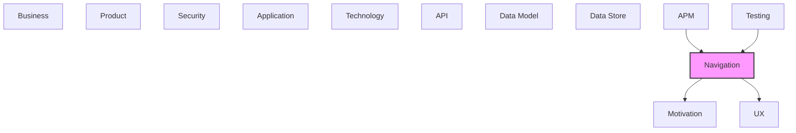

# Navigation

[← Back to README](../README.md)

Application routing, navigation flows, and page structures.

## Report Index

- [Layer Introduction](#layer-introduction)
- [Intra-Layer Relationships](#intra-layer-relationships)
- [Inter-Layer Dependencies](#inter-layer-dependencies)
- [Inter-Layer Relationships Table](#inter-layer-relationships-table)
- [Element Reference](#element-reference)

## Layer Introduction

| Metric                    | Count |
| ------------------------- | ----- |
| Elements                  | 37    |
| Intra-Layer Relationships | 5     |
| Inter-Layer Relationships | 37    |
| Inbound Relationships     | 3     |
| Outbound Relationships    | 34    |

**Cross-Layer References**:

- **Upstream layers**: [APM](./12-apm-layer-report.md), [Testing](./13-testing-layer-report.md)
- **Downstream layers**: [Motivation](./01-motivation-layer-report.md), [UX](./10-ux-layer-report.md)

## Intra-Layer Relationships

*This layer has >30 elements. Summary table shown instead of diagram.*

| Element                                             | Type             | Relationships |
| --------------------------------------------------- | ---------------- | ------------- |
| `navigation.navigationflow.ontology-hierarchy-flow` | `navigationflow` | 0             |
| `navigation.route.app-root-route`                   | `route`          | 2             |
| `navigation.route.app-shell-route`                  | `route`          | 2             |
| `navigation.route.batch-detail-route`               | `route`          | 0             |
| `navigation.route.benchmark-gold-route`             | `route`          | 0             |
| `navigation.route.claims-route`                     | `route`          | 0             |
| `navigation.route.class-detail-route`               | `route`          | 0             |
| `navigation.route.classes-route`                    | `route`          | 0             |
| `navigation.route.concept-scheme-detail-route`      | `route`          | 0             |
| `navigation.route.concept-schemes-index-route`      | `route`          | 0             |
| `navigation.route.concept-schemes-route`            | `route`          | 0             |
| `navigation.route.contact-sheet-route`              | `route`          | 0             |
| `navigation.route.dashboard-route`                  | `route`          | 0             |
| `navigation.route.datasets-route`                   | `route`          | 1             |
| `navigation.route.extract-source-route`             | `route`          | 0             |
| `navigation.route.extraction-review-route`          | `route`          | 0             |
| `navigation.route.graph-route`                      | `route`          | 0             |
| `navigation.route.grounding-workflows-route`        | `route`          | 0             |
| `navigation.route.index-redirect-route`             | `route`          | 2             |
| `navigation.route.individual-detail-route`          | `route`          | 0             |
| `navigation.route.individuals-route`                | `route`          | 0             |
| `navigation.route.pipeline-runs-route`              | `route`          | 0             |
| `navigation.route.pipelines-route`                  | `route`          | 0             |
| `navigation.route.properties-route`                 | `route`          | 0             |
| `navigation.route.proposal-compare-route`           | `route`          | 0             |
| `navigation.route.proposal-detail-route`            | `route`          | 1             |
| `navigation.route.proposal-review-route`            | `route`          | 1             |
| `navigation.route.proposals-route`                  | `route`          | 0             |
| `navigation.route.reference-sources-route`          | `route`          | 0             |
| `navigation.route.relationships-route`              | `route`          | 0             |
| `navigation.route.run-wizard-route`                 | `route`          | 0             |
| `navigation.route.settings-route`                   | `route`          | 0             |
| `navigation.route.sources-route`                    | `route`          | 0             |
| `navigation.route.taxonomies-route`                 | `route`          | 0             |
| `navigation.route.taxonomy-detail-route`            | `route`          | 0             |
| `navigation.route.versioning-route`                 | `route`          | 0             |
| `navigation.route.welcome-route`                    | `route`          | 1             |

## Inter-Layer Dependencies

## Inter-Layer Relationships Table

| Relationship ID                                      | Source Node                                                        | Dest Node                                           | Dest Layer   | Predicate   | Cardinality  | Strength |
| ---------------------------------------------------- | ------------------------------------------------------------------ | --------------------------------------------------- | ------------ | ----------- | ------------ | -------- |
| `apm.span.monitors.navigation.navigationflow`        | `apm.span.api-request-span`                                        | `navigation.navigationflow.ontology-hierarchy-flow` | `navigation` | `monitors`  | many-to-many | medium   |
| `navigation.route.maps-to.ux.view`                   | `navigation.route.app-shell-route`                                 | `ux.view.app-shell-view`                            | `ux`         | `maps-to`   | many-to-many | medium   |
| `navigation.route.maps-to.ux.view`                   | `navigation.route.batch-detail-route`                              | `ux.view.batch-detail-view`                         | `ux`         | `maps-to`   | many-to-many | medium   |
| `navigation.route.maps-to.ux.view`                   | `navigation.route.benchmark-gold-route`                            | `ux.view.benchmark-gold-view`                       | `ux`         | `maps-to`   | many-to-many | medium   |
| `navigation.route.maps-to.ux.view`                   | `navigation.route.claims-route`                                    | `ux.view.claims-view`                               | `ux`         | `maps-to`   | many-to-many | medium   |
| `navigation.route.maps-to.ux.view`                   | `navigation.route.class-detail-route`                              | `ux.view.class-detail-view`                         | `ux`         | `maps-to`   | many-to-many | medium   |
| `navigation.route.maps-to.ux.view`                   | `navigation.route.classes-route`                                   | `ux.view.classes-view`                              | `ux`         | `maps-to`   | many-to-many | medium   |
| `navigation.route.maps-to.ux.view`                   | `navigation.route.concept-scheme-detail-route`                     | `ux.view.concept-scheme-detail-view`                | `ux`         | `maps-to`   | many-to-many | medium   |
| `navigation.route.maps-to.ux.view`                   | `navigation.route.concept-schemes-index-route`                     | `ux.view.concept-schemes-index-view`                | `ux`         | `maps-to`   | many-to-many | medium   |
| `navigation.route.maps-to.ux.view`                   | `navigation.route.concept-schemes-route`                           | `ux.view.concept-schemes-view`                      | `ux`         | `maps-to`   | many-to-many | medium   |
| `navigation.route.maps-to.ux.view`                   | `navigation.route.contact-sheet-route`                             | `ux.view.contact-sheet-view`                        | `ux`         | `maps-to`   | many-to-many | medium   |
| `navigation.route.maps-to.ux.view`                   | `navigation.route.dashboard-route`                                 | `ux.view.dashboard-view`                            | `ux`         | `maps-to`   | many-to-many | medium   |
| `navigation.route.maps-to.ux.view`                   | `navigation.route.datasets-route`                                  | `ux.view.datasets-view`                             | `ux`         | `maps-to`   | many-to-many | medium   |
| `navigation.route.maps-to.ux.view`                   | `navigation.route.extract-source-route`                            | `ux.view.extract-source-view`                       | `ux`         | `maps-to`   | many-to-many | medium   |
| `navigation.route.maps-to.ux.view`                   | `navigation.route.extraction-review-route`                         | `ux.view.extraction-review-view`                    | `ux`         | `maps-to`   | many-to-many | medium   |
| `navigation.route.maps-to.ux.view`                   | `navigation.route.graph-route`                                     | `ux.view.graph-view`                                | `ux`         | `maps-to`   | many-to-many | medium   |
| `navigation.route.maps-to.ux.view`                   | `navigation.route.grounding-workflows-route`                       | `ux.view.grounding-workflows-view`                  | `ux`         | `maps-to`   | many-to-many | medium   |
| `navigation.route.maps-to.ux.view`                   | `navigation.route.individual-detail-route`                         | `ux.view.individual-detail-view`                    | `ux`         | `maps-to`   | many-to-many | medium   |
| `navigation.route.maps-to.ux.view`                   | `navigation.route.individuals-route`                               | `ux.view.individuals-view`                          | `ux`         | `maps-to`   | many-to-many | medium   |
| `navigation.route.maps-to.ux.view`                   | `navigation.route.pipeline-runs-route`                             | `ux.view.pipeline-runs-view`                        | `ux`         | `maps-to`   | many-to-many | medium   |
| `navigation.route.maps-to.ux.view`                   | `navigation.route.pipelines-route`                                 | `ux.view.pipelines-view`                            | `ux`         | `maps-to`   | many-to-many | medium   |
| `navigation.route.maps-to.ux.view`                   | `navigation.route.properties-route`                                | `ux.view.properties-view`                           | `ux`         | `maps-to`   | many-to-many | medium   |
| `navigation.route.maps-to.ux.view`                   | `navigation.route.proposal-compare-route`                          | `ux.view.proposal-compare-view`                     | `ux`         | `maps-to`   | many-to-many | medium   |
| `navigation.route.maps-to.ux.view`                   | `navigation.route.proposal-detail-route`                           | `ux.view.proposal-detail-view`                      | `ux`         | `maps-to`   | many-to-many | medium   |
| `navigation.route.satisfies.motivation.requirement`  | `navigation.route.proposal-detail-route`                           | `motivation.requirement.wide-side-by-side-diff`     | `motivation` | `satisfies` | many-to-many | medium   |
| `navigation.route.maps-to.ux.view`                   | `navigation.route.proposals-route`                                 | `ux.view.proposals-view`                            | `ux`         | `maps-to`   | many-to-many | medium   |
| `navigation.route.maps-to.ux.view`                   | `navigation.route.reference-sources-route`                         | `ux.view.reference-sources-view`                    | `ux`         | `maps-to`   | many-to-many | medium   |
| `navigation.route.maps-to.ux.view`                   | `navigation.route.relationships-route`                             | `ux.view.relationships-view`                        | `ux`         | `maps-to`   | many-to-many | medium   |
| `navigation.route.maps-to.ux.view`                   | `navigation.route.run-wizard-route`                                | `ux.view.run-wizard-view`                           | `ux`         | `maps-to`   | many-to-many | medium   |
| `navigation.route.maps-to.ux.view`                   | `navigation.route.settings-route`                                  | `ux.view.settings-view`                             | `ux`         | `maps-to`   | many-to-many | medium   |
| `navigation.route.maps-to.ux.view`                   | `navigation.route.sources-route`                                   | `ux.view.sources-view`                              | `ux`         | `maps-to`   | many-to-many | medium   |
| `navigation.route.maps-to.ux.view`                   | `navigation.route.taxonomies-route`                                | `ux.view.taxonomies-view`                           | `ux`         | `maps-to`   | many-to-many | medium   |
| `navigation.route.maps-to.ux.view`                   | `navigation.route.taxonomy-detail-route`                           | `ux.view.taxonomy-detail-view`                      | `ux`         | `maps-to`   | many-to-many | medium   |
| `navigation.route.maps-to.ux.view`                   | `navigation.route.versioning-route`                                | `ux.view.versioning-view`                           | `ux`         | `maps-to`   | many-to-many | medium   |
| `navigation.route.maps-to.ux.view`                   | `navigation.route.welcome-route`                                   | `ux.view.welcome-view`                              | `ux`         | `maps-to`   | many-to-many | medium   |
| `testing.testcasesketch.tests.navigation.route`      | `testing.testcasesketch.review-route-redirects-to-proposal-detail` | `navigation.route.proposal-review-route`            | `navigation` | `tests`     | many-to-many | medium   |
| `testing.testcoveragetarget.covers.navigation.route` | `testing.testcoveragetarget.one-review-page`                       | `navigation.route.proposal-review-route`            | `navigation` | `covers`    | many-to-many | medium   |

## Element Reference

### Ontology Hierarchy Flow {#ontology-hierarchy-flow}

**ID**: `navigation.navigationflow.ontology-hierarchy-flow`

**Type**: `navigationflow`

Three-step navigation flow guiding the user through the knowledge graph hierarchy: Taxonomies -&gt; Concept Schemes -&gt; Classes

#### Attributes

| Name        | Value                                                                      |
| ----------- | -------------------------------------------------------------------------- |
| description | Hierarchical drill-down through taxonomy, concept scheme, and class levels |

#### Relationships

| Type        | Related Element             | Predicate  | Direction |
| ----------- | --------------------------- | ---------- | --------- |
| inter-layer | `apm.span.api-request-span` | `monitors` | inbound   |

### App Root Route {#app-root-route}

**ID**: `navigation.route.app-root-route`

**Type**: `route`

Root application layout route — renders the navigation shell, sidebar, and main content area

#### Attributes

| Name  | Value          |
| ----- | -------------- |
| title | Context Studio |
| type  | public         |

#### Relationships

| Type        | Related Element                    | Predicate      | Direction |
| ----------- | ---------------------------------- | -------------- | --------- |
| intra-layer | `navigation.route.app-shell-route` | `navigates-to` | outbound  |
| intra-layer | `navigation.route.datasets-route`  | `navigates-to` | outbound  |

### App Shell Route {#app-shell-route}

**ID**: `navigation.route.app-shell-route`

**Type**: `route`

#### Attributes

| Name  | Value  |
| ----- | ------ |
| title | /app   |
| type  | public |

#### Relationships

| Type        | Related Element                         | Predicate      | Direction |
| ----------- | --------------------------------------- | -------------- | --------- |
| inter-layer | `ux.view.app-shell-view`                | `maps-to`      | outbound  |
| intra-layer | `navigation.route.app-root-route`       | `navigates-to` | inbound   |
| intra-layer | `navigation.route.index-redirect-route` | `navigates-to` | inbound   |

### Batch Detail Route {#batch-detail-route}

**ID**: `navigation.route.batch-detail-route`

**Type**: `route`

#### Attributes

| Name  | Value                           |
| ----- | ------------------------------- |
| title | /app/pipelines/batches/$batchId |
| type  | public                          |

#### Relationships

| Type        | Related Element             | Predicate | Direction |
| ----------- | --------------------------- | --------- | --------- |
| inter-layer | `ux.view.batch-detail-view` | `maps-to` | outbound  |

### Benchmark Gold Route {#benchmark-gold-route}

**ID**: `navigation.route.benchmark-gold-route`

**Type**: `route`

#### Attributes

| Name  | Value               |
| ----- | ------------------- |
| title | /app/pipelines/gold |
| type  | public              |

#### Relationships

| Type        | Related Element               | Predicate | Direction |
| ----------- | ----------------------------- | --------- | --------- |
| inter-layer | `ux.view.benchmark-gold-view` | `maps-to` | outbound  |

### Claims Route {#claims-route}

**ID**: `navigation.route.claims-route`

**Type**: `route`

#### Attributes

| Name  | Value       |
| ----- | ----------- |
| title | /app/claims |
| type  | public      |

#### Relationships

| Type        | Related Element       | Predicate | Direction |
| ----------- | --------------------- | --------- | --------- |
| inter-layer | `ux.view.claims-view` | `maps-to` | outbound  |

### Class Detail Route {#class-detail-route}

**ID**: `navigation.route.class-detail-route`

**Type**: `route`

#### Attributes

| Name  | Value                   |
| ----- | ----------------------- |
| title | /app/schema/classes/$id |
| type  | public                  |

#### Relationships

| Type        | Related Element             | Predicate | Direction |
| ----------- | --------------------------- | --------- | --------- |
| inter-layer | `ux.view.class-detail-view` | `maps-to` | outbound  |

### Classes Route {#classes-route}

**ID**: `navigation.route.classes-route`

**Type**: `route`

Route for /app/classes — renders Classes View

#### Attributes

| Name  | Value               |
| ----- | ------------------- |
| title | /app/schema/classes |
| type  | protected           |

#### Relationships

| Type        | Related Element        | Predicate | Direction |
| ----------- | ---------------------- | --------- | --------- |
| inter-layer | `ux.view.classes-view` | `maps-to` | outbound  |

### Concept Scheme Detail Route {#concept-scheme-detail-route}

**ID**: `navigation.route.concept-scheme-detail-route`

**Type**: `route`

#### Attributes

| Name  | Value                   |
| ----- | ----------------------- |
| title | /app/schema/schemes/$id |
| type  | public                  |

#### Relationships

| Type        | Related Element                      | Predicate | Direction |
| ----------- | ------------------------------------ | --------- | --------- |
| inter-layer | `ux.view.concept-scheme-detail-view` | `maps-to` | outbound  |

### Concept Schemes Index Route {#concept-schemes-index-route}

**ID**: `navigation.route.concept-schemes-index-route`

**Type**: `route`

#### Attributes

| Name  | Value                |
| ----- | -------------------- |
| title | /app/schema/schemes/ |
| type  | public               |

#### Relationships

| Type        | Related Element                      | Predicate | Direction |
| ----------- | ------------------------------------ | --------- | --------- |
| inter-layer | `ux.view.concept-schemes-index-view` | `maps-to` | outbound  |

### Concept Schemes Route {#concept-schemes-route}

**ID**: `navigation.route.concept-schemes-route`

**Type**: `route`

Route for /app/concept-schemes — renders Concept Schemes View

#### Attributes

| Name  | Value               |
| ----- | ------------------- |
| title | /app/schema/schemes |
| type  | protected           |

#### Relationships

| Type        | Related Element                | Predicate | Direction |
| ----------- | ------------------------------ | --------- | --------- |
| inter-layer | `ux.view.concept-schemes-view` | `maps-to` | outbound  |

### Contact Sheet Route {#contact-sheet-route}

**ID**: `navigation.route.contact-sheet-route`

**Type**: `route`

#### Attributes

| Name  | Value              |
| ----- | ------------------ |
| title | /app/contact-sheet |
| type  | public             |

#### Relationships

| Type        | Related Element              | Predicate | Direction |
| ----------- | ---------------------------- | --------- | --------- |
| inter-layer | `ux.view.contact-sheet-view` | `maps-to` | outbound  |

### Dashboard Route {#dashboard-route}

**ID**: `navigation.route.dashboard-route`

**Type**: `route`

#### Attributes

| Name  | Value  |
| ----- | ------ |
| title | /app/  |
| type  | public |

#### Relationships

| Type        | Related Element          | Predicate | Direction |
| ----------- | ------------------------ | --------- | --------- |
| inter-layer | `ux.view.dashboard-view` | `maps-to` | outbound  |

### Datasets Route {#datasets-route}

**ID**: `navigation.route.datasets-route`

**Type**: `route`

Route for the dataset workspace management page — /app/datasets

#### Attributes

| Name  | Value              |
| ----- | ------------------ |
| title | /app/data/datasets |
| type  | public             |

#### Relationships

| Type        | Related Element                   | Predicate      | Direction |
| ----------- | --------------------------------- | -------------- | --------- |
| inter-layer | `ux.view.datasets-view`           | `maps-to`      | outbound  |
| intra-layer | `navigation.route.app-root-route` | `navigates-to` | inbound   |

### Extract Source Route {#extract-source-route}

**ID**: `navigation.route.extract-source-route`

**Type**: `route`

#### Attributes

| Name  | Value                               |
| ----- | ----------------------------------- |
| title | /app/data/sources/$sourceId/extract |
| type  | public                              |

#### Relationships

| Type        | Related Element               | Predicate | Direction |
| ----------- | ----------------------------- | --------- | --------- |
| inter-layer | `ux.view.extract-source-view` | `maps-to` | outbound  |

### Extraction Review Route {#extraction-review-route}

**ID**: `navigation.route.extraction-review-route`

**Type**: `route`

#### Attributes

| Name  | Value                 |
| ----- | --------------------- |
| title | /app/pipelines/review |
| type  | public                |

#### Relationships

| Type        | Related Element                  | Predicate | Direction |
| ----------- | -------------------------------- | --------- | --------- |
| inter-layer | `ux.view.extraction-review-view` | `maps-to` | outbound  |

### Graph Route {#graph-route}

**ID**: `navigation.route.graph-route`

**Type**: `route`

#### Attributes

| Name  | Value      |
| ----- | ---------- |
| title | /app/graph |
| type  | public     |

#### Relationships

| Type        | Related Element      | Predicate | Direction |
| ----------- | -------------------- | --------- | --------- |
| inter-layer | `ux.view.graph-view` | `maps-to` | outbound  |

### Grounding Workflows Route {#grounding-workflows-route}

**ID**: `navigation.route.grounding-workflows-route`

**Type**: `route`

#### Attributes

| Name  | Value                    |
| ----- | ------------------------ |
| title | /app/reference/workflows |
| type  | public                   |

#### Relationships

| Type        | Related Element                    | Predicate | Direction |
| ----------- | ---------------------------------- | --------- | --------- |
| inter-layer | `ux.view.grounding-workflows-view` | `maps-to` | outbound  |

### Index Redirect Route {#index-redirect-route}

**ID**: `navigation.route.index-redirect-route`

**Type**: `route`

#### Attributes

| Name  | Value    |
| ----- | -------- |
| title | /        |
| type  | redirect |

#### Relationships

| Type        | Related Element                    | Predicate      | Direction |
| ----------- | ---------------------------------- | -------------- | --------- |
| intra-layer | `navigation.route.app-shell-route` | `navigates-to` | outbound  |
| intra-layer | `navigation.route.welcome-route`   | `navigates-to` | outbound  |

### Individual Detail Route {#individual-detail-route}

**ID**: `navigation.route.individual-detail-route`

**Type**: `route`

#### Attributes

| Name  | Value                     |
| ----- | ------------------------- |
| title | /app/data/individuals/$id |
| type  | public                    |

#### Relationships

| Type        | Related Element                  | Predicate | Direction |
| ----------- | -------------------------------- | --------- | --------- |
| inter-layer | `ux.view.individual-detail-view` | `maps-to` | outbound  |

### Individuals Route {#individuals-route}

**ID**: `navigation.route.individuals-route`

**Type**: `route`

Route for /app/individuals — renders Individuals View

#### Attributes

| Name  | Value                 |
| ----- | --------------------- |
| title | /app/data/individuals |
| type  | protected             |

#### Relationships

| Type        | Related Element            | Predicate | Direction |
| ----------- | -------------------------- | --------- | --------- |
| inter-layer | `ux.view.individuals-view` | `maps-to` | outbound  |

### Pipeline Runs Route {#pipeline-runs-route}

**ID**: `navigation.route.pipeline-runs-route`

**Type**: `route`

#### Attributes

| Name  | Value               |
| ----- | ------------------- |
| title | /app/pipelines/runs |
| type  | public              |

#### Relationships

| Type        | Related Element              | Predicate | Direction |
| ----------- | ---------------------------- | --------- | --------- |
| inter-layer | `ux.view.pipeline-runs-view` | `maps-to` | outbound  |

### Pipelines Route {#pipelines-route}

**ID**: `navigation.route.pipelines-route`

**Type**: `route`

#### Attributes

| Name  | Value           |
| ----- | --------------- |
| title | /app/pipelines/ |
| type  | public          |

#### Relationships

| Type        | Related Element          | Predicate | Direction |
| ----------- | ------------------------ | --------- | --------- |
| inter-layer | `ux.view.pipelines-view` | `maps-to` | outbound  |

### Properties Route {#properties-route}

**ID**: `navigation.route.properties-route`

**Type**: `route`

Route for /app/properties — renders Properties View

#### Attributes

| Name  | Value                  |
| ----- | ---------------------- |
| title | /app/schema/properties |
| type  | protected              |

#### Relationships

| Type        | Related Element           | Predicate | Direction |
| ----------- | ------------------------- | --------- | --------- |
| inter-layer | `ux.view.properties-view` | `maps-to` | outbound  |

### Proposal Compare Route {#proposal-compare-route}

**ID**: `navigation.route.proposal-compare-route`

**Type**: `route`

#### Attributes

| Name  | Value                                       |
| ----- | ------------------------------------------- |
| title | /app/proposals/$proposalId/compare/$otherId |
| type  | public                                      |

#### Relationships

| Type        | Related Element                 | Predicate | Direction |
| ----------- | ------------------------------- | --------- | --------- |
| inter-layer | `ux.view.proposal-compare-view` | `maps-to` | outbound  |

### Proposal Detail Route {#proposal-detail-route}

**ID**: `navigation.route.proposal-detail-route`

**Type**: `route`

The one review surface. Search params: ?selected=&lt;operation&gt; (?op= redirects to it) and &diff=&lt;field&gt; while the wide diff is open, so Back and links work.

#### Attributes

| Name  | Value                      |
| ----- | -------------------------- |
| title | /app/proposals/$proposalId |
| type  | public                     |

#### Relationships

| Type        | Related Element                                 | Predicate      | Direction |
| ----------- | ----------------------------------------------- | -------------- | --------- |
| inter-layer | `ux.view.proposal-detail-view`                  | `maps-to`      | outbound  |
| inter-layer | `motivation.requirement.wide-side-by-side-diff` | `satisfies`    | outbound  |
| intra-layer | `navigation.route.proposal-review-route`        | `navigates-to` | inbound   |

### Proposal Review Route {#proposal-review-route}

**ID**: `navigation.route.proposal-review-route`

**Type**: `route`

Redirects /app/proposals/$proposalId/review to /app/proposals/$proposalId, keeping ?selected=.

#### Attributes

| Name  | Value                             |
| ----- | --------------------------------- |
| title | /app/proposals/$proposalId/review |
| type  | redirect                          |

#### Relationships

| Type        | Related Element                                                    | Predicate      | Direction |
| ----------- | ------------------------------------------------------------------ | -------------- | --------- |
| inter-layer | `testing.testcasesketch.review-route-redirects-to-proposal-detail` | `tests`        | inbound   |
| inter-layer | `testing.testcoveragetarget.one-review-page`                       | `covers`       | inbound   |
| intra-layer | `navigation.route.proposal-detail-route`                           | `navigates-to` | outbound  |

### Proposals Route {#proposals-route}

**ID**: `navigation.route.proposals-route`

**Type**: `route`

#### Attributes

| Name  | Value          |
| ----- | -------------- |
| title | /app/proposals |
| type  | public         |

#### Relationships

| Type        | Related Element          | Predicate | Direction |
| ----------- | ------------------------ | --------- | --------- |
| inter-layer | `ux.view.proposals-view` | `maps-to` | outbound  |

### Reference Sources Route {#reference-sources-route}

**ID**: `navigation.route.reference-sources-route`

**Type**: `route`

#### Attributes

| Name  | Value                  |
| ----- | ---------------------- |
| title | /app/reference/sources |
| type  | public                 |

#### Relationships

| Type        | Related Element                  | Predicate | Direction |
| ----------- | -------------------------------- | --------- | --------- |
| inter-layer | `ux.view.reference-sources-view` | `maps-to` | outbound  |

### Relationships Route {#relationships-route}

**ID**: `navigation.route.relationships-route`

**Type**: `route`

Route for /app/relationships — renders Relationships View

#### Attributes

| Name  | Value                     |
| ----- | ------------------------- |
| title | /app/schema/relationships |
| type  | protected                 |

#### Relationships

| Type        | Related Element              | Predicate | Direction |
| ----------- | ---------------------------- | --------- | --------- |
| inter-layer | `ux.view.relationships-view` | `maps-to` | outbound  |

### Run Wizard Route {#run-wizard-route}

**ID**: `navigation.route.run-wizard-route`

**Type**: `route`

#### Attributes

| Name  | Value                          |
| ----- | ------------------------------ |
| title | /app/pipelines/types/$type/run |
| type  | public                         |

#### Relationships

| Type        | Related Element           | Predicate | Direction |
| ----------- | ------------------------- | --------- | --------- |
| inter-layer | `ux.view.run-wizard-view` | `maps-to` | outbound  |

### Settings Route {#settings-route}

**ID**: `navigation.route.settings-route`

**Type**: `route`

#### Attributes

| Name  | Value         |
| ----- | ------------- |
| title | /app/settings |
| type  | public        |

#### Relationships

| Type        | Related Element         | Predicate | Direction |
| ----------- | ----------------------- | --------- | --------- |
| inter-layer | `ux.view.settings-view` | `maps-to` | outbound  |

### Sources Route {#sources-route}

**ID**: `navigation.route.sources-route`

**Type**: `route`

#### Attributes

| Name  | Value             |
| ----- | ----------------- |
| title | /app/data/sources |
| type  | public            |

#### Relationships

| Type        | Related Element        | Predicate | Direction |
| ----------- | ---------------------- | --------- | --------- |
| inter-layer | `ux.view.sources-view` | `maps-to` | outbound  |

### Taxonomies Route {#taxonomies-route}

**ID**: `navigation.route.taxonomies-route`

**Type**: `route`

Route for /app/taxonomies — renders Taxonomies View

#### Attributes

| Name  | Value                  |
| ----- | ---------------------- |
| title | /app/schema/taxonomies |
| type  | protected              |

#### Relationships

| Type        | Related Element           | Predicate | Direction |
| ----------- | ------------------------- | --------- | --------- |
| inter-layer | `ux.view.taxonomies-view` | `maps-to` | outbound  |

### Taxonomy Detail Route {#taxonomy-detail-route}

**ID**: `navigation.route.taxonomy-detail-route`

**Type**: `route`

#### Attributes

| Name  | Value                      |
| ----- | -------------------------- |
| title | /app/schema/taxonomies/$id |
| type  | public                     |

#### Relationships

| Type        | Related Element                | Predicate | Direction |
| ----------- | ------------------------------ | --------- | --------- |
| inter-layer | `ux.view.taxonomy-detail-view` | `maps-to` | outbound  |

### Versioning Route {#versioning-route}

**ID**: `navigation.route.versioning-route`

**Type**: `route`

#### Attributes

| Name  | Value           |
| ----- | --------------- |
| title | /app/versioning |
| type  | public          |

#### Relationships

| Type        | Related Element           | Predicate | Direction |
| ----------- | ------------------------- | --------- | --------- |
| inter-layer | `ux.view.versioning-view` | `maps-to` | outbound  |

### Welcome Route {#welcome-route}

**ID**: `navigation.route.welcome-route`

**Type**: `route`

#### Attributes

| Name  | Value    |
| ----- | -------- |
| title | /welcome |
| type  | public   |

#### Relationships

| Type        | Related Element                         | Predicate      | Direction |
| ----------- | --------------------------------------- | -------------- | --------- |
| inter-layer | `ux.view.welcome-view`                  | `maps-to`      | outbound  |
| intra-layer | `navigation.route.index-redirect-route` | `navigates-to` | inbound   |

---

Generated: 2026-11-24T21:17:13.774Z | Model Version: 0.1.0
