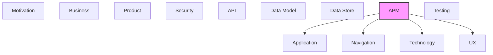

# APM

[← Back to README](../README.md)

Observability, monitoring, metrics, logging, and tracing.

## Report Index

- [Layer Introduction](#layer-introduction)
- [Intra-Layer Relationships](#intra-layer-relationships)
- [Inter-Layer Dependencies](#inter-layer-dependencies)
- [Inter-Layer Relationships Table](#inter-layer-relationships-table)
- [Element Reference](#element-reference)

## Layer Introduction

| Metric                    | Count |
| ------------------------- | ----- |
| Elements                  | 17    |
| Intra-Layer Relationships | 5     |
| Inter-Layer Relationships | 14    |
| Inbound Relationships     | 0     |
| Outbound Relationships    | 14    |

**Cross-Layer References**:

- **Downstream layers**: [Application](./05-application-layer-report.md), [Navigation](./11-navigation-layer-report.md), [Technology](./06-technology-layer-report.md), [UX](./10-ux-layer-report.md)

## Intra-Layer Relationships

```mermaid
flowchart LR
  subgraph apm
    apm_exporterconfig_browser_otlp_http_span_exporter["Browser OTLP HTTP Span Exporter"]
    apm_exporterconfig_otlp_log_exporter["OTLP Log Exporter"]
    apm_exporterconfig_otlp_span_exporter["OTLP Span Exporter"]
    apm_instrumentationconfig_fast_api_sqlalchemy_httpx_instrumentation["FastAPI SQLAlchemy httpx Instrumentation"]
    apm_logconfiguration_context_studio_server_log_configuration["Context Studio Server Log Configuration"]
    apm_logprocessor_otlp_log_bridge["OTLP Log Bridge"]
    apm_logprocessor_rotating_file_log_processor["Rotating File Log Processor"]
    apm_span_api_request_span["API Request Span"]
    apm_span_browser_http_client_span["Browser HTTP Client Span"]
    apm_span_browser_navigation_span["Browser Navigation Span"]
    apm_span_database_query_span["Database Query Span"]
    apm_span_embedding_encode_span["Embedding Encode Span"]
    apm_span_llm_completion_span["LLM Completion Span"]
    apm_span_nlp_process_span["NLP Process Span"]
    apm_span_sync_span["Sync Span"]
    apm_traceconfiguration_browser_trace_configuration["Browser Trace Configuration"]
    apm_traceconfiguration_server_trace_configuration["Server Trace Configuration"]
    apm_logconfiguration_context_studio_server_log_configuration -->|aggregates| apm_exporterconfig_otlp_log_exporter
    apm_logconfiguration_context_studio_server_log_configuration -->|aggregates| apm_logprocessor_otlp_log_bridge
    apm_logconfiguration_context_studio_server_log_configuration -->|aggregates| apm_logprocessor_rotating_file_log_processor
    apm_traceconfiguration_browser_trace_configuration -->|aggregates| apm_exporterconfig_browser_otlp_http_span_exporter
    apm_traceconfiguration_server_trace_configuration -->|aggregates| apm_exporterconfig_otlp_span_exporter
  end
```

## Inter-Layer Dependencies

## Inter-Layer Relationships Table

| Relationship ID                                                | Source Node                                                           | Dest Node                                                                 | Dest Layer    | Predicate  | Cardinality  | Strength |
| -------------------------------------------------------------- | --------------------------------------------------------------------- | ------------------------------------------------------------------------- | ------------- | ---------- | ------------ | -------- |
| `apm.instrumentationconfig.monitors.technology.systemsoftware` | `apm.instrumentationconfig.fast-api-sqlalchemy-httpx-instrumentation` | `technology.systemsoftware.fast-api`                                      | `technology`  | `monitors` | many-to-many | medium   |
| `apm.instrumentationconfig.monitors.technology.systemsoftware` | `apm.instrumentationconfig.fast-api-sqlalchemy-httpx-instrumentation` | `technology.systemsoftware.httpx`                                         | `technology`  | `monitors` | many-to-many | medium   |
| `apm.instrumentationconfig.monitors.technology.systemsoftware` | `apm.instrumentationconfig.fast-api-sqlalchemy-httpx-instrumentation` | `technology.systemsoftware.sqlalchemy`                                    | `technology`  | `monitors` | many-to-many | medium   |
| `apm.span.monitors.navigation.navigationflow`                  | `apm.span.api-request-span`                                           | `navigation.navigationflow.ontology-hierarchy-flow`                       | `navigation`  | `monitors` | many-to-many | medium   |
| `apm.span.monitors.ux.view`                                    | `apm.span.api-request-span`                                           | `ux.view.pipelines-view`                                                  | `ux`          | `monitors` | many-to-many | medium   |
| `apm.span.monitors.ux.view`                                    | `apm.span.browser-http-client-span`                                   | `ux.view.app-shell-view`                                                  | `ux`          | `monitors` | many-to-many | medium   |
| `apm.span.monitors.ux.view`                                    | `apm.span.browser-navigation-span`                                    | `ux.view.app-shell-view`                                                  | `ux`          | `monitors` | many-to-many | medium   |
| `apm.span.monitors.ux.view`                                    | `apm.span.database-query-span`                                        | `ux.view.datasets-view`                                                   | `ux`          | `monitors` | many-to-many | medium   |
| `apm.span.monitors.application.applicationcomponent`           | `apm.span.embedding-encode-span`                                      | `application.applicationcomponent.sentence-transformer-embedding-adapter` | `application` | `monitors` | many-to-many | medium   |
| `apm.span.monitors.application.applicationcomponent`           | `apm.span.llm-completion-span`                                        | `application.applicationcomponent.anthropic-llm-provider`                 | `application` | `monitors` | many-to-many | medium   |
| `apm.span.monitors.application.applicationcomponent`           | `apm.span.llm-completion-span`                                        | `application.applicationcomponent.open-ai-llm-provider`                   | `application` | `monitors` | many-to-many | medium   |
| `apm.span.monitors.application.applicationcomponent`           | `apm.span.nlp-process-span`                                           | `application.applicationcomponent.spa-cy-nlp-processor`                   | `application` | `monitors` | many-to-many | medium   |
| `apm.span.monitors.application.applicationcomponent`           | `apm.span.sync-span`                                                  | `application.applicationcomponent.duck-db-sync-adapter`                   | `application` | `monitors` | many-to-many | medium   |
| `apm.span.monitors.application.applicationcomponent`           | `apm.span.sync-span`                                                  | `application.applicationcomponent.s3-sync-adapter`                        | `application` | `monitors` | many-to-many | medium   |

## Element Reference

### Browser OTLP HTTP Span Exporter {#browser-otlp-http-span-exporter}

**ID**: `apm.exporterconfig.browser-otlp-http-span-exporter`

**Type**: `exporterconfig`

OTLPTraceExporter over HTTP that the UX's tracer provider sends finished spans to, batched; a console exporter is added in development.

#### Attributes

| Name     | Value                                              |
| -------- | -------------------------------------------------- |
| endpoint | VITE_OTLP_ENDPOINT (default http://localhost:4318) |
| type     | otlp                                               |

#### Relationships

| Type        | Related Element                                      | Predicate    | Direction |
| ----------- | ---------------------------------------------------- | ------------ | --------- |
| intra-layer | `apm.traceconfiguration.browser-trace-configuration` | `aggregates` | inbound   |

### OTLP Log Exporter {#otlp-log-exporter}

**ID**: `apm.exporterconfig.otlp-log-exporter`

**Type**: `exporterconfig`

OTLP log exporter over gRPC or HTTP, chosen by the configured protocol.

#### Attributes

| Name     | Value                                    |
| -------- | ---------------------------------------- |
| endpoint | config.json telemetry grpc/http endpoint |
| type     | otlp                                     |

#### Relationships

| Type        | Related Element                                                | Predicate    | Direction |
| ----------- | -------------------------------------------------------------- | ------------ | --------- |
| intra-layer | `apm.logconfiguration.context-studio-server-log-configuration` | `aggregates` | inbound   |

### OTLP Span Exporter {#otlp-span-exporter}

**ID**: `apm.exporterconfig.otlp-span-exporter`

**Type**: `exporterconfig`

OTLP span exporter over gRPC or HTTP, chosen by the configured protocol.

#### Attributes

| Name     | Value                                    |
| -------- | ---------------------------------------- |
| endpoint | config.json telemetry grpc/http endpoint |
| type     | otlp                                     |

#### Relationships

| Type        | Related Element                                     | Predicate    | Direction |
| ----------- | --------------------------------------------------- | ------------ | --------- |
| intra-layer | `apm.traceconfiguration.server-trace-configuration` | `aggregates` | inbound   |

### FastAPI SQLAlchemy httpx Instrumentation {#fastapi-sqlalchemy-httpx-instrumentation}

**ID**: `apm.instrumentationconfig.fast-api-sqlalchemy-httpx-instrumentation`

**Type**: `instrumentationconfig`

Auto-instrumentation of FastAPI requests, SQLAlchemy queries and httpx client calls.

#### Attributes

| Name | Value |
| ---- | ----- |
| type | auto  |

#### Relationships

| Type        | Related Element                        | Predicate  | Direction |
| ----------- | -------------------------------------- | ---------- | --------- |
| inter-layer | `technology.systemsoftware.fast-api`   | `monitors` | outbound  |
| inter-layer | `technology.systemsoftware.httpx`      | `monitors` | outbound  |
| inter-layer | `technology.systemsoftware.sqlalchemy` | `monitors` | outbound  |

### Context Studio Server Log Configuration {#context-studio-server-log-configuration}

**ID**: `apm.logconfiguration.context-studio-server-log-configuration`

**Type**: `logconfiguration`

Rotating file logger for the local-server. Configured via config.json logging settings (log_level, max_bytes, backup_count). Falls back to stderr StreamHandler if file logging fails.

#### Attributes

| Name            | Value                       |
| --------------- | --------------------------- |
| minimumSeverity | INFO                        |
| serviceName     | context-studio-local-server |

#### Relationships

| Type        | Related Element                                | Predicate    | Direction |
| ----------- | ---------------------------------------------- | ------------ | --------- |
| intra-layer | `apm.exporterconfig.otlp-log-exporter`         | `aggregates` | outbound  |
| intra-layer | `apm.logprocessor.otlp-log-bridge`             | `aggregates` | outbound  |
| intra-layer | `apm.logprocessor.rotating-file-log-processor` | `aggregates` | outbound  |

### OTLP Log Bridge {#otlp-log-bridge}

**ID**: `apm.logprocessor.otlp-log-bridge`

**Type**: `logprocessor`

Logging handler bridging Python log records to the OTLP log exporter.

#### Attributes

| Name | Value |
| ---- | ----- |
| type | batch |

#### Relationships

| Type        | Related Element                                                | Predicate    | Direction |
| ----------- | -------------------------------------------------------------- | ------------ | --------- |
| intra-layer | `apm.logconfiguration.context-studio-server-log-configuration` | `aggregates` | inbound   |

### Rotating File Log Processor {#rotating-file-log-processor}

**ID**: `apm.logprocessor.rotating-file-log-processor`

**Type**: `logprocessor`

Python RotatingFileHandler-based log processor writing to context_studio.log. Rotates based on configurable max_bytes and backup_count. Used by all domain, adapter, and route modules via utils/logger.py.

#### Attributes

| Name    | Value  |
| ------- | ------ |
| enabled | true   |
| type    | simple |

#### Relationships

| Type        | Related Element                                                | Predicate    | Direction |
| ----------- | -------------------------------------------------------------- | ------------ | --------- |
| intra-layer | `apm.logconfiguration.context-studio-server-log-configuration` | `aggregates` | inbound   |

### API Request Span {#api-request-span}

**ID**: `apm.span.api-request-span`

**Type**: `span`

Trace span representing the full duration of a single HTTP API request, from receipt to response in the FastAPI application

#### Attributes

| Name                   | Value  |
| ---------------------- | ------ |
| droppedAttributesCount | 0      |
| droppedEventsCount     | 0      |
| droppedLinksCount      | 0      |
| endTimeUnixNano        | 0      |
| parentSpanId           |        |
| spanId                 |        |
| spanKind               | SERVER |
| startTimeUnixNano      | 0      |
| traceId                |        |
| traceState             |        |

#### Relationships

| Type        | Related Element                                     | Predicate  | Direction |
| ----------- | --------------------------------------------------- | ---------- | --------- |
| inter-layer | `navigation.navigationflow.ontology-hierarchy-flow` | `monitors` | outbound  |
| inter-layer | `ux.view.pipelines-view`                            | `monitors` | outbound  |

### Browser HTTP Client Span {#browser-http-client-span}

**ID**: `apm.span.browser-http-client-span`

**Type**: `span`

UX span per API request made through the axios client (HTTP &lt;method&gt; &lt;url&gt;).

#### Attributes

| Name                   | Value  |
| ---------------------- | ------ |
| droppedAttributesCount | 0      |
| droppedEventsCount     | 0      |
| droppedLinksCount      | 0      |
| endTimeUnixNano        | 0      |
| parentSpanId           |        |
| spanId                 |        |
| spanKind               | CLIENT |
| startTimeUnixNano      | 0      |
| traceId                |        |
| traceState             |        |

#### Relationships

| Type        | Related Element          | Predicate  | Direction |
| ----------- | ------------------------ | ---------- | --------- |
| inter-layer | `ux.view.app-shell-view` | `monitors` | outbound  |

### Browser Navigation Span {#browser-navigation-span}

**ID**: `apm.span.browser-navigation-span`

**Type**: `span`

UX span per router navigation (Navigation: &lt;pathname&gt;).

#### Attributes

| Name                   | Value    |
| ---------------------- | -------- |
| droppedAttributesCount | 0        |
| droppedEventsCount     | 0        |
| droppedLinksCount      | 0        |
| endTimeUnixNano        | 0        |
| parentSpanId           |          |
| spanId                 |          |
| spanKind               | INTERNAL |
| startTimeUnixNano      | 0        |
| traceId                |          |
| traceState             |          |

#### Relationships

| Type        | Related Element          | Predicate  | Direction |
| ----------- | ------------------------ | ---------- | --------- |
| inter-layer | `ux.view.app-shell-view` | `monitors` | outbound  |

### Database Query Span {#database-query-span}

**ID**: `apm.span.database-query-span`

**Type**: `span`

OpenTelemetry span covering SQLAlchemy database query execution across local.db and operations.db

#### Attributes

| Name                   | Value  |
| ---------------------- | ------ |
| droppedAttributesCount | 0      |
| droppedEventsCount     | 0      |
| droppedLinksCount      | 0      |
| endTimeUnixNano        | 0      |
| parentSpanId           |        |
| spanId                 |        |
| spanKind               | CLIENT |
| startTimeUnixNano      | 0      |
| traceId                |        |
| traceState             |        |

#### Relationships

| Type        | Related Element         | Predicate  | Direction |
| ----------- | ----------------------- | ---------- | --------- |
| inter-layer | `ux.view.datasets-view` | `monitors` | outbound  |

### Embedding Encode Span {#embedding-encode-span}

**ID**: `apm.span.embedding-encode-span`

**Type**: `span`

Span around sentence-transformer encoding (embedding.encode).

#### Attributes

| Name                   | Value    |
| ---------------------- | -------- |
| droppedAttributesCount | 0        |
| droppedEventsCount     | 0        |
| droppedLinksCount      | 0        |
| endTimeUnixNano        | 0        |
| parentSpanId           |          |
| spanId                 |          |
| spanKind               | INTERNAL |
| startTimeUnixNano      | 0        |
| traceId                |          |
| traceState             |          |

#### Relationships

| Type        | Related Element                                                           | Predicate  | Direction |
| ----------- | ------------------------------------------------------------------------- | ---------- | --------- |
| inter-layer | `application.applicationcomponent.sentence-transformer-embedding-adapter` | `monitors` | outbound  |

### LLM Completion Span {#llm-completion-span}

**ID**: `apm.span.llm-completion-span`

**Type**: `span`

Span around each LLM completion call (llm.complete.anthropic, llm.complete.openai) with model and token attributes.

#### Attributes

| Name                   | Value  |
| ---------------------- | ------ |
| droppedAttributesCount | 0      |
| droppedEventsCount     | 0      |
| droppedLinksCount      | 0      |
| endTimeUnixNano        | 0      |
| parentSpanId           |        |
| spanId                 |        |
| spanKind               | CLIENT |
| startTimeUnixNano      | 0      |
| traceId                |        |
| traceState             |        |

#### Relationships

| Type        | Related Element                                           | Predicate  | Direction |
| ----------- | --------------------------------------------------------- | ---------- | --------- |
| inter-layer | `application.applicationcomponent.anthropic-llm-provider` | `monitors` | outbound  |
| inter-layer | `application.applicationcomponent.open-ai-llm-provider`   | `monitors` | outbound  |

### NLP Process Span {#nlp-process-span}

**ID**: `apm.span.nlp-process-span`

**Type**: `span`

Span around spaCy processing (nlp.process, nlp.process_open).

#### Attributes

| Name                   | Value    |
| ---------------------- | -------- |
| droppedAttributesCount | 0        |
| droppedEventsCount     | 0        |
| droppedLinksCount      | 0        |
| endTimeUnixNano        | 0        |
| parentSpanId           |          |
| spanId                 |          |
| spanKind               | INTERNAL |
| startTimeUnixNano      | 0        |
| traceId                |          |
| traceState             |          |

#### Relationships

| Type        | Related Element                                         | Predicate  | Direction |
| ----------- | ------------------------------------------------------- | ---------- | --------- |
| inter-layer | `application.applicationcomponent.spa-cy-nlp-processor` | `monitors` | outbound  |

### Sync Span {#sync-span}

**ID**: `apm.span.sync-span`

**Type**: `span`

Spans around sync push and pull (sync.push/pull.duckdb, sync.push/pull.s3).

#### Attributes

| Name                   | Value  |
| ---------------------- | ------ |
| droppedAttributesCount | 0      |
| droppedEventsCount     | 0      |
| droppedLinksCount      | 0      |
| endTimeUnixNano        | 0      |
| parentSpanId           |        |
| spanId                 |        |
| spanKind               | CLIENT |
| startTimeUnixNano      | 0      |
| traceId                |        |
| traceState             |        |

#### Relationships

| Type        | Related Element                                         | Predicate  | Direction |
| ----------- | ------------------------------------------------------- | ---------- | --------- |
| inter-layer | `application.applicationcomponent.duck-db-sync-adapter` | `monitors` | outbound  |
| inter-layer | `application.applicationcomponent.s3-sync-adapter`      | `monitors` | outbound  |

### Browser Trace Configuration {#browser-trace-configuration}

**ID**: `apm.traceconfiguration.browser-trace-configuration`

**Type**: `traceconfiguration`

Web TracerProvider for the UX with an OTLP HTTP exporter (VITE_OTLP_ENDPOINT, default localhost:4318).

#### Relationships

| Type        | Related Element                                      | Predicate    | Direction |
| ----------- | ---------------------------------------------------- | ------------ | --------- |
| intra-layer | `apm.exporterconfig.browser-otlp-http-span-exporter` | `aggregates` | outbound  |

### Server Trace Configuration {#server-trace-configuration}

**ID**: `apm.traceconfiguration.server-trace-configuration`

**Type**: `traceconfiguration`

OpenTelemetry TracerProvider for local-server: resource, batch span processor and OTLP exporter, set up when telemetry is enabled in config.json.

#### Relationships

| Type        | Related Element                         | Predicate    | Direction |
| ----------- | --------------------------------------- | ------------ | --------- |
| intra-layer | `apm.exporterconfig.otlp-span-exporter` | `aggregates` | outbound  |

---

Generated: 2026-11-19T16:49:39.982Z | Model Version: 0.1.0
