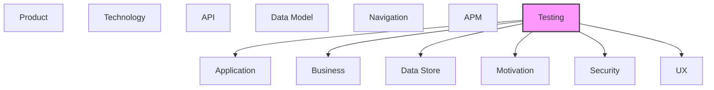

# Testing

[← Back to README](../README.md)

Test strategies, test cases, test data, and test coverage.

## Report Index

- [Layer Introduction](#layer-introduction)
- [Intra-Layer Relationships](#intra-layer-relationships)
- [Inter-Layer Dependencies](#inter-layer-dependencies)
- [Inter-Layer Relationships Table](#inter-layer-relationships-table)
- [Element Reference](#element-reference)

## Layer Introduction

| Metric                    | Count |
| ------------------------- | ----- |
| Elements                  | 35    |
| Intra-Layer Relationships | 32    |
| Inter-Layer Relationships | 49    |
| Inbound Relationships     | 0     |
| Outbound Relationships    | 49    |

**Cross-Layer References**:

- **Downstream layers**: [Application](./05-application-layer-report.md), [Business](./02-business-layer-report.md), [Data Store](./09-data-store-layer-report.md), [Motivation](./01-motivation-layer-report.md), [Security](./04-security-layer-report.md), [UX](./10-ux-layer-report.md)

## Intra-Layer Relationships

*This layer has >30 elements. Summary table shown instead of diagram.*

| Element                                                                                            | Type                  | Relationships |
| -------------------------------------------------------------------------------------------------- | --------------------- | ------------- |
| `testing.coverageexclusion.llm-api-live-call-tests`                                                | `coverageexclusion`   | 1             |
| `testing.coveragegap.s3-sync-e2e-coverage`                                                         | `coveragegap`         | 1             |
| `testing.coveragerequirement.domain-unit-test-coverage`                                            | `coveragerequirement` | 1             |
| `testing.coveragerequirement.e2e-test-coverage`                                                    | `coveragerequirement` | 1             |
| `testing.coveragerequirement.route-integration-test-coverage`                                      | `coveragerequirement` | 1             |
| `testing.inputspacepartition.entity-node-type-discriminator`                                       | `inputspacepartition` | 1             |
| `testing.outcomecategory.entity-creation-success`                                                  | `outcomecategory`     | 1             |
| `testing.outcomecategory.validation-error`                                                         | `outcomecategory`     | 1             |
| `testing.testcasesketch.pre-review-verdicts-reach-the-proposal-visibly`                            | `testcasesketch`      | 1             |
| `testing.testcasesketch.seeded-errors-are-built-and-scored-offline`                                | `testcasesketch`      | 1             |
| `testing.testcasesketch.split-witness-fires-on-gate-ds-four-splits`                                | `testcasesketch`      | 1             |
| `testing.testcasesketch.vite-config-does-not-open-the-dev-server-or-preview-to-the-network-mode-s` | `testcasesketch`      | 0             |
| `testing.testcoveragemodel.context-studio-backend-test-coverage-model`                             | `testcoveragemodel`   | 18            |
| `testing.testcoveragemodel.context-studio-ux-test-coverage-model`                                  | `testcoveragemodel`   | 4             |
| `testing.testcoveragetarget.adapter-integration-tests`                                             | `testcoveragetarget`  | 1             |
| `testing.testcoveragetarget.adapter-unit-tests`                                                    | `testcoveragetarget`  | 1             |
| `testing.testcoveragetarget.admin-health`                                                          | `testcoveragetarget`  | 1             |
| `testing.testcoveragetarget.chat-and-mcp-integration-tests`                                        | `testcoveragetarget`  | 1             |
| `testing.testcoveragetarget.domain-unit-tests`                                                     | `testcoveragetarget`  | 2             |
| `testing.testcoveragetarget.e2e-test-suite`                                                        | `testcoveragetarget`  | 2             |
| `testing.testcoveragetarget.extraction-pipeline`                                                   | `testcoveragetarget`  | 4             |
| `testing.testcoveragetarget.graph-analysis`                                                        | `testcoveragetarget`  | 1             |
| `testing.testcoveragetarget.interchange-integration-tests`                                         | `testcoveragetarget`  | 1             |
| `testing.testcoveragetarget.llm-pipeline-execution`                                                | `testcoveragetarget`  | 2             |
| `testing.testcoveragetarget.ontology-crud`                                                         | `testcoveragetarget`  | 3             |
| `testing.testcoveragetarget.performance-test-suite`                                                | `testcoveragetarget`  | 1             |
| `testing.testcoveragetarget.pipeline-integration-tests`                                            | `testcoveragetarget`  | 1             |
| `testing.testcoveragetarget.playwright-e2e-tests`                                                  | `testcoveragetarget`  | 1             |
| `testing.testcoveragetarget.route-integration-tests`                                               | `testcoveragetarget`  | 2             |
| `testing.testcoveragetarget.source-integration-tests`                                              | `testcoveragetarget`  | 1             |
| `testing.testcoveragetarget.ux-api-client-tests`                                                   | `testcoveragetarget`  | 1             |
| `testing.testcoveragetarget.ux-component-tests`                                                    | `testcoveragetarget`  | 1             |
| `testing.testcoveragetarget.ux-route-tests`                                                        | `testcoveragetarget`  | 1             |
| `testing.testcoveragetarget.versioning-integration-tests`                                          | `testcoveragetarget`  | 1             |
| `testing.testcoveragetarget.versioning-workflow`                                                   | `testcoveragetarget`  | 2             |

## Inter-Layer Dependencies

## Inter-Layer Relationships Table

| Relationship ID                                                      | Source Node                                                                                        | Dest Node                                                                    | Dest Layer    | Predicate   | Cardinality  | Strength |
| -------------------------------------------------------------------- | -------------------------------------------------------------------------------------------------- | ---------------------------------------------------------------------------- | ------------- | ----------- | ------------ | -------- |
| `testing.testcasesketch.tests.application.applicationfunction`       | `testing.testcasesketch.pre-review-verdicts-reach-the-proposal-visibly`                            | `application.applicationfunction.individual-pre-review`                      | `application` | `tests`     | many-to-many | medium   |
| `testing.testcasesketch.satisfies.motivation.requirement`            | `testing.testcasesketch.seeded-errors-are-built-and-scored-offline`                                | `motivation.requirement.pre-review-is-adopted-only-by-a-rule-set-in-advance` | `motivation`  | `satisfies` | many-to-many | high     |
| `testing.testcasesketch.tests.application.applicationfunction`       | `testing.testcasesketch.seeded-errors-are-built-and-scored-offline`                                | `application.applicationfunction.individual-pre-review`                      | `application` | `tests`     | many-to-many | medium   |
| `testing.testcasesketch.tests.application.applicationfunction`       | `testing.testcasesketch.split-witness-fires-on-gate-ds-four-splits`                                | `application.applicationfunction.split-witness`                              | `application` | `tests`     | many-to-many | medium   |
| `testing.testcasesketch.satisfies.motivation.requirement`            | `testing.testcasesketch.vite-config-does-not-open-the-dev-server-or-preview-to-the-network-mode-s` | `motivation.requirement.dev-server-not-reachable-from-the-lan`               | `motivation`  | `satisfies` | many-to-many | high     |
| `testing.testcasesketch.tests.security.countermeasure`               | `testing.testcasesketch.vite-config-does-not-open-the-dev-server-or-preview-to-the-network-mode-s` | `security.countermeasure.vite-dev-server-loopback-binding`                   | `security`    | `tests`     | many-to-many | medium   |
| `testing.testcoveragemodel.covers.ux.uxapplication`                  | `testing.testcoveragemodel.context-studio-ux-test-coverage-model`                                  | `ux.uxapplication.context-studio-spa`                                        | `ux`          | `covers`    | many-to-many | medium   |
| `testing.testcoveragetarget.covers.application.applicationcomponent` | `testing.testcoveragetarget.adapter-integration-tests`                                             | `application.applicationcomponent.sqlite-change-proposal-repository`         | `application` | `covers`    | many-to-many | medium   |
| `testing.testcoveragetarget.covers.application.applicationcomponent` | `testing.testcoveragetarget.adapter-integration-tests`                                             | `application.applicationcomponent.sqlite-ontology-repository`                | `application` | `covers`    | many-to-many | medium   |
| `testing.testcoveragetarget.covers.application.applicationcomponent` | `testing.testcoveragetarget.adapter-integration-tests`                                             | `application.applicationcomponent.sqlite-pipeline-repository`                | `application` | `covers`    | many-to-many | medium   |
| `testing.testcoveragetarget.covers.application.applicationcomponent` | `testing.testcoveragetarget.adapter-unit-tests`                                                    | `application.applicationcomponent.spa-cy-nlp-processor`                      | `application` | `covers`    | many-to-many | medium   |
| `testing.testcoveragetarget.covers.ux.view`                          | `testing.testcoveragetarget.admin-health`                                                          | `ux.view.settings-view`                                                      | `ux`          | `covers`    | many-to-many | medium   |
| `testing.testcoveragetarget.covers.application.applicationcomponent` | `testing.testcoveragetarget.chat-and-mcp-integration-tests`                                        | `application.applicationcomponent.mcp-server`                                | `application` | `covers`    | many-to-many | medium   |
| `testing.testcoveragetarget.covers.application.applicationservice`   | `testing.testcoveragetarget.chat-and-mcp-integration-tests`                                        | `application.applicationservice.chat-service`                                | `application` | `covers`    | many-to-many | medium   |
| `testing.testcoveragetarget.covers.application.applicationcomponent` | `testing.testcoveragetarget.domain-unit-tests`                                                     | `application.applicationcomponent.sqlite-ontology-repository`                | `application` | `covers`    | many-to-many | medium   |
| `testing.testcoveragetarget.covers.application.applicationservice`   | `testing.testcoveragetarget.domain-unit-tests`                                                     | `application.applicationservice.ontology-service`                            | `application` | `covers`    | many-to-many | medium   |
| `testing.testcoveragetarget.covers.application.applicationservice`   | `testing.testcoveragetarget.domain-unit-tests`                                                     | `application.applicationservice.proposal-service`                            | `application` | `covers`    | many-to-many | medium   |
| `testing.testcoveragetarget.covers.business.businessprocess`         | `testing.testcoveragetarget.domain-unit-tests`                                                     | `business.businessprocess.adjudicate-a-proposal`                             | `business`    | `covers`    | many-to-many | medium   |
| `testing.testcoveragetarget.covers.data-store.collection`            | `testing.testcoveragetarget.e2e-test-suite`                                                        | `data-store.collection.ontology-entities`                                    | `data-store`  | `covers`    | many-to-many | medium   |
| `testing.testcoveragetarget.covers.ux.view`                          | `testing.testcoveragetarget.extraction-pipeline`                                                   | `ux.view.pipelines-view`                                                     | `ux`          | `covers`    | many-to-many | medium   |
| `testing.testcoveragetarget.covers.ux.view`                          | `testing.testcoveragetarget.graph-analysis`                                                        | `ux.view.graph-view`                                                         | `ux`          | `covers`    | many-to-many | medium   |
| `testing.testcoveragetarget.covers.application.applicationcomponent` | `testing.testcoveragetarget.interchange-integration-tests`                                         | `application.applicationcomponent.skos-interchange-adapter`                  | `application` | `covers`    | many-to-many | medium   |
| `testing.testcoveragetarget.covers.application.applicationcomponent` | `testing.testcoveragetarget.interchange-integration-tests`                                         | `application.applicationcomponent.sqlite-interchange-repository`             | `application` | `covers`    | many-to-many | medium   |
| `testing.testcoveragetarget.covers.application.applicationservice`   | `testing.testcoveragetarget.interchange-integration-tests`                                         | `application.applicationservice.bundle-import-service`                       | `application` | `covers`    | many-to-many | medium   |
| `testing.testcoveragetarget.covers.business.businessprocess`         | `testing.testcoveragetarget.interchange-integration-tests`                                         | `business.businessprocess.client-round-trip`                                 | `business`    | `covers`    | many-to-many | medium   |
| `testing.testcoveragetarget.covers.ux.view`                          | `testing.testcoveragetarget.llm-pipeline-execution`                                                | `ux.view.pipeline-runs-view`                                                 | `ux`          | `covers`    | many-to-many | medium   |
| `testing.testcoveragetarget.covers.data-store.collection`            | `testing.testcoveragetarget.performance-test-suite`                                                | `data-store.collection.ontology-entities`                                    | `data-store`  | `covers`    | many-to-many | medium   |
| `testing.testcoveragetarget.covers.application.applicationservice`   | `testing.testcoveragetarget.pipeline-integration-tests`                                            | `application.applicationservice.pipeline-selection-service`                  | `application` | `covers`    | many-to-many | medium   |
| `testing.testcoveragetarget.covers.application.applicationservice`   | `testing.testcoveragetarget.pipeline-integration-tests`                                            | `application.applicationservice.source-extraction-service`                   | `application` | `covers`    | many-to-many | medium   |
| `testing.testcoveragetarget.covers.business.businessprocess`         | `testing.testcoveragetarget.pipeline-integration-tests`                                            | `business.businessprocess.extract-a-source-into-a-dataset`                   | `business`    | `covers`    | many-to-many | medium   |
| `testing.testcoveragetarget.covers.ux.view`                          | `testing.testcoveragetarget.playwright-e2e-tests`                                                  | `ux.view.classes-view`                                                       | `ux`          | `covers`    | many-to-many | medium   |
| `testing.testcoveragetarget.covers.ux.view`                          | `testing.testcoveragetarget.playwright-e2e-tests`                                                  | `ux.view.extraction-review-view`                                             | `ux`          | `covers`    | many-to-many | medium   |
| `testing.testcoveragetarget.covers.ux.view`                          | `testing.testcoveragetarget.playwright-e2e-tests`                                                  | `ux.view.graph-view`                                                         | `ux`          | `covers`    | many-to-many | medium   |
| `testing.testcoveragetarget.covers.ux.view`                          | `testing.testcoveragetarget.playwright-e2e-tests`                                                  | `ux.view.proposals-view`                                                     | `ux`          | `covers`    | many-to-many | medium   |
| `testing.testcoveragetarget.covers.application.applicationcomponent` | `testing.testcoveragetarget.route-integration-tests`                                               | `application.applicationcomponent.sqlite-ontology-repository`                | `application` | `covers`    | many-to-many | medium   |
| `testing.testcoveragetarget.covers.business.businessprocess`         | `testing.testcoveragetarget.route-integration-tests`                                               | `business.businessprocess.adjudicate-a-proposal`                             | `business`    | `covers`    | many-to-many | medium   |
| `testing.testcoveragetarget.covers.application.applicationservice`   | `testing.testcoveragetarget.source-integration-tests`                                              | `application.applicationservice.source-service`                              | `application` | `covers`    | many-to-many | medium   |
| `testing.testcoveragetarget.covers.business.businessprocess`         | `testing.testcoveragetarget.source-integration-tests`                                              | `business.businessprocess.extract-a-source-into-a-dataset`                   | `business`    | `covers`    | many-to-many | medium   |
| `testing.testcoveragetarget.covers.ux.librarycomponent`              | `testing.testcoveragetarget.ux-component-tests`                                                    | `ux.librarycomponent.app-ui-primitives`                                      | `ux`          | `covers`    | many-to-many | medium   |
| `testing.testcoveragetarget.covers.ux.view`                          | `testing.testcoveragetarget.ux-component-tests`                                                    | `ux.view.proposal-detail-view`                                               | `ux`          | `covers`    | many-to-many | medium   |
| `testing.testcoveragetarget.covers.ux.view`                          | `testing.testcoveragetarget.ux-component-tests`                                                    | `ux.view.proposal-review-view`                                               | `ux`          | `covers`    | many-to-many | medium   |
| `testing.testcoveragetarget.covers.ux.view`                          | `testing.testcoveragetarget.ux-component-tests`                                                    | `ux.view.run-detail-drawer`                                                  | `ux`          | `covers`    | many-to-many | medium   |
| `testing.testcoveragetarget.covers.ux.view`                          | `testing.testcoveragetarget.ux-route-tests`                                                        | `ux.view.dashboard-view`                                                     | `ux`          | `covers`    | many-to-many | medium   |
| `testing.testcoveragetarget.covers.ux.view`                          | `testing.testcoveragetarget.ux-route-tests`                                                        | `ux.view.individuals-view`                                                   | `ux`          | `covers`    | many-to-many | medium   |
| `testing.testcoveragetarget.covers.application.applicationcomponent` | `testing.testcoveragetarget.versioning-integration-tests`                                          | `application.applicationcomponent.sqlite-change-repository`                  | `application` | `covers`    | many-to-many | medium   |
| `testing.testcoveragetarget.covers.application.applicationservice`   | `testing.testcoveragetarget.versioning-integration-tests`                                          | `application.applicationservice.claim-service`                               | `application` | `covers`    | many-to-many | medium   |
| `testing.testcoveragetarget.covers.application.applicationservice`   | `testing.testcoveragetarget.versioning-integration-tests`                                          | `application.applicationservice.proposal-service`                            | `application` | `covers`    | many-to-many | medium   |
| `testing.testcoveragetarget.covers.business.businessprocess`         | `testing.testcoveragetarget.versioning-integration-tests`                                          | `business.businessprocess.adjudicate-a-proposal`                             | `business`    | `covers`    | many-to-many | medium   |
| `testing.testcoveragetarget.covers.ux.view`                          | `testing.testcoveragetarget.versioning-workflow`                                                   | `ux.view.datasets-view`                                                      | `ux`          | `covers`    | many-to-many | medium   |

## Element Reference

### LLM API Live Call Tests {#llm-api-live-call-tests}

**ID**: `testing.coverageexclusion.llm-api-live-call-tests`

**Type**: `coverageexclusion`

Tests requiring live LLM API calls to OpenAI/Anthropic are excluded from the CI test suite to avoid costs and flakiness

#### Attributes

| Name         | Value                                                                              |
| ------------ | ---------------------------------------------------------------------------------- |
| approvedBy   | team                                                                               |
| description  | Live LLM API tests excluded from automated CI                                      |
| reason       | External dependency on paid LLM APIs makes these tests unreliable and costly in CI |
| riskAccepted | true                                                                               |

#### Relationships

| Type        | Related Element                                     | Predicate    | Direction |
| ----------- | --------------------------------------------------- | ------------ | --------- |
| intra-layer | `testing.testcoveragetarget.llm-pipeline-execution` | `references` | outbound  |

### S3 Sync E2E Coverage {#s3-sync-e2e-coverage}

**ID**: `testing.coveragegap.s3-sync-e2e-coverage`

**Type**: `coveragegap`

Coverage gap: S3 sync operations are not covered by automated E2E tests due to external AWS dependency — manual verification required

#### Attributes

| Name                 | Value                                                        |
| -------------------- | ------------------------------------------------------------ |
| affectedRequirements | s3-sync-workflow                                             |
| description          | S3 sync E2E testing requires AWS credentials and live bucket |
| remediationStatus    | deferred                                                     |
| severity             | medium                                                       |

#### Relationships

| Type        | Related Element                                  | Predicate    | Direction |
| ----------- | ------------------------------------------------ | ------------ | --------- |
| intra-layer | `testing.testcoveragetarget.versioning-workflow` | `references` | outbound  |

### Domain Unit Test Coverage {#domain-unit-test-coverage}

**ID**: `testing.coveragerequirement.domain-unit-test-coverage`

**Type**: `coveragerequirement`

Coverage requirement for domain layer pure unit tests: all domain entities, services, and value objects must be tested with fake port implementations

#### Attributes

| Name             | Value          |
| ---------------- | -------------- |
| coverageCriteria | all-partitions |
| priority         | critical       |

#### Relationships

| Type        | Related Element                                | Predicate  | Direction |
| ----------- | ---------------------------------------------- | ---------- | --------- |
| intra-layer | `testing.testcoveragetarget.domain-unit-tests` | `composes` | inbound   |

### E2E Test Coverage {#e2e-test-coverage}

**ID**: `testing.coveragerequirement.e2e-test-coverage`

**Type**: `coveragerequirement`

Coverage requirement for end-to-end workflow tests: key multi-bounded-context flows (extraction, versioning, pipeline) must be covered

#### Attributes

| Name             | Value         |
| ---------------- | ------------- |
| coverageCriteria | path-coverage |
| priority         | high          |

#### Relationships

| Type        | Related Element                             | Predicate  | Direction |
| ----------- | ------------------------------------------- | ---------- | --------- |
| intra-layer | `testing.testcoveragetarget.e2e-test-suite` | `composes` | inbound   |

### Route Integration Test Coverage {#route-integration-test-coverage}

**ID**: `testing.coveragerequirement.route-integration-test-coverage`

**Type**: `coveragerequirement`

Coverage requirement for FastAPI route integration tests: all CRUD endpoints must be tested with real SQLite DB, covering success and error paths

#### Attributes

| Name             | Value       |
| ---------------- | ----------- |
| coverageCriteria | each-choice |
| priority         | high        |

#### Relationships

| Type        | Related Element                                      | Predicate  | Direction |
| ----------- | ---------------------------------------------------- | ---------- | --------- |
| intra-layer | `testing.testcoveragetarget.route-integration-tests` | `composes` | inbound   |

### Entity node_type Discriminator {#entity-node-type-discriminator}

**ID**: `testing.inputspacepartition.entity-node-type-discriminator`

**Type**: `inputspacepartition`

Input space partition for node_type discriminator: covers Taxonomy, ConceptScheme, Class (valid), and invalid/empty values — maps to unified ontology_entities table in local.db

#### Attributes

| Name         | Value                                                                 |
| ------------ | --------------------------------------------------------------------- |
| description  | node_type discriminator partition for unified ontology_entities table |
| presenceRule | required                                                              |

#### Relationships

| Type        | Related Element                                                        | Predicate  | Direction |
| ----------- | ---------------------------------------------------------------------- | ---------- | --------- |
| intra-layer | `testing.testcoveragemodel.context-studio-backend-test-coverage-model` | `composes` | inbound   |

### Entity Creation Success {#entity-creation-success}

**ID**: `testing.outcomecategory.entity-creation-success`

**Type**: `outcomecategory`

Expected outcome category: entity created with correct node_type, title, and parent assignment, returned with UUID

#### Attributes

| Name        | Value                                    |
| ----------- | ---------------------------------------- |
| description | Entity successfully created and returned |
| outcomeType | success                                  |

#### Relationships

| Type        | Related Element                            | Predicate  | Direction |
| ----------- | ------------------------------------------ | ---------- | --------- |
| intra-layer | `testing.testcoveragetarget.ontology-crud` | `composes` | inbound   |

### Validation Error {#validation-error}

**ID**: `testing.outcomecategory.validation-error`

**Type**: `outcomecategory`

Expected outcome for invalid inputs: missing required fields, duplicate titles, or invalid node_type values

#### Attributes

| Name        | Value                                             |
| ----------- | ------------------------------------------------- |
| description | Validation failure with descriptive error message |
| outcomeType | validation-error                                  |

#### Relationships

| Type        | Related Element                            | Predicate  | Direction |
| ----------- | ------------------------------------------ | ---------- | --------- |
| intra-layer | `testing.testcoveragetarget.ontology-crud` | `composes` | inbound   |

### Pre-review verdicts reach the proposal visibly {#pre-review-verdicts-reach-the-proposal-visibly}

**ID**: `testing.testcasesketch.pre-review-verdicts-reach-the-proposal-visibly`

**Type**: `testcasesketch`

Unit, fake extraction service (TestPreReview in test_single_call_orchestrator.py): with no or a disabled pre_review setting nothing is reviewed; with one, a retype changes the individual's class and a split replaces it by its parts before relating, unsure changes nothing, the counts and tokens reach the run's metadata; a failed review keeps the individuals and the run.

#### Attributes

| Name   | Value |
| ------ | ----- |
| status | draft |

#### Relationships

| Type        | Related Element                                         | Predicate  | Direction |
| ----------- | ------------------------------------------------------- | ---------- | --------- |
| inter-layer | `application.applicationfunction.individual-pre-review` | `tests`    | outbound  |
| intra-layer | `testing.testcoveragetarget.extraction-pipeline`        | `composes` | inbound   |

### Seeded errors are built and scored offline {#seeded-errors-are-built-and-scored-offline}

**ID**: `testing.testcasesketch.seeded-errors-are-built-and-scored-offline`

**Type**: `testcasesketch`

Unit, fake stage: the seeded-error builder merges gold pairs and retypes gold elements by stratum, and the scorer counts recovered, changed wrongly and missed seeds and false changes on the untouched controls, with Wilson intervals. No model call.

#### Attributes

| Name   | Value |
| ------ | ----- |
| status | draft |

#### Relationships

| Type        | Related Element                                                              | Predicate   | Direction |
| ----------- | ---------------------------------------------------------------------------- | ----------- | --------- |
| inter-layer | `motivation.requirement.pre-review-is-adopted-only-by-a-rule-set-in-advance` | `satisfies` | outbound  |
| inter-layer | `application.applicationfunction.individual-pre-review`                      | `tests`     | outbound  |
| intra-layer | `testing.testcoveragetarget.extraction-pipeline`                             | `composes`  | inbound   |

### Split witness fires on Gate D's four splits {#split-witness-fires-on-gate-d-s-four-splits}

**ID**: `testing.testcasesketch.split-witness-fires-on-gate-ds-four-splits`

**Type**: `testcasesketch`

Unit: the split witness marks 'Torx T20, T25', 'Copper water supply kits WX8X2, WX8X3, WX8X4', 'Straight and Phillips blade screwdriver' and 'Compression nut and ferrule', and its fire rate on single_call's recorded benchmark titles is reported.

#### Attributes

| Name   | Value |
| ------ | ----- |
| status | draft |

#### Relationships

| Type        | Related Element                                  | Predicate  | Direction |
| ----------- | ------------------------------------------------ | ---------- | --------- |
| inter-layer | `application.applicationfunction.split-witness`  | `tests`    | outbound  |
| intra-layer | `testing.testcoveragetarget.extraction-pipeline` | `composes` | inbound   |

### vite.config &gt; does not open the dev server or preview to the network (mode %s) {#vite-config-does-not-open-the-dev-server-or-preview-to-the-network-mode-s}

**ID**: `testing.testcasesketch.vite-config-does-not-open-the-dev-server-or-preview-to-the-network-mode-s`

**Type**: `testcasesketch`

vite.config.ts resolves with no server.host or preview.host (so Vite's localhost default applies) in the development, e2e and production modes.

#### Attributes

| Name                 | Value     |
| -------------------- | --------- |
| implementationFormat | automated |
| status               | automated |

#### Relationships

| Type        | Related Element                                                | Predicate   | Direction |
| ----------- | -------------------------------------------------------------- | ----------- | --------- |
| inter-layer | `motivation.requirement.dev-server-not-reachable-from-the-lan` | `satisfies` | outbound  |
| inter-layer | `security.countermeasure.vite-dev-server-loopback-binding`     | `tests`     | outbound  |

### Context Studio Backend Test Coverage Model {#context-studio-backend-test-coverage-model}

**ID**: `testing.testcoveragemodel.context-studio-backend-test-coverage-model`

**Type**: `testcoveragemodel`

ISP-based test coverage model for the Context Studio local-server backend, covering unit, integration, E2E, and performance test tiers across all bounded contexts

#### Attributes

| Name        | Value                       |
| ----------- | --------------------------- |
| application | context-studio-local-server |
| version     | 1.0                         |

#### Relationships

| Type        | Related Element                                              | Predicate  | Direction |
| ----------- | ------------------------------------------------------------ | ---------- | --------- |
| intra-layer | `testing.inputspacepartition.entity-node-type-discriminator` | `composes` | outbound  |
| intra-layer | `testing.testcoveragetarget.adapter-integration-tests`       | `composes` | outbound  |
| intra-layer | `testing.testcoveragetarget.adapter-unit-tests`              | `composes` | outbound  |
| intra-layer | `testing.testcoveragetarget.admin-health`                    | `composes` | outbound  |
| intra-layer | `testing.testcoveragetarget.chat-and-mcp-integration-tests`  | `composes` | outbound  |
| intra-layer | `testing.testcoveragetarget.domain-unit-tests`               | `composes` | outbound  |
| intra-layer | `testing.testcoveragetarget.e2e-test-suite`                  | `composes` | outbound  |
| intra-layer | `testing.testcoveragetarget.extraction-pipeline`             | `composes` | outbound  |
| intra-layer | `testing.testcoveragetarget.graph-analysis`                  | `composes` | outbound  |
| intra-layer | `testing.testcoveragetarget.interchange-integration-tests`   | `composes` | outbound  |
| intra-layer | `testing.testcoveragetarget.llm-pipeline-execution`          | `composes` | outbound  |
| intra-layer | `testing.testcoveragetarget.ontology-crud`                   | `composes` | outbound  |
| intra-layer | `testing.testcoveragetarget.performance-test-suite`          | `composes` | outbound  |
| intra-layer | `testing.testcoveragetarget.pipeline-integration-tests`      | `composes` | outbound  |
| intra-layer | `testing.testcoveragetarget.route-integration-tests`         | `composes` | outbound  |
| intra-layer | `testing.testcoveragetarget.source-integration-tests`        | `composes` | outbound  |
| intra-layer | `testing.testcoveragetarget.versioning-integration-tests`    | `composes` | outbound  |
| intra-layer | `testing.testcoveragetarget.versioning-workflow`             | `composes` | outbound  |

### Context Studio UX Test Coverage Model {#context-studio-ux-test-coverage-model}

**ID**: `testing.testcoveragemodel.context-studio-ux-test-coverage-model`

**Type**: `testcoveragemodel`

Suite-level coverage model for the React UX: vitest component/route/API-client suites and the Playwright end-to-end suite. Test functions are not modelled one by one.

#### Attributes

| Name        | Value             |
| ----------- | ----------------- |
| application | context-studio-ux |
| version     | 1.0               |

#### Relationships

| Type        | Related Element                                   | Predicate  | Direction |
| ----------- | ------------------------------------------------- | ---------- | --------- |
| inter-layer | `ux.uxapplication.context-studio-spa`             | `covers`   | outbound  |
| intra-layer | `testing.testcoveragetarget.playwright-e2e-tests` | `composes` | outbound  |
| intra-layer | `testing.testcoveragetarget.ux-api-client-tests`  | `composes` | outbound  |
| intra-layer | `testing.testcoveragetarget.ux-component-tests`   | `composes` | outbound  |
| intra-layer | `testing.testcoveragetarget.ux-route-tests`       | `composes` | outbound  |

### Adapter Integration Tests {#adapter-integration-tests}

**ID**: `testing.testcoveragetarget.adapter-integration-tests`

**Type**: `testcoveragetarget`

Adapter suites against real SQLite and providers: repositories, vector indexes, transaction scope.

#### Attributes

| Name       | Value                 |
| ---------- | --------------------- |
| priority   | high                  |
| targetType | application-component |

#### Relationships

| Type        | Related Element                                                        | Predicate  | Direction |
| ----------- | ---------------------------------------------------------------------- | ---------- | --------- |
| inter-layer | `application.applicationcomponent.sqlite-change-proposal-repository`   | `covers`   | outbound  |
| inter-layer | `application.applicationcomponent.sqlite-ontology-repository`          | `covers`   | outbound  |
| inter-layer | `application.applicationcomponent.sqlite-pipeline-repository`          | `covers`   | outbound  |
| intra-layer | `testing.testcoveragemodel.context-studio-backend-test-coverage-model` | `composes` | inbound   |

### Adapter Unit Tests {#adapter-unit-tests}

**ID**: `testing.testcoveragetarget.adapter-unit-tests`

**Type**: `testcoveragetarget`

Unit suites for adapters with fakes: LLM providers and router, decision models, chat tools, interchange (DR) adapters, request guard, events, NLP (40 test files).

#### Attributes

| Name       | Value            |
| ---------- | ---------------- |
| priority   | high             |
| targetType | integration-flow |

#### Relationships

| Type        | Related Element                                                        | Predicate  | Direction |
| ----------- | ---------------------------------------------------------------------- | ---------- | --------- |
| inter-layer | `application.applicationcomponent.spa-cy-nlp-processor`                | `covers`   | outbound  |
| intra-layer | `testing.testcoveragemodel.context-studio-backend-test-coverage-model` | `composes` | inbound   |

### Admin Health {#admin-health}

**ID**: `testing.testcoveragetarget.admin-health`

**Type**: `testcoveragetarget`

Coverage target for health checks, background task management, and configuration in the SystemAdministration bounded context

#### Attributes

| Name        | Value                                                           |
| ----------- | --------------------------------------------------------------- |
| description | SystemAdministration bounded context health and task management |
| priority    | medium                                                          |
| targetType  | api-endpoint                                                    |

#### Relationships

| Type        | Related Element                                                        | Predicate  | Direction |
| ----------- | ---------------------------------------------------------------------- | ---------- | --------- |
| inter-layer | `ux.view.settings-view`                                                | `covers`   | outbound  |
| intra-layer | `testing.testcoveragemodel.context-studio-backend-test-coverage-model` | `composes` | inbound   |

### Chat And MCP Integration Tests {#chat-and-mcp-integration-tests}

**ID**: `testing.testcoveragetarget.chat-and-mcp-integration-tests`

**Type**: `testcoveragetarget`

Integration suites for the chat service, chat routes, tool parity between chat and MCP, and the MCP endpoint.

#### Attributes

| Name       | Value            |
| ---------- | ---------------- |
| priority   | high             |
| targetType | integration-flow |

#### Relationships

| Type        | Related Element                                                        | Predicate  | Direction |
| ----------- | ---------------------------------------------------------------------- | ---------- | --------- |
| inter-layer | `application.applicationcomponent.mcp-server`                          | `covers`   | outbound  |
| inter-layer | `application.applicationservice.chat-service`                          | `covers`   | outbound  |
| intra-layer | `testing.testcoveragemodel.context-studio-backend-test-coverage-model` | `composes` | inbound   |

### Domain Unit Tests {#domain-unit-tests}

**ID**: `testing.testcoveragetarget.domain-unit-tests`

**Type**: `testcoveragetarget`

Pure unit suites for the domain contexts (ontology, graph, extraction, pipelines, versioning, chat, decision, interchange, admin) with fake ports (96 test files).

#### Attributes

| Name       | Value             |
| ---------- | ----------------- |
| priority   | critical          |
| targetType | business-workflow |

#### Relationships

| Type        | Related Element                                                        | Predicate  | Direction |
| ----------- | ---------------------------------------------------------------------- | ---------- | --------- |
| inter-layer | `application.applicationcomponent.sqlite-ontology-repository`          | `covers`   | outbound  |
| inter-layer | `application.applicationservice.ontology-service`                      | `covers`   | outbound  |
| inter-layer | `application.applicationservice.proposal-service`                      | `covers`   | outbound  |
| inter-layer | `business.businessprocess.adjudicate-a-proposal`                       | `covers`   | outbound  |
| intra-layer | `testing.testcoveragemodel.context-studio-backend-test-coverage-model` | `composes` | inbound   |
| intra-layer | `testing.coveragerequirement.domain-unit-test-coverage`                | `composes` | outbound  |

### E2E Test Suite {#e2e-test-suite}

**ID**: `testing.testcoveragetarget.e2e-test-suite`

**Type**: `testcoveragetarget`

End-to-end tests covering full-stack service interaction across ontology, graph, extraction, pipeline, versioning, and interchange contexts (8 test files)

#### Attributes

| Name       | Value             |
| ---------- | ----------------- |
| priority   | high              |
| targetType | business-workflow |

#### Relationships

| Type        | Related Element                                                        | Predicate  | Direction |
| ----------- | ---------------------------------------------------------------------- | ---------- | --------- |
| inter-layer | `data-store.collection.ontology-entities`                              | `covers`   | outbound  |
| intra-layer | `testing.testcoveragemodel.context-studio-backend-test-coverage-model` | `composes` | inbound   |
| intra-layer | `testing.coveragerequirement.e2e-test-coverage`                        | `composes` | outbound  |

### Extraction Pipeline {#extraction-pipeline}

**ID**: `testing.testcoveragetarget.extraction-pipeline`

**Type**: `testcoveragetarget`

Coverage target for the RAG pipeline: text input -&gt; NLP extraction -&gt; embedding -&gt; entity output via the KnowledgeExtraction bounded context

#### Attributes

| Name        | Value                                        |
| ----------- | -------------------------------------------- |
| description | KnowledgeExtraction bounded context services |
| priority    | high                                         |
| targetType  | business-workflow                            |

#### Relationships

| Type        | Related Element                                                         | Predicate  | Direction |
| ----------- | ----------------------------------------------------------------------- | ---------- | --------- |
| inter-layer | `ux.view.pipelines-view`                                                | `covers`   | outbound  |
| intra-layer | `testing.testcoveragemodel.context-studio-backend-test-coverage-model`  | `composes` | inbound   |
| intra-layer | `testing.testcasesketch.pre-review-verdicts-reach-the-proposal-visibly` | `composes` | outbound  |
| intra-layer | `testing.testcasesketch.seeded-errors-are-built-and-scored-offline`     | `composes` | outbound  |
| intra-layer | `testing.testcasesketch.split-witness-fires-on-gate-ds-four-splits`     | `composes` | outbound  |

### Graph Analysis {#graph-analysis}

**ID**: `testing.testcoveragetarget.graph-analysis`

**Type**: `testcoveragetarget`

Coverage target for in-memory graph construction, traversal, SPARQL query execution, and network metrics computation

#### Attributes

| Name        | Value                                   |
| ----------- | --------------------------------------- |
| description | Graph Analysis bounded context services |
| priority    | critical                                |
| targetType  | business-workflow                       |

#### Relationships

| Type        | Related Element                                                        | Predicate  | Direction |
| ----------- | ---------------------------------------------------------------------- | ---------- | --------- |
| inter-layer | `ux.view.graph-view`                                                   | `covers`   | outbound  |
| intra-layer | `testing.testcoveragemodel.context-studio-backend-test-coverage-model` | `composes` | inbound   |

### Interchange Integration Tests {#interchange-integration-tests}

**ID**: `testing.testcoveragetarget.interchange-integration-tests`

**Type**: `testcoveragetarget`

Integration test suite for SKOS/OWL/GraphML round-trip serialization, import run lifecycle, and persistence adapter correctness (6 test files)

#### Attributes

| Name       | Value            |
| ---------- | ---------------- |
| priority   | high             |
| targetType | integration-flow |

#### Relationships

| Type        | Related Element                                                        | Predicate  | Direction |
| ----------- | ---------------------------------------------------------------------- | ---------- | --------- |
| inter-layer | `application.applicationcomponent.skos-interchange-adapter`            | `covers`   | outbound  |
| inter-layer | `application.applicationcomponent.sqlite-interchange-repository`       | `covers`   | outbound  |
| inter-layer | `application.applicationservice.bundle-import-service`                 | `covers`   | outbound  |
| inter-layer | `business.businessprocess.client-round-trip`                           | `covers`   | outbound  |
| intra-layer | `testing.testcoveragemodel.context-studio-backend-test-coverage-model` | `composes` | inbound   |

### LLM Pipeline Execution {#llm-pipeline-execution}

**ID**: `testing.testcoveragetarget.llm-pipeline-execution`

**Type**: `testcoveragetarget`

Coverage target for pipeline execution: registry and selection, background run executor, run lifecycle (pending, running, cancel, resume, apply, revert) and LLM metadata on runs.

#### Attributes

| Name        | Value                                          |
| ----------- | ---------------------------------------------- |
| description | LLMPipelineManagement bounded context services |
| priority    | high                                           |
| targetType  | business-workflow                              |

#### Relationships

| Type        | Related Element                                                        | Predicate    | Direction |
| ----------- | ---------------------------------------------------------------------- | ------------ | --------- |
| inter-layer | `ux.view.pipeline-runs-view`                                           | `covers`     | outbound  |
| intra-layer | `testing.coverageexclusion.llm-api-live-call-tests`                    | `references` | inbound   |
| intra-layer | `testing.testcoveragemodel.context-studio-backend-test-coverage-model` | `composes`   | inbound   |

### Ontology CRUD {#ontology-crud}

**ID**: `testing.testcoveragetarget.ontology-crud`

**Type**: `testcoveragetarget`

Coverage target for the full CRUD lifecycle of ontology entities (Taxonomy, ConceptScheme, Class) via the OntologyManagement bounded context and REST API

#### Attributes

| Name        | Value                                              |
| ----------- | -------------------------------------------------- |
| description | OntologyManagement bounded context CRUD operations |
| priority    | critical                                           |
| targetType  | api-endpoint                                       |

#### Relationships

| Type        | Related Element                                                        | Predicate  | Direction |
| ----------- | ---------------------------------------------------------------------- | ---------- | --------- |
| intra-layer | `testing.testcoveragemodel.context-studio-backend-test-coverage-model` | `composes` | inbound   |
| intra-layer | `testing.outcomecategory.entity-creation-success`                      | `composes` | outbound  |
| intra-layer | `testing.outcomecategory.validation-error`                             | `composes` | outbound  |

### Performance Test Suite {#performance-test-suite}

**ID**: `testing.testcoveragetarget.performance-test-suite`

**Type**: `testcoveragetarget`

Performance tests covering scalability and throughput for ontology operations, graph traversal, extraction pipeline, and API response times (6 test files)

#### Attributes

| Name       | Value        |
| ---------- | ------------ |
| priority   | medium       |
| targetType | api-endpoint |

#### Relationships

| Type        | Related Element                                                        | Predicate  | Direction |
| ----------- | ---------------------------------------------------------------------- | ---------- | --------- |
| inter-layer | `data-store.collection.ontology-entities`                              | `covers`   | outbound  |
| intra-layer | `testing.testcoveragemodel.context-studio-backend-test-coverage-model` | `composes` | inbound   |

### Pipeline Integration Tests {#pipeline-integration-tests}

**ID**: `testing.testcoveragetarget.pipeline-integration-tests`

**Type**: `testcoveragetarget`

Integration suites for every pipeline type (extraction, grounding, refinement, reflection, claims) with recorded LLM cassettes and quality floors.

#### Attributes

| Name       | Value             |
| ---------- | ----------------- |
| priority   | critical          |
| targetType | business-workflow |

#### Relationships

| Type        | Related Element                                                        | Predicate  | Direction |
| ----------- | ---------------------------------------------------------------------- | ---------- | --------- |
| inter-layer | `application.applicationservice.pipeline-selection-service`            | `covers`   | outbound  |
| inter-layer | `application.applicationservice.source-extraction-service`             | `covers`   | outbound  |
| inter-layer | `business.businessprocess.extract-a-source-into-a-dataset`             | `covers`   | outbound  |
| intra-layer | `testing.testcoveragemodel.context-studio-backend-test-coverage-model` | `composes` | inbound   |

### Playwright E2E Tests {#playwright-e2e-tests}

**ID**: `testing.testcoveragetarget.playwright-e2e-tests`

**Type**: `testcoveragetarget`

Playwright end-to-end specs over the running stack: data, design, graph, ontology management, pipelines, proposals, schema and shell.

#### Attributes

| Name       | Value             |
| ---------- | ----------------- |
| priority   | high              |
| targetType | business-workflow |

#### Relationships

| Type        | Related Element                                                   | Predicate  | Direction |
| ----------- | ----------------------------------------------------------------- | ---------- | --------- |
| inter-layer | `ux.view.classes-view`                                            | `covers`   | outbound  |
| inter-layer | `ux.view.extraction-review-view`                                  | `covers`   | outbound  |
| inter-layer | `ux.view.graph-view`                                              | `covers`   | outbound  |
| inter-layer | `ux.view.proposals-view`                                          | `covers`   | outbound  |
| intra-layer | `testing.testcoveragemodel.context-studio-ux-test-coverage-model` | `composes` | inbound   |

### Route Integration Tests {#route-integration-tests}

**ID**: `testing.testcoveragetarget.route-integration-tests`

**Type**: `testcoveragetarget`

Route-level integration suites for the FastAPI routers (ontology, datasets, graph, pipelines, proposals, comparison, claims, sources, admin, decision models, provenance) against real SQLite (21 test files).

#### Attributes

| Name       | Value        |
| ---------- | ------------ |
| priority   | high         |
| targetType | api-endpoint |

#### Relationships

| Type        | Related Element                                                        | Predicate  | Direction |
| ----------- | ---------------------------------------------------------------------- | ---------- | --------- |
| inter-layer | `application.applicationcomponent.sqlite-ontology-repository`          | `covers`   | outbound  |
| inter-layer | `business.businessprocess.adjudicate-a-proposal`                       | `covers`   | outbound  |
| intra-layer | `testing.testcoveragemodel.context-studio-backend-test-coverage-model` | `composes` | inbound   |
| intra-layer | `testing.coveragerequirement.route-integration-test-coverage`          | `composes` | outbound  |

### Source Integration Tests {#source-integration-tests}

**ID**: `testing.testcoveragetarget.source-integration-tests`

**Type**: `testcoveragetarget`

Integration suites for sources: readers, fetching, file store and source routes.

#### Attributes

| Name       | Value            |
| ---------- | ---------------- |
| priority   | high             |
| targetType | integration-flow |

#### Relationships

| Type        | Related Element                                                        | Predicate  | Direction |
| ----------- | ---------------------------------------------------------------------- | ---------- | --------- |
| inter-layer | `application.applicationservice.source-service`                        | `covers`   | outbound  |
| inter-layer | `business.businessprocess.extract-a-source-into-a-dataset`             | `covers`   | outbound  |
| intra-layer | `testing.testcoveragemodel.context-studio-backend-test-coverage-model` | `composes` | inbound   |

### UX API Client Tests {#ux-api-client-tests}

**ID**: `testing.testcoveragetarget.ux-api-client-tests`

**Type**: `testcoveragetarget`

Vitest (and MSW) suites for API services, TanStack Query hooks and mutation error handling.

#### Attributes

| Name       | Value            |
| ---------- | ---------------- |
| priority   | medium           |
| targetType | integration-flow |

#### Relationships

| Type        | Related Element                                                   | Predicate  | Direction |
| ----------- | ----------------------------------------------------------------- | ---------- | --------- |
| intra-layer | `testing.testcoveragemodel.context-studio-ux-test-coverage-model` | `composes` | inbound   |

### UX Component Tests {#ux-component-tests}

**ID**: `testing.testcoveragetarget.ux-component-tests`

**Type**: `testcoveragetarget`

Vitest + React Testing Library suites for components (proposals, pipeline, ontology, ui, entity, crud, graph, sources, shell, schema, chat, datasets, claims, settings, reference) and hooks.

#### Attributes

| Name       | Value        |
| ---------- | ------------ |
| priority   | high         |
| targetType | ui-component |

#### Relationships

| Type        | Related Element                                                   | Predicate  | Direction |
| ----------- | ----------------------------------------------------------------- | ---------- | --------- |
| inter-layer | `ux.librarycomponent.app-ui-primitives`                           | `covers`   | outbound  |
| inter-layer | `ux.view.proposal-detail-view`                                    | `covers`   | outbound  |
| inter-layer | `ux.view.proposal-review-view`                                    | `covers`   | outbound  |
| inter-layer | `ux.view.run-detail-drawer`                                       | `covers`   | outbound  |
| intra-layer | `testing.testcoveragemodel.context-studio-ux-test-coverage-model` | `composes` | inbound   |

### UX Route Tests {#ux-route-tests}

**ID**: `testing.testcoveragetarget.ux-route-tests`

**Type**: `testcoveragetarget`

Vitest suites rendering the /app route pages (populated, empty and error states).

#### Attributes

| Name       | Value        |
| ---------- | ------------ |
| priority   | high         |
| targetType | ui-component |

#### Relationships

| Type        | Related Element                                                   | Predicate  | Direction |
| ----------- | ----------------------------------------------------------------- | ---------- | --------- |
| inter-layer | `ux.view.dashboard-view`                                          | `covers`   | outbound  |
| inter-layer | `ux.view.individuals-view`                                        | `covers`   | outbound  |
| intra-layer | `testing.testcoveragemodel.context-studio-ux-test-coverage-model` | `composes` | inbound   |

### Versioning Integration Tests {#versioning-integration-tests}

**ID**: `testing.testcoveragetarget.versioning-integration-tests`

**Type**: `testcoveragetarget`

Integration suites for the versioning context against real SQLite: proposals and their operations, decisions and gold, claims, approval policy, bundle and drift import, provenance, change events (18 test files).

#### Attributes

| Name       | Value            |
| ---------- | ---------------- |
| priority   | high             |
| targetType | integration-flow |

#### Relationships

| Type        | Related Element                                                        | Predicate  | Direction |
| ----------- | ---------------------------------------------------------------------- | ---------- | --------- |
| inter-layer | `application.applicationcomponent.sqlite-change-repository`            | `covers`   | outbound  |
| inter-layer | `application.applicationservice.claim-service`                         | `covers`   | outbound  |
| inter-layer | `application.applicationservice.proposal-service`                      | `covers`   | outbound  |
| inter-layer | `business.businessprocess.adjudicate-a-proposal`                       | `covers`   | outbound  |
| intra-layer | `testing.testcoveragemodel.context-studio-backend-test-coverage-model` | `composes` | inbound   |

### Versioning Workflow {#versioning-workflow}

**ID**: `testing.testcoveragetarget.versioning-workflow`

**Type**: `testcoveragetarget`

Coverage target for change management: change proposals (create, decide, apply, reject, reopen, revert, land), approval policies, claims, gold decisions, change events and sync.

#### Attributes

| Name        | Value                                                             |
| ----------- | ----------------------------------------------------------------- |
| description | VersionControl bounded context versioning and changeset lifecycle |
| priority    | critical                                                          |
| targetType  | business-workflow                                                 |

#### Relationships

| Type        | Related Element                                                        | Predicate    | Direction |
| ----------- | ---------------------------------------------------------------------- | ------------ | --------- |
| inter-layer | `ux.view.datasets-view`                                                | `covers`     | outbound  |
| intra-layer | `testing.coveragegap.s3-sync-e2e-coverage`                             | `references` | inbound   |
| intra-layer | `testing.testcoveragemodel.context-studio-backend-test-coverage-model` | `composes`   | inbound   |

---

Generated: 2026-11-24T14:28:53.404Z | Model Version: 0.1.0
